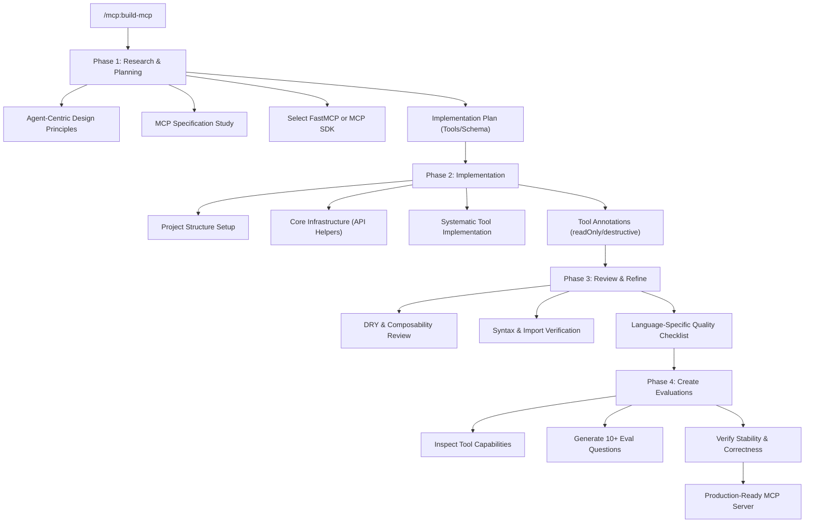
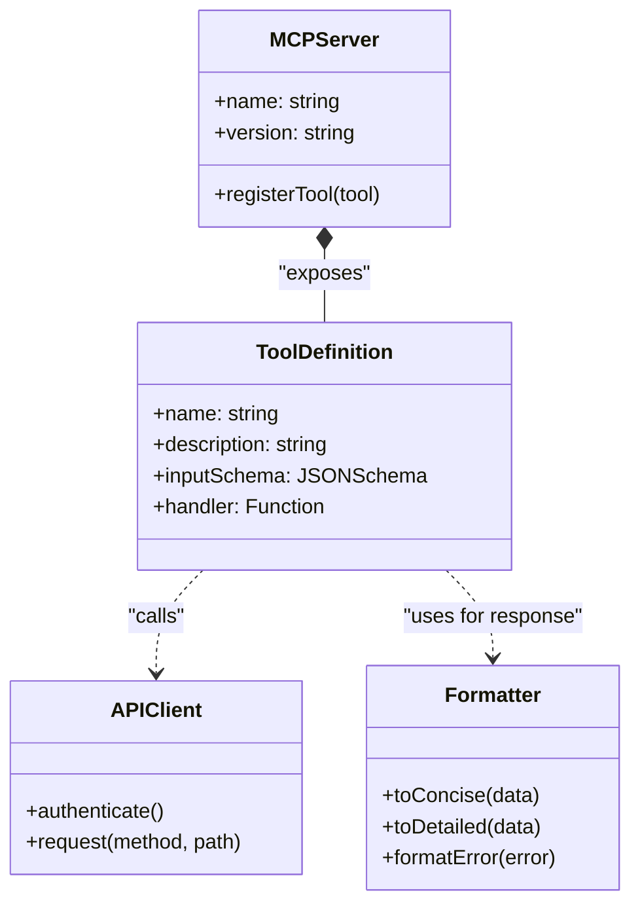
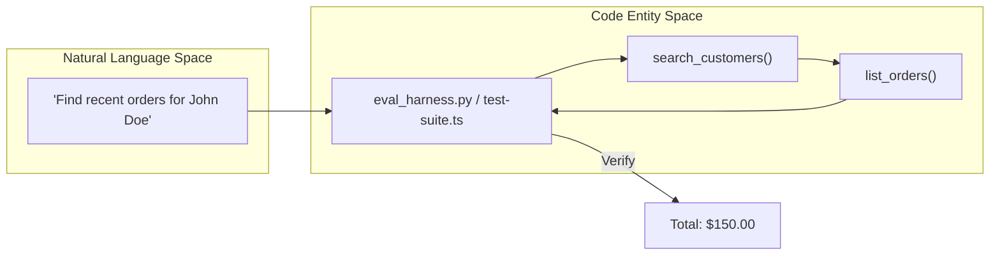

<!-- source: DeepWiki mcp.deepwiki.com · repo neolabhq/context-engineering-kit · page 4.6 Building Custom MCP Servers · fetched 2026-10-27 -->

# Building Custom MCP Servers

Relevant source files

The following files were used as context for generating this wiki page:

- [docs/guides/README.md](docs/guides/README.md)
- [docs/plugins/mcp/README.md](docs/plugins/mcp/README.md)
- [plugins/mcp/.claude-plugin/plugin.json](plugins/mcp/.claude-plugin/plugin.json)
- [plugins/mcp/README.md](plugins/mcp/README.md)

This page documents the development process for creating custom Model Context Protocol (MCP) servers that enable LLMs to interact with external services through well-designed tools. This guide covers the four-phase workflow implemented by the `/mcp:build-mcp` command, design principles for agent-centric tools, and evaluation harness creation.

For setup instructions for existing MCP servers like Context7 and Serena, see [4.2 Context7 MCP Setup]() and [4.3 Serena MCP Setup](). For overall MCP integration concepts, see [4.1 MCP Architecture]().

## Purpose and Use Cases

Custom MCP servers extend LLM capabilities to interact with services and data sources not covered by existing MCP servers. Build a custom MCP server when you need the LLM to:

- Interact with internal company APIs or proprietary services.
- Access databases or data warehouses with domain-specific schemas.
- Integrate with third-party services (CRMs, project management tools).
- Perform specialized operations unique to your domain or workflow.

The `/mcp:build-mcp` command provides structured guidance through server development, from initial design through evaluation creation [docs/plugins/mcp/README.md:19-19](), [plugins/mcp/README.md:19-19]().

Sources: [docs/plugins/mcp/README.md:11-19](), [plugins/mcp/README.md:11-19]()

## Development Workflow Overview

The MCP server development process follows four sequential phases, each building on the previous phase's outputs.

### The Four-Phase Process

**Four-Phase MCP Server Development Process**

Sources: [docs/plugins/mcp/README.md:55-55](), [plugins/mcp/README.md:55-55]()

## Phase 1: Deep Research and Planning

Phase 1 establishes the foundation for a well-designed MCP server by studying agent-centric design principles and selecting appropriate frameworks.

### Agent-Centric Design Principles

Tools must be optimized for LLM consumption rather than just wrapping an API:

| Principle | Description |
|-----------|-------------|
| **Workflow Tools** | Design tools around complete user tasks rather than 1:1 API endpoint mapping. |
| **Context Efficiency** | Provide concise default responses with optional detailed output to save tokens. |
| **Actionable Errors** | Return errors that explicitly tell the LLM what to try next or which parameters to fix. |
| **Natural Subdivisions** | Break complex operations into logical, sequential steps that mirror human workflows. |

### Framework Selection

The command supports two primary implementation paths [docs/plugins/mcp/README.md:19-19]():

1.  **Python with FastMCP**: Recommended for rapid development using decorators and Pydantic models for automatic schema validation.
2.  **TypeScript with MCP SDK**: Recommended for projects requiring strict type safety and Node.js ecosystem integration.

Sources: [docs/plugins/mcp/README.md:9-19](), [plugins/mcp/README.md:9-19]()

## Phase 2: Implementation

Phase 2 focuses on systematic construction of the MCP server, moving from shared infrastructure to individual tool logic.

### Bridging Code Entities to Tool Design

The following diagram maps internal code concepts to the external tool interface exposed to the LLM.

**Code Entity Mapping for MCP Tools**

### Tool Implementation Best Practices

*   **Input Schemas**: Use descriptive field names and include `examples` in the schema so the LLM understands expected formats.
*   **Annotations**: Explicitly mark tools as `readOnly` or `destructive` to help the LLM manage safety and permissions.
*   **Shared Utilities**: Implement a centralized `APIClient` and `Formatter` to ensure consistent behavior across all tools.

Sources: [docs/plugins/mcp/README.md:55-55](), [plugins/mcp/README.md:55-55]()

## Phase 3: Review and Refine

Phase 3 ensures the server is robust and composable.

*   **DRY Review**: Ensure authentication and common error handling are not duplicated across tools.
*   **Composability**: Verify that the output of a "search" tool provides the exact ID required by a "get_details" tool.
*   **Actionable Error Messages**: Test failure states to ensure the LLM receives guidance (e.g., "Customer not found. Try searching by email instead of ID.").

Sources: [docs/plugins/mcp/README.md:11-19]()

## Phase 4: Create Evaluations

Phase 4 creates a verification harness to ensure the server works correctly in real-world agentic workflows.

### Evaluation Workflow

**Bridging User Intent to Code Execution via Evaluations**

### Evaluation Requirements
1.  **Tool Inspection**: Verify the LLM can see all registered tools and their descriptions.
2.  **10+ Complex Questions**: Create a suite of questions that require multi-step tool usage (e.g., "Find the customer, then find their last order, then return the shipping status").
3.  **Stability Check**: Run the evaluations multiple times to ensure non-deterministic LLM behavior doesn't break the integration.

Sources: [docs/plugins/mcp/README.md:19-19](), [plugins/mcp/README.md:19-19]()

## Configuration and Deployment

Once built, the custom server must be registered in the project configuration. The `/mcp:build-mcp` command assists in updating the relevant `CLAUDE.md` files [docs/plugins/mcp/README.md:21-27]().

| Level | File Path | Scope |
|-------|-----------|-------|
| **Project (Shared)** | `./CLAUDE.md` | Shared with the team via Git [docs/plugins/mcp/README.md:23-23]() |
| **Project (Personal)** | `./CLAUDE.local.md` | Local overrides, not tracked in Git [docs/plugins/mcp/README.md:24-24]() |
| **User (Global)** | `~/.claude/CLAUDE.md` | Applies to all projects for this user [docs/plugins/mcp/README.md:25-25]() |

Sources: [docs/plugins/mcp/README.md:21-27](), [plugins/mcp/README.md:21-27]()

---

