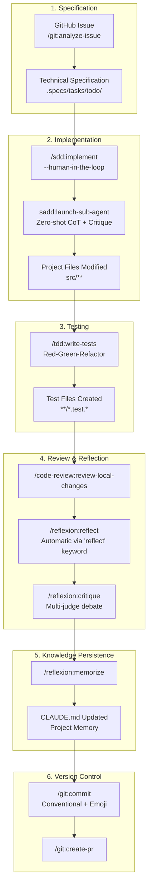
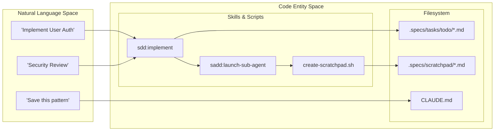

<!-- source: DeepWiki mcp.deepwiki.com · repo neolabhq/context-engineering-kit · page 5.1 Feature Development Workflow · fetched 2026-10-27 -->

# Feature Development Workflow

Relevant source files

The following files were used as context for generating this wiki page:

- [.gitignore](.gitignore)
- [.specs/tasks/roadmap.md](.specs/tasks/roadmap.md)
- [docs/guides/bug-investigation.md](docs/guides/bug-investigation.md)
- [docs/guides/code-quality-improvement.md](docs/guides/code-quality-improvement.md)
- [docs/guides/feature-development.md](docs/guides/feature-development.md)
- [docs/plugins/reflexion/usage-examples.md](docs/plugins/reflexion/usage-examples.md)
- [plugins/sadd/skills/launch-sub-agent/SKILL.md](plugins/sadd/skills/launch-sub-agent/SKILL.md)
- [plugins/sdd/scripts/create-scratchpad.sh](plugins/sdd/scripts/create-scratchpad.sh)
- [plugins/sdd/skills/implement/SKILL.md](plugins/sdd/skills/implement/SKILL.md)
- [plugins/sdd/skills/plan/SKILL.md](plugins/sdd/skills/plan/SKILL.md)

This guide covers the complete workflow for developing standard features using Context Engineering Kit plugins. This workflow is appropriate for straightforward features where requirements are clear and complexity is manageable.

**For more complex features requiring detailed planning and specifications**, see [Spec-Driven Development Workflow](#5.2). For investigating and fixing bugs, see [Bug Investigation & Root Cause Analysis](#5.3).

## Purpose and Scope

The Feature Development Workflow provides a quality-gated approach to building features through six stages:

1.  **Specification** - Define what to build.
2.  **Implementation** - Write the code with optional sub-agent orchestration.
3.  **Testing** - Add test coverage via TDD.
4.  **Review** - Multi-agent quality analysis.
5.  **Reflection** - Self-refinement and knowledge capture.
6.  **Commit** - Version control with conventional standards.

This workflow balances velocity with quality by using specialized agents and reflection loops to catch issues early while maintaining development speed.

Sources: [docs/guides/feature-development.md:1-21](), [docs/guides/bug-investigation.md:5-5]()

## Workflow Architecture

The workflow transitions from high-level natural language requirements to specific code entities and validated artifacts.

### Process Flow Diagram

Sources: [docs/guides/feature-development.md:25-65](), [plugins/sdd/skills/implement/SKILL.md:1-35](), [plugins/sadd/skills/launch-sub-agent/SKILL.md:1-11]()

### Code Entity Mapping
This diagram bridges Natural Language concepts to the specific code identifiers and file structures used in the kit.

Sources: [plugins/sdd/scripts/create-scratchpad.sh:1-44](), [plugins/sdd/skills/implement/SKILL.md:21-35](), [plugins/sadd/skills/launch-sub-agent/SKILL.md:1-11]()

## Implementation Phase Detail

Standard implementation can be enhanced using the `sdd:implement` skill or the `sadd:launch-sub-agent` for isolated tasks.

### Using sdd:implement
This command executes implementation steps with automated quality verification.

*   **Refine Mode (`--refine`)**: Detects changes in project files via `git diff HEAD --name-only` and maps them to implementation steps to determine what needs re-verification [plugins/sdd/skills/implement/SKILL.md:84-112]().
*   **Human-in-the-loop (`--human-in-the-loop`)**: Pauses for manual verification after specific steps [plugins/sdd/skills/implement/SKILL.md:32-32]().
*   **Quality Gates**: Uses `LLM-as-Judge` to verify artifacts against a `--target-quality` threshold (default 4.0) [plugins/sdd/skills/implement/SKILL.md:33-33]().

### Using Sub-Agents
For focused sub-tasks, `sadd:launch-sub-agent` provides context isolation.

1.  **Model Selection**: Automatically selects between `opus` (complex reasoning), `sonnet` (long output), or `haiku` (simple tasks) [plugins/sadd/skills/launch-sub-agent/SKILL.md:57-68]().
2.  **Specialized Agent Matching**: Incorporates prompts for roles like `sdd:developer` or `sdd:software-architect` [plugins/sadd/skills/launch-sub-agent/SKILL.md:91-97]().
3.  **Mandatory Loops**: Every sub-agent is dispatched with a **Zero-shot Chain-of-Thought** prefix and a **Self-Critique** suffix [plugins/sadd/skills/launch-sub-agent/SKILL.md:115-173]().

Sources: [plugins/sdd/skills/implement/SKILL.md:1-148](), [plugins/sadd/skills/launch-sub-agent/SKILL.md:1-173]()

## Review and Reflection Phase

The kit emphasizes iterative refinement before code is committed.

### Automated Reflection
Users can trigger automatic reflection by appending "reflect" to their natural language prompts [docs/plugins/reflexion/usage-examples.md:7-13]().
*   **Action**: Claude implements the feature, then automatically runs `/reflexion:reflect` to review and fix issues [docs/plugins/reflexion/usage-examples.md:15-19]().

### Knowledge Persistence
The `/reflexion:memorize` command captures patterns discovered during development and appends them to `CLAUDE.md` [docs/guides/feature-development.md:110-124]().
*   **Purpose**: Builds "institutional knowledge" to prevent recurring bugs [docs/guides/bug-investigation.md:132-140]().
*   **Structure**: Insights are categorized into sections like "Development Guidelines" or "Architecture Decisions" [docs/plugins/reflexion/usage-examples.md:135-148]().

Sources: [docs/plugins/reflexion/usage-examples.md:1-150](), [docs/guides/feature-development.md:110-124]()

## Workflow Integration Table

| Phase | Primary Command | Code Entity / Script | Key Output |
| :--- | :--- | :--- | :--- |
| **Plan** | `/sdd:plan` | `plugins/sdd/skills/plan` | `.specs/tasks/todo/*.md` |
| **Think** | N/A | `plugins/sdd/scripts/create-scratchpad.sh` | `.specs/scratchpad/[hex].md` |
| **Implement** | `/sdd:implement` | `plugins/sdd/skills/implement` | Feature Code + `[DONE]` markers |
| **Verify** | `/code-review:review-local-changes` | `plugins/code-review` | Severity-ranked findings |
| **Refine** | `/reflexion:reflect` | `plugins/reflexion` | Self-corrected implementation |
| **Persist** | `/reflexion:memorize` | `plugins/reflexion` | `CLAUDE.md` updates |

Sources: [plugins/sdd/skills/plan/SKILL.md:1-25](), [plugins/sdd/scripts/create-scratchpad.sh:33-44](), [plugins/sdd/skills/implement/SKILL.md:72-78](), [docs/guides/feature-development.md:100-116]()

## Best Practices

1.  **Scratchpad Usage**: Use `create-scratchpad.sh` to generate a random 8-character hex ID file for structured thinking. Access these only via Read/Write tools, never via shell commands like `cat` or `echo` [plugins/sdd/scripts/create-scratchpad.sh:33-44]().
2.  **Refine Mode**: Use `--refine` in both planning and implementation to incrementally update work based on git diffs without re-running the entire workflow [plugins/sdd/skills/plan/SKILL.md:111-127](), [plugins/sdd/skills/implement/SKILL.md:84-112]().
3.  **Quality Thresholds**: For critical components, set `--target-quality 4.5` to enforce stricter LLM-as-Judge validation [plugins/sdd/skills/implement/SKILL.md:33-54]().

Sources: [plugins/sdd/scripts/create-scratchpad.sh:1-44](), [plugins/sdd/skills/plan/SKILL.md:111-127](), [plugins/sdd/skills/implement/SKILL.md:33-54]()

---

