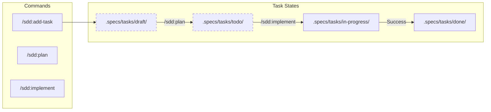
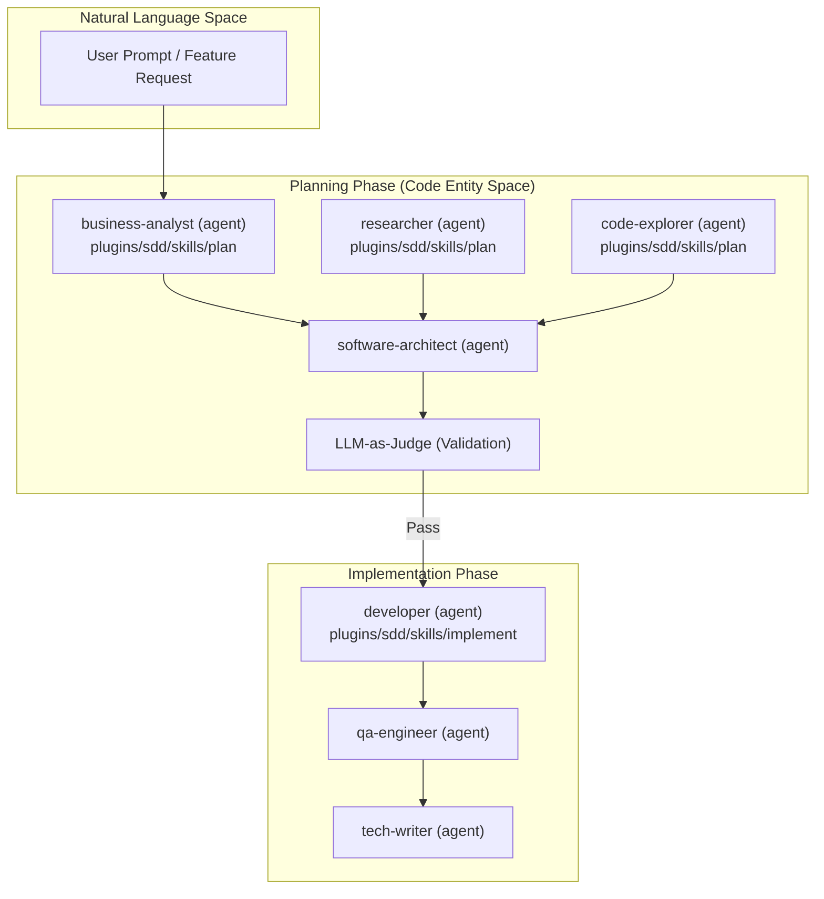

<!-- source: DeepWiki mcp.deepwiki.com · repo neolabhq/context-engineering-kit · page 5.2 Spec-Driven Development Workflow · fetched 2026-10-27 -->

# Spec-Driven Development Workflow

<details>
<summary>Relevant source files</summary>

The following files were used as context for generating this wiki page:

- [.gitignore](.gitignore)
- [.specs/tasks/roadmap.md](.specs/tasks/roadmap.md)
- [docs/guides/brainstorming-to-implementation.md](docs/guides/brainstorming-to-implementation.md)
- [docs/guides/competitivy-generation.md](docs/guides/competitivy-generation.md)
- [docs/guides/decision-making.md](docs/guides/decision-making.md)
- [docs/guides/project-setup.md](docs/guides/project-setup.md)
- [docs/guides/spec-driven-development.md](docs/guides/spec-driven-development.md)
- [docs/plugins/sdd/README.md](docs/plugins/sdd/README.md)
- [docs/plugins/sdd/add-task.md](docs/plugins/sdd/add-task.md)
- [docs/plugins/sdd/customization.md](docs/plugins/sdd/customization.md)
- [docs/plugins/sdd/implement.md](docs/plugins/sdd/implement.md)
- [docs/plugins/sdd/plan.md](docs/plugins/sdd/plan.md)
- [docs/plugins/sdd/refine.md](docs/plugins/sdd/refine.md)
- [docs/plugins/sdd/usage-examples.md](docs/plugins/sdd/usage-examples.md)
- [plugins/sadd/skills/launch-sub-agent/SKILL.md](plugins/sadd/skills/launch-sub-agent/SKILL.md)
- [plugins/sdd/scripts/create-scratchpad.sh](plugins/sdd/scripts/create-scratchpad.sh)
- [plugins/sdd/skills/implement/SKILL.md](plugins/sdd/skills/implement/SKILL.md)
- [plugins/sdd/skills/plan/SKILL.md](plugins/sdd/skills/plan/SKILL.md)

</details>


## Purpose and Scope

This guide documents the complete workflow for developing complex features using the Spec-Driven Development (SDD) plugin. SDD implements a structured methodology that transforms natural language prompts into production-ready implementations through multi-agent orchestration, architectural synthesis, and quality-gated execution [docs/plugins/sdd/README.md:1-5]().

**When to use this workflow:**
- Complex features requiring significant architectural changes [docs/guides/spec-driven-development.md:7-10]().
- Large codebases where impact analysis is critical [docs/plugins/sdd/README.md:14-14]().
- Scenarios where reliability and "compilation-like" reproducibility are required [docs/plugins/sdd/README.md:9-10]().

For simpler features, see the standard feature development workflow. For brainstorming vague ideas before specification, see the [Brainstorming to Implementation](#brainstorming-to-implementation) section.

## Core Workflow Overview

The SDD workflow follows a rigorous task lifecycle: `draft` → `todo` → `in-progress` → `done` [docs/plugins/sdd/README.md:72-77]().

### Task Lifecycle and Commands


Sources: [docs/plugins/sdd/README.md:53-77](), [docs/plugins/sdd/add-task.md:66-76]()

### Agent Orchestration Architecture

The SDD plugin uses a "Model-as-Judge" pattern where an orchestrator (typically `sonnet`) launches specialized agents (often `opus`) to perform work, followed by validation agents to verify quality [docs/guides/spec-driven-development.md:21-24]().


Sources: [docs/plugins/sdd/README.md:94-107](), [plugins/sdd/skills/plan/SKILL.md:56-64](), [docs/guides/spec-driven-development.md:50-116]()

## Phase 1: Setup and Task Creation (`/sdd:add-task`)

The process begins by capturing user intent into a structured markdown file with metadata [docs/plugins/sdd/add-task.md:1-6]().

**Key Functions:**
- **Classification:** Automatically detects task type (`feature`, `bug`, `refactor`, etc.) [docs/plugins/sdd/add-task.md:81-91]().
- **Dependency Tracking:** Links the new task to existing task files using the `depends_on` frontmatter [docs/plugins/sdd/add-task.md:106-110]().
- **Directory Management:** Ensures the `.specs/tasks/` hierarchy exists [docs/plugins/sdd/add-task.md:66-76]().

**Command:**
```bash
/sdd:add-task "Implement JWT authentication middleware"
```
Sources: [docs/plugins/sdd/add-task.md:8-10](), [docs/plugins/sdd/README.md:33-34]()

## Phase 2: Refinement and Planning (`/sdd:plan`)

This phase transforms a draft into a complete specification through parallel analysis and synthesis [plugins/sdd/skills/plan/SKILL.md:15-22]().

### Planning Stages
1.  **Parallel Analysis (Phase 2a-c):**
    *   `researcher`: Gathers library docs and best practices [plugins/sdd/skills/plan/SKILL.md:58]().
    *   `code-explorer`: Identifies affected files and integration points [plugins/sdd/skills/plan/SKILL.md:59]().
    *   `business-analyst`: Refines acceptance criteria [plugins/sdd/skills/plan/SKILL.md:60]().
2.  **Architecture Synthesis (Phase 3):** `software-architect` combines analysis into a solution strategy [plugins/sdd/skills/plan/SKILL.md:61]().
3.  **Decomposition (Phase 4):** `tech-lead` breaks the design into implementation steps with risks [plugins/sdd/skills/plan/SKILL.md:62]().
4.  **Parallelization (Phase 5):** `team-lead` reorganizes steps for parallel execution [plugins/sdd/skills/plan/SKILL.md:63]().
5.  **Verifications (Phase 6):** `qa-engineer` adds LLM-as-Judge rubrics for each step [plugins/sdd/skills/plan/SKILL.md:64]().

### Refine Mode (`--refine`)
If the user manually edits the task file (e.g., changing the architecture), running `/sdd:plan --refine` triggers a top-to-bottom propagation. The agent detects the earliest modified section via `git diff` and re-runs only the affected subsequent stages [plugins/sdd/skills/plan/SKILL.md:111-137]().

Sources: [plugins/sdd/skills/plan/SKILL.md:1-152](), [docs/plugins/sdd/plan.md:1-138]()

## Phase 3: Implementation (`/sdd:implement`)

Implementation is an iterative process where steps are executed by a `developer` agent and verified by `judge` agents [plugins/sdd/skills/implement/SKILL.md:7-11]().

### Implementation Logic
For each step defined in the task file:
1.  **Execution:** The `developer` agent implements the code [docs/plugins/sdd/implement.md:119]().
2.  **Verification Levels:**
    *   **None:** For simple operations like directory creation [docs/plugins/sdd/implement.md:115-120]().
    *   **Single Judge:** One evaluation agent (Target Quality ~4.0) [docs/plugins/sdd/implement.md:164]().
    *   **Panel of 2:** Parallel evaluation for critical artifacts (Target Quality ~4.5) [docs/plugins/sdd/implement.md:122-129]().
3.  **Fix Loop:** If a judge fails, the `developer` agent receives feedback and retries (default max 3 iterations) [plugins/sdd/skills/implement/SKILL.md:34](), [docs/plugins/sdd/implement.md:18]().

### Project Refine Mode
Running `/sdd:implement --refine` maps manual changes in the **codebase** back to implementation steps. It identifies the earliest affected step and re-verifies all subsequent steps to ensure manual fixes didn't break planned logic [plugins/sdd/skills/implement/SKILL.md:84-133]().

Sources: [plugins/sdd/skills/implement/SKILL.md:1-148](), [docs/plugins/sdd/implement.md:1-157]()

## Data Flow and Artifacts

The SDD workflow generates several hidden and visible artifacts to maintain state and provide reasoning trails.

| Artifact Path | Purpose | Persistence |
| :--- | :--- | :--- |
| `.specs/tasks/` | Main task specifications (Draft/Todo/Done) | Permanent |
| `.specs/analysis/` | Detailed codebase and research reports | Permanent |
| `.specs/scratchpad/` | Temporary files for agent "chain-of-thought" | Gitignored [plugins/sdd/scripts/create-scratchpad.sh:15-28]() |
| `.claude/skills/` | Task-specific skills generated during research | Permanent [docs/plugins/sdd/README.md:58-59]() |

### Scratchpad Integration
Agents use a specialized script `plugins/sdd/scripts/create-scratchpad.sh` to generate random hex-ID markdown files in `.specs/scratchpad/` [plugins/sdd/scripts/create-scratchpad.sh:1-44](). These are used for structured thinking and are excluded from version control to prevent repository bloat [.gitignore:145-147]().

Sources: [plugins/sdd/scripts/create-scratchpad.sh:1-44](), [docs/plugins/sdd/README.md:57-61](), [.gitignore:145-147]()

## Advanced Workflow: Brainstorming to Implementation

For vague requirements, the workflow begins with collaborative dialogue before entering the SDD pipeline [docs/guides/brainstorming-to-implementation.md:1-5]().

1.  **`/sdd:brainstorm`**: A Q&A session where the LLM asks clarifying questions one at a time to refine the goal [docs/guides/brainstorming-to-implementation.md:60-75]().
2.  **Approach Exploration**: The LLM proposes 2-3 options with trade-offs (e.g., Elasticsearch vs PostgreSQL Search) [docs/guides/brainstorming-to-implementation.md:76-96]().
3.  **Design Presentation**: Validated designs are saved to `docs/plans/` before being converted to SDD tasks [docs/guides/brainstorming-to-implementation.md:126-140]().

Sources: [docs/guides/brainstorming-to-implementation.md:1-180]()

## Customization and Quality Gates

The SDD plugin allows balancing speed vs. quality through command flags:

-   **`--target-quality`**: Sets the threshold (0.0-5.0) for judge pass/fail decisions. Default is 3.5 for planning and 4.0 for implementation [plugins/sdd/skills/plan/SKILL.md:44](), [plugins/sdd/skills/implement/SKILL.md:33]().
-   **`--max-iterations`**: Limits the fix-verify cycles. Default is 3 [plugins/sdd/skills/plan/SKILL.md:45](), [plugins/sdd/skills/implement/SKILL.md:34]().
-   **`--fast`**: A preset for rapid development (`--target-quality 3.0 --max-iterations 1`) [plugins/sdd/skills/plan/SKILL.md:48]().
-   **`--human-in-the-loop`**: Pauses the process after specific phases or steps for manual review [plugins/sdd/skills/plan/SKILL.md:50](), [plugins/sdd/skills/implement/SKILL.md:32]().

Sources: [docs/plugins/sdd/customization.md:1-24](), [plugins/sdd/skills/plan/SKILL.md:38-53]()

---

