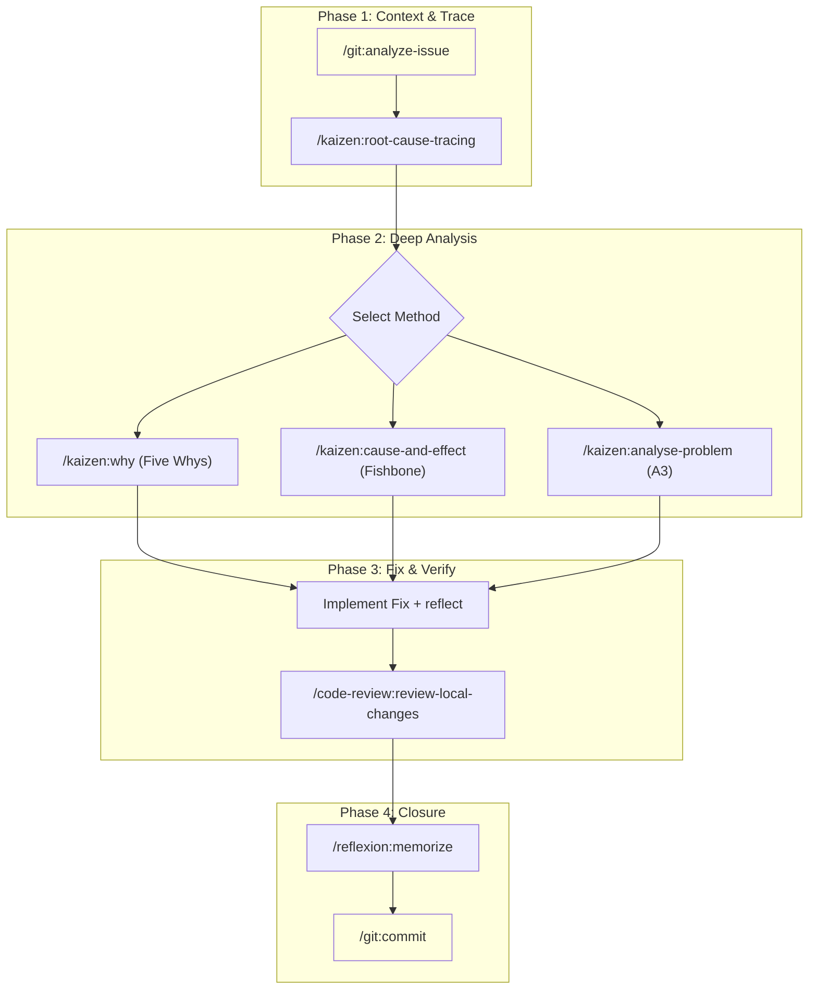

<!-- source: DeepWiki mcp.deepwiki.com · repo neolabhq/context-engineering-kit · page 5.3 Bug Investigation & Root Cause Analysis · fetched 2026-10-27 -->

# Bug Investigation & Root Cause Analysis

<details>
<summary>Relevant source files</summary>

The following files were used as context for generating this wiki page:

- [docs/guides/bug-investigation.md](docs/guides/bug-investigation.md)
- [docs/guides/code-quality-improvement.md](docs/guides/code-quality-improvement.md)
- [docs/guides/feature-development.md](docs/guides/feature-development.md)
- [docs/plugins/reflexion/usage-examples.md](docs/plugins/reflexion/usage-examples.md)
- [plugins/kaizen/skills/kaizen/SKILL.md](plugins/kaizen/skills/kaizen/SKILL.md)

</details>


Systematic bug fixing with root cause analysis using Kaizen methodology to eliminate problems at their source. Instead of fixing symptoms, this workflow helps identify and address fundamental causes, preventing entire classes of issues from recurring.

**Scope**: This page covers bug investigation, root cause identification, and systematic fixes. For proactive quality improvements and technical debt reduction, see [Code Quality Improvement](./code-quality-improvement.md). For simple, obvious bugs (typos, single-line fixes), use the [Feature Development](./feature-development.md) workflow.

Sources: [docs/guides/bug-investigation.md:1-5](), [plugins/kaizen/skills/kaizen/SKILL.md:6-14]()

## Purpose and Philosophy

Traditional bug fixing addresses visible symptoms without understanding why problems occur. Kaizen methodology, derived from continuous improvement principles, provides systematic techniques to trace bugs to their root causes. The core principle is that many small improvements beat one big change, and quality is achieved through incremental progress and prevention.

The workflow integrates multiple plugins:
- **Kaizen Plugin**: Root cause analysis and problem documentation via `/kaizen:why`, `/kaizen:root-cause-tracing`, and `/kaizen:cause-and-effect`.
- **Git Plugin**: Issue analysis via `/git:analyze-issue` and conventional commits via `/git:commit`.
- **Code Review Plugin**: Multi-agent verification via `/code-review:review-local-changes`.
- **Reflexion Plugin**: Learning from bugs via `/reflexion:memorize` and `/reflexion:reflect`.

Sources: [plugins/kaizen/skills/kaizen/SKILL.md:27-55](), [docs/guides/bug-investigation.md:14-19](), [docs/guides/bug-investigation.md:74-83]()

## Investigation Workflow Overview



**Workflow Steps**:
1.  **Load Issue Context**: Use `/git:analyze-issue` to extract symptoms and reproduction steps from GitHub [docs/guides/bug-investigation.md:74-83]().
2.  **Trace Root Cause**: Use `/kaizen:root-cause-tracing` to follow the call stack backward from symptom to origin [docs/guides/bug-investigation.md:84-93]().
3.  **Deep Analysis**: Use `/kaizen:why` to find systemic reasons (missing tests, architectural gaps) [docs/guides/bug-investigation.md:94-103]().
4.  **Implement Fix**: Address the root cause. Adding `reflect` to the prompt triggers automatic verification [docs/guides/bug-investigation.md:104-121]().
5.  **Review**: Run `/code-review:review-local-changes` to catch new edge cases or regression gaps [docs/guides/bug-investigation.md:122-131]().
6.  **Preserve Learnings**: Use `/reflexion:memorize` to update `CLAUDE.md` with the bug pattern [docs/guides/bug-investigation.md:132-141]().
7.  **Commit**: Finalize with `/git:commit` to link the fix to the issue [docs/guides/bug-investigation.md:142-151]().

Sources: [docs/guides/bug-investigation.md:21-72](), [docs/guides/bug-investigation.md:74-151]()

## Method Selection Criteria

| Bug Characteristic | Recommended Method | Command |
| :--- | :--- | :--- |
| **Unclear Origin** | Root Cause Tracing | `/kaizen:root-cause-tracing` |
| **Systemic/Recurring** | Five Whys | `/kaizen:why` |
| **Multi-factor/Complex** | Fishbone Analysis | `/kaizen:cause-and-effect` |
| **Major Incident** | A3 Problem Summary | `/kaizen:analyse-problem` |
| **Hypothesis Testing** | PDCA Cycle | `/kaizen:plan-do-check-act` |

Sources: [docs/guides/bug-investigation.md:152-180]()

## Implementation: Poka-Yoke (Error Proofing)

When implementing fixes, the Kaizen philosophy emphasizes **Poka-Yoke**: designing systems that prevent errors at compile/design time rather than runtime.

### Type System Error Proofing
Instead of checking values at runtime, use the type system to make invalid states unrepresentable.

```typescript
// From plugins/kaizen/skills/kaizen/SKILL.md:171-182
// Good: Only valid states possible
type OrderStatus = 'pending' | 'processing' | 'shipped' | 'delivered';

// Better: States with associated data
type Order =
  | { status: 'pending'; createdAt: Date }
  | { status: 'processing'; startedAt: Date; estimatedCompletion: Date }
  | { status: 'shipped'; trackingNumber: string; shippedAt: Date }
  | { status: 'delivered'; deliveredAt: Date; signature: string };

// Now impossible to have 'shipped' without a trackingNumber
```

### Validation at Boundaries
Use branded types to validate data once at the system boundary (e.g., API request) so internal functions can trust the data without re-validation.

```typescript
// From plugins/kaizen/skills/kaizen/SKILL.md:234-245
type PositiveNumber = number & { readonly __brand: 'PositiveNumber' };

const validatePositive = (n: number): PositiveNumber => {
  if (n <= 0) throw new Error('Must be positive');
  return n as PositiveNumber;
};

const processPayment = (amount: PositiveNumber) => {
  // amount is guaranteed positive by the type system
  const fee = amount * 0.03;
};
```

Sources: [plugins/kaizen/skills/kaizen/SKILL.md:133-160](), [plugins/kaizen/skills/kaizen/SKILL.md:170-207](), [plugins/kaizen/skills/kaizen/SKILL.md:211-252]()

## Learning and Memory (Reflexion)

A critical step in bug investigation is the "Act" phase of PDCA: standardizing the fix and memorizing the pattern to prevent recurrence.

### The Memorization Loop
1.  **Identify Pattern**: During reflection or critique, identify why the bug was non-obvious.
2.  **Command**: Run `/reflexion:memorize "Root cause patterns for [Issue]"` [docs/guides/bug-investigation.md:132-141]().
3.  **Persistence**: The agent updates `CLAUDE.md` with specific development guidelines [docs/plugins/reflexion/usage-examples.md:135-148]().

### Example: API Optimization Memory
If a bug investigation revealed that synchronous third-party calls were causing timeouts, the following would be added to `CLAUDE.md`:

```markdown
## Development Guidelines
### API Integration Patterns
- For third-party API calls (Stripe, etc.) taking >500ms:
  - Move to background job queue
  - Return immediate response with job ID
```

Sources: [docs/plugins/reflexion/usage-examples.md:104-148](), [docs/guides/bug-investigation.md:132-141]()

## Summary of Analysis Commands

| Command | Technical Purpose |
| :--- | :--- |
| `/kaizen:why` | Drill from symptoms to fundamental causes through iterative questioning [docs/guides/bug-investigation.md:94-103](). |
| `/kaizen:root-cause-tracing` | Systematically trace backward through the call stack to identify the origin of invalid data [docs/guides/bug-investigation.md:84-93](). |
| `/kaizen:cause-and-effect` | Fishbone analysis exploring causes across People, Process, Technology, Environment, Methods, and Materials [docs/guides/bug-investigation.md:156-162](). |
| `/kaizen:plan-do-check-act` | Structured improvement plan with measurable success criteria for testing hypotheses [docs/guides/bug-investigation.md:172-179](). |
| `/kaizen:analyse-problem` | A3 analysis for a one-page problem summary with root cause and action plan [docs/guides/bug-investigation.md:164-170](). |

Sources: [docs/guides/bug-investigation.md:84-180](), [plugins/kaizen/skills/kaizen/SKILL.md:1-25]()

---

