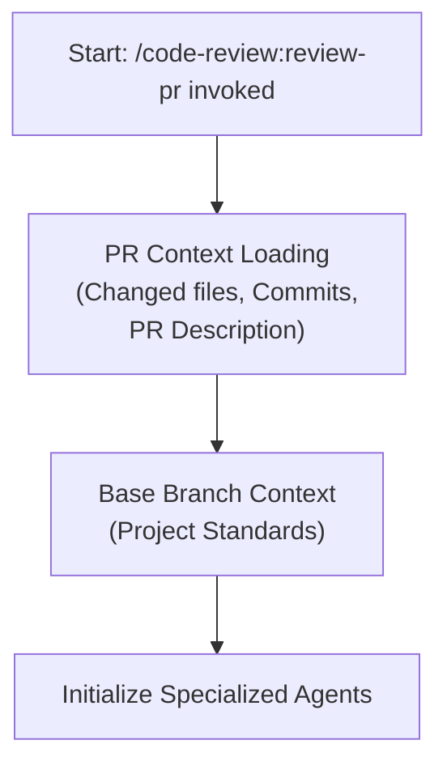
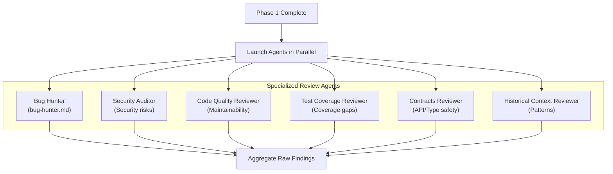
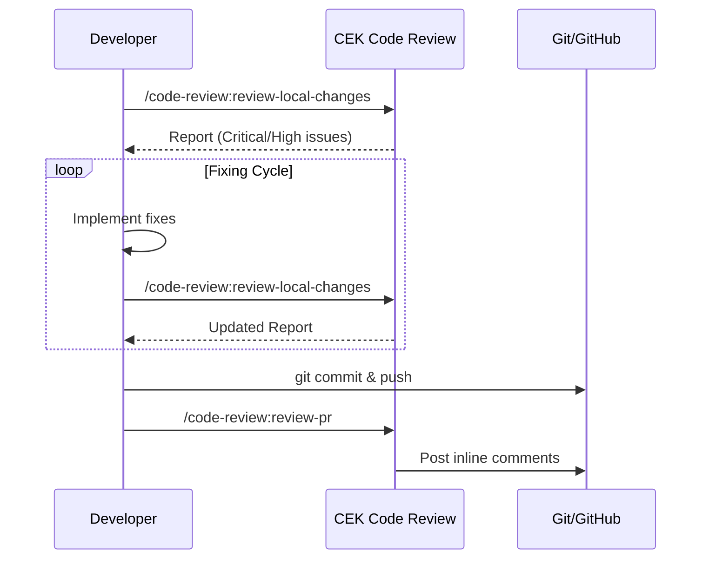

<!-- source: DeepWiki mcp.deepwiki.com · repo neolabhq/context-engineering-kit · page 5.4 PR Review Workflow · fetched 2026-10-27 -->

# PR Review Workflow

<details>
<summary>Relevant source files</summary>

The following files were used as context for generating this wiki page:

- [.cursor/worktrees.json](.cursor/worktrees.json)
- [docs/plugins/code-review/README.md](docs/plugins/code-review/README.md)
- [docs/plugins/code-review/review-local-changes.md](docs/plugins/code-review/review-local-changes.md)
- [docs/plugins/code-review/review-pr.md](docs/plugins/code-review/review-pr.md)
- [docs/plugins/code-review/usage-examples.md](docs/plugins/code-review/usage-examples.md)
- [docs/plugins/customaize-agent/agent-evaluation.md](docs/plugins/customaize-agent/agent-evaluation.md)
- [docs/plugins/customaize-agent/apply-anthropic-skill-best-practices.md](docs/plugins/customaize-agent/apply-anthropic-skill-best-practices.md)
- [docs/plugins/customaize-agent/context-engineering.md](docs/plugins/customaize-agent/context-engineering.md)
- [plugins/code-review/.claude-plugin/plugin.json](plugins/code-review/.claude-plugin/plugin.json)
- [plugins/code-review/agents/bug-hunter.md](plugins/code-review/agents/bug-hunter.md)

</details>


This document describes the comprehensive pull request review workflow using the Code Review plugin's multi-agent system. The workflow involves three phases: preparation, issue detection, and confidence scoring, followed by iterative fixing and re-review cycles.

**Related workflows**: For automated PR reviews in CI/CD pipelines, see [CI/CD Integration](#5.5). For pre-commit local review, use `/code-review:review-local-changes` as described in [Feature Development Workflow](#5.1). For systematic quality improvement after review findings, see [Code Quality Improvement](#5.6).

## Overview

The PR review workflow executes comprehensive code analysis by spawning up to six specialized agents that examine pull request changes from different perspectives. The `/code-review:review-pr` command orchestrates this multi-agent system, applies confidence and impact scoring to filter findings, and posts structured review comments directly to GitHub.

**Key capabilities**:
- **Multi-perspective analysis**: Six specialized agents (Bug Hunter, Security Auditor, etc.) examine code from different angles [docs/plugins/code-review/README.md:7-14]().
- **Progressive threshold filtering**: Issues are filtered based on a combination of confidence and impact scores [docs/plugins/code-review/review-pr.md:45-52]().
- **Line-specific inline comments**: High-confidence, high-value comments are posted directly on PR lines to minimize noise [docs/plugins/code-review/review-pr.md:3-6]().
- **Integration**: Works with GitHub via the Model Context Protocol (MCP) or standard CLI tools [docs/plugins/code-review/README.md:197-198]().

**Command syntax**:
```bash
/code-review:review-pr [review-aspects] [--min-impact critical|high|medium|medium-low|low]
```

Sources: [docs/plugins/code-review/README.md:1-14](), [docs/plugins/code-review/review-pr.md:1-10]()

## Three-Phase Review Architecture

The review process executes three sequential phases that progressively refine findings from initial detection through confidence scoring to final posting.

### Phase 1: Preparation & Context Loading

Before analysis begins, the system gathers the necessary context to understand the scope of the changes.



**Preparation phase steps**:
1. **PR Context Loading**: Fetches PR details including changed files, commit messages, and the PR description [docs/plugins/code-review/review-pr.md:35-38]().
2. **Base Branch Context**: Analyzes the base branch to understand the architectural patterns and existing standards [docs/plugins/code-review/review-pr.md:39-39]().
3. **Change Detection**: Identifies staged and unstaged modifications if reviewing local changes [docs/plugins/code-review/review-local-changes.md:32-35]().

Sources: [docs/plugins/code-review/review-pr.md:33-40](), [docs/plugins/code-review/review-local-changes.md:30-36]()

### Phase 2: Parallel Agent Analysis

The system spawns six specialized agents simultaneously to analyze the diff from their unique focus areas.



**Agent Specializations**:
- **Bug Hunter**: Uses systematic root cause analysis to find logic errors, race conditions, and unhandled cases [plugins/code-review/agents/bug-hunter.md:7-17]().
- **Security Auditor**: Scans for SQL injection, XSS, CSRF, and insecure cryptography [docs/plugins/code-review/README.md:82-92]().
- **Test Coverage Reviewer**: Evaluates missing edge case tests and integration needs [docs/plugins/code-review/README.md:94-102]().
- **Code Quality Reviewer**: Assesses complexity, naming conventions, and code smells [docs/plugins/code-review/README.md:104-114]().
- **Contracts Reviewer**: Reviews API endpoint definitions, breaking changes, and type safety [docs/plugins/code-review/README.md:116-125]().
- **Historical Context Reviewer**: Analyzes consistency with existing patterns and architectural drift [docs/plugins/code-review/README.md:126-135]().

Sources: [docs/plugins/code-review/README.md:68-135](), [plugins/code-review/agents/bug-hunter.md:1-17](), [docs/plugins/code-review/review-local-changes.md:37-44]()

### Phase 3: Confidence & Impact Scoring

Raw findings are filtered to ensure only high-value, high-confidence issues are reported to the developer.

**Scoring Dimensions**:
- **Confidence (0-100)**: Probability that the finding is a real issue rather than a false positive [docs/plugins/code-review/review-pr.md:46-46]().
- **Impact (0-100)**: Severity of the consequence if the issue remains unfixed [docs/plugins/code-review/review-pr.md:47-47]().

**Progressive Threshold Filtering**:
The system requires higher confidence for lower-impact issues to maintain a high signal-to-noise ratio.

| Impact Level | Score Range | Min Confidence Required |
|--------------|-------------|-------------------------|
| **Critical** | 81-100 | 50% |
| **High** | 61-80 | 65% |
| **Medium** | 41-60 | 75% |
| **Medium-Low** | 21-40 | 85% |
| **Low** | 0-20 | 95% |

Sources: [docs/plugins/code-review/review-pr.md:23-31](), [docs/plugins/code-review/review-pr.md:45-54](), [docs/plugins/code-review/review-local-changes.md:51-53]()

## Output Formats

The review results are presented differently depending on whether the review is for local changes or a remote Pull Request.

### Local Review (`review-local-changes`)
Produces a structured report organized by severity, including an executive summary and specific action items [docs/plugins/code-review/README.md:202-227](). If the `--json` flag is used, it outputs a machine-readable object containing a `quality_gate` status ("PASS" or "FAIL") [docs/plugins/code-review/review-local-changes.md:82-88]().

### PR Review (`review-pr`)
Posts inline comments directly to GitHub using the following format:
```markdown
🔴/🟠/🟡 [Severity]: [Description]

[Evidence: Observation and consequence]
[Suggested Fix]
```
No overall summary report is posted to the PR to minimize noise; only specific line-level issues are highlighted [docs/plugins/code-review/review-pr.md:3-6]().

Sources: [docs/plugins/code-review/README.md:202-238](), [docs/plugins/code-review/review-local-changes.md:80-88]()

## Iterative Fix Workflow

The review process is designed to be iterative, allowing developers to fix issues locally before pushing to the remote repository.



**Best Practices**:
1. **Review before committing**: Always run `/code-review:review-local-changes` before `git commit` [docs/plugins/code-review/review-local-changes.md:91-91]().
2. **Prioritize Severity**: Address Critical and High findings immediately [docs/plugins/code-review/review-local-changes.md:92-92]().
3. **Verify with Reflexion**: After fixing, use `/reflexion:memorize` to save successful patterns to `CLAUDE.md` for future sessions [docs/plugins/code-review/review-local-changes.md:94-94]().

Sources: [docs/plugins/code-review/review-local-changes.md:89-95](), [docs/plugins/code-review/usage-examples.md:7-41]()

## CI/CD Integration

The workflow can be automated using the `anthropics/claude-code-action`. This allows the multi-agent review to run automatically on PR events (opened, synchronized, etc.) [docs/plugins/code-review/README.md:143-154]().

**Required Tools for CI Review**:
To function correctly in a CI environment, the action must be granted specific tool permissions, including `mcp__github_inline_comment__create_inline_comment` and various `gh pr` commands [docs/plugins/code-review/README.md:197-198]().

Sources: [docs/plugins/code-review/README.md:136-198]()

---

