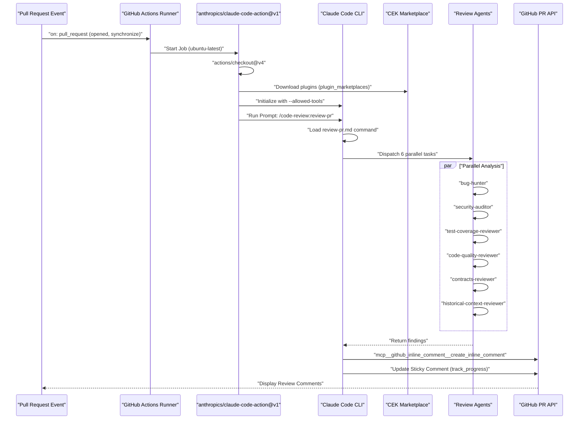
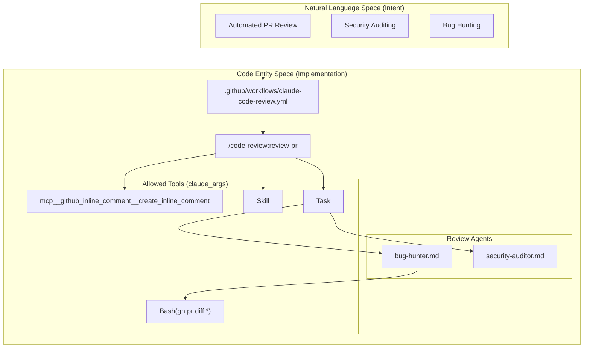

<!-- source: DeepWiki mcp.deepwiki.com · repo neolabhq/context-engineering-kit · page 5.5 CI/CD Integration · fetched 2026-10-27 -->

# CI/CD Integration

<details>
<summary>Relevant source files</summary>

The following files were used as context for generating this wiki page:

- [.cursor/worktrees.json](.cursor/worktrees.json)
- [docs/guides/ci-integration.md](docs/guides/ci-integration.md)
- [docs/plugins/reflexion/README.md](docs/plugins/reflexion/README.md)
- [docs/plugins/sadd/README.md](docs/plugins/sadd/README.md)
- [docs/resources/papers.md](docs/resources/papers.md)
- [plugins/code-review/README.md](plugins/code-review/README.md)
- [plugins/code-review/agents/bug-hunter.md](plugins/code-review/agents/bug-hunter.md)
- [plugins/reflexion/README.md](plugins/reflexion/README.md)
- [plugins/sadd/README.md](plugins/sadd/README.md)
- [plugins/sadd/scripts/create-scratchpad.sh](plugins/sadd/scripts/create-scratchpad.sh)
- [plugins/sdd/README.md](plugins/sdd/README.md)

</details>


This page documents the integration of Context Engineering Kit plugins with GitHub Actions for automated code review. It covers the setup, configuration, and operation of the `anthropics/claude-code-action@v1` GitHub Action that executes the Code Review plugin on pull requests.

For manual PR review workflows, see [PR Review Workflow](5.4). For general code quality improvement workflows, see [Code Quality Improvement](5.6).

---

## Overview

The CI/CD integration automatically runs multi-agent code reviews on pull requests using GitHub Actions. The integration uses the official `anthropics/claude-code-action@v1` action to execute Context Engineering Kit plugins in a CI environment, posting review findings as PR comments.

**Key capabilities:**
- Automated execution of `/code-review:review-pr` on PR events [plugins/code-review/README.md:25-27]()
- Six specialized agents analyze code in parallel: Bug Hunter, Security Auditor, Test Coverage, Code Quality, Contracts, and Historical Context [plugins/code-review/README.md:35-49]()
- Sticky comment updates (no duplicate comments on new commits) [docs/guides/ci-integration.md:97-98]()
- Progress tracking with visual indicators [docs/guides/ci-integration.md:70-71]()
- Configurable tool permissions for security [docs/guides/ci-integration.md:78-79]()

Sources: [docs/guides/ci-integration.md:1-98](), [plugins/code-review/README.md:31-49](), [plugins/code-review/README.md:125-187]()

---

## Architecture

### GitHub Action Flow



**Sources:** [docs/guides/ci-integration.md:87-98](), [plugins/code-review/README.md:35-49](), [plugins/code-review/README.md:172-187]()

---

### Code Entity Space Mapping

This diagram maps the CI/CD system components to specific files and tool identifiers used in the codebase.



**Sources:** [docs/guides/ci-integration.md:26-80](), [plugins/code-review/README.md:134-187](), [plugins/code-review/agents/bug-hunter.md:1-4]()

---

## Setup Process

### Step 1: Configure Secrets

Run the following command in Claude Code to set up the required GitHub App and secrets:

```bash
/install-github-app
```

This creates the `CLAUDE_CODE_OAUTH_TOKEN` secret in your repository settings and adds the `claude-code-review.yml` workflow file.

**Sources:** [docs/guides/ci-integration.md:14-23](), [plugins/code-review/README.md:131-132]()

---

### Step 2: Workflow Configuration

The primary configuration resides in `.github/workflows/claude-code-review.yml`. 

| Parameter | Configuration Value | Purpose |
|-----------|---------------------|---------|
| `on` | `pull_request` (opened, synchronize, ready_for_review, reopened) | Defines when the review triggers [docs/guides/ci-integration.md:31-37]() |
| `permissions` | `contents: read`, `pull-requests: read`, `issues: write` | Required for reading code and posting comments [docs/guides/ci-integration.md:52-57]() |
| `plugin_marketplaces` | `https://github.com/NeoLabHQ/context-engineering-kit.git` | Points to the CEK registry [docs/guides/ci-integration.md:73]() |
| `plugins` | `code-review@context-engineering-kit`, `git@...`, `sadd@...` | List of plugins to load into the CI session [docs/guides/ci-integration.md:74]() |
| `prompt` | `/code-review:review-pr ${{ github.repository }}/pull/${{ github.event.pull_request.number }}` | The specific command sent to Claude [docs/guides/ci-integration.md:76]() |

**Sources:** [docs/guides/ci-integration.md:28-80](), [plugins/code-review/README.md:134-187]()

---

## Tool Permission Model

The CI/CD integration uses a restricted tool permission model via the `claude_args` parameter to ensure security while maintaining functionality.

```yaml
claude_args: '--allowed-tools "Skill,Bash,Glob,Grep,Read,Task,mcp__github_inline_comment__create_inline_comment,Bash(gh issue view:*),Bash(gh search:*),Bash(gh issue list:*),Bash(gh pr comment:*),Bash(gh pr edit:*),Bash(gh pr diff:*),Bash(gh pr view:*),Bash(gh pr list:*),Bash(gh api:*)"'
```

### Essential Tools for Review

| Tool Group | Specific Tool / Pattern | Role in CI Review |
|------------|-------------------------|-------------------|
| **Core** | `Skill`, `Task` | Loading plugin skills and spawning parallel review agents [docs/guides/ci-integration.md:79]() |
| **Analysis** | `Read`, `Glob`, `Grep` | Reading source files and searching for patterns [docs/guides/ci-integration.md:79]() |
| **GitHub CLI** | `Bash(gh pr diff:*)` | Fetching the PR diff for analysis [docs/guides/ci-integration.md:79]() |
| **GitHub CLI** | `Bash(gh pr view:*)` | Reading PR metadata and descriptions [docs/guides/ci-integration.md:79]() |
| **Comments** | `mcp__github_inline_comment__*` | Posting line-specific suggestions on the PR [docs/guides/ci-integration.md:79]() |
| **Reporting** | `Bash(gh pr comment:*)` | Posting the final aggregated report [docs/guides/ci-integration.md:79]() |

**Sources:** [docs/guides/ci-integration.md:78-79](), [plugins/code-review/README.md:185-186]()

---

## Agent Specialization

When `/code-review:review-pr` is executed in CI, it orchestrates six agents. Each agent follows a specific protocol defined in its manifest.

| Agent | Focus Area | Example Detection |
|-------|------------|-------------------|
| **Bug Hunter** | Logic & Edge Cases | Race conditions, null pointers, unhandled errors [plugins/code-review/README.md:59-70]() |
| **Security Auditor** | Vulnerabilities | SQL injection, XSS, exposed secrets [plugins/code-review/README.md:71-81]() |
| **Test Coverage** | Verification | Missing edge case tests, coverage gaps [plugins/code-review/README.md:83-92]() |
| **Code Quality** | Maintainability | Complexity, naming, code smells [plugins/code-review/README.md:93-102]() |
| **Contracts** | Interfaces | API breaking changes, type safety [plugins/code-review/README.md:104-114]() |
| **Historical Context** | Consistency | Architectural drift, pattern consistency [plugins/code-review/README.md:115-124]() |

### Implementation Detail: Bug Hunter Agent
The `bug-hunter` agent uses a 5-phase process: Deep Scan, Root Cause Tracing, Multi-Dimensional Analysis (Fishbone), Five Whys, and Prioritization [plugins/code-review/agents/bug-hunter.md:24-152](). It specifically looks for "High-Risk Patterns" like fallback logic hiding errors or async operations without proper error handling [plugins/code-review/agents/bug-hunter.md:38-48]().

**Sources:** [plugins/code-review/README.md:57-124](), [plugins/code-review/agents/bug-hunter.md:24-152]()

---

## Output Formats

### PR Inline Comments
For PR reviews, findings are posted directly on the relevant lines using a structured format:
- **Severity Indicator**: 🔴 (Critical), 🟠 (High), 🟡 (Medium) [plugins/code-review/README.md:223]()
- **Evidence**: Observation and consequence if unfixed [plugins/code-review/README.md:225]()
- **Suggestion**: Code block containing the proposed fix [plugins/code-review/README.md:227-229]()

### Sticky Comments
The action uses `use_sticky_comment: true` to maintain a single "tracking" comment that updates as the review progresses [docs/guides/ci-integration.md:71](). This prevents comment spam in the PR timeline [docs/guides/ci-integration.md:97-98]().

**Sources:** [plugins/code-review/README.md:218-230](), [docs/guides/ci-integration.md:96-98]()

---

