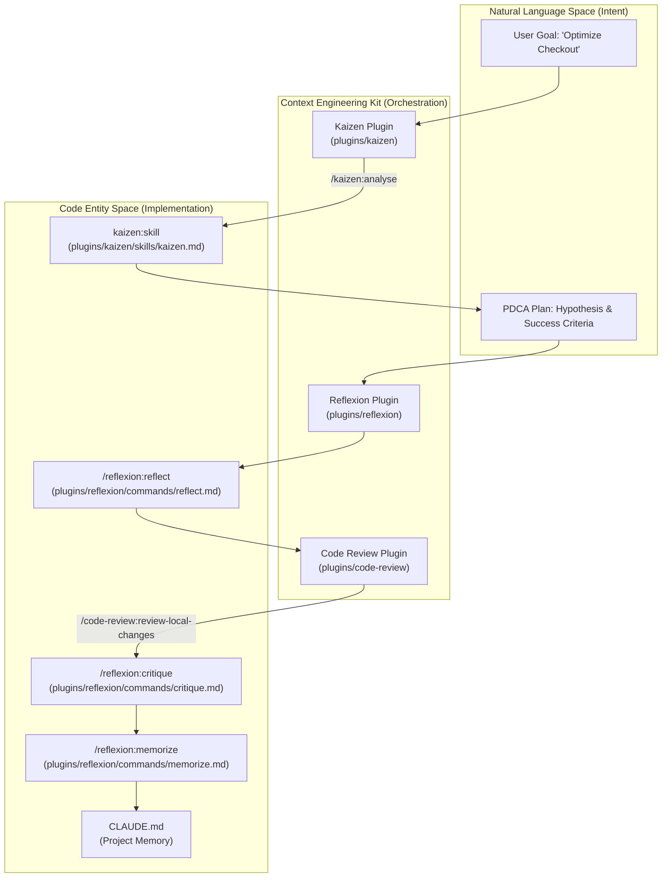
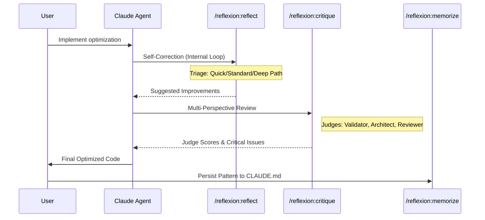

<!-- source: DeepWiki mcp.deepwiki.com · repo neolabhq/context-engineering-kit · page 5.6 Code Quality Improvement · fetched 2026-10-27 -->

# Code Quality Improvement

Relevant source files

The following files were used as context for generating this wiki page:

- [.specs/anthropic-claude-code-action-prompt.md](.specs/anthropic-claude-code-action-prompt.md)
- [.specs/reports/do-competitively-analysis.md](.specs/reports/do-competitively-analysis.md)
- [.specs/research/research-resources.md](.specs/research/research-resources.md)
- [.specs/usefull-prompts.md](.specs/usefull-prompts.md)
- [docs/guides/bug-investigation.md](docs/guides/bug-investigation.md)
- [docs/guides/code-quality-improvement.md](docs/guides/code-quality-improvement.md)
- [docs/guides/feature-development.md](docs/guides/feature-development.md)
- [docs/plugins/reflexion/usage-examples.md](docs/plugins/reflexion/usage-examples.md)
- [plugins/customaize-agent/skills/thought-based-reasoning/SKILL.md](plugins/customaize-agent/skills/thought-based-reasoning/SKILL.md)

This guide documents systematic approaches to improving code quality using the Kaizen methodology combined with Reflexion self-refinement. It focuses on identifying waste, performing root cause analysis, implementing measured improvements through PDCA (Plan-Do-Check-Act) cycles, and accumulating knowledge in `CLAUDE.md` for continuous improvement.

**Purpose**: Proactive quality improvement work including performance optimization, technical debt reduction, and architecture refinement.
**Key Plugins**: Kaizen plugin for systematic analysis, Reflexion plugin for self-refinement and knowledge accumulation, Code Review plugin for multi-agent validation.

## Overview

Code quality improvement in the Context Engineering Kit is treated as a continuous loop of analysis and refinement. Unlike standard feature development, it focuses on the "meta" aspects of the codebase—eliminating inefficiencies (Muda) and ensuring that the AI's internal reasoning aligns with the project's actual implementation (Gemba).

| Aspect | Feature Development | Bug Fixing | Quality Improvement |
|--------|-------------------|------------|-------------------|
| **Trigger** | Requirements or issue | Visible failure | Proactive analysis |
| **Goal** | Add capability | Restore function | Eliminate waste, improve maintainability |
| **Success Metric** | Feature works | Bug fixed | Measurable improvement in metrics |
| **Methodology** | SDD / TDD | Five Whys / Root Cause | Kaizen / PDCA / Reflexion |

Sources: [docs/guides/code-quality-improvement.md:1-20](), [docs/guides/bug-investigation.md:1-20]()

## Quality Improvement Architecture

The system bridges Natural Language requirements to Code Entity space through a structured command flow that utilizes specialized agents and skills.

**Diagram: Mapping Quality Intent to Code Entities**

Sources: [docs/guides/code-quality-improvement.md:24-73](), [plugins/customaize-agent/skills/thought-based-reasoning/SKILL.md:15-25]()

## Identifying Quality Issues (Kaizen)

The Kaizen methodology focuses on "Small Change for Better." It starts with identifying "Muda" (Waste) or performing a "Gemba Walk" (observing the actual place of work/code).

### 1. Analysis Methods
The `/kaizen:analyse` command intelligently selects the best analysis method for the target area:
- **Muda Analysis**: Identifies 7 types of waste (Overproduction, Waiting, Transportation, Over-processing, Inventory, Motion, Defects).
- **Gemba Walk**: Compares documentation (what should be) against actual code (what is).
- **Value Stream Mapping**: Analyzes the flow of data or processes to find bottlenecks.

### 2. Root Cause Analysis
Before fixing, the system must understand *why* a quality issue exists:
- **Five Whys (`/kaizen:why`)**: Drills from symptoms to fundamental causes through iterative questioning. [docs/guides/bug-investigation.md:94-102]()
- **Root Cause Tracing**: Systematically traces bugs backward through the call stack to identify where invalid data originates. [docs/guides/bug-investigation.md:84-92]()
- **Fishbone Analysis (`/kaizen:cause-and-effect`)**: Explores causes across six categories (People, Process, Technology, Environment, Methods, Materials). [docs/guides/code-quality-improvement.md:156-162]()

Sources: [docs/guides/code-quality-improvement.md:75-84](), [docs/guides/bug-investigation.md:84-102]()

## The Improvement Loop (PDCA & Reflexion)

The core of the quality workflow is the **Plan-Do-Check-Act (PDCA)** cycle, reinforced by the **Reflexion** pattern.

### PDCA Cycle Implementation
1. **Plan**: Define the problem, baseline metrics, and hypothesis using `/kaizen:plan-do-check-act`. [docs/guides/code-quality-improvement.md:95-109]()
2. **Do**: Implement the changes incrementally.
3. **Check**: Verify results against success criteria using `/reflexion:reflect` or `/code-review:review-local-changes`. [docs/guides/code-quality-improvement.md:121-130]()
4. **Act**: Standardize the fix and memorize the pattern.

### Reflexion Pattern
Reflexion provides iterative self-improvement by allowing the agent to critique its own work before finalization.

**Diagram: Reflexion & Critique Interaction**

Sources: [docs/plugins/reflexion/usage-examples.md:64-103](), [plugins/customaize-agent/skills/thought-based-reasoning/SKILL.md:175-208]()

## Pattern Memorization

The final step in quality improvement is ensuring the lesson is never forgotten. The `/reflexion:memorize` command captures insights and adds them to the project's `CLAUDE.md` file.

### What to Memorize:
- **Bug Patterns**: e.g., "Race conditions in Redis operations." [docs/guides/bug-investigation.md:132-141]()
- **Performance Patterns**: e.g., "Move third-party API calls to background jobs." [docs/plugins/reflexion/usage-examples.md:135-149]()
- **Architecture Decisions**: Validated designs for caching, auth, or data flow. [docs/plugins/reflexion/usage-examples.md:151-171]()

### Data Flow for Memory:
1. **Extraction**: `Reflexion` identifies a successful pattern or a "learned the hard way" anti-pattern.
2. **Formatting**: The insight is formatted as a concise rule or guideline.
3. **Persistence**: The command updates `CLAUDE.md` under sections like `## Development Guidelines` or `## Architecture Decisions`.

Sources: [docs/guides/code-quality-improvement.md:131-140](), [docs/plugins/reflexion/usage-examples.md:135-149]()

## Practical Example: Performance Optimization

A typical quality improvement session for a slow API endpoint:

1. **Analyze**: `> /kaizen:analyse "Target checkout flow for performance"` [docs/guides/code-quality-improvement.md:79-81]()
2. **Root Cause**: `> /kaizen:why "Why is the checkout slow?"` [docs/guides/code-quality-improvement.md:165-168]()
3. **Plan**: `> /kaizen:plan-do-check-act "Reduce response time by 50%"` [docs/guides/code-quality-improvement.md:99-101]()
4. **Implement**: `> claude "Apply optimizations, then reflect"` [docs/guides/code-quality-improvement.md:115-117]()
5. **Critique**: `> /reflexion:critique` (Ensures optimization didn't break security). [docs/guides/code-quality-improvement.md:89-91]()
6. **Memorize**: `> /reflexion:memorize "Performance optimization for checkout"` [docs/guides/code-quality-improvement.md:136-137]()

Sources: [docs/guides/code-quality-improvement.md:75-150](), [docs/plugins/reflexion/usage-examples.md:104-133]()

---

