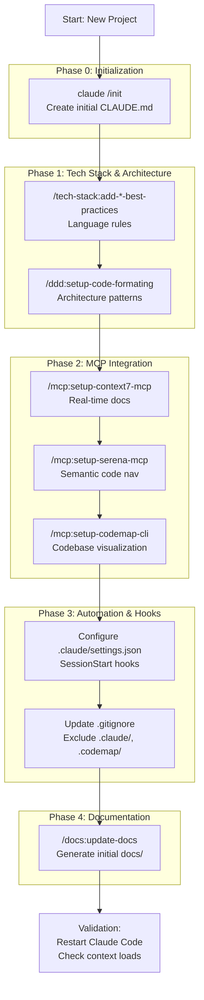
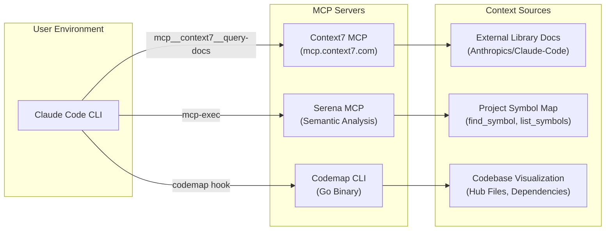

<!-- source: DeepWiki mcp.deepwiki.com · repo neolabhq/context-engineering-kit · page 5.7 Project Setup & Context Enhancement · fetched 2026-10-27 -->

# Project Setup & Context Enhancement

<details>
<summary>Relevant source files</summary>

The following files were used as context for generating this wiki page:

- [.devcontainer/Dockerfile](.devcontainer/Dockerfile)
- [.devcontainer/configure-claude.sh](.devcontainer/configure-claude.sh)
- [.devcontainer/devcontainer.json](.devcontainer/devcontainer.json)
- [.devcontainer/install-mcps.sh](.devcontainer/install-mcps.sh)
- [.devcontainer/statusline.sh](.devcontainer/statusline.sh)
- [CLAUDE.md](CLAUDE.md)
- [docs/guides/brainstorming-to-implementation.md](docs/guides/brainstorming-to-implementation.md)
- [docs/guides/decision-making.md](docs/guides/decision-making.md)
- [docs/guides/project-setup.md](docs/guides/project-setup.md)
- [docs/plugins/fpf/architecture.md](docs/plugins/fpf/architecture.md)
- [docs/plugins/fpf/evidence-freshness.md](docs/plugins/fpf/evidence-freshness.md)
- [justfile](justfile)

</details>


This guide covers initializing new projects with comprehensive context engineering infrastructure. It walks through configuring `CLAUDE.md` files, setting up MCP servers, enabling session hooks, and establishing best practices that persist across development sessions.

**Scope**: Initial project setup using the Context Engineering Kit. For ongoing feature development workflows, see [Feature Development Workflow](#5.1) and [Spec-Driven Development Workflow](#5.2).

Sources: [CLAUDE.md:1-84](), [docs/guides/project-setup.md:1-18]()

---

## Prerequisites

Before setting up a new project, ensure:

- Claude Code CLI is installed and functional.
- Context Engineering Kit marketplace is added: `claude plugin marketplace add NeoLabHQ/context-engineering-kit` [CLAUDE.md:82-82]().
- Required plugins are installed (minimum: `mcp`, `tech-stack`, `sdd`, `git`) [CLAUDE.md:83-85]().
- Project repository is initialized with Git.

Sources: [.devcontainer/configure-claude.sh:77-86](), [CLAUDE.md:82-86]()

---

## Project Initialization Workflow

The following diagram shows the complete setup sequence for a new project:

**Diagram: Complete Project Setup Flow**



Sources: [docs/guides/project-setup.md:19-108](), [CLAUDE.md:43-56]()

---

## Step 0: Initialize Claude Code

Use the `/init` command to create the initial `CLAUDE.md` file. This file serves as the primary project-wide context for the AI assistant [docs/guides/project-setup.md:51-57]().

**Recommended CLAUDE.md Structure**

A standard `CLAUDE.md` should include the following sections:
- **Project Structure**: A tree view of the repository [CLAUDE.md:7-27]().
- **Available Plugins**: List of installed Context Engineering Kit plugins [CLAUDE.md:29-31]().
- **Development Commands**: Project-specific `bash` commands for building/testing [CLAUDE.md:33-42]().
- **Key Development Rules**: Coding standards and plugin design philosophy [CLAUDE.md:44-52]().

Sources: [CLAUDE.md:1-56](), [docs/guides/project-setup.md:51-60]()

---

## Step 1: Configure Tech Stack Best Practices

Use the `tech-stack` plugin to establish language and framework standards. These rules ensure consistent code style across all AI-assisted development [docs/guides/project-setup.md:61-70]().

**Available Tech Stack Commands**

| Command | Purpose | CLAUDE.md Updates |
|---------|---------|-------------------|
| `/tech-stack:add-typescript-best-practices` | TypeScript coding standards | Type safety rules, naming conventions |
| `/tech-stack:add-python-best-practices` | Python style guidelines | PEP 8 compliance, type hints |

**What Gets Added to CLAUDE.md**
These commands append detailed sections containing language-specific coding standards, framework best practices, and common anti-patterns to avoid [docs/guides/project-setup.md:69-70]().

Sources: [docs/guides/project-setup.md:61-70](), [CLAUDE.md:31-31]()

---

## Step 2: Set Up Architecture Patterns

Use the `ddd` plugin to establish architectural guidelines and formatting rules. This ensures the codebase follows Clean Architecture and SOLID principles [docs/guides/project-setup.md:71-80]().

**Command**: `/ddd:setup-code-formating` [docs/guides/project-setup.md:73-73]().

The architecture guidelines inform the `sdd` plugin's implementation phase and the `code-review` plugin's evaluation [docs/guides/project-setup.md:79-80]().

Sources: [docs/guides/project-setup.md:71-80](), [CLAUDE.md:31-31]()

---

## Step 3: Configure MCP Servers

Integrate external tools using the Model Context Protocol (MCP) to enhance AI capabilities [docs/guides/project-setup.md:81-98]().

**Diagram: MCP Integration Data Flow**



Sources: [CLAUDE.md:93-112](), [.devcontainer/install-mcps.sh:4-5](), [.devcontainer/Dockerfile:76-79]()

### Context7 MCP: Real-time Library Documentation
**Purpose**: Fetches up-to-date documentation with code examples to eliminate hallucinations [CLAUDE.md:93-95]().
**Command**: `/mcp:setup-context7-mcp` [docs/guides/project-setup.md:88-88]().
**Recommended Library IDs**:
- `/anthropics/claude-code` [CLAUDE.md:99-99]()
- `/websites/platform_claude` [CLAUDE.md:100-100]()
- `/websites/platform_claude_en_agent-sdk` [CLAUDE.md:103-103]()

### Serena MCP: Semantic Code Analysis
**Purpose**: Enables precise code navigation and symbol-based searching [docs/guides/project-setup.md:91-95]().
**Command**: `/mcp:setup-serena-mcp` [docs/guides/project-setup.md:94-94]().
**Tools**: `find_symbol`, `list_symbols` [docs/guides/project-setup.md:94-94]().

### Codemap CLI: Codebase Visualization
**Purpose**: Provides automatic project structure context at session start [.devcontainer/Dockerfile:76-79]().
**Command**: `/mcp:setup-codemap-cli` [docs/guides/project-setup.md:83-83]().
**Implementation**: Installs the `codemap` Go binary and configures session hooks [.devcontainer/Dockerfile:76-79]().

Sources: [CLAUDE.md:93-112](), [docs/guides/project-setup.md:81-98](), [.devcontainer/Dockerfile:76-79]()

---

## Step 4: Enable Session Hooks

Configure automatic context injection in `~/.claude/settings.json` to provide the AI with project state at every session start [.devcontainer/configure-claude.sh:13-31]().

**Essential Hook Configuration**
```json
{
  "hooks": {
    "SessionStart": [
      {
        "hooks": [
          {
            "type": "command",
            "command": "echo 'git diff:' && git diff --stat && echo 'git status:' && git status"
          }
        ]
      }
    ]
  }
}
```
Sources: [.devcontainer/configure-claude.sh:13-31]()

---

## Step 5: Document Project Setup

Use the `docs` plugin to generate initial project documentation based on the established setup [docs/guides/project-setup.md:99-108]().

**Command**: `/docs:update-docs` [docs/guides/project-setup.md:101-101]().

This command analyzes the project and creates/updates technical documentation in the `docs/` directory [docs/guides/project-setup.md:106-107]().

Sources: [docs/guides/project-setup.md:99-108](), [CLAUDE.md:31-31]()

---

## Sandbox Environment (Optional)

For a pre-configured development environment, use the provided DevContainer. It includes all necessary tools like `just`, `gh`, `go`, and `codemap` [.devcontainer/Dockerfile:1-121]().

**Sandbox Management Commands**:
- `just sandbox`: Start devcontainer and open an interactive shell [justfile:82-96]().
- `just attach-sandbox`: Attach to a running devcontainer [justfile:99-118]().
- `just stop-sandbox`: Stop and remove the devcontainer [justfile:121-131]().

Sources: [justfile:82-131](), [.devcontainer/Dockerfile:1-121]()

---

## Summary: Final State

After completing this workflow, the project will contain:
- **`CLAUDE.md`**: AI assistant configuration with coding standards and architecture rules [docs/guides/project-setup.md:113-113]().
- **`docs/`**: Initial project documentation [docs/guides/project-setup.md:114-114]().
- **MCP Integrations**: Configured servers for real-time documentation and semantic search [docs/guides/project-setup.md:115-115]().
- **`.claude/settings.json`**: Session hooks for automatic git status and diff reporting [.devcontainer/configure-claude.sh:13-31]().

Sources: [docs/guides/project-setup.md:109-116](), [.devcontainer/configure-claude.sh:13-31]()

---

