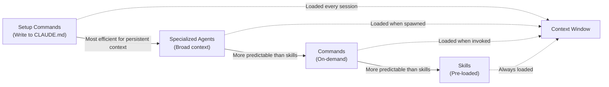
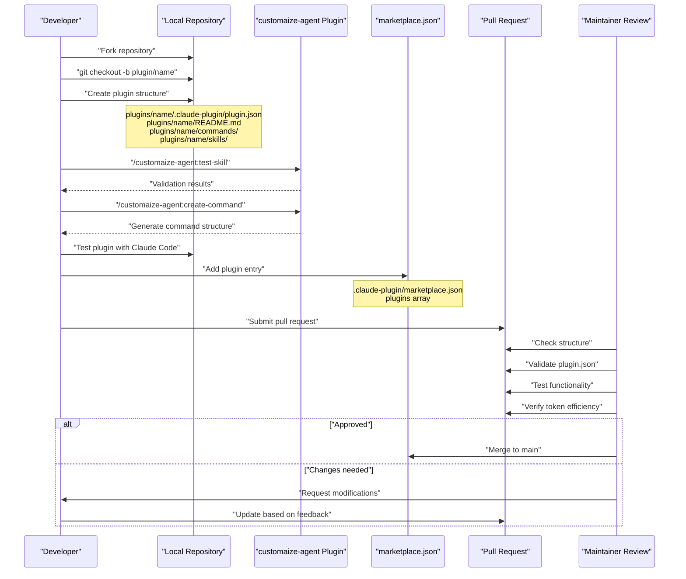
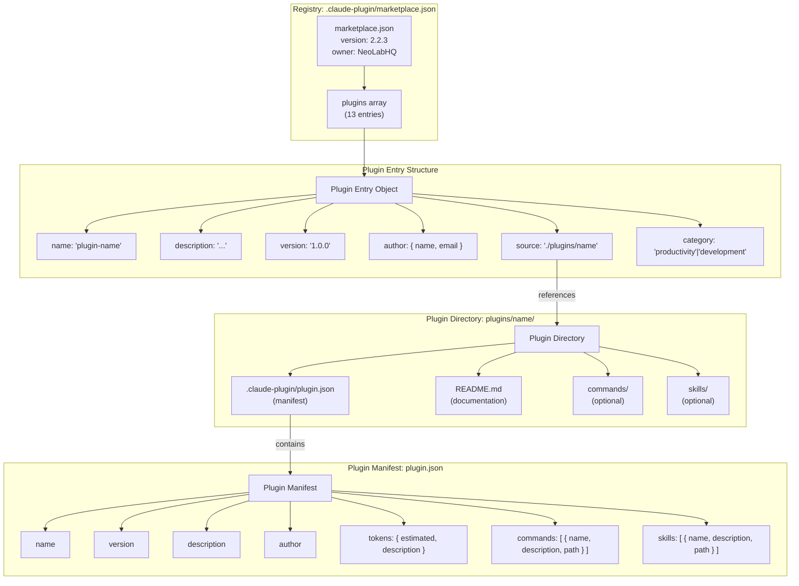
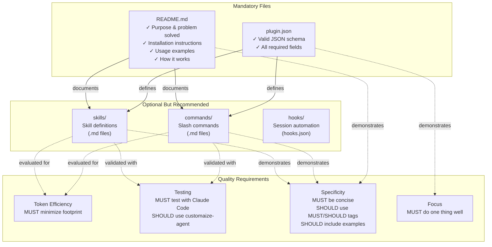
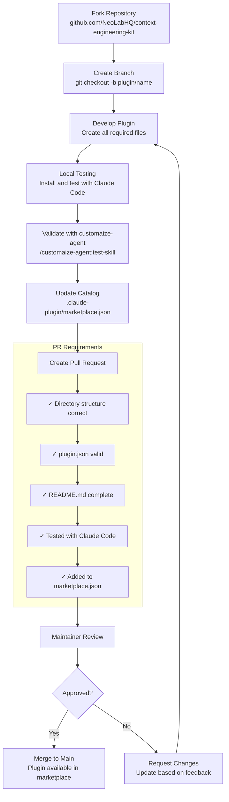
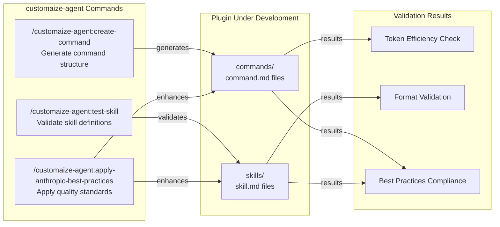

<!-- source: DeepWiki mcp.deepwiki.com · repo neolabhq/context-engineering-kit · page 6 Contributing · fetched 2026-10-27 -->

# Contributing

<details>
<summary>Relevant source files</summary>

The following files were used as context for generating this wiki page:

- [.claude-plugin/marketplace.json](.claude-plugin/marketplace.json)
- [.claude/commands/bump-plugin.md](.claude/commands/bump-plugin.md)
- [CONTRIBUTING.md](CONTRIBUTING.md)
- [plugins/customaize-agent/.claude-plugin/plugin.json](plugins/customaize-agent/.claude-plugin/plugin.json)
- [plugins/reflexion/hooks/.gitignore](plugins/reflexion/hooks/.gitignore)
- [plugins/reflexion/hooks/bun.lockb](plugins/reflexion/hooks/bun.lockb)
- [plugins/reflexion/hooks/hooks.json](plugins/reflexion/hooks/hooks.json)
- [plugins/reflexion/hooks/package.json](plugins/reflexion/hooks/package.json)
- [plugins/reflexion/hooks/src/index.ts](plugins/reflexion/hooks/src/index.ts)
- [plugins/reflexion/hooks/src/lib.ts](plugins/reflexion/hooks/src/lib.ts)
- [plugins/reflexion/hooks/src/session.ts](plugins/reflexion/hooks/src/session.ts)
- [plugins/sadd/.claude-plugin/plugin.json](plugins/sadd/.claude-plugin/plugin.json)
- [plugins/sdd/.claude-plugin/plugin.json](plugins/sdd/.claude-plugin/plugin.json)

</details>


This document provides an overview of how to contribute plugins to the Context Engineering Kit marketplace. It covers the philosophy, development workflow, and submission process for creating high-quality plugins that enhance Claude Code with advanced context engineering techniques.

For detailed information on specific aspects of contribution:
- Plugin structure, manifests, and testing: see [Plugin Development Guide](#6.1)
- Token efficiency and quality guidelines: see [Quality Standards & Best Practices](#6.2)
- Fork/branch workflow and PR requirements: see [Submission Process](#6.3)

---

## Core Philosophy

The Context Engineering Kit prioritizes **quality over quantity**. Each plugin must meaningfully improve agent output through efficient context engineering patterns. The marketplace follows three fundamental principles:

| Principle | Description | Implementation |
|-----------|-------------|----------------|
| **Minimal Token Footprint** | Every token loaded into context must provide value | Commands load on-demand; skills pre-load descriptions; setup commands write to `CLAUDE.md` |
| **Predictable Context Loading** | Agents should reliably access needed information | Prefer commands and specialized agents over skills that may not be loaded |
| **Quality Gates** | Better to do one thing well than many things poorly | Thorough testing required; `customaize-agent` plugin available for validation |

**Token Efficiency Hierarchy:**



Sources: [CONTRIBUTING.md:6-13]()

---

## Plugin Development Workflow

The complete plugin development process follows this sequence:



Sources: [CONTRIBUTING.md:85-106]()

---

## Plugin Architecture & Registry Structure

Plugins integrate with the marketplace through a structured registry and manifest system. The central registry is located at [.claude-plugin/marketplace.json:1-155]().



**Marketplace Entry Example:**

The `sdd` plugin entry in `marketplace.json`:

```json
{
  "name": "sdd",
  "description": "Specification Driven Development workflow commands and agents, based on Github Spec Kit and OpenSpec. Uses specialized agents for effective context management and quality review.",
  "version": "2.1.1",
  "author": {
    "name": "Vlad Goncharov",
    "email": "vlad.goncharov@neolab.finance"
  },
  "source": "./plugins/sdd",
  "category": "development"
}
```

**Plugin Manifest Example:**

The corresponding manifest in [plugins/sdd/.claude-plugin/plugin.json:1-9]():

```json
{
  "name": "sdd",
  "version": "2.1.1",
  "description": "Specification Driven Development workflow commands and agents, based on Github Spec Kit and OpenSpec. Uses specialized agents for effective context management and quality review.",
  "author": {
    "name": "Vlad Goncharov",
    "email": "vlad.goncharov@neolab.finance"
  }
}
```

Sources: [.claude-plugin/marketplace.json:78-87](), [plugins/sdd/.claude-plugin/plugin.json:1-9](), [CONTRIBUTING.md:20-65]()

---

## Required Plugin Components

Every plugin submission must include these components:



**Plugin Directory Structure:**

```
your-plugin/
├── .claude-plugin/
│   └── plugin.json       # REQUIRED: Manifest with metadata, commands, skills
├── README.md            # REQUIRED: Complete documentation
├── commands/            # OPTIONAL: On-demand slash commands
│   └── command.md
├── skills/              # OPTIONAL: Pre-loaded skill definitions
│   └── skill.md
└── hooks/               # OPTIONAL: Automation hooks (e.g. Stop, UserPromptSubmit)
    └── hooks.json
```

Sources: [CONTRIBUTING.md:19-84](), [plugins/reflexion/hooks/hooks.json:1-26]()

---

## Plugin Categories & Token Budget

Plugins are categorized based on their primary function:

| Category | Purpose | Examples |
|----------|---------|----------|
| `productivity` | Enhance development workflow efficiency | `reflexion`, `code-review`, `git`, `kaizen`, `docs` |
| `development` | Implement structured methodologies | `tdd`, `sadd`, `ddd`, `sdd`, `customaize-agent`, `tech-stack`, `mcp`, `fpf` |

**Token Estimation Requirements:**

The `plugin.json` manifest should include estimated token usage to help users manage their context window.

```json
{
  "tokens": {
    "estimated": 500,
    "description": "Explain token usage and what affects it"
  }
}
```

Sources: [.claude-plugin/marketplace.json:11-153](), [CONTRIBUTING.md:46-49]()

---

## Versioning and Maintenance

The repository uses automated tools for version management. Contributors should be aware of the `bump-plugin` command defined in [.claude/commands/bump-plugin.md:1-40](), which synchronizes plugin versions with the marketplace version.

### Versioning Logic:
- `patch`: 1.0.0 → 1.0.1 (bug fixes)
- `minor`: 1.0.0 → 1.1.0 (new features)
- `major`: 1.0.0 → 2.0.0 (breaking changes)

Sources: [.claude/commands/bump-plugin.md:18-30]()

---

## Submission Checklist & Pull Request Flow



**Pull Request Template:**

Your PR must include confirmation of:

- [ ] Plugin follows directory structure
- [ ] `plugin.json` is valid and complete
- [ ] `README.md` includes all required sections
- [ ] Tested with Claude Code
- [ ] Added to `.claude-plugin/marketplace.json` catalog

Sources: [CONTRIBUTING.md:85-106]()

---

## Testing with customaize-agent Plugin

The `customaize-agent` plugin provides tools for validating plugin quality and applying Anthropic best practices.



Sources: [.claude-plugin/marketplace.json:100-109](), [CONTRIBUTING.md:79]()

---

## Documentation Requirements

Every plugin's `README.md` must include:

1. **Clear Purpose**: What problem does the plugin solve?
2. **Installation**: Copy-paste ready instructions, including setup commands.
3. **Usage Examples**: Real use cases showing command invocations.
4. **How It Works**: High-level overview of the logic and context management.

Sources: [CONTRIBUTING.md:67-74]()

---

For detailed implementation guidance, token optimization strategies, and the complete submission workflow, see the subsections:
- [Plugin Development Guide](#6.1)
- [Quality Standards & Best Practices](#6.2)
- [Submission Process](#6.3)

Questions? Open an issue with the `question` label or start a discussion in the repository.

Sources: [CONTRIBUTING.md:104-106]()

---

