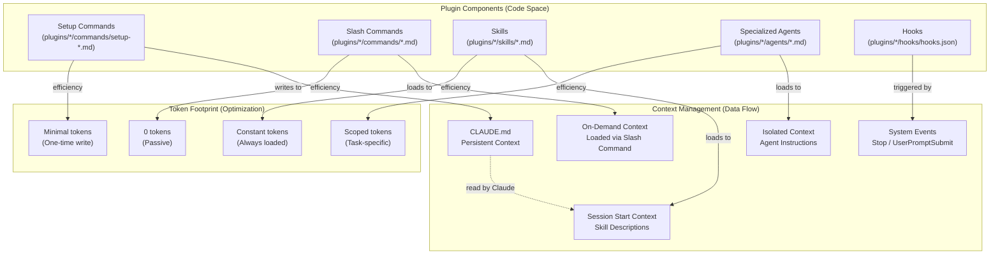
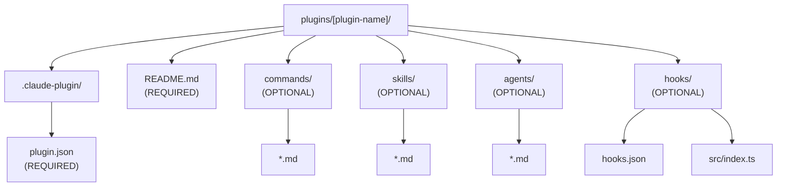

<!-- source: DeepWiki mcp.deepwiki.com · repo neolabhq/context-engineering-kit · page 6.1 Plugin Development Guide · fetched 2026-10-27 -->

# Plugin Development Guide

<details>
<summary>Relevant source files</summary>

The following files were used as context for generating this wiki page:

- [.claude-plugin/marketplace.json](.claude-plugin/marketplace.json)
- [.claude/commands/bump-plugin.md](.claude/commands/bump-plugin.md)
- [CLAUDE.md](CLAUDE.md)
- [CONTRIBUTING.md](CONTRIBUTING.md)
- [docs/plugins/fpf/architecture.md](docs/plugins/fpf/architecture.md)
- [docs/plugins/fpf/evidence-freshness.md](docs/plugins/fpf/evidence-freshness.md)
- [justfile](justfile)
- [plugins/customaize-agent/.claude-plugin/plugin.json](plugins/customaize-agent/.claude-plugin/plugin.json)
- [plugins/reflexion/hooks/.gitignore](plugins/reflexion/hooks/.gitignore)
- [plugins/reflexion/hooks/bun.lockb](plugins/reflexion/hooks/bun.lockb)
- [plugins/reflexion/hooks/hooks.json](plugins/reflexion/hooks/hooks.json)
- [plugins/reflexion/hooks/package.json](plugins/reflexion/hooks/package.json)
- [plugins/reflexion/hooks/src/index.ts](plugins/reflexion/hooks/src/index.ts)
- [plugins/reflexion/hooks/src/lib.ts](plugins/reflexion/hooks/src/lib.ts)
- [plugins/reflexion/hooks/src/session.ts](plugins/reflexion/hooks/src/session.ts)
- [plugins/sadd/.claude-plugin/plugin.json](plugins/sadd/.claude-plugin/plugin.json)
- [plugins/sdd/.claude-plugin/plugin.json](plugins/sdd/.claude-plugin/plugin.json)

</details>


This document provides comprehensive guidance for creating new plugins for the Context Engineering Kit marketplace. It covers the required directory structure, plugin manifest configuration, architectural patterns for commands and skills, and testing requirements.

For information about plugin quality standards and Anthropic best practices, see [Quality Standards & Best Practices](#6.2). For the submission process to get your plugin into the marketplace, see [Submission Process](#6.3).

---

## Plugin Architecture Overview

The Context Engineering Kit plugin system is designed around **token efficiency** and **predictable loading behavior**. Plugins can contain four types of components, each with different loading characteristics:

| Component Type | Loading Behavior | Token Cost | Use Case |
|---------------|------------------|------------|----------|
| **Setup Commands** | On-demand execution, writes to `CLAUDE.md` | Minimal (loaded once, persists in CLAUDE.md) | Project-specific configuration that should be loaded every session |
| **Commands** | On-demand loading via slash commands | None until invoked | Complex operations, multi-step workflows |
| **Skills** | Loaded automatically at session start | Always present in context | Core capabilities that need to be always available |
| **Agents** | Spawned by commands with specific context | Isolated context window | Specialized review or implementation tasks |
| **Hooks** | Triggered by system events (e.g., `Stop`, `UserPromptSubmit`) | Execution-time cost | Automation, state management, or post-processing |

**Sources:** [CONTRIBUTING.md:10-13](), [README.md:17-19](), [plugins/reflexion/hooks/hooks.json:1-26]()

### Context & Token Flow

The following diagram bridges the natural language concept of "Context" to the code entities that manage it.

**Diagram: Context Loading Architecture**

**Sources:** [CONTRIBUTING.md:10-13](), [README.md:17-18](), [CLAUDE.md:11-19](), [plugins/reflexion/hooks/hooks.json:1-26]()

---

## Plugin Directory Structure

Every plugin must follow this standardized structure to be recognized by the marketplace and `just` management scripts.

**Diagram: Plugin File System Structure**

**Sources:** [CLAUDE.md:9-27](), [CONTRIBUTING.md:22-33](), [plugins/reflexion/hooks/hooks.json:1-26]()

### Key Files
1.  **`.claude-plugin/plugin.json`**: The manifest containing metadata used by the marketplace [plugins/sdd/.claude-plugin/plugin.json:1-9]().
2.  **`README.md`**: Must be kept in sync with `docs/plugins/[name]/README.md` using `just sync-plugins-to-docs` [CLAUDE.md:38-39]().
3.  **`commands/*.md`**: Markdown files where the frontmatter defines the slash command properties [CONTRIBUTING.md:29-30]().
4.  **`hooks/hooks.json`**: Defines event matchers and the shell commands (often using `bun`) to execute [plugins/reflexion/hooks/hooks.json:1-26]().

---

## Plugin Manifest (plugin.json)

The `plugin.json` file defines the plugin's identity. Note that while individual `plugin.json` files are simple, the central `marketplace.json` contains the full registry.

### Local Manifest Example
From [plugins/customaize-agent/.claude-plugin/plugin.json:1-9]():
```json
{
  "name": "customaize-agent",
  "version": "1.4.0",
  "description": "Commands and skills for writing and refining commands, hooks, skills for Claude Code...",
  "author": {
    "name": "Vlad Goncharov",
    "email": "vlad.goncharov@neolab.finance"
  }
}
```

### Marketplace Registration
New plugins must be added to the `plugins` array in `.claude-plugin/marketplace.json`. Each entry includes a `source` path and a `category` (`productivity` or `development`) [.claude-plugin/marketplace.json:10-21]().

---

## Commands vs. Skills

Choosing between a command and a skill is a critical context engineering decision.

### Commands: On-Demand Context
Commands (e.g., `/reflexion:reflect`) load their prompt into the context only when the user types the slash command. 
- **Pros**: Zero idle token cost.
- **Cons**: Requires manual user trigger.
- **Use for**: Heavy reasoning tasks, one-off analyses, or multi-step workflows like `sdd` [README.md:296-347]().

### Skills: Always-Loaded Context
Skills are loaded into the system prompt at the start of every session.
- **Pros**: Claude "knows" it can do this without being told.
- **Cons**: Constant token drain.
- **Use for**: Fundamental behavioral changes, like the `sadd` subagent-driven development pattern [README.md:264-276]().

**Sources:** [CONTRIBUTING.md:10-13](), [CLAUDE.md:48-51]()

---

## Hooks: Event-Driven Automation

Hooks allow plugins to react to session events. The `reflexion` plugin uses hooks to trigger logic on `Stop` and `UserPromptSubmit` [.claude-plugin/marketplace.json:12-21](), [plugins/reflexion/hooks/hooks.json:1-26]().

### Example Hook Configuration
The `hooks.json` file maps events to shell commands. It often uses `bun` to execute TypeScript logic:
```json
{
    "hooks": {
        "Stop": [
            {
                "matcher": "",
                "hooks": [
                    {
                        "type": "command",
                        "command": "command -v bun >/dev/null 2>&1 && bun ${CLAUDE_PLUGIN_ROOT}/hooks/src/index.ts Stop || true"
                    }
                ]
            }
        ]
    }
}
```
**Sources:** [plugins/reflexion/hooks/hooks.json:1-26]()

---

## Testing Requirements

Plugins must be tested before submission. The `customaize-agent` plugin provides specialized tools for this.

### Testing Commands
- **`/customaize-agent:test-prompt`**: Used to verify the behavior of new commands or agents [CLAUDE.md:58]().
- **`/customaize-agent:test-skill`**: Specifically designed to validate that a skill's instructions are correctly interpreted by the model [CLAUDE.md:58]().

### Sandbox Environment
Developers should use the provided devcontainer to test plugins in a clean environment.
- `just sandbox`: Starts and enters the devcontainer [justfile:82-96]().
- `just claude "prompt"`: Runs Claude with a specific prompt to test plugin output [justfile:136-146]().

**Sources:** [justfile:77-131](), [CLAUDE.md:58]()

---

## Versioning & Syncing

The kit uses `just` commands to maintain consistency across the marketplace.

1.  **Version Bumping**: Use `just set-version <name> <x.y.z>` to update both the plugin's local `plugin.json` and the global `marketplace.json` [justfile:38-52]().
2.  **Doc Syncing**: READMEs exist in both `plugins/` and `docs/`. Use `just sync-plugins-to-docs` to propagate changes from the code to the documentation [justfile:24-35]().
3.  **Marketplace Bump**: Use `just set-marketplace-version <x.y.z>` to update the root manifest version [justfile:55-64]().

**Sources:** [CLAUDE.md:33-42](), [justfile:1-75]()

---

