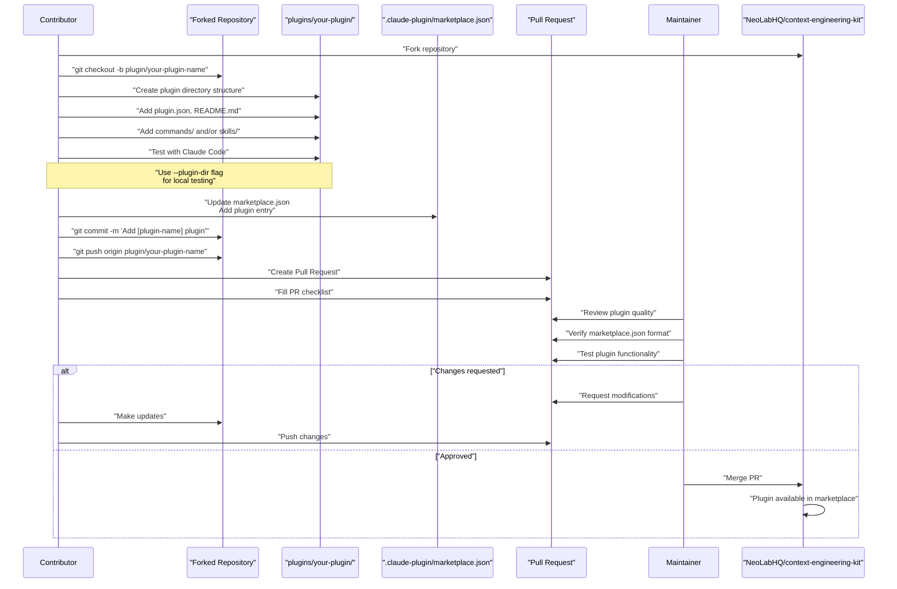
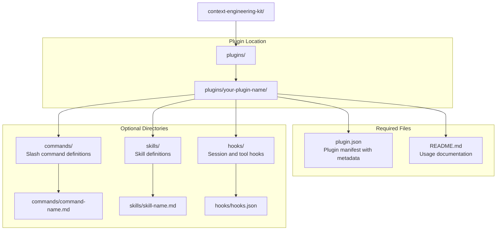
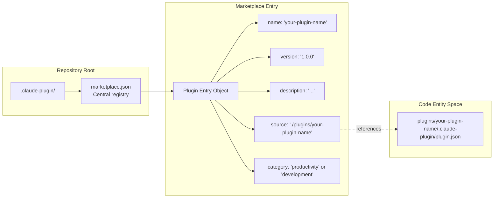

<!-- source: DeepWiki mcp.deepwiki.com · repo neolabhq/context-engineering-kit · page 6.3 Submission Process · fetched 2026-10-27 -->

# Submission Process

<details>
<summary>Relevant source files</summary>

The following files were used as context for generating this wiki page:

- [.claude-plugin/marketplace.json](.claude-plugin/marketplace.json)
- [.claude/commands/bump-plugin.md](.claude/commands/bump-plugin.md)
- [CONTRIBUTING.md](CONTRIBUTING.md)
- [plugins/customaize-agent/.claude-plugin/plugin.json](plugins/customaize-agent/.claude-plugin/plugin.json)
- [plugins/reflexion/hooks/.gitignore](plugins/reflexion/hooks/.gitignore)
- [plugins/reflexion/hooks/bun.lockb](plugins/reflexion/hooks/bun.lockb)
- [plugins/reflexion/hooks/hooks.json](plugins/reflexion/hooks/hooks.json)
- [plugins/reflexion/hooks/package.json](plugins/reflexion/hooks/package.json)
- [plugins/reflexion/hooks/src/index.ts](plugins/reflexion/hooks/src/index.ts)
- [plugins/reflexion/hooks/src/lib.ts](plugins/reflexion/hooks/src/lib.ts)
- [plugins/reflexion/hooks/src/session.ts](plugins/reflexion/hooks/src/session.ts)
- [plugins/sadd/.claude-plugin/plugin.json](plugins/sadd/.claude-plugin/plugin.json)
- [plugins/sdd/.claude-plugin/plugin.json](plugins/sdd/.claude-plugin/plugin.json)

</details>


## Purpose and Scope

This document describes the process for submitting new plugins to the Context Engineering Kit marketplace. It covers the fork/branch workflow, required manifest updates, version management, and the technical requirements for Pull Requests (PRs). For guidance on creating the plugin itself, see [6.1 Plugin Development Guide](). For quality requirements your plugin must meet, see [6.2 Quality Standards & Best Practices]().

## Workflow Overview

The submission process follows a standard fork-and-pull-request model with specific requirements for marketplace integration.

### Submission Workflow Sequence



Sources: [CONTRIBUTING.md:85-106](), [CONTRIBUTING.md:110-111]()

## Pre-Submission Checklist

Before starting the submission process, verify your plugin meets all requirements:

| Requirement | Description | Reference |
|------------|-------------|-----------|
| **Directory Structure** | Plugin follows `plugins/<plugin-name>/` structure with all required files | [CONTRIBUTING.md:22-33]() |
| **plugin.json** | Valid JSON manifest with name, version, description, author, license, tokens, commands, skills | [CONTRIBUTING.md:36-64]() |
| **README.md** | Includes purpose, installation, usage examples, and how it works | [CONTRIBUTING.md:68-74]() |
| **Token Efficiency** | Commands preferred over skills; specialized agents used appropriately | [CONTRIBUTING.md:7-14]() |
| **Testing** | Thoroughly tested with Claude Code and `customaize-agent` plugin | [CONTRIBUTING.md:79](), [CONTRIBUTING.md:110-111]() |
| **Documentation Quality** | Concise prompts, specific instructions, clear examples, MUST/SHOULD tags | [CONTRIBUTING.md:77-83]() |

Sources: [CONTRIBUTING.md:85-103]()

## Fork and Branch Creation

### Step 1: Fork the Repository

Fork the repository at `https://github.com/NeoLabHQ/context-engineering-kit` to your GitHub account.

### Step 2: Clone and Create Branch

```bash
git clone https://github.com/YOUR_USERNAME/context-engineering-kit.git
cd context-engineering-kit
git checkout -b plugin/your-plugin-name
```

The branch naming convention is `plugin/<plugin-name>` as specified in [CONTRIBUTING.md:88]().

Sources: [CONTRIBUTING.md:87-88]()

## Adding Plugin Files

### Plugin Directory Structure



Sources: [CONTRIBUTING.md:22-33](), [plugins/reflexion/hooks/hooks.json:1-26]()

### Creating plugin.json

The `plugin.json` manifest must contain all required fields as defined in [CONTRIBUTING.md:36-64](). Note that the schema for individual plugins is slightly different from the root marketplace registry.

**Key fields in `plugins/<name>/.claude-plugin/plugin.json`:**
- `name`: Must match directory name and be kebab-case.
- `version`: Semantic versioning (major.minor.patch).
- `description`: Clear, concise one-sentence description.
- `author`: Name and email for contact.

Example from SADD plugin: [plugins/sadd/.claude-plugin/plugin.json:1-9]()

Sources: [CONTRIBUTING.md:36-64](), [plugins/sadd/.claude-plugin/plugin.json:1-9]()

## Updating Marketplace Registry

The critical step that makes your plugin discoverable is adding it to `.claude-plugin/marketplace.json`.

### Marketplace Registry Structure

The root `marketplace.json` serves as the central index for the entire kit.



Sources: [.claude-plugin/marketplace.json:1-155]()

### Adding Your Entry

Edit `.claude-plugin/marketplace.json` and add your plugin to the `plugins` array. The marketplace currently categorizes plugins into two types:

| Category | Purpose | Example Plugins |
|----------|---------|-----------------|
| `productivity` | Plugins focused on efficiency, review, and documentation | `reflexion`, `code-review`, `git`, `kaizen`, `docs` |
| `development` | Plugins implementing methodologies or setup workflows | `tdd`, `sadd`, `ddd`, `sdd`, `customaize-agent`, `tech-stack`, `mcp`, `fpf` |

**Entry requirements:**
- `name` must exactly match the directory name.
- `version` must match the version in the plugin's internal `plugin.json`.
- `source` must be the relative path from the root (e.g., `./plugins/your-plugin`).

Sources: [.claude-plugin/marketplace.json:10-154]()

## Version Management

The repository uses a `bump-plugin` command to synchronize versioning across individual plugins and the main marketplace registry.

### Automatic Version Bumping

When submitting changes to an existing plugin, use the `.claude/commands/bump-plugin.md` tool:

1. The tool detects changed plugins via `git diff`.
2. It calculates new versions based on the argument provided (`major`, `minor`, or `patch`).
3. It updates `plugins/<name>/.claude-plugin/plugin.json` using the `just set-version` task.
4. It updates the root `.claude-plugin/marketplace.json` version using `just set-marketplace-version`.

Sources: [.claude/commands/bump-plugin.md:1-40]()

## Pull Request Submission

### Pull Request Checklist

The PR must include completion of the checklist from [CONTRIBUTING.md:97-102]():

```markdown
- [ ] Plugin follows directory structure
- [ ] `plugin.json` is valid and complete
- [ ] `README.md` includes all required sections
- [ ] Tested with Claude Code
- [ ] Added to `.claude-plugin/marketplace.json` catalog
```

### Review Process

Maintainers evaluate submissions based on the core philosophy of **Quality over Quantity** and **Minimal Token Footprint**.

| Philosophy | Technical Implementation |
|------------|--------------------------|
| **Quality** | Does the prompt meaningfully improve agent output? |
| **Efficiency** | Are commands used instead of skills where possible? |
| **Orchestration** | Are specialized agents used to manage context? |
| **Setup** | Are setup-commands used for persistent CLAUDE.md updates? |

Sources: [CONTRIBUTING.md:6-14]()

## Local Testing Before Submission

To verify your plugin works correctly before submitting the PR, use the `--plugin-dir` flag with Claude Code. This allows you to load your local development directory as a plugin without it being in the marketplace registry.

```bash
claude --plugin-dir ./plugins/your-new-plugin
```

Sources: [CONTRIBUTING.md:110-111]()

---

