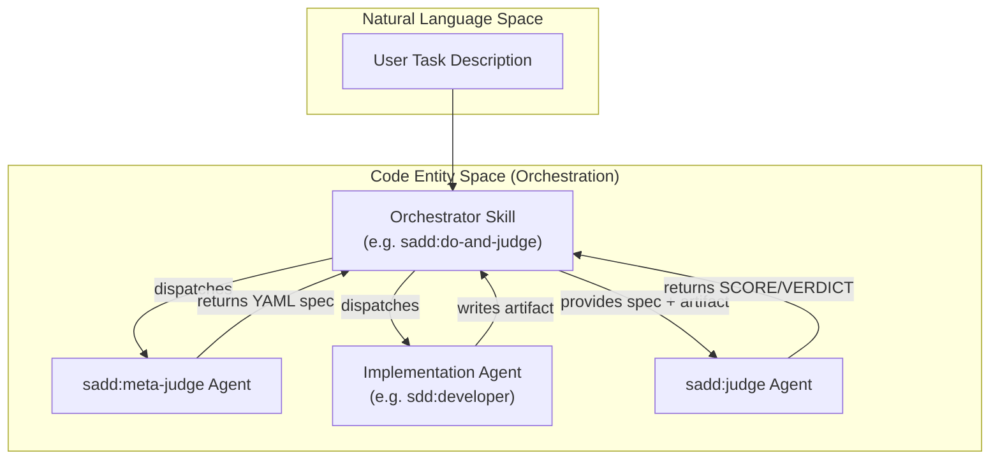
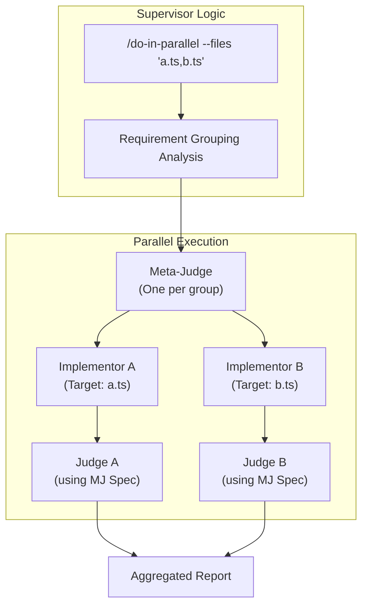

<!-- source: DeepWiki mcp.deepwiki.com · repo neolabhq/context-engineering-kit · page 7.1 Agent Orchestration Patterns · fetched 2026-10-27 -->

# Agent Orchestration Patterns

<details>
<summary>Relevant source files</summary>

The following files were used as context for generating this wiki page:

- [docs/plugins/sadd/do-and-judge.md](docs/plugins/sadd/do-and-judge.md)
- [docs/plugins/sadd/do-competitively.md](docs/plugins/sadd/do-competitively.md)
- [docs/plugins/sadd/do-in-parallel.md](docs/plugins/sadd/do-in-parallel.md)
- [docs/plugins/sadd/do-in-steps.md](docs/plugins/sadd/do-in-steps.md)
- [docs/plugins/sadd/judge-with-debate.md](docs/plugins/sadd/judge-with-debate.md)
- [docs/plugins/sadd/judge.md](docs/plugins/sadd/judge.md)
- [docs/plugins/sadd/multi-agent-patterns.md](docs/plugins/sadd/multi-agent-patterns.md)
- [docs/plugins/sadd/subagent-driven-development.md](docs/plugins/sadd/subagent-driven-development.md)
- [docs/plugins/sadd/tree-of-thoughts.md](docs/plugins/sadd/tree-of-thoughts.md)
- [plugins/customaize-agent/skills/create-rule/SKILL.md](plugins/customaize-agent/skills/create-rule/SKILL.md)
- [plugins/sadd/agents/judge.md](plugins/sadd/agents/judge.md)
- [plugins/sadd/agents/meta-judge.md](plugins/sadd/agents/meta-judge.md)
- [plugins/sadd/skills/do-and-judge/SKILL.md](plugins/sadd/skills/do-and-judge/SKILL.md)
- [plugins/sadd/skills/do-competitively/SKILL.md](plugins/sadd/skills/do-competitively/SKILL.md)
- [plugins/sadd/skills/do-in-parallel/SKILL.md](plugins/sadd/skills/do-in-parallel/SKILL.md)
- [plugins/sadd/skills/do-in-steps/SKILL.md](plugins/sadd/skills/do-in-steps/SKILL.md)
- [plugins/sadd/skills/judge-with-debate/SKILL.md](plugins/sadd/skills/judge-with-debate/SKILL.md)
- [plugins/sadd/skills/judge/SKILL.md](plugins/sadd/skills/judge/SKILL.md)
- [plugins/sadd/skills/tree-of-thoughts/SKILL.md](plugins/sadd/skills/tree-of-thoughts/SKILL.md)

</details>


This document covers advanced techniques for orchestrating multiple Claude agents to solve complex tasks efficiently. Agent orchestration involves spawning specialized agents with focused contexts, tools, and responsibilities, enabling parallel execution, quality gates, and token-efficient workflows.

For basic plugin usage and commands, see [Plugin Reference](#3). For session-level automation, see [Session Hooks & Automation](#7.2). For knowledge management strategies, see [Knowledge Accumulation Strategies](#7.3).

## Understanding Agents in Claude Code

### What is an Agent?

An agent is a fresh Claude instance with:
- **Specific context**: Focused instructions and knowledge for a particular task.
- **Limited tools**: Only the tools needed for its responsibility.
- **Defined scope**: Clear boundaries for what it should and shouldn't do.
- **Optional model override**: Can use different models (e.g., `sonnet` vs `opus`).

Agents differ from the main Claude session in that they start with clean context, preventing pollution from unrelated conversation history.

### Agent Definition Structure

Agents are defined using the `--agents` flag with JSON configuration:

```bash
claude --agents '{
  "agent-name": {
    "description": "When to use this agent",
    "prompt": "System instructions for the agent",
    "tools": ["Read", "Grep", "Glob", "Bash"],
    "model": "sonnet"
  }
}'
```

### Permission Modes

Permission modes control agent autonomy:

| Mode | Behavior | Use Case |
|------|----------|----------|
| `ask` | Prompt before each tool use | Interactive review, learning |
| `plan` | Show execution plan, confirm before running | Balanced safety/automation |
| `auto` | Execute without confirmation | CI/CD, trusted workflows |

Set via `--permission-mode <mode>` flag or `--dangerously-skip-permissions` for full automation.

**Sources**: [plugins/sadd/skills/do-and-judge/SKILL.md:85](), [plugins/sadd/agents/judge.md:4-6](), [plugins/sadd/agents/meta-judge.md:4-6]()

## Pattern 1: Meta-Judge → LLM-as-a-Judge

The core orchestration pattern used across the Context Engineering Kit is the **Meta-Judge → Judge** pipeline. This pattern separates the creation of evaluation criteria from the act of evaluation to eliminate surface-level bias and "length bias" in LLM assessments [plugins/sadd/skills/judge/SKILL.md:14-20]().


**Diagram: Meta-Judge to Judge Data Flow**

### Implementation Detail
1.  **Meta-Judge (`sadd:meta-judge`)**: Analyzes the user prompt and context to generate a structured YAML specification containing `rubric_dimensions` and a `checklist` [plugins/sadd/agents/meta-judge.md:39-68]().
2.  **Implementation**: A subagent (often `opus` for logic or `sonnet` for volume) executes the task [plugins/sadd/skills/do-and-judge/SKILL.md:77-85]().
3.  **Judge (`sadd:judge`)**: A "ruthless quality gatekeeper" that applies the YAML spec mechanically to the implementation artifact [plugins/sadd/agents/judge.md:18-30]().

**Sources**: [plugins/sadd/skills/do-and-judge/SKILL.md:13-30](), [plugins/sadd/agents/meta-judge.md:9-18](), [plugins/sadd/agents/judge.md:8-17]()

## Pattern 2: Parallel Dispatch (Supervisor Pattern)

The `sadd:do-in-parallel` skill implements a supervisor pattern that executes tasks across multiple independent targets simultaneously. This is highly efficient for batch operations like refactoring multiple files or generating documentation for several modules [plugins/sadd/skills/do-in-parallel/SKILL.md:14-31]().


**Diagram: Parallel Orchestration with Requirement Grouping**

### Requirement Grouping
To save tokens and time, the orchestrator identifies if tasks are:
-   **Repeatable**: Same task across different files (shares one Meta-Judge spec) [plugins/sadd/skills/do-in-parallel/SKILL.md:14-22]().
-   **Shared**: Interdependent tasks (uses one combined judge) [plugins/sadd/skills/do-in-parallel/SKILL.md:14-22]().
-   **Independent**: Distinct tasks (separate meta-judges and judges) [plugins/sadd/skills/do-in-parallel/SKILL.md:120-125]().

**Sources**: [plugins/sadd/skills/do-in-parallel/SKILL.md:7-40](), [docs/plugins/sadd/do-in-parallel.md:16-58]()

## Pattern 3: Sequential Step Decomposition

For complex tasks that cannot be parallelized due to dependencies, the `sadd:do-in-steps` skill decomposes the work into a linear pipeline [plugins/sadd/skills/do-in-steps/SKILL.md:9-11]().

### Workflow Steps:
1.  **Decomposition**: Analyzes the task to identify natural boundaries (e.g., Interface change → Implementation → Consumer update) [plugins/sadd/skills/do-in-steps/SKILL.md:98-120]().
2.  **Context Passing**: Summaries of relevant outputs from Step N are passed as input to Step N+1 [plugins/sadd/skills/do-in-steps/SKILL.md:14-22]().
3.  **Step-Level Quality Gates**: Each individual step must pass a Judge verification (Score ≥ 4) before the orchestrator proceeds to the next step [plugins/sadd/skills/do-in-steps/SKILL.md:26-34]().

**Sources**: [plugins/sadd/skills/do-in-steps/SKILL.md:9-35](), [plugins/sadd/skills/do-in-steps/SKILL.md:140-146]()

## Pattern 4: Competitive Multi-Agent Synthesis (GCS)

The Generate-Critique-Synthesize (GCS) pattern is used for high-stakes tasks where quality is paramount. It involves launching three independent generators to solve the same problem, then synthesizing the best elements [plugins/sadd/skills/do-competitively/SKILL.md:9-23]().

### Adaptive Strategy Selection
Based on judge scores, the orchestrator selects a finalization path:
-   **SELECT_AND_POLISH**: Used when there is a clear winner (Score > 4.5) [plugins/sadd/skills/do-competitively/SKILL.md:43-47]().
-   **FULL_SYNTHESIS**: Used when different solutions have complementary strengths [plugins/sadd/skills/do-competitively/SKILL.md:43-47]().
-   **REDESIGN**: Triggered if all candidates fail to meet the quality threshold [plugins/sadd/skills/do-competitively/SKILL.md:43-47]().

**Sources**: [plugins/sadd/skills/do-competitively/SKILL.md:29-52](), [docs/plugins/sadd/do-competitively.md:16-39]()

## Pattern 5: Multi-Agent Debate

For high-complexity reasoning, the `sadd:judge-with-debate` pattern uses three judges that challenge each other's assessments [plugins/sadd/skills/judge-with-debate/SKILL.md:9-14]().

1.  **Independent Analysis**: Judges perform initial reviews in isolation to avoid groupthink [plugins/sadd/skills/judge-with-debate/SKILL.md:115-130]().
2.  **Debate Rounds**: Judges read each other's reports and argue for/against specific ratings based on evidence [plugins/sadd/skills/judge-with-debate/SKILL.md:180-200]().
3.  **Consensus**: The process iterates until judges converge on a unified score or reach the maximum number of rounds [plugins/sadd/skills/judge-with-debate/SKILL.md:43-54]().

**Sources**: [plugins/sadd/skills/judge-with-debate/SKILL.md:27-54](), [plugins/sadd/skills/judge-with-debate/SKILL.md:180-202]()

## Pattern 6: Tree of Thoughts (ToT)

The `sadd:tree-of-thoughts` pattern explores multiple solution paths before committing to implementation [plugins/sadd/skills/tree-of-thoughts/SKILL.md:9-14]().

1.  **Exploration**: 3 agents propose 6 distinct high-level approaches with probability estimates [plugins/sadd/skills/tree-of-thoughts/SKILL.md:89-101]().
2.  **Pruning**: Judges vote on the most promising approaches using a "Pruning Meta-Judge" specification [plugins/sadd/skills/tree-of-thoughts/SKILL.md:34-42]().
3.  **Expansion**: The top 3 approaches are developed into full solutions for final evaluation [plugins/sadd/skills/tree-of-thoughts/SKILL.md:44-47]().

**Sources**: [plugins/sadd/skills/tree-of-thoughts/SKILL.md:28-65](), [plugins/sadd/skills/tree-of-thoughts/SKILL.md:141-156]()

## Knowledge Accumulation via Rules

Orchestration patterns generate feedback loops that result in permanent project knowledge. When a Judge identifies a repetitive issue, the `customaize-agent:create-rule` skill is used to create a behavioral guardrail in `.claude/rules/` [plugins/customaize-agent/skills/create-rule/SKILL.md:2-4]().

### Contrastive Pattern
Rules must use the **Incorrect vs. Correct** pattern to eliminate ambiguity [plugins/customaize-agent/skills/create-rule/SKILL.md:12-13]().

```markdown
## Incorrect
// Anti-pattern code example

## Correct
// Recommended code example
```

**Sources**: [plugins/customaize-agent/skills/create-rule/SKILL.md:94-130](), [plugins/customaize-agent/skills/create-rule/SKILL.md:132-139]()

## Summary Table: Orchestration Patterns

| Pattern | Skill / Agent | Primary Benefit | Model Selection |
| :--- | :--- | :--- | :--- |
| **Meta-Judge/Judge** | `sadd:judge` | Eliminates evaluation bias | Opus (Judge) |
| **Parallel Supervisor** | `sadd:do-in-parallel` | Speed (Concurrent execution) | Haiku/Sonnet (Simple) |
| **Sequential Steps** | `sadd:do-in-steps` | Context management | Opus (Complex) |
| **Competitive GCS** | `sadd:do-competitively` | Superior quality (Best of 3) | Opus (All) |
| **ToT** | `sadd:tree-of-thoughts` | Broad solution exploration | Sonnet (Exploration) |

**Sources**: [plugins/sadd/skills/do-and-judge/SKILL.md:77-85](), [plugins/sadd/skills/do-in-parallel/SKILL.md:32-36](), [docs/plugins/sadd/do-competitively.md:54-62]()

---

