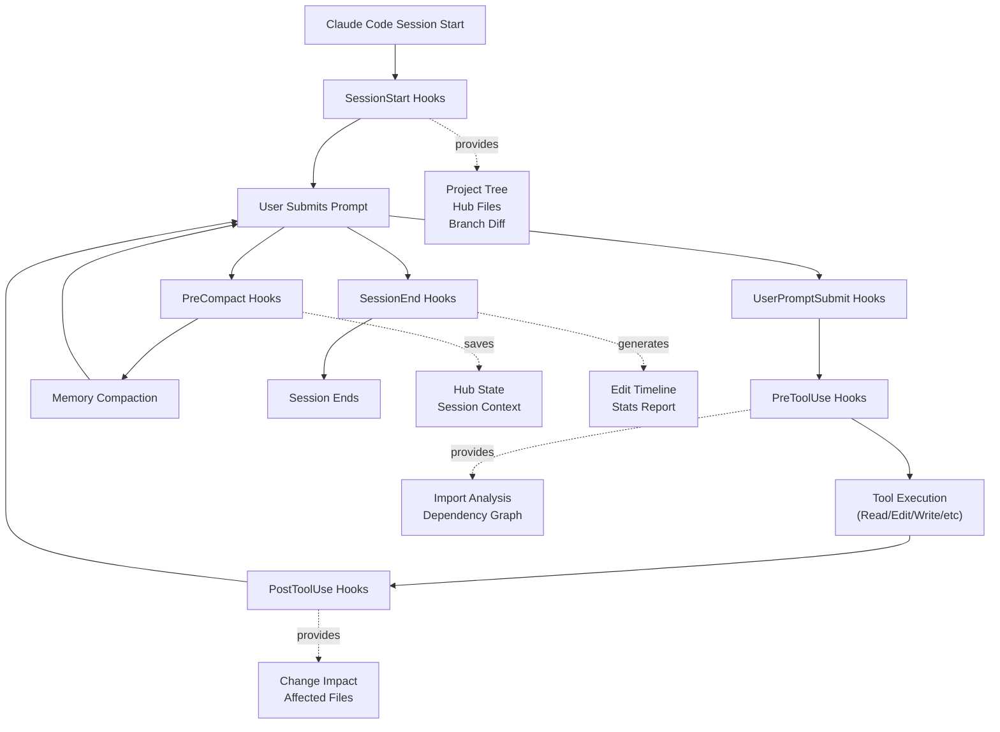
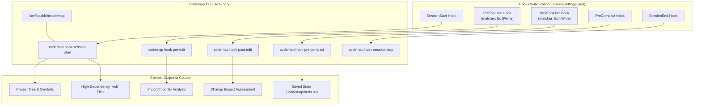

<!-- source: DeepWiki mcp.deepwiki.com · repo neolabhq/context-engineering-kit · page 7.2 Session Hooks & Automation · fetched 2026-10-27 -->

# Session Hooks & Automation

<details>
<summary>Relevant source files</summary>

The following files were used as context for generating this wiki page:

- [.devcontainer/Dockerfile](.devcontainer/Dockerfile)
- [.devcontainer/configure-claude.sh](.devcontainer/configure-claude.sh)
- [.devcontainer/devcontainer.json](.devcontainer/devcontainer.json)
- [.devcontainer/install-mcps.sh](.devcontainer/install-mcps.sh)
- [.devcontainer/statusline.sh](.devcontainer/statusline.sh)
- [CLAUDE.md](CLAUDE.md)
- [docs/guides/README.md](docs/guides/README.md)
- [docs/plugins/fpf/architecture.md](docs/plugins/fpf/architecture.md)
- [docs/plugins/fpf/evidence-freshness.md](docs/plugins/fpf/evidence-freshness.md)
- [docs/plugins/mcp/README.md](docs/plugins/mcp/README.md)
- [justfile](justfile)
- [plugins/mcp/.claude-plugin/plugin.json](plugins/mcp/.claude-plugin/plugin.json)
- [plugins/mcp/README.md](plugins/mcp/README.md)

</details>


Session hooks provide automated context injection and monitoring capabilities in Claude Code through the `.claude/settings.json` configuration file. This system allows developers to execute shell commands at specific lifecycle points of an AI interaction session, ensuring the agent always has access to the most relevant codebase state, dependency graphs, and change impacts.

## Purpose and Scope

Session hooks enable automatic execution of commands at specific points during a Claude Code session. Primary use cases include:

- **Automatic context injection**: Providing codebase structure, changes, and state at session start.
- **Pre/post-tool monitoring**: Tracking file edits, imports, and dependencies before and after modifications.
- **State preservation**: Saving context before memory compaction.
- **Session analytics**: Generating edit timelines and statistics on session end.

The Context Engineering Kit leverages these hooks primarily for **Codemap CLI** integration, which visualizes codebase architecture for the agent [docs/plugins/mcp/README.md:17-19]().

## Hook System Architecture

The following diagram illustrates the lifecycle of a Claude Code session and where specific hooks trigger.

### Session Lifecycle & Hook Trigger Points

**Sources:** [.devcontainer/configure-claude.sh:20-31](), [docs/plugins/mcp/README.md:53-55]()

## Configuration File Location

Hook configurations are stored in `.claude/settings.json`. In the Context Engineering Kit's devcontainer environment, a default configuration is initialized with `bypassPermissions` and a basic `SessionStart` hook [.devcontainer/configure-claude.sh:15-31]().

**File structure:**
```json
{
  "hooks": {
    "SessionStart": [...],
    "PreToolUse": [...],
    "PostToolUse": [...],
    "UserPromptSubmit": [...],
    "PreCompact": [...],
    "SessionEnd": [...]
  }
}
```

**Sources:** [.devcontainer/configure-claude.sh:15-31]()

## Available Hook Types

| Hook Type | Trigger Point | Typical Use Case |
|-----------|---------------|------------------|
| **SessionStart** | Session initialization | Inject project structure, branch diff, working state |
| **UserPromptSubmit** | User submits each prompt | Contextual file analysis, progress tracking |
| **PreToolUse** | Before tool execution | Pre-edit dependency analysis, import tracking |
| **PostToolUse** | After tool execution | Post-edit impact analysis, change verification |
| **PreCompact** | Before memory compaction | Save state for post-compact recovery |
| **SessionEnd** | Session termination | Generate edit summary, statistics |

**Sources:** [.devcontainer/configure-claude.sh:20-31](), [.devcontainer/configure-claude.sh:46-54]()

## Hook Definition Syntax

### Basic Hook Structure
Each hook type contains an array of hook definitions. Each definition includes a `type` (usually `"command"`) and the shell `command` to execute.

```json
{
  "hooks": {
    "SessionStart": [
      {
        "hooks": [
          {
            "type": "command",
            "command": "echo 'git diff:' && git diff --stat && echo 'git status:' && git status"
          }
        ]
      }
    ]
  }
}
```
**Sources:** [.devcontainer/configure-claude.sh:21-30]()

### Conditional Hook Execution with Matchers
Hooks like `PreToolUse` and `PostToolUse` can use matchers to trigger only for specific tools (e.g., only when the agent attempts to `Edit` or `Write` a file).

## Codemap CLI Integration

Codemap is a core component of the Context Engineering Kit used for intelligent codebase visualization [docs/plugins/mcp/README.md:53-55](). It is installed during the devcontainer build process [.devcontainer/Dockerfile:76-79]().

### Codemap Hook Data Flow

**Sources:** [.devcontainer/Dockerfile:76-79](), [docs/plugins/mcp/README.md:53-55]()

### Codemap Hook Commands Reference

| Command | Output | Use Case |
|---------|--------|----------|
| `codemap hook session-start` | Project tree, hub files, branch diff | Session initialization |
| `codemap hook pre-edit` | Importers/Dependencies of target file | Pre-edit impact analysis |
| `codemap hook post-edit` | Updated dependency graph | Post-edit verification |
| `codemap hook pre-compact` | Saves state to `.codemap/hubs.txt` | State preservation |
| `codemap hook session-stop` | Edit timeline and statistics | Session summary |

**Sources:** [docs/plugins/mcp/README.md:53-55](), [.devcontainer/Dockerfile:76-79]()

## Automation Setup

### MCP Plugin Automation
The Context Engineering Kit provides a specialized command to automate this setup:
`/mcp:setup-codemap-cli` [docs/plugins/mcp/README.md:53-55]().

This command:
1. Verifies the `codemap` binary is available.
2. Configures the `.claude/settings.json` with appropriate hooks.
3. Updates `CLAUDE.md` to inform the agent about available visualization tools.

### Devcontainer Initialization
The kit's sandbox environment automatically configures several automation features:
- **Status Line**: A custom bash script `~/.claude/statusline.sh` is configured to show model, style, token usage, and git branch in the CLI [.devcontainer/configure-claude.sh:32-35]().
- **Bypass Permissions**: Sets `defaultMode` to `bypassPermissions` for a smoother automated experience in the sandbox [.devcontainer/configure-claude.sh:18]().
- **Auto-Compaction**: Explicitly disables `autoCompactEnabled` in `~/.claude.json` to allow manual control via hooks [.devcontainer/configure-claude.sh:46-54]().

## Best Practices

1. **Commands over Skills**: Use hooks to run commands that inject context on-demand rather than loading massive skill descriptions into every prompt [CLAUDE.md:48]().
2. **Minimal Tokens**: Ensure hook outputs are concise. Every token consumed by a hook reduces the available context window for reasoning [CLAUDE.md:51]().
3. **Setup Commands**: Use `/mcp:setup-*` commands to update `CLAUDE.md`. This ensures the project context is persistent and shared with the team [CLAUDE.md:50]().
4. **Bypass Mode in Sandbox**: For CI/CD or sandbox environments, use `bypassPermissions` to prevent interactive prompts from blocking automated hooks [.devcontainer/configure-claude.sh:18]().

**Sources:** [CLAUDE.md:46-51](), [.devcontainer/configure-claude.sh:13-44]()

---

