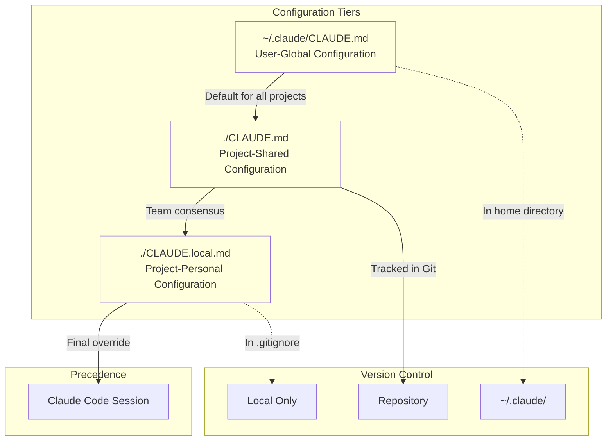
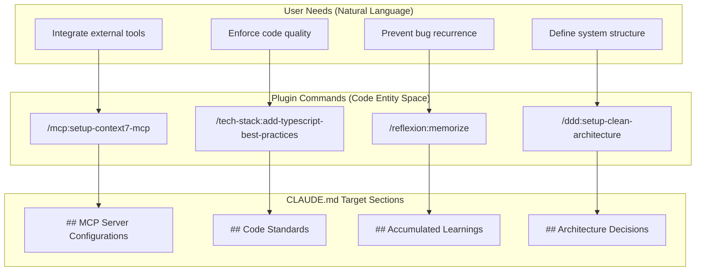
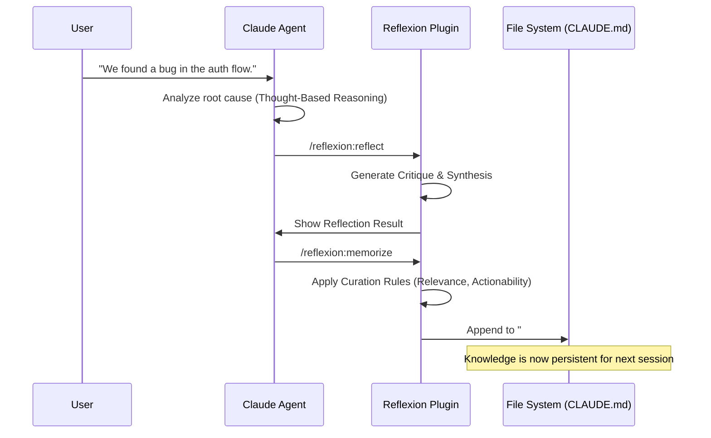

<!-- source: DeepWiki mcp.deepwiki.com · repo neolabhq/context-engineering-kit · page 7.3 Knowledge Accumulation Strategies · fetched 2026-10-27 -->

# Knowledge Accumulation Strategies

Relevant source files

The following files were used as context for generating this wiki page:

- [.specs/anthropic-claude-code-action-prompt.md](.specs/anthropic-claude-code-action-prompt.md)
- [.specs/reports/do-competitively-analysis.md](.specs/reports/do-competitively-analysis.md)
- [.specs/research/research-resources.md](.specs/research/research-resources.md)
- [.specs/usefull-prompts.md](.specs/usefull-prompts.md)
- [CLAUDE.md](CLAUDE.md)
- [docs/plugins/fpf/architecture.md](docs/plugins/fpf/architecture.md)
- [docs/plugins/fpf/evidence-freshness.md](docs/plugins/fpf/evidence-freshness.md)
- [justfile](justfile)
- [plugins/customaize-agent/skills/thought-based-reasoning/SKILL.md](plugins/customaize-agent/skills/thought-based-reasoning/SKILL.md)

This document explains strategies for maximizing the effectiveness of accumulated knowledge in `CLAUDE.md` files within the Context Engineering Kit. It covers what knowledge to preserve, how to structure it, curation principles, and the distinction between team-shared versus personal configurations.

For information about the three-tier configuration system itself, see [Configuration & Context Management](#2.2). For automatic knowledge updates via Reflexion, see [Reflexion Plugin](#3.1.2).

**Sources:** [CLAUDE.md:1-84](), [plugins/reflexion/README.md:1-262](), [plugins/kaizen/README.md:1-576](), [justfile:1-180]()

---

## Configuration Hierarchy

The Context Engineering Kit uses a three-tier configuration system, each serving different purposes for knowledge accumulation. This hierarchy ensures that global preferences don't clutter project-specific rules, and team standards remain consistent across environments.

### Data Flow: Configuration Resolution
The following diagram shows how the system resolves configurations from the most general to the most specific, ultimately forming the `Claude Code Session` context.

**Configuration Tier Purposes:**

| Tier | File Path | Git Tracked | Purpose | Use For |
|------|-----------|-------------|---------|---------|
| **User-Global** | `~/.claude/CLAUDE.md` | No | Personal defaults across all projects | Your coding style, preferred libraries, global preferences |
| **Project-Shared** | `./CLAUDE.md` | Yes | Team-wide project context | Architecture decisions, coding standards, domain knowledge, MCP configurations |
| **Project-Personal** | `./CLAUDE.local.md` | No | Individual overrides for this project | Local API keys, personal workflow preferences, WIP notes |

**Sources:** [CLAUDE.md:1-84](), [plugins/customaize-agent/commands/create-agent.md:1-91]()

---

## Types of Accumulated Knowledge

`CLAUDE.md` files contain four primary categories of knowledge. The kit provides specific commands to populate these sections programmatically.

### Knowledge Category Mapping
This diagram bridges the **Natural Language Space** (User Requirements) to the **Code Entity Space** (Plugin Commands and CLAUDE.md sections).

### 1. MCP Server Configurations
External tool integrations that provide documentation access, semantic code analysis, and other capabilities. These are usually added via `setup-commands` [CLAUDE.md:50]().

**Written by:** `/mcp:setup-context7-mcp`, `/mcp:setup-serena-mcp`, `/mcp:setup-codemap-cli`, `/mcp:setup-arxiv-mcp`.

**Sources:** [CLAUDE.md:93-138](), [plugins/mcp/README.md]()

### 2. Code Standards & Best Practices
Language-specific and framework-specific guidelines. The `tech-stack` plugin provides commands like `/tech-stack:add-typescript-best-practices` to populate these [plugins/tech-stack/README.md]().

### 3. Accumulated Learnings
Insights from reflections and root cause analyses. The `reflexion` plugin uses the `/reflexion:memorize` command to persist these [plugins/reflexion/README.md:172-242]().

### 4. Setup Commands & Hard Rules
Persistent project context and architectural constraints. The `ddd` plugin writes Clean Architecture rules to `CLAUDE.md` [plugins/ddd/README.md]().

---

## Rigorous Knowledge: The First Principles Framework (FPF)

For high-stakes architectural decisions, the kit includes the `fpf` (First Principles Framework) plugin. This moves beyond simple "memorization" to "knowledge assurance" [docs/plugins/fpf/architecture.md:3-32]().

### FPF Knowledge Assurance Levels
Knowledge in FPF is not binary; it has levels of verification:

| Level | Name | Meaning | Promotion Path |
|-------|------|---------|----------------|
| **L0** | Observation | Unverified hypothesis or note | → `/fpf:propose-hypotheses verify` |
| **L1** | Substantiated | Passed logical consistency check | → `/fpf:propose-hypotheses validate` |
| **L2** | Verified | Empirically tested and confirmed | Terminal |
| **Invalid**| Disproved | Failed verification (kept for learning)| Terminal |

**Sources:** [docs/plugins/fpf/architecture.md:53-60]()

### Evidence Freshness (Decay)
Accumulated knowledge can become stale. FPF tracks "Evidence Freshness" [docs/plugins/fpf/evidence-freshness.md:1-13]().
- **WLNK (Weakest Link Principle):** A claim's assurance is capped by its most fragile dependency [docs/plugins/fpf/architecture.md:62-67]().
- **Decay Command:** `/fpf:decay` identifies stale evidence that requires refreshing, deprecation, or waiving [docs/plugins/fpf/evidence-freshness.md:23-46]().

---

## Curation Principles

Effective curation prevents "Context Collapse"—where `CLAUDE.md` becomes so large that important information is lost in noise.

### Memory Curation Rules
When using `/reflexion:memorize`, the following filters are applied:
1. **Relevance**: Does this apply to future work?
2. **Non-Redundancy**: Is this already documented?
3. **Actionability**: Can someone act on this?
4. **Evidence-Based**: Is it backed by concrete examples?

**Sources:** [plugins/reflexion/README.md:188-214]()

### Maintenance Schedule
- **Weekly:** Review new learnings; consolidate duplicates.
- **Monthly:** Archive resolved issues to `ARCHIVE.md`.
- **Quarterly:** Prune obsolete technology references.

---

## Implementation Flow: From Thought to Memory

This diagram shows the technical data flow from an AI's internal reasoning to persistent storage in `CLAUDE.md`.

**Sources:** [plugins/reflexion/README.md:1-262](), [plugins/customaize-agent/skills/thought-based-reasoning/SKILL.md:1-25](), [CLAUDE.md:44-51]()

### Key Development Rules for Knowledge
- **Setup-commands**: Always use setup commands to update `CLAUDE.md` for persistent context [CLAUDE.md:50]().
- **Minimal tokens**: Keep prompts and stored knowledge concise to save context window space [CLAUDE.md:51]().
- **Documentation Checklist**: When adding new skills, update `docs/reference/skills.md` and the plugin's `README.md` [CLAUDE.md:62-72]().

**Sources:** [CLAUDE.md:44-72](), [justfile:11-35]()

---

