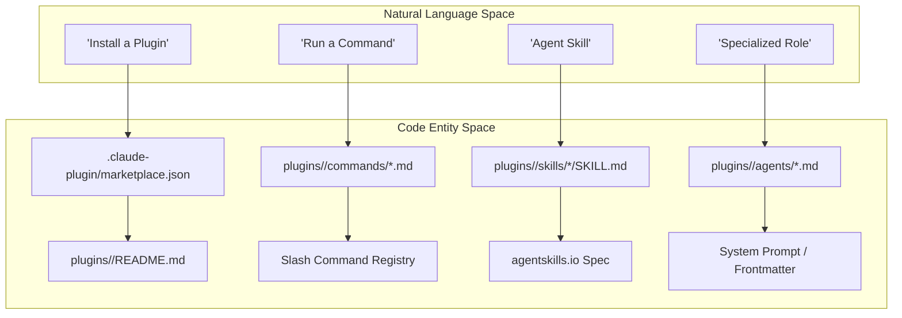
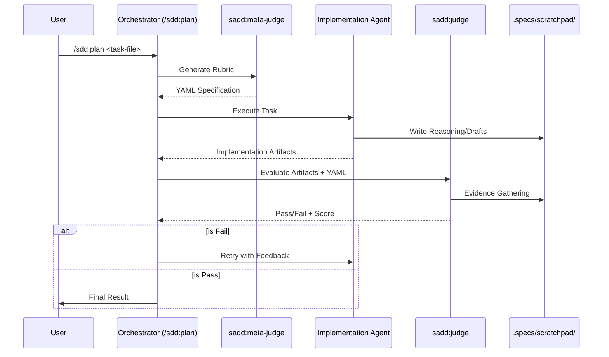

<!-- source: DeepWiki mcp.deepwiki.com · repo neolabhq/context-engineering-kit · page 8 Glossary · fetched 2026-10-27 -->

# Glossary

Relevant source files

The following files were used as context for generating this wiki page:

- [.bin/install-commands.sh](.bin/install-commands.sh)
- [.claude-plugin/marketplace.json](.claude-plugin/marketplace.json)
- [.claude/commands/bump-plugin.md](.claude/commands/bump-plugin.md)
- [.gitignore](.gitignore)
- [.specs/tasks/roadmap.md](.specs/tasks/roadmap.md)
- [CLAUDE.md](CLAUDE.md)
- [README.md](README.md)
- [docs/guides/ci-integration.md](docs/guides/ci-integration.md)
- [docs/plugins/fpf/architecture.md](docs/plugins/fpf/architecture.md)
- [docs/plugins/fpf/evidence-freshness.md](docs/plugins/fpf/evidence-freshness.md)
- [docs/plugins/reflexion/README.md](docs/plugins/reflexion/README.md)
- [docs/plugins/sadd/README.md](docs/plugins/sadd/README.md)
- [docs/resources/papers.md](docs/resources/papers.md)
- [justfile](justfile)
- [plugins/code-review/README.md](plugins/code-review/README.md)
- [plugins/customaize-agent/.claude-plugin/plugin.json](plugins/customaize-agent/.claude-plugin/plugin.json)
- [plugins/customaize-agent/skills/create-rule/SKILL.md](plugins/customaize-agent/skills/create-rule/SKILL.md)
- [plugins/reflexion/README.md](plugins/reflexion/README.md)
- [plugins/sadd/.claude-plugin/plugin.json](plugins/sadd/.claude-plugin/plugin.json)
- [plugins/sadd/README.md](plugins/sadd/README.md)
- [plugins/sadd/agents/judge.md](plugins/sadd/agents/judge.md)
- [plugins/sadd/agents/meta-judge.md](plugins/sadd/agents/meta-judge.md)
- [plugins/sadd/scripts/create-scratchpad.sh](plugins/sadd/scripts/create-scratchpad.sh)
- [plugins/sadd/skills/launch-sub-agent/SKILL.md](plugins/sadd/skills/launch-sub-agent/SKILL.md)
- [plugins/sdd/.claude-plugin/plugin.json](plugins/sdd/.claude-plugin/plugin.json)
- [plugins/sdd/README.md](plugins/sdd/README.md)
- [plugins/sdd/scripts/create-scratchpad.sh](plugins/sdd/scripts/create-scratchpad.sh)
- [plugins/sdd/skills/implement/SKILL.md](plugins/sdd/skills/implement/SKILL.md)
- [plugins/sdd/skills/plan/SKILL.md](plugins/sdd/skills/plan/SKILL.md)

This page provides definitions for codebase-specific terms, jargon, and domain concepts used throughout the **Context Engineering Kit (CEK)**. It serves as a technical reference for onboarding engineers to understand the implementation details and data flow of the kit's plugin architecture.

## Core Definitions

### Plugin
A modular unit of functionality that extends Claude Code. Unlike monolithic configurations, plugins are granular, allowing users to install only the specific agents, commands, and skills they need `[README.md:27-28]()`.
*   **Implementation:** Defined by a `plugin.json` manifest within `plugins/<name>/.claude-plugin/` `[CLAUDE.md:15-16]()`.
*   **Registry:** Managed globally in `.claude-plugin/marketplace.json` `[CLAUDE.md:11-12]()`.

### Command
A slash command (e.g., `/reflexion:reflect`) that is loaded **on-demand**. Commands are preferred over skills for complex tasks to minimize the default token footprint `[CLAUDE.md:48-49]()`.
*   **File Location:** `plugins/<plugin-name>/commands/*.md` `[CLAUDE.md:18-18]()`.

### Skill
A set of instructions or capabilities that are **pre-loaded** into the agent's context by default. They follow the [agentskills.io](https://agentskills.io) specification `[README.md:30-30]()`.
*   **File Location:** `plugins/<plugin-name>/skills/*.md` `[CLAUDE.md:19-19]()`.

### Specialized Agent
A focused LLM configuration with a restricted system prompt and specific tools, designed to perform a narrow task (e.g., `sadd:judge`). This reduces hallucinations by limiting context to only what is necessary for that role `[CLAUDE.md:49-49]()`.
*   **File Location:** `.claude/agents/<name>.md` or `plugins/<plugin>/agents/<name>.md` `[CLAUDE.md:89-89]()`.

---

## Technical Concepts & Jargon

### Context Pollution
The degradation of LLM performance and reasoning accuracy caused by an excessively long session history, outdated assumptions, or redundant information in the prompt `[plugins/sadd/README.md:29-29]()`. The SADD plugin mitigates this by dispatching "fresh" subagents for every task `[plugins/sadd/README.md:7-7]()`.

### Quality Gate
A verification checkpoint between development phases where a **Judge Agent** evaluates the output against a specification. If the output fails the rubric, the workflow triggers a retry loop `[plugins/sadd/README.md:8-8]()`, `[plugins/sdd/skills/implement/SKILL.md:9-9]()`.

### LLM-as-a-Judge
A pattern where one LLM (the Judge) evaluates the output of another LLM (the Implementation Agent) using a structured rubric `[plugins/sadd/README.md:48-48]()`.
*   **Meta-Judge:** An agent that generates the evaluation criteria (YAML) for a specific task `[plugins/sadd/agents/meta-judge.md]()`.
*   **Judge:** An agent that applies the YAML rubric to the implementation artifact `[plugins/sadd/agents/judge.md:10-10]()`.

### Scratchpad
A temporary markdown file created in `.specs/scratchpad/` used by agents to perform "Chain-of-Thought" reasoning, gather evidence, and draft reports before finalizing them `[plugins/sadd/agents/judge.md:72-75]()`.
*   **Script:** `plugins/sadd/scripts/create-scratchpad.sh` `[plugins/sadd/agents/judge.md:72-72]()`.

---

## System Architecture Diagrams

### From Natural Language to Code Entities
The following diagram maps high-level system concepts to their specific code representations and file structures.

**Entity Mapping Diagram**

**Sources:** `[CLAUDE.md:7-27]()`, `[README.md:42-60]()`, `[plugins/sdd/skills/plan/SKILL.md:1-5]()`.

---

### SADD/SDD Workflow Data Flow
This diagram illustrates how data flows between different specialized agents and files during a Specification-Driven Development (SDD) or Subagent-Driven Development (SADD) cycle.

**Execution & Quality Gate Flow**

**Sources:** `[plugins/sadd/README.md:48-50]()`, `[plugins/sadd/agents/judge.md:72-130]()`, `[plugins/sdd/skills/implement/SKILL.md:128-132]()`.

---

## Abbreviations Table

| Abbreviation | Full Term | Context / Definition |
| :--- | :--- | :--- |
| **SADD** | Subagent-Driven Development | Framework for dispatching fresh agents per task `[plugins/sadd/README.md:1-3]()`. |
| **SDD** | Spec-Driven Development | Workflow based on GitHub Spec Kit and OpenSpec `[README.md:79-80]()`. |
| **MCP** | Model Context Protocol | Open standard for connecting AI models to data sources `[README.md:133-134]()`. |
| **FPF** | First Principles Framework | Structured reasoning using ADI (Abduction-Deduction-Induction) cycles `[README.md:144-146]()`. |
| **ADI** | Abduction-Deduction-Induction | The logical cycle used within the FPF plugin `[README.md:145-145]()`. |
| **DDD** | Domain-Driven Development | Plugin focused on Clean Architecture and SOLID principles `[README.md:67-69]()`. |

**Sources:** `[.claude-plugin/marketplace.json:1-155]()`, `[README.md:1-160]()`.