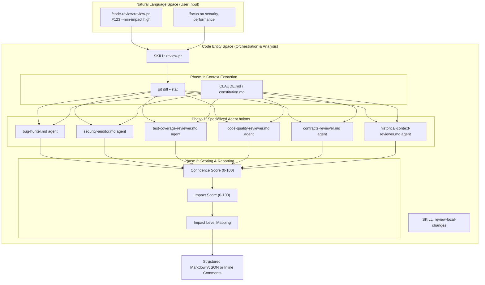
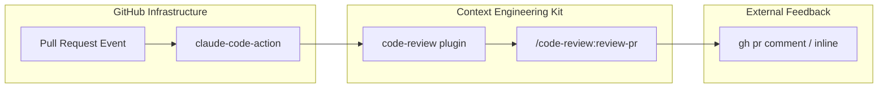

<!-- source: DeepWiki mcp.deepwiki.com · repo neolabhq/context-engineering-kit · extra page Code Review Plugin · fetched 2026-10-27 -->

# Code Review Plugin

<details>
<summary>Relevant source files</summary>

The following files were used as context for generating this wiki page:

- [.cursor/worktrees.json](.cursor/worktrees.json)
- [docs/plugins/code-review/README.md](docs/plugins/code-review/README.md)
- [docs/plugins/code-review/review-local-changes.md](docs/plugins/code-review/review-local-changes.md)
- [docs/plugins/code-review/review-pr.md](docs/plugins/code-review/review-pr.md)
- [docs/plugins/code-review/usage-examples.md](docs/plugins/code-review/usage-examples.md)
- [docs/plugins/customaize-agent/agent-evaluation.md](docs/plugins/customaize-agent/agent-evaluation.md)
- [docs/plugins/customaize-agent/apply-anthropic-skill-best-practices.md](docs/plugins/customaize-agent/apply-anthropic-skill-best-practices.md)
- [docs/plugins/customaize-agent/context-engineering.md](docs/plugins/customaize-agent/context-engineering.md)
- [plugins/code-review/.claude-plugin/plugin.json](plugins/code-review/.claude-plugin/plugin.json)
- [plugins/code-review/agents/bug-hunter.md](plugins/code-review/agents/bug-hunter.md)
- [plugins/code-review/agents/code-quality-reviewer.md](plugins/code-review/agents/code-quality-reviewer.md)
- [plugins/code-review/agents/historical-context-reviewer.md](plugins/code-review/agents/historical-context-reviewer.md)
- [plugins/code-review/agents/security-auditor.md](plugins/code-review/agents/security-auditor.md)
- [plugins/code-review/agents/test-coverage-reviewer.md](plugins/code-review/agents/test-coverage-reviewer.md)
- [plugins/code-review/skills/review-local-changes/SKILL.md](plugins/code-review/skills/review-local-changes/SKILL.md)
- [plugins/code-review/skills/review-pr/SKILL.md](plugins/code-review/skills/review-pr/SKILL.md)
- [plugins/customaize-agent/skills/apply-anthropic-skill-best-practices/SKILL.md](plugins/customaize-agent/skills/apply-anthropic-skill-best-practices/SKILL.md)
- [plugins/customaize-agent/skills/create-agent/SKILL.md](plugins/customaize-agent/skills/create-agent/SKILL.md)
- [plugins/customaize-agent/skills/create-command/SKILL.md](plugins/customaize-agent/skills/create-command/SKILL.md)
- [plugins/customaize-agent/skills/create-skill/SKILL.md](plugins/customaize-agent/skills/create-skill/SKILL.md)
- [plugins/customaize-agent/skills/create-workflow-command/SKILL.md](plugins/customaize-agent/skills/create-workflow-command/SKILL.md)
- [plugins/customaize-agent/skills/test-prompt/SKILL.md](plugins/customaize-agent/skills/test-prompt/SKILL.md)
- [plugins/customaize-agent/skills/test-skill/SKILL.md](plugins/customaize-agent/skills/test-skill/SKILL.md)
- [plugins/ddd/skills/setup-code-formating/SKILL.md](plugins/ddd/skills/setup-code-formating/SKILL.md)

</details>


## Purpose and Scope

The Code Review Plugin is a comprehensive multi-agent system designed to perform deep analysis of code changes. It utilizes six specialized agents to examine code from distinct perspectives, catching bugs, security vulnerabilities, and quality regressions before they reach production. The system supports reviewing uncommitted local changes, active GitHub Pull Requests, and automated CI/CD integration.

**Sources:** [plugins/code-review/README.md:1-14](), [docs/plugins/code-review/README.md:1-15]()

## Plugin Architecture

The plugin is structured as a set of high-level commands that orchestrate specialized sub-agents. It follows a parallel execution model to ensure comprehensive coverage without linear time penalties.

### Plugin Manifest
| Field | Value |
|-------|-------|
| Plugin Name | `code-review` |
| Version | `1.1.1` |
| Commands | `/code-review:review-local-changes`, `/code-review:review-pr` |
| Review Agents | 6 specialized perspectives |

**Sources:** [plugins/code-review/.claude-plugin/plugin.json:1-9](), [docs/plugins/code-review/README.md:63-68]()

### System Data Flow
The following diagram illustrates how the plugin bridges Natural Language requests to Code Entity analysis through its specialized agents.



**Sources:** [plugins/code-review/skills/review-pr/SKILL.md:64-128](), [plugins/code-review/skills/review-local-changes/SKILL.md:81-148]()

## Specialized Review Agents

The core of the system is the division of labor among six agents, each defined by specific instructions and focus areas.

| Agent Name | Primary Focus | Key Entities Analyzed |
|------------|---------------|-----------------------|
| **Bug Hunter** | Logic & Runtime | Race conditions, null pointers, edge cases, error paths. |
| **Security Auditor** | Vulnerabilities | SQLi, XSS, CSRF, secrets exposure, insecure crypto. |
| **Test Coverage** | Verification | Behavioral coverage, missing edge case tests, mock quality. |
| **Code Quality** | Maintainability | Complexity, naming, SOLID principles, code smells. |
| **Contracts** | Interfaces | API schemas, type safety, breaking changes, data models. |
| **Historical Context**| Evolution | Architectural drift, recurring bug patterns, `git blame`. |

**Sources:** [docs/plugins/code-review/README.md:70-135](), [plugins/code-review/agents/bug-hunter.md:8-17](), [plugins/code-review/agents/historical-context-reviewer.md:8-12]()

## Commands & Implementation Details

### /code-review:review-local-changes
This command targets uncommitted work in the current directory. It differentiates between staged and unstaged changes to provide context-aware feedback.

*   **Implementation**: Uses `git diff --stat` and `git diff --cached --stat` to determine scope [plugins/code-review/skills/review-local-changes/SKILL.md:89-96]().
*   **Output**: Can produce a Markdown report or a structured JSON object using the `--json` flag [plugins/code-review/skills/review-local-changes/SKILL.md:27-31]().
*   **Quality Gate**: Fails if any "Critical" or "High" issues are detected when outputting JSON [docs/plugins/code-review/review-local-changes.md:82-88]().

### /code-review:review-pr
Designed for PR workflows, this command emphasizes inline feedback to minimize noise.

*   **Implementation**: Launches parallel Haiku agents to summarize changes before Sonnet/Opus agents perform the deep review [plugins/code-review/skills/review-pr/SKILL.md:79-93]().
*   **Inline Logic**: It is strictly instructed to post inline comments and avoid overall summary reports to reduce developer friction [plugins/code-review/skills/review-pr/SKILL.md:19-20]().

**Sources:** [plugins/code-review/skills/review-local-changes/SKILL.md:1-112](), [plugins/code-review/skills/review-pr/SKILL.md:1-94]()

## Scoring & Filtering System

To ensure high-quality feedback, every issue undergoes a two-factor evaluation by a secondary Haiku agent.

### Impact Level Mapping
The system maps qualitative levels to quantitative scores to enable precise filtering via the `--min-impact` argument.

| Level | Score Range | Threshold |
|-------|-------------|-----------|
| `critical` | 81-100 | 81 |
| `high` | 61-80 | 61 |
| `medium` | 41-60 | 41 |
| `medium-low`| 21-40 | 21 |
| `low` | 0-20 | 0 |

**Sources:** [plugins/code-review/skills/review-pr/SKILL.md:34-62](), [docs/plugins/code-review/review-pr.md:23-31]()

### Progressive Confidence Thresholds
The system uses a "sliding scale" for confidence. Critical issues require less confidence to report (to avoid missing catastrophic bugs), while low-impact issues require near-certainty (to avoid nitpicking).

*   **Critical (81-100 impact)**: 50% confidence required.
*   **High (61-80 impact)**: 65% confidence required.
*   **Medium (41-60 impact)**: 75% confidence required.
*   **Low (0-20 impact)**: 95% confidence required.

**Sources:** [docs/plugins/code-review/review-pr.md:45-52](), [docs/plugins/code-review/review-local-changes.md:51-53]()

## CI/CD Integration

The plugin is optimized for use within GitHub Actions using the `anthropics/claude-code-action`.

### Integration Workflow



### Configuration Example
The following YAML snippet demonstrates how to configure the review in `.github/workflows/claude-code-review.yml`. It requires specific `claude_args` to allow the necessary tools for PR interaction.

```yaml
# Source: docs/plugins/code-review/README.md:143-198
steps:
  - name: Run Claude Code Review
    uses: anthropics/claude-code-action@v1
    with:
      claude_code_oauth_token: ${{ secrets.CLAUDE_CODE_OAUTH_TOKEN }}
      plugin_marketplaces: https://github.com/NeoLabHQ/context-engineering-kit.git
      plugins: "code-review@context-engineering-kit"
      prompt: '/code-review:review-pr ${{ github.repository }}/pull/${{ github.event.pull_request.number }}'
      claude_args: '--allowed-tools "Skill,Bash,Glob,Grep,Read,Task,mcp__github_inline_comment__create_inline_comment,Bash(gh pr comment:*),Bash(gh pr diff:*)"'
```

**Sources:** [docs/plugins/code-review/README.md:136-198](), [plugins/code-review/README.md:42-45]()

---

