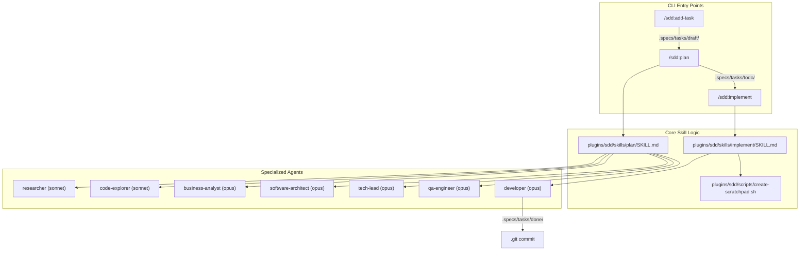
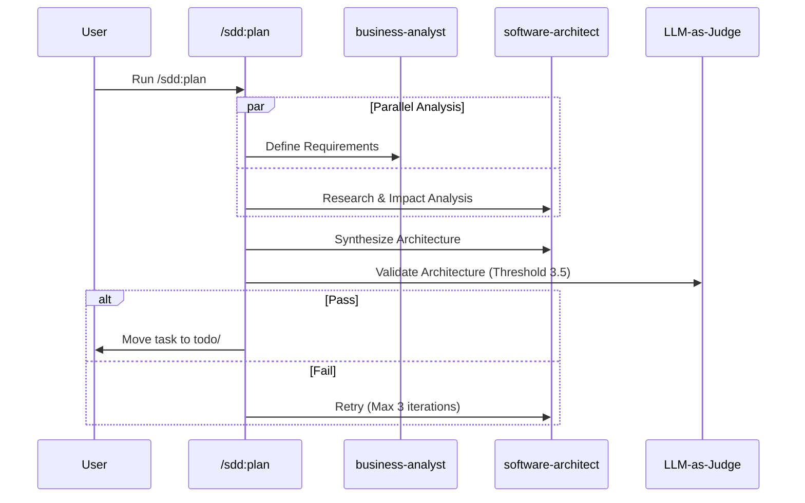

<!-- source: DeepWiki mcp.deepwiki.com · repo neolabhq/context-engineering-kit · extra page SDD Plugin · fetched 2026-10-27 -->

# SDD Plugin

Relevant source files

The following files were used as context for generating this wiki page:

- [.gitignore](.gitignore)
- [.specs/tasks/roadmap.md](.specs/tasks/roadmap.md)
- [docs/guides/competitivy-generation.md](docs/guides/competitivy-generation.md)
- [docs/guides/spec-driven-development.md](docs/guides/spec-driven-development.md)
- [docs/plugins/sdd/README.md](docs/plugins/sdd/README.md)
- [docs/plugins/sdd/add-task.md](docs/plugins/sdd/add-task.md)
- [docs/plugins/sdd/customization.md](docs/plugins/sdd/customization.md)
- [docs/plugins/sdd/implement.md](docs/plugins/sdd/implement.md)
- [docs/plugins/sdd/plan.md](docs/plugins/sdd/plan.md)
- [docs/plugins/sdd/refine.md](docs/plugins/sdd/refine.md)
- [docs/plugins/sdd/usage-examples.md](docs/plugins/sdd/usage-examples.md)
- [plugins/sadd/skills/launch-sub-agent/SKILL.md](plugins/sadd/skills/launch-sub-agent/SKILL.md)
- [plugins/sdd/scripts/create-scratchpad.sh](plugins/sdd/scripts/create-scratchpad.sh)
- [plugins/sdd/skills/implement/SKILL.md](plugins/sdd/skills/implement/SKILL.md)
- [plugins/sdd/skills/plan/SKILL.md](plugins/sdd/skills/plan/SKILL.md)

The SDD (Spec-Driven Development) Plugin implements a high-reliability, multi-agent development workflow designed to transform natural language prompts into production-ready code. Based on the **arc42** standard and the **GitHub Spec Kit**, it functions as a "development compilation" process where task specifications are iteratively refined through quality gates before execution.

This plugin is specifically optimized for complex or large codebases where architecture consistency and impact analysis are critical. It uses a 6-phase planning process followed by a gated implementation phase, leveraging specialized agents for research, architecture, and verification.

Sources: [docs/plugins/sdd/README.md:1-15](), [docs/plugins/sdd/README.md:108-113]()

## Architecture & Data Flow

The SDD Plugin operates through a series of specialized agents that manage the lifecycle of a task across four distinct states: `draft`, `todo`, `in-progress`, and `done`.

### Task Lifecycle & Directory Structure

The plugin enforces a strict directory structure under `.specs/tasks/` to manage the state of development.

| Directory | State | Description |
|-----------|-------|-------------|
| `.specs/tasks/draft/` | Draft | Initial user intent captured by `/sdd:add-task`. |
| `.specs/tasks/todo/` | Planned | Refined specification with architecture and steps after `/sdd:plan`. |
| `.specs/tasks/in-progress/` | Active | Currently being executed by `/sdd:implement`. |
| `.specs/tasks/done/` | Completed | Implementation finished and verified. |
| `.specs/scratchpad/` | Context | Gitignored temporary files for agent reasoning. |

Sources: [docs/plugins/sdd/README.md:72-77](), [docs/plugins/sdd/add-task.md:69-76]()

### System Entity Map (Code Space to Workflow Space)

The following diagram maps codebase entities (scripts, skill files, and agents) to the logical phases of the SDD workflow.

Sources: [plugins/sdd/skills/plan/SKILL.md:1-23](), [plugins/sdd/skills/implement/SKILL.md:1-11](), [docs/plugins/sdd/README.md:96-106]()

## Phase 1: Planning Workflow (`/sdd:plan`)

The planning phase transforms a vague prompt into a technical specification. It uses a parallel analysis strategy followed by synthesis.

### Parallel Analysis & Synthesis

1.  **Phase 2a: Research** (`researcher`): Gathers documentation and creates reusable skills in `.claude/skills/`.
2.  **Phase 2b: Codebase Analysis** (`code-explorer`): Identifies affected files and integration points, producing `.specs/analysis/` reports.
3.  **Phase 2c: Business Analysis** (`business-analyst`): Refines acceptance criteria and user scenarios.
4.  **Phase 3: Architecture Synthesis** (`software-architect`): Combines analysis into a solution strategy.
5.  **Phase 4: Decomposition** (`tech-lead`): Breaks the design into implementation steps.
6.  **Phase 5: Parallelize** (`team-lead`): Reorganizes steps for execution efficiency.
7.  **Phase 6: Verifications** (`qa-engineer`): Defines **LLM-as-Judge** rubrics for each step.

Sources: [plugins/sdd/skills/plan/SKILL.md:54-64](), [docs/plugins/sdd/plan.md:112-138]()

### Planning Control Flow

Sources: [plugins/sdd/skills/plan/SKILL.md:44-52](), [docs/plugins/sdd/plan.md:42-108]()

## Phase 2: Implementation Workflow (`/sdd:implement`)

Implementation is an iterative process where each step is verified by a "Judge" agent before moving to the next.

### Implementation Patterns

The `sdd:implement` skill applies different verification levels based on step complexity:

*   **Simple Step**: No verification (e.g., creating directories).
*   **Critical Step**: Uses a **Panel of 2** evaluation agents. It calculates the median score; if it meets the `--target-quality` (default 4.0-4.5), the step is marked `[DONE]`.
*   **Multi-Item Step**: Launches parallel developer and judge agents for each item (e.g., implementing 5 different API endpoints).

Sources: [docs/plugins/sdd/implement.md:115-139](), [plugins/sdd/skills/implement/SKILL.md:33-34]()

### Refine Mode (`--refine`)

The `--refine` flag allows for incremental development. It uses `git diff` to detect manual changes made by the developer.
1.  **Change Detection**: Runs `git diff HEAD --name-only` to find modified project files.
2.  **Mapping**: Maps modified files to specific implementation steps in the task file.
3.  **Propagation**: Starts re-verification from the **earliest affected step**.

Sources: [plugins/sdd/skills/implement/SKILL.md:84-126](), [docs/plugins/sdd/usage-examples.md:116-137]()

## Configuration & Customization

The plugin allows balancing speed vs. quality through command-line arguments.

| Argument | Default | Description |
|----------|---------|-------------|
| `--target-quality` | 3.5 (Plan) / 4.0 (Impl) | Threshold (0-5.0) for Judge pass/fail. |
| `--max-iterations` | 3 | Maximum retry cycles per step before proceeding. |
| `--fast` | N/A | Alias for lower quality (3.0) and skipped analysis phases. |
| `--human-in-the-loop`| None | Pauses for user approval after specified phases. |

Sources: [plugins/sdd/skills/plan/SKILL.md:38-52](), [docs/plugins/sdd/customization.md:9-18]()

### Scratchpad Usage
Agents are instructed to use a dedicated scratchpad for "thinking" to avoid polluting the main context. The script `plugins/sdd/scripts/create-scratchpad.sh` generates a unique hex ID for each session (e.g., `.specs/scratchpad/a1b2c3d4.md`) and ensures it is added to `.gitignore`.

Sources: [plugins/sdd/scripts/create-scratchpad.sh:15-43](), [docs/plugins/sdd/add-task.md:76]()

---

