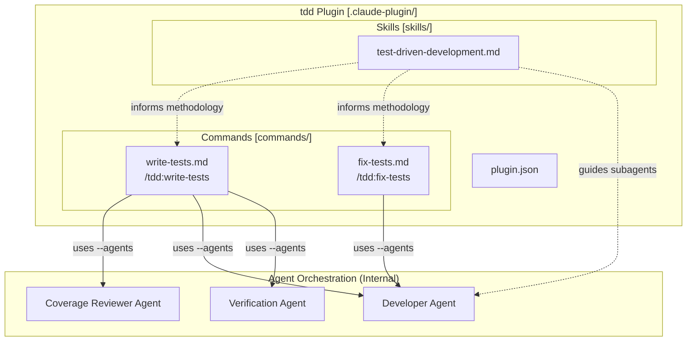
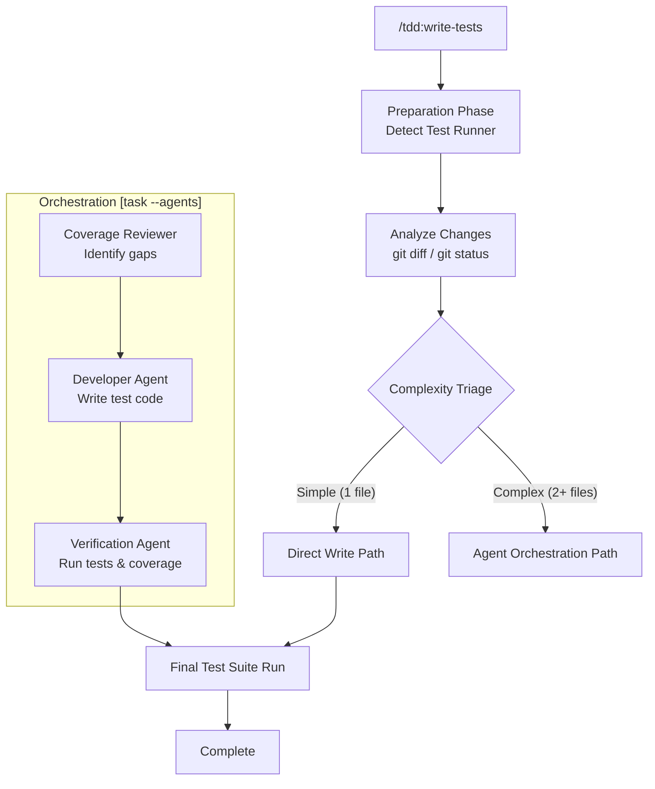
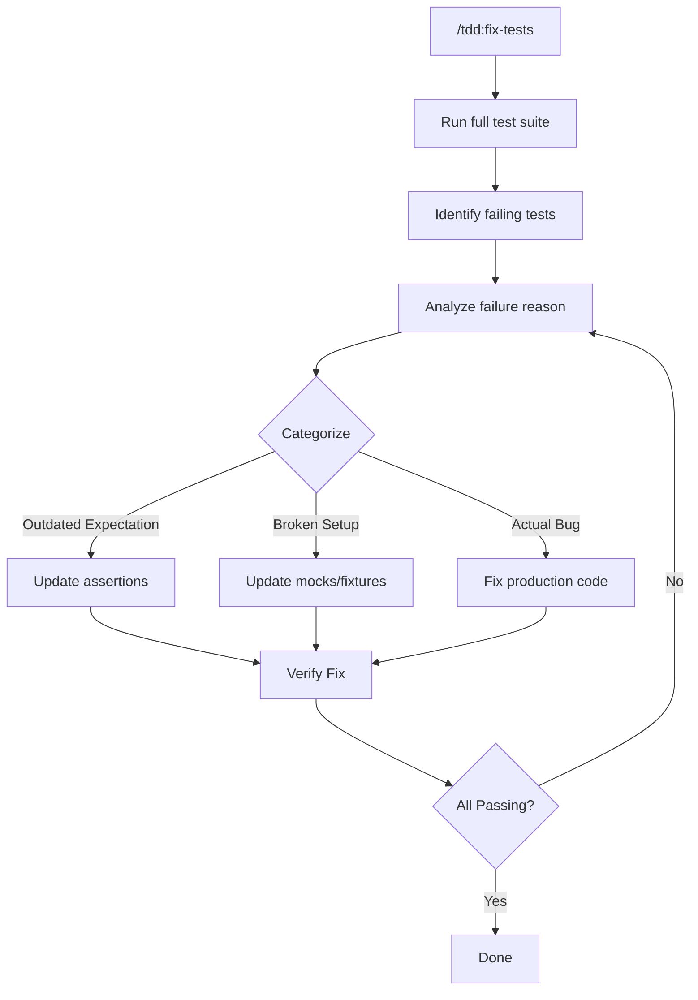
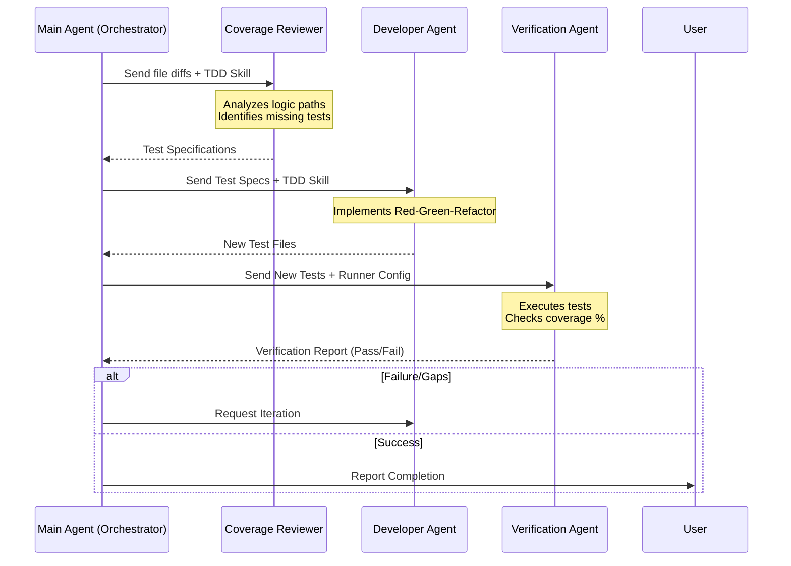

<!-- source: DeepWiki mcp.deepwiki.com · repo neolabhq/context-engineering-kit · extra page TDD Plugin · fetched 2026-10-27 -->

# TDD Plugin

Relevant source files

The following files were used as context for generating this wiki page:

- [plugins/docs/.claude-plugin/plugin.json](plugins/docs/.claude-plugin/plugin.json)
- [plugins/kaizen/.claude-plugin/plugin.json](plugins/kaizen/.claude-plugin/plugin.json)
- [plugins/tdd/.claude-plugin/plugin.json](plugins/tdd/.claude-plugin/plugin.json)

The TDD Plugin implements Test-Driven Development methodology for Claude Code, ensuring production code is validated by tests written first. This plugin provides commands for systematic test coverage generation (`/tdd:write-tests`) and test maintenance (`/tdd:fix-tests`), orchestrating specialized agents to handle complex multi-file changes. It enforces the Red-Green-Refactor cycle and detects common testing anti-patterns.

For spec-driven workflows that incorporate testing, see [3.2.2 SDD Plugin](). For quality gates that verify test coverage between tasks, see [3.2.3 SADD Plugin](). For continuous improvement of test suites, see [3.4.1 Kaizen Plugin]().

---

## Plugin Architecture

The TDD Plugin consists of two commands and one skill that work together to enforce test-first development practices.

### Code Entity Relationship Diagram

**Sources:** [plugins/tdd/.claude-plugin/plugin.json:1-9](), [plugins/tdd/README.md:1-20]()

---

## Command: /tdd:write-tests

The `write-tests` command systematically generates test coverage for local code changes. It analyzes uncommitted modifications (or the latest commit if the working directory is clean), determines complexity, and either writes tests directly or orchestrates specialized agents.

### Implementation Flow

**Sources:** [plugins/tdd/README.md:68-120]()

### Complexity Decision Logic

| Condition | Path | Agent Strategy |
|-----------|------|----------------|
| 1 simple file, straightforward logic | Simple | Direct test writing by main agent |
| 2+ files | Complex | Parallel coverage reviewer + developer agents per file |
| Complex logic in single file | Complex | Full orchestration: review → develop → verify |

**Sources:** [plugins/tdd/README.md:84-89]()

---

## Command: /tdd:fix-tests

The `fix-tests` command updates failing tests after business logic changes or refactoring. It distinguishes between outdated test expectations and actual bugs, fixing tests to match current behavior while preserving test intent.

### Failure Analysis Logic

**Sources:** [plugins/tdd/README.md:138-189]()

---

## Skill: test-driven-development

The `test-driven-development` skill provides comprehensive methodology guidance and anti-pattern detection that informs both command execution and direct Claude Code interactions.

### The Red-Green-Refactor Cycle

The skill enforces the fundamental TDD cycle with verification at each step:

1.  **RED**: Write a minimal failing test. The skill mandates that the test must fail for the expected reason before any production code is written [plugins/tdd/README.md:205-220]().
2.  **GREEN**: Write the simplest code possible to make the test pass. This adheres to the YAGNI (You Ain't Gonna Need It) principle [plugins/tdd/README.md:222-240]().
3.  **REFACTOR**: Clean up the code while ensuring tests remain green. This includes removing duplication and improving naming [plugins/tdd/README.md:242-262]().

### Anti-Pattern Detection

The TDD skill includes detection for common testing mistakes:

| Anti-Pattern | Problem |
|--------------|---------|
| **Testing Mocks** | Verifies the mock implementation rather than the actual logic [plugins/tdd/README.md:265-266](). |
| **Test-Only Methods** | Adding public methods to production code solely for test access [plugins/tdd/README.md:267-268](). |
| **Incomplete Mocks** | Mocks that don't reflect the full behavior of the real dependency [plugins/tdd/README.md:271-272](). |
| **Post-hoc Testing** | Writing tests after the code, which fails to prove the test actually validates the logic [plugins/tdd/README.md:273-274](). |

**Sources:** [plugins/tdd/README.md:263-274]()

---

## Agent Orchestration Detail

When complexity is high, the TDD plugin spawns specialized subagents using the `task` tool with the `--agents` flag.

### Data Flow Between Agents

**Sources:** [plugins/tdd/README.md:82-93](), [plugins/tdd/README.md:148-166]()

---

## Integration with Documentation and Quality

The TDD plugin often works in tandem with the `docs` and `kaizen` plugins to maintain high project standards.

-   **Docs Integration**: When tests are written or fixed, the `docs` plugin can be used to update technical specifications or API documentation to reflect the validated behavior [plugins/docs/.claude-plugin/plugin.json:1-9]().
-   **Kaizen Integration**: If recurring test failures are identified, the `kaizen` plugin's "5 Whys" or "Fishbone Analysis" commands can be used to investigate root causes in the development process [plugins/kaizen/.claude-plugin/plugin.json:1-9]().

**Sources:** [plugins/docs/.claude-plugin/plugin.json:1-9](), [plugins/kaizen/.claude-plugin/plugin.json:1-9]()

---

