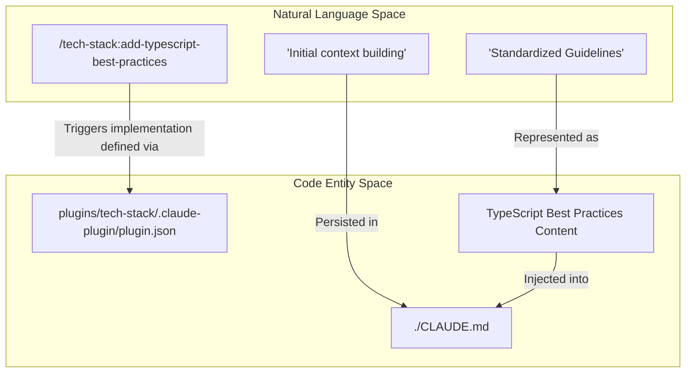
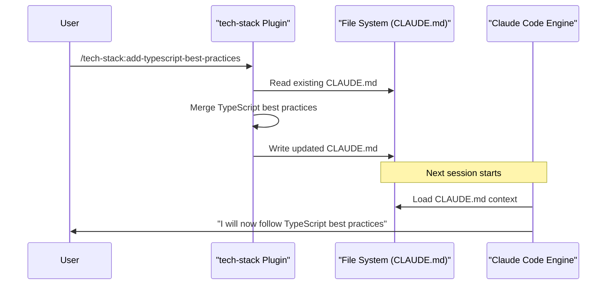
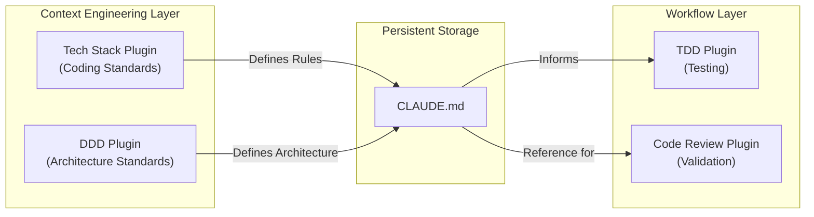

<!-- source: DeepWiki mcp.deepwiki.com · repo neolabhq/context-engineering-kit · extra page Tech Stack Plugin · fetched 2026-10-27 -->

# Tech Stack Plugin

Relevant source files

The following files were used as context for generating this wiki page:

- [docs/plugins/docs/README.md](docs/plugins/docs/README.md)
- [docs/plugins/kaizen/README.md](docs/plugins/kaizen/README.md)
- [docs/plugins/tdd/README.md](docs/plugins/tdd/README.md)
- [docs/plugins/tech-stack/README.md](docs/plugins/tech-stack/README.md)
- [plugins/tech-stack/.claude-plugin/plugin.json](plugins/tech-stack/.claude-plugin/plugin.json)

## Purpose and Scope

The Tech Stack Plugin provides commands for configuring language and framework-specific coding standards in your project's `CLAUDE.md` file. This plugin establishes persistent best practices that Claude follows in every conversation, ensuring consistent code quality across all AI-assisted development [docs/plugins/tech-stack/README.md:1-15]().

This page documents the Tech Stack Plugin's architecture, command reference, and implementation details. It focuses on how curated, production-tested guidelines are injected into the project context to bridge the gap between a raw project and one with well-defined development standards [docs/plugins/tech-stack/README.md:12-14]().

---

## Overview

The Tech Stack Plugin addresses the challenge of inconsistent code generation by providing standardized guidelines that are loaded during every Claude Code session [docs/plugins/tech-stack/README.md:7-8](). By placing coding standards in `CLAUDE.md`, the plugin ensures that rules are persistent, project-specific, and synchronized across a team via version control [docs/plugins/tech-stack/README.md:34-39]().

### Core Components
- **Plugin Manifest**: Defined in `plugins/tech-stack/.claude-plugin/plugin.json` [plugins/tech-stack/.claude-plugin/plugin.json:1-9]().
- **Standardized Guidelines**: Pre-defined best practices for specific stacks (e.g., TypeScript) [docs/plugins/tech-stack/README.md:7]().
- **Context Injection**: Automated updates to `CLAUDE.md` [docs/plugins/tech-stack/README.md:8]().

Sources: [docs/plugins/tech-stack/README.md:1-40](), [plugins/tech-stack/.claude-plugin/plugin.json:1-9]()

---

## Architecture & Data Flow

The plugin operates by modifying the project's persistent context. When a user executes a tech-stack command, the plugin identifies the `CLAUDE.md` file and appends or updates specific best-practice sections.

### Natural Language to Code Entity Mapping
This diagram illustrates how user-facing commands and documentation concepts map to specific code entities and file structures.

Sources: [docs/plugins/tech-stack/README.md:1-15](), [plugins/tech-stack/.claude-plugin/plugin.json:1-9]()

### Configuration Lifecycle
The Tech Stack Plugin interacts with the project-level `CLAUDE.md`, which is the primary source of truth for Claude's behavior in a specific repository.

Sources: [docs/plugins/tech-stack/README.md:32-40](), [docs/plugins/tech-stack/README.md:43]()

---

## Command Reference

### /tech-stack:add-typescript-best-practices

This command sets up TypeScript best practices and code style rules in the `CLAUDE.md` file. It provides Claude with explicit guidelines for generating consistent, type-safe code [docs/plugins/tech-stack/README.md:43]().

**Key Guidelines Injected:**
| Category | Description |
| :--- | :--- |
| **Code Style** | Principles like explicit types, `const` by default, and naming conventions. |
| **Type System** | Rules for `interface` vs `type`, enum usage, and generic constraints. |
| **Library-First** | Recommendations for modern utilities (e.g., `zod`, `date-fns`) over legacy ones. |
| **Quality Patterns** | Patterns for async/await, error handling, and destructuring. |

Sources: [docs/plugins/tech-stack/README.md:43](), [docs/plugins/tech-stack/README.md:12-14]()

---

## Integration with the Plugin Ecosystem

The Tech Stack Plugin serves as the "foundation" layer. It is often used in conjunction with other plugins to create a robust development environment.

### Synergy with Other Plugins
- **TDD Plugin**: While Tech Stack defines *how* to write TypeScript, the TDD plugin (via `/tdd:write-tests`) defines the *workflow* for verifying that code [docs/plugins/tdd/README.md:54-55]().
- **Kaizen Plugin**: Tech Stack provides the "Standardized Work" pillar of Kaizen, making good practices easy to follow [docs/plugins/kaizen/README.md:58]().
- **Docs Plugin**: Once the tech stack is established, the Docs plugin ensures the resulting implementation is documented accurately [docs/plugins/docs/README.md:51-53]().

Sources: [docs/plugins/tech-stack/README.md:7-8](), [docs/plugins/tdd/README.md:3-10](), [docs/plugins/kaizen/README.md:58]()

---

## Usage Examples

### Initializing a Project
To set up a new project with TypeScript best practices:
1. Install the plugin: `/plugin install tech-stack@NeoLabHQ/context-engineering-kit` [docs/plugins/tech-stack/README.md:20]().
2. Run the setup: `/tech-stack:add-typescript-best-practices` [docs/plugins/tech-stack/README.md:23]().
3. Verify the context: `cat CLAUDE.md` [docs/plugins/tech-stack/README.md:26]().

### Continuous Improvement
By integrating with the Kaizen mindset, the Tech Stack plugin supports "Standardized Work"—one of the four pillars of Kaizen—ensuring that the AI doesn't just write code, but writes code that follows the team's established patterns [docs/plugins/kaizen/README.md:58]().

Sources: [docs/plugins/tech-stack/README.md:18-27](), [docs/plugins/kaizen/README.md:52-60]()

---

