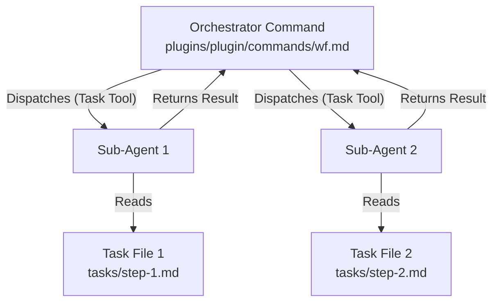
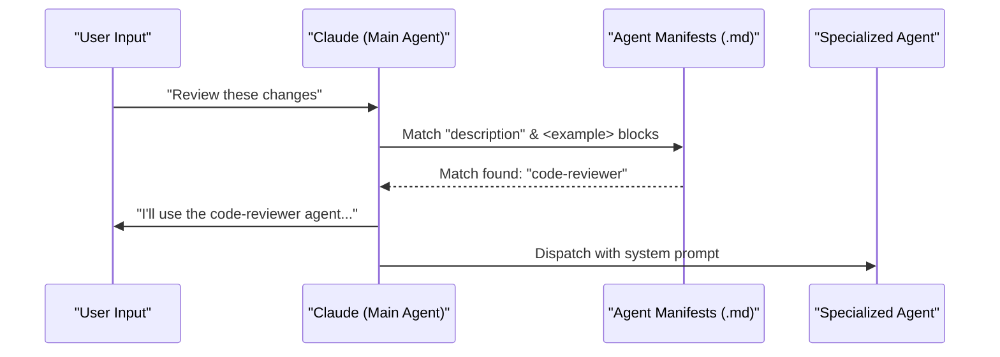

<!-- source: DeepWiki mcp.deepwiki.com · repo neolabhq/context-engineering-kit · extra page Customaize Agent Plugin · fetched 2026-10-27 -->

# Customaize Agent Plugin

Relevant source files

The following files were used as context for generating this wiki page:

- [.specs/research/claude-agent-resources.md](.specs/research/claude-agent-resources.md)
- [docs/plugins/customaize-agent/README.md](docs/plugins/customaize-agent/README.md)
- [plugins/code-review/skills/review-local-changes/SKILL.md](plugins/code-review/skills/review-local-changes/SKILL.md)
- [plugins/code-review/skills/review-pr/SKILL.md](plugins/code-review/skills/review-pr/SKILL.md)
- [plugins/customaize-agent/README.md](plugins/customaize-agent/README.md)
- [plugins/customaize-agent/skills/apply-anthropic-skill-best-practices/SKILL.md](plugins/customaize-agent/skills/apply-anthropic-skill-best-practices/SKILL.md)
- [plugins/customaize-agent/skills/create-agent/SKILL.md](plugins/customaize-agent/skills/create-agent/SKILL.md)
- [plugins/customaize-agent/skills/create-command/SKILL.md](plugins/customaize-agent/skills/create-command/SKILL.md)
- [plugins/customaize-agent/skills/create-hook/SKILL.md](plugins/customaize-agent/skills/create-hook/SKILL.md)
- [plugins/customaize-agent/skills/create-skill/SKILL.md](plugins/customaize-agent/skills/create-skill/SKILL.md)
- [plugins/customaize-agent/skills/create-workflow-command/SKILL.md](plugins/customaize-agent/skills/create-workflow-command/SKILL.md)
- [plugins/customaize-agent/skills/test-prompt/SKILL.md](plugins/customaize-agent/skills/test-prompt/SKILL.md)
- [plugins/customaize-agent/skills/test-skill/SKILL.md](plugins/customaize-agent/skills/test-skill/SKILL.md)
- [plugins/ddd/skills/setup-code-formating/SKILL.md](plugins/ddd/skills/setup-code-formating/SKILL.md)
- [plugins/docs/skills/write-concisely/SKILL.md](plugins/docs/skills/write-concisely/SKILL.md)
- [plugins/kaizen/skills/kaizen/SKILL.md](plugins/kaizen/skills/kaizen/SKILL.md)
- [plugins/sdd/skills/brainstorm/SKILL.md](plugins/sdd/skills/brainstorm/SKILL.md)

The Customaize Agent Plugin is a meta-level framework for creating, testing, and optimizing Claude Code extensions, including commands, skills, and hooks. It implements prompt engineering best practices from Anthropic and research-backed persuasion principles to ensure that custom agents are effective, discoverable, and token-efficient [docs/plugins/customaize-agent/README.md:1-10]().

## Overview

The plugin provides a complete toolkit for extending Claude Code's capabilities by applying Test-Driven Development (TDD) principles to prompt engineering. Users write test scenarios first, observe agent failures, and then create prompts that address those failures in a "RED-GREEN-REFACTOR" cycle [docs/plugins/customaize-agent/README.md:18-22]().

### Core Capabilities
*   **Extension Creation**: Interactive assistants for building commands, skills, and hooks [docs/plugins/customaize-agent/README.md:7]().
*   **Prompt TDD**: Isolated subagent testing to verify prompts before deployment [docs/plugins/customaize-agent/README.md:8]().
*   **Optimization**: Application of Claude Search Optimization (CSO) and persuasion techniques that have been shown to significantly increase agent compliance rates [docs/plugins/customaize-agent/README.md:16-22]().

### Extension Types
| Type | Purpose | Implementation |
| :--- | :--- | :--- |
| **Command** | On-demand actions | Markdown files in `commands/` [plugins/customaize-agent/skills/create-command/SKILL.md:130-138](). |
| **Skill** | Persistent procedural knowledge | `SKILL.md` with YAML frontmatter [plugins/customaize-agent/skills/create-skill/SKILL.md:115-130](). |
| **Hook** | Automated workflow triggers | Scripts in `.claude/hooks/` or `~/.claude/hooks/` [plugins/customaize-agent/skills/create-hook/SKILL.md:102-108](). |
| **Agent** | Specialized sub-task executors | Markdown with `model`, `tools`, and `triggering` metadata [.specs/research/claude-agent-resources.md:17-55](). |

**Sources:** [docs/plugins/customaize-agent/README.md:1-22](), [plugins/customaize-agent/skills/create-skill/SKILL.md:115-130](), [plugins/customaize-agent/skills/create-hook/SKILL.md:102-108](), [plugins/customaize-agent/skills/create-command/SKILL.md:130-138]().

## Command Reference

### /customaize-agent:create-command
This command acts as an interactive assistant for creating new slash commands. It guides the user through understanding the command's purpose, determining its category (Planning, Implementation, Analysis, Workflow, or Utility), and generating the file with required YAML frontmatter [plugins/customaize-agent/skills/create-command/SKILL.md:7-61]().

**Key Features**:
*   **Namespacing**: Uses subdirectories to group related commands (e.g., `.claude/commands/frontend/component.md`) [plugins/customaize-agent/skills/create-command/SKILL.md:130-138]().
*   **Argument Handling**: Supports `$ARGUMENTS` for all input or `$1`, `$2` for positional parameters [plugins/customaize-agent/skills/create-command/SKILL.md:140-166]().
*   **Bash Execution**: Allows executing shell commands via the `!` prefix to provide dynamic context [plugins/customaize-agent/skills/create-command/SKILL.md:168-187]().

### /customaize-agent:create-workflow-command
Designed to solve the "context bloat problem," this command creates orchestrator commands that dispatch sub-agents for multi-step tasks. Instead of one massive prompt, instructions are split into separate task files in the `tasks/` directory [plugins/customaize-agent/skills/create-workflow-command/SKILL.md:19-34]().

**Workflow Architecture**:

**Sources:** [plugins/customaize-agent/skills/create-workflow-command/SKILL.md:19-47]().

### /customaize-agent:create-skill
Treats skill creation as TDD for process documentation. It guides the user to write a "pressure scenario" (test case), watch the agent fail (RED), write the skill (GREEN), and then refine to close loopholes (REFACTOR) [plugins/customaize-agent/skills/create-skill/SKILL.md:13-21]().

**Skill Anatomy**:
*   **YAML Frontmatter**: Must include `name` and `description` (max 1024 chars) [plugins/customaize-agent/skills/create-skill/SKILL.md:132-142]().
*   **Triggering Conditions**: Descriptions must start with "Use when..." to define when Claude should load the skill [plugins/customaize-agent/skills/create-skill/SKILL.md:143-152]().
*   **Bundled Resources**: Can include `scripts/`, `references/`, and `assets/` [plugins/customaize-agent/skills/create-skill/SKILL.md:126-130]().

### /customaize-agent:create-hook
Analyzes project tooling (TypeScript, Prettier, ESLint, etc.) to suggest and configure Git hooks. It handles the creation of the script and updates `settings.json` [plugins/customaize-agent/skills/create-hook/SKILL.md:7-17]().

**Trigger Timings**:
*   `PreToolUse`: Runs before operations (can block via exit code 2) [plugins/customaize-agent/skills/create-hook/SKILL.md:69-74]().
*   `PostToolUse`: Runs after operations (provides feedback/fixes) [plugins/customaize-agent/skills/create-hook/SKILL.md:69-74]().

**Sources:** [plugins/customaize-agent/skills/create-skill/SKILL.md:13-152](), [plugins/customaize-agent/skills/create-hook/SKILL.md:7-108]().

## Prompt Engineering & Testing

### RED-GREEN-REFACTOR for Prompts
The plugin enforces a rigorous testing cycle for all extension types to ensure they are "bulletproof against rationalization" [plugins/customaize-agent/skills/create-skill/SKILL.md:3]().

| Phase | Action | Goal |
| :--- | :--- | :--- |
| **RED** | Run baseline scenario without the prompt | Document exact rationalizations or failures the agent makes [plugins/customaize-agent/skills/create-skill/SKILL.md:53-57](). |
| **GREEN** | Add the prompt/skill and re-run scenario | Verify the agent now complies with the new instructions [plugins/customaize-agent/skills/create-skill/SKILL.md:54-59](). |
| **REFACTOR** | Find new edge cases or loopholes | Optimize for token efficiency while maintaining compliance [plugins/customaize-agent/skills/create-skill/SKILL.md:55-60](). |

### Agent Triggering Metadata
For specialized agents, the `description` field is critical. It must include `<example>` blocks that demonstrate both proactive and reactive triggering scenarios [.specs/research/claude-agent-resources.md:75-90]().

**Data Flow for Agent Triggering**:

**Sources:** [.specs/research/claude-agent-resources.md:75-155](), [plugins/customaize-agent/skills/create-skill/SKILL.md:47-62]().

## Skills Reference

### customaize-agent:prompt-engineering
Provides advanced techniques including Anthropic's official guidelines and persuasion principles. It is used when writing or optimizing any instructional content [docs/plugins/customaize-agent/README.md:61]().

### customaize-agent:context-engineering
Focuses on the mechanics of context in agent systems. It is essential for managing "context bloat" in complex multi-agent workflows [docs/plugins/customaize-agent/README.md:62]().

### customaize-agent:agent-evaluation
Used to measure agent improvement quality and validate context engineering choices during the testing phase [docs/plugins/customaize-agent/README.md:63]().

**Sources:** [docs/plugins/customaize-agent/README.md:61-64]().

---

