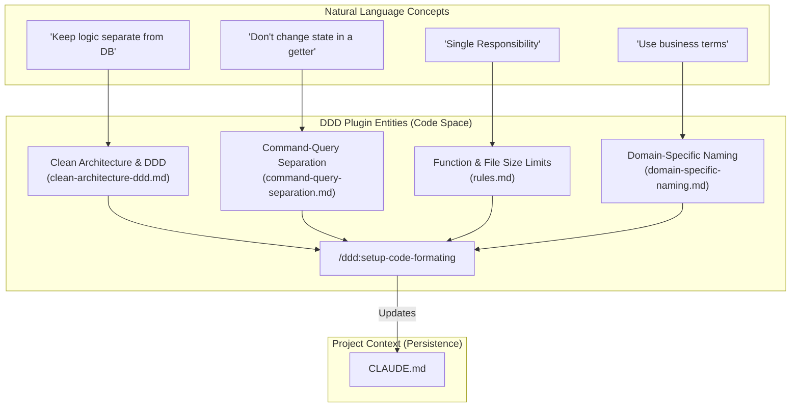
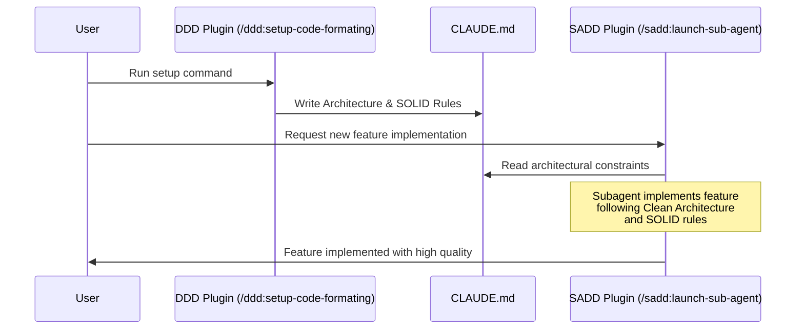

<!-- source: DeepWiki mcp.deepwiki.com · repo neolabhq/context-engineering-kit · extra page DDD Plugin · fetched 2026-10-27 -->

# DDD Plugin

<details>
<summary>Relevant source files</summary>

The following files were used as context for generating this wiki page:

- [docs/SUMMARY.md](docs/SUMMARY.md)
- [docs/plugins/README.md](docs/plugins/README.md)
- [docs/plugins/ddd/README.md](docs/plugins/ddd/README.md)
- [docs/plugins/ddd/rules.md](docs/plugins/ddd/rules.md)
- [docs/reference/skills.md](docs/reference/skills.md)
- [plugins/ddd/.claude-plugin/plugin.json](plugins/ddd/.claude-plugin/plugin.json)
- [plugins/ddd/README.md](plugins/ddd/README.md)
- [plugins/ddd/rules/call-site-honesty.md](plugins/ddd/rules/call-site-honesty.md)
- [plugins/ddd/rules/clean-architecture-ddd.md](plugins/ddd/rules/clean-architecture-ddd.md)
- [plugins/ddd/rules/command-query-separation.md](plugins/ddd/rules/command-query-separation.md)
- [plugins/ddd/rules/domain-specific-naming.md](plugins/ddd/rules/domain-specific-naming.md)
- [plugins/ddd/rules/early-return-pattern.md](plugins/ddd/rules/early-return-pattern.md)
- [plugins/ddd/rules/error-handling.md](plugins/ddd/rules/error-handling.md)
- [plugins/ddd/rules/explicit-control-flow.md](plugins/ddd/rules/explicit-control-flow.md)
- [plugins/sadd/skills/subagent-driven-development/SKILL.md](plugins/sadd/skills/subagent-driven-development/SKILL.md)
- [plugins/tdd/skills/test-driven-development/SKILL.md](plugins/tdd/skills/test-driven-development/SKILL.md)

</details>


The DDD (Domain-Driven Development) Plugin is a code quality framework that embeds **Clean Architecture**, **SOLID principles**, and **Domain-Driven Design** patterns into the development workflow. It operates through persistent rules and contextual commands that update the project's `CLAUDE.md` configuration to ensure that AI-assisted code generation adheres to high-quality architectural standards.

[plugins/ddd/README.md:1-11]()

## Overview

The DDD plugin addresses the core challenge of software development: **managing complexity**. It establishes clear boundaries between business logic and infrastructure, promotes domain-specific naming, and follows proven design patterns. These principles are based on foundational works such as Eric Evans' "Domain-Driven Design" and Robert C. Martin's "Clean Architecture".

The plugin functions by providing:
- **Persistent Rules**: 14 composable rules that activate automatically when writing or reviewing code.
- **Contextual Commands**: Tools to establish code formatting and architectural standards in the project context.
- **Architectural Guardrails**: Correct and incorrect code examples within rules to guide the model toward maintainable patterns.

[plugins/ddd/README.md:12-19](), [docs/plugins/ddd/README.md:12-19]()

## System Architecture & Data Flow

The DDD plugin acts as a configuration engine for the `CLAUDE.md` file, which serves as the primary context source for Claude Code.

### Logic Flow: Natural Language to Code Entity

The following diagram illustrates how architectural concepts expressed in natural language are mapped to specific code entities and rules within the DDD plugin.



**Sources:** [plugins/ddd/README.md:42-51](), [docs/plugins/ddd/rules.md:9-24](), [plugins/ddd/.claude-plugin/plugin.json:1-9]()

## Installation

Install the DDD plugin from the marketplace:

```bash
/plugin install ddd@NeoLabHQ/context-engineering-kit
```

**Sources:** [docs/plugins/README.md:29-35]()

## Commands

### /ddd:setup-code-formating

This command establishes consistent code formatting rules and style guidelines by updating the project's `CLAUDE.md` file. It enforces standards for naming, file organization, and architectural boundaries.

[plugins/ddd/README.md:36-40](), [docs/plugins/ddd/README.md:43-46]()

## Rules Reference

The plugin includes 14 rules organized into four categories. These rules target specific file patterns (usually `src/**/*`) and provide impact levels to prioritize architectural integrity.

| Category | Rules | Impact |
| :--- | :--- | :--- |
| **Architecture** | Clean Architecture & DDD, Separation of Concerns, Functional Core / Imperative Shell | HIGH |
| **Function Design** | Command-Query Separation, Principle of Least Astonishment, Call-Site Honesty | HIGH/MED |
| **Explicitness** | Explicit Control Flow, Explicit Data Flow, Explicit Side Effects | HIGH |
| **Code Quality** | Error Handling, Domain-Specific Naming, Library-First Approach, Early Return Pattern, Function & File Size Limits | HIGH/MED |

[docs/plugins/ddd/rules.md:9-24](), [plugins/ddd/README.md:46-51]()

### Key Implementation Patterns

#### Command-Query Separation (CQS)
Functions must either return a value (query) or cause a side effect (command), never both. This prevents hidden mutations that are invisible at the call site.
[plugins/ddd/rules/command-query-separation.md:8-10]()

#### Explicit Control Flow
Policy-mechanism separation: A "mechanism" is a pure function returning a result; a "policy" is the caller's decision (throw, log, branch). Control flow decisions must be visible at the call site.
[plugins/ddd/rules/explicit-control-flow.md:8-12]()

#### Typed Error Handling
Never silently swallow exceptions. Every catch block must use typed error handling and log the error with context before rethrowing.
[plugins/ddd/rules/error-handling.md:8-10]()

## Integration with Development Workflow

The DDD plugin provides the architectural foundation for other workflow plugins like **TDD** (Test-Driven Development) and **SADD** (Subagent-Driven Development).



**Sources:** [docs/plugins/README.md:87-101](), [docs/reference/skills.md:13-24](), [plugins/sadd/skills/subagent-driven-development/SKILL.md:1-11]()

## Foundational Concepts

The plugin applies concepts from core software engineering literature:

| Concept | Source | Application |
| :--- | :--- | :--- |
| **Ubiquitous Language** | Eric Evans (DDD) | Domain-specific naming conventions in `domain-specific-naming.md` |
| **Dependency Inversion** | Robert C. Martin (SOLID) | Layer separation rules in `clean-architecture-ddd.md` |
| **Functional Core** | Gary Bernhardt | Pure logic in `functional-core-imperative-shell.md` |
| **Single Responsibility** | Robert C. Martin (SOLID) | Function (<80 lines) and File (<200 lines) size limits |

[plugins/ddd/README.md:65-83](), [docs/plugins/ddd/rules.md:24]()

---

