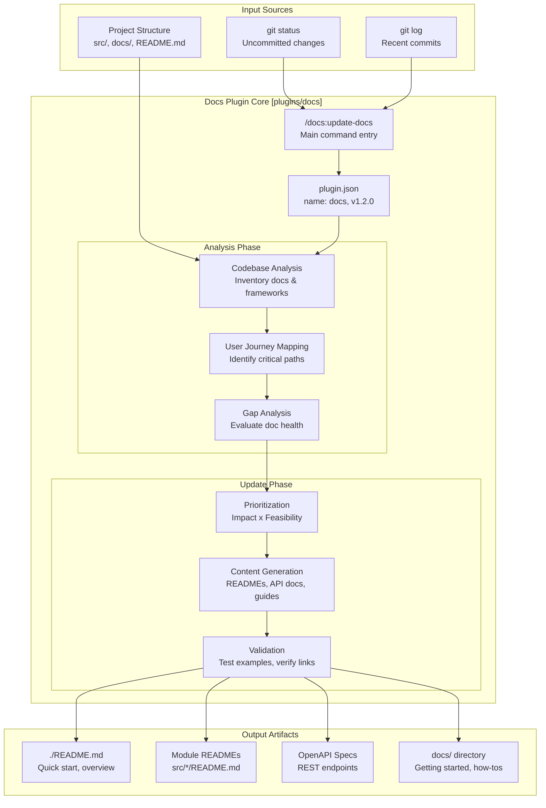
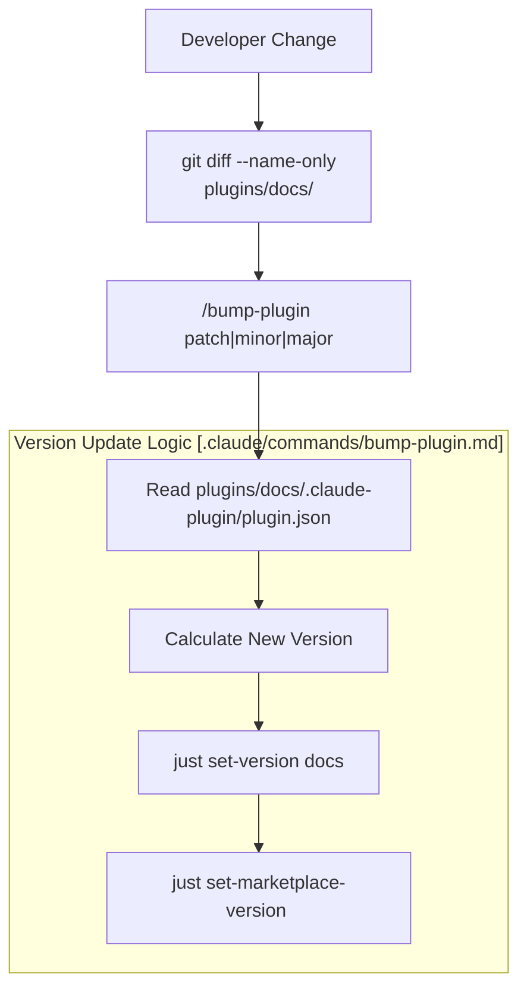

<!-- source: DeepWiki mcp.deepwiki.com · repo neolabhq/context-engineering-kit · extra page Docs Plugin · fetched 2026-10-27 -->

# Docs Plugin

<details>
<summary>Relevant source files</summary>

The following files were used as context for generating this wiki page:

- [.claude-plugin/marketplace.json](.claude-plugin/marketplace.json)
- [.claude/commands/bump-plugin.md](.claude/commands/bump-plugin.md)
- [plugins/customaize-agent/.claude-plugin/plugin.json](plugins/customaize-agent/.claude-plugin/plugin.json)
- [plugins/docs/.claude-plugin/plugin.json](plugins/docs/.claude-plugin/plugin.json)
- [plugins/kaizen/.claude-plugin/plugin.json](plugins/kaizen/.claude-plugin/plugin.json)
- [plugins/sadd/.claude-plugin/plugin.json](plugins/sadd/.claude-plugin/plugin.json)
- [plugins/sdd/.claude-plugin/plugin.json](plugins/sdd/.claude-plugin/plugin.json)
- [plugins/tdd/.claude-plugin/plugin.json](plugins/tdd/.claude-plugin/plugin.json)

</details>


This page documents the Docs Plugin, which provides commands for analyzing codebases and maintaining technical documentation throughout the development lifecycle. The plugin enforces a documentation philosophy that prioritizes user tasks over comprehensive coverage and maintains "living documentation" that evolves with the codebase.

For continuous improvement analysis techniques, see [Kaizen Plugin](#3.4.1). For documentation of code standards and best practices setup, see [Tech Stack Plugin](#3.5.1).

**Sources:** [plugins/docs/.claude-plugin/plugin.json:1-10](), [.claude-plugin/marketplace.json:111-120]()

---

## Overview

The Docs plugin implements a structured approach to documentation management based on the principle that documentation must justify its existence. Rather than pursuing comprehensive documentation coverage, the plugin identifies high-impact documentation needs through user journey mapping and gap analysis.

The plugin provides:

- **Codebase analysis** - Discovers existing documentation, project structure, and frameworks in use.
- **User journey mapping** - Identifies critical documentation paths (onboarding, API usage, troubleshooting).
- **Gap analysis** - Evaluates documentation health and identifies high-impact missing content.
- **Strategic updates** - Prioritizes documentation improvements by user impact.
- **Quality validation** - Tests code examples and verifies links before publishing.

### Documentation Philosophy

The plugin enforces these principles:

1. **Living documentation** - Documentation evolves with code changes.
2. **Task-oriented** - Documentation serves real user needs, not just structural completeness.
3. **Automation-first** - Leverage generated docs (OpenAPI, JSDoc, GraphQL) where appropriate.
4. **Debt prevention** - Actively identifies and removes outdated or duplicate documentation.

**Sources:** [.claude-plugin/marketplace.json:111-120](), [plugins/docs/.claude-plugin/plugin.json:4-4]()

---

## Plugin Architecture

The following diagram bridges the Natural Language documentation requirements to the Code Entity space by mapping the workflow to specific plugin manifests and command structures.

### Documentation Lifecycle Flow
"Title: Documentation Management Data Flow"


**Sources:** [.claude-plugin/marketplace.json:111-120](), [plugins/docs/.claude-plugin/plugin.json:1-10]()

---

## Command Reference

### /docs:update-docs

Comprehensive documentation update command that analyzes the project, identifies documentation needs, and creates or updates documentation following best practices.

**Syntax:**
```bash
/docs:update-docs ["target directory or documentation type"]
```

**Arguments:**

| Argument | Type | Description | Example |
|----------|------|-------------|---------|
| target | string (optional) | Directory path, doc type, or empty for full analysis | `src/auth/`, `api`, `readme`, `jsdoc` |

**Command Behavior:**

"Title: Command Execution Path"
```mermaid
graph LR
    Invoke["/docs:update-docs"]
    
    subgraph "Input Processing"
        ParseTarget["Parse target argument"]
        DetectScope["Determine scope:<br/>directory, doc type, or full"]
    end
    
    subgraph "Execution Path"
        FullAnalysis["Full Project Analysis<br/>All docs + structure"]
        TargetedAnalysis["Targeted Analysis<br/>Specific module/type"]
    end
    
    Invoke --> ParseTarget
    ParseTarget --> DetectScope
    DetectScope -->|"No argument"| FullAnalysis
    DetectScope -->|"src/auth/"| TargetedAnalysis
    DetectScope -->|"api" or "readme"| TargetedAnalysis
```

**Sources:** [.claude-plugin/marketplace.json:111-120](), [plugins/docs/.claude-plugin/plugin.json:4-4]()

---

## Documentation Update Workflow

The `/docs:update-docs` command follows a five-phase workflow:

### Phase 1: Codebase Analysis

Discovers project structure and existing documentation, identifying framework-specific patterns (e.g., detecting TypeScript or Node.js environments).

### Phase 2: User Journey Mapping

Identifies critical documentation paths users follow:
- **Developer onboarding**: Setup instructions, first run guide.
- **API consumption**: Endpoint docs, request/response examples.
- **Feature usage**: Configuration guide, usage examples.
- **Troubleshooting**: Common errors, solutions, FAQ.

### Phase 3: Gap Analysis

Evaluates documentation health and identifies high-impact gaps using a priority score:
`Priority Score = (User Impact × Frequency) / Effort to Fix`

### Phase 4: Strategic Updates

Implements prioritized documentation improvements across Root READMEs, Module READMEs, and API specifications.

### Phase 5: Validation

Ensures documentation quality before finalizing. This includes checking code examples, verifying links, and ensuring the target audience is correctly identified.

---

## Versioning and Maintenance

The Docs plugin, like all plugins in the kit, follows a structured versioning process managed via the `bump-plugin` command.

"Title: Plugin Versioning Workflow"


**Sources:** [.claude/commands/bump-plugin.md:1-40](), [plugins/docs/.claude-plugin/plugin.json:3-3](), [.claude-plugin/marketplace.json:113-113]()

---

## Integration with Other Plugins

The Docs plugin is part of a larger ecosystem of productivity and development tools.

| Plugin | Category | Interaction with Docs |
|--------|----------|-----------------------|
| `sdd` | Development | Calls docs update in phase `/sdd:05-document`. |
| `sadd` | Development | Ensures documentation is updated between subagent tasks. |
| `customaize-agent` | Development | Refines documentation prompts using Anthropic Best Practices. |
| `kaizen` | Productivity | Provides root cause analysis that should be documented in FAQs. |

**Sources:** [.claude-plugin/marketplace.json:56-110](), [plugins/sdd/.claude-plugin/plugin.json:1-9](), [plugins/sadd/.claude-plugin/plugin.json:1-9]()

---

## Command Reference Summary

| Command | Purpose | Output |
|---------|---------|--------|
| `/docs:update-docs` | Full project documentation update | Updated README, API docs, guides |
| `/docs:update-docs api` | Update API documentation only | OpenAPI specs, endpoint examples |
| `/docs:update-docs readme` | Update README files only | Project and module READMEs |
| `/docs:update-docs jsdoc` | Update code comments only | JSDoc/TSDoc annotations |

**Installation:**
```bash
/plugin install docs
```

**Sources:** [.claude-plugin/marketplace.json:111-120](), [plugins/docs/.claude-plugin/plugin.json:1-9]()

---

