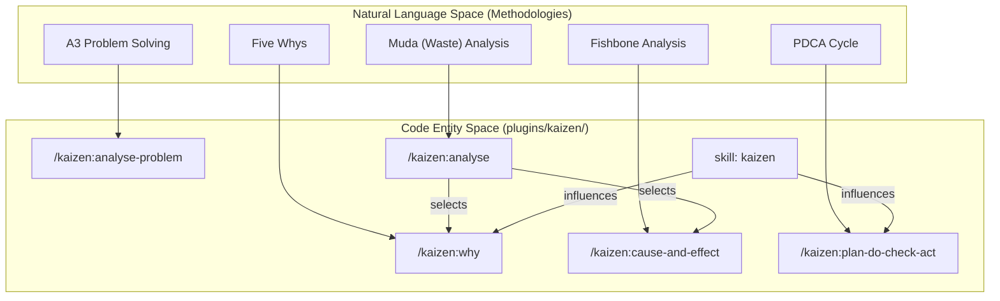
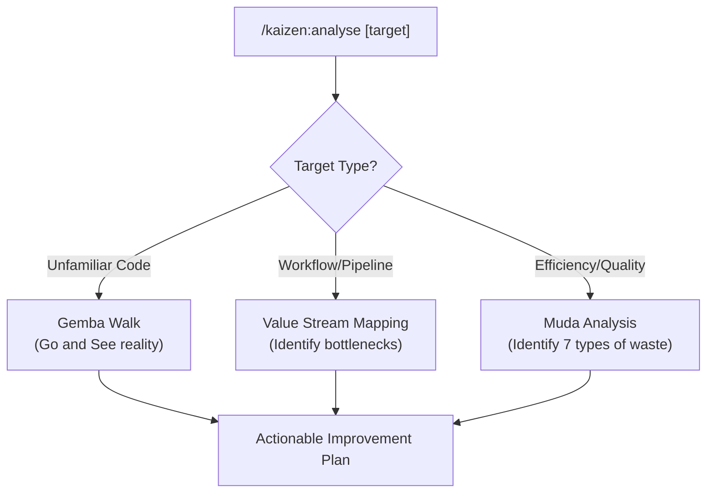

<!-- source: DeepWiki mcp.deepwiki.com · repo neolabhq/context-engineering-kit · extra page Kaizen Plugin · fetched 2026-10-27 -->

# Kaizen Plugin

Relevant source files

The following files were used as context for generating this wiki page:

- [docs/plugins/docs/README.md](docs/plugins/docs/README.md)
- [docs/plugins/git/README.md](docs/plugins/git/README.md)
- [docs/plugins/kaizen/README.md](docs/plugins/kaizen/README.md)
- [docs/plugins/tdd/README.md](docs/plugins/tdd/README.md)
- [docs/plugins/tech-stack/README.md](docs/plugins/tech-stack/README.md)
- [plugins/docs/README.md](plugins/docs/README.md)
- [plugins/git/.claude-plugin/plugin.json](plugins/git/.claude-plugin/plugin.json)
- [plugins/git/README.md](plugins/git/README.md)
- [plugins/kaizen/README.md](plugins/kaizen/README.md)
- [plugins/kaizen/skills/kaizen/SKILL.md](plugins/kaizen/skills/kaizen/SKILL.md)
- [plugins/tdd/README.md](plugins/tdd/README.md)
- [plugins/tech-stack/README.md](plugins/tech-stack/README.md)

The Kaizen Plugin is a continuous improvement toolkit inspired by the Toyota Production System (TPS) and Lean manufacturing principles, adapted specifically for software development. It provides a structured framework for systematic problem analysis, root cause investigation, and iterative improvement cycles, moving beyond surface-level fixes to address fundamental systemic issues.

[plugins/kaizen/README.md:1-19]()

## Architecture & Data Flow

The Kaizen plugin is implemented as a set of specialized commands and a persistent skill. Unlike the Code Review plugin, it does not utilize a multi-agent orchestration layer; instead, it provides structured prompts and methodologies that guide the primary AI agent through rigorous analytical frameworks.

### Code Entity Space to System Mapping

The following diagram maps the logical Kaizen concepts to the specific code entities within the plugin structure.

**Diagram: Kaizen System to Code Entity Mapping**

Sources: [plugins/kaizen/README.md:38-50](), [plugins/kaizen/skills/kaizen/SKILL.md:1-10]()

## Core Implementation Components

### 1. The Kaizen Skill (`kaizen:kaizen`)
The `kaizen` skill is a persistent context provider that guides the AI's mindset during code implementation, refactoring, and architectural design. It enforces four pillars of improvement.

**The Four Pillars of Kaizen Skill**:
*   **Continuous Improvement**: Prioritizes small, frequent improvements that compound over time [plugins/kaizen/skills/kaizen/SKILL.md:29-31]().
*   **Poka-Yoke (Error Proofing)**: Focuses on designing systems that prevent errors at compile-time (e.g., using exhaustive type unions instead of strings) [plugins/kaizen/skills/kaizen/SKILL.md:133-144]().
*   **Standardized Work**: Encourages following established patterns and documenting what works [plugins/kaizen/README.md:58-58]().
*   **Just-In-Time (JIT)**: Building only what is needed now to avoid over-engineering and premature optimization [plugins/kaizen/README.md:59-59]().

Sources: [plugins/kaizen/skills/kaizen/SKILL.md:1-10](), [plugins/kaizen/README.md:52-60]()

### 2. Analysis Commands

The plugin provides specialized commands for different depths of problem-solving.

| Command | Methodology | Primary Function |
| :--- | :--- | :--- |
| `/kaizen:why` | Five Whys | Drills from surface symptoms to fundamental root causes by repeatedly asking "why" [plugins/kaizen/README.md:40-40](). |
| `/kaizen:cause-and-effect` | Fishbone (Ishikawa) | Explores problem causes across six categories: People, Process, Tech, Environment, Methods, Materials [plugins/kaizen/README.md:42-42](). |
| `/kaizen:analyse-problem` | A3 Analysis | Creates a comprehensive one-page document covering Background, Current Condition, Goals, and Implementation Plan [plugins/kaizen/README.md:43-43](). |
| `/kaizen:root-cause-tracing` | Stack Tracing | Systematically traces bugs backward through the call stack to find where invalid data originates [plugins/kaizen/README.md:41-41](). |
| `/kaizen:plan-do-check-act` | PDCA Cycle | A four-phase iterative cycle for systematic experimentation and improvement [plugins/kaizen/README.md:45-45](). |

Sources: [plugins/kaizen/README.md:38-45]()

## Smart Analysis Selection (`/kaizen:analyse`)

The `/kaizen:analyse` command acts as a router. It intelligently selects the most appropriate Kaizen technique based on the target provided by the user.

**Diagram: /kaizen:analyse Logic Flow**

**Muda (Waste) Analysis Categories**:
The plugin identifies seven types of waste in software development:
1.  **Overproduction**: Features no one uses.
2.  **Waiting**: Blocked by builds or reviews.
3.  **Transportation**: Unnecessary data transformations.
4.  **Over-processing**: Redundant validations.
5.  **Inventory**: Unmerged branches or half-finished features.
6.  **Motion**: Context switching.
7.  **Defects**: Production bugs and technical debt.

Sources: [plugins/kaizen/README.md:44-44](), [plugins/kaizen/README.md:75-80]()

## Implementation Example: Continuous Improvement

The `kaizen` skill enforces an iterative approach to code quality. It discourages "doing everything at once" and instead promotes a three-pass iteration strategy.

**Code Evolution Pattern (Kaizen Skill)**:
1.  **Iteration 1: Make it work** - Simplest viable change [plugins/kaizen/skills/kaizen/SKILL.md:58-65]().
2.  **Iteration 2: Make it clear** - Refactor for readability [plugins/kaizen/skills/kaizen/SKILL.md:67-72]().
3.  **Iteration 3: Make it robust** - Add validation and error handling [plugins/kaizen/skills/kaizen/SKILL.md:74-84]().

Sources: [plugins/kaizen/skills/kaizen/SKILL.md:49-88]()

## Integration with Context Management

The Kaizen plugin often works in conjunction with the `git` and `docs` plugins to ensure that improvements are documented and committed according to standards.

*   **Git Integration**: Improvements identified via PDCA cycles are committed using `/git:commit` to maintain a clean, conventional history [plugins/git/README.md:45-45]().
*   **Docs Integration**: Process changes resulting from A3 analysis are formalized using `/docs:update-docs` to keep living documentation accurate [plugins/docs/README.md:51-53]().

Sources: [plugins/git/README.md:12-14](), [plugins/docs/README.md:19-21]()

---

