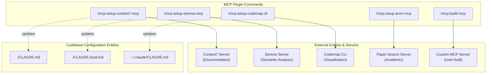
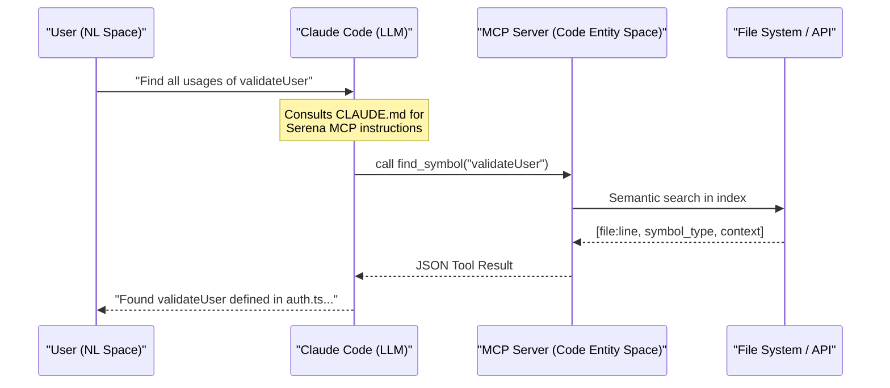

<!-- source: DeepWiki mcp.deepwiki.com · repo neolabhq/context-engineering-kit · extra page MCP Plugin Overview · fetched 2026-10-27 -->

# MCP Plugin Overview

Relevant source files

The following files were used as context for generating this wiki page:

- [docs/guides/README.md](docs/guides/README.md)
- [docs/plugins/mcp/README.md](docs/plugins/mcp/README.md)
- [docs/plugins/mcp/recommended-mcp.md](docs/plugins/mcp/recommended-mcp.md)
- [docs/plugins/mcp/usage-examples.md](docs/plugins/mcp/usage-examples.md)
- [plugins/mcp/.claude-plugin/plugin.json](plugins/mcp/.claude-plugin/plugin.json)
- [plugins/mcp/README.md](plugins/mcp/README.md)

The MCP Plugin provides commands for integrating Model Context Protocol (MCP) servers into your AI-powered development workflow. This plugin enables Claude to access external data sources, tools, and specialized capabilities through a standardized protocol interface [plugins/mcp/README.md:1-11]().

This page covers the plugin's architecture, the five core commands, and integration patterns. For detailed setup procedures for each MCP server, see section 4 (MCP Integration Deep Dive). For workflow guides combining MCP with other plugins, see section 5 (Development Guides).

## What is Model Context Protocol?

Model Context Protocol (MCP) is an open protocol that enables AI assistants to interact with external services, databases, and tools through a standardized interface [docs/plugins/mcp/README.md:9-11](). MCP servers expose three types of capabilities:

| Capability Type | Purpose | Example |
|----------------|---------|---------|
| **Resources** | External data sources Claude can read | Library documentation, API schemas, database contents |
| **Tools** | Actions Claude can execute | Search operations, code transformations, API calls |
| **Prompts** | Reusable prompt templates | Query patterns with dynamic inputs |

MCP servers run as separate processes that communicate with Claude through the MCP protocol, providing access to capabilities without loading them into Claude's context window until needed [docs/plugins/mcp/recommended-mcp.md:5-13]().

**Sources:** [plugins/mcp/README.md:9-11](), [docs/plugins/mcp/recommended-mcp.md:5-13]()

## Plugin Architecture

The MCP Plugin serves as an integration hub, connecting Claude Code to external MCP servers through five setup commands and one development command. Each command handles the complete integration workflow: installation verification, configuration, connection testing, and `CLAUDE.md` documentation updates [plugins/mcp/README.md:13-27]().

### System to Code Entity Mapping: MCP Plugin Flow

This diagram maps the high-level integration concepts to the specific commands defined in the plugin manifest [plugins/mcp/.claude-plugin/plugin.json:1-9]().

**Sources:** [plugins/mcp/README.md:13-27](), [docs/plugins/mcp/README.md:13-27](), [plugins/mcp/.claude-plugin/plugin.json:1-9]()

## Three-Tier Configuration System

Each MCP setup command supports configuration at three levels, allowing different scopes of configuration sharing [plugins/mcp/README.md:21-27]():

| Level | File Path | Git Tracked | Use Case |
|-------|-----------|-------------|----------|
| **Project Shared** | `./CLAUDE.md` | Yes | Team-wide MCP server configuration and documentation requirements |
| **Project Personal** | `./CLAUDE.local.md` | No | Local project-specific configuration not tracked in git |
| **User Global** | `~/.claude/CLAUDE.md` | No | Global configuration applying to all projects for the current user |

The command guides the user through the setup process and updates the appropriate file to ensure consistent usage across sessions [docs/plugins/mcp/README.md:21-27]().

**Sources:** [plugins/mcp/README.md:21-27](), [docs/plugins/mcp/README.md:21-27]()

## Core Commands Overview

### /mcp:setup-context7-mcp: Documentation Access
Sets up the Context7 MCP server to provide real-time access to library and framework documentation. This eliminates hallucinations caused by outdated training data [docs/plugins/mcp/README.md:51]().

*   **Auto-detection**: Scans `package.json` or `requirements.txt` to identify project technologies [docs/plugins/mcp/usage-examples.md:59-67]().
*   **Validation**: Searches Context7 for valid library IDs (e.g., `nextjs`, `prisma`, `zod`) [docs/plugins/mcp/usage-examples.md:24-28]().
*   **Output**: Updates `CLAUDE.md` with recommended library IDs for Claude to use [docs/plugins/mcp/usage-examples.md:29-42]().

### /mcp:setup-serena-mcp: Semantic Code Analysis
Configures the Serena MCP server for semantic code retrieval and symbol-based editing [docs/plugins/mcp/README.md:52]().

*   **Tools**: Exposes `find_symbol`, `list_symbols`, and `read_file` [docs/plugins/mcp/usage-examples.md:191-195]().
*   **Prerequisites**: Verifies `uv` is installed and indexes the project (e.g., "Indexed 1,247 files") [docs/plugins/mcp/usage-examples.md:171-189]().

### /mcp:setup-codemap-cli: Codebase Visualization
Installs and configures the Codemap CLI for intelligent codebase navigation [docs/plugins/mcp/README.md:53]().

*   **Features**: Tree views, dependency analysis (`codemap --deps .`), and change tracking vs. main branches [docs/plugins/mcp/usage-examples.md:131-142]().
*   **Automation**: Updates `.gitignore` to exclude the `.codemap/` directory and configures session hooks [docs/plugins/mcp/usage-examples.md:98-125]().

### /mcp:setup-arxiv-mcp: Academic Paper Search
Sets up the Paper Search MCP server via Docker MCP [docs/plugins/mcp/README.md:54](). It provides access to 8+ academic sources including arXiv, PubMed, and Semantic Scholar [docs/plugins/mcp/usage-examples.md:280-357]().

### /mcp:build-mcp: Custom Server Development
A comprehensive guide for creating high-quality MCP servers [docs/plugins/mcp/README.md:55](). It covers a four-phase process:
1.  **Research & Planning**: Agent-centric design and framework selection (FastMCP/MCP SDK).
2.  **Implementation**: Core infrastructure and tool annotations.
3.  **Review & Refine**: Quality checklists and testing.
4.  **Evaluations**: Content exploration and QA generation.

**Sources:** [docs/plugins/mcp/README.md:50-56](), [docs/plugins/mcp/usage-examples.md:7-438]()

## Data Flow: MCP Integration Pattern

This diagram illustrates how MCP tools bridge the gap between Natural Language requests and Code Entity operations.

**Sources:** [docs/plugins/mcp/usage-examples.md:199-208](), [docs/plugins/mcp/recommended-mcp.md:7-12]()

## Integration with Other Plugins

MCP servers provide the "contextual fuel" for other specialized agents in the kit:

| Plugin | MCP Enhancement |
|--------|-----------------|
| **SDD** ([3.2.2]()) | Uses **Context7** during `/sdd:01-research` to fetch latest API specs [docs/guides/README.md:12](). |
| **Kaizen** ([3.4.1]()) | Uses **Codemap** to visualize dependency flow during root cause analysis [docs/guides/README.md:12](). |
| **TDD** ([3.2.1]()) | Uses **Serena** to find relevant test targets for existing symbols [docs/guides/README.md:12](). |

**Sources:** [docs/guides/README.md:10-34](), [docs/plugins/mcp/usage-examples.md:211-255]()

---

