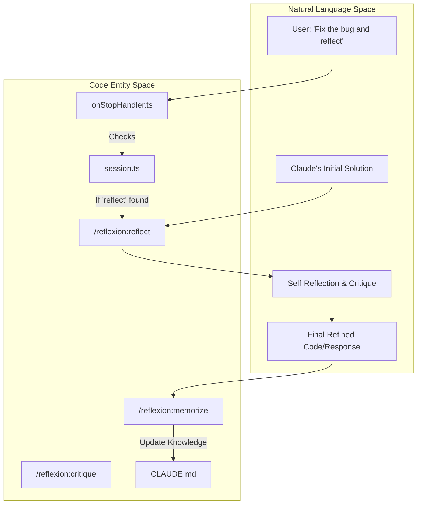
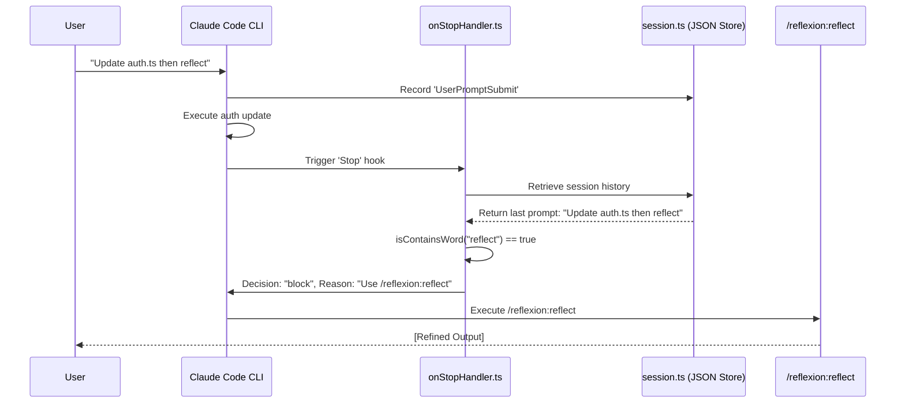

<!-- source: DeepWiki mcp.deepwiki.com · repo neolabhq/context-engineering-kit · extra page Reflexion Plugin · fetched 2026-10-27 -->

# Reflexion Plugin

<details>
<summary>Relevant source files</summary>

The following files were used as context for generating this wiki page:

- [.specs/anthropic-claude-code-action-prompt.md](.specs/anthropic-claude-code-action-prompt.md)
- [.specs/reports/do-competitively-analysis.md](.specs/reports/do-competitively-analysis.md)
- [.specs/research/research-resources.md](.specs/research/research-resources.md)
- [.specs/usefull-prompts.md](.specs/usefull-prompts.md)
- [CONTRIBUTING.md](CONTRIBUTING.md)
- [plugins/customaize-agent/skills/thought-based-reasoning/SKILL.md](plugins/customaize-agent/skills/thought-based-reasoning/SKILL.md)
- [plugins/reflexion/.claude-plugin/plugin.json](plugins/reflexion/.claude-plugin/plugin.json)
- [plugins/reflexion/hooks/.gitignore](plugins/reflexion/hooks/.gitignore)
- [plugins/reflexion/hooks/README.md](plugins/reflexion/hooks/README.md)
- [plugins/reflexion/hooks/bun.lockb](plugins/reflexion/hooks/bun.lockb)
- [plugins/reflexion/hooks/hooks.json](plugins/reflexion/hooks/hooks.json)
- [plugins/reflexion/hooks/package.json](plugins/reflexion/hooks/package.json)
- [plugins/reflexion/hooks/src/index.ts](plugins/reflexion/hooks/src/index.ts)
- [plugins/reflexion/hooks/src/lib.ts](plugins/reflexion/hooks/src/lib.ts)
- [plugins/reflexion/hooks/src/onStopHandler.test.ts](plugins/reflexion/hooks/src/onStopHandler.test.ts)
- [plugins/reflexion/hooks/src/onStopHandler.ts](plugins/reflexion/hooks/src/onStopHandler.ts)
- [plugins/reflexion/hooks/src/session.ts](plugins/reflexion/hooks/src/session.ts)

</details>


The Reflexion plugin provides self-refinement capabilities through structured feedback and refinement loops. Based on research papers such as *Self-Refine* and *Reflexion*, it improves LLM output by introducing iterative critique and memory integration. The plugin consists of three primary commands: `/reflexion:reflect`, `/reflexion:critique`, and `/reflexion:memorize`, along with an automated hook system for trigger-word-based reflection.

Sources: [plugins/reflexion/.claude-plugin/plugin.json:1-9](), [plugins/reflexion/hooks/README.md:1-5]()

## Purpose and Architecture

The Reflexion plugin implements a feedback loop where the model evaluates its own performance. This architecture moves beyond single-pass generation to an iterative "Generate-Critique-Refine" cycle.

### Feedback Loop Architecture



**Diagram: Reflexion Feedback Loop Architecture**

The system bridges natural language triggers (the word "reflect") to code-level execution via `onStopHandler.ts` [plugins/reflexion/hooks/src/onStopHandler.ts:11-37](). It persists session state in `session.ts` [plugins/reflexion/hooks/src/session.ts:1-20]() to allow the `Stop` hook to access historical user prompts.

Sources: [plugins/reflexion/hooks/README.md:7-35](), [plugins/reflexion/hooks/src/onStopHandler.ts:11-37]()

## Automatic Reflection (Hooks)

The plugin includes a sophisticated hook system that automates reflection without requiring explicit slash commands.

### Trigger Logic

The `onStopHandler.ts` monitors the `Stop` event. If the user's last prompt contained the standalone word "reflect", the handler blocks the standard stop signal and forces the execution of `/reflexion:reflect`.

| Component | Logic | File Reference |
|-----------|-------|----------------|
| **Trigger Word** | Matches "reflect" as a standalone word (case-insensitive). | [plugins/reflexion/hooks/src/onStopHandler.ts:3-4]() |
| **Regex Protection** | Uses negative lookbehind `(?<![:/])` to avoid triggering on `/reflect` or `:reflect`. | [plugins/reflexion/hooks/src/onStopHandler.ts:44-50]() |
| **Cycle Prevention** | Filters session data for `UserPromptSubmit` and `Stop`. Blocks if two `Stop` events occur consecutively. | [plugins/reflexion/hooks/src/onStopHandler.ts:11-28]() |
| **Session Persistence** | Stores prompts in `/tmp/claude-hooks-sessions/<session_id>.json`. | [plugins/reflexion/hooks/README.md:59-61]() |

Sources: [plugins/reflexion/hooks/src/onStopHandler.ts:11-50](), [plugins/reflexion/hooks/README.md:46-57]()

### Hook Execution Flow



**Diagram: Hook-Based Reflection Flow**

Sources: [plugins/reflexion/hooks/README.md:9-27](), [plugins/reflexion/hooks/src/onStopHandler.ts:11-37]()

## Commands Reference

### /reflexion:reflect
This command forces the model to review its previous output. It typically performs "Complexity Triage," choosing between a Quick Path (simple verification), Standard Path (full reflection), or Deep Path (comprehensive analysis for critical systems).

- **Implementation Principle**: Based on the *Self-Refine* paper (Wei et al., 2022).
- **Behavior**: It evaluates completeness, quality, and correctness before implementing refinements.

Sources: [plugins/reflexion/README.md:45-112](), [plugins/customaize-agent/skills/thought-based-reasoning/SKILL.md:30-66]()

### /reflexion:critique
Implements a multi-agent debate pattern. It spawns specialized "Judge" agents (Requirements Validator, Solution Architect, Code Quality Reviewer) to evaluate work from different perspectives.

- **Consensus Mechanism**: Judges identify disagreements and debate until a consensus report is generated.
- **Scoring**: Provides a 1-10 score across multiple dimensions.

Sources: [plugins/reflexion/README.md:114-171](), [.specs/reports/do-competitively-analysis.md:140-214]()

### /reflexion:memorize
Extracts "lessons learned" from the current session and persists them into the project's `CLAUDE.md` file.

- **Curation Rules**: Filters for relevance, non-redundancy, and actionability to prevent "context collapse" (bloating the context with low-value information).
- **Target Sections**: Updates sections like "Code Quality Standards" or "Architecture Decisions".

Sources: [plugins/reflexion/README.md:173-242](), [CONTRIBUTING.md:10-14]()

## Scientific Foundation

The plugin implements several advanced prompting and reasoning techniques:

| Technique | Research Reference | Purpose |
|-----------|--------------------|---------|
| **Reflexion** | Shinn et al. (2023) | Iterative improvement through linguistic feedback. |
| **Self-Refine** | Madaan et al. (2023) | Improving outputs without external data or fine-tuning. |
| **Multi-Agent Debate** | Du et al. (2023) | Using multiple agents to reach higher accuracy through consensus. |
| **Agentic Context Engineering** | Neolab (2025) | Updating persistent context (CLAUDE.md) based on session reflections. |

Sources: [plugins/reflexion/README.md:243-261](), [plugins/customaize-agent/skills/thought-based-reasoning/SKILL.md:24-25]()

## Installation and Setup

The hooks require `bun` for execution as defined in `hooks.json`.

```bash
# Install hook dependencies
cd plugins/reflexion/hooks
bun install

# Start Claude with the plugin
claude --plugin-dir ./plugins/reflexion
```

The hook configuration in `hooks.json` registers the `Stop` and `UserPromptSubmit` events to the `src/index.ts` entry point.

Sources: [plugins/reflexion/hooks/README.md:63-79](), [plugins/reflexion/hooks/hooks.json:1-26]()

---

