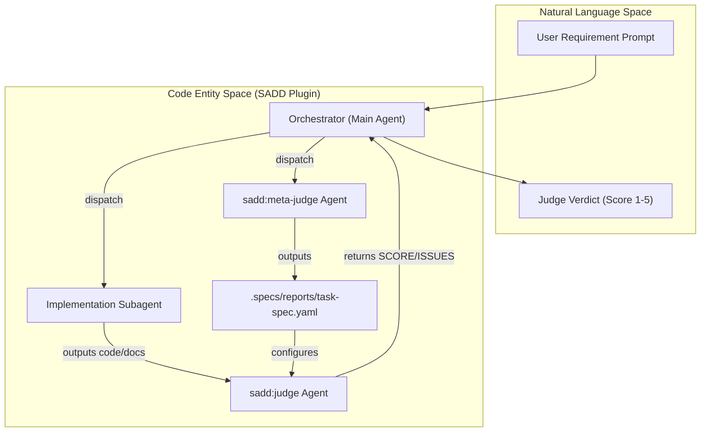
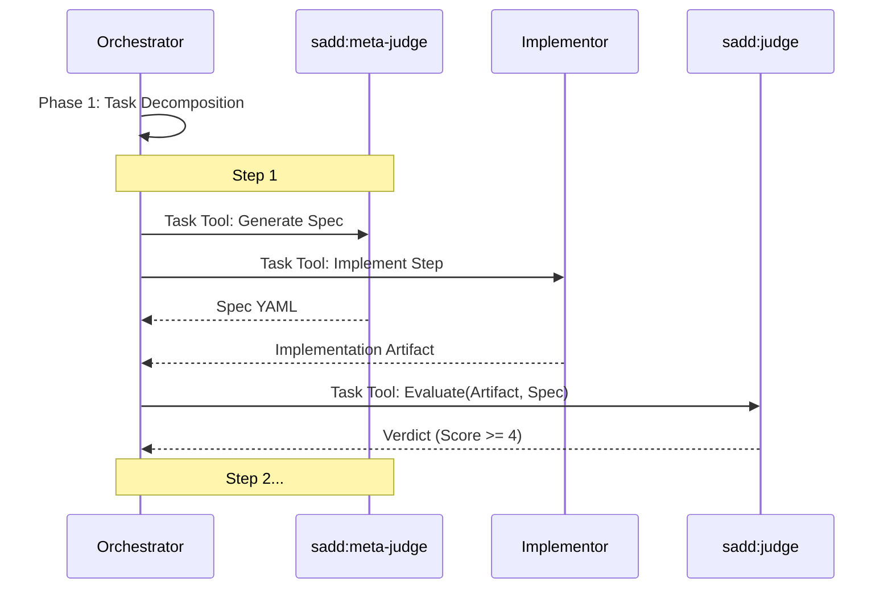

<!-- source: DeepWiki mcp.deepwiki.com · repo neolabhq/context-engineering-kit · extra page SADD Plugin · fetched 2026-10-27 -->

# SADD Plugin

Relevant source files

The following files were used as context for generating this wiki page:

- [docs/guides/ci-integration.md](docs/guides/ci-integration.md)
- [docs/plugins/reflexion/README.md](docs/plugins/reflexion/README.md)
- [docs/plugins/sadd/README.md](docs/plugins/sadd/README.md)
- [docs/plugins/sadd/do-and-judge.md](docs/plugins/sadd/do-and-judge.md)
- [docs/plugins/sadd/do-competitively.md](docs/plugins/sadd/do-competitively.md)
- [docs/plugins/sadd/do-in-parallel.md](docs/plugins/sadd/do-in-parallel.md)
- [docs/plugins/sadd/do-in-steps.md](docs/plugins/sadd/do-in-steps.md)
- [docs/plugins/sadd/judge-with-debate.md](docs/plugins/sadd/judge-with-debate.md)
- [docs/plugins/sadd/judge.md](docs/plugins/sadd/judge.md)
- [docs/plugins/sadd/multi-agent-patterns.md](docs/plugins/sadd/multi-agent-patterns.md)
- [docs/plugins/sadd/subagent-driven-development.md](docs/plugins/sadd/subagent-driven-development.md)
- [docs/plugins/sadd/tree-of-thoughts.md](docs/plugins/sadd/tree-of-thoughts.md)
- [docs/resources/papers.md](docs/resources/papers.md)
- [plugins/code-review/README.md](plugins/code-review/README.md)
- [plugins/reflexion/README.md](plugins/reflexion/README.md)
- [plugins/sadd/README.md](plugins/sadd/README.md)
- [plugins/sadd/scripts/create-scratchpad.sh](plugins/sadd/scripts/create-scratchpad.sh)
- [plugins/sadd/skills/do-and-judge/SKILL.md](plugins/sadd/skills/do-and-judge/SKILL.md)
- [plugins/sadd/skills/do-competitively/SKILL.md](plugins/sadd/skills/do-competitively/SKILL.md)
- [plugins/sadd/skills/do-in-parallel/SKILL.md](plugins/sadd/skills/do-in-parallel/SKILL.md)
- [plugins/sadd/skills/do-in-steps/SKILL.md](plugins/sadd/skills/do-in-steps/SKILL.md)
- [plugins/sadd/skills/judge-with-debate/SKILL.md](plugins/sadd/skills/judge-with-debate/SKILL.md)
- [plugins/sadd/skills/judge/SKILL.md](plugins/sadd/skills/judge/SKILL.md)
- [plugins/sadd/skills/tree-of-thoughts/SKILL.md](plugins/sadd/skills/tree-of-thoughts/SKILL.md)
- [plugins/sdd/README.md](plugins/sdd/README.md)

The Subagent-Driven Development (SADD) Plugin is an execution framework that dispatches fresh subagents for each task with quality-controlled gates between iterations. It is designed to prevent "context pollution"—the accumulation of confusion, outdated assumptions, or implementation drift over long sessions—by ensuring each subagent starts with a clean context window [plugins/sadd/README.md:1-29]().

For other development workflow methodologies, see [TDD Plugin (3.2.1)](), [SDD Plugin (3.2.2)](), and [DDD Plugin (3.2.4)]().

## Overview

SADD implements the **Supervisor/Orchestrator pattern** [plugins/sadd/skills/do-in-steps/SKILL.md:14-14](). Instead of one agent performing all work, a main orchestrator decomposes a complex requirement into discrete tasks and dispatches specialized subagents.

**Core Capabilities:**
*   **Fresh Context per Task:** Each subagent starts clean without context pollution from previous tasks [plugins/sadd/README.md:7-7]().
*   **Quality Gates:** Integrated **LLM-as-a-Judge** and **Meta-Judge** verification catches issues before they compound [plugins/sadd/README.md:8-8]().
*   **Parallel Execution:** Independent tasks run concurrently to reduce total execution time [plugins/sadd/README.md:9-9]().
*   **Model Selection:** Intelligent selection of models (Opus, Sonnet, Haiku) based on task complexity [plugins/sadd/skills/do-and-judge/SKILL.md:77-84]().

**Sources:** [plugins/sadd/README.md:1-31](), [plugins/sadd/skills/do-in-steps/SKILL.md:14-24]()

## Architecture & Data Flow

### The Meta-Judge -> Judge Pattern
A critical innovation in SADD v2.2 is the separation of evaluation criteria generation from the evaluation itself.
1.  **Meta-Judge (`sadd:meta-judge`)**: Generates a tailored evaluation specification (YAML) including rubrics and checklists for a specific task [plugins/sadd/skills/do-and-judge/SKILL.md:93-115]().
2.  **Implementation Agent**: Executes the task in parallel with the Meta-Judge [plugins/sadd/skills/do-and-judge/SKILL.md:87-91]().
3.  **Judge (`sadd:judge`)**: Applies the Meta-Judge's specification to the implementation artifact to provide a verdict and score [plugins/sadd/skills/do-and-judge/SKILL.md:13-22]().

### SADD System Entity Mapping

**Sources:** [plugins/sadd/skills/do-and-judge/SKILL.md:13-30](), [plugins/sadd/README.md:46-51]()

## Key Commands & Skills

### `/do-and-judge`
Executes a single task with an automatic retry loop. It dispatches a meta-judge and implementor in parallel, then uses a judge to verify the result. It allows up to 2 retries if the score is below 4 [plugins/sadd/skills/do-and-judge/SKILL.md:1-30]().

### `/do-in-parallel`
Used for batch operations across multiple files or targets.
*   **Requirement Grouping**: Analyzes tasks to identify "repeatable" (same task, different files) or "shared" (interdependent) groups to reduce the number of meta-judges required [plugins/sadd/skills/do-in-parallel/SKILL.md:14-24]().
*   **Independence Validation**: Ensures targets do not share files or state before parallelizing [plugins/sadd/skills/do-in-parallel/SKILL.md:127-135]().

### `/do-in-steps`
Orchestrates complex, sequential tasks. It decomposes a feature into steps (e.g., Interface -> Implementation -> Consumer) and applies the Judge gate to each step before proceeding [plugins/sadd/skills/do-in-steps/SKILL.md:9-24]().

### Orchestration Workflow (Sequential)

**Sources:** [plugins/sadd/skills/do-in-steps/SKILL.md:26-35](), [plugins/sadd/skills/do-in-steps/SKILL.md:85-132]()

## Implementation Details

### Model Selection Logic
The orchestrator selects models based on task characteristics to optimize for cost and speed:
| Model | Use Case |
| :--- | :--- |
| **Opus** | Default for complex implementation, architecture, and business logic [plugins/sadd/skills/do-and-judge/SKILL.md:81-81](). |
| **Sonnet** | High volume, repetitive tasks with large context (e.g., bulk refactoring) [plugins/sadd/skills/do-and-judge/SKILL.md:82-82](). |
| **Haiku** | Trivial, mechanical operations (e.g., file moving, simple config edits) [plugins/sadd/skills/do-and-judge/SKILL.md:83-83](). |

### Quality Gate Thresholds
*   **Pass (Score 4-5)**: Task is complete and meets all criteria [docs/plugins/sadd/do-in-parallel.md:92-92]().
*   **Soft Pass (Score 3)**: Minor issues only; orchestrator may proceed or fix [docs/plugins/sadd/do-in-parallel.md:93-93]().
*   **Fail (Score <3)**: Automatic retry with judge feedback (Max 2-3 retries) [docs/plugins/sadd/do-in-parallel.md:94-94]().

**Sources:** [plugins/sadd/skills/do-and-judge/SKILL.md:77-85](), [docs/plugins/sadd/do-in-parallel.md:62-96]()

## Theoretical Foundation
The SADD plugin is built on advanced agentic research, including:
*   **LLM-as-a-Judge**: Using models to evaluate outputs [plugins/sadd/README.md:92-92]().
*   **LLM-as-a-Meta-Judge**: Evaluating the quality of the evaluation rubrics themselves [plugins/sadd/README.md:95-95]().
*   **Tree of Thoughts**: Systematic exploration of solution spaces [plugins/sadd/README.md:59-59]().
*   **Agentic Context Engineering**: Using memory updates after reflection to outperform standard baselines [plugins/sadd/README.md:105-105]().

**Sources:** [plugins/sadd/README.md:73-106](), [docs/resources/papers.md:57-92]()

---

