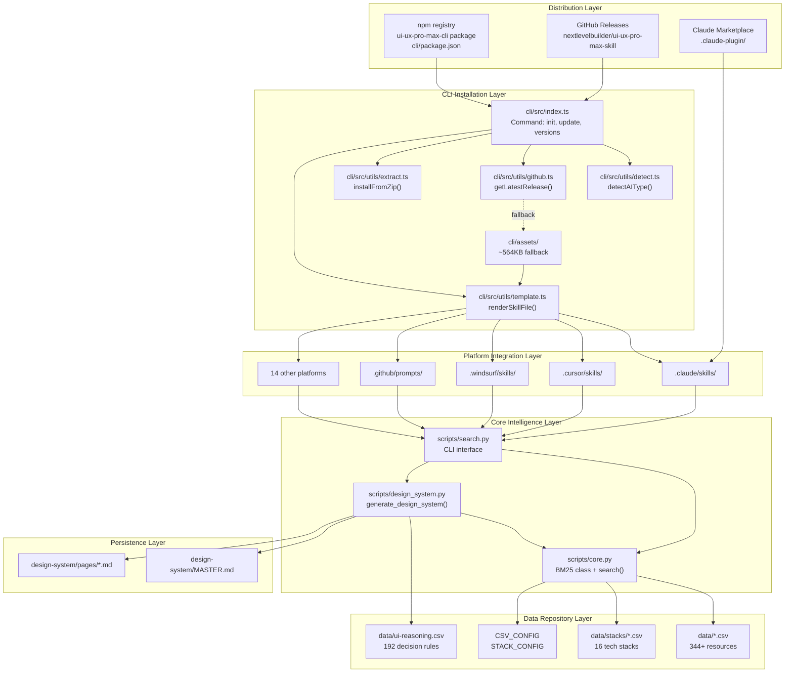
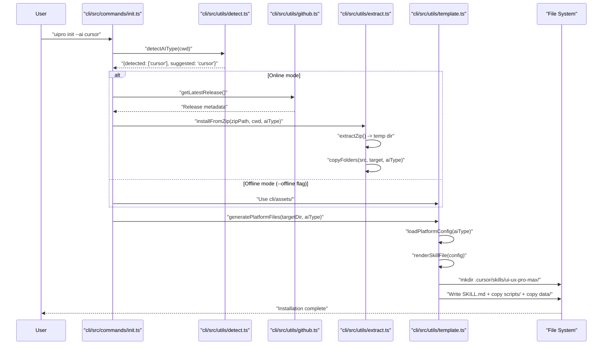
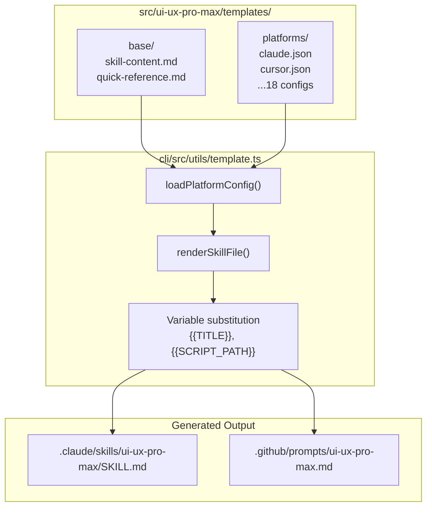
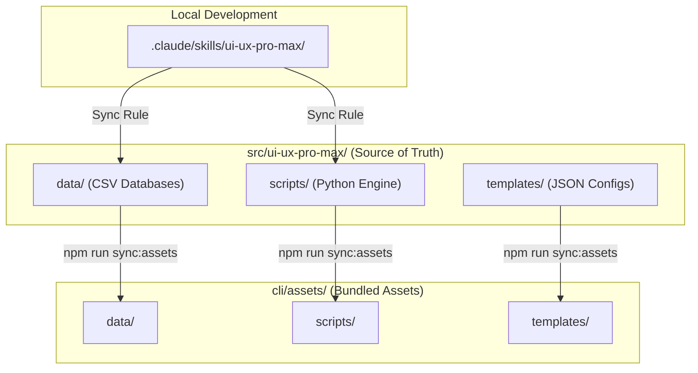

<!-- source: DeepWiki mcp.deepwiki.com · repo nextlevelbuilder/ui-ux-pro-max-skill · page 1.2 System Architecture · fetched 2026-10-27 -->

# System Architecture

Relevant source files

The following files were used as context for generating this wiki page:

- [CLAUDE.md](CLAUDE.md)
- [README.md](README.md)
- [README.vi.md](README.vi.md)
- [README.zh.md](README.zh.md)
- [cli/assets/scripts/core.py](cli/assets/scripts/core.py)
- [cli/assets/scripts/search.py](cli/assets/scripts/search.py)
- [cli/assets/templates/base/skill-content.md](cli/assets/templates/base/skill-content.md)
- [cli/assets/templates/platforms/universal.json](cli/assets/templates/platforms/universal.json)
- [src/ui-ux-pro-max/scripts/core.py](src/ui-ux-pro-max/scripts/core.py)
- [src/ui-ux-pro-max/scripts/search.py](src/ui-ux-pro-max/scripts/search.py)
- [src/ui-ux-pro-max/templates/base/skill-content.md](src/ui-ux-pro-max/templates/base/skill-content.md)
- [src/ui-ux-pro-max/templates/platforms/universal.json](src/ui-ux-pro-max/templates/platforms/universal.json)

This document describes the technical architecture of the UI/UX Pro Max system, including its distribution mechanisms, core intelligence components, platform integration layer, and data persistence patterns. The system is designed as a distributed AI skill that operates across 18+ AI coding assistant platforms through template-based generation and a centralized Source of Truth.

---

## System Overview

The UI/UX Pro Max system consists of five primary layers: distribution, installation, intelligence, integration, and persistence. These layers work together to deliver design intelligence from a centralized knowledge base to multiple AI platforms.

### High-Level System Topology

**Sources:** [README.md:1-24](), [CLAUDE.md:41-69](), [cli/src/index.ts:20-81]()

---

## Distribution and Installation Layer

The system provides three distribution channels, each serving different installation workflows.

### Distribution Channels

| Channel | Package | Install Method | Target Audience |
|---------|---------|----------------|-----------------|
| npm registry | `ui-ux-pro-max-cli` | `npm install -g ui-ux-pro-max-cli` | General users [README.md:18-19]() |
| GitHub Releases | Source archives + ZIP assets | `uipro init` downloads via API | Offline/enterprise users [README.md:10-10]() |
| Claude Marketplace | Plugin directory | Marketplace Integration | Claude Code users only [CLAUDE.md:68-68]() |

### CLI Entry Point Architecture

The CLI is implemented as a TypeScript/Bun application. The main entry point [cli/src/index.ts:1-83]() defines commands using the `commander` library:

- `init` - Installs the skill to the current project or globally [cli/src/index.ts:26-44]().
- `update` - Upgrades an existing installation to the latest version [cli/src/index.ts:52-64]().
- `uninstall` - Removes the skill from project or home directory [cli/src/index.ts:67-81]().
- `versions` - Lists all available GitHub releases [cli/src/index.ts:47-49]().

**Sources:** [cli/src/index.ts:1-83](), [README.md:18-22]()

### Platform Detection System

The `detectAIType()` function scans the current working directory for platform-specific folders to determine which AI assistants are present. It supports 18 platforms including:

| Platform | Detection Path | Constant |
|----------|---------------|----------|
| Claude Code | `.claude/` | `'claude'` |
| Cursor | `.cursor/` | `'cursor'` |
| Windsurf | `.windsurf/` | `'windsurf'` |
| Antigravity | `.agents/` | `'antigravity'` |
| GitHub Copilot | `.github/` | `'copilot'` |
| Trae | `.trae/` | `'trae'` |
| Roo Code | `.roo/` | `'roocode'` |
| Warp | `.warp/` | `'warp'` |

**Sources:** [CLAUDE.md:52-54](), [src/ui-ux-pro-max/templates/platforms/universal.json:1-21]()

---

## CLI Installation Pipeline

The installation flow consists of asset acquisition, extraction, and template rendering.

### Installation Sequence Diagram

**Sources:** [cli/src/index.ts:26-44](), [CLAUDE.md:56-65]()

---

## Template-Based Generation System

UI/UX Pro Max uses a template system to generate platform-specific files from a single base.

### Template Architecture

**Sources:** [CLAUDE.md:52-54](), [src/ui-ux-pro-max/templates/base/skill-content.md:1-115]()

### Platform Configuration Schema

The configuration defines how each platform is handled:
- `installType`: `'full'` (Skill mode) or `'reference'` (Workflow mode) [src/ui-ux-pro-max/templates/platforms/universal.json:4-4]().
- `folderStructure`: Defines the `root`, `skillPath`, and `filename` for the target platform [src/ui-ux-pro-max/templates/platforms/universal.json:5-9]().
- `frontmatter`: YAML metadata for platforms like Copilot [src/ui-ux-pro-max/templates/platforms/universal.json:11-14]().

**Sources:** [src/ui-ux-pro-max/templates/platforms/universal.json:1-21]()

---

## Core Intelligence System

The intelligence layer consists of Python modules that implement search and reasoning.

### BM25 Search Engine

The `core.py` module implements the search engine using BM25 ranking [src/ui-ux-pro-max/scripts/core.py:1-12]() and regex matching [src/ui-ux-pro-max/scripts/core.py:50-50]().
- `tokenize`: Normalizes text for the BM25 algorithm.
- `CSV_CONFIG`: Maps domains (style, color, chart, etc.) to specific CSV files and search/output columns [src/ui-ux-pro-max/scripts/core.py:18-79]().
- `STACK_CONFIG`: Maps implementation stacks to guideline files [src/ui-ux-pro-max/scripts/core.py:89-112]().

**Sources:** [src/ui-ux-pro-max/scripts/core.py:1-112]()

### Search CLI Interface

`search.py` serves as the primary entry point for AI assistants [src/ui-ux-pro-max/scripts/search.py:1-26]().
- `--domain`: Searches specific categories like `style`, `color`, or `ux` [src/ui-ux-pro-max/scripts/search.py:99-99]().
- `--stack`: Searches technology-specific guidelines (e.g., `react`, `shadcn`) [src/ui-ux-pro-max/scripts/search.py:100-100]().
- `--design-system`: Triggers the reasoning engine to generate a complete system [src/ui-ux-pro-max/scripts/search.py:106-106]().
- `--persist`: Saves the design system using the Master + Overrides pattern [src/ui-ux-pro-max/scripts/search.py:110-110]().

**Sources:** [src/ui-ux-pro-max/scripts/search.py:1-131](), [CLAUDE.md:9-40]()

---

## Source of Truth and Sync Rules

The project maintains a strict "Source of Truth" model to ensure consistency across development environments and installations.

### Directory Mapping and Sync Architecture

**Sync Rules:**
1. **Source of Truth**: `src/ui-ux-pro-max/` is the canonical source for all data, scripts, and templates [CLAUDE.md:75-75]().
2. **No Symlinks**: The repository avoids symlinks for Windows compatibility; files are mirrored using sync scripts [CLAUDE.md:77-80]().
3. **Manual Sync**: Changes in `src/ui-ux-pro-max/` must be mirrored to `cli/assets/` and `.claude/skills/` using `npm run sync:assets` before committing [CLAUDE.md:94-99]().

**Sources:** [CLAUDE.md:73-104]()

---

