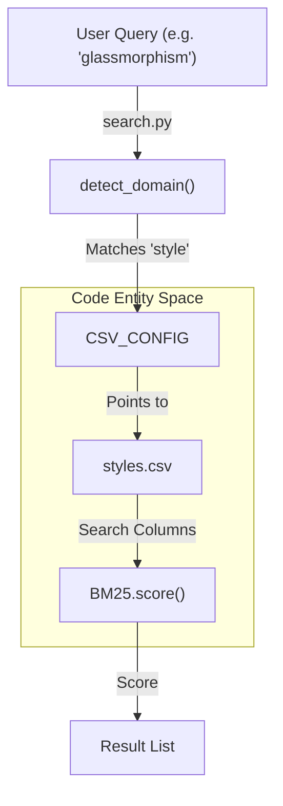
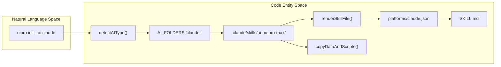

<!-- source: DeepWiki mcp.deepwiki.com · repo nextlevelbuilder/ui-ux-pro-max-skill · page 10 Glossary · fetched 2026-10-27 -->

# Glossary

Relevant source files

The following files were used as context for generating this wiki page:

- [.claude/skills/design/SKILL.md](.claude/skills/design/SKILL.md)
- [.claude/skills/design/references/logo-design.md](.claude/skills/design/references/logo-design.md)
- [.claude/skills/design/scripts/logo/generate.py](.claude/skills/design/scripts/logo/generate.py)
- [.claude/skills/design/scripts/logo/tests/test_generate.py](.claude/skills/design/scripts/logo/tests/test_generate.py)
- [.claude/skills/ui-ux-pro-max/scripts/design_system.py](.claude/skills/ui-ux-pro-max/scripts/design_system.py)
- [README.md](README.md)
- [README.vi.md](README.vi.md)
- [README.zh.md](README.zh.md)
- [cli/assets/scripts/core.py](cli/assets/scripts/core.py)
- [cli/assets/scripts/design_system.py](cli/assets/scripts/design_system.py)
- [cli/assets/scripts/search.py](cli/assets/scripts/search.py)
- [cli/assets/skills/design/SKILL.md](cli/assets/skills/design/SKILL.md)
- [cli/assets/skills/design/references/logo-design.md](cli/assets/skills/design/references/logo-design.md)
- [cli/assets/skills/design/scripts/logo/generate.py](cli/assets/skills/design/scripts/logo/generate.py)
- [cli/assets/skills/design/scripts/logo/tests/test_generate.py](cli/assets/skills/design/scripts/logo/tests/test_generate.py)
- [cli/assets/templates/platforms/universal.json](cli/assets/templates/platforms/universal.json)
- [cli/src/types/index.ts](cli/src/types/index.ts)
- [cli/src/utils/detect.ts](cli/src/utils/detect.ts)
- [cli/src/utils/template.ts](cli/src/utils/template.ts)
- [src/ui-ux-pro-max/scripts/core.py](src/ui-ux-pro-max/scripts/core.py)
- [src/ui-ux-pro-max/scripts/design_system.py](src/ui-ux-pro-max/scripts/design_system.py)
- [src/ui-ux-pro-max/scripts/search.py](src/ui-ux-pro-max/scripts/search.py)
- [src/ui-ux-pro-max/templates/platforms/universal.json](src/ui-ux-pro-max/templates/platforms/universal.json)

This page defines codebase-specific terms, jargon, and technical concepts used within the UI/UX Pro Max system. It serves as a reference for onboarding engineers to understand the mapping between domain language and the underlying implementation.

## Core System Concepts

### BM25
The primary ranking algorithm used by the search engine to determine the relevance of design guidelines to a user's query. It improves upon simple keyword matching by considering term frequency and document length normalization.
*   **Implementation**: Defined in the `BM25` class within `src/ui-ux-pro-max/scripts/core.py`.
*   **Parameters**: Uses constants `k1=1.5` and `b=0.75` [src/ui-ux-pro-max/scripts/core.py:202-204]().
*   **Logic**: Includes a `tokenize` method for text normalization and an `idf` calculation for term weighting [src/ui-ux-pro-max/scripts/core.py:212-235]().

### Skill vs. Workflow
The system operates in two distinct modes depending on the AI assistant's capabilities:
*   **Skill Mode**: A persistent capability where the AI has full access to the `search.py` script and can auto-activate based on context. Typically used by Claude Code and Cursor.
*   **Workflow Mode**: A "slash command" or reference-based interaction where the AI refers to a `SKILL.md` file to understand how to manually invoke the search tools.
*   **Configuration**: Controlled by the `skillOrWorkflow` property in platform JSON files [cli/src/utils/template.ts:33]().

### Master + Overrides
A hierarchical persistence pattern for design systems implemented in `design_system.py`.
*   **MASTER.md**: The global source of truth for a project's design system, containing core colors, typography, and styles [src/ui-ux-pro-max/scripts/design_system.py:12-14]().
*   **Overrides**: Page-specific Markdown files located in `design-system/<project-slug>/pages/`. These contain rules that take precedence over the Master file for specific views (e.g., `dashboard.md`) [src/ui-ux-pro-max/scripts/search.py:23-25]().

### Symlink Architecture
During development, the project uses symbolic links to ensure that changes in the "Source of Truth" (`src/ui-ux-pro-max/`) are immediately reflected in the local AI assistant directories.
*   **Source of Truth**: `src/ui-ux-pro-max/` is the authoritative directory for scripts and data.
*   **CLI Handling**: The CLI tool handles the transition from symlinks to physical files during installation via `copyDataAndScripts` [cli/src/utils/template.ts:186-206]().

---

## Technical Entities

### AIType
A TypeScript union type representing all supported AI assistants.
*   **Definition**: `claude | cursor | windsurf | antigravity | copilot | kiro | roocode | codex | qoder | gemini | trae | opencode | continue | codebuddy | droid | kilocode | warp | augment | codewhale | universal | all` [cli/src/types/index.ts:1]().
*   **Usage**: Used for platform detection and targeted installation [cli/src/utils/detect.ts:10]().

### Platform Config
JSON files that define how the skill should be installed and formatted for a specific AI platform.
*   **Location**: `cli/assets/templates/platforms/` and `src/ui-ux-pro-max/templates/platforms/`.
*   **Schema**: Defined by the `PlatformConfig` interface, including `folderStructure`, `installType`, `frontmatter`, and `scriptPath` [cli/src/utils/template.ts:16-34]().

### CSV_CONFIG & STACK_CONFIG
Global dictionaries in the Python core that map search domains and technology stacks to their respective data files and metadata.
*   **CSV_CONFIG**: Maps 12 domains (style, color, chart, landing, product, ux, typography, icons, gsap, react, web, google-fonts) to CSV files [src/ui-ux-pro-max/scripts/core.py:18-79]().
*   **STACK_CONFIG**: Maps 22 technology stacks (e.g., `react`, `nextjs`, `html-tailwind`) to specific guideline files [src/ui-ux-pro-max/scripts/core.py:89-112]().

### Project Slug
A URL-friendly string generated from the project name, used as the directory name for persisted design systems.
*   **Implementation**: Generated via `re.sub(r'[^a-z0-9]+', '-', project_name.lower())` [src/ui-ux-pro-max/scripts/design_system.py:644]().

### InstallType
Determines the depth of the installation.
*   **full**: Installs the complete search engine, scripts, and datasets.
*   **reference**: Installs only the documentation and instructions for the AI to use the system [cli/src/types/index.ts:4]().

---

## Logic & Engines

### Design System Generator
The reasoning engine that synthesizes multiple domain searches into a cohesive design recommendation.
*   **Entry Point**: `generate_design_system` function in `src/ui-ux-pro-max/scripts/design_system.py` [src/ui-ux-pro-max/scripts/design_system.py:123]().
*   **Workflow**: Performs parallel searches across product, style, color, landing, and typography domains before synthesizing the final output [src/ui-ux-pro-max/scripts/design_system.py:40-46]().

### Design Dials
Optional 1-10 sliders that bias the design system generation towards specific visual characteristics.
*   **variance**: Controls symmetry vs. experimental layouts (1=centered/minimal, 10=bold/asymmetric) [src/ui-ux-pro-max/scripts/design_system.py:72-76]().
*   **motion**: Controls animation complexity, pulling GSAP snippets from `motion.csv` [src/ui-ux-pro-max/scripts/design_system.py:77-81]().
*   **density**: Overrides the spacing scale (1=spacious, 10=dense/dashboard) [src/ui-ux-pro-max/scripts/design_system.py:82-86]().

### Reasoning Engine
A logic layer that maps product categories to specific design attributes using `ui-reasoning.csv`. 
*   **Logic**: Implemented in `reasoning_contract.py` and invoked via `apply_decision_rules` [src/ui-ux-pro-max/scripts/design_system.py:28]().
*   **Functionality**: Resolves conflicts between styles and color modes (e.g., ensuring a dark-primary style isn't paired with a light-only palette) [src/ui-ux-pro-max/scripts/design_system.py:101-127]().

### detect_domain
A function within the search engine that automatically routes a user's query to the most relevant database if no specific domain is provided.
*   **Implementation**: Found in `src/ui-ux-pro-max/scripts/core.py`.
*   **Mechanism**: Uses keyword scoring to differentiate between domains [src/ui-ux-pro-max/scripts/core.py:346-378]().

### Severity Levels
Used in `ux` and `stack` guidelines to indicate the importance of a specific rule.
*   **Values**: `Low`, `Medium`, `High`.
*   **Usage**: Defined in the `Severity` column of CSV files [src/ui-ux-pro-max/scripts/core.py:47, 119]().

---

## System Mapping Diagrams

### From Query to Data (Search Engine Flow)
This diagram bridges the Natural Language query to the Python internal configurations.

**Sources**: [src/ui-ux-pro-max/scripts/search.py:96-102](), [src/ui-ux-pro-max/scripts/core.py:18-23](), [src/ui-ux-pro-max/scripts/core.py:237-268]()

### From CLI to Filesystem (Installation Flow)
This diagram maps the CLI commands to the platform-specific directory structures.

**Sources**: [cli/src/utils/detect.ts:10-15](), [cli/src/types/index.ts:51-72](), [cli/src/utils/template.ts:132-164](), [cli/src/utils/template.ts:186-206]()

---

## Domain & Stack Glossary Table

| Term | Category | Description | File Pointer |
| :--- | :--- | :--- | :--- |
| `product` | Domain | Recommendations for SaaS, e-commerce, portfolios | `products.csv` [src/ui-ux-pro-max/scripts/core.py:39]() |
| `style` | Domain | Visual styles (Glassmorphism, Minimalism) | `styles.csv` [src/ui-ux-pro-max/scripts/core.py:19]() |
| `ux` | Domain | Best practices and anti-patterns | `ux-guidelines.csv` [src/ui-ux-pro-max/scripts/core.py:44]() |
| `html-tailwind` | Stack | Standard web stack with Tailwind CSS | `stacks/html-tailwind.csv` [src/ui-ux-pro-max/scripts/core.py:100]() |
| `shadcn` | Stack | React components based on Radix UI | `stacks/shadcn.csv` [src/ui-ux-pro-max/scripts/core.py:101]() |
| `frontmatter` | Config | Metadata headers for platform-specific files | `PlatformConfig.frontmatter` [cli/src/utils/template.ts:27]() |
| `anti-patterns` | Concept | Design choices to avoid (e.g., emojis as icons) | `README.md:84-86` |
| `GSAP` | Library | GreenSock Animation Platform for motion | `motion.csv` [src/ui-ux-pro-max/scripts/core.py:59]() |
| `CIP` | Concept | Corporate Identity Program (Brand Guidelines) | `README.md:12` |

**Sources**: [src/ui-ux-pro-max/scripts/core.py:18-112](), [cli/src/utils/template.ts:16-34](), [README.md:84-86]()