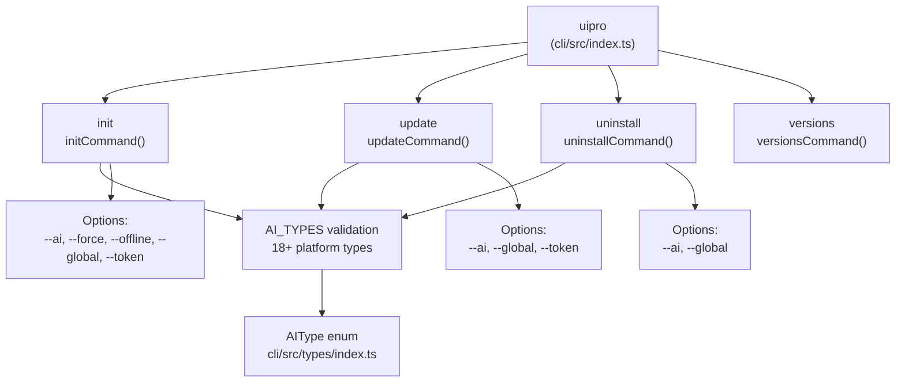
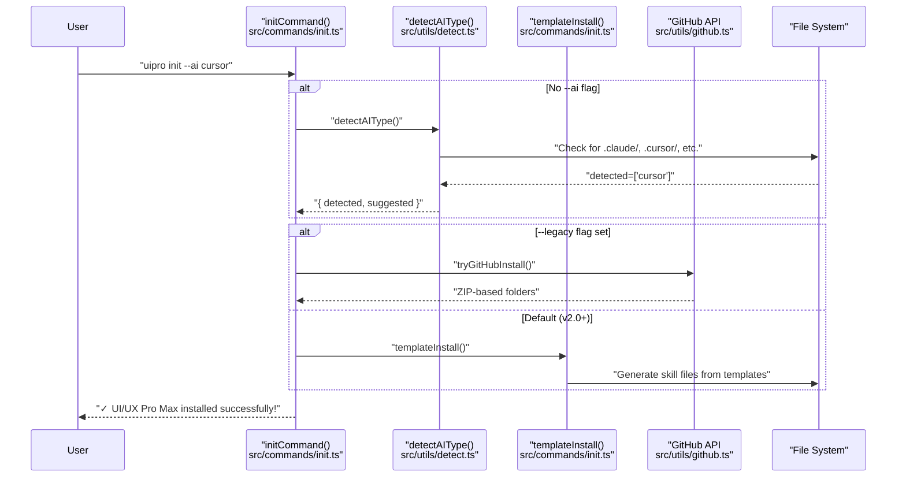

<!-- source: DeepWiki mcp.deepwiki.com · repo nextlevelbuilder/ui-ux-pro-max-skill · page 2 uipro-cli Tool · fetched 2026-10-27 -->

# uipro-cli Tool

Relevant source files

The following files were used as context for generating this wiki page:

- [cli/.npmignore](cli/.npmignore)
- [cli/README.md](cli/README.md)
- [cli/package.json](cli/package.json)
- [cli/src/commands/init.ts](cli/src/commands/init.ts)
- [cli/src/commands/update.ts](cli/src/commands/update.ts)
- [cli/src/commands/versions.ts](cli/src/commands/versions.ts)
- [cli/src/index.ts](cli/src/index.ts)
- [cli/src/utils/extract.ts](cli/src/utils/extract.ts)
- [cli/src/utils/github.ts](cli/src/utils/github.ts)

The `uipro-cli` tool is a Node.js command-line interface distributed via npm as `ui-ux-pro-max-cli` [cli/package.json:2](). it automates the installation and management of the UI/UX Pro Max skill across 18+ AI coding platforms. It handles platform detection, GitHub release downloading with bundled fallback, and a v2.0 template-based generation system for creating platform-specific configuration files.

This page covers the CLI's package structure, command architecture, and high-level installation workflow. For detailed information on specific subsystems, see:
- CLI command options and usage: [CLI Commands](#2.1)
- Installation pipeline stages: [Installation Flow](#2.2)
- Platform directory detection logic: [Platform Detection](#2.3)
- Template-based file generation: [Template Generation](#2.4)

---

## Package Structure

The `uipro-cli` package is configured as an ES module [cli/package.json:5]() with a binary entry point at `dist/index.js` [cli/package.json:7](). The package includes two critical directories:

| Directory | Purpose |
|-----------|---------|
| `dist/` | Compiled TypeScript output from `src/` [cli/package.json:10]() |
| `assets/` | Templates, platform JSON configs, and bundled data/scripts [cli/package.json:11]() |

The `package.json` defines the binary command `uipro` that maps to the compiled entry point [cli/package.json:7]().

### Key Dependencies

| Package | Purpose |
|---------|---------|
| `commander@^12.1.0` | Command-line argument parsing and subcommand routing [cli/package.json:52]() |
| `chalk@^5.3.0` | Terminal color output for success/error messages [cli/package.json:51]() |
| `ora@^8.1.1` | Animated spinners during async operations [cli/package.json:53]() |
| `prompts@^2.4.2` | Interactive platform selection and confirmation [cli/package.json:54]() |

**Sources:** [cli/package.json:1-63]()

---

## Command Architecture

### Entry Point and Command Registration

The CLI entry point at [cli/src/index.ts:1-90]() uses `commander` to register four primary subcommands: `init`, `versions`, `update`, and `uninstall`.

**Command Hierarchy Diagram**

### Command Implementation Files

Each command is implemented in a separate module under `src/commands/`:

| Command | Module | Purpose |
|---------|--------|---------|
| `init` | `src/commands/init.ts` | Install skill to project or home directory [cli/src/commands/init.ts:127]() |
| `update` | `src/commands/update.ts` | Update existing installation to latest version or refresh files [cli/src/commands/update.ts:38]() |
| `uninstall` | `src/commands/uninstall.ts` | Remove skill files from project or globally [cli/src/index.ts:74]() |
| `versions` | `src/commands/versions.ts` | Fetch and display available GitHub releases [cli/src/commands/versions.ts:10]() |

**Sources:** [cli/src/index.ts:1-90](), [cli/src/commands/init.ts:1-226](), [cli/src/commands/update.ts:1-106](), [cli/README.md:11-39]()

---

## Installation Architecture

The CLI orchestrates a multi-stage installation process. In v2.0+, the default mode is **Template Generation**, which constructs the skill files dynamically from bundled templates [cli/src/commands/init.ts:189-193]().

**Installation Flow with Code Entities**

### Installation Modes

| Mode | Trigger | Logic |
|------|---------|-------|
| **Template** | Default | Uses `generatePlatformFiles` to render files from templates and platform JSON [cli/src/commands/init.ts:109-125](). |
| **Legacy ZIP** | `--legacy` | Downloads ZIP from GitHub via `getLatestRelease` [cli/src/commands/init.ts:54]() and extracts via `installFromZip` [cli/src/utils/extract.ts:125](). |
| **Global** | `--global` | Installs to the user's home directory (`~/`) instead of the current project [cli/src/index.ts:31](). |

**Sources:** [cli/src/commands/init.ts:127-226](), [cli/src/utils/extract.ts:125-149](), [cli/src/index.ts:25-46]()

---

## Platform Detection and Configuration

### Detection Logic
The `detectAIType` function scans the current working directory for hidden platform folders (e.g., `.cursor`, `.windsurf`, `.trae`) to suggest the appropriate installation target [cli/src/commands/init.ts:134]().

### GitHub Integration
The CLI integrates with the GitHub API to fetch releases [cli/src/utils/github.ts:54]() and download assets [cli/src/utils/github.ts:94](). It handles authentication via `UI_PRO_MAX_GITHUB_TOKEN` or `GITHUB_TOKEN` to bypass rate limits [cli/src/utils/github.ts:50]().

**Sources:** [cli/src/utils/github.ts:1-127](), [cli/src/commands/init.ts:130-157](), [cli/README.md:41-65]()

---

## ZIP Extraction and Fallback

While Template Generation is the primary mode, the CLI maintains robust ZIP handling for legacy support and manual updates.

**Extraction Utilities**
The `extractZip` function handles platform-specific extraction [cli/src/utils/extract.ts:13-24]():
- **Windows**: Uses PowerShell `Expand-Archive` [cli/src/utils/extract.ts:17]().
- **Unix**: Uses `unzip` [cli/src/utils/extract.ts:19]().

**Fallback Strategy**
In legacy mode, if the GitHub download fails due to rate limits (`GitHubRateLimitError`) or network issues, the CLI automatically falls back to bundled assets in the `ASSETS_DIR` [cli/src/commands/init.ts:184-188]().

**Sources:** [cli/src/utils/extract.ts:1-149](), [cli/src/commands/init.ts:44-104]()

---

## Development and Build

The CLI is developed using TypeScript and can be run using the Bun runtime.

| Action | Command |
|--------|---------|
| **Build** | `node scripts/build.mjs` (via `npm run build`) [cli/package.json:14]() |
| **Dev** | `bun run src/index.ts` [cli/package.json:15]() |
| **Sync Assets** | `node scripts/sync-assets.mjs` [cli/package.json:16]() |

The `prepublishOnly` hook ensures that assets are synced, data is verified, and the project is built before publishing to npm [cli/package.json:30]().

**Sources:** [cli/package.json:13-31](), [cli/README.md:77-97]()

---

