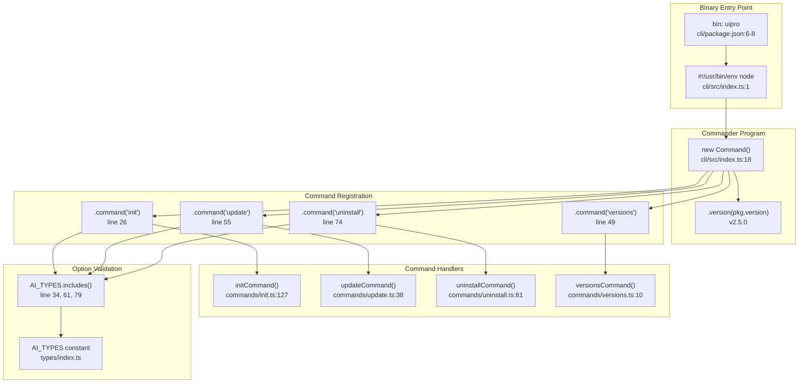
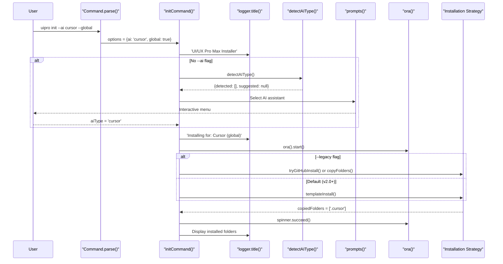
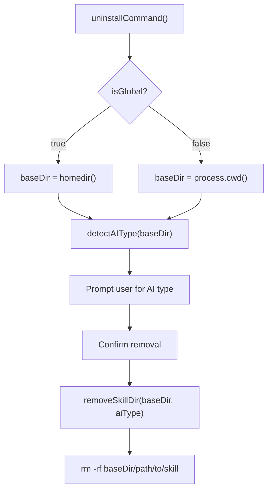

<!-- source: DeepWiki mcp.deepwiki.com · repo nextlevelbuilder/ui-ux-pro-max-skill · page 2.1 CLI Commands · fetched 2026-10-27 -->

# CLI Commands

<details>
<summary>Relevant source files</summary>

The following files were used as context for generating this wiki page:

- [cli/.npmignore](cli/.npmignore)
- [cli/README.md](cli/README.md)
- [cli/assets/templates/platforms/augment.json](cli/assets/templates/platforms/augment.json)
- [cli/assets/templates/platforms/kilocode.json](cli/assets/templates/platforms/kilocode.json)
- [cli/assets/templates/platforms/warp.json](cli/assets/templates/platforms/warp.json)
- [cli/package.json](cli/package.json)
- [cli/src/commands/init.ts](cli/src/commands/init.ts)
- [cli/src/commands/uninstall.ts](cli/src/commands/uninstall.ts)
- [cli/src/commands/update.ts](cli/src/commands/update.ts)
- [cli/src/commands/versions.ts](cli/src/commands/versions.ts)
- [cli/src/index.ts](cli/src/index.ts)
- [cli/src/utils/extract.ts](cli/src/utils/extract.ts)
- [cli/src/utils/github.ts](cli/src/utils/github.ts)

</details>


This document details the command-line interface of the `uipro` CLI tool, which provides four primary commands for installing and managing UI/UX Pro Max across AI coding assistants. The CLI is distributed via npm as `ui-ux-pro-max-cli` [cli/package.json:2-8]() and provides installation orchestration with automatic platform detection, GitHub integration, and template-based file generation.

For information about the installation pipeline and asset download mechanisms, see [Installation Flow](#2.2). For platform detection logic, see [Platform Detection](#2.3). For template-based file generation, see [Template Generation](#2.4).

---

## Command Overview

The CLI exposes four commands through the `uipro` executable [cli/package.json:6-8]():

| Command | Purpose | Key Options |
|---------|---------|-------------|
| `uipro init` | Install UI/UX Pro Max skill to current project or globally | `--ai`, `--force`, `--offline`, `--legacy`, `--global`, `--token` |
| `uipro update` | Update the global CLI or refresh installed skill files | `--ai`, `--global`, `--token` |
| `uipro uninstall` | Remove skill files from project or home directory | `--ai`, `--global` |
| `uipro versions` | List available versions from GitHub releases | `--token` |

**Sources:** [cli/src/index.ts:20-81](), [cli/package.json:6-8](), [cli/README.md:13-39]()

---

## CLI Program Structure

The following diagram maps the command-line entry point to code entities:



**Sources:** [cli/src/index.ts:1-90](), [cli/package.json:1-8]()

---

## init Command

The `init` command installs UI/UX Pro Max to the current working directory or the user's home directory by detecting platforms, generating skill files, and copying data assets.

### Syntax

```bash
uipro init [options]
```

### Options

| Option | Type | Description | Default |
|--------|------|-------------|---------|
| `-a, --ai <type>` | string | Target AI platform (e.g., `cursor`, `claude`, `all`) | Interactive prompt |
| `-f, --force` | boolean | Overwrite existing files without confirmation | `false` |
| `-o, --offline` | boolean | Compatibility flag; template installs use bundled assets | `false` |
| `-g, --global` | boolean | Install to home directory (`~/`) instead of project | `false` |
| `--legacy` | boolean | Use ZIP-based installation instead of templates | `false` |
| `-t, --token <token>`| string | GitHub Personal Access Token for higher rate limits | Environment variable |

**Sources:** [cli/src/index.ts:26-46](), [cli/src/commands/init.ts:31-38]()

### Execution Flow



**Sources:** [cli/src/commands/init.ts:127-226](), [cli/src/index.ts:26-46]()

### Installation Strategies

#### Template Generation (Default)
This method uses `templateInstall` [cli/src/commands/init.ts:109](), which calls `generatePlatformFiles` [cli/src/commands/init.ts:124]() to create platform-specific files from bundled templates [cli/src/commands/init.ts:23-29](). It handles global path rewrites if `--global` is specified [cli/src/commands/init.ts:116-118]().

#### ZIP-Based Installation (Legacy)
Triggered by the `--legacy` flag [cli/src/commands/init.ts:170](). It attempts to download the latest release ZIP from GitHub via `tryGitHubInstall` [cli/src/commands/init.ts:44](). If the download fails or `--offline` is set, it falls back to copying folders from `ASSETS_DIR` [cli/src/commands/init.ts:185-187]().

**Sources:** [cli/src/commands/init.ts:44-125](), [cli/src/utils/extract.ts:35-88]()

---

## uninstall Command

The `uninstall` command removes the `ui-ux-pro-max` skill directory and related files from specific AI assistant folders.

### Syntax

```bash
uipro uninstall [options]
```

### Options

| Option | Type | Description |
|--------|------|-------------|
| `-a, --ai <type>` | string | Specific AI assistant to remove |
| `-g, --global` | boolean | Uninstall from home directory (`~/`) |

**Sources:** [cli/src/index.ts:74-88](), [cli/src/commands/uninstall.ts:13-16]()

### Implementation: removeSkillDir
The core logic resides in `removeSkillDir` [cli/src/commands/uninstall.ts:21](). It derives the installation path from the platform configuration [cli/src/commands/uninstall.ts:38-47]() and removes both the main skill and bundled sub-skills [cli/src/commands/uninstall.ts:25, 65-76]().



**Sources:** [cli/src/commands/uninstall.ts:21-80](), [cli/src/commands/uninstall.ts:81-177]()

---

## update Command

The `update` command checks for new CLI versions on GitHub [cli/src/commands/update.ts:44](). If a new version exists, it attempts to update the global npm package [cli/src/commands/update.ts:71-75](). If the CLI is already up-to-date, it refreshes the local skill files by running `initCommand` with `force: true` [cli/src/commands/update.ts:93-98]().

### Syntax

```bash
uipro update [options]
```

**Sources:** [cli/src/index.ts:55-71](), [cli/src/commands/update.ts:38-106]()

---

## versions Command

The `versions` command displays all available GitHub releases for the repository [cli/src/commands/versions.ts:14](). It marks the most recent release as `[latest]` [cli/src/commands/versions.ts:31]().

**Sources:** [cli/src/commands/versions.ts:10-46](), [cli/src/utils/github.ts:54-72]()

---

## Command-Line Option Validation

### AI Type Validation
The CLI validates the `--ai` option against the `AI_TYPES` array [cli/src/index.ts:34, 61, 79](). Supported platforms include `claude`, `cursor`, `windsurf`, `antigravity`, `copilot`, `roocode`, `kiro`, `codex`, `qoder`, `gemini`, `trae`, `opencode`, `continue`, `codebuddy`, `droid`, `kilocode`, `warp`, `augment`, and `all`.

**Sources:** [cli/src/index.ts:12](), [cli/README.md:15-28]()

### GitHub Authentication
To avoid API rate limits, users can provide a token via the `--token` flag, `UI_PRO_MAX_GITHUB_TOKEN` environment variable, or `GITHUB_TOKEN` environment variable [cli/src/utils/github.ts:49-52]().

**Sources:** [cli/README.md:41-64](), [cli/src/utils/github.ts:23-31]()

### Exit Codes

| Exit Code | Condition | Location |
|-----------|-----------|----------|
| `0` | Successful execution | Implicit |
| `1` | Invalid `--ai` type provided | [cli/src/index.ts:37, 64, 82]() |
| `1` | Command failure (Init, Update, Uninstall, Versions) | [cli/src/commands/init.ts:224](), [cli/src/commands/update.ts:104](), [cli/src/commands/uninstall.ts:176](), [cli/src/commands/versions.ts:44]() |

**Sources:** [cli/src/index.ts:37-82](), [cli/src/commands/init.ts:224]()

---

