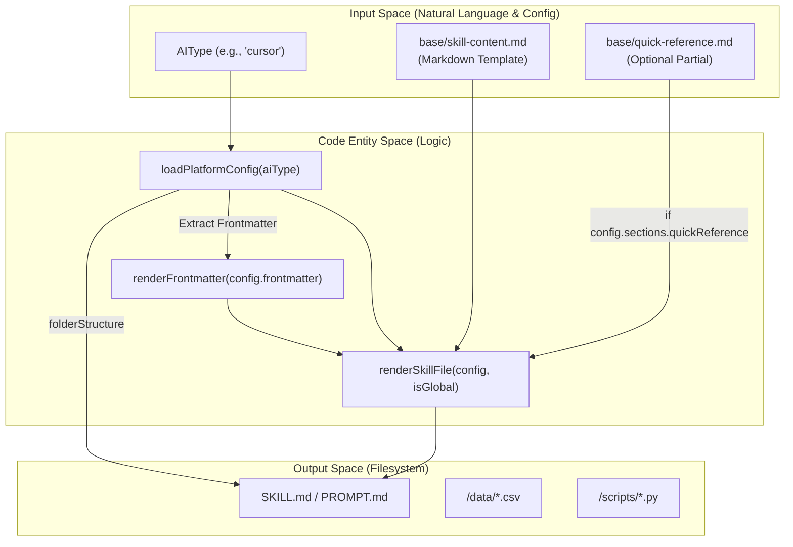
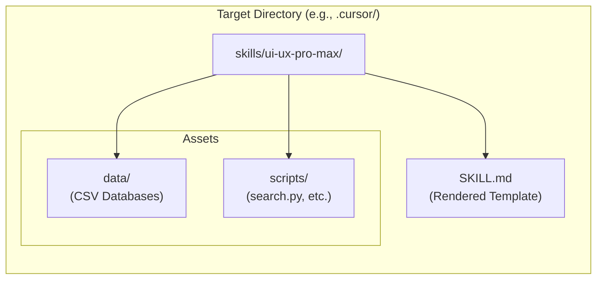

<!-- source: DeepWiki mcp.deepwiki.com · repo nextlevelbuilder/ui-ux-pro-max-skill · page 2.4 Template Generation · fetched 2026-10-27 -->

# Template Generation

Relevant source files

The following files were used as context for generating this wiki page:

- [CLAUDE.md](CLAUDE.md)
- [cli/assets/templates/base/skill-content.md](cli/assets/templates/base/skill-content.md)
- [cli/src/types/index.ts](cli/src/types/index.ts)
- [cli/src/utils/detect.ts](cli/src/utils/detect.ts)
- [cli/src/utils/template.ts](cli/src/utils/template.ts)
- [src/ui-ux-pro-max/templates/base/skill-content.md](src/ui-ux-pro-max/templates/base/skill-content.md)

The Template Generation system is the core of the v2.0 architecture, responsible for producing platform-specific installation files from a single source of truth using declarative JSON configurations. This system enables the UI/UX Pro Max skill to support 18+ AI platforms (including Claude, Cursor, Windsurf, Trae, and others) by mapping a base template to specific folder structures, file naming conventions, and metadata requirements.

---

## Platform Configuration Schema

Each AI platform is defined by a JSON configuration file located in `src/ui-ux-pro-max/templates/platforms/` (mirrored to `cli/assets/templates/platforms/`). These files define the structural and content parameters used by the `template.ts` utility to generate the final skill files.

### Configuration Structure

The `PlatformConfig` interface defines the following fields:

| Field | Type | Purpose | Example Values |
|-------|------|---------|----------------|
| `platform` | `string` | Internal platform identifier | `"cursor"`, `"trae"`, `"warp"` |
| `displayName` | `string` | UI name shown in CLI prompts | `"Cursor"`, `"GitHub Copilot"` |
| `installType` | `string` | Delivery mode (`full` or `reference`) | `"full"` |
| `folderStructure.root` | `string` | Top-level hidden directory | `".cursor"`, `".github"`, `".trae"` |
| `folderStructure.skillPath` | `string` | Subdirectory path for the skill | `"skills/ui-ux-pro-max"` |
| `folderStructure.filename` | `string` | Target filename | `"SKILL.md"`, `"PROMPT.md"` |
| `scriptPath` | `string` | Path to the Python search engine | `"scripts/search.py"` |
| `frontmatter` | `Record \| null` | YAML metadata for the markdown file | `{"name": "ui-ux-pro-max"}` |
| `sections.quickReference` | `boolean` | Toggle for the quick-ref template | `true`, `false` |
| `skillOrWorkflow` | `string` | Categorization for instructions | `"Skill"`, `"Workflow"` |

**Sources:** [cli/src/utils/template.ts:16-34](), [cli/src/types/index.ts:26-44]()

---

## Template Rendering Pipeline

The rendering pipeline transforms abstract platform definitions into concrete filesystem entities. It utilizes a base template (`base/skill-content.md`) and injects platform-specific values.

**Diagram: Template Generation Flow**

**Sources:** [cli/src/utils/template.ts:72-81](), [cli/src/utils/template.ts:132-164](), [cli/src/utils/template.ts:233-270]()

### Key Implementation Functions

- **`loadPlatformConfig(aiType)`**: Maps the CLI `aiType` string to a JSON file name via the `AI_TO_PLATFORM` map and parses the configuration from the assets directory. [cli/src/utils/template.ts:72-81]()
- **`renderSkillFile(config, isGlobal)`**: Performs the string replacement for placeholders like `{{TITLE}}`, `{{DESCRIPTION}}`, and `{{SCRIPT_PATH}}`. If `isGlobal` is true, it rewrites the `commandScriptPath` to use the home directory prefix (`~/`). [cli/src/utils/template.ts:132-164]()
- **`generatePlatformFiles(targetDir, aiType, isGlobal)`**: The main entry point that creates the directory structure, writes the rendered markdown, and calls `copyDataAndScripts` and `copySubSkills`. [cli/src/utils/template.ts:233-270]()

---

## Data and Script Injection

Unlike the legacy ZIP-based system, the v2.0 template system creates **self-contained** installations. Each platform directory receives its own copy of the core design database and search logic to avoid broken symlinks on environments like Windows.

**Diagram: Self-Contained Skill Structure**

**Sources:** [cli/src/utils/template.ts:186-206](), [CLAUDE.md:74-80]()

The `copyDataAndScripts` function is responsible for this injection. It uses `ensureCleanDir` to remove any legacy non-directory files (like broken symlinks) before creating the `data/` and `scripts/` directories and copying assets. [cli/src/utils/template.ts:172-206]()

---

## Global vs Local Installation

The template system handles two distinct installation scopes, primarily affecting how the Python scripts are invoked by the AI assistant:

1.  **Local (Default)**: Files are generated within the current working directory (e.g., `./.cursor/skills/...`).
2.  **Global (`--global`)**: Files are generated in the user's home directory (`~/`). The `renderSkillFile` function detects this and rewrites the `{{SCRIPT_PATH}}` placeholder to use absolute paths anchored at the home directory:
    - *Local Path Calculation*: `config.folderStructure.root + '/' + config.scriptPath` [cli/src/utils/template.ts:145-146]()
    - *Global Rewrite*: `isGlobal ? '~/' + rootedScriptPath : rootedScriptPath` [cli/src/utils/template.ts:147]()

**Sources:** [cli/src/utils/template.ts:132-164]()

---

## Platform Support Table (v2.5.0)

The system currently supports 20 AI assistant types (including `all` and `universal`). The following table illustrates how the template system maps these types to specific directory structures:

| AIType | Root Folder | Skill/Prompt Filename | Interaction Mode |
| :--- | :--- | :--- | :--- |
| `claude` | `.claude` | `SKILL.md` | Skill |
| `cursor` | `.cursor` | `SKILL.md` | Skill |
| `copilot` | `.github` | `PROMPT.md` | Workflow |
| `windsurf` | `.windsurf` | `SKILL.md` | Skill |
| `kiro` | `.kiro` | `SKILL.md` | Workflow |
| `roocode` | `.roo` | `SKILL.md` | Workflow |
| `trae` | `.trae` | `SKILL.md` | Skill |
| `warp` | `.warp` | `SKILL.md` | Skill |
| `augment` | `.augment` | `SKILL.md` | Skill |
| `gemini` | `.gemini` | `SKILL.md` | Skill |

**Sources:** [cli/src/types/index.ts:51-72](), [cli/src/utils/detect.ts:93-138](), [cli/src/utils/template.ts:37-58]()

---

## Summary of Data Flow

The CLI installation flow integrates template generation as the final step of the `init` command.

1.  **Detection**: `detectAIType()` identifies existing platform directories in the CWD. [cli/src/utils/detect.ts:10-91]()
2.  **Configuration**: `loadPlatformConfig()` fetches the JSON definition from `ASSETS_DIR`. [cli/src/utils/template.ts:72-81]()
3.  **Rendering**: `renderSkillFile()` merges `base/skill-content.md` and `base/quick-reference.md` with config values. [cli/src/utils/template.ts:132-164]()
4.  **Materialization**: `generatePlatformFiles()` writes the rendered file and performs recursive copies of `data/`, `scripts/`, and `skills/` (sub-skills). [cli/src/utils/template.ts:233-270]()

**Sources:** [cli/src/utils/template.ts:1-270](), [cli/src/utils/detect.ts:1-138]()

---

