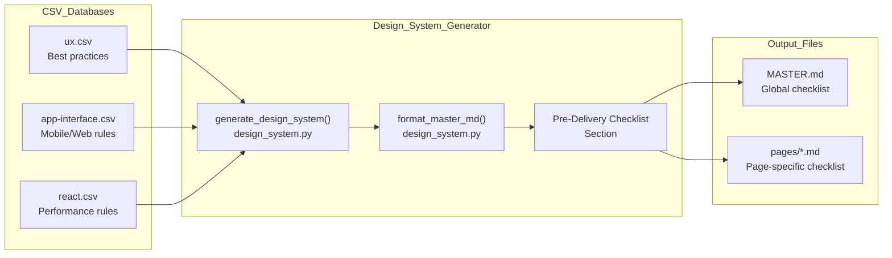
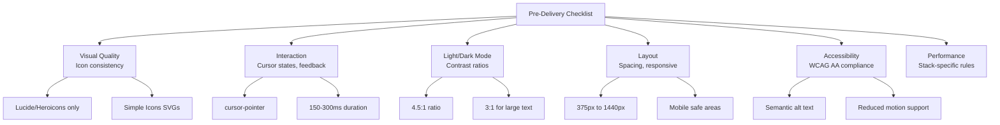
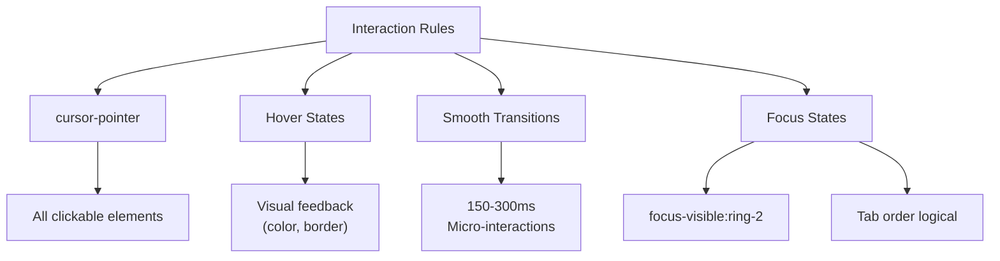

<!-- source: DeepWiki mcp.deepwiki.com · repo nextlevelbuilder/ui-ux-pro-max-skill · page 3.3 Pre-Delivery Checklist · fetched 2026-10-27 -->

# Pre-Delivery Checklist

Relevant source files

The following files were used as context for generating this wiki page:

- [.claude/skills/ui-ux-pro-max/scripts/design_system.py](.claude/skills/ui-ux-pro-max/scripts/design_system.py)
- [CLAUDE.md](CLAUDE.md)
- [cli/assets/scripts/design_system.py](cli/assets/scripts/design_system.py)
- [cli/assets/templates/base/skill-content.md](cli/assets/templates/base/skill-content.md)
- [src/ui-ux-pro-max/scripts/design_system.py](src/ui-ux-pro-max/scripts/design_system.py)
- [src/ui-ux-pro-max/templates/base/skill-content.md](src/ui-ux-pro-max/templates/base/skill-content.md)

The Pre-Delivery Checklist is a quality assurance verification system that ensures UI/UX deliverables meet professional standards before shipping. This checklist is automatically generated as part of the design system output and covers critical areas including accessibility, interaction design, visual consistency, and responsive behavior.

For information about the design system generation that produces this checklist, see [Design System Generator](#6). For stack-specific implementation guidelines, see [Stack-Specific Guidelines](#4.3).

## Purpose and Scope

The checklist serves three primary functions:

1.  **Automated Quality Gate** - Included in every `--design-system` output to remind developers of common issues.
2.  **Context-Aware Rules** - Filters checklist items based on product type and style selection via `ui-reasoning.csv` [src/ui-ux-pro-max/scripts/design_system.py:38]().
3.  **Severity Prioritization** - Organizes items by impact (Critical → High → Medium → Low) derived from stack and domain databases.

The checklist draws rules from multiple CSV databases and consolidates them into actionable verification steps. It does not replace manual testing but provides a systematic framework for catching the most common UI/UX defects.

Sources: [src/ui-ux-pro-max/templates/base/skill-content.md:30-35](), [src/ui-ux-pro-max/scripts/design_system.py:38-46]()

## Integration Architecture

The checklist is generated through a multi-stage pipeline that combines domain-specific rules with reasoning logic. The `design_system.py` script acts as the orchestrator.

**Checklist Data Flow**

**Checklist Generation Flow:**

1.  `generate_design_system()` performs multi-domain searches including the `ux` domain [src/ui-ux-pro-max/scripts/design_system.py:8-15]().
2.  `persist_design_system()` saves the output to `MASTER.md` or page-specific overrides [src/ui-ux-pro-max/templates/base/skill-content.md:90-110]().
3.  Output includes standard categories with verification items scoped to the user's platform (e.g., ignoring mobile-only rules for desktop-web projects) [src/ui-ux-pro-max/templates/base/skill-content.md:67-69]().

Sources: [src/ui-ux-pro-max/scripts/design_system.py:8-28](), [src/ui-ux-pro-max/templates/base/skill-content.md:58-70](), [src/ui-ux-pro-max/templates/base/skill-content.md:90-110]()

## Checklist Categories

The checklist organizes rules into priority-ordered categories. Each category targets specific quality dimensions:

**Category Hierarchy**

Sources: [src/ui-ux-pro-max/templates/base/skill-content.md:49-54](), [src/ui-ux-pro-max/templates/base/skill-content.md:67-69](), [src/ui-ux-pro-max/scripts/design_system.py:153-162]()

## 1. Visual Quality

This category ensures professional visual appearance by preventing common amateur mistakes:

| Rule | Severity | Description |
| :--- | :--- | :--- |
| **No emoji icons** | Critical | Emojis lack semantic meaning and render inconsistently. |
| **Consistent icon set** | High | Use one library (Heroicons/Lucide) via `icons` domain search. |
| **Verified brand logos** | Medium | Use official SVG paths from Simple Icons. |
| **No layout-shift hover** | High | Hover states must not cause content reflow. |
| **Direct theme colors** | Low | Use CSS variables like `--color-primary` [src/ui-ux-pro-max/scripts/design_system.py:49](). |

Sources: [src/ui-ux-pro-max/scripts/design_system.py:48-65](), [src/ui-ux-pro-max/templates/base/skill-content.md:49-52]()

## 2. Interaction

Interaction rules ensure responsive, intuitive user experiences:

**Interaction Logic Space**

**Key Verification Items:**
- **`cursor-pointer`**: Must be applied to all interactive elements (buttons, cards, links).
- **Hover Feedback**: Must be distinct and not cause layout shifts.
- **Smooth Transitions**: Standard duration is 150-300ms for micro-interactions [src/ui-ux-pro-max/templates/base/skill-content.md:52]().
- **Focus States**: Visible focus rings for keyboard navigation (WCAG 2.4.7).

Sources: [src/ui-ux-pro-max/templates/base/skill-content.md:49-52](), [CLAUDE.md:27]()

## 3. Light/Dark Mode Contrast

The system calculates contrast ratios to enforce WCAG AA compliance in both modes using the `_contrast_ratio` function [src/ui-ux-pro-max/scripts/design_system.py:153-162]().

| Rule | WCAG Level | Minimum Ratio | Context |
| :--- | :--- | :--- | :--- |
| **Text contrast** | AA | 4.5:1 | Normal text (< 18pt) |
| **Large text contrast** | AA | 3:1 | Large text (≥ 18pt) |
| **Glass elements** | AA | 4.5:1 | Background/Foreground contrast |

**Color Mode Resolution:**
The `design_system.py` script uses `_relative_luminance` to detect if a palette is dark [src/ui-ux-pro-max/scripts/design_system.py:129-150]() and adjusts anti-patterns accordingly [src/ui-ux-pro-max/scripts/design_system.py:120-122]().

Sources: [src/ui-ux-pro-max/scripts/design_system.py:129-162]()

## 4. Layout and Responsive Design

Layout verification ensures content displays correctly across viewport sizes.

**Breakpoint Standards:**
The checklist enforces specific breakpoints which align with standard device widths:

| Breakpoint | Width | Device |
| :--- | :--- | :--- |
| **Mobile** | 375px | iPhone SE |
| **Tablet** | 768px | iPad Portrait |
| **Laptop** | 1024px | MacBook |
| **Desktop** | 1440px | 1440p Display |

**Platform Constraints:**
Mobile-specific concerns like "Safe Areas," "Haptics," and "Dynamic Type" are only included for native app platforms [src/ui-ux-pro-max/templates/base/skill-content.md:67-69]().

Sources: [src/ui-ux-pro-max/templates/base/skill-content.md:67-70]()

## 5. Accessibility (WCAG AA)

Accessibility rules ensure compliance with WCAG 2.1 Level AA standards. The `Query Contract` specifies using explicit accessibility outcome terms for searches [src/ui-ux-pro-max/templates/base/skill-content.md:49-50]().

**Accessibility Checklist Items:**
- **Images**: Alt text for meaningful images; `aria-hidden="true"` for decorative icons.
- **Forms**: Label elements with `for` attributes; `aria-label` for icon-only buttons.
- **Motion**: Support for `prefers-reduced-motion` to disable non-essential animations.
- **Semantic HTML**: Use outcome-first queries like `"error summary validation" --domain ux` [src/ui-ux-pro-max/templates/base/skill-content.md:49]().

Sources: [src/ui-ux-pro-max/templates/base/skill-content.md:49-52]()

## 6. Performance and Stack-Specific Rules

The final checklist section includes performance verification based on the implementation stack (e.g., `react`, `nextjs`, `html-tailwind`) [CLAUDE.md:39]().

| Category | Rule | Severity |
| :--- | :--- | :--- |
| **Async Waterfall** | Parallelize independent fetches with `Promise.all()` | Critical |
| **Bundle Size** | Avoid barrel imports; use direct path imports | Critical |
| **React** | Memoize expensive components; stable list keys | High |
| **Next.js** | Use `next/image` and `next/font` | High |

**Verification Workflow:**
The checklist is designed for systematic verification before code delivery, moving from Visual Quality → Interaction → Light/Dark Mode → Layout → Accessibility → Performance [src/ui-ux-pro-max/templates/base/skill-content.md:37-70]().

Sources: [CLAUDE.md:35-40](), [src/ui-ux-pro-max/templates/base/skill-content.md:43-46]()

---

