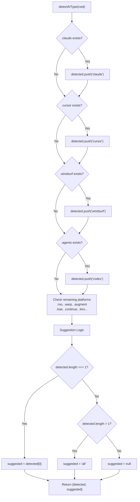
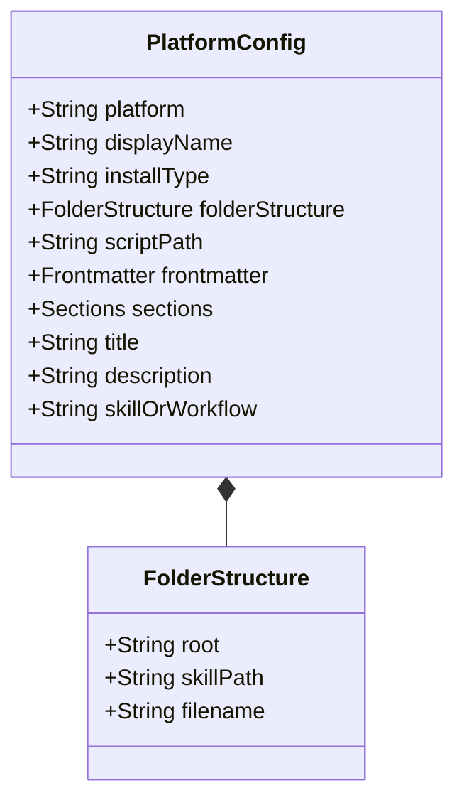

<!-- source: DeepWiki mcp.deepwiki.com · repo nextlevelbuilder/ui-ux-pro-max-skill · page 7 Platform Integration · fetched 2026-10-27 -->

# Platform Integration

<details>
<summary>Relevant source files</summary>

The following files were used as context for generating this wiki page:

- [.claude-plugin/marketplace.json](.claude-plugin/marketplace.json)
- [.claude-plugin/plugin.json](.claude-plugin/plugin.json)
- [cli/assets/templates/platforms/agent.json](cli/assets/templates/platforms/agent.json)
- [cli/assets/templates/platforms/codex.json](cli/assets/templates/platforms/codex.json)
- [cli/assets/templates/platforms/cursor.json](cli/assets/templates/platforms/cursor.json)
- [cli/assets/templates/platforms/kiro.json](cli/assets/templates/platforms/kiro.json)
- [cli/assets/templates/platforms/roocode.json](cli/assets/templates/platforms/roocode.json)
- [cli/assets/templates/platforms/windsurf.json](cli/assets/templates/platforms/windsurf.json)
- [skill.json](skill.json)
- [src/ui-ux-pro-max/templates/platforms/claude.json](src/ui-ux-pro-max/templates/platforms/claude.json)
- [src/ui-ux-pro-max/templates/platforms/codebuddy.json](src/ui-ux-pro-max/templates/platforms/codebuddy.json)
- [src/ui-ux-pro-max/templates/platforms/codex.json](src/ui-ux-pro-max/templates/platforms/codex.json)
- [src/ui-ux-pro-max/templates/platforms/continue.json](src/ui-ux-pro-max/templates/platforms/continue.json)
- [src/ui-ux-pro-max/templates/platforms/gemini.json](src/ui-ux-pro-max/templates/platforms/gemini.json)
- [src/ui-ux-pro-max/templates/platforms/opencode.json](src/ui-ux-pro-max/templates/platforms/opencode.json)

</details>


The Platform Integration system enables UI/UX Pro Max to operate across 18 AI coding assistants through a template-based configuration mechanism. This system handles platform detection, configuration management, and file generation to create platform-specific installations from a single source of truth. For details on the CLI commands that drive this integration, see [CLI Commands](#2.1). For the template generation mechanism itself, see [Template Generation](#2.4).

## Supported Platforms

The system supports 18 AI coding assistant platforms, each identified by an `AIType` discriminator and mapped to specific directory structures via JSON configuration files. Recent additions include high-performance environments like Warp, Augment, and Trae.

| Platform | AIType | Root Directory | File Structure | Mode |
|----------|--------|----------------|----------------|------|
| Claude Code | `claude` | `.claude/` | `skills/ui-ux-pro-max/SKILL.md` | Skill |
| Cursor | `cursor` | `.cursor/` | `skills/ui-ux-pro-max/SKILL.md` | Skill |
| Windsurf | `windsurf` | `.windsurf/` | `skills/ui-ux-pro-max/SKILL.md` | Skill |
| Antigravity | `antigravity` | `.agents/` | `skills/ui-ux-pro-max/SKILL.md` | Skill |
| GitHub Copilot | `copilot` | `.github/` | `prompts/ui-ux-pro-max/PROMPT.md` | Workflow |
| Kiro | `kiro` | `.kiro/` | `steering/ui-ux-pro-max/SKILL.md` | Workflow |
| Codex CLI | `codex` | `.agents/` | `skills/ui-ux-pro-max/SKILL.md` | Skill |
| Roo Code | `roocode` | `.roo/` | `skills/ui-ux-pro-max/SKILL.md` | Workflow |
| Qoder | `qoder` | `.qoder/` | `skills/ui-ux-pro-max/SKILL.md` | Skill |
| Gemini CLI | `gemini` | `.gemini/` | `skills/ui-ux-pro-max/SKILL.md` | Skill |
| Trae | `trae` | `.trae/` | `skills/ui-ux-pro-max/SKILL.md` | Skill |
| OpenCode | `opencode` | `.opencode/` | `skills/ui-ux-pro-max/SKILL.md` | Skill |
| Continue | `continue` | `.continue/` | `skills/ui-ux-pro-max/SKILL.md` | Skill |
| CodeBuddy | `codebuddy` | `.codebuddy/` | `skills/ui-ux-pro-max/SKILL.md` | Skill |
| Warp | `warp` | `.warp/` | `skills/ui-ux-pro-max/SKILL.md` | Skill |
| Augment | `augment` | `.augment/` | `skills/ui-ux-pro-max/SKILL.md` | Skill |
| Kilocode | `kilocode` | `.kilocode/` | `skills/ui-ux-pro-max/SKILL.md` | Skill |

**Sources:** [skill.json:20-40](), [cli/assets/templates/platforms/codex.json:1-21](), [src/ui-ux-pro-max/templates/platforms/claude.json:1-21](), [src/ui-ux-pro-max/templates/platforms/continue.json:1-21]()

## Platform Detection System

### detectAIType Function

The `detectAIType` function performs filesystem-based platform detection by scanning for platform-specific directories defined in the platform configuration files.



**Detection Algorithm:**

The detection follows a sequential filesystem check pattern using the `folderStructure.root` property from platform JSON files:

1. **Parallel Directory Checks**: Validates existence of folders like `.claude`, `.cursor`, `.windsurf`, and `.agents`.
2. **Detection Accumulation**: Builds an array of all detected platforms in the current working directory.
3. **Suggestion Logic**:
   - If exactly 1 platform detected → suggest that specific platform.
   - If multiple platforms detected → suggest `'all'`.
   - If no platforms detected → suggest `null`.

**Sources:** [cli/assets/templates/platforms/codex.json:5-9](), [src/ui-ux-pro-max/templates/platforms/claude.json:5-9](), [src/ui-ux-pro-max/templates/platforms/codex.json:5-9]()

## Platform Configuration Schema

### PlatformConfig Structure

Each platform is defined by a JSON configuration file (e.g., `codex.json`, `claude.json`) containing metadata for installation and AI interaction.



### Configuration Examples

**Skill Mode (Full Content):**
[cli/assets/templates/platforms/codex.json:1-21]()
```json
{
  "platform": "codex",
  "displayName": "Codex",
  "installType": "full",
  "folderStructure": {
    "root": ".agents",
    "skillPath": "skills/ui-ux-pro-max",
    "filename": "SKILL.md"
  },
  "scriptPath": "skills/ui-ux-pro-max/scripts/search.py",
  "skillOrWorkflow": "Skill"
}
```

**Workflow Mode (Reference Content):**
[cli/assets/templates/platforms/roocode.json:1-21]()
```json
{
  "platform": "roocode",
  "displayName": "Roo Code",
  "installType": "full",
  "folderStructure": {
    "root": ".roo",
    "skillPath": "skills/ui-ux-pro-max",
    "filename": "SKILL.md"
  },
  "scriptPath": "skills/ui-ux-pro-max/scripts/search.py",
  "skillOrWorkflow": "Workflow"
}
```

**Sources:** [cli/assets/templates/platforms/codex.json:1-21](), [cli/assets/templates/platforms/roocode.json:1-21](), [src/ui-ux-pro-max/templates/platforms/claude.json:1-21]()

## Skill Mode vs Workflow Mode

The system distinguishes between **Skill Mode** (passive, high-context) and **Workflow Mode** (active, command-based).

| Aspect | Skill Mode | Workflow Mode |
|--------|------------|---------------|
| **Trigger** | Auto-activates on UI/UX keywords | Requires explicit slash command |
| **Platforms** | 14 platforms (Cursor, Windsurf, Warp, etc.) | 4 platforms (Kiro, Copilot, Roo Code) |
| **Content Size** | Full knowledge base | Lighter reference content |
| **Execution** | AI autonomously calls `search.py` | User triggers via prompt/command |

For details, see [Skill vs Workflow Modes](#7.2).

**Sources:** [cli/assets/templates/platforms/codex.json:20](), [cli/assets/templates/platforms/roocode.json:20](), [cli/assets/templates/platforms/kiro.json:20]()

## Claude Marketplace Integration

For the Claude platform, UI/UX Pro Max provides specific integration files to support the official marketplace and plugin ecosystem.

- **plugin.json**: Defines the skill's capabilities and local skill path for Claude Code [ .claude-plugin/plugin.json:1-21]().
- **marketplace.json**: Provides discovery metadata, categorization (design), and ownership details [ .claude-plugin/marketplace.json:1-35]().
- **skill.json**: Root configuration file defining version `2.13.0` and keywords for search indexing [ skill.json:1-42]().

For details, see [Claude Marketplace Integration](#7.3).

**Sources:** [.claude-plugin/plugin.json:1-21](), [.claude-plugin/marketplace.json:1-35](), [skill.json:1-42]()

---

