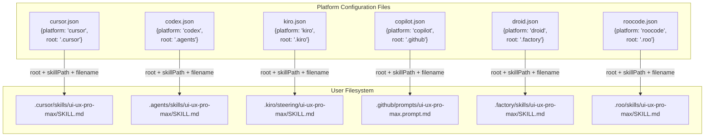
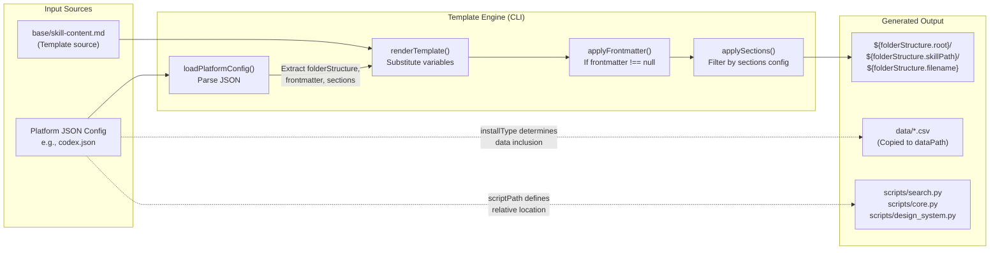

<!-- source: DeepWiki mcp.deepwiki.com · repo nextlevelbuilder/ui-ux-pro-max-skill · page 7.1 Platform Configuration System · fetched 2026-10-27 -->

# Platform Configuration System

<details>
<summary>Relevant source files</summary>

The following files were used as context for generating this wiki page:

- [cli/assets/templates/platforms/agent.json](cli/assets/templates/platforms/agent.json)
- [cli/assets/templates/platforms/claude.json](cli/assets/templates/platforms/claude.json)
- [cli/assets/templates/platforms/codebuddy.json](cli/assets/templates/platforms/codebuddy.json)
- [cli/assets/templates/platforms/codex.json](cli/assets/templates/platforms/codex.json)
- [cli/assets/templates/platforms/continue.json](cli/assets/templates/platforms/continue.json)
- [cli/assets/templates/platforms/copilot.json](cli/assets/templates/platforms/copilot.json)
- [cli/assets/templates/platforms/cursor.json](cli/assets/templates/platforms/cursor.json)
- [cli/assets/templates/platforms/droid.json](cli/assets/templates/platforms/droid.json)
- [cli/assets/templates/platforms/gemini.json](cli/assets/templates/platforms/gemini.json)
- [cli/assets/templates/platforms/kiro.json](cli/assets/templates/platforms/kiro.json)
- [cli/assets/templates/platforms/opencode.json](cli/assets/templates/platforms/opencode.json)
- [cli/assets/templates/platforms/roocode.json](cli/assets/templates/platforms/roocode.json)
- [cli/assets/templates/platforms/windsurf.json](cli/assets/templates/platforms/windsurf.json)
- [src/ui-ux-pro-max/templates/platforms/augment.json](src/ui-ux-pro-max/templates/platforms/augment.json)
- [src/ui-ux-pro-max/templates/platforms/claude.json](src/ui-ux-pro-max/templates/platforms/claude.json)
- [src/ui-ux-pro-max/templates/platforms/codebuddy.json](src/ui-ux-pro-max/templates/platforms/codebuddy.json)
- [src/ui-ux-pro-max/templates/platforms/codex.json](src/ui-ux-pro-max/templates/platforms/codex.json)
- [src/ui-ux-pro-max/templates/platforms/continue.json](src/ui-ux-pro-max/templates/platforms/continue.json)
- [src/ui-ux-pro-max/templates/platforms/copilot.json](src/ui-ux-pro-max/templates/platforms/copilot.json)
- [src/ui-ux-pro-max/templates/platforms/droid.json](src/ui-ux-pro-max/templates/platforms/droid.json)
- [src/ui-ux-pro-max/templates/platforms/gemini.json](src/ui-ux-pro-max/templates/platforms/gemini.json)
- [src/ui-ux-pro-max/templates/platforms/kilocode.json](src/ui-ux-pro-max/templates/platforms/kilocode.json)
- [src/ui-ux-pro-max/templates/platforms/opencode.json](src/ui-ux-pro-max/templates/platforms/opencode.json)
- [src/ui-ux-pro-max/templates/platforms/warp.json](src/ui-ux-pro-max/templates/platforms/warp.json)

</details>


## Purpose and Scope

The Platform Configuration System defines how UI/UX Pro Max adapts to different AI coding assistants through JSON-based configuration files. Each platform (Cursor, Claude, Windsurf, GitHub Copilot, etc.) has unique requirements for directory structure, file naming, and metadata format. This system provides a declarative schema that the template generator reads to produce platform-specific installations.

The system supports 18 distinct platforms, including recent additions such as **warp**, **augment**, **trae**, **opencode**, **continue**, **codebuddy**, **qoder**, **codex**, and **gemini**.

For information about how these configurations distinguish between Skill Mode and Workflow Mode behavior, see [7.2 Skill vs Workflow Modes](). For details on how templates are processed and rendered, see [2.4 Template Generation]().

---

## Configuration File Schema

Each platform is defined by a JSON file in `src/ui-ux-pro-max/templates/platforms/` (source of truth) and `cli/assets/templates/platforms/` (bundled with CLI). The schema consists of the following top-level fields:

| Field | Type | Required | Description |
|-------|------|----------|-------------|
| `platform` | `string` | Yes | Internal identifier (e.g., `"cursor"`, `"codex"`, `"trae"`) |
| `displayName` | `string` | Yes | Human-readable name (e.g., `"Cursor"`, `"Codex"`) |
| `installType` | `string` | Yes | Content mode: `"full"` or `"reference"` |
| `folderStructure` | `object` | Yes | Defines directory hierarchy (see below) |
| `scriptPath` | `string` | Yes | Relative path to `search.py` from project root |
| `frontmatter` | `object \| null` | Yes | YAML frontmatter for file header, or `null` if not needed |
| `sections` | `object` | Yes | Content sections to include (e.g., `quickReference`) |
| `title` | `string` | Yes | Skill/workflow title shown to user |
| `description` | `string` | Yes | Brief description of capabilities |
| `skillOrWorkflow` | `string` | Yes | Interaction mode: `"Skill"` or `"Workflow"` |

### folderStructure Object

```json
{
  "root": ".agents",              // Top-level directory
  "skillPath": "skills/ui-ux-pro-max",  // Subdirectory path
  "filename": "SKILL.md",          // Primary file name
  "dataPath": "prompts/ui-ux-pro-max" // Optional: Specific path for CSV data
}
```

### sections Object

```json
{
  "quickReference": true  // Whether to include condensed reference content
}
```

### frontmatter Object (Optional)

```json
{
  "name": "ui-ux-pro-max",
  "description": "UI/UX design intelligence with searchable database",
  "mode": "agent"
}
```

**Sources:** [cli/assets/templates/platforms/codex.json:1-21](), [cli/assets/templates/platforms/copilot.json:1-22](), [src/ui-ux-pro-max/templates/platforms/kilocode.json:1-21]()

---

## Platform Configuration Mapping

The following diagram shows how platform configuration files map to their respective filesystem structures across various AI assistants:

**Configuration to Filesystem Mapping**



**Sources:** [cli/assets/templates/platforms/cursor.json:5-9](), [cli/assets/templates/platforms/codex.json:5-9](), [cli/assets/templates/platforms/kiro.json:5-9](), [cli/assets/templates/platforms/copilot.json:5-9](), [cli/assets/templates/platforms/droid.json:5-9](), [cli/assets/templates/platforms/roocode.json:5-9]()

---

## Platform Comparison Table

The following table compares key configuration differences across a selection of the 18 supported platforms:

| Platform | `root` | `skillPath` | `filename` | `installType` | `skillOrWorkflow` |
|----------|--------|-------------|------------|---------------|-------------------|
| Cursor | `.cursor` | `skills/ui-ux-pro-max` | `SKILL.md` | `full` | `Skill` |
| Codex | `.agents` | `skills/ui-ux-pro-max` | `SKILL.md` | `full` | `Skill` |
| Windsurf | `.windsurf` | `skills/ui-ux-pro-max` | `SKILL.md` | `full` | `Skill` |
| Kiro | `.kiro` | `steering/ui-ux-pro-max` | `SKILL.md` | `full` | `Workflow` |
| GitHub Copilot | `.github` | `prompts` | `ui-ux-pro-max.prompt.md` | `full` | `Workflow` |
| Roo Code | `.roo` | `skills/ui-ux-pro-max` | `SKILL.md` | `full` | `Workflow` |
| Droid (Factory) | `.factory` | `skills/ui-ux-pro-max` | `SKILL.md` | `full` | `Skill` |
| Antigravity | `.agents` | `skills/ui-ux-pro-max` | `SKILL.md` | `full` | `Skill` |

**Key Observations:**

1. **Root Directory Variance:** Platforms utilize specific hidden directories for discovery, such as `.agents` for Codex/Antigravity [cli/assets/templates/platforms/codex.json:6]() and `.factory` for Droid [cli/assets/templates/platforms/droid.json:6]().
2. **Subdirectory Patterns:** Most platforms standardize on `skills/`, while Kiro uses `steering/` [cli/assets/templates/platforms/kiro.json:7]() and Copilot uses `prompts/` [cli/assets/templates/platforms/copilot.json:7]().
3. **Filename Convention:** `SKILL.md` is the standard for most modern agents. GitHub Copilot uses a specific suffix: `ui-ux-pro-max.prompt.md` [cli/assets/templates/platforms/copilot.json:8]().
4. **Frontmatter Metadata:** Codex and Copilot include specific metadata in `frontmatter` to define the skill name or agent mode [cli/assets/templates/platforms/codex.json:11-14](), [cli/assets/templates/platforms/copilot.json:12-15]().
5. **Mode Distribution:** Modern IDE-integrated agents like Cursor and Droid are configured as `Skill` [cli/assets/templates/platforms/cursor.json:20](), [cli/assets/templates/platforms/droid.json:20](), while command-based or generic assistants like Roo Code are `Workflow` [cli/assets/templates/platforms/roocode.json:20]().

**Sources:** [cli/assets/templates/platforms/cursor.json:1-21](), [cli/assets/templates/platforms/codex.json:1-21](), [cli/assets/templates/platforms/copilot.json:1-22](), [cli/assets/templates/platforms/droid.json:1-21](), [cli/assets/templates/platforms/agent.json:1-21]()

---

## Template Processing Flow

The following diagram illustrates how the CLI tool reads platform configuration files and generates the final installation:

**Template Processing with Code Entities**



**Sources:** [cli/assets/templates/platforms/codex.json:1-21](), [cli/assets/templates/platforms/copilot.json:1-22](), [cli/assets/templates/platforms/cursor.json:1-21]()

---

## Field Reference

### platform
**Type:** `string` | **Example:** `"codex"`, `"warp"`, `"augment"`
Internal identifier used for programmatic platform detection and template selection.
**Sources:** [cli/assets/templates/platforms/codex.json:2](), [src/ui-ux-pro-max/templates/platforms/warp.json:2]()

### displayName
**Type:** `string` | **Example:** `"Codex"`, `"GitHub Copilot"`
Human-readable name displayed in CLI output during the installation process.
**Sources:** [cli/assets/templates/platforms/codex.json:3](), [cli/assets/templates/platforms/copilot.json:3]()

### installType
**Type:** `string` | **Values:** `"full"` | `"reference"`
Determines content depth. All current platform configs (e.g., Codex, Droid, Copilot) use `"full"` to include the complete intelligence suite.
**Sources:** [cli/assets/templates/platforms/codex.json:4](), [cli/assets/templates/platforms/droid.json:4]()

### folderStructure
**Type:** `object`
Defines the complete filesystem path where skill files are installed.
- **`root`**: Top-level directory (e.g., `.agents`, `.github`).
- **`skillPath`**: Subdirectory path within `root` (e.g., `skills/ui-ux-pro-max`).
- **`filename`**: Primary markdown file name (e.g., `SKILL.md`).
- **`dataPath`**: (Optional) Specific path for data assets, used by platforms like Copilot [cli/assets/templates/platforms/copilot.json:9]().
**Sources:** [cli/assets/templates/platforms/codex.json:5-9](), [cli/assets/templates/platforms/copilot.json:5-10]()

### scriptPath
**Type:** `string` | **Example:** `"skills/ui-ux-pro-max/scripts/search.py"`
Relative path from project root to the search executable. This path is embedded in the generated skill so the AI can execute Python search tools.
**Sources:** [cli/assets/templates/platforms/codex.json:10](), [cli/assets/templates/platforms/copilot.json:11]()

### frontmatter
**Type:** `object | null`
YAML frontmatter block. Codex uses this for `name` and `description` [cli/assets/templates/platforms/codex.json:11-14](), while Copilot uses it for `description` and `mode` [cli/assets/templates/platforms/copilot.json:12-15]().

### sections
**Type:** `object`
Controls which content blocks are included. `quickReference: true` in Codex enables a condensed reference section [cli/assets/templates/platforms/codex.json:15-17]().

### title & description
**Type:** `string`
Standardized skill identifier and summary of capabilities. The description highlights the inclusion of 79 searchable styles (50 active), 192 product palettes, 74 font pairings, and 22 stacks [cli/assets/templates/platforms/codex.json:18-19]().

### skillOrWorkflow
**Type:** `string` | **Values:** `"Skill"` | `"Workflow"`
Categorizes platform interaction model. `Skill` (e.g., Codex, Droid) implies an automated capability, while `Workflow` (e.g., Copilot, Roo Code) implies a prompt-based instruction set [cli/assets/templates/platforms/codex.json:20](), [cli/assets/templates/platforms/roocode.json:20]().

---

## Configuration File Locations

Platform configuration files exist in two locations:

| Location | Purpose | Sync Status |
|----------|---------|-------------|
| `src/ui-ux-pro-max/templates/platforms/*.json` | Source of truth for development | Primary |
| `cli/assets/templates/platforms/*.json` | Bundled with CLI distribution | Manually synced from `src/` |

When adding or modifying platform configurations, always edit files in `src/ui-ux-pro-max/templates/platforms/` first, then manually copy to `cli/assets/templates/platforms/`.

**Sources:** [src/ui-ux-pro-max/templates/platforms/codex.json](), [cli/assets/templates/platforms/codex.json]()

---

