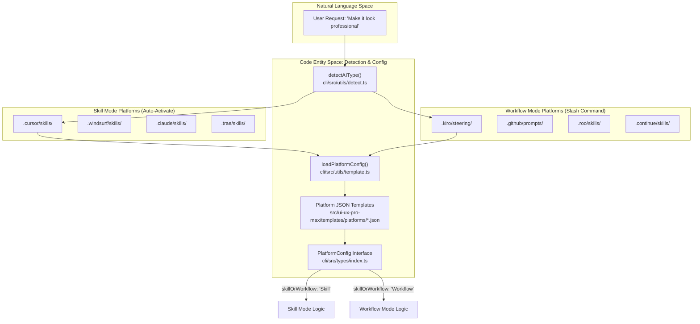
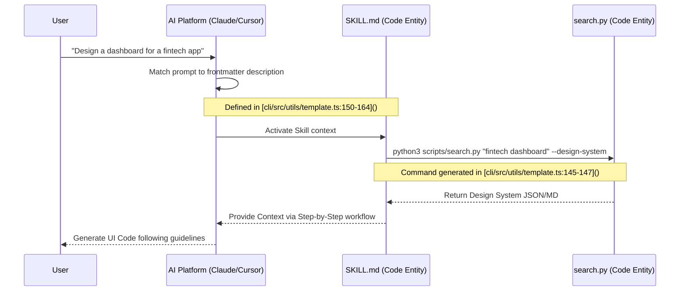
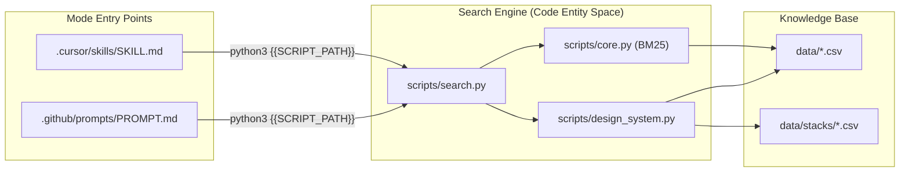

<!-- source: DeepWiki mcp.deepwiki.com · repo nextlevelbuilder/ui-ux-pro-max-skill · page 7.2 Skill vs Workflow Modes · fetched 2026-10-27 -->

# Skill vs Workflow Modes

Relevant source files

The following files were used as context for generating this wiki page:

- [CLAUDE.md](CLAUDE.md)
- [cli/assets/templates/base/skill-content.md](cli/assets/templates/base/skill-content.md)
- [cli/src/types/index.ts](cli/src/types/index.ts)
- [cli/src/utils/detect.ts](cli/src/utils/detect.ts)
- [cli/src/utils/template.ts](cli/src/utils/template.ts)
- [src/ui-ux-pro-max/templates/base/skill-content.md](src/ui-ux-pro-max/templates/base/skill-content.md)

## Purpose and Scope

This document explains the two operational modes supported by UI/UX Pro Max: **Skill Mode** and **Workflow Mode**. These modes define how the design intelligence system integrates with different AI coding assistants, specifically their activation mechanisms, invocation patterns, and filesystem conventions. 

UI/UX Pro Max supports 18+ platforms, each requiring a specific integration strategy managed by the `uipro-cli` during the `init` process [cli/src/utils/detect.ts:93-138]().

---

## Mode Overview

UI/UX Pro Max operates in two distinct modes depending on the capabilities and conventions of the AI platform as defined in the platform configuration files located in `src/ui-ux-pro-max/templates/platforms/` [cli/src/utils/template.ts:78-81]().

| Aspect | Skill Mode | Workflow Mode |
|--------|------------|---------------|
| **Activation** | Auto-detects UI/UX requests via NLP | Explicit slash command or manual selection |
| **Trigger Pattern** | Natural language (e.g., "Build a landing page") | Slash command (e.g., `/ui-ux-pro-max ...`) |
| **Install Type** | `full` (Includes data/ and scripts/) | `full` (Includes data/ and scripts/) |
| **Content Scope** | Complete knowledge base | Complete knowledge base |
| **User Friction** | Low (automatic background reasoning) | Medium (explicit intent required) |

**Sources:** [cli/src/types/index.ts:4-4](), [cli/src/types/index.ts:26-44](), [CLAUDE.md:7-8]()

---

## Platform Distribution by Mode

### Platform Detection and Configuration Flow

The following diagram bridges the natural language intent to the code entities that manage platform detection and configuration via the `PlatformConfig` interface.

**Sources:** [cli/src/utils/detect.ts:10-91](), [cli/src/utils/template.ts:16-34](), [cli/src/utils/template.ts:72-81](), [cli/src/types/index.ts:51-72]()

---

## Skill Mode

### Characteristics

Skill Mode platforms support **automatic activation** when the AI assistant detects UI/UX-related intent. The AI platform's internal NLP engine matches the description provided in the `SKILL.md` frontmatter to the user's prompt.

**Key Implementation Details:**
*   **Metadata:** The `description` field in the `PlatformConfig` acts as the trigger surface [cli/src/types/index.ts:42-42]().
*   **Frontmatter:** Rendered via `renderFrontmatter()` to provide YAML metadata that AI agents use to index the skill [cli/src/utils/template.ts:112-126]().
*   **File Naming:** Typically uses `SKILL.md` for discovery [cli/src/types/index.ts:33-33]().

### Skill Mode Invocation Logic

**Sources:** [src/ui-ux-pro-max/templates/base/skill-content.md:71-89](), [cli/src/utils/template.ts:132-164](), [CLAUDE.md:29-33]()

---

## Workflow Mode

### Characteristics

Workflow Mode platforms require **explicit invocation** via a slash command (e.g., `/ui-ux-pro-max`) or by manually selecting a prompt file. This is used for platforms where the AI does not automatically scan all project files for "skills" but instead relies on registered "prompts" or "steering files."

**Key Implementation Details:**
*   **Slash Command:** The `skillOrWorkflow` field in the config identifies these as explicit workflows [cli/src/types/index.ts:43-43]().
*   **Directory Naming:** Uses platform-specific folders like `steering/` (Kiro), `prompts/` (Copilot), or `.roo/skills/` (Roo Code) [cli/src/types/index.ts:51-72]().
*   **Reference Content:** While the `installType` is "full", these files act as a manual reference the user points the AI towards [cli/src/types/index.ts:29-29]().

---

## Installation and Filesystem Mapping

The `uipro-cli` maps these modes to specific filesystem structures during the `init` command using the `AI_FOLDERS` mapping.

### Mode Comparison Table (Expanded)

| Platform | Mode | Root Directory | Internal Path | Filename |
| :--- | :--- | :--- | :--- | :--- |
| **Claude** | Skill | `.claude` | `skills/ui-ux-pro-max` | `SKILL.md` |
| **Cursor** | Skill | `.cursor` | `skills/ui-ux-pro-max` | `SKILL.md` |
| **Trae** | Skill | `.trae` | `skills/ui-ux-pro-max` | `SKILL.md` |
| **Kiro** | Workflow | `.kiro` | `steering/ui-ux-pro-max` | `SKILL.md` |
| **Copilot** | Workflow | `.github` | `prompts/ui-ux-pro-max` | `PROMPT.md` |
| **Warp** | Skill | `.warp` | `skills/ui-ux-pro-max` | `SKILL.md` |
| **Continue** | Workflow | `.continue` | `skills/ui-ux-pro-max` | `SKILL.md` |

**Sources:** [cli/src/types/index.ts:51-72](), [cli/src/utils/detect.ts:93-138]()

---

## Technical Data Flow

Regardless of the mode, once the AI decides to use the toolkit, the execution converges on the Python search engine.

### Common Execution Pipeline

**Sources:** [CLAUDE.md:44-51](), [src/ui-ux-pro-max/templates/base/skill-content.md:145-147](), [cli/src/utils/template.ts:145-147]()

### Implementation Notes
1.  **Path Resolution:** The `renderSkillFile` function calculates `commandScriptPath` differently based on whether the install is `--global`. Global installs use the `~/` home directory prefix to ensure the AI can find the scripts regardless of the current working directory [cli/src/utils/template.ts:142-147]().
2.  **Asset Mirroring:** To ensure both modes work offline, `copyDataAndScripts` performs a recursive copy of the `data/` and `scripts/` directories into the platform-specific folder structure [cli/src/utils/template.ts:186-206]().
3.  **Quick Reference:** For Skill Mode platforms like Claude, a `quickReference` section is often toggled `true` in the config, providing the AI with immediate local context before it even runs a search [cli/src/utils/template.ts:136-140]().

**Sources:** [cli/src/utils/template.ts:132-164](), [cli/src/utils/template.ts:186-206](), [CLAUDE.md:75-80]()

---

