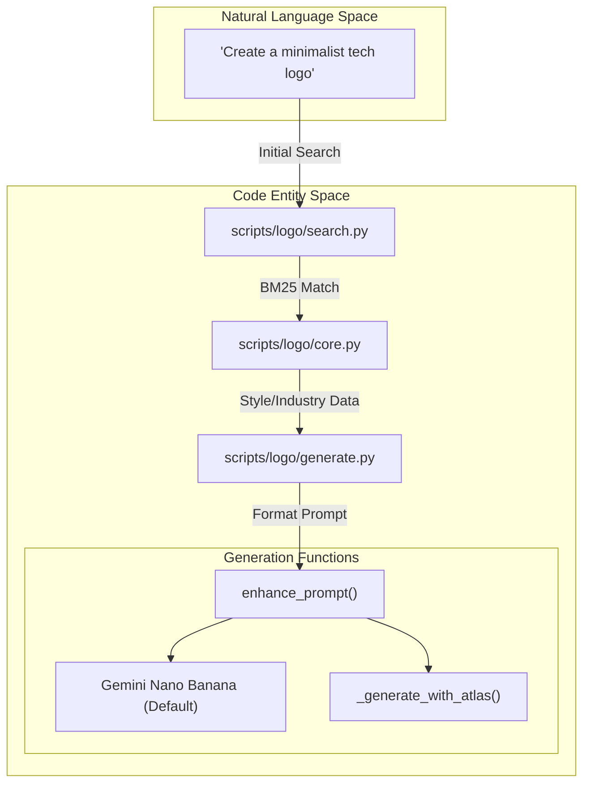
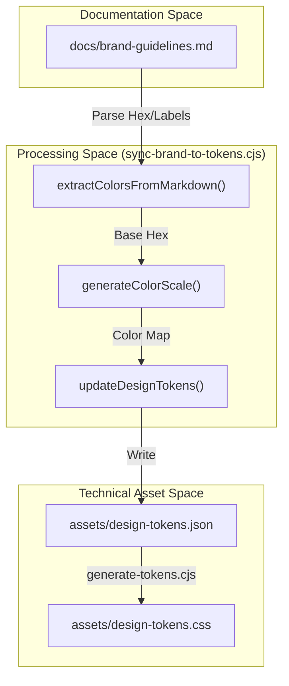

<!-- source: DeepWiki mcp.deepwiki.com · repo nextlevelbuilder/ui-ux-pro-max-skill · page 8.1 Design and Brand Sub-skills · fetched 2026-10-27 -->

# Design and Brand Sub-skills

Relevant source files

The following files were used as context for generating this wiki page:

- [.claude/skills/brand/references/approval-checklist.md](.claude/skills/brand/references/approval-checklist.md)
- [.claude/skills/brand/references/asset-organization.md](.claude/skills/brand/references/asset-organization.md)
- [.claude/skills/brand/references/brand-guideline-template.md](.claude/skills/brand/references/brand-guideline-template.md)
- [.claude/skills/brand/references/color-palette-management.md](.claude/skills/brand/references/color-palette-management.md)
- [.claude/skills/brand/references/consistency-checklist.md](.claude/skills/brand/references/consistency-checklist.md)
- [.claude/skills/brand/references/logo-usage-rules.md](.claude/skills/brand/references/logo-usage-rules.md)
- [.claude/skills/brand/references/messaging-framework.md](.claude/skills/brand/references/messaging-framework.md)
- [.claude/skills/brand/references/typography-specifications.md](.claude/skills/brand/references/typography-specifications.md)
- [.claude/skills/brand/references/update.md](.claude/skills/brand/references/update.md)
- [.claude/skills/brand/references/visual-identity.md](.claude/skills/brand/references/visual-identity.md)
- [.claude/skills/brand/scripts/extract-colors.cjs](.claude/skills/brand/scripts/extract-colors.cjs)
- [.claude/skills/brand/scripts/sync-brand-to-tokens.cjs](.claude/skills/brand/scripts/sync-brand-to-tokens.cjs)
- [.claude/skills/design/SKILL.md](.claude/skills/design/SKILL.md)
- [.claude/skills/design/references/logo-design.md](.claude/skills/design/references/logo-design.md)
- [.claude/skills/design/scripts/logo/generate.py](.claude/skills/design/scripts/logo/generate.py)
- [.claude/skills/design/scripts/logo/tests/test_generate.py](.claude/skills/design/scripts/logo/tests/test_generate.py)
- [cli/assets/skills/design/SKILL.md](cli/assets/skills/design/SKILL.md)
- [cli/assets/skills/design/references/logo-design.md](cli/assets/skills/design/references/logo-design.md)
- [cli/assets/skills/design/scripts/logo/generate.py](cli/assets/skills/design/scripts/logo/generate.py)
- [cli/assets/skills/design/scripts/logo/tests/test_generate.py](cli/assets/skills/design/scripts/logo/tests/test_generate.py)

The Design and Brand sub-skills provide the UI/UX Pro Max system with the ability to generate visual identities, maintain brand consistency, and bridge the gap between high-level brand requirements and technical design tokens. These skills leverage AI models for asset generation (logos, icons, CIP) and Python/Node.js scripts for data extraction and synchronization.

## Design Skill Implementation

The `design` skill is a unified interface for generating brand identity assets, including logos, Corporate Identity Programs (CIP), and icons. It operates by routing tasks to specialized built-in modules or external sub-skills [ .claude/skills/design/SKILL.md:26-39]().

### Logo Generation Architecture
The logo system uses a BM25 search engine to match user requirements against a database of 55+ styles, 30 color palettes, and 25 industry guides [ .claude/skills/design/SKILL.md:40-42]().

**Logo Generation Workflow:**
1. **Brief Generation:** `scripts/logo/search.py` generates a design brief based on keywords like "tech startup modern" [ .claude/skills/design/scripts/logo/search.py:18-19]().
2. **Style Search:** The system performs domain-specific searches (style, color, industry) using `scripts/logo/core.py` [ .claude/skills/design/references/logo-design.md:7-11]().
3. **AI Generation:** `scripts/logo/generate.py` invokes either **Gemini Nano Banana** (default) or **Atlas Cloud** to produce the final image [ .claude/skills/design/scripts/logo/generate.py:4-9]().

### Natural Language to Logo Generation Entity Map

This diagram maps natural language requests to the specific Python entities and scripts that execute the generation.

"Logo Generation Entity Map"

**Sources:** [ .claude/skills/design/scripts/logo/generate.py:1-20](), [ .claude/skills/design/scripts/logo/generate.py:126-140](), [ .claude/skills/design/references/logo-design.md:5-13]()

### Generation Providers and Models
The system supports two primary providers for image generation:

| Provider | Model Name | Description |
| :--- | :--- | :--- |
| **Gemini (Flash)** | `gemini-2.5-flash-image` | Default; fast, high-volume, low-latency [ .claude/skills/design/scripts/logo/generate.py:62-62](). |
| **Gemini (Pro)** | `gemini-3-pro-image-preview` | Professional quality, advanced reasoning [ .claude/skills/design/scripts/logo/generate.py:63-63](). |
| **Atlas Cloud** | `google/nano-banana-2-lite/text-to-image` | Opt-in via `--provider atlas`; uses async polling [ .claude/skills/design/scripts/logo/generate.py:66-70](). |

## Brand Skill and Token Synchronization

The `brand` skill manages the "Source of Truth" for visual identity, specifically through the synchronization of markdown-based guidelines into machine-readable design tokens.

### The Sync Pipeline
The core of the brand skill is `sync-brand-to-tokens.cjs`, which automates the propagation of color changes across the project [ .claude/skills/brand/scripts/sync-brand-to-tokens.cjs:1-10]().

**Data Flow:**
1. **Extract:** `extractColorsFromMarkdown()` parses `docs/brand-guidelines.md` for hex codes in "Quick Reference" or "Role" tables [ .claude/skills/brand/scripts/sync-brand-to-tokens.cjs:25-77]().
2. **Scale Generation:** `generateColorScale()` creates 10 shades (50-900) for each base color using `adjustBrightness()` [ .claude/skills/brand/scripts/sync-brand-to-tokens.cjs:82-108]().
3. **Token Update:** `updateDesignTokens()` modifies `assets/design-tokens.json`, updating both primitives and semantic aliases (e.g., `sem.primary` points to `primitive.color.primary.500`) [ .claude/skills/brand/scripts/sync-brand-to-tokens.cjs:113-172]().
4. **CSS Generation:** The script triggers `generate-tokens.cjs` to output `assets/design-tokens.css` [ .claude/skills/brand/scripts/sync-brand-to-tokens.cjs:19-20]().

### Brand to Code Synchronization Map

This diagram illustrates how a human-readable brand guideline is transformed into technical assets used by the frontend.

"Brand Sync Pipeline"

**Sources:** [ .claude/skills/brand/scripts/sync-brand-to-tokens.cjs:16-20](), [ .claude/skills/brand/scripts/sync-brand-to-tokens.cjs:113-138](), [ .claude/skills/brand/references/update.md:5-11]()

### Color Presets
The brand skill includes pre-defined themes to accelerate project initialization [ .claude/skills/brand/references/update.md:102-113]():

| Preset | Primary | Secondary | Accent |
| :--- | :--- | :--- | :--- |
| `ocean-professional` | #3B82F6 | #F59E0B | #10B981 |
| `electric-creative` | #FF6B6B | #9B5DE5 | #00F5D4 |
| `forest-calm` | #059669 | #92400E | #FBBF24 |
| `midnight-purple` | #7C3AED | #EC4899 | #06B6D4 |

## Technical Validation and Testing

### Logo Generation Tests
The system includes robust testing for asynchronous providers like Atlas Cloud. `test_generate.py` verifies that:
- The system polls the Atlas API until the status is `completed` [ .claude/skills/design/scripts/logo/tests/test_generate.py:17-35]().
- Media downloads do not leak API keys in headers [ .claude/skills/design/scripts/logo/tests/test_generate.py:82-116]().
- Redirects are validated against non-public or non-HTTPS destinations [ .claude/skills/design/scripts/logo/tests/test_generate.py:123-129]().

### Brand Asset Checklist
Before finalizing brand assets, the `approval-checklist.md` defines technical and visual requirements [ .claude/skills/brand/references/approval-checklist.md:1-5]():
- **Visual:** 60/30/10 color ratio and logo clear space [ .claude/skills/brand/references/approval-checklist.md:23-28]().
- **Accessibility:** WCAG AA contrast ratios (4.5:1 for normal text) [ .claude/skills/brand/references/approval-checklist.md:47-53]().
- **Technical:** Naming conventions and metadata validation via `validate-asset.cjs` [ .claude/skills/brand/references/approval-checklist.md:153-160]().

**Sources:**
- [ .claude/skills/design/SKILL.md]()
- [ .claude/skills/design/scripts/logo/generate.py]()
- [ .claude/skills/design/scripts/logo/tests/test_generate.py]()
- [ .claude/skills/brand/scripts/sync-brand-to-tokens.cjs]()
- [ .claude/skills/brand/references/update.md]()
- [ .claude/skills/brand/references/approval-checklist.md]()

---

