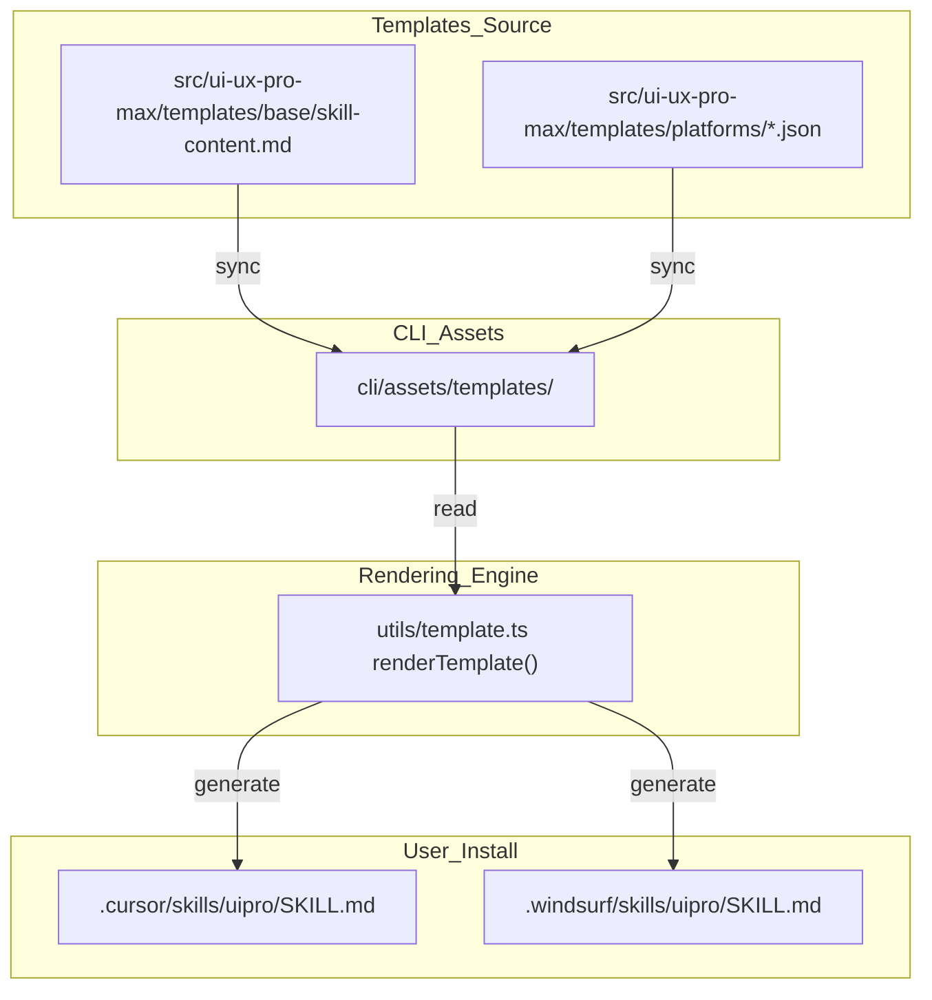
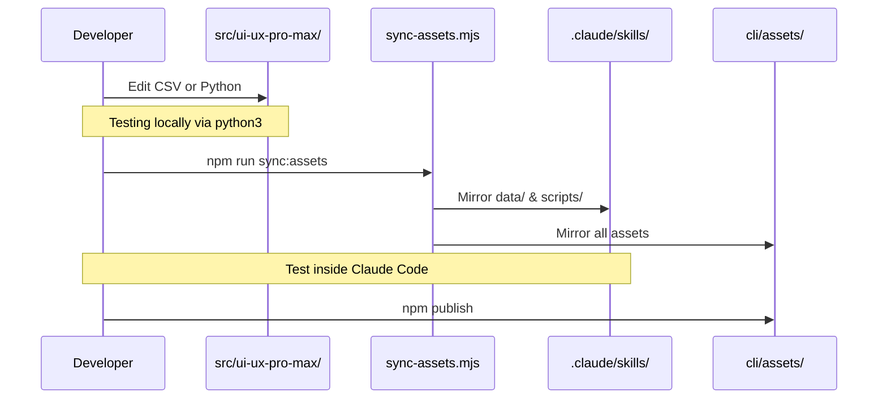

<!-- source: DeepWiki mcp.deepwiki.com · repo nextlevelbuilder/ui-ux-pro-max-skill · page 9.1 Source of Truth and Sync Rules · fetched 2026-10-27 -->

# Source of Truth and Sync Rules

<details>
<summary>Relevant source files</summary>

The following files were used as context for generating this wiki page:

- [.github/workflows/check-asset-sync.yml](.github/workflows/check-asset-sync.yml)
- [CLAUDE.md](CLAUDE.md)
- [cli/assets/templates/base/skill-content.md](cli/assets/templates/base/skill-content.md)
- [cli/scripts/sync-assets.mjs](cli/scripts/sync-assets.mjs)
- [src/ui-ux-pro-max/templates/base/skill-content.md](src/ui-ux-pro-max/templates/base/skill-content.md)

</details>


## Purpose and Scope

This document defines the canonical source of truth for all UI/UX Pro Max assets and the synchronization rules required to maintain consistency across distribution channels. It covers the `src/ui-ux-pro-max/` directory structure, the mirroring architecture for Claude Code, and manual sync requirements for the `uipro-cli` bundled assets.

For template generation mechanics, see [Template Generation](). For build and publish workflows, see [Testing and Contributing]().

---

## Source of Truth: src/ui-ux-pro-max/

All canonical assets reside in `src/ui-ux-pro-max/` [CLAUDE.md:75-75](). This directory serves as the single source of truth for the core search engine and design database.

### Directory Structure

| Path | Purpose |
|:---|:---|
| `data/` | Canonical CSV databases (styles, colors, typography, etc.) [CLAUDE.md:45-47]() |
| `scripts/` | Python search engine (`search.py`, `core.py`) and generator (`design_system.py`) [CLAUDE.md:48-51]() |
| `templates/` | Base Markdown templates and platform-specific JSON configurations [CLAUDE.md:52-54]() |

Any modifications to skill functionality, data, or platform support **must** be made in this directory first [CLAUDE.md:84-92]().

**Sources:** [CLAUDE.md:44-54](), [CLAUDE.md:75-75](), [CLAUDE.md:84-92]()

---

## Mirroring Architecture (No Symlinks)

Unlike previous versions, the repository **does not use symlinks** to avoid silent breakages on Windows systems [CLAUDE.md:77-78](). Instead, it uses a mirroring strategy where independent copies of files are kept in sync by a dedicated script.

### Figure 1: Asset Propagation Flow

```mermaid
graph TD
    subgraph "Source_of_Truth"
        [src/ui-ux-pro-max/]
    end
    
    subgraph "Sync_Script"
        SyncScript["sync-assets.mjs"]
    end

    subgraph "Mirrored_Targets"
        CLIAssets["cli/assets/"]
        ClaudeSkill[".claude/skills/ui-ux-pro-max/"]
    end

    [src/ui-ux-pro-max/] -->|input| SyncScript
    SyncScript -->|npm run sync:assets| CLIAssets
    SyncScript -->|npm run sync:assets| ClaudeSkill
    
    subgraph "CI_Validation"
        CIVersion["check-asset-sync.yml"]
    end
    
    CLIAssets -.->|validate| CIVersion
    ClaudeSkill -.->|validate| CIVersion
```

**Sources:** [CLAUDE.md:77-80](), [cli/scripts/sync-assets.mjs:15-38](), [.github/workflows/check-asset-sync.yml:25-40]()

### Mirrored Locations

| Location | Purpose | Sync Method |
|:---|:---|:---|
| `cli/assets/` | Bundled fallback for the npm package [CLAUDE.md:61-64]() | `npm run sync:assets` |
| `.claude/skills/ui-ux-pro-max/` | The copy actually loaded by Claude Code [CLAUDE.md:66-67]() | `npm run sync:assets` |

**Sources:** [CLAUDE.md:60-67](), [cli/scripts/sync-assets.mjs:94-120]()

---

## Sync Procedures

### The `sync-assets.mjs` Utility

The script `cli/scripts/sync-assets.mjs` is the central tool for maintaining alignment. It performs content-based hashing (SHA-256) and normalizes line endings (CRLF to LF) to ensure cross-platform consistency [cli/scripts/sync-assets.mjs:48-50]().

**Key Functions:**
- `toLF(text)`: Normalizes all text to LF to prevent hash drift [cli/scripts/sync-assets.mjs:50-50]().
- `diffDir(...)`: Compares source and target directories for missing, extra, or stale files [cli/scripts/sync-assets.mjs:94-120]().
- `syncDir(...)`: Deletes the target and mirrors the source to prevent orphan files [cli/scripts/sync-assets.mjs:124-140]().

**Sources:** [cli/scripts/sync-assets.mjs:48-50](), [cli/scripts/sync-assets.mjs:94-140]()

### Manual Sync Commands

When modifying files in `src/ui-ux-pro-max/`, changes are **not** automatically reflected elsewhere [CLAUDE.md:87-87](). Developers must run:

```bash
cd cli
npm run sync:assets   # Performs the mirror
npm run check:assets  # Verifies sync status (used in CI)
```

**Sources:** [CLAUDE.md:94-99](), [.github/workflows/check-asset-sync.yml:39-40]()

---

## Template System Sync

The CLI uses a template-based system to generate `SKILL.md` files for different platforms.

### Figure 2: Template Rendering vs Mirroring



**Sources:** [cli/src/utils/template.ts:1-20](), [CLAUDE.md:57-59](), [CLAUDE.md:103-103]()

### Template Sync Rules

1. **Base Templates**: Modify `src/ui-ux-pro-max/templates/base/skill-content.md` for shared instructions [CLAUDE.md:89-91]().
2. **Platform Configs**: Modify `src/ui-ux-pro-max/templates/platforms/*.json` for platform-specific behavior [CLAUDE.md:92-92]().
3. **Claude Code Exception**: `.claude/skills/ui-ux-pro-max/SKILL.md` is **hand-authored** and is not generated from templates [CLAUDE.md:100-101](). Do not overwrite it via the sync script.

**Sources:** [CLAUDE.md:89-93](), [CLAUDE.md:100-101]()

---

## Development Workflow

### Figure 3: Source to Deployment Pipeline



**Sources:** [CLAUDE.md:82-99](), [cli/scripts/sync-assets.mjs:177-195]()

### File Change Impact Matrix

| File Type | Source Path | Impacted Targets | Required Action |
|:---|:---|:---|:---|
| **Data/Scripts** | `src/ui-ux-pro-max/data/`, `scripts/` | `cli/assets/`, `.claude/skills/` | `npm run sync:assets` [CLAUDE.md:97-97]() |
| **Templates** | `src/ui-ux-pro-max/templates/` | `cli/assets/templates/` | `npm run sync:assets` + `uipro init` [CLAUDE.md:103-103]() |
| **Sub-skills** | `.claude/skills/<sub-skill>/` | `cli/assets/skills/` | `npm run sync:assets` [cli/scripts/sync-assets.mjs:26-28]() |

**Sources:** [CLAUDE.md:82-103](), [cli/scripts/sync-assets.mjs:22-38]()

---

## Anti-Patterns to Avoid

- **Editing `cli/assets/` directly**: These files are deleted and overwritten every time `sync:assets` runs [cli/scripts/sync-assets.mjs:130-131]().
- **Editing generated skill files**: Files in `.cursor/` or `.windsurf/` are transient and generated by the CLI [CLAUDE.md:103-103]().
- **Forgetting the Sync**: If you modify `src/` but don't sync, the `uipro-cli` will distribute stale data, and CI will fail the `check:assets` step [.github/workflows/check-asset-sync.yml:39-40]().

**Sources:** [CLAUDE.md:87-87](), [cli/scripts/sync-assets.mjs:130-131](), [.github/workflows/check-asset-sync.yml:39-40]()

---

