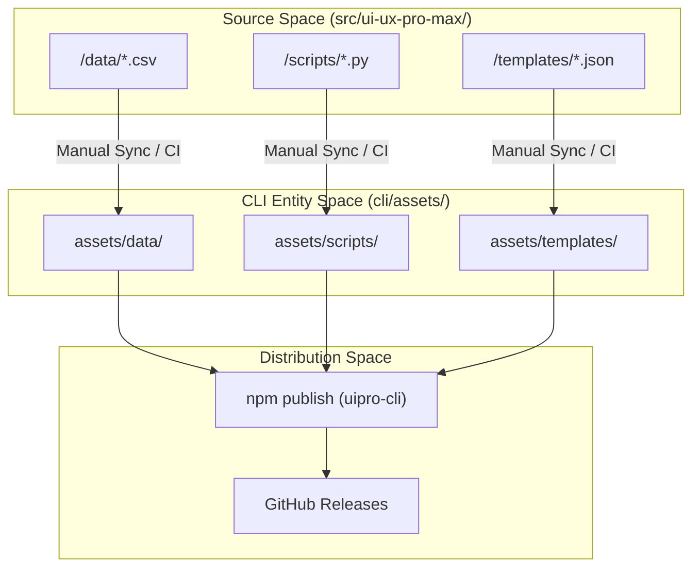

<!-- source: DeepWiki mcp.deepwiki.com · repo nextlevelbuilder/ui-ux-pro-max-skill · page 9.3 Testing and Contributing · fetched 2026-10-27 -->

# Testing and Contributing

Relevant source files

The following files were used as context for generating this wiki page:

- [.github/ISSUE_TEMPLATE/bug_report.yml](.github/ISSUE_TEMPLATE/bug_report.yml)
- [.github/ISSUE_TEMPLATE/feature_request.yml](.github/ISSUE_TEMPLATE/feature_request.yml)
- [.github/PULL_REQUEST_TEMPLATE.md](.github/PULL_REQUEST_TEMPLATE.md)
- [.github/workflows/bump-versions.yml](.github/workflows/bump-versions.yml)
- [.github/workflows/release.yml](.github/workflows/release.yml)
- [.github/workflows/smoke-stacks.yml](.github/workflows/smoke-stacks.yml)
- [.github/workflows/tests.yml](.github/workflows/tests.yml)
- [.gitignore](.gitignore)
- [.releaserc.json](.releaserc.json)
- [CODE_OF_CONDUCT.md](CODE_OF_CONDUCT.md)
- [SECURITY.md](SECURITY.md)
- [cli/assets/data/stacks/astro.csv](cli/assets/data/stacks/astro.csv)
- [cli/package-lock.json](cli/package-lock.json)
- [cli/playwright.config.ts](cli/playwright.config.ts)
- [cli/scripts/build.mjs](cli/scripts/build.mjs)
- [cli/tests/e2e/preview.spec.ts](cli/tests/e2e/preview.spec.ts)
- [cli/tests/e2e/template-script-paths.spec.ts](cli/tests/e2e/template-script-paths.spec.ts)
- [scripts/sync-release-version.mjs](scripts/sync-release-version.mjs)
- [scripts/validate-csv.py](scripts/validate-csv.py)

## Overview

The UI/UX Pro Max system utilizes a decentralized development workflow where the **Source of Truth** resides in `src/ui-ux-pro-max/`. This page documents the Git branching strategy, local development setup using `Bun` and `Node.js`, the automated CI/CD pipeline using Playwright and Semantic Release, and the validation scripts required to maintain data integrity across the CLI tool and AI platforms.

---

## Git Workflow and Branching

Direct pushes to the `main` branch are restricted. The project follows a standard Feature Branch workflow facilitated by conventional commits to trigger automated releases.

### Branch Naming Conventions

| Prefix | Purpose | Example |
| :--- | :--- | :--- |
| `feat/` | New features or platforms | `feat/add-trae-support` |
| `fix/` | Bug fixes in scripts or CLI | `fix/bm25-tokenization` |
| `data/` | Updates to CSV databases | `data/update-react-stack` |
| `docs/` | Documentation or wiki updates | `docs/testing-guide` |

### Automated Release Pipeline

The repository uses `semantic-release` to automate versioning and package publishing.

1.  **Release Trigger**: Pushes to `main` or `dev` (beta channel) trigger the `.github/workflows/release.yml` workflow [.github/workflows/release.yml:3-8]().
2.  **Semantic Analysis**: The `@semantic-release/commit-analyzer` determines the version bump based on Conventional Commits [.releaserc.json:12-17]().
3.  **Distribution**: The CLI is published to NPM from the `cli/` directory [.releaserc.json:25-29]().
4.  **Version Syncing**: After a successful release, the `bump-versions.yml` workflow creates a PR to update `skill.json`, `marketplace.json`, and `plugin.json` to match the new tag [.github/workflows/bump-versions.yml:29-61]().

**Sources:** [.github/workflows/release.yml:1-90](), [.releaserc.json:1-38](), [.github/workflows/bump-versions.yml:1-61]()

---

## Local Development and CLI Testing

The `uipro-cli` is built using TypeScript. While it prefers the Bun runtime for speed, it includes a fallback build script for standard Node.js environments.

### Environment Setup

1.  **Navigate to CLI**: `cd cli`
2.  **Install Dependencies**: `npm ci` or `bun install` [cli/package-lock.json:7-27]().
3.  **Link Package**: `bun link` or `npm link`. This makes the `uipro` command available globally as defined in the `bin` field [cli/package-lock.json:17-19]().

### Build System

The `cli/scripts/build.mjs` script manages the compilation process:
-   **Primary**: Attempts to use `bun build` for the fastest compilation [cli/scripts/build.mjs:15-18]().
-   **Fallback**: If Bun is missing, it invokes the local TypeScript compiler (`tsc`) [cli/scripts/build.mjs:20-29]().

**Sources:** [cli/package-lock.json:1-30](), [cli/scripts/build.mjs:1-29]()

---

## Testing Suites

The project maintains a rigorous testing regime covering data integrity, CLI logic, and generated output.

### 1. Data Validation (Offline Gate)
Before any build, the system runs a "verify:data" script to ensure that the CSV knowledge base is intact and correctly formatted.
-   **Command**: `npm --prefix cli run verify:data` [.github/workflows/tests.yml:50-50]().
-   **Python Validation**: Uses `scripts/validate-csv.py` to check for schema consistency across domains and stacks.

### 2. End-to-End (e2e) Playwright Tests
The CLI uses Playwright to test template rendering and file generation.
-   **Template Logic**: `cli/tests/e2e/template-script-paths.spec.ts` verifies that `renderSkillFile` correctly injects platform-specific script paths (e.g., `.claude/skills/...` vs `~/.claude/skills/...`) [cli/tests/e2e/template-script-paths.spec.ts:18-32]().
-   **Preview Smoke Tests**: `cli/tests/e2e/preview.spec.ts` uses Playwright to load generated HTML files (like `xiaomaomi-app.html`) and ensures no console errors or page errors occur during rendering [cli/tests/e2e/preview.spec.ts:17-31]().

### 3. Regression Tests
-   **Skill Regressions**: Python-based tests run via `pytest` against the `.claude/skills` directory [.github/workflows/tests.yml:53-53]().
-   **Stack Smoke Tests**: Validates specific technology stacks (e.g., `astro.csv`) for required fields like `Severity` and `Category` [.github/workflows/smoke-stacks.yml]().

**Sources:** [.github/workflows/tests.yml:1-81](), [cli/tests/e2e/template-script-paths.spec.ts:1-33](), [cli/tests/e2e/preview.spec.ts:1-31](), [cli/playwright.config.ts:1-18]()

---

## Data Flow and Build Synchronization

The CLI tool bundles assets for offline use, requiring a synchronization step to move files from the **Source of Truth** to the CLI's internal asset store.

### System Data Flow

### Build and Publish Checklist

1.  **Validate**: Run `python3 scripts/validate-csv.py` to check all data files.
2.  **Sync**: Copy all files from `src/ui-ux-pro-max/` to `cli/assets/`.
3.  **Test**: Execute `npx playwright test` in the `cli/` directory to verify template rendering [cli/package-lock.json:28-43]().
4.  **Release**: Push to `main` to trigger the `Release` workflow [.github/workflows/release.yml:4-7]().

**Sources:** [.github/workflows/release.yml:57-67](), [cli/scripts/build.mjs:1-29](), [.releaserc.json:1-38]()

---

