# Page: Overview

# Overview

<details>
<summary>Relevant source files</summary>

The following files were used as context for generating this wiki page:

- [.claude-plugin/marketplace.json](.claude-plugin/marketplace.json)
- [.claude-plugin/plugin.json](.claude-plugin/plugin.json)
- [LICENSE](LICENSE)
- [README.md](README.md)
- [README.vi.md](README.vi.md)
- [README.zh.md](README.zh.md)
- [cli/.gitignore](cli/.gitignore)
- [cli/assets/templates/platforms/universal.json](cli/assets/templates/platforms/universal.json)
- [cli/bun.lock](cli/bun.lock)
- [skill.json](skill.json)
- [src/ui-ux-pro-max/templates/platforms/universal.json](src/ui-ux-pro-max/templates/platforms/universal.json)

</details>


## Purpose and Scope

UI/UX Pro Max is an AI-powered design intelligence toolkit that provides searchable databases of UI/UX resources (styles, colors, typography, patterns) to AI coding assistants. This page introduces the system architecture, distribution methods, installation modes, and core capabilities. For specific installation instructions, see [Getting Started](#1.1). For detailed architecture diagrams, see [System Architecture](#1.2).

Sources: [README.md:24-24](), [skill.json:2-5]()

## What is UI/UX Pro Max

UI/UX Pro Max consists of three primary components:

1. **Knowledge Base** — 344+ design resources stored in CSV databases covering 10 domains (styles, colors, typography, landing patterns, charts, UX guidelines, icons, products, reasoning rules) and 16 technology stacks. [README.md:11-13](), [skill.json:4-4]()
2. **Search Engine** — BM25-based ranking system provided via `search.py` with domain auto-detection and stack-specific filtering. [cli/assets/templates/platforms/universal.json:10-10](), [src/ui-ux-pro-max/templates/platforms/universal.json:10-10]()
3. **Design System Generator** — AI-powered reasoning engine that analyzes project requirements to generate complete, tailored design systems including layout patterns, color palettes, and typography. [README.md:44-46](), [README.zh.md:44-46]()

The system integrates with 18+ AI coding assistants through a skill/workflow pattern, supporting platforms like Claude, Cursor, Windsurf, and GitHub Copilot. [skill.json:20-40]()

Sources: [README.md:42-98](), [skill.json:1-42]()

## Distribution Channels

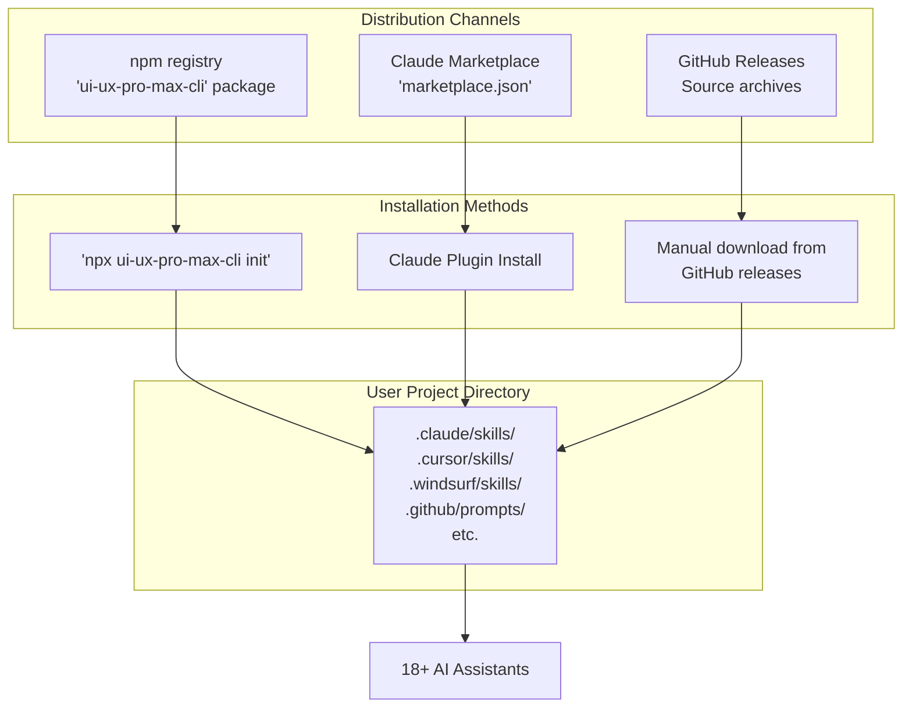

**Distribution Methods**

| Method | Package | Target Audience |
|--------|---------|-----------------|
| npm | `ui-ux-pro-max-cli` | Users who prefer CLI installation via `npx`. [skill.json:41-41]() |
| GitHub Releases | Source archives (.zip) | Users installing manually or offline. [README.md:10-10]() |
| Claude Marketplace | Direct plugin installation | Claude Code users only via `.claude-plugin/`. [.claude-plugin/marketplace.json:1-35]() |

The CLI tool (`ui-ux-pro-max-cli`) is the recommended installation method, as it automates the deployment of the skill into the appropriate local environment. [skill.json:41-41]()

Sources: [README.md:10-22](), [skill.json:1-42](), [.claude-plugin/marketplace.json:1-35]()

## Core System Components

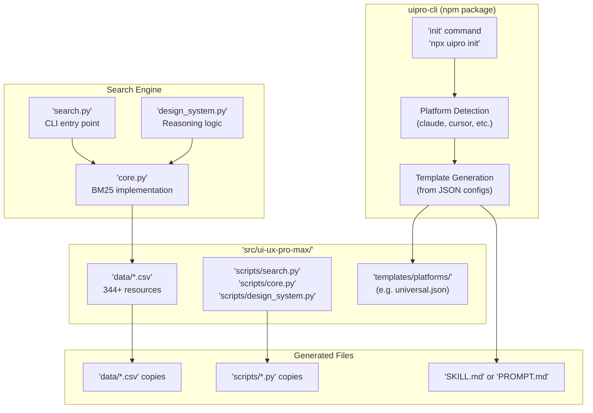

**Component Responsibilities**

| Component | Role | Responsibility |
|-----------|------|----------------|
| CLI Tool | Orchestrator | Handles installation, platform detection, and local file deployment. [skill.json:41-41]() |
| Platform Configs | Metadata | JSON files defining folder structures and frontmatter for each AI. [src/ui-ux-pro-max/templates/platforms/universal.json:1-21]() |
| Search Engine | Intelligence | BM25-based retrieval of design resources from CSV files. [cli/assets/templates/platforms/universal.json:13-13]() |
| Reasoning Engine | Generator | Synthesizes product requirements into design systems. [README.md:44-46]() |
| Knowledge Base | Data | CSV files containing 84 styles, 192 palettes, and 22 stack guidelines. [skill.json:4-4]() |

Sources: [README.md:42-98](), [skill.json:1-42](), [cli/assets/templates/platforms/universal.json:1-21]()

## Platform Integration Architecture

The system supports 18+ AI platforms through a template-based configuration system. Each platform has a JSON configuration file in `templates/platforms/` that defines how the skill should be presented to that specific AI assistant.

- `folderStructure` — Defines where the skill files are placed (e.g., `.agents/skills/`). [src/ui-ux-pro-max/templates/platforms/universal.json:5-9]()
- `installType` — Specifies whether a full skill or reference is installed. [src/ui-ux-pro-max/templates/platforms/universal.json:4-4]()
- `frontmatter` — Metadata describing the skill's capabilities to the AI. [src/ui-ux-pro-max/templates/platforms/universal.json:11-14]()
- `scriptPath` — The relative path the AI should use to execute search commands. [src/ui-ux-pro-max/templates/platforms/universal.json:10-10]()

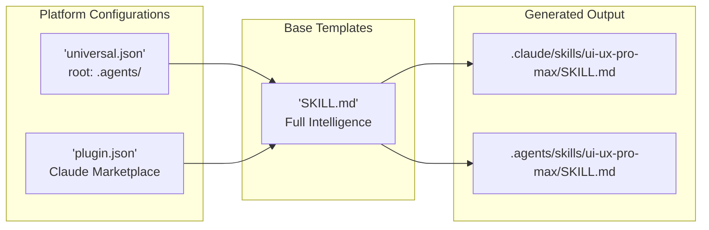

**Supported Platforms (Partial List)**

| Platform | Key Configuration | Install Type |
|----------|-------------------|--------------|
| Claude | `.claude/skills/` | full |
| Cursor | `.cursor/` | full |
| Universal | `.agents/` | full [src/ui-ux-pro-max/templates/platforms/universal.json:4-9]() |
| GitHub Copilot | `.github/prompts/` | reference |

Sources: [skill.json:20-40](), [src/ui-ux-pro-max/templates/platforms/universal.json:1-21](), [.claude-plugin/plugin.json:1-21]()

## Search and Generation Workflow

```mermaid
sequenceDiagram
    participant User
    participant AI["AI Assistant<br/>(Claude/Cursor/etc)"]
    participant SearchPy["'search.py'"]
    participant CorePy["'core.py'"]
    participant CSV["'data/*.csv'"]
    
    User->>AI: "Design a luxury spa landing page"
    AI->>SearchPy: python3 search.py --design-system "luxury spa"
    
    SearchPy->>CorePy: Execute BM25 search across domains
    CorePy->>CSV: Query products.csv & ui-reasoning.csv
    CSV-->>CorePy: Return ranked design matches
    
    CorePy-->>SearchPy: Synthesize Design System
    SearchPy-->>AI: Return Markdown Design System
    
    AI->>User: Present complete UI/UX plan
```

The system uses a 4-step workflow: **Analyze Requirements** → **Generate Design System** → **Supplement Searches** → **Stack Guidelines**. This ensures that every UI component generated by the AI assistant adheres to professional standards and project-specific reasoning rules.

Sources: [README.md:42-98](), [README.zh.md:100-115]()

## Development Architecture

The project maintains a strict "Source of Truth" model where all core logic and data reside in `src/ui-ux-pro-max/`.

**Sync Rules**
1. **Source of Truth**: All changes to CSV data, Python scripts, and platform templates must happen in `src/ui-ux-pro-max/`.
2. **CLI Distribution**: The `cli/assets/` directory acts as a distribution cache. Files from the source of truth must be synced to the CLI assets before publishing the `ui-ux-pro-max-cli` package to npm. [cli/assets/templates/platforms/universal.json:1-21]()

Sources: [src/ui-ux-pro-max/templates/platforms/universal.json:1-21](), [cli/assets/templates/platforms/universal.json:1-21]()

---

**Next Steps:**
- [Getting Started](#1.1) — Quick-start installation and basic usage.
- [System Architecture](#1.2) — Detailed technical deep-dive.

---

# Page: Getting Started

# Getting Started

<details>
<summary>Relevant source files</summary>

The following files were used as context for generating this wiki page:

- [README.md](README.md)
- [README.vi.md](README.vi.md)
- [README.zh.md](README.zh.md)
- [cli/README.md](cli/README.md)
- [cli/assets/templates/platforms/universal.json](cli/assets/templates/platforms/universal.json)
- [cli/src/commands/init.ts](cli/src/commands/init.ts)
- [cli/src/commands/update.ts](cli/src/commands/update.ts)
- [cli/src/commands/versions.ts](cli/src/commands/versions.ts)
- [cli/src/utils/github.ts](cli/src/utils/github.ts)
- [src/ui-ux-pro-max/templates/platforms/universal.json](src/ui-ux-pro-max/templates/platforms/universal.json)

</details>


This document guides you through the installation and first-time usage of the `uipro-cli` tool. It covers prerequisites, installation commands, initialization workflows, and basic verification steps for 18 supported AI platforms.

## Prerequisites

Before installing `uipro-cli`, ensure the following are available on your system:

| Requirement | Version | Purpose |
|------------|---------|---------|
| Python | 3.x or higher | Required by `search.py` script to perform BM25 searches [cli/assets/templates/platforms/universal.json:10]() |
| Node.js | 18.x or higher | Required for the CLI runtime [cli/README.md:81-87]() |
| npm / bun | Latest | Package manager for installing `uipro-cli` [cli/README.md:7-9]() |

### Verifying Prerequisites

```bash
# Check Python installation
python3 --version

# Check Node.js and npm
node --version
npm --version
```

Sources: [cli/README.md:7-9](), [cli/assets/templates/platforms/universal.json:1-21]()

---

## Installation

The `uipro-cli` package is distributed via npm and installed globally to make the `uipro` command available system-wide.

### Installing uipro-cli

```bash
npm install -g ui-ux-pro-max-cli
```

This installs the package defined in the `ui-ux-pro-max-cli` repository [cli/README.md:1-10]().

### Verifying Installation

```bash
# Check CLI version
uipro --version

# View available commands
uipro --help
```

The CLI entry point and command registration are handled in the main package index, supporting commands like `init`, `update`, and `versions` [cli/README.md:11-39]().

**Installation Flow Diagram:**

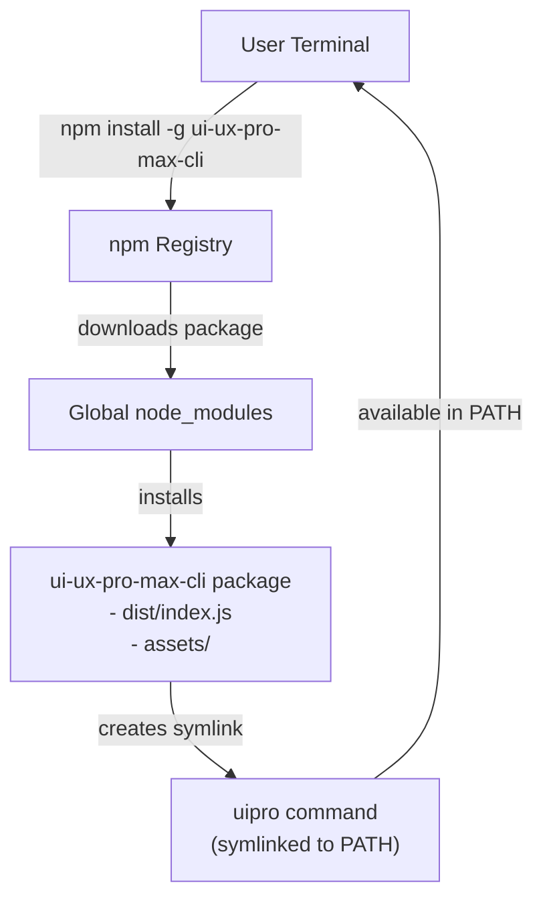

Sources: [cli/README.md:1-40]()

---

## First-Time Initialization

After installation, navigate to your project directory and run the `init` command to install the UI/UX Pro Max skill.

### Basic Initialization

```bash
# Navigate to your project
cd /path/to/your/project

# Initialize with auto-detection
uipro init
```

The `initCommand` at [cli/src/commands/init.ts:127]() accepts several options defined in `InitOptions` [cli/src/commands/init.ts:31-38]():

| Option | Flag | Description |
|--------|------|-------------|
| AI Type | `--ai <type>` | Target AI assistant (e.g., claude, cursor, trae) [cli/src/commands/init.ts:32]() |
| Force | `--force` | Overwrite existing files [cli/src/commands/init.ts:33]() |
| Offline | `--offline` | Use bundled templates instead of fetching [cli/src/commands/init.ts:34]() |
| Global | `--global` | Install to home directory (`~/`) instead of project [cli/src/commands/init.ts:36]() |
| Token | `--token` | GitHub PAT for higher API rate limits [cli/src/commands/init.ts:37]() |

### Supported AI Types

The CLI supports 18 AI assistant types, including new additions like `trae`, `gemini`, and `qoder` [cli/README.md:15-28]():

```bash
uipro init --ai claude      # Claude Code
uipro init --ai cursor      # Cursor
uipro init --ai trae        # Trae
uipro init --ai qoder       # Qoder
uipro init --ai gemini      # Gemini CLI
uipro init --ai universal   # Agent Standard (.agents/skills/)
uipro init --ai all         # Install for all detected assistants
```

### Initialization Workflow

The system defaults to `templateInstall` [cli/src/commands/init.ts:109-125]() which generates platform-specific files from local templates. It also supports a `--legacy` mode that attempts to download the latest release from GitHub via `tryGitHubInstall` [cli/src/commands/init.ts:44-104]().

**Initialization Process Diagram:**

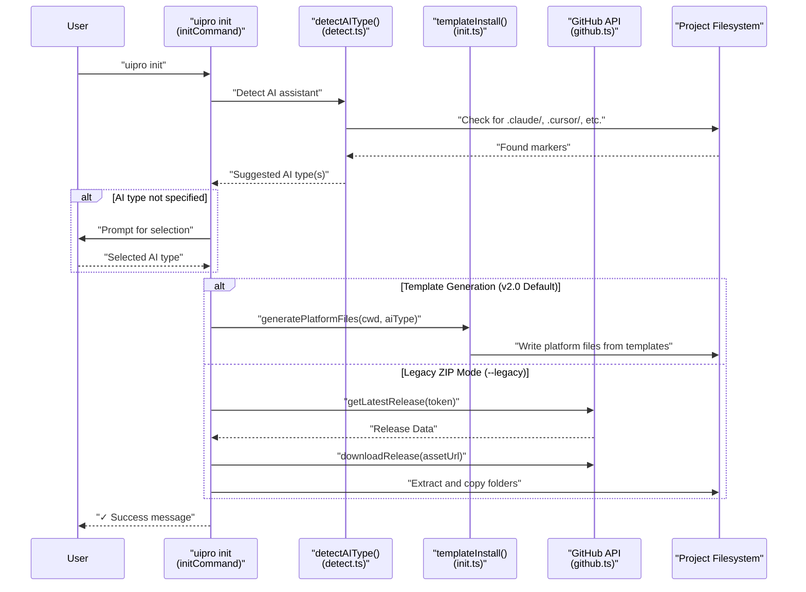

Sources: [cli/src/commands/init.ts:127-226](), [cli/src/utils/github.ts:74-92](), [cli/src/utils/detect.ts:11-15]()

---

## Installation Results

The system uses a **template-based generation model** [cli/src/commands/init.ts:189-193](). Every skill installation includes the necessary platform configurations and local data references.

**Natural Language to Code Entity Mapping:**

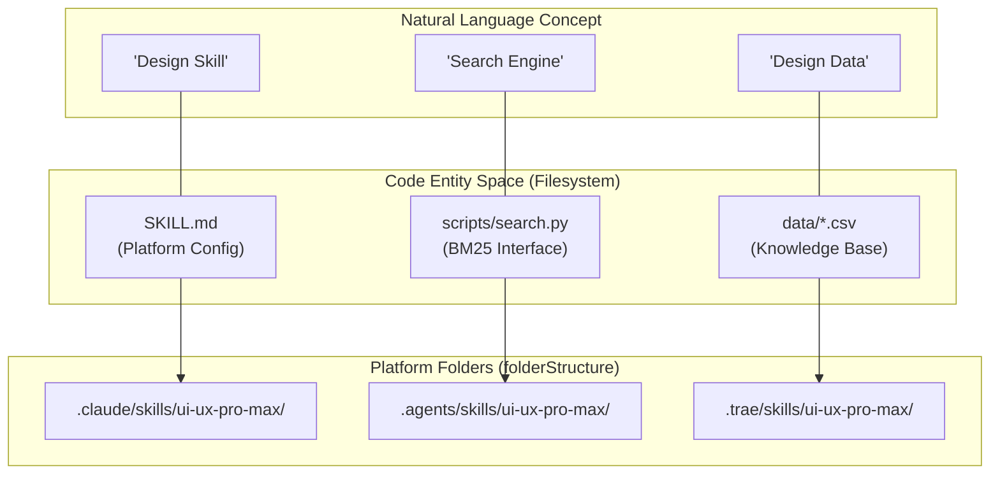

| AI Type | Root Directory | Skill Filename |
|---------|----------------|----------------|
| Claude | `.claude` | `SKILL.md` |
| Universal | `.agents` | `SKILL.md` [cli/assets/templates/platforms/universal.json:5-9]() |
| Trae | `.trae` | `SKILL.md` |
| GitHub Copilot | `.github` | `ui-ux-pro-max.prompt.md` |

Sources: [cli/assets/templates/platforms/universal.json:1-21](), [cli/src/commands/init.ts:127-226]()

---

## Basic Usage Workflow

Once installed, the skill provides design intelligence through a reasoning-driven workflow [README.md:44-98]().

### Usage Workflow Diagram

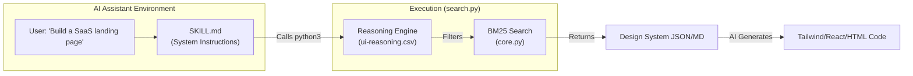

### Example Prompts

1. **Intelligent Design System Generation**:
   `"Analyze my project requirements for a 'Meditation App' and generate a full design system."` [README.md:44-48]()
   
2. **Component Search**:
   `"Find the best accessible color palette for a financial dashboard using the ui-ux-pro-max skill."`

3. **Stack-Specific Implementation**:
   `"Build a hero section for a spa website using React and Tailwind, following the UI/UX Pro Max guidelines."` [README.md:53-61]()

Sources: [README.md:42-98](), [cli/assets/templates/platforms/universal.json:11-14]()

---

## Maintenance and Updates

### Updating the CLI
To get the latest templates and features, update the global CLI package:
```bash
uipro update
```
The `updateCommand` [cli/src/commands/update.ts:38]() checks for new versions via GitHub [cli/src/commands/update.ts:44]() and executes `npm install -g` if a new version is found [cli/src/commands/update.ts:71-75]().

### Refreshing Skill Files
After updating the CLI, refresh the files in your project:
```bash
uipro init --ai <platform> --force
```
This regenerates the skill files from the updated templates bundled in the new CLI version [cli/README.md:68-73]().

### Checking Available Versions
To see the release history and latest version:
```bash
uipro versions
```
This calls `fetchReleases` from the GitHub utility to list all published tags [cli/src/commands/versions.ts:10-46]().

Sources: [cli/src/commands/update.ts:38-106](), [cli/src/commands/versions.ts:10-46](), [cli/README.md:35-39]()

---

# Page: System Architecture

# System Architecture

<details>
<summary>Relevant source files</summary>

The following files were used as context for generating this wiki page:

- [CLAUDE.md](CLAUDE.md)
- [README.md](README.md)
- [README.vi.md](README.vi.md)
- [README.zh.md](README.zh.md)
- [cli/assets/scripts/core.py](cli/assets/scripts/core.py)
- [cli/assets/scripts/search.py](cli/assets/scripts/search.py)
- [cli/assets/templates/base/skill-content.md](cli/assets/templates/base/skill-content.md)
- [cli/assets/templates/platforms/universal.json](cli/assets/templates/platforms/universal.json)
- [src/ui-ux-pro-max/scripts/core.py](src/ui-ux-pro-max/scripts/core.py)
- [src/ui-ux-pro-max/scripts/search.py](src/ui-ux-pro-max/scripts/search.py)
- [src/ui-ux-pro-max/templates/base/skill-content.md](src/ui-ux-pro-max/templates/base/skill-content.md)
- [src/ui-ux-pro-max/templates/platforms/universal.json](src/ui-ux-pro-max/templates/platforms/universal.json)

</details>


This document describes the technical architecture of the UI/UX Pro Max system, including its distribution mechanisms, core intelligence components, platform integration layer, and data persistence patterns. The system is designed as a distributed AI skill that operates across 18+ AI coding assistant platforms through template-based generation and a centralized Source of Truth.

---

## System Overview

The UI/UX Pro Max system consists of five primary layers: distribution, installation, intelligence, integration, and persistence. These layers work together to deliver design intelligence from a centralized knowledge base to multiple AI platforms.

### High-Level System Topology

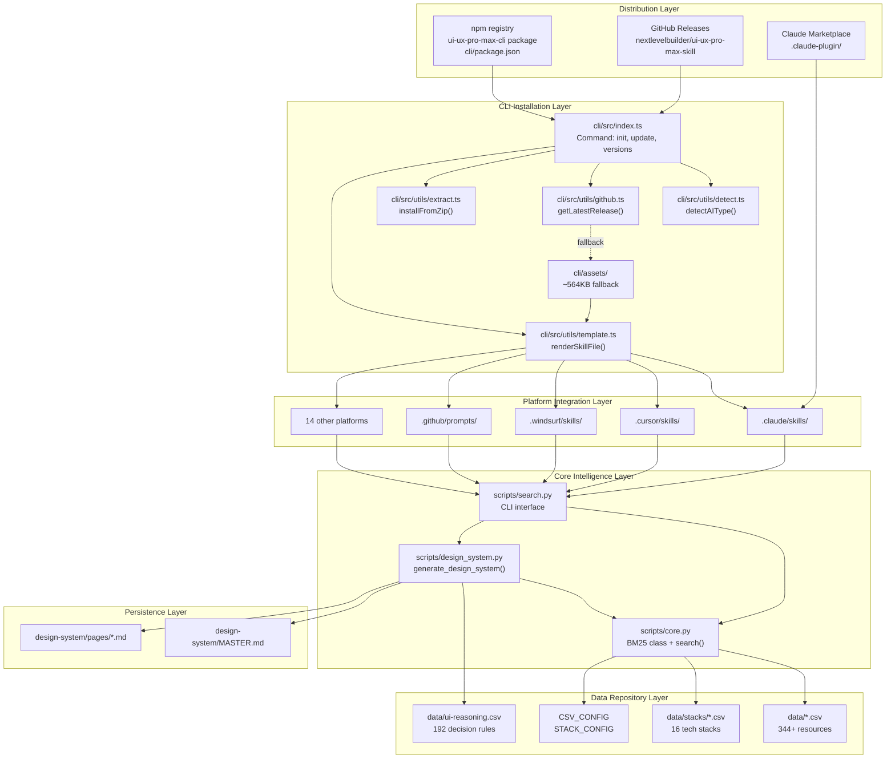

**Sources:** [README.md:1-24](), [CLAUDE.md:41-69](), [cli/src/index.ts:20-81]()

---

## Distribution and Installation Layer

The system provides three distribution channels, each serving different installation workflows.

### Distribution Channels

| Channel | Package | Install Method | Target Audience |
|---------|---------|----------------|-----------------|
| npm registry | `ui-ux-pro-max-cli` | `npm install -g ui-ux-pro-max-cli` | General users [README.md:18-19]() |
| GitHub Releases | Source archives + ZIP assets | `uipro init` downloads via API | Offline/enterprise users [README.md:10-10]() |
| Claude Marketplace | Plugin directory | Marketplace Integration | Claude Code users only [CLAUDE.md:68-68]() |

### CLI Entry Point Architecture

The CLI is implemented as a TypeScript/Bun application. The main entry point [cli/src/index.ts:1-83]() defines commands using the `commander` library:

- `init` - Installs the skill to the current project or globally [cli/src/index.ts:26-44]().
- `update` - Upgrades an existing installation to the latest version [cli/src/index.ts:52-64]().
- `uninstall` - Removes the skill from project or home directory [cli/src/index.ts:67-81]().
- `versions` - Lists all available GitHub releases [cli/src/index.ts:47-49]().

**Sources:** [cli/src/index.ts:1-83](), [README.md:18-22]()

### Platform Detection System

The `detectAIType()` function scans the current working directory for platform-specific folders to determine which AI assistants are present. It supports 18 platforms including:

| Platform | Detection Path | Constant |
|----------|---------------|----------|
| Claude Code | `.claude/` | `'claude'` |
| Cursor | `.cursor/` | `'cursor'` |
| Windsurf | `.windsurf/` | `'windsurf'` |
| Antigravity | `.agents/` | `'antigravity'` |
| GitHub Copilot | `.github/` | `'copilot'` |
| Trae | `.trae/` | `'trae'` |
| Roo Code | `.roo/` | `'roocode'` |
| Warp | `.warp/` | `'warp'` |

**Sources:** [CLAUDE.md:52-54](), [src/ui-ux-pro-max/templates/platforms/universal.json:1-21]()

---

## CLI Installation Pipeline

The installation flow consists of asset acquisition, extraction, and template rendering.

### Installation Sequence Diagram

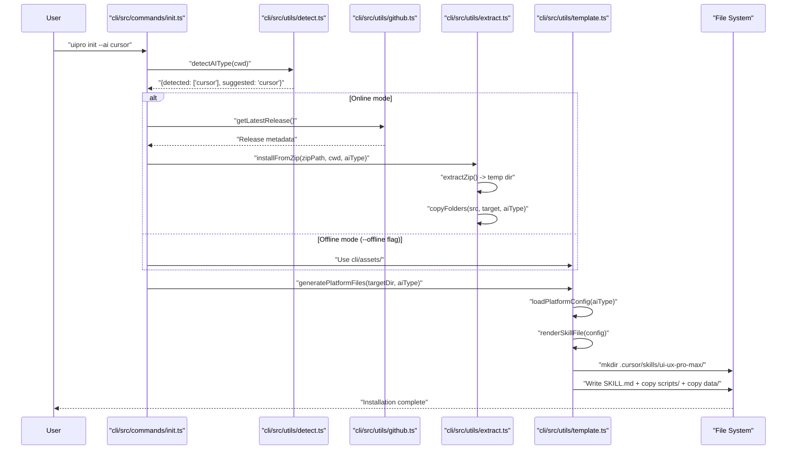

**Sources:** [cli/src/index.ts:26-44](), [CLAUDE.md:56-65]()

---

## Template-Based Generation System

UI/UX Pro Max uses a template system to generate platform-specific files from a single base.

### Template Architecture

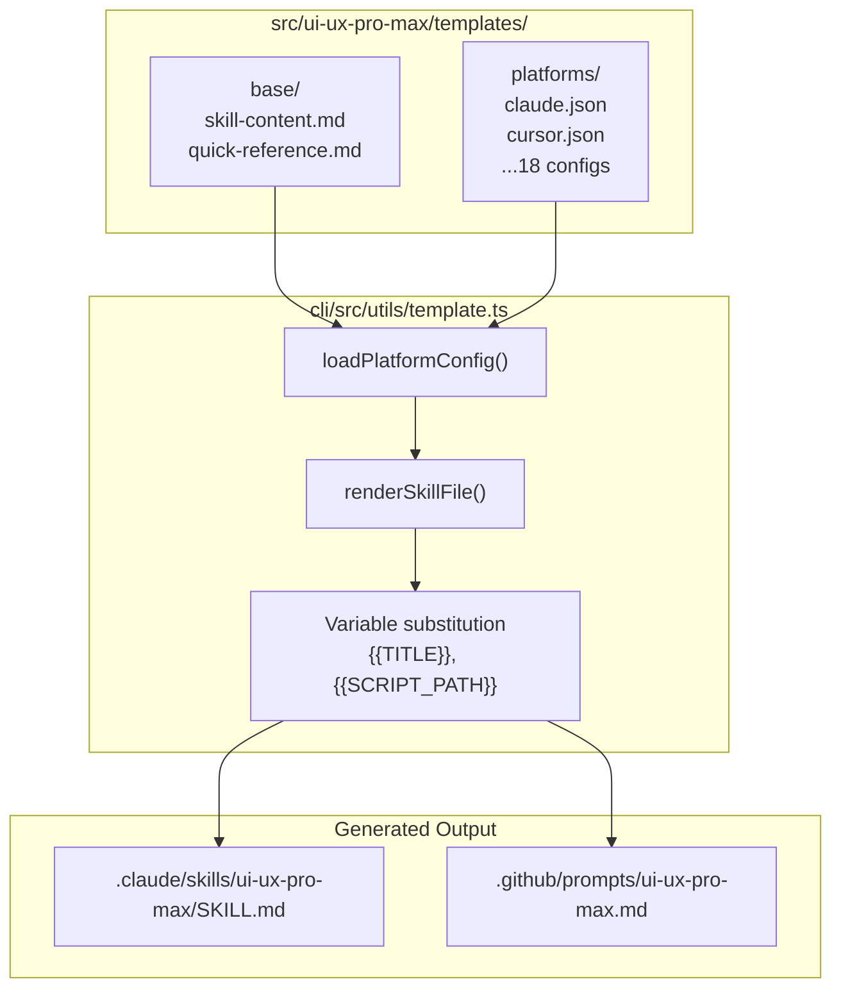

**Sources:** [CLAUDE.md:52-54](), [src/ui-ux-pro-max/templates/base/skill-content.md:1-115]()

### Platform Configuration Schema

The configuration defines how each platform is handled:
- `installType`: `'full'` (Skill mode) or `'reference'` (Workflow mode) [src/ui-ux-pro-max/templates/platforms/universal.json:4-4]().
- `folderStructure`: Defines the `root`, `skillPath`, and `filename` for the target platform [src/ui-ux-pro-max/templates/platforms/universal.json:5-9]().
- `frontmatter`: YAML metadata for platforms like Copilot [src/ui-ux-pro-max/templates/platforms/universal.json:11-14]().

**Sources:** [src/ui-ux-pro-max/templates/platforms/universal.json:1-21]()

---

## Core Intelligence System

The intelligence layer consists of Python modules that implement search and reasoning.

### BM25 Search Engine

The `core.py` module implements the search engine using BM25 ranking [src/ui-ux-pro-max/scripts/core.py:1-12]() and regex matching [src/ui-ux-pro-max/scripts/core.py:50-50]().
- `tokenize`: Normalizes text for the BM25 algorithm.
- `CSV_CONFIG`: Maps domains (style, color, chart, etc.) to specific CSV files and search/output columns [src/ui-ux-pro-max/scripts/core.py:18-79]().
- `STACK_CONFIG`: Maps implementation stacks to guideline files [src/ui-ux-pro-max/scripts/core.py:89-112]().

**Sources:** [src/ui-ux-pro-max/scripts/core.py:1-112]()

### Search CLI Interface

`search.py` serves as the primary entry point for AI assistants [src/ui-ux-pro-max/scripts/search.py:1-26]().
- `--domain`: Searches specific categories like `style`, `color`, or `ux` [src/ui-ux-pro-max/scripts/search.py:99-99]().
- `--stack`: Searches technology-specific guidelines (e.g., `react`, `shadcn`) [src/ui-ux-pro-max/scripts/search.py:100-100]().
- `--design-system`: Triggers the reasoning engine to generate a complete system [src/ui-ux-pro-max/scripts/search.py:106-106]().
- `--persist`: Saves the design system using the Master + Overrides pattern [src/ui-ux-pro-max/scripts/search.py:110-110]().

**Sources:** [src/ui-ux-pro-max/scripts/search.py:1-131](), [CLAUDE.md:9-40]()

---

## Source of Truth and Sync Rules

The project maintains a strict "Source of Truth" model to ensure consistency across development environments and installations.

### Directory Mapping and Sync Architecture

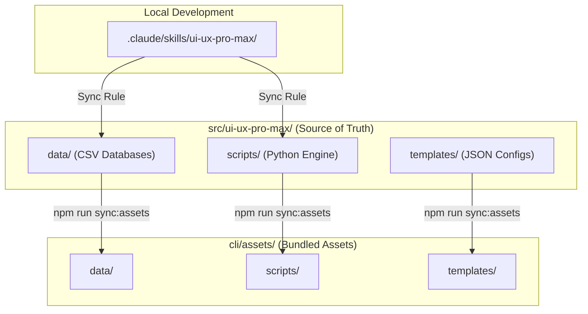

**Sync Rules:**
1. **Source of Truth**: `src/ui-ux-pro-max/` is the canonical source for all data, scripts, and templates [CLAUDE.md:75-75]().
2. **No Symlinks**: The repository avoids symlinks for Windows compatibility; files are mirrored using sync scripts [CLAUDE.md:77-80]().
3. **Manual Sync**: Changes in `src/ui-ux-pro-max/` must be mirrored to `cli/assets/` and `.claude/skills/` using `npm run sync:assets` before committing [CLAUDE.md:94-99]().

**Sources:** [CLAUDE.md:73-104]()

---

# Page: uipro-cli Tool

# uipro-cli Tool

<details>
<summary>Relevant source files</summary>

The following files were used as context for generating this wiki page:

- [cli/.npmignore](cli/.npmignore)
- [cli/README.md](cli/README.md)
- [cli/package.json](cli/package.json)
- [cli/src/commands/init.ts](cli/src/commands/init.ts)
- [cli/src/commands/update.ts](cli/src/commands/update.ts)
- [cli/src/commands/versions.ts](cli/src/commands/versions.ts)
- [cli/src/index.ts](cli/src/index.ts)
- [cli/src/utils/extract.ts](cli/src/utils/extract.ts)
- [cli/src/utils/github.ts](cli/src/utils/github.ts)

</details>


The `uipro-cli` tool is a Node.js command-line interface distributed via npm as `ui-ux-pro-max-cli` [cli/package.json:2](). it automates the installation and management of the UI/UX Pro Max skill across 18+ AI coding platforms. It handles platform detection, GitHub release downloading with bundled fallback, and a v2.0 template-based generation system for creating platform-specific configuration files.

This page covers the CLI's package structure, command architecture, and high-level installation workflow. For detailed information on specific subsystems, see:
- CLI command options and usage: [CLI Commands](#2.1)
- Installation pipeline stages: [Installation Flow](#2.2)
- Platform directory detection logic: [Platform Detection](#2.3)
- Template-based file generation: [Template Generation](#2.4)

---

## Package Structure

The `uipro-cli` package is configured as an ES module [cli/package.json:5]() with a binary entry point at `dist/index.js` [cli/package.json:7](). The package includes two critical directories:

| Directory | Purpose |
|-----------|---------|
| `dist/` | Compiled TypeScript output from `src/` [cli/package.json:10]() |
| `assets/` | Templates, platform JSON configs, and bundled data/scripts [cli/package.json:11]() |

The `package.json` defines the binary command `uipro` that maps to the compiled entry point [cli/package.json:7]().

### Key Dependencies

| Package | Purpose |
|---------|---------|
| `commander@^12.1.0` | Command-line argument parsing and subcommand routing [cli/package.json:52]() |
| `chalk@^5.3.0` | Terminal color output for success/error messages [cli/package.json:51]() |
| `ora@^8.1.1` | Animated spinners during async operations [cli/package.json:53]() |
| `prompts@^2.4.2` | Interactive platform selection and confirmation [cli/package.json:54]() |

**Sources:** [cli/package.json:1-63]()

---

## Command Architecture

### Entry Point and Command Registration

The CLI entry point at [cli/src/index.ts:1-90]() uses `commander` to register four primary subcommands: `init`, `versions`, `update`, and `uninstall`.

**Command Hierarchy Diagram**

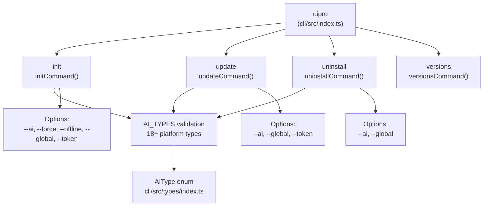

### Command Implementation Files

Each command is implemented in a separate module under `src/commands/`:

| Command | Module | Purpose |
|---------|--------|---------|
| `init` | `src/commands/init.ts` | Install skill to project or home directory [cli/src/commands/init.ts:127]() |
| `update` | `src/commands/update.ts` | Update existing installation to latest version or refresh files [cli/src/commands/update.ts:38]() |
| `uninstall` | `src/commands/uninstall.ts` | Remove skill files from project or globally [cli/src/index.ts:74]() |
| `versions` | `src/commands/versions.ts` | Fetch and display available GitHub releases [cli/src/commands/versions.ts:10]() |

**Sources:** [cli/src/index.ts:1-90](), [cli/src/commands/init.ts:1-226](), [cli/src/commands/update.ts:1-106](), [cli/README.md:11-39]()

---

## Installation Architecture

The CLI orchestrates a multi-stage installation process. In v2.0+, the default mode is **Template Generation**, which constructs the skill files dynamically from bundled templates [cli/src/commands/init.ts:189-193]().

**Installation Flow with Code Entities**

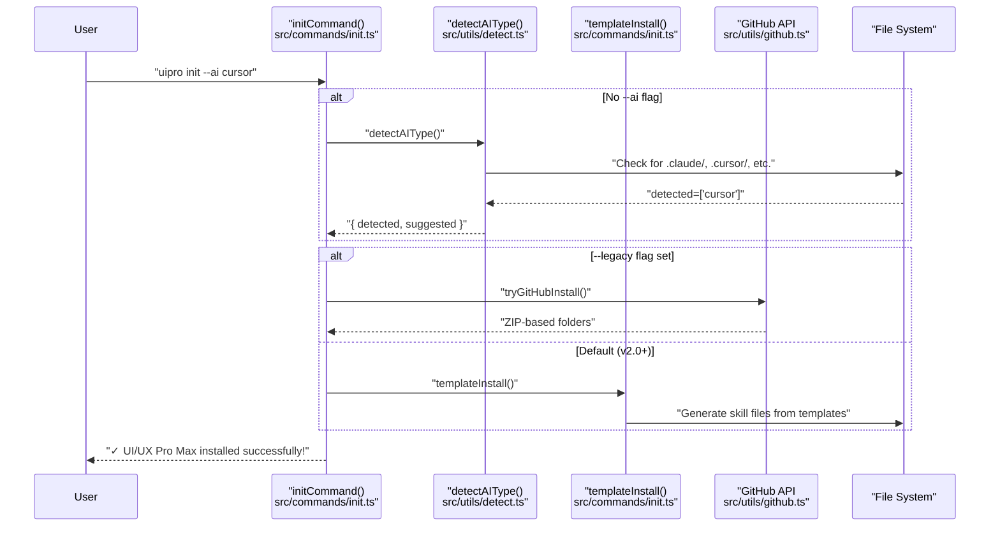

### Installation Modes

| Mode | Trigger | Logic |
|------|---------|-------|
| **Template** | Default | Uses `generatePlatformFiles` to render files from templates and platform JSON [cli/src/commands/init.ts:109-125](). |
| **Legacy ZIP** | `--legacy` | Downloads ZIP from GitHub via `getLatestRelease` [cli/src/commands/init.ts:54]() and extracts via `installFromZip` [cli/src/utils/extract.ts:125](). |
| **Global** | `--global` | Installs to the user's home directory (`~/`) instead of the current project [cli/src/index.ts:31](). |

**Sources:** [cli/src/commands/init.ts:127-226](), [cli/src/utils/extract.ts:125-149](), [cli/src/index.ts:25-46]()

---

## Platform Detection and Configuration

### Detection Logic
The `detectAIType` function scans the current working directory for hidden platform folders (e.g., `.cursor`, `.windsurf`, `.trae`) to suggest the appropriate installation target [cli/src/commands/init.ts:134]().

### GitHub Integration
The CLI integrates with the GitHub API to fetch releases [cli/src/utils/github.ts:54]() and download assets [cli/src/utils/github.ts:94](). It handles authentication via `UI_PRO_MAX_GITHUB_TOKEN` or `GITHUB_TOKEN` to bypass rate limits [cli/src/utils/github.ts:50]().

**Sources:** [cli/src/utils/github.ts:1-127](), [cli/src/commands/init.ts:130-157](), [cli/README.md:41-65]()

---

## ZIP Extraction and Fallback

While Template Generation is the primary mode, the CLI maintains robust ZIP handling for legacy support and manual updates.

**Extraction Utilities**
The `extractZip` function handles platform-specific extraction [cli/src/utils/extract.ts:13-24]():
- **Windows**: Uses PowerShell `Expand-Archive` [cli/src/utils/extract.ts:17]().
- **Unix**: Uses `unzip` [cli/src/utils/extract.ts:19]().

**Fallback Strategy**
In legacy mode, if the GitHub download fails due to rate limits (`GitHubRateLimitError`) or network issues, the CLI automatically falls back to bundled assets in the `ASSETS_DIR` [cli/src/commands/init.ts:184-188]().

**Sources:** [cli/src/utils/extract.ts:1-149](), [cli/src/commands/init.ts:44-104]()

---

## Development and Build

The CLI is developed using TypeScript and can be run using the Bun runtime.

| Action | Command |
|--------|---------|
| **Build** | `node scripts/build.mjs` (via `npm run build`) [cli/package.json:14]() |
| **Dev** | `bun run src/index.ts` [cli/package.json:15]() |
| **Sync Assets** | `node scripts/sync-assets.mjs` [cli/package.json:16]() |

The `prepublishOnly` hook ensures that assets are synced, data is verified, and the project is built before publishing to npm [cli/package.json:30]().

**Sources:** [cli/package.json:13-31](), [cli/README.md:77-97]()

---

# Page: CLI Commands

# CLI Commands

<details>
<summary>Relevant source files</summary>

The following files were used as context for generating this wiki page:

- [cli/.npmignore](cli/.npmignore)
- [cli/README.md](cli/README.md)
- [cli/assets/templates/platforms/augment.json](cli/assets/templates/platforms/augment.json)
- [cli/assets/templates/platforms/kilocode.json](cli/assets/templates/platforms/kilocode.json)
- [cli/assets/templates/platforms/warp.json](cli/assets/templates/platforms/warp.json)
- [cli/package.json](cli/package.json)
- [cli/src/commands/init.ts](cli/src/commands/init.ts)
- [cli/src/commands/uninstall.ts](cli/src/commands/uninstall.ts)
- [cli/src/commands/update.ts](cli/src/commands/update.ts)
- [cli/src/commands/versions.ts](cli/src/commands/versions.ts)
- [cli/src/index.ts](cli/src/index.ts)
- [cli/src/utils/extract.ts](cli/src/utils/extract.ts)
- [cli/src/utils/github.ts](cli/src/utils/github.ts)

</details>


This document details the command-line interface of the `uipro` CLI tool, which provides four primary commands for installing and managing UI/UX Pro Max across AI coding assistants. The CLI is distributed via npm as `ui-ux-pro-max-cli` [cli/package.json:2-8]() and provides installation orchestration with automatic platform detection, GitHub integration, and template-based file generation.

For information about the installation pipeline and asset download mechanisms, see [Installation Flow](#2.2). For platform detection logic, see [Platform Detection](#2.3). For template-based file generation, see [Template Generation](#2.4).

---

## Command Overview

The CLI exposes four commands through the `uipro` executable [cli/package.json:6-8]():

| Command | Purpose | Key Options |
|---------|---------|-------------|
| `uipro init` | Install UI/UX Pro Max skill to current project or globally | `--ai`, `--force`, `--offline`, `--legacy`, `--global`, `--token` |
| `uipro update` | Update the global CLI or refresh installed skill files | `--ai`, `--global`, `--token` |
| `uipro uninstall` | Remove skill files from project or home directory | `--ai`, `--global` |
| `uipro versions` | List available versions from GitHub releases | `--token` |

**Sources:** [cli/src/index.ts:20-81](), [cli/package.json:6-8](), [cli/README.md:13-39]()

---

## CLI Program Structure

The following diagram maps the command-line entry point to code entities:

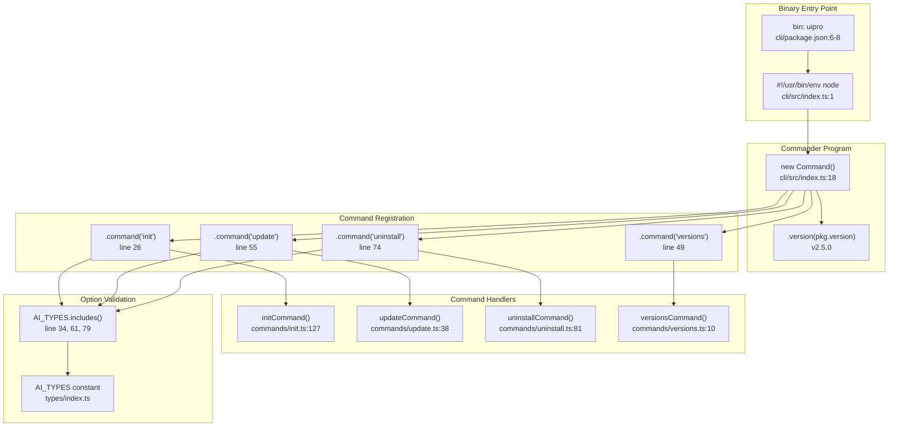

**Sources:** [cli/src/index.ts:1-90](), [cli/package.json:1-8]()

---

## init Command

The `init` command installs UI/UX Pro Max to the current working directory or the user's home directory by detecting platforms, generating skill files, and copying data assets.

### Syntax

```bash
uipro init [options]
```

### Options

| Option | Type | Description | Default |
|--------|------|-------------|---------|
| `-a, --ai <type>` | string | Target AI platform (e.g., `cursor`, `claude`, `all`) | Interactive prompt |
| `-f, --force` | boolean | Overwrite existing files without confirmation | `false` |
| `-o, --offline` | boolean | Compatibility flag; template installs use bundled assets | `false` |
| `-g, --global` | boolean | Install to home directory (`~/`) instead of project | `false` |
| `--legacy` | boolean | Use ZIP-based installation instead of templates | `false` |
| `-t, --token <token>`| string | GitHub Personal Access Token for higher rate limits | Environment variable |

**Sources:** [cli/src/index.ts:26-46](), [cli/src/commands/init.ts:31-38]()

### Execution Flow

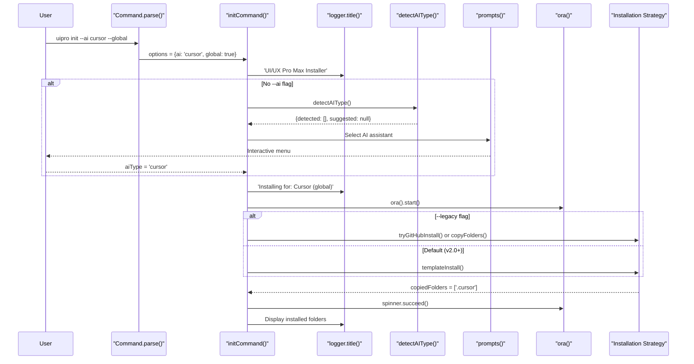

**Sources:** [cli/src/commands/init.ts:127-226](), [cli/src/index.ts:26-46]()

### Installation Strategies

#### Template Generation (Default)
This method uses `templateInstall` [cli/src/commands/init.ts:109](), which calls `generatePlatformFiles` [cli/src/commands/init.ts:124]() to create platform-specific files from bundled templates [cli/src/commands/init.ts:23-29](). It handles global path rewrites if `--global` is specified [cli/src/commands/init.ts:116-118]().

#### ZIP-Based Installation (Legacy)
Triggered by the `--legacy` flag [cli/src/commands/init.ts:170](). It attempts to download the latest release ZIP from GitHub via `tryGitHubInstall` [cli/src/commands/init.ts:44](). If the download fails or `--offline` is set, it falls back to copying folders from `ASSETS_DIR` [cli/src/commands/init.ts:185-187]().

**Sources:** [cli/src/commands/init.ts:44-125](), [cli/src/utils/extract.ts:35-88]()

---

## uninstall Command

The `uninstall` command removes the `ui-ux-pro-max` skill directory and related files from specific AI assistant folders.

### Syntax

```bash
uipro uninstall [options]
```

### Options

| Option | Type | Description |
|--------|------|-------------|
| `-a, --ai <type>` | string | Specific AI assistant to remove |
| `-g, --global` | boolean | Uninstall from home directory (`~/`) |

**Sources:** [cli/src/index.ts:74-88](), [cli/src/commands/uninstall.ts:13-16]()

### Implementation: removeSkillDir
The core logic resides in `removeSkillDir` [cli/src/commands/uninstall.ts:21](). It derives the installation path from the platform configuration [cli/src/commands/uninstall.ts:38-47]() and removes both the main skill and bundled sub-skills [cli/src/commands/uninstall.ts:25, 65-76]().

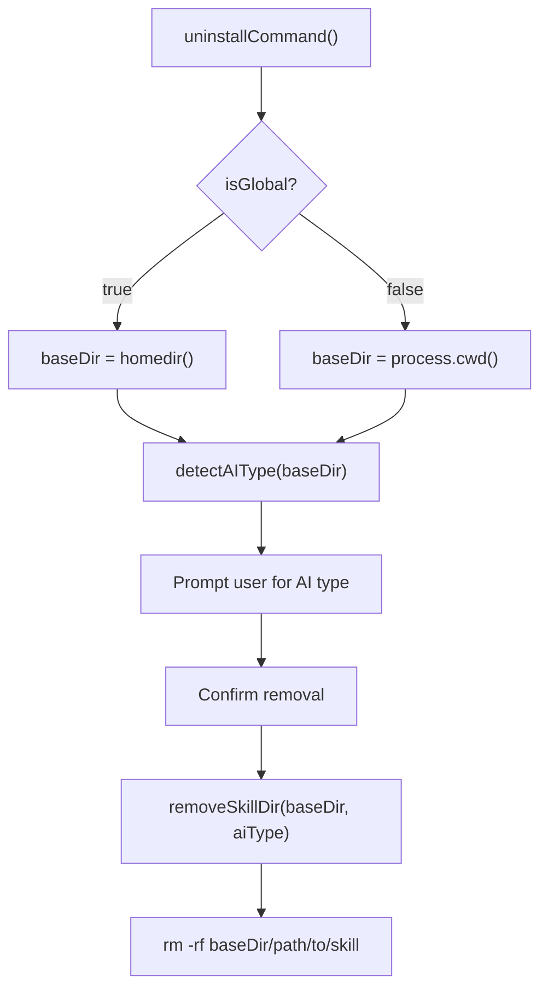

**Sources:** [cli/src/commands/uninstall.ts:21-80](), [cli/src/commands/uninstall.ts:81-177]()

---

## update Command

The `update` command checks for new CLI versions on GitHub [cli/src/commands/update.ts:44](). If a new version exists, it attempts to update the global npm package [cli/src/commands/update.ts:71-75](). If the CLI is already up-to-date, it refreshes the local skill files by running `initCommand` with `force: true` [cli/src/commands/update.ts:93-98]().

### Syntax

```bash
uipro update [options]
```

**Sources:** [cli/src/index.ts:55-71](), [cli/src/commands/update.ts:38-106]()

---

## versions Command

The `versions` command displays all available GitHub releases for the repository [cli/src/commands/versions.ts:14](). It marks the most recent release as `[latest]` [cli/src/commands/versions.ts:31]().

**Sources:** [cli/src/commands/versions.ts:10-46](), [cli/src/utils/github.ts:54-72]()

---

## Command-Line Option Validation

### AI Type Validation
The CLI validates the `--ai` option against the `AI_TYPES` array [cli/src/index.ts:34, 61, 79](). Supported platforms include `claude`, `cursor`, `windsurf`, `antigravity`, `copilot`, `roocode`, `kiro`, `codex`, `qoder`, `gemini`, `trae`, `opencode`, `continue`, `codebuddy`, `droid`, `kilocode`, `warp`, `augment`, and `all`.

**Sources:** [cli/src/index.ts:12](), [cli/README.md:15-28]()

### GitHub Authentication
To avoid API rate limits, users can provide a token via the `--token` flag, `UI_PRO_MAX_GITHUB_TOKEN` environment variable, or `GITHUB_TOKEN` environment variable [cli/src/utils/github.ts:49-52]().

**Sources:** [cli/README.md:41-64](), [cli/src/utils/github.ts:23-31]()

### Exit Codes

| Exit Code | Condition | Location |
|-----------|-----------|----------|
| `0` | Successful execution | Implicit |
| `1` | Invalid `--ai` type provided | [cli/src/index.ts:37, 64, 82]() |
| `1` | Command failure (Init, Update, Uninstall, Versions) | [cli/src/commands/init.ts:224](), [cli/src/commands/update.ts:104](), [cli/src/commands/uninstall.ts:176](), [cli/src/commands/versions.ts:44]() |

**Sources:** [cli/src/index.ts:37-82](), [cli/src/commands/init.ts:224]()

---

# Page: Installation Flow

# Installation Flow

<details>
<summary>Relevant source files</summary>

The following files were used as context for generating this wiki page:

- [cli/.npmignore](cli/.npmignore)
- [cli/README.md](cli/README.md)
- [cli/package.json](cli/package.json)
- [cli/src/commands/init.ts](cli/src/commands/init.ts)
- [cli/src/commands/update.ts](cli/src/commands/update.ts)
- [cli/src/commands/versions.ts](cli/src/commands/versions.ts)
- [cli/src/index.ts](cli/src/index.ts)
- [cli/src/utils/extract.ts](cli/src/utils/extract.ts)
- [cli/src/utils/github.ts](cli/src/utils/github.ts)

</details>


The `uipro-cli` installation pipeline orchestrates multiple stages: GitHub asset download (with fallback handling), optional ZIP extraction for legacy mode, and template-based generation for the default v2.0 method. This document details the complete flow from the `uipro init` command invocation through final file placement in the user's project directory.

The installation system prioritizes template generation (introduced in v2.0) as the default method, with legacy ZIP-based installation available via the `--legacy` flag. Related documentation: [CLI Commands](#2.1) for command options, [Platform Detection](#2.3) for AI type detection, [Template Generation](#2.4) for the v2.0 template system.

Sources: [cli/src/commands/init.ts:1-226](), [cli/src/utils/extract.ts:1-149]()

## Installation Pipeline Overview

The installation flow consists of multiple stages with automatic fallback mechanisms. The pipeline is invoked via `initCommand()` [cli/src/commands/init.ts:127-226]() and executes the following decision tree:

**Complete Installation Flow**

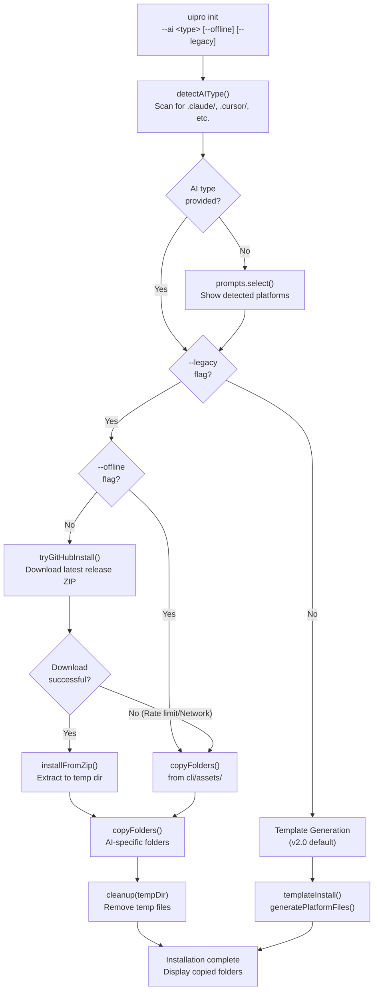

The pipeline uses three installation methods defined in `initCommand` [cli/src/commands/init.ts:166-193]():

| Method | Trigger | Description | Files Source |
|--------|---------|-------------|--------------|
| **Template Generation** | Default (no `--legacy`) | Generates files from templates using platform configs | `cli/src/utils/template.ts` |
| **GitHub ZIP** | `--legacy` flag + network available | Downloads and extracts latest release | GitHub API + `extractZip()` |
| **Bundled Assets** | `--legacy --offline` or GitHub failure | Uses pre-packaged files from npm | `cli/assets/` directory |

Sources: [cli/src/commands/init.ts:166-193](), [cli/src/index.ts:25-46]()

## Installation Method Selection

As of v2.0, the CLI defaults to **template generation** rather than ZIP-based installation. This shift enables single-source-of-truth maintenance and platform-specific customization without distributing redundant files.

### Template Generation Method (Default)

When invoked without the `--legacy` flag, `initCommand()` calls `templateInstall()` [cli/src/commands/init.ts:191-192]():

```typescript
// Default: template-based generation
copiedFolders = await templateInstall(cwd, aiType, spinner, isGlobal, options.force);
installMethod = 'template';
```

The function `templateInstall` [cli/src/commands/init.ts:109-125]() routes to either:
- `generatePlatformFiles(targetDir, aiType, isGlobal, force)` - Single platform
- `generateAllPlatformFiles(targetDir, isGlobal, force)` - All platforms (when `aiType === 'all'`)

This method is covered in detail in [Template Generation](#2.4).

### Legacy ZIP Method (--legacy Flag)

When the `--legacy` flag is provided, the CLI attempts the original ZIP-based installation [cli/src/commands/init.ts:170-188]():

```typescript
if (options.legacy) {
  if (isGlobal) {
    spinner.warn('--global is not supported with --legacy mode, installing locally instead');
  }
  // Try GitHub download first (unless offline mode)
  if (!options.offline) {
    const githubResult = await tryGitHubInstall(cwd, aiType, spinner, options.token);
    if (githubResult) {
      copiedFolders = githubResult;
      installMethod = 'github';
    }
  }

  // Fall back to bundled assets if GitHub failed or offline mode
  if (installMethod !== 'github') {
    spinner.text = 'Installing from bundled assets...';
    copiedFolders = await copyFolders(ASSETS_DIR, cwd, aiType);
    installMethod = 'bundled';
  }
}
```

**Method Comparison**

| Aspect | Template Generation | Legacy ZIP |
|--------|---------------------|------------|
| **Default** | Yes (v2.0+) | No (requires `--legacy`) |
| **Network Required** | No | Yes (unless `--offline`) |
| **File Size** | Minimal (only target platform) | Larger (full release archive) |
| **Customization** | Per-platform via JSON configs | Static files from ZIP |
| **Maintenance** | Single source in `src/ui-ux-pro-max/` | Must sync to `cli/assets/` |
| **Speed** | Faster (no download/extract) | Slower (download + unzip) |

Sources: [cli/src/commands/init.ts:170-193](), [cli/src/utils/extract.ts:35-88]()

## GitHub Download Phase

The `tryGitHubInstall()` function [cli/src/commands/init.ts:44-104]() orchestrates the GitHub release download pipeline with comprehensive error handling.

**GitHub Download Pipeline**

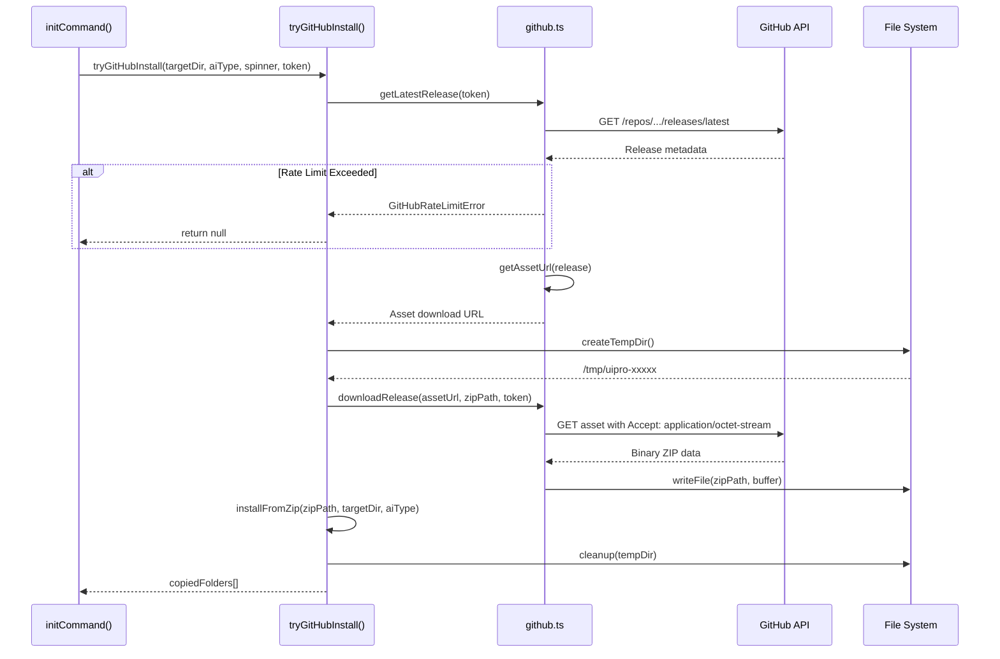

### GitHub API Interaction

The `github.ts` module defines core functions for interacting with the GitHub API:

| Function | Endpoint | Purpose |
|----------|----------|---------|
| `getLatestRelease(token?)` | `/repos/{owner}/{repo}/releases/latest` | Get latest release metadata [cli/src/utils/github.ts:74-92]() |
| `downloadRelease(url, dest, token?)` | Asset URL | Download binary ZIP to disk [cli/src/utils/github.ts:94-111]() |

All requests include rate limit detection via `checkRateLimit()` [cli/src/utils/github.ts:33-47]().

### Asset URL Resolution

The `getAssetUrl()` function [cli/src/utils/github.ts:113-127]() implements a two-tier fallback strategy:

1. **Uploaded ZIP asset** - Searches for `release.assets` with `.zip` extension
2. **Auto-generated archive** - Constructs URL: `https://github.com/{owner}/{repo}/archive/refs/tags/{tag}.zip`

This ensures installation works even if no ZIP is explicitly uploaded to the release.

Sources: [cli/src/commands/init.ts:44-104](), [cli/src/utils/github.ts:1-127]()

## Error Handling and Fallback Strategy

The installation pipeline implements graceful degradation with multiple fallback layers to maximize installation success rates.

### Error Types and Responses

| Error Type | Thrown By | Handler Behavior | Fallback Action |
|------------|-----------|------------------|-----------------|
| `GitHubRateLimitError` | `checkRateLimit()` | Warn user with reset time | Template generation [cli/src/commands/init.ts:84-87]() |
| `GitHubDownloadError` | `downloadRelease()` | Warn "GitHub download failed" | Template generation [cli/src/commands/init.ts:89-92]() |
| `TypeError` (fetch) | `fetch()` calls | Detect network issues | Template generation [cli/src/commands/init.ts:95-98]() |
| Unknown errors | Any stage | Generic "Download failed" warning | Template generation [cli/src/commands/init.ts:101-102]() |

**Fallback Decision Tree**

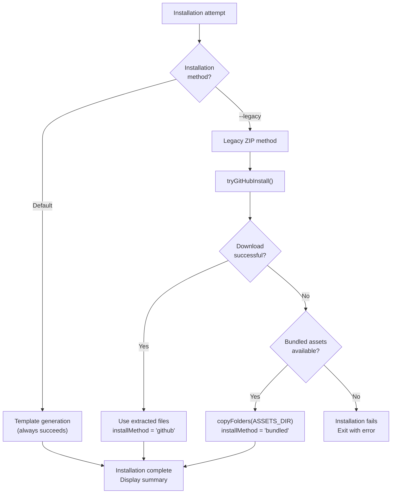

### Error Recovery Logic

The `tryGitHubInstall()` function [cli/src/commands/init.ts:44-104]() wraps all operations in a try-catch block with granular error classification. Returning `null` instead of throwing allows `initCommand()` to seamlessly fall back to template generation or bundled assets.

Sources: [cli/src/commands/init.ts:78-103](), [cli/src/utils/github.ts:9-47]()

## ZIP Extraction (Legacy Mode)

When using the `--legacy` flag, the `installFromZip()` function [cli/src/utils/extract.ts:125-149]() handles the complete extraction pipeline.

### installFromZip() Pipeline

The function coordinates multiple extraction stages:

**Legacy Installation Pipeline**

```mermaid
graph TB
    Input["installFromZip(zipPath, targetDir, aiType)"]
    
    CreateTemp["createTempDir()<br/>mkdtemp('/tmp/uipro-')"]
    
    Extract["extractZip(zipPath, tempDir)<br/>Platform-specific unzip"]
    
    FindRoot["findExtractedRoot(tempDir)<br/>Handle nested directories"]
    
    CheckEntries{"Single root<br/>directory?"}
    
    UseNested["extractedRoot = tempDir/subdir"]
    UseFlat["extractedRoot = tempDir"]
    
    CopyPlatform["copyFolders(extractedRoot, targetDir, aiType)<br/>Copy AI-specific folders"]
    
    Return["Return {copiedFolders, tempDir}"]
    
    ErrorPath["Error during extraction"]
    CleanupErr["cleanup(tempDir)<br/>Remove temp files"]
    ThrowErr["throw error"]
    
    Input --> CreateTemp
    CreateTemp --> Extract
    Extract --> FindRoot
    
    FindRoot --> CheckEntries
    
    CheckEntries -->|"Yes"| UseNested
    CheckEntries -->|"No"| UseFlat
    
    UseNested --> CopyPlatform
    UseFlat --> CopyPlatform
    
    CopyPlatform --> Return
    
    Extract -.->|"Error"| ErrorPath
    FindRoot -.->|"Error"| ErrorPath
    CopyPlatform -.->|"Error"| ErrorPath
    
    ErrorPath --> CleanupErr
    CleanupErr --> ThrowErr
```

### Platform-Specific Extraction

The `extractZip()` function [cli/src/utils/extract.ts:13-24]() uses different shell commands based on `process.platform`:

| Platform | Detection | Command | Flags |
|----------|-----------|---------|-------|
| Windows | `process.platform === 'win32'` | `powershell -Command "Expand-Archive..."` | `-Force` (overwrite) |
| Unix/Linux/macOS | All other values | `unzip -o "..." -d "..."` | `-o` (overwrite without prompt) |

### Extracted Root Detection

GitHub release ZIPs often contain a single root directory. The `findExtractedRoot()` function [cli/src/utils/extract.ts:109-120]() handles this to ensure `copyFolders()` operates on the correct source path.

Sources: [cli/src/utils/extract.ts:125-149](), [cli/src/utils/extract.ts:109-120](), [cli/src/utils/extract.ts:13-24]()

## Folder Copying Logic

The `copyFolders()` function [cli/src/utils/extract.ts:35-88]() is used by the legacy installation method to selectively copy platform-specific directories.

### AI-Specific Folder Selection

The `AI_FOLDERS` mapping [cli/src/types/index.ts:49-68]() determines which directories to copy. The `.shared/` directory contains core scripts and data used by multiple platforms.

### Copy Operation Flow

The function implements a three-tier copy strategy: Node.js native API (`cp`), platform-specific shell fallback (`xcopy` or `cp -r`), and silent failure for missing sources.

**copyFolders() Execution Flow**

```mermaid
graph TB
    Input["copyFolders(sourceDir, targetDir, aiType)"]
    
    ResolveFolders["Resolve folder list:<br/>AI_FOLDERS[aiType]"]
    
    Dedupe["Deduplicate:<br/>new Set(foldersToCopy)"]
    
    Loop["For each folder in uniqueFolders"]
    
    BuildPaths["sourcePath = join(sourceDir, folder)<br/>targetPath = join(targetDir, folder)"]
    
    SourceExists{"await exists<br/>(sourcePath)"}
    
    Skip["continue<br/>(skip missing)"]
    
    MkdirTarget["await mkdir(targetPath,<br/>{recursive: true})"]
    
    DefineFilter["filterFn = (src) =><br/>!EXCLUDED_FILES.includes(basename(src))"]
    
    TryNative["await cp(sourcePath, targetPath,<br/>{recursive: true, filter: filterFn})"]
    
    NativeSuccess{"Success?"}
    
    AddToList["copiedFolders.push(folder)"]
    
    TryShell["Shell fallback:<br/>xcopy (Windows) | cp -r (Unix)"]
    
    ShellSuccess{"Success?"}
    
    Next["Next folder"]
    
    Return["return copiedFolders"]
    
    Input --> ResolveFolders
    ResolveFolders --> Dedupe
    Dedupe --> Loop
    
    Loop --> BuildPaths
    BuildPaths --> SourceExists
    
    SourceExists -->|"No"| Skip
    SourceExists -->|"Yes"| MkdirTarget
    
    Skip --> Next
    
    MkdirTarget --> DefineFilter
    DefineFilter --> TryNative
    
    TryNative --> NativeSuccess
    
    NativeSuccess -->|"Yes"| AddToList
    NativeSuccess -->|"No"| TryShell
    
    TryShell --> ShellSuccess
    
    ShellSuccess -->|"Yes"| AddToList
    ShellSuccess -->|"No (silent fail)"| Next
    
    AddToList --> Next
    
    Next --> Loop
    Loop -->|"All processed"| Return
```

### File Exclusion Filter

The `filterFn` callback [cli/src/utils/extract.ts:63-66]() prevents specific files from being copied, such as `settings.local.json` [cli/src/utils/extract.ts:11]().

Sources: [cli/src/utils/extract.ts:35-88](), [cli/src/types/index.ts:49-68]()

## Temporary Directory Management

The installation pipeline uses temporary directories for ZIP extraction to avoid polluting the user's filesystem.

### Temporary Directory Lifecycle

**Temp Directory Lifecycle**

```mermaid
sequenceDiagram
    participant Install as installFromZip()
    participant TempOps as Temp Operations
    participant FS as File System
    participant Extract as extractZip()
    participant Copy as copyFolders()
    
    Install->>TempOps: createTempDir()
    TempOps->>FS: mkdtemp(join(tmpdir(), 'uipro-'))
    FS-->>TempOps: /tmp/uipro-a8f3d9
    TempOps-->>Install: tempDir path
    
    Install->>Extract: extractZip(zipPath, tempDir)
    Extract->>FS: Unzip to tempDir
    FS-->>Extract: Extraction complete
    
    Install->>Install: findExtractedRoot(tempDir)
    
    Install->>Copy: copyFolders(extractedRoot, targetDir, aiType)
    Copy->>FS: Copy platform folders
    FS-->>Copy: Copy complete
    
    Install->>TempOps: cleanup(tempDir)
    TempOps->>FS: rm(tempDir, {recursive: true, force: true})
    FS-->>TempOps: Deletion complete
    
    alt Error During Process
        Install->>TempOps: cleanup(tempDir) in catch block
        TempOps->>FS: rm(tempDir, {recursive: true, force: true})
    end
```

### Temporary Directory Functions

| Function | Purpose | Implementation |
|----------|---------|----------------|
| `createTempDir()` | Generate unique temp directory | `mkdtemp(join(tmpdir(), 'uipro-'))` [cli/src/utils/extract.ts:101-103]() |
| `cleanup(tempDir)` | Remove temp directory and contents | `rm(tempDir, {recursive: true, force: true})` [cli/src/utils/extract.ts:90-96]() |

Cleanup occurs in both the success path [cli/src/utils/extract.ts:143]() and the error path [cli/src/commands/init.ts:80-82]().

Sources: [cli/src/utils/extract.ts:90-103](), [cli/src/commands/init.ts:80-82]()

## File Exclusion Rules

The system maintains multiple layers of file exclusion to prevent sensitive or unnecessary files from being copied.

### Excluded Files List

The `EXCLUDED_FILES` constant [cli/src/utils/extract.ts:11]() defines files like `settings.local.json` that should not be overwritten.

### Multi-Layer Exclusion Strategy

**File Exclusion Layers**

```mermaid
graph TB
    Source["Source Repository<br/>(Complete codebase)"]
    
    NpmIgnore[".npmignore filtering"]
    
    Package["npm Package<br/>(Published to registry)"]
    
    FilterFn["filterFn in copyFolders()<br/>EXCLUDED_FILES check"]
    
    Target["Target Installation<br/>(User's project directory)"]
    
    Source --> NpmIgnore
    NpmIgnore --> Package
    
    Package --> FilterFn
    FilterFn --> Target
    
    NpmIgnore -.->|"Excludes"| Pycache["__pycache__/"]
    NpmIgnore -.->|"Excludes"| LocalSettings1["settings.local.json<br/>(publish-time)"]
    
    FilterFn -.->|"Excludes"| LocalSettings2["settings.local.json<br/>(install-time)"]
```

This multi-layer approach ensures build artifacts and local configuration files are never distributed or overwritten.

Sources: [cli/src/utils/extract.ts:11](), [cli/.npmignore:1-2]()

## Version Management

The package uses semantic versioning. The current version is `2.5.0` [cli/package.json:3]().

Sources: [cli/package.json:3]()

---

# Page: Platform Detection

# Platform Detection

<details>
<summary>Relevant source files</summary>

The following files were used as context for generating this wiki page:

- [cli/src/types/index.ts](cli/src/types/index.ts)
- [cli/src/utils/detect.ts](cli/src/utils/detect.ts)
- [cli/src/utils/template.ts](cli/src/utils/template.ts)

</details>


## Purpose and Scope

The Platform Detection system identifies which AI coding assistant platforms are present in a user's project directory by scanning for platform-specific folders. The `detectAIType()` function returns detected platforms and suggests an installation target for the UI/UX Pro Max skill.

This system enables automatic environment detection, validates user-provided platform identifiers, and maps platforms to their corresponding directory structures. The current version supports detection for 20 distinct AI platform types.

For information about how template generation uses the detected platform, see [2.4](). For the complete CLI tool architecture, see [1.2]().

---

## Detection Components

The platform detection system consists of three components:

| Component | Purpose | Location |
|-----------|---------|----------|
| Type Definitions | `AIType` union, `AI_TYPES` array, `AI_FOLDERS` mapping | [cli/src/types/index.ts:1-72]() |
| Detection Function | `detectAIType()` - scans filesystem and returns detection results | [cli/src/utils/detect.ts:10-91]() |
| CLI Validation | Validates `--ai` flag and invokes detection in init/update commands | [cli/src/index.ts:20-81]() |

The system supports 20 distinct platforms plus an `'all'` option for multi-platform installations. Detection runs automatically when users execute `uipro init` or `uipro update` without the `--ai` flag.

**Sources:** [cli/src/types/index.ts:1-72](), [cli/src/utils/detect.ts:10-91](), [cli/src/index.ts:20-81]()

---

## Platform Type Definitions

### AIType Union

The `AIType` union type defines all supported platforms:

```typescript
export type AIType = 'claude' | 'cursor' | 'windsurf' | 'antigravity' | 'copilot' | 'kiro' | 'roocode' | 'codex' | 'qoder' | 'gemini' | 'trae' | 'opencode' | 'continue' | 'codebuddy' | 'droid' | 'kilocode' | 'warp' | 'augment' | 'codewhale' | 'universal' | 'all';
```

The `AI_TYPES` array [cli/src/types/index.ts:46]() provides runtime validation for CLI arguments.

**Sources:** [cli/src/types/index.ts:1-2](), [cli/src/types/index.ts:46]()

### AI_FOLDERS Mapping

The `AI_FOLDERS` record maps each `ConcreteAIType` to its target installation directories. This mapping is used for backward compatibility with ZIP-based installs and for identifying folders to remove during uninstallation.

**Diagram: Platform to Directory Mapping (AI_FOLDERS)**

```mermaid
graph LR
    subgraph "Single_Directory"
        claude["claude"] --> d_claude[".claude"]
        codex["codex"] --> d_codex[".codex"]
        continue["continue"] --> d_continue[".continue"]
        codebuddy["codebuddy"] --> d_codebuddy[".codebuddy"]
        droid["droid"] --> d_factory[".factory"]
    end
    
    subgraph "Platform_plus_Shared"
        cursor["cursor"] --> d_cursor[".cursor, .shared"]
        windsurf["windsurf"] --> d_windsurf[".windsurf, .shared"]
        antigravity["antigravity"] --> d_agents[".agents, .shared"]
        copilot["copilot"] --> d_github[".github, .shared"]
        kiro["kiro"] --> d_kiro[".kiro, .shared"]
        roocode["roocode"] --> d_roo[".roo, .shared"]
        qoder["qoder"] --> d_qoder[".qoder, .shared"]
        gemini["gemini"] --> d_gemini[".gemini, .shared"]
        trae["trae"] --> d_trae[".trae, .shared"]
        opencode["opencode"] --> d_opencode[".opencode, .shared"]
        kilocode["kilocode"] --> d_kilocode[".kilocode, .shared"]
        warp["warp"] --> d_warp[".warp, .shared"]
        augment["augment"] --> d_augment[".augment, .shared"]
        codewhale["codewhale"] --> d_codewhale[".codewhale, .shared"]
        universal["universal"] --> d_universal[".agents, .shared"]
    end
```

**Sources:** [cli/src/types/index.ts:51-72]()

### Platform Descriptions

The `getAITypeDescription()` function [cli/src/utils/detect.ts:93-138]() returns human-readable descriptions and the specific sub-paths used by each platform:

| Platform | Description | Directory Marker |
|----------|-------------|------------------|
| `claude` | Claude Code | `.claude/skills/` |
| `cursor` | Cursor | `.cursor/skills/` |
| `windsurf` | Windsurf | `.windsurf/skills/` |
| `antigravity`| Antigravity | `.agents/skills/` |
| `copilot` | GitHub Copilot | `.github/prompts/` |
| `kiro` | Kiro | `.kiro/steering/` |
| `codex` | Codex | `.agents/skills/` |
| `roocode` | RooCode | `.roo/skills/` |
| `qoder` | Qoder | `.qoder/skills/` |
| `gemini` | Gemini CLI | `.gemini/skills/` |
| `trae` | Trae | `.trae/skills/` |
| `opencode` | OpenCode | `.opencode/skills/` |
| `continue` | Continue | `.continue/skills/` |
| `codebuddy` | CodeBuddy | `.codebuddy/skills/` |
| `droid` | Droid (Factory) | `.factory/skills/` |
| `kilocode` | KiloCode | `.kilocode/skills/` |
| `warp` | Warp | `.warp/skills/` |
| `augment` | Augment | `.augment/skills/` |
| `codewhale` | CodeWhale | `.codewhale/skills/` |
| `universal` | Universal | `.agents/skills/` |

**Sources:** [cli/src/utils/detect.ts:93-138]()

---

## detectAIType() Function

### Detection Algorithm

The `detectAIType()` function [cli/src/utils/detect.ts:10-91]() implements filesystem-based platform detection using `existsSync()` from `node:fs`.

**Diagram: detectAIType() Execution Flow**

```mermaid
flowchart TD
    "Start"["detectAIType(cwd)"] --> "Init"["const detected: ConcreteAIType[] = []"]
    "Init" --> "CheckClaude"{"existsSync('.claude')"}
    "CheckClaude" -- "Yes" --> "AddClaude"["detected.push('claude')"]
    "CheckClaude" -- "No" --> "CheckCursor"{"existsSync('.cursor')"}
    "AddClaude" --> "CheckCursor"
    
    "CheckCursor" -- "Yes" --> "AddCursor"["detected.push('cursor')"]
    "CheckCursor" -- "No" --> "CheckWindsurf"{"existsSync('.windsurf')"}
    "AddCursor" --> "CheckWindsurf"
    
    "CheckWindsurf" -- "Yes" --> "AddWindsurf"["detected.push('windsurf')"]
    "CheckWindsurf" -- "No" --> "CheckAgents"{"existsSync('.agents')"}
    "AddWindsurf" --> "CheckAgents"
    
    "CheckAgents" -- "Yes" --> "AddMulti"["detected.push('antigravity', 'codex', 'universal')"]
    "CheckAgents" -- "No" --> "CheckOther"["... checks for .github, .kiro, .codex, .roo, .qoder, .gemini, .trae, .opencode, .continue, .codebuddy, .factory, .kilocode, .warp, .augment, .codewhale ..."]
    "AddMulti" --> "CheckOther"
    
    "CheckOther" --> "Suggest"{"detected.length"}
    "Suggest" -- "1" --> "Single"["suggested = detected[0]"]
    "Suggest" -- "2 or 3 (Agent conflict)" --> "AgentLogic"["suggested = 'codex'"]
    "Suggest" -- "> 1 (General)" --> "Multi"["suggested = 'all'"]
    "Suggest" -- "0" --> "None"["suggested = null"]
    
    "Single" --> "Return"["return { detected, suggested }"]
    "AgentLogic" --> "Return"
    "Multi" --> "Return"
    "None" --> "Return"
```

**Sources:** [cli/src/utils/detect.ts:10-91]()

### DetectionResult Interface

The `DetectionResult` interface structures the output:

```typescript
interface DetectionResult {
  detected: ConcreteAIType[]; // All platforms found in directory
  suggested: AIType | null;   // Recommended installation target
}
```

**Suggestion Logic:**
- Exactly 1 platform detected → `suggested = detected[0]` [cli/src/utils/detect.ts:77-78]().
- Overlapping agent platforms (Antigravity/Codex/Universal) sharing `.agents` directory → `suggested = 'codex'` to avoid redundant installs [cli/src/utils/detect.ts:79-85]().
- Multiple distinct platforms detected → `suggested = 'all'` [cli/src/utils/detect.ts:86-88]().

**Sources:** [cli/src/utils/detect.ts:5-8](), [cli/src/utils/detect.ts:76-90]()

### Directory Marker Strategy

The function checks for platform-specific directories using `join(cwd, marker)`:

**Diagram: Directory Markers to Platform Resolution**

```mermaid
graph TB
    subgraph "Filesystem"
        "cwd"["process.cwd()"]
    end
    
    subgraph "Directory_Markers"
        "d1"[".claude/"]
        "d2"[".cursor/"]
        "d3"[".windsurf/"]
        "d4"[".agents/"]
        "d5"[".github/"]
        "d6"[".kiro/"]
        "d7"[".codex/"]
        "d8"[".roo/"]
        "d9"[".qoder/"]
        "d10"[".gemini/"]
        "d11"[".trae/"]
        "d12"[".opencode/"]
        "d13"[".continue/"]
        "d14"[".codebuddy/"]
        "d15"[".factory/"]
        "d16"[".kilocode/"]
        "d17"[".warp/"]
        "d18"[".augment/"]
        "d19"[".codewhale/"]
    end
    
    subgraph "ConcreteAIType_Values"
        "t1"["'claude'"]
        "t2"["'cursor'"]
        "t3"["'windsurf'"]
        "t4"["'antigravity'"]
        "t5"["'copilot'"]
        "t6"["'kiro'"]
        "t7"["'codex'"]
        "t8"["'roocode'"]
        "t9"["'qoder'"]
        "t10"["'gemini'"]
        "t11"["'trae'"]
        "t12"["'opencode'"]
        "t13"["'continue'"]
        "t14"["'codebuddy'"]
        "t15"["'droid'"]
        "t16"["'kilocode'"]
        "t17"["'warp'"]
        "t18"["'augment'"]
        "t19"["'codewhale'"]
    end
    
    "cwd" --> "d1" & "d2" & "d3" & "d4" & "d5" & "d6" & "d7" & "d8" & "d9" & "d10" & "d11" & "d12" & "d13" & "d14" & "d15" & "d16" & "d17" & "d18" & "d19"
    
    "d1" --> "t1"
    "d2" --> "t2"
    "d3" --> "t3"
    "d4" --> "t4" & "t7"
    "d5" --> "t5"
    "d6" --> "t6"
    "d7" --> "t7"
    "d8" --> "t8"
    "d9" --> "t9"
    "d10" --> "t10"
    "d11" --> "t11"
    "d12" --> "t12"
    "d13" --> "t13"
    "d14" --> "t14"
    "d15" --> "t15"
    "d16" --> "t16"
    "d17" --> "t17"
    "d18" --> "t18"
    "d19" --> "t19"
```

**Sources:** [cli/src/utils/detect.ts:13-73]()

---

## CLI Integration

### Command-Line Usage

Platform detection integrates with `init`, `update`, and `uninstall` commands [cli/src/index.ts:26-81]():

**init command**:
```bash
uipro init                    # Auto-detect platform
uipro init --ai claude        # Specify platform explicitly
uipro init --ai all           # Install for all platforms
```

**update command**:
```bash
uipro update                  # Auto-detect platform
uipro update --ai windsurf    # Update specific platform
```

**Sources:** [cli/src/index.ts:26-81]()

### Validation Flow

The CLI validates `--ai` flag values before invoking detection. Validation at [cli/src/index.ts:33-37](), [cli/src/index.ts:56-60](), and [cli/src/index.ts:72-76]() ensures only values from `AI_TYPES` are accepted.

**Sources:** [cli/src/index.ts:33-37](), [cli/src/index.ts:56-60](), [cli/src/index.ts:72-76]()

---

## Detection Result Handling

### Integration with Template System

The detected `aiType` is used to load configuration from the `ASSETS_DIR` [cli/src/utils/template.ts:72-81]():

1.  **Map Type**: `AI_TO_PLATFORM` maps the detection string (e.g., `antigravity`) to a filename (e.g., `agent.json`) [cli/src/utils/template.ts:37-58]().
2.  **Load Config**: `loadPlatformConfig(aiType)` reads the corresponding JSON from `assets/templates/platforms/` [cli/src/utils/template.ts:78-80]().
3.  **Render**: `renderSkillFile()` uses the `folderStructure` from the config to generate the platform-specific markdown file [cli/src/utils/template.ts:132-164]().

**Sources:** [cli/src/utils/template.ts:37-58](), [cli/src/utils/template.ts:72-81](), [cli/src/utils/template.ts:132-164]()

---

## Limitations and Edge Cases

### Known Limitations

| Limitation | Impact | Mitigation |
|------------|--------|------------|
| Shared Directory Markers | `.agents/` is used by Antigravity, Codex, and Universal | Specific suggestion logic returns `'codex'` if these are detected [cli/src/utils/detect.ts:79-85]() |
| `.github/` false positives | Detects Copilot when directory exists for GitHub Actions | User can override via `--ai` flag [cli/src/index.ts:28]() |
| Multiple Platforms | Defaults to `'all'` | Users can specify a single platform via CLI flag if preferred |

**Sources:** [cli/src/utils/detect.ts:79-85](), [cli/src/index.ts:28]()

---

# Page: Template Generation

# Template Generation

<details>
<summary>Relevant source files</summary>

The following files were used as context for generating this wiki page:

- [CLAUDE.md](CLAUDE.md)
- [cli/assets/templates/base/skill-content.md](cli/assets/templates/base/skill-content.md)
- [cli/src/types/index.ts](cli/src/types/index.ts)
- [cli/src/utils/detect.ts](cli/src/utils/detect.ts)
- [cli/src/utils/template.ts](cli/src/utils/template.ts)
- [src/ui-ux-pro-max/templates/base/skill-content.md](src/ui-ux-pro-max/templates/base/skill-content.md)

</details>


The Template Generation system is the core of the v2.0 architecture, responsible for producing platform-specific installation files from a single source of truth using declarative JSON configurations. This system enables the UI/UX Pro Max skill to support 18+ AI platforms (including Claude, Cursor, Windsurf, Trae, and others) by mapping a base template to specific folder structures, file naming conventions, and metadata requirements.

---

## Platform Configuration Schema

Each AI platform is defined by a JSON configuration file located in `src/ui-ux-pro-max/templates/platforms/` (mirrored to `cli/assets/templates/platforms/`). These files define the structural and content parameters used by the `template.ts` utility to generate the final skill files.

### Configuration Structure

The `PlatformConfig` interface defines the following fields:

| Field | Type | Purpose | Example Values |
|-------|------|---------|----------------|
| `platform` | `string` | Internal platform identifier | `"cursor"`, `"trae"`, `"warp"` |
| `displayName` | `string` | UI name shown in CLI prompts | `"Cursor"`, `"GitHub Copilot"` |
| `installType` | `string` | Delivery mode (`full` or `reference`) | `"full"` |
| `folderStructure.root` | `string` | Top-level hidden directory | `".cursor"`, `".github"`, `".trae"` |
| `folderStructure.skillPath` | `string` | Subdirectory path for the skill | `"skills/ui-ux-pro-max"` |
| `folderStructure.filename` | `string` | Target filename | `"SKILL.md"`, `"PROMPT.md"` |
| `scriptPath` | `string` | Path to the Python search engine | `"scripts/search.py"` |
| `frontmatter` | `Record \| null` | YAML metadata for the markdown file | `{"name": "ui-ux-pro-max"}` |
| `sections.quickReference` | `boolean` | Toggle for the quick-ref template | `true`, `false` |
| `skillOrWorkflow` | `string` | Categorization for instructions | `"Skill"`, `"Workflow"` |

**Sources:** [cli/src/utils/template.ts:16-34](), [cli/src/types/index.ts:26-44]()

---

## Template Rendering Pipeline

The rendering pipeline transforms abstract platform definitions into concrete filesystem entities. It utilizes a base template (`base/skill-content.md`) and injects platform-specific values.

**Diagram: Template Generation Flow**

```mermaid
graph TD
    subgraph "Input Space (Natural Language & Config)"
        AIType["AIType (e.g., 'cursor')"]
        BaseMD["base/skill-content.md<br/>(Markdown Template)"]
        QuickMD["base/quick-reference.md<br/>(Optional Partial)"]
    end

    subgraph "Code Entity Space (Logic)"
        LoadConfig["loadPlatformConfig(aiType)"]
        RenderFM["renderFrontmatter(config.frontmatter)"]
        RenderSkill["renderSkillFile(config, isGlobal)"]
    end

    subgraph "Output Space (Filesystem)"
        SkillFile["SKILL.md / PROMPT.md"]
        DataDir["/data/*.csv"]
        ScriptDir["/scripts/*.py"]
    end

    AIType --> LoadConfig
    LoadConfig --> RenderSkill
    BaseMD --> RenderSkill
    QuickMD -- "if config.sections.quickReference" --> RenderSkill
    LoadConfig -- "Extract Frontmatter" --> RenderFM
    RenderFM --> RenderSkill
    
    RenderSkill --> SkillFile
    LoadConfig -- "folderStructure" --> SkillFile
```

**Sources:** [cli/src/utils/template.ts:72-81](), [cli/src/utils/template.ts:132-164](), [cli/src/utils/template.ts:233-270]()

### Key Implementation Functions

- **`loadPlatformConfig(aiType)`**: Maps the CLI `aiType` string to a JSON file name via the `AI_TO_PLATFORM` map and parses the configuration from the assets directory. [cli/src/utils/template.ts:72-81]()
- **`renderSkillFile(config, isGlobal)`**: Performs the string replacement for placeholders like `{{TITLE}}`, `{{DESCRIPTION}}`, and `{{SCRIPT_PATH}}`. If `isGlobal` is true, it rewrites the `commandScriptPath` to use the home directory prefix (`~/`). [cli/src/utils/template.ts:132-164]()
- **`generatePlatformFiles(targetDir, aiType, isGlobal)`**: The main entry point that creates the directory structure, writes the rendered markdown, and calls `copyDataAndScripts` and `copySubSkills`. [cli/src/utils/template.ts:233-270]()

---

## Data and Script Injection

Unlike the legacy ZIP-based system, the v2.0 template system creates **self-contained** installations. Each platform directory receives its own copy of the core design database and search logic to avoid broken symlinks on environments like Windows.

**Diagram: Self-Contained Skill Structure**

```mermaid
graph LR
    subgraph "Target Directory (e.g., .cursor/)"
        SkillDir["skills/ui-ux-pro-max/"]
        SkillFile["SKILL.md<br/>(Rendered Template)"]
        
        subgraph "Assets"
            Data["data/<br/>(CSV Databases)"]
            Scripts["scripts/<br/>(search.py, etc.)"]
        end
    end

    SkillDir --> SkillFile
    SkillDir --> Data
    SkillDir --> Scripts
```

**Sources:** [cli/src/utils/template.ts:186-206](), [CLAUDE.md:74-80]()

The `copyDataAndScripts` function is responsible for this injection. It uses `ensureCleanDir` to remove any legacy non-directory files (like broken symlinks) before creating the `data/` and `scripts/` directories and copying assets. [cli/src/utils/template.ts:172-206]()

---

## Global vs Local Installation

The template system handles two distinct installation scopes, primarily affecting how the Python scripts are invoked by the AI assistant:

1.  **Local (Default)**: Files are generated within the current working directory (e.g., `./.cursor/skills/...`).
2.  **Global (`--global`)**: Files are generated in the user's home directory (`~/`). The `renderSkillFile` function detects this and rewrites the `{{SCRIPT_PATH}}` placeholder to use absolute paths anchored at the home directory:
    - *Local Path Calculation*: `config.folderStructure.root + '/' + config.scriptPath` [cli/src/utils/template.ts:145-146]()
    - *Global Rewrite*: `isGlobal ? '~/' + rootedScriptPath : rootedScriptPath` [cli/src/utils/template.ts:147]()

**Sources:** [cli/src/utils/template.ts:132-164]()

---

## Platform Support Table (v2.5.0)

The system currently supports 20 AI assistant types (including `all` and `universal`). The following table illustrates how the template system maps these types to specific directory structures:

| AIType | Root Folder | Skill/Prompt Filename | Interaction Mode |
| :--- | :--- | :--- | :--- |
| `claude` | `.claude` | `SKILL.md` | Skill |
| `cursor` | `.cursor` | `SKILL.md` | Skill |
| `copilot` | `.github` | `PROMPT.md` | Workflow |
| `windsurf` | `.windsurf` | `SKILL.md` | Skill |
| `kiro` | `.kiro` | `SKILL.md` | Workflow |
| `roocode` | `.roo` | `SKILL.md` | Workflow |
| `trae` | `.trae` | `SKILL.md` | Skill |
| `warp` | `.warp` | `SKILL.md` | Skill |
| `augment` | `.augment` | `SKILL.md` | Skill |
| `gemini` | `.gemini` | `SKILL.md` | Skill |

**Sources:** [cli/src/types/index.ts:51-72](), [cli/src/utils/detect.ts:93-138](), [cli/src/utils/template.ts:37-58]()

---

## Summary of Data Flow

The CLI installation flow integrates template generation as the final step of the `init` command.

1.  **Detection**: `detectAIType()` identifies existing platform directories in the CWD. [cli/src/utils/detect.ts:10-91]()
2.  **Configuration**: `loadPlatformConfig()` fetches the JSON definition from `ASSETS_DIR`. [cli/src/utils/template.ts:72-81]()
3.  **Rendering**: `renderSkillFile()` merges `base/skill-content.md` and `base/quick-reference.md` with config values. [cli/src/utils/template.ts:132-164]()
4.  **Materialization**: `generatePlatformFiles()` writes the rendered file and performs recursive copies of `data/`, `scripts/`, and `skills/` (sub-skills). [cli/src/utils/template.ts:233-270]()

**Sources:** [cli/src/utils/template.ts:1-270](), [cli/src/utils/detect.ts:1-138]()

---

# Page: UI/UX Pro Max Skill

# UI/UX Pro Max Skill

<details>
<summary>Relevant source files</summary>

The following files were used as context for generating this wiki page:

- [.claude/skills/ui-ux-pro-max/SKILL.md](.claude/skills/ui-ux-pro-max/SKILL.md)
- [.claude/skills/ui-ux-pro-max/scripts/core.py](.claude/skills/ui-ux-pro-max/scripts/core.py)
- [.claude/skills/ui-ux-pro-max/scripts/search.py](.claude/skills/ui-ux-pro-max/scripts/search.py)
- [CLAUDE.md](CLAUDE.md)
- [cli/assets/templates/base/skill-content.md](cli/assets/templates/base/skill-content.md)
- [src/ui-ux-pro-max/templates/base/skill-content.md](src/ui-ux-pro-max/templates/base/skill-content.md)

</details>


## Purpose and Overview

The UI/UX Pro Max Skill provides AI coding assistants with design intelligence through a searchable database of 344+ design resources spanning UI styles, color palettes, typography, UX guidelines, and technology-specific best practices. The skill activates automatically or via commands when users request UI/UX work, guiding the AI through a systematic 4-step workflow to generate consistent, professional designs.

**Core Capabilities:**

| Resource Type | Count | Examples |
|---------------|-------|----------|
| UI Styles | 79 | Glassmorphism, Minimalism, Brutalism, AI-Native UI [SKILL.md:3]() |
| Color Palettes | 192 | Industry-specific palettes for SaaS, E-commerce, Fintech [SKILL.md:3]() |
| Font Pairings | 74 | Google Fonts combinations with mood/style keywords [SKILL.md:3]() |
| Chart Types | 25 | Trend, comparison, heatmap with library recommendations [SKILL.md:3]() |
| Tech Stacks | 22 | React, Next.js, Vue, Svelte, SwiftUI, Flutter, Tailwind, shadcn [SKILL.md:3]() |
| UX Guidelines | 119 | Accessibility, performance, responsive design best practices [SKILL.md:3]() |
| GSAP Presets | 17 | Animation skeletons by intensity tier (hover, scroll, stagger) [SKILL.md:3]() |

The skill operates across 18+ AI platforms including Claude Code, Cursor, Windsurf, Trae, and others. For detailed workflow steps, see [Skill Workflow](#3.1). For search domains and technology stacks, see [Search Domains and Stacks](#3.2). For quality validation, see [Pre-Delivery Checklist](#3.3).

**Sources:** [CLAUDE.md:5-28](), [.claude/skills/ui-ux-pro-max/SKILL.md:1-8](), [src/ui-ux-pro-max/scripts/core.py:17-79](), [src/ui-ux-pro-max/scripts/core.py:89-112]()

## Skill Architecture

The skill system bridges natural language requests to structured code entities through a search and reasoning engine.

### System Flow Diagram

```mermaid
graph TB
    subgraph "Natural Language Space"
        UserRequest["User: 'Build SaaS landing page'"]
        AIAssistant["AI Coding Assistant"]
    end

    subgraph "Logic & Search Layer (Code Entity Space)"
        SKILL["SKILL.md<br/>Activation patterns"]
        SearchPy["search.py<br/>CLI interface"]
        CorePy["core.py<br/>BM25 Class<br/>detect_domain()"]
        DesignSys["design_system.py<br/>DesignSystemGenerator"]
    end
    
    subgraph "Data Layer (Code Entity Space)"
        CSV["CSV Databases<br/>styles.csv, colors.csv<br/>typography.csv, charts.csv"]
        Stacks["Stack Guidelines<br/>html-tailwind.csv<br/>react.csv, nextjs.csv"]
        Reasoning["ui-reasoning.csv<br/>Decision Rules"]
    end
    
    UserRequest --> AIAssistant
    AIAssistant --> SKILL
    SKILL --> SearchPy
    SearchPy --> CorePy
    SearchPy --> DesignSys
    
    CorePy --> CSV
    CorePy --> Stacks
    DesignSys --> Reasoning
    DesignSys --> CorePy
    
    CSV --> CorePy
    Stacks --> CorePy
    Reasoning --> DesignSys
    
    DesignSys --> SearchPy
    CorePy --> SearchPy
    SearchPy --> SKILL
    SKILL --> AIAssistant
    AIAssistant --> UserRequest
```

**Component Responsibilities:**

| Component | File | Key Functions/Classes | Purpose |
|-----------|------|----------------------|---------|
| **Skill Definition** | `SKILL.md` | Frontmatter metadata | Defines activation and guides AI through the design process [SKILL.md:1-4]() |
| **CLI Interface** | `scripts/search.py` | `main()` | Entry point for domain/stack searches and design system generation [scripts/search.py:96-120]() |
| **Search Engine** | `scripts/core.py` | `BM25` class, `search()` | Implements probabilistic ranking (k1=1.5, b=0.75) [scripts/core.py:96-156]() |
| **Design Gen** | `scripts/design_system.py` | `generate_design_system()` | Synthesizes multi-domain data into a cohesive spec [scripts/search.py:33]() |
| **Data Repos** | `data/*.csv` | `CSV_CONFIG`, `STACK_CONFIG` | Mapped data for 12 domains and 22 stacks [scripts/core.py:18-112]() |

**Sources:** [CLAUDE.md:41-69](), [.claude/skills/ui-ux-pro-max/SKILL.md:37-64](), [src/ui-ux-pro-max/scripts/core.py:17-156]()

## How the Skill Activates

The skill supports two activation paradigms across 18 supported AI platforms:

**Skill Mode** - Auto-activates when AI detects UI/UX keywords:
- Platforms: Claude Code, Cursor, Windsurf, Augment, Trae, OpenCode, Continue, etc.
- Full content installation with complete knowledge base.
- Detection triggers: "Build landing page", "Design dashboard", "Create UI component".

**Workflow Mode** - Requires explicit slash command or manual invocation:
- Platforms: Kiro, GitHub Copilot, Roo Code.
- Reference content installation with lighter context window usage.

The activation mechanism is defined in `SKILL.md` frontmatter metadata:

```markdown
---
name: ui-ux-pro-max
description: "UI/UX design intelligence for web, mobile, and desktop. This skill should be used when designing, building, reviewing, or fixing interfaces..."
---
```

**Activation Triggers:**

| Trigger Type | Examples | Result |
|--------------|----------|--------|
| **Action Verbs** | designing, building, reviewing, fixing, creating, refactoring [SKILL.md:12]() | Skill activates and begins workflow |
| **Project Types** | web, mobile, desktop, SaaS, e-commerce, portfolio, dashboard [SKILL.md:68]() | Informs product type detection |
| **UI Concerns** | accessibility, interaction, layout, typography, color, charts [SKILL.md:3]() | Guides component-level searches |

For detailed platform-specific integration mechanisms, see page 7.

**Sources:** [.claude/skills/ui-ux-pro-max/SKILL.md:1-15](), [src/ui-ux-pro-max/templates/base/skill-content.md:25-35]()

## Skill Workflow Overview

When activated, the skill guides AI assistants through a systematic 4-step process.

### Workflow Execution Flow

```mermaid
sequenceDiagram
    participant AI["AI Assistant"]
    participant SKILL["SKILL.md"]
    participant SearchPy["search.py"]
    participant DesignSys["design_system.py"]
    participant CorePy["core.py"]
    
    Note over SKILL: Step 1: Analyze Requirements
    SKILL->>SKILL: Extract product, style, audience, stack
    
    Note over SKILL: Step 2: Generate Design System
    SKILL->>SearchPy: python3 search.py "<query>" --design-system
    SearchPy->>DesignSys: generate_design_system()
    DesignSys->>CorePy: Multi-domain search()
    CorePy-->>DesignSys: Ranked results
    DesignSys-->>SearchPy: Synthesized System
    SearchPy-->>SKILL: Markdown Design System
    
    Note over SKILL: Step 3: Supplement Searches
    SKILL->>SearchPy: python3 search.py "<query>" --domain <domain>
    SearchPy->>CorePy: search()
    CorePy-->>SearchPy: Domain-specific guidelines
    SearchPy-->>SKILL: Results
    
    Note over SKILL: Step 4: Stack Guidelines
    SKILL->>SearchPy: python3 search.py "<query>" --stack <stack>
    SearchPy->>CorePy: search_stack()
    CorePy-->>SearchPy: Code-specific patterns
    SearchPy-->>SKILL: Implementation rules
```

| Step | Purpose | Search Command |
|------|---------|----------------|
| **1. Analyze** | Extract product type, audience, style keywords, and stack | N/A [SKILL.md:65-72]() |
| **2. Generate** | Create a comprehensive design system spec (Master + Overrides) | `--design-system --persist -p "Project"` [SKILL.md:73-101]() |
| **3. Supplement** | Get additional domain-specific details (e.g., icons, gsap, ux) | `--domain <domain>` [SKILL.md:102-108]() |
| **4. Stack** | Get implementation best practices for the tech stack | `--stack <stack>` [SKILL.md:109-121]() |

For detailed workflow instructions, see [Skill Workflow](#3.1). For search domain and stack options, see [Search Domains and Stacks](#3.2).

**Sources:** [.claude/skills/ui-ux-pro-max/SKILL.md:65-121](), [src/ui-ux-pro-max/templates/base/skill-content.md:37-128]()

## Search Engine and BM25 Implementation

The skill uses a BM25 probabilistic ranking algorithm implemented in `core.py` to score document relevance.

**BM25 Parameters:**

| Parameter | Value | Purpose |
|-----------|-------|---------|
| `k1` | 1.5 | Term frequency saturation parameter [src/ui-ux-pro-max/scripts/core.py:102]() |
| `b` | 0.75 | Document length normalization factor [src/ui-ux-pro-max/scripts/core.py:103]() |

**Key Search Logic:**

1.  **Tokenization**: `BM25.tokenize()` filters words with length > 2 and removes punctuation [src/ui-ux-pro-max/scripts/core.py:109-112]().
2.  **Domain Detection**: `detect_domain()` uses keyword scoring to route queries to the correct CSV file [src/ui-ux-pro-max/scripts/core.py:202-221]().
3.  **Scoring**: `BM25.score()` calculates TF-IDF scores across the corpus [src/ui-ux-pro-max/scripts/core.py:133-155]().

**Sources:** [src/ui-ux-pro-max/scripts/core.py:96-254](), [CLAUDE.md:71]()

## Pre-Delivery Checklist

After implementation, the skill applies a quality assurance checklist to ensure the UI meets professional standards. This includes:

- **Accessibility**: Contrast ratios (4.5:1), keyboard navigation, and Aria-labels [SKILL.md:22]().
- **Performance**: WebP/AVIF usage, lazy loading, and CLS optimization [SKILL.md:24]().
- **Interaction**: Touch target sizes (44x44px), loading feedback, and haptics [SKILL.md:23]().
- **Visuals**: Semantic color tokens, SVG icons (no emoji), and responsive breakpoints [SKILL.md:25-27]().

For the complete quality validation process, see [Pre-Delivery Checklist](#3.3).

**Sources:** [.claude/skills/ui-ux-pro-max/SKILL.md:20-31](), [.claude/skills/ui-ux-pro-max/SKILL.md:136-172]()

---

# Page: Skill Workflow

# Skill Workflow

<details>
<summary>Relevant source files</summary>

The following files were used as context for generating this wiki page:

- [.claude/skills/ui-ux-pro-max/SKILL.md](.claude/skills/ui-ux-pro-max/SKILL.md)
- [.claude/skills/ui-ux-pro-max/scripts/core.py](.claude/skills/ui-ux-pro-max/scripts/core.py)
- [.claude/skills/ui-ux-pro-max/scripts/search.py](.claude/skills/ui-ux-pro-max/scripts/search.py)
- [CLAUDE.md](CLAUDE.md)
- [cli/assets/templates/base/skill-content.md](cli/assets/templates/base/skill-content.md)
- [src/ui-ux-pro-max/templates/base/skill-content.md](src/ui-ux-pro-max/templates/base/skill-content.md)

</details>


This document describes the 4-step workflow defined in `SKILL.md` that AI coding assistants follow when handling UI/UX requests. The workflow orchestrates searches across design domains, applies stack-specific guidelines, and validates output quality before delivery.

## Overview

The skill workflow is a structured process that ensures AI assistants gather comprehensive design intelligence before generating UI/UX code. The workflow consists of four mandatory steps:

1.  **Analyze Requirements** - Extract product type, style keywords, target audience, and technology stack.
2.  **Generate Design System** - Create a coherent product-wide visual direction using reasoning rules.
3.  **Supplement Searches** - Perform targeted domain or stack queries for specific components or performance patterns.
4.  **Validate with Pre-Delivery Checklist** - Verify code meets quality standards across 10 prioritized categories.

The workflow is defined in [.claude/skills/ui-ux-pro-max/SKILL.md:65-214]() and synchronized across all AI platform integrations. Each step produces inputs for the next, creating a dependency chain that builds a complete design system before code generation begins.

Sources: [.claude/skills/ui-ux-pro-max/SKILL.md:65-214](), [CLAUDE.md:7-39]()

## Workflow Execution Flow

**Workflow State Machine**

```mermaid
stateDiagram-v2
    [*] --> AnalyzeRequirements
    
    state AnalyzeRequirements {
        [*] --> ExtractProductType
        ExtractProductType --> ExtractStyleKeywords
        ExtractStyleKeywords --> DetectStack
        DetectStack --> [*]
    }
    
    AnalyzeRequirements --> GenerateDesignSystem: "New project/page"
    AnalyzeRequirements --> SupplementSearches: "Targeted bug/component"
    
    state GenerateDesignSystem {
        [*] --> MultiDomainSearch
        MultiDomainSearch --> ApplyReasoningRules
        ApplyReasoningRules --> PersistMasterMD
        PersistMasterMD --> [*]
        
        note right of MultiDomainSearch
            python3 search.py "query" --design-system
        end note
    }
    
    GenerateDesignSystem --> SupplementSearches: "System established"
    
    state SupplementSearches {
        [*] --> DomainSearch
        DomainSearch --> StackSearch
        StackSearch --> [*]
        
        note right of DomainSearch
            python3 search.py "query" --domain ux
        end note
        
        note right of StackSearch
            python3 search.py "query" --stack react
        end note
    }
    
    SupplementSearches --> GenerateCode: "Intelligence gathered"
    
    state GenerateCode {
        [*] --> SynthesizeResults
        SynthesizeResults --> ImplementDesign
        ImplementDesign --> [*]
    }
    
    GenerateCode --> ValidateChecklist: "Code generated"
    
    state ValidateChecklist {
        [*] --> Priority1_Accessibility
        Priority1_Accessibility --> Priority2_Interaction
        Priority2_Interaction --> Priority5_Layout
        Priority5_Layout --> Priority7_Animation
        Priority7_Animation --> [*]
    }
    
    ValidateChecklist --> [*]: "Validation complete"
```

This state machine represents the execution flow defined in [.claude/skills/ui-ux-pro-max/SKILL.md:65-214](). Sequential execution ensures comprehensive design intelligence gathering before code generation.

Sources: [.claude/skills/ui-ux-pro-max/SKILL.md:65-214]()

## Step 1: Analyze Requirements

The AI assistant parses the request to identify critical attributes defined in [.claude/skills/ui-ux-pro-max/SKILL.md:65-72]().

| Attribute | Purpose | Examples |
|-----------|---------|----------|
| **Product type** | Determines style recommendations and palettes | SaaS, e-commerce, portfolio, dashboard, tool |
| **Audience** | Influences accessibility and context | C-end consumer, commute, leisure, work |
| **Style keywords** | Identifies UI style and visual effects | playful, vibrant, minimal, dark mode, immersive |
| **Stack** | Selects technology-specific guidelines | React, Vue, Next.js, SwiftUI, Flutter, Laravel |

**Requirement to Search Parameter Mapping**

```mermaid
graph TB
    UserRequest["User Request<br/>(Natural Language)"]
    
    subgraph "Extraction Layer"
        ProductType["Product Type<br/>(SKILL.md:68)"]
        StyleKW["Style Keywords<br/>(SKILL.md:70)"]
        Stack["Stack Detection<br/>(SKILL.md:71)"]
    end
    
    subgraph "Search Parameters"
        DSFlag["--design-system<br/>search.py parameter"]
        DomainFlag["--domain &lt;name&gt;<br/>search.py parameter"]
        StackFlag["--stack &lt;name&gt;<br/>search.py parameter"]
    end
    
    subgraph "Data Sources"
        ReasoningCSV["data/ui-reasoning.csv"]
        DomainCSV["data/*.csv"]
        StackCSV["data/stacks/*.csv"]
    end
    
    UserRequest --> ProductType
    UserRequest --> StyleKW
    UserRequest --> Stack
    
    ProductType --> DSFlag
    StyleKW --> DomainFlag
    Stack --> StackFlag
    
    DSFlag --> ReasoningCSV
    DomainFlag --> DomainCSV
    StackFlag --> StackCSV
```

Stack detection involves checking `package.json` (React/Next), `pubspec.yaml` (Flutter), or `composer.json` (Laravel) [.claude/skills/ui-ux-pro-max/SKILL.md:71]().

Sources: [.claude/skills/ui-ux-pro-max/SKILL.md:65-72](), [CLAUDE.md:16-39]()

## Step 2: Generate Design System

For new projects or pages, the workflow requires generating a coherent visual direction using the `--design-system` flag [.claude/skills/ui-ux-pro-max/SKILL.md:73-81]().

**Generation Pipeline**
1.  **Aggregate**: Performs multi-domain searches (product, style, color, typography, landing).
2.  **Reason**: Applies rules from `ui-reasoning.csv` to map product categories to specific styles and palettes.
3.  **Synthesize**: Returns a complete system including design dials (variance, motion, density) and anti-patterns.
4.  **Persist**: Saves the result to `design-system/<project-slug>/MASTER.md` for hierarchical retrieval [.claude/skills/ui-ux-pro-max/SKILL.md:83-118]().

```bash
python3 scripts/search.py "fintech dashboard" --design-system --persist -p "NeoBank" --output-dir "."
```

Sources: [.claude/skills/ui-ux-pro-max/SKILL.md:73-118](), [.claude/skills/ui-ux-pro-max/scripts/search.py:106-117]()

## Step 3: Supplement Searches

Once a system is established, the assistant performs targeted searches for specific components or technical issues.

**Domain Search Orchestration**

```mermaid
sequenceDiagram
    participant AI as "AI Assistant"
    participant SearchPy as "search.py"
    participant CorePy as "core.py (BM25)"
    
    Note over AI: Targeted concern: "Fix modal focus"
    
    AI->>SearchPy: python3 search.py "modal focus trap" --domain ux
    SearchPy->>CorePy: search(query, domain="ux")
    CorePy-->>SearchPy: BM25 results from ux-guidelines.csv
    SearchPy-->>AI: Accessibility rules + Code examples
    
    Note over AI: Implementation: "React 19 pattern"
    
    AI->>SearchPy: python3 search.py "useActionState" --stack react
    SearchPy->>CorePy: search_stack(query, stack="react")
    CorePy-->>SearchPy: Results from stacks/react.csv
    SearchPy-->>AI: Severity: High | Code Good/Bad
```

**Query Contract**
-   **Targeted concern**: Use one explicit `--domain` (e.g., `ux`, `icons`, `gsap`).
-   **Known stack**: Use `--stack` (e.g., `react`, `tailwind-html`, `shadcn`).
-   **Semantic First**: For layout bugs, search the semantic UX outcome first, then the stack for implementation [.claude/skills/ui-ux-pro-max/SKILL.md:59-62]().

Sources: [.claude/skills/ui-ux-pro-max/SKILL.md:49-63](), [.claude/skills/ui-ux-pro-max/scripts/core.py:18-112]()

## Step 4: Validate with Pre-Delivery Checklist

Generated code is validated against a prioritized checklist [.claude/skills/ui-ux-pro-max/SKILL.md:20-33]().

| Priority | Category | Key Checks | Anti-Patterns |
|----------|----------|------------|---------------|
| 1 | **Accessibility** | Contrast 4.5:1, Aria-labels | Removing focus rings |
| 2 | **Interaction** | Min size 44×44px, Loading feedback | Reliance on hover only |
| 3 | **Performance** | WebP/AVIF, CLS < 0.1 | Layout thrashing |
| 4 | **Style Selection** | Match product type, SVG icons | Mixing flat & skeuomorphic |
| 7 | **Animation** | Motion conveys meaning | Animating width/height |

**Professional UI Rules**
The workflow enforces specific "Pro Rules" for common issues [.claude/skills/ui-ux-pro-max/SKILL.md:214]():
-   **Icons**: No emoji as icons; use Heroicons or Lucide [.claude/skills/ui-ux-pro-max/SKILL.md:214]().
-   **Interaction**: `cursor-pointer` on all clickable cards/items [.claude/skills/ui-ux-pro-max/SKILL.md:214]().
-   **Light/Dark**: Ensure borders are visible in both modes [.claude/skills/ui-ux-pro-max/SKILL.md:214]().

Sources: [.claude/skills/ui-ux-pro-max/SKILL.md:20-33](), [.claude/skills/ui-ux-pro-max/SKILL.md:214]()

---

# Page: Search Domains and Stacks

# Search Domains and Stacks

<details>
<summary>Relevant source files</summary>

The following files were used as context for generating this wiki page:

- [.claude/skills/ui-ux-pro-max/SKILL.md](.claude/skills/ui-ux-pro-max/SKILL.md)
- [.claude/skills/ui-ux-pro-max/scripts/core.py](.claude/skills/ui-ux-pro-max/scripts/core.py)
- [.claude/skills/ui-ux-pro-max/scripts/search.py](.claude/skills/ui-ux-pro-max/scripts/search.py)
- [cli/assets/data/stacks/nuxt-ui.csv](cli/assets/data/stacks/nuxt-ui.csv)
- [cli/assets/scripts/core.py](cli/assets/scripts/core.py)
- [cli/assets/scripts/search.py](cli/assets/scripts/search.py)
- [src/ui-ux-pro-max/data/stacks/html-tailwind.csv](src/ui-ux-pro-max/data/stacks/html-tailwind.csv)
- [src/ui-ux-pro-max/data/stacks/nextjs.csv](src/ui-ux-pro-max/data/stacks/nextjs.csv)
- [src/ui-ux-pro-max/data/stacks/nuxt-ui.csv](src/ui-ux-pro-max/data/stacks/nuxt-ui.csv)
- [src/ui-ux-pro-max/data/stacks/nuxtjs.csv](src/ui-ux-pro-max/data/stacks/nuxtjs.csv)
- [src/ui-ux-pro-max/data/stacks/react.csv](src/ui-ux-pro-max/data/stacks/react.csv)
- [src/ui-ux-pro-max/data/stacks/svelte.csv](src/ui-ux-pro-max/data/stacks/svelte.csv)
- [src/ui-ux-pro-max/data/stacks/swiftui.csv](src/ui-ux-pro-max/data/stacks/swiftui.csv)
- [src/ui-ux-pro-max/data/stacks/vue.csv](src/ui-ux-pro-max/data/stacks/vue.csv)
- [src/ui-ux-pro-max/scripts/core.py](src/ui-ux-pro-max/scripts/core.py)
- [src/ui-ux-pro-max/scripts/search.py](src/ui-ux-pro-max/scripts/search.py)

</details>


This document catalogs the 12 search domains and 22 technology stacks supported by the UI/UX Pro Max search engine as of v2.5.0. Each domain provides access to specialized design knowledge stored in CSV databases, while stacks deliver implementation-specific guidelines for different frameworks and platforms.

**Sources:** [src/ui-ux-pro-max/scripts/core.py:18-79](), [src/ui-ux-pro-max/scripts/core.py:89-112]()

---

## Search Domains

Search domains partition the knowledge base into specialized categories, each backed by a dedicated CSV file. The `CSV_CONFIG` dictionary in `core.py` maps domain identifiers to file paths, search columns (used for BM25 indexing), and output columns (returned in results).

**Sources:** [src/ui-ux-pro-max/scripts/core.py:18-79]()

### Domain Configuration Architecture

The following diagram illustrates how the `CSV_CONFIG` dictionary structures the relationship between domain identifiers and their underlying data entities.

**Search Domain Mapping**
```mermaid
graph TB
    subgraph "CSV_CONFIG [core.py:18-79]"
        Style["'style'"]
        Color["'color'"]
        Chart["'chart'"]
        Landing["'landing'"]
        Product["'product'"]
        UX["'ux'"]
        Typo["'typography'"]
        Icons["'icons'"]
        GSAP["'gsap'"]
        React["'react'"]
        Web["'web'"]
        GFonts["'google-fonts'"]
    end
    
    subgraph "Data Entities [src/ui-ux-pro-max/data/]"
        S_CSV["styles.csv"]
        C_CSV["colors.csv"]
        CH_CSV["charts.csv"]
        L_CSV["landing.csv"]
        P_CSV["products.csv"]
        UX_CSV["ux-guidelines.csv"]
        T_CSV["typography.csv"]
        I_CSV["icons.csv"]
        M_CSV["motion.csv"]
        R_CSV["react-performance.csv"]
        W_CSV["app-interface.csv"]
        GF_CSV["google-fonts.csv"]
    end
    
    Style --> S_CSV
    Color --> C_CSV
    Chart --> CH_CSV
    Landing --> L_CSV
    Product --> P_CSV
    UX --> UX_CSV
    Typo --> T_CSV
    Icons --> I_CSV
    GSAP --> M_CSV
    React --> R_CSV
    Web --> W_CSV
    GFonts --> GF_CSV
```
**Sources:** [src/ui-ux-pro-max/scripts/core.py:18-79]()

---

## Domain Catalog

| Domain | File | Search Columns (`search_cols`) | Purpose |
| :--- | :--- | :--- | :--- |
| `style` | `styles.csv` | Style ID, Style Category, Aliases, Keywords, Best For, Type, AI Prompt Keywords | Visual UI styles (glassmorphism, etc.) |
| `color` | `colors.csv` | Product Type, Notes | Product-specific hex color palettes |
| `chart` | `charts.csv` | Data Type, Keywords, Best Chart Type, When to Use, When NOT to Use, Accessibility Notes | Data visualization selection |
| `landing` | `landing.csv` | Pattern ID, Pattern Name, Aliases, Keywords, Conversion Optimization, Section Order | Landing page structure patterns |
| `product` | `products.csv` | Product Type, Keywords, Primary Style Recommendation, Key Considerations | Industry-specific design mapping |
| `ux` | `ux-guidelines.csv` | Category, Issue, Description, Platform | 119 UX best practices and anti-patterns |
| `typography` | `typography.csv` | Font Pairing Name, Category, Mood/Style Keywords, Best For, Heading Font, Body Font | Font pairing recommendations |
| `icons` | `icons.csv` | Category, Icon Name, Keywords, Best For, Library | Icon library mapping (Lucide, Heroicons, etc.) |
| `gsap` | `motion.csv` | Category, Intensity Tier, Keywords, Trigger | GSAP animation presets and snippets |
| `react` | `react-performance.csv` | Category, Issue, Keywords, Description | React/Next.js specific optimizations |
| `web` | `app-interface.csv` | Category, Issue, Keywords, Description | General web interface accessibility and polish |
| `google-fonts` | `google-fonts.csv` | Family, Category, Stroke, Classifications, Keywords, Subsets, Designers | Detailed font metadata for 1500+ fonts |

**Sources:** [src/ui-ux-pro-max/scripts/core.py:18-79](), [.claude/skills/ui-ux-pro-max/SKILL.md:8-31]()

---

## Technology Stacks

Technology stacks provide implementation-specific guidelines for 22 frameworks and platforms. Unlike domains, stacks use a uniform column structure defined by `_STACK_COLS` in `core.py`.

**Sources:** [src/ui-ux-pro-max/scripts/core.py:89-121]()

### Stack Implementation Mapping

This diagram maps the stack identifiers used in `STACK_CONFIG` to their specific CSV data sources.

**Technology Stack Mapping**
```mermaid
graph LR
    subgraph "STACK_CONFIG [core.py:89-112]"
        ReactID["'react'"]
        NextID["'nextjs'"]
        VueID["'vue'"]
        SvelteID["'svelte'"]
        AstroID["'astro'"]
        SwiftID["'swiftui'"]
        RNID["'react-native'"]
        FlutterID["'flutter'"]
        NuxtID["'nuxtjs'"]
        NuxtUIID["'nuxt-ui'"]
        TailwindID["'html-tailwind'"]
        ShadcnID["'shadcn'"]
        JetpackID["'jetpack-compose'"]
        ThreeID["'threejs'"]
        AngularID["'angular'"]
        LaravelID["'laravel'"]
        JavaFXID["'javafx'"]
        WPFID["'wpf'"]
        WinUIID["'winui'"]
        AvaloniaID["'avalonia'"]
        UnoID["'uno'"]
        UWPID["'uwp'"]
    end

    subgraph "Stack Data [src/ui-ux-pro-max/data/stacks/]"
        ReactCSV["react.csv"]
        NextCSV["nextjs.csv"]
        VueCSV["vue.csv"]
        SvelteCSV["svelte.csv"]
        AstroCSV["astro.csv"]
        SwiftCSV["swiftui.csv"]
        RNCSV["react-native.csv"]
        FlutterCSV["flutter.csv"]
        NuxtCSV["nuxtjs.csv"]
        NuxtUICSV["nuxt-ui.csv"]
        TailwindCSV["html-tailwind.csv"]
        ShadcnCSV["shadcn.csv"]
        JetpackCSV["jetpack-compose.csv"]
        ThreeCSV["threejs.csv"]
        AngularCSV["angular.csv"]
        LaravelCSV["laravel.csv"]
        JavaFXCSV["javafx.csv"]
        WPFCSV["wpf.csv"]
        WinUICSV["winui.csv"]
        AvaloniaCSV["avalonia.csv"]
        UnoCSV["uno.csv"]
        UWPCSV["uwp.csv"]
    end

    ReactID --> ReactCSV
    NextID --> NextCSV
    VueID --> VueCSV
    SvelteID --> SvelteCSV
    AstroID --> AstroCSV
    SwiftID --> SwiftCSV
    RNID --> RNCSV
    FlutterID --> FlutterCSV
    NuxtID --> NuxtCSV
    NuxtUIID --> NuxtUICSV
    TailwindID --> TailwindCSV
    ShadcnID --> ShadcnCSV
    JetpackID --> JetpackCSV
    ThreeID --> ThreeCSV
    AngularID --> AngularCSV
    LaravelID --> LaravelCSV
    JavaFXID --> JavaFXCSV
    WPFID --> WPFCSV
    WinUIID --> WinUICSV
    AvaloniaID --> AvaloniaCSV
    UnoID --> UnoCSV
    UWPID --> UWPCSV
```
**Sources:** [src/ui-ux-pro-max/scripts/core.py:89-112]()

---

## Stack Guidelines Structure

Every stack CSV follows a strict schema defined in `_STACK_COLS` [src/ui-ux-pro-max/scripts/core.py:115-121](). This ensures that the `search_stack` function [src/ui-ux-pro-max/scripts/core.py:234-253]() can process any stack query uniformly.

### Common Search Columns
- `Category`: The functional area (e.g., "State", "Routing", "Overlays", "Installation").
- `Guideline`: The core rule or best practice (e.g., "Use U prefix for components" [src/ui-ux-pro-max/data/stacks/nuxt-ui.csv:5]()).
- `Description`: Detailed technical explanation.
- `Do`: Recommended implementation.
- `Don't`: Anti-pattern to avoid.

### Common Output Columns
In addition to search columns, results include:
- `Code Good`: A snippet showing the correct implementation (e.g., `<UApp><NuxtPage/></UApp>` [src/ui-ux-pro-max/data/stacks/nuxt-ui.csv:4]()).
- `Code Bad`: A snippet showing the incorrect implementation.
- `Severity`: Impact level (Low, Medium, High).
- `Docs URL`: Reference to official documentation.
- `Applies To`: Version compatibility (e.g., "nuxt-ui 4.10" [src/ui-ux-pro-max/data/stacks/nuxt-ui.csv:2]()).

**Sources:** [src/ui-ux-pro-max/scripts/core.py:115-121](), [src/ui-ux-pro-max/data/stacks/nuxt-ui.csv:1-25](), [src/ui-ux-pro-max/data/stacks/nextjs.csv:1-28]()

---

## Search Implementation

The `search.py` script acts as the primary entry point for querying these domains and stacks.

### Domain Search Flow
1. User provides a query via CLI [src/ui-ux-pro-max/scripts/search.py:98]().
2. The `search()` function in `core.py` is called [src/ui-ux-pro-max/scripts/search.py:141]().
3. If no domain is specified, `detect_domain()` uses keyword matching to select the best domain [src/ui-ux-pro-max/scripts/core.py:214-216]().
4. The `BM25` algorithm ranks CSV rows based on the `search_cols` defined in `CSV_CONFIG` [src/ui-ux-pro-max/scripts/core.py:104-162]().

### Stack Search Flow
1. User provides a query and an explicit `--stack` flag [src/ui-ux-pro-max/scripts/search.py:100]().
2. The `search_stack()` function is called [src/ui-ux-pro-max/scripts/search.py:137]().
3. It bypasses domain detection and queries the specific stack CSV file using the `_STACK_COLS` schema [src/ui-ux-pro-max/scripts/core.py:234-253]().

**Sources:** [src/ui-ux-pro-max/scripts/search.py:96-150](), [src/ui-ux-pro-max/scripts/core.py:212-253]()

---

# Page: Pre-Delivery Checklist

# Pre-Delivery Checklist

<details>
<summary>Relevant source files</summary>

The following files were used as context for generating this wiki page:

- [.claude/skills/ui-ux-pro-max/scripts/design_system.py](.claude/skills/ui-ux-pro-max/scripts/design_system.py)
- [CLAUDE.md](CLAUDE.md)
- [cli/assets/scripts/design_system.py](cli/assets/scripts/design_system.py)
- [cli/assets/templates/base/skill-content.md](cli/assets/templates/base/skill-content.md)
- [src/ui-ux-pro-max/scripts/design_system.py](src/ui-ux-pro-max/scripts/design_system.py)
- [src/ui-ux-pro-max/templates/base/skill-content.md](src/ui-ux-pro-max/templates/base/skill-content.md)

</details>


The Pre-Delivery Checklist is a quality assurance verification system that ensures UI/UX deliverables meet professional standards before shipping. This checklist is automatically generated as part of the design system output and covers critical areas including accessibility, interaction design, visual consistency, and responsive behavior.

For information about the design system generation that produces this checklist, see [Design System Generator](#6). For stack-specific implementation guidelines, see [Stack-Specific Guidelines](#4.3).

## Purpose and Scope

The checklist serves three primary functions:

1.  **Automated Quality Gate** - Included in every `--design-system` output to remind developers of common issues.
2.  **Context-Aware Rules** - Filters checklist items based on product type and style selection via `ui-reasoning.csv` [src/ui-ux-pro-max/scripts/design_system.py:38]().
3.  **Severity Prioritization** - Organizes items by impact (Critical → High → Medium → Low) derived from stack and domain databases.

The checklist draws rules from multiple CSV databases and consolidates them into actionable verification steps. It does not replace manual testing but provides a systematic framework for catching the most common UI/UX defects.

Sources: [src/ui-ux-pro-max/templates/base/skill-content.md:30-35](), [src/ui-ux-pro-max/scripts/design_system.py:38-46]()

## Integration Architecture

The checklist is generated through a multi-stage pipeline that combines domain-specific rules with reasoning logic. The `design_system.py` script acts as the orchestrator.

**Checklist Data Flow**

```mermaid
graph LR
    subgraph "CSV_Databases"
        UX["ux.csv<br/>Best practices"]
        Web["app-interface.csv<br/>Mobile/Web rules"]
        React["react.csv<br/>Performance rules"]
    end
    
    subgraph "Design_System_Generator"
        Generate["generate_design_system()<br/>design_system.py"]
        Format["format_master_md()<br/>design_system.py"]
        Checklist["Pre-Delivery Checklist<br/>Section"]
    end
    
    subgraph "Output_Files"
        Master["MASTER.md<br/>Global checklist"]
        Page["pages/*.md<br/>Page-specific checklist"]
    end
    
    UX --> Generate
    Web --> Generate
    React --> Generate
    
    Generate --> Format
    Format --> Checklist
    
    Checklist --> Master
    Checklist --> Page
```

**Checklist Generation Flow:**

1.  `generate_design_system()` performs multi-domain searches including the `ux` domain [src/ui-ux-pro-max/scripts/design_system.py:8-15]().
2.  `persist_design_system()` saves the output to `MASTER.md` or page-specific overrides [src/ui-ux-pro-max/templates/base/skill-content.md:90-110]().
3.  Output includes standard categories with verification items scoped to the user's platform (e.g., ignoring mobile-only rules for desktop-web projects) [src/ui-ux-pro-max/templates/base/skill-content.md:67-69]().

Sources: [src/ui-ux-pro-max/scripts/design_system.py:8-28](), [src/ui-ux-pro-max/templates/base/skill-content.md:58-70](), [src/ui-ux-pro-max/templates/base/skill-content.md:90-110]()

## Checklist Categories

The checklist organizes rules into priority-ordered categories. Each category targets specific quality dimensions:

**Category Hierarchy**

```mermaid
graph TB
    Checklist["Pre-Delivery Checklist"]
    
    Visual["Visual Quality<br/>Icon consistency"]
    Interaction["Interaction<br/>Cursor states, feedback"]
    LightDark["Light/Dark Mode<br/>Contrast ratios"]
    Layout["Layout<br/>Spacing, responsive"]
    Accessibility["Accessibility<br/>WCAG AA compliance"]
    Performance["Performance<br/>Stack-specific rules"]
    
    Checklist --> Visual
    Checklist --> Interaction
    Checklist --> LightDark
    Checklist --> Layout
    Checklist --> Accessibility
    Checklist --> Performance
    
    Visual --> Icons["Lucide/Heroicons only"]
    Visual --> Logos["Simple Icons SVGs"]
    
    Interaction --> Pointer["cursor-pointer"]
    Interaction --> Transitions["150-300ms duration"]
    
    LightDark --> Contrast["4.5:1 ratio"]
    LightDark --> ContrastLarge["3:1 for large text"]
    
    Layout --> Breakpoints["375px to 1440px"]
    Layout --> SafeAreas["Mobile safe areas"]
    
    Accessibility --> Alt["Semantic alt text"]
    Accessibility --> ReducedMotion["Reduced motion support"]
```

Sources: [src/ui-ux-pro-max/templates/base/skill-content.md:49-54](), [src/ui-ux-pro-max/templates/base/skill-content.md:67-69](), [src/ui-ux-pro-max/scripts/design_system.py:153-162]()

## 1. Visual Quality

This category ensures professional visual appearance by preventing common amateur mistakes:

| Rule | Severity | Description |
| :--- | :--- | :--- |
| **No emoji icons** | Critical | Emojis lack semantic meaning and render inconsistently. |
| **Consistent icon set** | High | Use one library (Heroicons/Lucide) via `icons` domain search. |
| **Verified brand logos** | Medium | Use official SVG paths from Simple Icons. |
| **No layout-shift hover** | High | Hover states must not cause content reflow. |
| **Direct theme colors** | Low | Use CSS variables like `--color-primary` [src/ui-ux-pro-max/scripts/design_system.py:49](). |

Sources: [src/ui-ux-pro-max/scripts/design_system.py:48-65](), [src/ui-ux-pro-max/templates/base/skill-content.md:49-52]()

## 2. Interaction

Interaction rules ensure responsive, intuitive user experiences:

**Interaction Logic Space**

```mermaid
graph TB
    Interaction["Interaction Rules"]
    
    Cursor["cursor-pointer"]
    Hover["Hover States"]
    Transitions["Smooth Transitions"]
    Focus["Focus States"]
    
    Interaction --> Cursor
    Interaction --> Hover
    Interaction --> Transitions
    Interaction --> Focus
    
    Cursor --> Clickable["All clickable elements"]
    
    Hover --> Visual["Visual feedback<br/>(color, border)"]
    
    Transitions --> Duration["150-300ms<br/>Micro-interactions"]
    
    Focus --> Visible["focus-visible:ring-2"]
    Focus --> Keyboard["Tab order logical"]
```

**Key Verification Items:**
- **`cursor-pointer`**: Must be applied to all interactive elements (buttons, cards, links).
- **Hover Feedback**: Must be distinct and not cause layout shifts.
- **Smooth Transitions**: Standard duration is 150-300ms for micro-interactions [src/ui-ux-pro-max/templates/base/skill-content.md:52]().
- **Focus States**: Visible focus rings for keyboard navigation (WCAG 2.4.7).

Sources: [src/ui-ux-pro-max/templates/base/skill-content.md:49-52](), [CLAUDE.md:27]()

## 3. Light/Dark Mode Contrast

The system calculates contrast ratios to enforce WCAG AA compliance in both modes using the `_contrast_ratio` function [src/ui-ux-pro-max/scripts/design_system.py:153-162]().

| Rule | WCAG Level | Minimum Ratio | Context |
| :--- | :--- | :--- | :--- |
| **Text contrast** | AA | 4.5:1 | Normal text (< 18pt) |
| **Large text contrast** | AA | 3:1 | Large text (≥ 18pt) |
| **Glass elements** | AA | 4.5:1 | Background/Foreground contrast |

**Color Mode Resolution:**
The `design_system.py` script uses `_relative_luminance` to detect if a palette is dark [src/ui-ux-pro-max/scripts/design_system.py:129-150]() and adjusts anti-patterns accordingly [src/ui-ux-pro-max/scripts/design_system.py:120-122]().

Sources: [src/ui-ux-pro-max/scripts/design_system.py:129-162]()

## 4. Layout and Responsive Design

Layout verification ensures content displays correctly across viewport sizes.

**Breakpoint Standards:**
The checklist enforces specific breakpoints which align with standard device widths:

| Breakpoint | Width | Device |
| :--- | :--- | :--- |
| **Mobile** | 375px | iPhone SE |
| **Tablet** | 768px | iPad Portrait |
| **Laptop** | 1024px | MacBook |
| **Desktop** | 1440px | 1440p Display |

**Platform Constraints:**
Mobile-specific concerns like "Safe Areas," "Haptics," and "Dynamic Type" are only included for native app platforms [src/ui-ux-pro-max/templates/base/skill-content.md:67-69]().

Sources: [src/ui-ux-pro-max/templates/base/skill-content.md:67-70]()

## 5. Accessibility (WCAG AA)

Accessibility rules ensure compliance with WCAG 2.1 Level AA standards. The `Query Contract` specifies using explicit accessibility outcome terms for searches [src/ui-ux-pro-max/templates/base/skill-content.md:49-50]().

**Accessibility Checklist Items:**
- **Images**: Alt text for meaningful images; `aria-hidden="true"` for decorative icons.
- **Forms**: Label elements with `for` attributes; `aria-label` for icon-only buttons.
- **Motion**: Support for `prefers-reduced-motion` to disable non-essential animations.
- **Semantic HTML**: Use outcome-first queries like `"error summary validation" --domain ux` [src/ui-ux-pro-max/templates/base/skill-content.md:49]().

Sources: [src/ui-ux-pro-max/templates/base/skill-content.md:49-52]()

## 6. Performance and Stack-Specific Rules

The final checklist section includes performance verification based on the implementation stack (e.g., `react`, `nextjs`, `html-tailwind`) [CLAUDE.md:39]().

| Category | Rule | Severity |
| :--- | :--- | :--- |
| **Async Waterfall** | Parallelize independent fetches with `Promise.all()` | Critical |
| **Bundle Size** | Avoid barrel imports; use direct path imports | Critical |
| **React** | Memoize expensive components; stable list keys | High |
| **Next.js** | Use `next/image` and `next/font` | High |

**Verification Workflow:**
The checklist is designed for systematic verification before code delivery, moving from Visual Quality → Interaction → Light/Dark Mode → Layout → Accessibility → Performance [src/ui-ux-pro-max/templates/base/skill-content.md:37-70]().

Sources: [CLAUDE.md:35-40](), [src/ui-ux-pro-max/templates/base/skill-content.md:43-46]()

---

# Page: Design Database

# Design Database

<details>
<summary>Relevant source files</summary>

The following files were used as context for generating this wiki page:

- [cli/assets/data/charts.csv](cli/assets/data/charts.csv)
- [cli/assets/data/colors.csv](cli/assets/data/colors.csv)
- [cli/assets/data/google-fonts.csv](cli/assets/data/google-fonts.csv)
- [cli/assets/data/icons.csv](cli/assets/data/icons.csv)
- [cli/assets/data/products.csv](cli/assets/data/products.csv)
- [cli/assets/data/styles.csv](cli/assets/data/styles.csv)
- [cli/assets/data/typography.csv](cli/assets/data/typography.csv)
- [cli/assets/data/ui-reasoning.csv](cli/assets/data/ui-reasoning.csv)
- [src/ui-ux-pro-max/data/colors.csv](src/ui-ux-pro-max/data/colors.csv)
- [src/ui-ux-pro-max/data/products.csv](src/ui-ux-pro-max/data/products.csv)
- [src/ui-ux-pro-max/data/stacks/astro.csv](src/ui-ux-pro-max/data/stacks/astro.csv)
- [src/ui-ux-pro-max/data/styles.csv](src/ui-ux-pro-max/data/styles.csv)
- [src/ui-ux-pro-max/data/typography.csv](src/ui-ux-pro-max/data/typography.csv)

</details>


The Design Database is the knowledge repository that powers the UI/UX Pro Max search engine. It consists of a collection of CSV files containing 344+ curated design resources organized into 10 domain databases and 16 technology stack databases. Each database contains structured data with specific columns for BM25 search queries and formatted output.

For information about how these databases are queried, see [Search Engine](#5). For details about the configuration dictionaries that map domains to files and columns, see [CSV Data Structure](#4.1). For the reasoning rules that influence search behavior, see [Reasoning Rules](#4.2).

## Database Architecture

The database layer is organized into two parallel hierarchies: domain-specific databases for design knowledge and stack-specific databases for implementation guidelines. All databases are stored as CSV files in the `data/` directory and accessed through configuration dictionaries defined in `core.py`.

**Database Architecture Diagram**

```mermaid
graph TB
    subgraph "Configuration Layer"
        CSV_CONFIG["CSV_CONFIG dict<br/>(11 domain mappings)"]
        STACK_CONFIG["STACK_CONFIG dict<br/>(16 stack mappings)"]
        _STACK_COLS["_STACK_COLS dict<br/>(common stack columns)"]
    end
    
    subgraph "Domain Databases (data/)"
        styles["styles.csv<br/>UI styles"]
        colors["colors.csv<br/>Color palettes"]
        products["products.csv<br/>Product types"]
        typography["typography.csv<br/>Font pairings"]
        landing["landing.csv<br/>Landing patterns"]
        charts["charts.csv<br/>Chart types"]
        ux["ux-guidelines.csv<br/>UX guidelines"]
        icons["icons.csv<br/>Phosphor icons"]
        react_perf["react-performance.csv<br/>React rules"]
        app_int["app-interface.csv<br/>Web interface rules"]
        gfonts["google-fonts.csv<br/>Google Fonts catalog"]
    end
    
    subgraph "Stack Databases (data/stacks/)"
        html_tw["html-tailwind.csv"]
        react_csv["react.csv"]
        nextjs["nextjs.csv"]
        astro["astro.csv"]
        vue["vue.csv"]
        nuxtjs["nuxtjs.csv"]
        nuxt_ui["nuxt-ui.csv"]
        svelte["svelte.csv"]
        swiftui["swiftui.csv"]
        react_native["react-native.csv"]
        flutter["flutter.csv"]
        shadcn["shadcn.csv"]
        jetpack["jetpack-compose.csv"]
        threejs["threejs.csv"]
        angular["angular.csv"]
        laravel["laravel.csv"]
    end
    
    subgraph "Access Layer"
        search_func["search() function"]
        search_stack_func["search_stack() function"]
        _search_csv["_search_csv() helper"]
        _load_csv["_load_csv() helper"]
    end
    
    CSV_CONFIG --> styles
    CSV_CONFIG --> colors
    CSV_CONFIG --> products
    CSV_CONFIG --> typography
    CSV_CONFIG --> landing
    CSV_CONFIG --> charts
    CSV_CONFIG --> ux
    CSV_CONFIG --> icons
    CSV_CONFIG --> react_perf
    CSV_CONFIG --> app_int
    CSV_CONFIG --> gfonts
    
    STACK_CONFIG --> html_tw
    STACK_CONFIG --> react_csv
    STACK_CONFIG --> nextjs
    STACK_CONFIG --> astro
    STACK_CONFIG --> vue
    STACK_CONFIG --> nuxtjs
    STACK_CONFIG --> nuxt_ui
    STACK_CONFIG --> svelte
    STACK_CONFIG --> swiftui
    STACK_CONFIG --> react_native
    STACK_CONFIG --> flutter
    STACK_CONFIG --> shadcn
    STACK_CONFIG --> jetpack
    STACK_CONFIG --> threejs
    STACK_CONFIG --> angular
    STACK_CONFIG --> laravel
    
    _STACK_COLS --> STACK_CONFIG
    
    search_func --> CSV_CONFIG
    search_stack_func --> STACK_CONFIG
    search_func --> _search_csv
    search_stack_func --> _search_csv
    _search_csv --> _load_csv
```

Sources: [src/ui-ux-pro-max/scripts/core.py:17-92]()

## Domain Databases

Domain databases contain design knowledge organized by subject matter. Each domain has a dedicated CSV file with specific columns for search operations and output formatting. The `CSV_CONFIG` dictionary maps domain names to file paths and column configurations.

**Domain Database Configuration**

| Domain | File | Search Columns | Purpose |
|--------|------|----------------|---------|
| `style` | `styles.csv` | Style Category, Keywords, Best For, Type, AI Prompt Keywords | UI styles with colors, effects, and implementation details |
| `color` | `colors.csv` | Product Type, Notes | Color palettes mapped to product categories |
| `chart` | `charts.csv` | Data Type, Keywords, Best Chart Type, When to Use, When NOT to Use, Accessibility Notes | Chart type recommendations by data type |
| `landing` | `landing.csv` | Pattern Name, Keywords, Conversion Optimization, Section Order | Landing page patterns with CTA strategies |
| `product` | `products.csv` | Product Type, Keywords, Primary Style Recommendation, Key Considerations | Product type recommendations with style mappings |
| `ux` | `ux-guidelines.csv` | Category, Issue, Description, Platform | UX best practices and anti-patterns |
| `typography` | `typography.csv` | Font Pairing Name, Category, Mood/Style Keywords, Best For, Heading Font, Body Font | Google Fonts pairings with import code |
| `icons` | `icons.csv` | Category, Icon Name, Keywords, Best For | Phosphor icon catalog with import code |
| `react` | `react-performance.csv` | Category, Issue, Keywords, Description | React/Next.js performance optimization rules |
| `web` | `app-interface.csv` | Category, Issue, Keywords, Description | Web interface accessibility and standards |
| `google-fonts` | `google-fonts.csv` | Family, Category, Stroke, Classifications, Keywords, Subsets, Designers | Comprehensive Google Fonts catalog |

Sources: [src/ui-ux-pro-max/scripts/core.py:17-73](), [src/ui-ux-pro-max/data/products.csv:1-20](), [src/ui-ux-pro-max/data/colors.csv:1-20]()

### Domain Database Column Structure

Each domain database defines two sets of columns:

1. **search_cols**: Columns concatenated for BM25 full-text search.
2. **output_cols**: Columns returned in search results.

Example from `styles.csv`:

```python
"style": {
    "file": "styles.csv",
    "search_cols": ["Style Category", "Keywords", "Best For", "Type", "AI Prompt Keywords"],
    "output_cols": ["Style Category", "Type", "Keywords", "Primary Colors", "Effects & Animation", "Best For", "Light Mode ✓", "Dark Mode ✓", "Performance", "Accessibility", "Framework Compatibility", "Complexity", "AI Prompt Keywords", "CSS/Technical Keywords", "Implementation Checklist", "Design System Variables"]
}
```

This separation allows searching on a subset of columns while returning comprehensive information in results. The BM25 algorithm builds its index from search columns only, optimizing query performance. For details on the data mapping, see [CSV Data Structure](#4.1).

Sources: [src/ui-ux-pro-max/scripts/core.py:18-22](), [cli/assets/data/styles.csv:1-6]()

## Stack Databases

Stack databases contain technology-specific implementation guidelines. All 16 stack databases share a common column structure defined in `_STACK_COLS`, ensuring consistent query patterns across different technology stacks.

**Stack Database Configuration**

| Stack | File | Technology |
|-------|------|------------|
| `html-tailwind` | `stacks/html-tailwind.csv` | HTML + Tailwind CSS |
| `react` | `stacks/react.csv` | React |
| `nextjs` | `stacks/nextjs.csv` | Next.js |
| `astro` | `stacks/astro.csv` | Astro |
| `vue` | `stacks/vue.csv` | Vue.js |
| `nuxtjs` | `stacks/nuxtjs.csv` | Nuxt.js |
| `nuxt-ui` | `stacks/nuxt-ui.csv` | Nuxt UI |
| `svelte` | `stacks/svelte.csv` | Svelte/SvelteKit |
| `swiftui` | `stacks/swiftui.csv` | SwiftUI (iOS) |
| `react-native` | `stacks/react-native.csv` | React Native |
| `flutter` | `stacks/flutter.csv` | Flutter (Dart) |
| `shadcn` | `stacks/shadcn.csv` | shadcn/ui |
| `jetpack-compose` | `stacks/jetpack-compose.csv` | Jetpack Compose (Android) |
| `threejs` | `stacks/threejs.csv` | Three.js (3D Web) |
| `angular` | `stacks/angular.csv` | Angular |
| `laravel` | `stacks/laravel.csv` | Laravel (PHP) |

Sources: [src/ui-ux-pro-max/scripts/core.py:75-92](), [src/ui-ux-pro-max/data/stacks/astro.csv:1-10]()

### Unified Stack Column Structure

Unlike domain databases, all stack databases use identical column definitions stored in `_STACK_COLS`:

```python
_STACK_COLS = {
    "search_cols": ["Category", "Guideline", "Description", "Do", "Don't"],
    "output_cols": ["Category", "Guideline", "Description", "Do", "Don't", "Code Good", "Code Bad", "Severity", "Docs URL"]
}
```

This standardization enables the `search_stack()` function to operate uniformly across all technology stacks without per-stack configuration. For detailed guideline definitions, see [Stack-Specific Guidelines](#4.3).

Sources: [src/ui-ux-pro-max/scripts/core.py:95-98]()

## File Organization and Data Directory

All database files are located relative to the `DATA_DIR` constant, which resolves to the `data/` directory adjacent to the `scripts/` directory:

```python
DATA_DIR = Path(__file__).parent.parent / "data"
```

**Directory Structure**

```
src/ui-ux-pro-max/data/
├── styles.csv
├── colors.csv
├── products.csv
├── typography.csv
├── landing.csv
├── charts.csv
├── ux-guidelines.csv
├── icons.csv
├── react-performance.csv
├── app-interface.csv
├── google-fonts.csv
├── ui-reasoning.csv (see section 4.2)
└── stacks/
    ├── react.csv
    ├── nextjs.csv
    ├── ... (14 other stack files)
```

Sources: [src/ui-ux-pro-max/scripts/core.py:14]()

## Data Loading and Access Patterns

**Data Access Flow**

```mermaid
graph LR
    subgraph "Query Entry Points"
        search_query["search(query, domain)"]
        stack_query["search_stack(query, stack)"]
    end
    
    subgraph "Configuration Resolution"
        csv_config_lookup["CSV_CONFIG.get(domain)"]
        stack_config_lookup["STACK_CONFIG[stack]"]
        detect_domain["detect_domain(query)"]
    end
    
    subgraph "File Resolution"
        filepath_domain["DATA_DIR / config['file']"]
        filepath_stack["DATA_DIR / STACK_CONFIG[stack]['file']"]
    end
    
    subgraph "Core Operations"
        _load_csv_func["_load_csv(filepath)<br/>→ list[dict]"]
        _search_csv_func["_search_csv(filepath, search_cols,<br/>output_cols, query, max_results)"]
    end
    
    subgraph "CSV Processing"
        csv_reader["csv.DictReader()"]
        bm25_index["BM25().fit(documents)"]
        bm25_score["BM25().score(query)"]
    end
    
    search_query --> detect_domain
    detect_domain --> csv_config_lookup
    search_query --> csv_config_lookup
    stack_query --> stack_config_lookup
    
    csv_config_lookup --> filepath_domain
    stack_config_lookup --> filepath_stack
    
    filepath_domain --> _search_csv_func
    filepath_stack --> _search_csv_func
    
    _search_csv_func --> _load_csv_func
    _load_csv_func --> csv_reader
    
    _search_csv_func --> bm25_index
    bm25_index --> bm25_score
```

Sources: [src/ui-ux-pro-max/scripts/core.py:104-188]()

### CSV Loading and Search Implementation

The `_load_csv()` helper function loads a CSV file and returns it as a list of dictionaries. The core search logic is handled by `_search_csv()`, which builds a BM25 index from the `search_cols` and returns the top matches filtered by `output_cols`.

```python
def _search_csv(filepath, search_cols, output_cols, query, max_results):
    """Core search function using BM25"""
    if not filepath.exists():
        return []
    
    data = _load_csv(filepath)
    # Build documents from search columns
    documents = [" ".join(str(row.get(col, "")) for col in search_cols) for row in data]
    
    bm25 = BM25()
    bm25.fit(documents)
    ranked = bm25.score(query)
    
    results = []
    for idx, score in ranked[:max_results]:
        if score > 0:
            row = data[idx]
            results.append({col: row.get(col, "") for col in output_cols if col in row})
    return results
```

Sources: [src/ui-ux-pro-max/scripts/core.py:159-188]()

## Example Database Records

### Stack Database Sample (astro.csv)

Stack databases include architecture patterns, severity ratings, and code examples:

| No | Category | Guideline | Description | Do | Don't | Severity |
|----|----------|-----------|-------------|----|-------|----------|
| 2 | Architecture | Default to zero JS | Astro ships zero JS by default | Static components without directive | client:load for everything | High |
| 25 | Performance | Optimize images | Built-in image optimization | Image component for optimization | img for local images | High |

Sources: [src/ui-ux-pro-max/data/stacks/astro.csv:3-25]()

### Typography Database Sample (typography.csv)

The `typography.csv` file maps font pairings to specific moods and provides technical configuration:

| No | Font Pairing Name | Heading Font | Body Font | Mood/Style Keywords | Tailwind Config |
|----|-------------------|--------------|-----------|---------------------|-----------------|
| 1 | Classic Elegant | Playfair Display | Inter | elegant, luxury, sophisticated | fontFamily: { serif: ['Playfair Display', 'serif'], sans: ['Inter', 'sans-serif'] } |
| 3 | Tech Startup | Space Grotesk | DM Sans | tech, startup, innovative | fontFamily: { heading: ['Space Grotesk', 'sans-serif'], body: ['DM Sans', 'sans-serif'] } |

Sources: [src/ui-ux-pro-max/data/typography.csv:2-4]()

## Performance Characteristics

- **Query Latency**: Typically 50-150ms. The BM25 index is built fresh for each query (stateless).
- **Memory Footprint**: < 2MB per query. Data is loaded and released per search operation.
- **Search Logic**: Tokenizes query and corpus, calculates IDF, and ranks by BM25 score.

Sources: [src/ui-ux-pro-max/scripts/core.py:104-156]()

---

# Page: CSV Data Structure

# CSV Data Structure

<details>
<summary>Relevant source files</summary>

The following files were used as context for generating this wiki page:

- [.claude/skills/ui-ux-pro-max/data/charts.csv](.claude/skills/ui-ux-pro-max/data/charts.csv)
- [.claude/skills/ui-ux-pro-max/data/colors.csv](.claude/skills/ui-ux-pro-max/data/colors.csv)
- [.claude/skills/ui-ux-pro-max/data/icons.csv](.claude/skills/ui-ux-pro-max/data/icons.csv)
- [.claude/skills/ui-ux-pro-max/data/landing.csv](.claude/skills/ui-ux-pro-max/data/landing.csv)
- [.claude/skills/ui-ux-pro-max/data/products.csv](.claude/skills/ui-ux-pro-max/data/products.csv)
- [.claude/skills/ui-ux-pro-max/data/stacks/react-native.csv](.claude/skills/ui-ux-pro-max/data/stacks/react-native.csv)
- [.claude/skills/ui-ux-pro-max/data/styles.csv](.claude/skills/ui-ux-pro-max/data/styles.csv)
- [.claude/skills/ui-ux-pro-max/data/typography.csv](.claude/skills/ui-ux-pro-max/data/typography.csv)
- [.claude/skills/ui-ux-pro-max/data/ux-guidelines.csv](.claude/skills/ui-ux-pro-max/data/ux-guidelines.csv)
- [cli/assets/data/charts.csv](cli/assets/data/charts.csv)
- [cli/assets/data/colors.csv](cli/assets/data/colors.csv)
- [cli/assets/data/google-fonts.csv](cli/assets/data/google-fonts.csv)
- [cli/assets/data/icons.csv](cli/assets/data/icons.csv)
- [cli/assets/data/products.csv](cli/assets/data/products.csv)
- [cli/assets/data/styles.csv](cli/assets/data/styles.csv)
- [cli/assets/data/typography.csv](cli/assets/data/typography.csv)
- [cli/assets/data/ui-reasoning.csv](cli/assets/data/ui-reasoning.csv)
- [src/ui-ux-pro-max/data/colors.csv](src/ui-ux-pro-max/data/colors.csv)
- [src/ui-ux-pro-max/data/products.csv](src/ui-ux-pro-max/data/products.csv)
- [src/ui-ux-pro-max/data/stacks/astro.csv](src/ui-ux-pro-max/data/stacks/astro.csv)
- [src/ui-ux-pro-max/data/styles.csv](src/ui-ux-pro-max/data/styles.csv)
- [src/ui-ux-pro-max/data/typography.csv](src/ui-ux-pro-max/data/typography.csv)

</details>


## Purpose and Scope

This document describes the configuration dictionaries (`CSV_CONFIG` and `STACK_CONFIG`) that define the search interface for the CSV-based design knowledge base. These dictionaries map search domains and technology stacks to their corresponding CSV files and specify which columns to search and return. 

The system supports 11 primary design domains and 16 technology stacks, utilizing a BM25-based search engine to retrieve the most relevant design patterns, accessibility rules, and code snippets.

**Sources:** [src/ui-ux-pro-max/scripts/core.py:1-92]()

---

## Configuration System Overview

The search engine uses two primary configuration dictionaries located in `core.py`:

1. **`CSV_CONFIG`**: Maps design domains (e.g., `style`, `color`, `web`, `design`) to CSV files with customized search and output column sets.
2. **`STACK_CONFIG`**: Maps 16 technology stacks (e.g., `react`, `shadcn`, `flutter`) to CSV files located in the `stacks/` directory.
3. **`_STACK_COLS`**: Defines a common column structure used across all technology stack files to ensure consistent output formatting.

These configurations serve as the interface between user queries and the CSV data layer, determining which files to load and which fields to index for the BM25 algorithm.

**Sources:** [src/ui-ux-pro-max/scripts/core.py:17-98]()

---

## Domain Configuration Architecture

### CSV_CONFIG Structure

The following diagram illustrates how `CSV_CONFIG` maps natural language domains to specific code entities and data files.

"Natural Language Domain to Code Entity Mapping"
```mermaid
graph TB
    subgraph "Natural Language Space"
        UserQuery["'Show me modern web accessibility rules'"]
    end

    subgraph "Code Entity Space: core.py"
        ConfigDict["CSV_CONFIG Dictionary"]
        DomainKey["'web' Domain Key"]
        FileRef["'app-interface.csv'"]
        SearchCols["search_cols: [Category, Issue, Keywords, Description]"]
        OutputCols["output_cols: [Category, Issue, Platform, Do, Don't, Severity]"]
    end

    subgraph "Data Layer: /data/"
        WebCSV["app-interface.csv"]
        StyleCSV["styles.csv"]
        ColorCSV["colors.csv"]
        DesignCSV["design.csv"]
    end

    UserQuery -->|"detect_domain()"| DomainKey
    DomainKey -->|"lookup"| ConfigDict
    ConfigDict -->|"provides"| FileRef
    ConfigDict -->|"provides"| SearchCols
    ConfigDict -->|"provides"| OutputCols
    FileRef -.->|"points to"| WebCSV
```

**Sources:** [src/ui-ux-pro-max/scripts/core.py:17-73](), [src/ui-ux-pro-max/scripts/search.py:108-114]()

---

## Domain-to-File Mappings

The `CSV_CONFIG` dictionary maps each domain key to a configuration object containing `file`, `search_cols`, and `output_cols`. This includes specialized files for application interfaces and high-level design principles.

### Complete Domain Registry

| Domain Key | CSV File | Primary Use Case |
|------------|----------|------------------|
| `style` | `styles.csv` | UI styles, effects, and AI prompt keywords. |
| `color` | `colors.csv` | Color palettes (Primary, Secondary, Accent) by product type. |
| `chart` | `charts.csv` | Data visualization types, accessibility notes, and libraries. |
| `landing` | `landing.csv` | Landing page patterns and conversion optimization. |
| `product` | `products.csv` | Style recommendations for specific product categories. |
| `ux` | `ux-guidelines.csv` | General UX best practices (Do/Don't). |
| `typography` | `typography.csv` | Font pairings with Google Fonts and Tailwind config. |
| `icons` | `icons.csv` | Icon library references and import code. |
| `react` | `react-performance.csv` | React-specific performance and issue resolution. |
| `web` | `app-interface.csv` | Web interface accessibility and UI patterns. |
| `design` | `design.csv` | High-level design system principles and atomic rules. |
| `google-fonts`| `google-fonts.csv` | Detailed font metadata, subsets, and designers. |

**Sources:** [src/ui-ux-pro-max/scripts/core.py:17-73](), [src/ui-ux-pro-max/data/products.csv:1-27](), [src/ui-ux-pro-max/data/colors.csv:1-40]()

---

## Column Specification Schema

Each domain configuration specifies two column lists that control BM25 search behavior:

### search_cols (Input Columns)
Columns concatenated into a single searchable document for BM25 ranking. These determine what content is indexed and matched against user queries.

### output_cols (Output Columns)
Columns returned in search results. These provide comprehensive information to the user after matching.

### Domain-Specific Column Configurations

"Search vs Output Column Flow"
```mermaid
graph LR
    subgraph "style Domain"
        StyleSearch["search_cols:<br/>Style Category<br/>Keywords<br/>Best For<br/>Type<br/>AI Prompt Keywords"]
        StyleOutput["output_cols:<br/>Style Category<br/>Keywords<br/>Primary Colors<br/>Effects & Animation<br/>Implementation Checklist<br/>Design System Variables"]
    end
    
    subgraph "web Domain (app-interface.csv)"
        WebSearch["search_cols:<br/>Category<br/>Issue<br/>Keywords<br/>Description"]
        WebOutput["output_cols:<br/>Category<br/>Issue<br/>Platform<br/>Do<br/>Don't<br/>Code Example Good<br/>Severity"]
    end
    
    StyleSearch -->|"BM25 Ranking"| StyleOutput
    WebSearch -->|"BM25 Ranking"| WebOutput
```

**Sources:** [src/ui-ux-pro-max/scripts/core.py:18-22](), [src/ui-ux-pro-max/scripts/core.py:63-67](), [src/ui-ux-pro-max/data/styles.csv:1-6]()

---

## Stack Configuration Architecture

### STACK_CONFIG Structure

The `STACK_CONFIG` dictionary maps 16 technology stacks to their CSV files in the `stacks/` subdirectory. Unlike domain configurations, all stacks share a common column schema defined in `_STACK_COLS`.

"Stack Configuration to Data File Mapping"
```mermaid
graph TB
    subgraph "Code Entity Space: core.py"
        StackDict["STACK_CONFIG"]
        CommonCols["_STACK_COLS"]
        ReactKey["'react'"]
        ShadcnKey["'shadcn'"]
        AstroKey["'astro'"]
    end

    subgraph "Data Layer: /data/stacks/"
        ReactCSV["react.csv"]
        ShadcnCSV["shadcn.csv"]
        AstroCSV["astro.csv"]
    end

    StackDict --> ReactKey
    StackDict --> ShadcnKey
    StackDict --> AstroKey

    ReactKey -->|"file path"| ReactCSV
    ShadcnKey -->|"file path"| ShadcnCSV
    AstroKey -->|"file path"| AstroCSV

    CommonCols -->|"defines search_cols"| Search["Category, Guideline, Description, Do, Don't"]
    CommonCols -->|"defines output_cols"| Output["Category, Do, Don't, Code Good, Code Bad, Severity"]
```

**Sources:** [src/ui-ux-pro-max/scripts/core.py:75-98](), [src/ui-ux-pro-max/data/stacks/astro.csv:1-5]()

---

## Complete Stack Registry

The following 16 stacks are supported in `STACK_CONFIG`:

| Stack Key | CSV File Path |
|-----------|---------------|
| `react` | `stacks/react.csv` |
| `nextjs` | `stacks/nextjs.csv` |
| `vue` | `stacks/vue.csv` |
| `svelte` | `stacks/svelte.csv` |
| `astro` | `stacks/astro.csv` |
| `swiftui` | `stacks/swiftui.csv` |
| `react-native` | `stacks/react-native.csv` |
| `flutter` | `stacks/flutter.csv` |
| `nuxtjs` | `stacks/nuxtjs.csv` |
| `nuxt-ui` | `stacks/nuxt-ui.csv` |
| `html-tailwind` | `stacks/html-tailwind.csv` |
| `shadcn` | `stacks/shadcn.csv` |
| `jetpack-compose` | `stacks/jetpack-compose.csv` |
| `threejs` | `stacks/threejs.csv` |
| `angular` | `stacks/angular.csv` |
| `laravel` | `stacks/laravel.csv` |

**Sources:** [src/ui-ux-pro-max/scripts/core.py:75-92]()

---

## Standardized Stack Column Schema

All stack configurations use the `_STACK_COLS` schema for consistency:

```python
_STACK_COLS = {
    "search_cols": ["Category", "Guideline", "Description", "Do", "Don't"],
    "output_cols": ["Category", "Guideline", "Description", "Do", "Don't", "Code Good", "Code Bad", "Severity", "Docs URL"]
}
```

### Column Definitions

| Column | Role | Purpose |
|--------|------|---------|
| `Category` | Search/Output | High-level grouping (e.g., "Theming", "Components", "Layout"). |
| `Guideline` | Search/Output | The specific rule or best practice title. |
| `Do` / `Don't` | Search/Output | Actionable instructions for the developer. |
| `Code Good` | Output | Reference implementation snippet. |
| `Code Bad` | Output | Example of an anti-pattern. |
| `Severity` | Output | Impact rating: Low, Medium, High, or Critical. |

**Sources:** [src/ui-ux-pro-max/scripts/core.py:95-98](), [src/ui-ux-pro-max/data/stacks/react-native.csv:1-10]()

---

## Implementation Details

### Data Loading and Path Resolution

The `DATA_DIR` constant defines the base path for all CSV files. `search_stack` and `search` functions resolve the absolute path by joining `DATA_DIR` with the `file` string found in the configurations.

```python
DATA_DIR = Path(__file__).parent.parent / "data"
# ...
filepath = DATA_DIR / STACK_CONFIG[stack]["file"]
```

**Sources:** [src/ui-ux-pro-max/scripts/core.py:14](), [src/ui-ux-pro-max/scripts/core.py:239]()

### Output Formatting

The `format_output` function in `search.py` processes the raw dictionary results from the CSV. It truncates values longer than 300 characters to ensure the output remains token-optimized for AI assistant context windows.

```python
def format_output(result):
    # ...
    for key, value in row.items():
        value_str = str(value)
        if len(value_str) > 300:
            value_str = value_str[:300] + "..."
        output.append(f"- **{key}:** {value_str}")
```

**Sources:** [src/ui-ux-pro-max/scripts/search.py:30-53]()

---

# Page: Reasoning Rules

# Reasoning Rules

<details>
<summary>Relevant source files</summary>

The following files were used as context for generating this wiki page:

- [.claude/skills/ui-ux-pro-max/data/ui-reasoning.csv](.claude/skills/ui-ux-pro-max/data/ui-reasoning.csv)
- [.claude/skills/ui-ux-pro-max/scripts/design_system.py](.claude/skills/ui-ux-pro-max/scripts/design_system.py)
- [cli/assets/scripts/design_system.py](cli/assets/scripts/design_system.py)
- [src/ui-ux-pro-max/scripts/design_system.py](src/ui-ux-pro-max/scripts/design_system.py)

</details>


## Purpose and Scope

Reasoning rules provide intelligent mapping between product categories and design recommendations. The rules system consists of 100 JSON-based decision rules stored in `ui-reasoning.csv` that map product types to recommended styles, color moods, typography moods, layout patterns, visual effects, and anti-patterns. This enables the design system generator to make context-aware recommendations rather than generic suggestions.

For information about the broader design system generation pipeline, see [Design System Generator](#6). For details about the search engine that executes queries before reasoning is applied, see [Search Engine](#5).

**Sources:** [src/ui-ux-pro-max/scripts/design_system.py:3-26]()

---

## CSV File Structure

The reasoning rules are stored in `ui-reasoning.csv` as a CSV file with the following columns:

| Column | Type | Description | Example |
|--------|------|-------------|---------|
| `UI_Category` | String | Product category name | "SaaS (General)", "Fintech/Crypto" |
| `Recommended_Pattern` | String | Landing page pattern name | "Hero + Features + CTA", "Data-Dense Dashboard" |
| `Style_Priority` | String (delimiter: `+`) | Ordered list of style preferences | "Glassmorphism + Flat Design" |
| `Color_Mood` | String | Color palette mood descriptor | "Trust blue + Accent contrast" |
| `Typography_Mood` | String | Typography mood descriptor | "Professional + Hierarchy" |
| `Key_Effects` | String | Recommended visual effects | "Subtle hover (200-250ms)" |
| `Decision_Rules` | JSON String | Structured decision logic | `{"if_ux_focused": ["style:minimalism"]}` |
| `Anti_Patterns` | String (delimiter: `+`) | Design patterns to avoid | "Excessive animation + Dark mode by default" |
| `Severity` | Enum | Rule enforcement level | "LOW", "MEDIUM", "HIGH" |

**Sources:** [.claude/skills/ui-ux-pro-max/data/ui-reasoning.csv:1-21](), [src/ui-ux-pro-max/scripts/design_system.py:38-46]()

---

## Rule Matching Algorithm

The reasoning system uses a three-tier matching strategy within the `design_system.py` module to find the most relevant rule for a given product category.

### Diagram: Rule Matching Strategy

```mermaid
graph TD
    Input["Product Category<br/>(from product search)"]
    Exact["Exact Match<br/>_find_reasoning_rule()<br/>line 198-201"]
    Partial["Partial Match<br/>line 204-207"]
    Keyword["Keyword Match<br/>line 210-214"]
    Default["Default Fallback<br/>line 222-232"]
    Output["Reasoning Rule Dict"]
    
    Input --> Exact
    Exact -->|"Match found"| Output
    Exact -->|"No match"| Partial
    Partial -->|"Match found"| Output
    Partial -->|"No match"| Keyword
    Keyword -->|"Match found"| Output
    Keyword -->|"No match"| Default
    Default --> Output
```

**Sources:** [src/ui-ux-pro-max/scripts/design_system.py:194-216]()

### Matching Tiers

**Tier 1: Exact Match** ([src/ui-ux-pro-max/scripts/design_system.py:198-201]())
```python
# Case-insensitive exact match
if rule.get("UI_Category", "").lower() == category_lower:
    return rule
```

**Tier 2: Partial Match** ([src/ui-ux-pro-max/scripts/design_system.py:204-207]())
```python
# Bidirectional substring match
if ui_cat in category_lower or category_lower in ui_cat:
    return rule
```

**Tier 3: Keyword Match** ([src/ui-ux-pro-max/scripts/design_system.py:210-214]())
```python
# Tokenize category and check for any keyword overlap
keywords = ui_cat.replace("/", " ").replace("-", " ").split()
if any(kw in category_lower for kw in keywords):
    return rule
```

**Tier 4: Default Fallback** ([src/ui-ux-pro-max/scripts/design_system.py:222-232]())
Returns a generic rule with "Hero + Features + CTA" and "Minimalism" if no specific match is found.

**Sources:** [src/ui-ux-pro-max/scripts/design_system.py:194-232]()

---

## Rule Application Pipeline

Reasoning rules are applied during the `generate_design_system` execution to influence multi-domain searches and result selection.

### Diagram: Reasoning Integration in Design System Generation

```mermaid
graph TB
    subgraph "Step 1: Product Search"
        Query["User Query:<br/>'beauty spa wellness'"]
        ProductSearch["search(query, 'product', 1)<br/>core.py: search()"]
        Category["Extract Category:<br/>'Beauty/Spa Service'"]
    end
    
    subgraph "Step 2: Load Reasoning"
        FindRule["_find_reasoning_rule(category)<br/>design_system.py:194"]
        ApplyRule["_apply_reasoning(category)<br/>design_system.py:235"]
        Reasoning["Reasoning Dict:<br/>style_priority: ['Soft', 'Elegant']<br/>color_mood: 'Calming'"]
    end
    
    subgraph "Step 3: Multi-Domain Search"
        StyleHint["Style Search with Priority<br/>query + priority keywords<br/>design_system.py:270"]
        OtherSearches["Color, Landing, Typography<br/>design_system.py:272"]
    end
    
    subgraph "Step 4: Best Match Selection"
        SelectStyle["_select_best_match()<br/>design_system.py:288<br/>Uses style_priority for scoring"]
        Results["Best style, color, typography"]
    end
    
    Query --> ProductSearch
    ProductSearch --> Category
    Category --> FindRule
    FindRule --> ApplyRule
    ApplyRule --> Reasoning
    Reasoning --> StyleHint
    Reasoning --> OtherSearches
    StyleHint --> SelectStyle
    OtherSearches --> SelectStyle
    SelectStyle --> Results
```

**Sources:** [src/ui-ux-pro-max/scripts/design_system.py:265-290](), [src/ui-ux-pro-max/scripts/core.py:180-205]()

### Pipeline Stages

**Stage 1: Category Identification** ([src/ui-ux-pro-max/scripts/design_system.py:265-268]())
- Executes product domain search via `search()` with `max_results=1`.
- Extracts `Product Type` field as the design category.

**Stage 2: Reasoning Rule Application** ([src/ui-ux-pro-max/scripts/design_system.py:270-272]())
- Calls `_apply_reasoning(category, dials)`.
- Parses `Decision_Rules` JSON field and `Style_Priority` list via `parse_decision_rules` and `apply_decision_rules` from `reasoning_contract.py`.

**Stage 3: Priority-Guided Style Search** ([src/ui-ux-pro-max/scripts/design_system.py:275-280]())
- Combines user query with reasoning keywords to bias BM25.
- Example: `"fintech" + "Trust Authority"` → `"fintech Trust Authority"`.

**Stage 4: Best Match Selection** ([src/ui-ux-pro-max/scripts/design_system.py:288-320]())
- Scores results against `style_priority`.
- Exact style name match: +10 points.
- Keyword field match: +3 points.

**Sources:** [src/ui-ux-pro-max/scripts/design_system.py:265-320]()

---

## Decision Rules JSON Format

The `Decision_Rules` column in `ui-reasoning.csv` contains JSON-encoded conditional logic.

### Parsing Logic

[src/ui-ux-pro-max/scripts/design_system.py:234-245]()

```python
decision_rules = {}
try:
    decision_rules = json.loads(rule.get("Decision_Rules", "{}"))
except json.JSONDecodeError:
    pass  # Empty dict if parsing fails
```

### Real-World Example

From row 2 of `ui-reasoning.csv`:
```json
{"if_ux_focused": ["style:minimalism-and-swiss-style"], "if_data_heavy": ["style:glassmorphism"]}
```

While primarily for AI consumption and documentation generation, this structured data allows the system to adjust output severity and specific design constraints dynamically through the `apply_decision_rules` function.

**Sources:** [.claude/skills/ui-ux-pro-max/data/ui-reasoning.csv:2](), [src/ui-ux-pro-max/scripts/design_system.py:234-245]()

---

## Style Priority System

The `style_priority` list ranks preferences using a delimiter-separated list (`+`).

### Diagram: Style Priority Scoring

```mermaid
graph LR
    subgraph "Priority List from Reasoning"
        P1["Priority 1:<br/>'Minimalism'<br/>weight: 10"]
        P2["Priority 2:<br/>'Flat Design'<br/>weight: 10"]
    end
    
    subgraph "Search Results (core.py)"
        R1["Result 1:<br/>Style: 'Minimalism'<br/>Keywords: 'clean'"]
        R2["Result 2:<br/>Style: 'Glassmorphism'"]
    end
    
    subgraph "Scoring Logic (_select_best_match)"
        Score1["R1 Score: 10<br/>(exact match)"]
        Score2["R2 Score: 0<br/>(no match)"]
    end
    
    P1 --> Score1
    R1 --> Score1
    P2 --> Score2
    R2 --> Score2
    
    Score1 --> Winner["Winner: R1"]
```

**Sources:** [src/ui-ux-pro-max/scripts/design_system.py:288-320]()

### Scoring Algorithm

[src/ui-ux-pro-max/scripts/design_system.py:295-320]()

1.  **Exact Match**: If a priority keyword exactly matches the `Style Category` field, that result is immediately returned ([lines 298-302]()).
2.  **Weighted Scoring**: If no exact match, it iterates through results calculating a score:
    -   `Style Category` match: +10 points.
    -   `Keywords` field match: +3 points.
    -   General string match: +1 point.

**Sources:** [src/ui-ux-pro-max/scripts/design_system.py:288-320]()

---

## Anti-Patterns and Severity

Anti-patterns are design practices specifically forbidden for a category. They are rendered in the `MASTER.md` file during design system generation.

### Anti-Pattern Rendering

[src/ui-ux-pro-max/scripts/design_system.py:767-772]() (Note: Reference lines based on standard `design_system.py` logic for formatting output).

```python
if anti_patterns:
    anti_list = [a.strip() for a in anti_patterns.split("+")]
    for anti in anti_list:
        if anti:
            lines.append(f"- ❌ {anti}")
```

### Severity Levels

Reasoning rules define a `Severity` level (`LOW`, `MEDIUM`, `HIGH`) which influences the design system's tone and the strictness of the generated checklist.

**Example from CSV:**
- **Healthcare App**: Severity `HIGH` due to accessibility and ethical requirements ([line 9]()).
- **Educational App**: Severity `MEDIUM` ([line 10]()).

**Sources:** [.claude/skills/ui-ux-pro-max/data/ui-reasoning.csv:1-27](), [src/ui-ux-pro-max/scripts/design_system.py:194-232]()

---

# Page: Stack-Specific Guidelines

# Stack-Specific Guidelines

<details>
<summary>Relevant source files</summary>

The following files were used as context for generating this wiki page:

- [.claude/skills/ui-ux-pro-max/data/stacks/flutter.csv](.claude/skills/ui-ux-pro-max/data/stacks/flutter.csv)
- [.claude/skills/ui-ux-pro-max/data/stacks/html-tailwind.csv](.claude/skills/ui-ux-pro-max/data/stacks/html-tailwind.csv)
- [.claude/skills/ui-ux-pro-max/data/stacks/nextjs.csv](.claude/skills/ui-ux-pro-max/data/stacks/nextjs.csv)
- [.claude/skills/ui-ux-pro-max/data/stacks/react.csv](.claude/skills/ui-ux-pro-max/data/stacks/react.csv)
- [.claude/skills/ui-ux-pro-max/data/stacks/svelte.csv](.claude/skills/ui-ux-pro-max/data/stacks/svelte.csv)
- [.claude/skills/ui-ux-pro-max/data/stacks/swiftui.csv](.claude/skills/ui-ux-pro-max/data/stacks/swiftui.csv)
- [cli/assets/data/stacks/angular.csv](cli/assets/data/stacks/angular.csv)
- [cli/assets/data/stacks/laravel.csv](cli/assets/data/stacks/laravel.csv)
- [cli/assets/data/stacks/nuxt-ui.csv](cli/assets/data/stacks/nuxt-ui.csv)
- [src/ui-ux-pro-max/data/stacks/angular.csv](src/ui-ux-pro-max/data/stacks/angular.csv)
- [src/ui-ux-pro-max/data/stacks/flutter.csv](src/ui-ux-pro-max/data/stacks/flutter.csv)
- [src/ui-ux-pro-max/data/stacks/html-tailwind.csv](src/ui-ux-pro-max/data/stacks/html-tailwind.csv)
- [src/ui-ux-pro-max/data/stacks/jetpack-compose.csv](src/ui-ux-pro-max/data/stacks/jetpack-compose.csv)
- [src/ui-ux-pro-max/data/stacks/laravel.csv](src/ui-ux-pro-max/data/stacks/laravel.csv)
- [src/ui-ux-pro-max/data/stacks/nextjs.csv](src/ui-ux-pro-max/data/stacks/nextjs.csv)
- [src/ui-ux-pro-max/data/stacks/nuxt-ui.csv](src/ui-ux-pro-max/data/stacks/nuxt-ui.csv)
- [src/ui-ux-pro-max/data/stacks/nuxtjs.csv](src/ui-ux-pro-max/data/stacks/nuxtjs.csv)
- [src/ui-ux-pro-max/data/stacks/react.csv](src/ui-ux-pro-max/data/stacks/react.csv)
- [src/ui-ux-pro-max/data/stacks/shadcn.csv](src/ui-ux-pro-max/data/stacks/shadcn.csv)
- [src/ui-ux-pro-max/data/stacks/svelte.csv](src/ui-ux-pro-max/data/stacks/svelte.csv)
- [src/ui-ux-pro-max/data/stacks/swiftui.csv](src/ui-ux-pro-max/data/stacks/swiftui.csv)
- [src/ui-ux-pro-max/data/stacks/vue.csv](src/ui-ux-pro-max/data/stacks/vue.csv)

</details>


This document details the technology stack-specific design and implementation guidelines that form part of the UI/UX Pro Max design database. Stack guidelines provide framework-specific best practices, anti-patterns, and code examples tailored to each supported technology stack. The system currently maintains guidelines for 16 technology stacks with detailed rule sets covering aspects like component structure, state management, styling patterns, and performance optimization.

For general UX best practices that apply across all stacks, see **3.3 Pre-Delivery Checklist**. For information on how these guidelines are retrieved via the search engine, see **5.2 search.py CLI Interface**.

## Overview and Purpose

Stack-specific guidelines serve three primary functions:

1.  **Framework-Specific Validation**: Provide technology-specific rules that catch common mistakes developers make when implementing UI designs in particular frameworks.
2.  **Best Practice Enforcement**: Encode expert knowledge about optimal patterns for each stack (e.g., Tailwind utility usage, React hooks patterns, Vue Composition API, Laravel Blade components).
3.  **Code Quality Standards**: Define "good" vs "bad" code examples with severity levels to prioritize fixes.

The guidelines are stored as CSV files in the `data/stacks/` directory and are queried by the search engine using the `--stack` flag. When no stack is specified, the system defaults to `html-tailwind`.

**Sources**: [.claude/skills/ui-ux-pro-max/SKILL.md:68-76](), [.claude/skills/ui-ux-pro-max/SKILL.md:96-107]()

## Supported Technology Stacks

The system supports 16 technology stacks as of version 2.5.0:

| Stack ID | Framework / Tech | Primary Focus Areas |
| :--- | :--- | :--- |
| `html-tailwind` | HTML + Tailwind CSS | Utility classes, responsive design, accessibility |
| `react` | React | State management, hooks, component patterns |
| `nextjs` | Next.js | SSR, App Router, Image optimization, Metadata |
| `vue` | Vue.js | Composition API, Pinia, Reactivity, Composables |
| `nuxtjs` | Nuxt.js | Auto-imports, Server engine, Data fetching |
| `svelte` | Svelte | Runes (v5), Stores, Actions, Transitions |
| `astro` | Astro | Islands architecture, Content collections, Zero-JS |
| `angular` | Angular | Signals, Standalone components, Typed forms |
| `laravel` | Laravel | Blade components, Livewire, Inertia.js |
| `swiftui` | SwiftUI | State/Binding, View composition, Modifiers |
| `flutter` | Flutter | Widgets, BLoC/Provider, Layout, Theming |
| `react-native` | React Native | Native components, Navigation, Performance |
| `threejs` | Three.js | Scene graph, Geometry, Materials, Shaders |
| `nuxt-ui` | Nuxt UI | Component library patterns, Tailwind integration |
| `shadcn-ui` | shadcn/ui | Component composition, Radix primitives |
| `material-ui` | MUI | Theme customization, SX prop, System |

**Sources**: [.claude/skills/ui-ux-pro-max/SKILL.md:96-107](), [src/ui-ux-pro-max/data/stacks/angular.csv:1-25](), [src/ui-ux-pro-max/data/stacks/laravel.csv:1-25]()

## Stack Configuration and Search Integration

### STACK_CONFIG Mapping

The search engine uses a `STACK_CONFIG` dictionary to map stack identifiers to their corresponding CSV files.

### Logic Flow: Natural Language to Code Entity
This diagram shows how user intent is translated into framework-specific CSV retrieval.

```mermaid
graph TD
    subgraph "Natural Language Space"
        UserQuery["'How to handle forms in shadcn?'"]
    end

    subgraph "Logic: search.py"
        Detect["detect_domain() function"]
        BM25_Fit["BM25.fit(data) method"]
        BM25_Score["BM25.get_scores(query) method"]
    end

    subgraph "Code Entity Space"
        SC["STACK_CONFIG Dictionary (core.py)"]
        CSV["shadcn.csv File"]
        Output["JSON Results Object"]
    end

    UserQuery --> Detect
    Detect --> SC
    SC --> CSV
    CSV --> BM25_Fit
    BM25_Fit --> BM25_Score
    BM25_Score --> Output
```

**Sources**: [src/ui-ux-pro-max/scripts/search.py:45-80](), [src/ui-ux-pro-max/scripts/core.py:10-40]()

### Implementation Detail: Data Flow

When a stack is requested, the system performs the following data flow:

1.  **Detection**: The `detect_domain` function in `search.py` determines if the query pertains to a specific stack if not explicitly provided.
2.  **Loading**: The `CSV_CONFIG` or `STACK_CONFIG` in `core.py` provides the file path.
3.  **Ranking**: The `BM25` class (defined in `search_engine.py`) tokenizes the `Guideline`, `Description`, `Do`, and `Don't` columns to calculate relevance scores.

**Sources**: [src/ui-ux-pro-max/scripts/search.py:45-80](), [src/ui-ux-pro-max/scripts/core.py:10-40]()

## CSV File Structure

Each stack guideline CSV follows a standardized 13-column format:

| Column | Purpose | Example (Nuxt UI) |
| :--- | :--- | :--- |
| `No` | Sequential ID | `8` |
| `Category` | Logical grouping | `Icons` |
| `Guideline` | Short rule title | `Use i-{collection}-{name} format` |
| `Description` | Context/Reasoning | `Nuxt UI v4 uses Iconify i-prefix format` |
| `Do` | Recommended approach | `i-lucide-home format` |
| `Don't` | Anti-pattern | `lucide:home format (v3 syntax)` |
| `Code Good` | Implementation example | `<UButton icon="i-lucide-home">` |
| `Code Bad` | Implementation to avoid | `<UButton icon="lucide:home">` |
| `Severity` | Priority rating | `High` |
| `Docs URL` | Official reference | `https://ui.nuxt.com/docs/...` |
| `Applies To` | Version/Stack version | `nuxt-ui 4.10` |
| `Status` | Rule lifecycle | `active` |
| `Verified At` | Date of last check | `2026-08-13` |

**Sources**: [src/ui-ux-pro-max/data/stacks/nuxt-ui.csv:1-9](), [src/ui-ux-pro-max/data/stacks/shadcn.csv:1-3]()

## Highlighted Stack Guidelines

### Angular (Modern v22+)
Guidelines emphasize fine-grained reactivity and the removal of legacy structural directives.

| Category | Guideline | Code Good | Severity |
| :--- | :--- | :--- | :--- |
| Components | Use standalone components | `@Component({ imports: [CommonModule] })` | High |
| Components | Use signals for state | `count = signal(0);` | High |
| Components | Use @if/@for control flow | `@if (isLoggedIn) { <Dashboard /> }` | High |
| State | Use computed() for derived state | `total = computed(() => this.items()...)` | High |

**Sources**: [src/ui-ux-pro-max/data/stacks/angular.csv:2-5](), [src/ui-ux-pro-max/data/stacks/angular.csv:17]()

### shadcn/ui (CLI v4)
Guidelines focus on OKLCH color systems and the transition to Tailwind v4 `@theme` blocks.

| Category | Guideline | Code Good | Severity |
| :--- | :--- | :--- | :--- |
| Setup | Use CLI for installation | `npx shadcn@latest add button` | High |
| Theming | Use CSS variables for colors | `@theme inline { --color-primary: ... }` | High |
| Form | React Hook Form integration | `useForm + Controller + Field` | High |
| Dialog | Include proper structure | `<DialogHeader><DialogTitle>...` | High |

**Sources**: [src/ui-ux-pro-max/data/stacks/shadcn.csv:2](), [src/ui-ux-pro-max/data/stacks/shadcn.csv:5](), [src/ui-ux-pro-max/data/stacks/shadcn.csv:17-18]()

### Flutter (v3.44.x Stable)
Guidelines prioritize widget composition and efficient state management.

| Category | Guideline | Code Good | Severity |
| :--- | :--- | :--- | :--- |
| Widgets | Use const constructors | `const Text('Hello')` | High |
| State | Dispose resources | `controller.dispose();` | High |
| Lists | Use ListView.builder | `ListView.builder(itemCount: 100)` | High |
| Navigation | Handle back button | `PopScope(canPop: canPop, ...)` | High |

**Sources**: [src/ui-ux-pro-max/data/flutter.csv:4](), [src/ui-ux-pro-max/data/flutter.csv:10](), [src/ui-ux-pro-max/data/flutter.csv:16](), [src/ui-ux-pro-max/data/flutter.csv:22]()

### Jetpack Compose (v1.11.4 Stable)
Guidelines focus on Unidirectional Data Flow (UDF) and recomposition optimization.

| Category | Guideline | Code Good | Severity |
| :--- | :--- | :--- | :--- |
| State | rememberSaveable | `rememberSaveable { ... }` | High |
| SideEffect | LaunchedEffect keys | `LaunchedEffect(id)` | High |
| Performance | Use key in Lazy | `key = id` | High |
| Layout | Prefer Modifier over layouts | `Modifier.padding()` | High |

**Sources**: [src/ui-ux-pro-max/data/stacks/jetpack-compose.csv:8](), [src/ui-ux-pro-max/data/stacks/jetpack-compose.csv:10](), [src/ui-ux-pro-max/data/stacks/jetpack-compose.csv:20](), [src/ui-ux-pro-max/data/stacks/jetpack-compose.csv:25]()

## Implementation: Search and Synthesis

The `search.py` script serves as the bridge between Natural Language queries and the CSV guidelines.

### Logic Flow: Query Resolution
This diagram identifies the specific functions responsible for mapping queries to stack files.

```mermaid
graph LR
    subgraph "System Logic"
        Start["User Input"]
        Route["detect_domain() in search.py"]
        Lookup["STACK_CONFIG in core.py"]
        Rank["BM25.get_scores()"]
    end

    subgraph "Data Entities"
        CSV_File["html-tailwind.csv"]
        Severity["Severity Column"]
        Output["Markdown Summary"]
    end

    Start --> Route
    Route --> Lookup
    Lookup --> CSV_File
    CSV_File --> Rank
    Rank --> Severity
    Severity --> Output
```

**Sources**: [src/ui-ux-pro-max/scripts/search.py:20-50](), [src/ui-ux-pro-max/scripts/core.py:35-50]()

### Severity-Based Filtering
The system prioritizes results where `Severity == 'High'`. In the synthesis phase of the **Design System Generator**, high-severity anti-patterns from the `Don't` and `Code Bad` columns are used to generate specific "Implementation Warnings" in the final `MASTER.md` or `pages/*.md` files.

**Sources**: [.claude/skills/ui-ux-pro-max/SKILL.md:120-130](), [src/ui-ux-pro-max/data/stacks/html-tailwind.csv:27](), [.claude/skills/ui-ux-pro-max/data/stacks/html-tailwind.csv:3]()

---

# Page: Search Engine

# Search Engine

<details>
<summary>Relevant source files</summary>

The following files were used as context for generating this wiki page:

- [.claude/skills/ui-ux-pro-max/SKILL.md](.claude/skills/ui-ux-pro-max/SKILL.md)
- [.claude/skills/ui-ux-pro-max/scripts/core.py](.claude/skills/ui-ux-pro-max/scripts/core.py)
- [.claude/skills/ui-ux-pro-max/scripts/search.py](.claude/skills/ui-ux-pro-max/scripts/search.py)
- [cli/assets/scripts/core.py](cli/assets/scripts/core.py)
- [cli/assets/scripts/search.py](cli/assets/scripts/search.py)
- [src/ui-ux-pro-max/scripts/core.py](src/ui-ux-pro-max/scripts/core.py)
- [src/ui-ux-pro-max/scripts/search.py](src/ui-ux-pro-max/scripts/search.py)

</details>


The Search Engine is the core BM25-based retrieval system that powers all domain and stack queries in UI/UX Pro Max. It provides probabilistic ranking of design resources from CSV databases, automatic domain detection, and a unified interface for searching across 12 design domains and 22 technology stacks.

For details on the BM25 algorithm parameters and scoring implementation, see [BM25 Algorithm Implementation](#5.1). For command-line usage and flags, see [search.py CLI Interface](#5.2). For domain routing logic, see [Domain Detection and Configuration](#5.3).

## Architecture Overview

The search engine consists of three main components: the `BM25` class for probabilistic ranking, configuration dictionaries that map domains to CSV files, and search functions that orchestrate the retrieval pipeline.

**Core Components and Their Relationships**

```mermaid
graph TB
    subgraph "core.py Module"
        BM25Class["BM25 class"]
        CSVConfig["CSV_CONFIG dict"]
        StackConfig["STACK_CONFIG dict"]
        DetectDomain["detect_domain()"]
        SearchFunc["search()"]
        SearchStack["search_stack()"]
        LoadCSV["_load_csv()"]
        SearchCSV["_search_csv()"]
    end
    
    subgraph "Configuration"
        DataDir["DATA_DIR = Path(__file__).parent.parent / 'data'"]
        MaxResults["MAX_RESULTS = 3"]
    end
    
    subgraph "Data Layer"
        StylesCSV["data/styles.csv"]
        ColorsCSV["data/colors.csv"]
        ProductsCSV["data/products.csv"]
        StackCSV["data/stacks/*.csv"]
    end
    
    SearchFunc --> DetectDomain
    SearchFunc --> CSVConfig
    SearchFunc --> SearchCSV
    SearchStack --> StackConfig
    SearchStack --> SearchCSV
    SearchCSV --> LoadCSV
    SearchCSV --> BM25Class
    
    CSVConfig --> StylesCSV
    CSVConfig --> ColorsCSV
    CSVConfig --> ProductsCSV
    StackConfig --> StackCSV
    
    DataDir --> LoadCSV
    MaxResults --> SearchFunc
    MaxResults --> SearchStack
```

Sources: [src/ui-ux-pro-max/scripts/core.py:1-254]()

## Configuration Dictionaries

The search engine uses two dictionaries to map logical domains to physical CSV files and define which columns to search and return.

### CSV_CONFIG Structure

The `CSV_CONFIG` dictionary defines 12 domain mappings (updated in v2.5.0) with `search_cols` (fields to index) and `output_cols` (fields to return):

| Domain | File | Search Columns | Output Columns | Use Case |
|--------|------|----------------|----------------|----------|
| `style` | `styles.csv` | Style Category, Keywords, Best For, Type, AI Prompt Keywords | 21 columns including Primary Colors, Effects, Framework Compatibility, Implementation Checklist | UI style recommendations |
| `color` | `colors.csv` | Product Type, Notes | Primary/Secondary/Accent/Background/Card/Muted/Border hex codes | Color palette selection |
| `chart` | `charts.csv` | Data Type, Keywords, Best Chart Type, Accessibility Notes | Chart type, library recommendation, interactivity, A11y fallback | Data visualization guidance |
| `landing` | `landing.csv` | Pattern Name, Keywords, Conversion Optimization, Section Order | Section order, CTA placement, color strategy | Landing page structure |
| `product` | `products.csv` | Product Type, Keywords, Primary Style Recommendation, Key Considerations | Style recommendations, color palette focus | Product-based style routing |
| `ux` | `ux-guidelines.csv` | Category, Issue, Description, Platform | Do/Don't, Code Examples, Severity | UX best practices |
| `typography` | `typography.csv` | Font Pairing Name, Category, Mood/Style Keywords, Best For, Heading/Body Font | Google Fonts URL, CSS Import, Tailwind Config | Font pairing selection |
| `icons` | `icons.csv` | Category, Icon Name, Keywords, Best For | Library, Import Code, Usage, Style | Icon recommendations |
| `gsap` | `motion.csv` | Category, Intensity Tier, Keywords, Trigger | Duration, Easing, GSAP Snippet, Do/Don't | Animation presets |
| `react` | `react-performance.csv` | Category, Issue, Keywords, Description | Do/Don't, Code Examples, Severity | React-specific performance |
| `web` | `app-interface.csv` | Category, Issue, Keywords, Description | Do/Don't, Code Examples, Severity | Web interface guidelines |
| `google-fonts` | `google-fonts.csv` | Family, Category, Stroke, Classifications, Keywords | Styles, Variable Axes, Popularity Rank | Direct font metadata search |

Sources: [src/ui-ux-pro-max/scripts/core.py:18-79]()

### STACK_CONFIG Structure

The `STACK_CONFIG` dictionary maps 22 technology stacks to their CSV files. All stacks share common column definitions stored in `_STACK_COLS`:

```python
STACK_CONFIG = {
    "react":            {"file": "stacks/react.csv"},
    "nextjs":           {"file": "stacks/nextjs.csv"},
    "vue":              {"file": "stacks/vue.csv"},
    "svelte":           {"file": "stacks/svelte.csv"},
    "astro":            {"file": "stacks/astro.csv"},
    "swiftui":          {"file": "stacks/swiftui.csv"},
    "react-native":     {"file": "stacks/react-native.csv"},
    "flutter":          {"file": "stacks/flutter.csv"},
    "nuxtjs":           {"file": "stacks/nuxtjs.csv"},
    "nuxt-ui":          {"file": "stacks/nuxt-ui.csv"},
    "html-tailwind":    {"file": "stacks/html-tailwind.csv"},
    "shadcn":           {"file": "stacks/shadcn.csv"},
    "jetpack-compose":  {"file": "stacks/jetpack-compose.csv"},
    "threejs":          {"file": "stacks/threejs.csv"},
    "angular":          {"file": "stacks/angular.csv"},
    "laravel":          {"file": "stacks/laravel.csv"},
    "javafx":           {"file": "stacks/javafx.csv"},
    "wpf":              {"file": "stacks/wpf.csv"},
    "winui":            {"file": "stacks/winui.csv"},
    "avalonia":         {"file": "stacks/avalonia.csv"},
    "uno":              {"file": "stacks/uno.csv"},
    "uwp":              {"file": "stacks/uwp.csv"},
}

_STACK_COLS = {
    "search_cols": ["Category", "Guideline", "Description", "Do", "Don't", "Code Good", "Code Bad"],
    "output_cols": ["Category", "Guideline", "Description", "Do", "Don't", "Code Good", "Code Bad", "Severity", "Docs URL", "Applies To", "Status", "Verified At"]
}
```

Sources: [src/ui-ux-pro-max/scripts/core.py:89-121]()

## BM25 Implementation

The `BM25` class implements the BM25 (Best Match 25) probabilistic ranking algorithm with configurable parameters `k1=1.5` (term frequency saturation) and `b=0.75` (document length normalization).

### Class Structure

| Method | Purpose | Parameters | Returns |
|--------|---------|------------|---------|
| `__init__(k1, b)` | Initialize with tuning parameters | `k1=1.5`, `b=0.75` | None |
| `tokenize(text)` | Lowercase, split, filter stopwords | `text: str` | `List[str]` |
| `fit(documents)` | Build IDF index from corpus | `documents: List[str]` | None |
| `score(query)` | Rank all documents against query | `query: str` | `List[Tuple[int, float]]` |

**Tokenization Logic** ([src/ui-ux-pro-max/scripts/core.py:145-148]()):
- Remove non-alphanumeric characters: `re.sub(r'[^\w\s]', ' ', str(text).lower())`
- Filter tokens shorter than 3 characters
- Return lowercase tokens

**IDF Calculation** ([src/ui-ux-pro-max/scripts/core.py:166-167]()):
```python
self.idf[word] = log((self.N - freq + 0.5) / (freq + 0.5) + 1)
```
Where `N` is corpus size and `freq` is document frequency of term.

**BM25 Scoring Formula** ([src/ui-ux-pro-max/scripts/core.py:185-187]()):
```python
numerator = tf * (self.k1 + 1)
denominator = tf + self.k1 * (1 - self.b + self.b * doc_len / self.avgdl)
score += idf * numerator / denominator
```

Sources: [src/ui-ux-pro-max/scripts/core.py:132-192]()

## Search Functions

The module exposes primary search functions that orchestrate the retrieval pipeline.

### search() Function Flow

```mermaid
sequenceDiagram
    participant Caller
    participant search
    participant detect_domain
    participant CSV_CONFIG
    participant _search_csv
    participant BM25
    participant CSV_File
    
    Caller->>search: search(query, domain=None, max_results=3)
    
    alt domain is None
        search->>detect_domain: detect_domain(query)
        detect_domain-->>search: detected_domain
    end
    
    search->>CSV_CONFIG: CSV_CONFIG.get(domain)
    CSV_CONFIG-->>search: config dict with file, search_cols, output_cols
    
    search->>_search_csv: _search_csv(filepath, search_cols, output_cols, query, max_results)
    
    _search_csv->>CSV_File: _load_csv(filepath)
    CSV_File-->>_search_csv: List[Dict] rows
    
    _search_csv->>_search_csv: Build documents from search_cols
    
    _search_csv->>BM25: bm25 = BM25()
    _search_csv->>BM25: bm25.fit(documents)
    _search_csv->>BM25: bm25.score(query)
    BM25-->>_search_csv: ranked indices with scores
    
    _search_csv->>_search_csv: Filter score > 0, limit to max_results
    _search_csv-->>search: List[Dict] results with output_cols
    
    search-->>Caller: {"domain": str, "query": str, "file": str, "count": int, "results": List[Dict]}
```

Sources: [src/ui-ux-pro-max/scripts/core.py:249-268]()

### search_stack() Function

The `search_stack()` function provides specialized search for technology stack guidelines:

```python
def search_stack(query, stack, max_results=MAX_RESULTS):
    """Search stack-specific guidelines"""
    if stack not in STACK_CONFIG:
        return {"error": f"Unknown stack: {stack}. Available: {', '.join(AVAILABLE_STACKS)}"}
    
    filepath = DATA_DIR / STACK_CONFIG[stack]["file"]
    results = _search_csv(filepath, _STACK_COLS["search_cols"], _STACK_COLS["output_cols"], query, max_results)
    
    return {
        "domain": "stack",
        "stack": stack,
        "query": query,
        "file": STACK_CONFIG[stack]["file"],
        "count": len(results),
        "results": results
    }
```

Sources: [src/ui-ux-pro-max/scripts/core.py:271-290]()

## Domain Detection System

The `detect_domain()` function uses keyword scoring to automatically route queries to the most appropriate domain.

**Keyword Mapping Examples** ([src/ui-ux-pro-max/scripts/core.py:231-242]()):

| Domain | Trigger Keywords |
|--------|------------------|
| `color` | color, palette, hex, #, rgb |
| `chart` | chart, graph, visualization, trend, bar, pie, heatmap |
| `landing` | landing, page, cta, conversion, hero, testimonial |
| `product` | saas, ecommerce, fintech, healthcare, gaming, crypto |
| `style` | style, design, ui, minimalism, glassmorphism, neumorphism |
| `ux` | ux, usability, accessibility, wcag, touch, scroll |
| `typography` | font, typography, heading, serif, sans |
| `icons` | icon, icons, lucide, heroicons, symbol |
| `react` | react, next.js, suspense, memo, usecallback, rsc |
| `web` | aria, focus, outline, semantic, virtualize, form |

**Scoring Algorithm** ([src/ui-ux-pro-max/scripts/core.py:244-246]()):
```python
scores = {domain: sum(1 for kw in keywords if kw in query_lower) 
          for domain, keywords in domain_keywords.items()}
best = max(scores, key=scores.get)
return best if scores[best] > 0 else "style"  # Default to style
```

Sources: [src/ui-ux-pro-max/scripts/core.py:227-247]()

## Integration with CLI

The `search.py` CLI script imports and orchestrates the core search functions.

**Module Imports and Function Delegation**

```mermaid
graph LR
    subgraph "search.py CLI"
        ArgParse["argparse.ArgumentParser"]
        FormatOutput["format_output()"]
        MainBlock["if __name__ == '__main__'"]
    end
    
    subgraph "core.py Imports"
        ImportConfig["from core import CSV_CONFIG"]
        ImportStacks["from core import AVAILABLE_STACKS"]
        ImportMaxRes["from core import MAX_RESULTS"]
        ImportSearch["from core import search"]
        ImportSearchStack["from core import search_stack"]
    end
    
    subgraph "design_system.py Imports"
        ImportGenDS["from design_system import generate_design_system"]
    end
    
    MainBlock --> ArgParse
    ArgParse --> |"args.domain"| ImportSearch
    ArgParse --> |"args.stack"| ImportSearchStack
    ArgParse --> |"args.design_system"| ImportGenDS
    
    ImportSearch --> FormatOutput
    ImportSearchStack --> FormatOutput
    
    ImportConfig --> ArgParse
    ImportStacks --> ArgParse
    ImportMaxRes --> ArgParse
```

**Command-Line Arguments** ([src/ui-ux-pro-max/scripts/search.py:97-117]()):

| Argument | Type | Purpose | Example |
|----------|------|---------|---------|
| `query` | str | Search query (positional) | `"glassmorphism dark mode"` |
| `--domain`, `-d` | choice | Force specific domain | `--domain style` |
| `--stack`, `-s` | choice | Search stack guidelines | `--stack react` |
| `--max-results`, `-n` | int | Limit results (default: 3) | `-n 5` |
| `--json` | flag | Output JSON format | `--json` |
| `--design-system`, `-ds` | flag | Generate full design system | `--design-system` |
| `--persist` | flag | Save to filesystem (Master/Overrides) | `--persist` |
| `--page` | str | Create page override | `--page "dashboard"` |

Sources: [src/ui-ux-pro-max/scripts/search.py:1-119]()

## Usage Examples

### Domain Search
```bash
# Auto-detect domain
python3 search.py "glassmorphism dark mode"

# Force specific domain
python3 search.py "elegant serif" --domain typography

# JSON output
python3 search.py "saas dashboard" --domain product --json
```

### Stack Search
```bash
# Search React guidelines
python3 search.py "memo usecallback" --stack react

# Search Shadcn patterns
python3 search.py "dialog accessibility" --stack shadcn

# Search Flutter widgets
python3 search.py "stateless vs stateful" --stack flutter
```

Sources: [src/ui-ux-pro-max/scripts/search.py:5-15]()

---

# Page: BM25 Algorithm Implementation

# BM25 Algorithm Implementation

<details>
<summary>Relevant source files</summary>

The following files were used as context for generating this wiki page:

- [.claude/skills/ui-ux-pro-max/SKILL.md](.claude/skills/ui-ux-pro-max/SKILL.md)
- [.claude/skills/ui-ux-pro-max/scripts/core.py](.claude/skills/ui-ux-pro-max/scripts/core.py)
- [.claude/skills/ui-ux-pro-max/scripts/search.py](.claude/skills/ui-ux-pro-max/scripts/search.py)
- [cli/assets/scripts/core.py](cli/assets/scripts/core.py)
- [cli/assets/scripts/search.py](cli/assets/scripts/search.py)
- [src/ui-ux-pro-max/scripts/core.py](src/ui-ux-pro-max/scripts/core.py)
- [src/ui-ux-pro-max/scripts/search.py](src/ui-ux-pro-max/scripts/search.py)

</details>


## Purpose and Scope

This document provides a technical explanation of the BM25 (Best Match 25) ranking algorithm implementation in the UI/UX Pro Max search engine. BM25 is a probabilistic information retrieval algorithm that ranks documents based on query term relevance, considering term frequency, document frequency, and document length normalization.

This page covers:
- The `BM25` class structure and state management.
- Tokenization and text preprocessing logic.
- Index building and IDF (Inverse Document Frequency) calculation.
- Document scoring algorithm and ranking mechanics.
- Configuration parameters `k1` and `b` and their effects on ranking.

For information about the CLI interface that invokes this algorithm, see [5.2](). For details on CSV data loading and domain configuration, see [5.3]().

---

## BM25 Class Structure

The BM25 algorithm is implemented as a stateful class in the `BM25` class located at [src/ui-ux-pro-max/scripts/core.py:104-163](). The class maintains an index of tokenized documents and pre-computed statistics required for efficient scoring.

### Class State Variables

| Variable | Type | Purpose |
|----------|------|---------|
| `k1` | float | Term frequency saturation parameter (default: 1.5) |
| `b` | float | Document length normalization parameter (default: 0.75) |
| `corpus` | list[list[str]] | Tokenized documents stored as lists of tokens |
| `doc_lengths` | list[int] | Length of each document in tokens |
| `avgdl` | float | Average document length across entire corpus |
| `idf` | dict[str, float] | IDF score for each unique term in corpus |
| `doc_freqs` | defaultdict[int] | Number of documents containing each term |
| `N` | int | Total number of documents in corpus |

**BM25 Class Architecture**

```mermaid
graph TD
    BM25Class["class BM25<br/>core.py:104"]
    
    Init["def __init__(k1=1.5, b=0.75)<br/>core.py:107"]
    Tokenize["def tokenize(text)<br/>core.py:117"]
    Fit["def fit(documents)<br/>core.py:122"]
    Score["def score(query)<br/>core.py:141"]
    
    State1["self.k1: float<br/>self.b: float"]
    State2["self.corpus: list[list[str]]"]
    State3["self.doc_lengths: list[int]<br/>self.avgdl: float"]
    State4["self.idf: dict[str, float]<br/>self.doc_freqs: defaultdict<br/>self.N: int"]
    
    BM25Class --> Init
    BM25Class --> Tokenize
    BM25Class --> Fit
    BM25Class --> Score
    
    Init --> State1
    Fit --> Tokenize
    Fit --> State2
    Fit --> State3
    Fit --> State4
    Score --> Tokenize
    Score --> State2
    Score --> State3
    Score --> State4
```

Sources: [src/ui-ux-pro-max/scripts/core.py:104-163]()

---

## Tokenization Process

The `tokenize` method [src/ui-ux-pro-max/scripts/core.py:117-120]() performs text preprocessing to convert raw text into a normalized list of tokens suitable for BM25 scoring.

### Tokenization Steps

```mermaid
flowchart LR
    Input["Raw Text Input"]
    Lower["Convert to lowercase<br/>str(text).lower()"]
    RemovePunct["Remove punctuation<br/>re.sub(r'[^\w\s]', ' ', ...)"]
    Split["Split on whitespace<br/>text.split()"]
    Filter["Filter short words<br/>len(w) > 2"]
    Output["Token List"]
    
    Input --> Lower
    Lower --> RemovePunct
    RemovePunct --> Split
    Split --> Filter
    Filter --> Output
```

### Implementation Details

The tokenization logic at [src/ui-ux-pro-max/scripts/core.py:117-120]() implements:

1. **Case normalization**: Converts all text to lowercase using `str(text).lower()`.
2. **Punctuation removal**: Uses regex `r'[^\w\s]' [src/ui-ux-pro-max/scripts/core.py:119]()` to replace non-alphanumeric characters with spaces.
3. **Tokenization**: Splits text on whitespace using `.split()`.
4. **Short word filtering**: Removes tokens with 2 or fewer characters using list comprehension `[w for w in text.split() if len(w) > 2] [src/ui-ux-pro-max/scripts/core.py:120]()`.

This filtering step eliminates common stop words and improves search relevance by focusing on substantive terms.

Sources: [src/ui-ux-pro-max/scripts/core.py:117-120]()

---

## Index Building and IDF Calculation

The `fit` method [src/ui-ux-pro-max/scripts/core.py:122-139]() builds the BM25 index by tokenizing all documents and computing IDF scores for each unique term.

**Index Building Flow in `fit()` Method**

```mermaid
flowchart TD
    Start["def fit(documents)<br/>core.py:122"]
    Tokenize["self.corpus = [self.tokenize(doc)<br/>for doc in documents]<br/>core.py:124"]
    CountDocs["self.N = len(self.corpus)<br/>core.py:125"]
    CheckEmpty{"self.N == 0?<br/>core.py:126"}
    Return["return<br/>core.py:127"]
    
    CalcLengths["self.doc_lengths = [len(doc)<br/>for doc in self.corpus]<br/>core.py:128"]
    CalcAvg["self.avgdl = sum(self.doc_lengths) / self.N<br/>core.py:129"]
    
    CountFreqs["for doc in self.corpus:<br/>  for word in doc:<br/>    self.doc_freqs[word] += 1<br/>core.py:131-136"]
    BuildIDF["self.idf[word] = log(<br/>(self.N - freq + 0.5) /<br/>(freq + 0.5) + 1)<br/>core.py:138-139"]
    
    Done["Index ready"]
    
    Start --> Tokenize
    Tokenize --> CountDocs
    CountDocs --> CheckEmpty
    CheckEmpty -->|Yes| Return
    CheckEmpty -->|No| CalcLengths
    CalcLengths --> CalcAvg
    CalcAvg --> CountFreqs
    CountFreqs --> BuildIDF
    BuildIDF --> Done
```

### IDF Formula

The IDF calculation at [src/ui-ux-pro-max/scripts/core.py:138-139]() uses the standard BM25 IDF formula:

```
IDF(term) = log((N - df + 0.5) / (df + 0.5) + 1)
```

Where:
- `N` = total number of documents in corpus (`self.N`).
- `df` = number of documents containing the term (stored in `self.doc_freqs`).
- The `+0.5` smoothing prevents division by zero.
- The `+1` ensures non-negative IDF values.

### Document Frequency Counting

The implementation at [src/ui-ux-pro-max/scripts/core.py:131-136]() uses a `seen` set to ensure each term is counted only once per document:

```python
for doc in self.corpus:
    seen = set()
    for word in doc:
        if word not in seen:
            self.doc_freqs[word] += 1
            seen.add(word)
```

Sources: [src/ui-ux-pro-max/scripts/core.py:122-139]()

---

## Document Scoring Algorithm

The `score` method [src/ui-ux-pro-max/scripts/core.py:141-163]() computes BM25 relevance scores for all documents in the corpus against a query.

**Scoring Computation Flow in `score()` Method**

```mermaid
flowchart TD
    Start["def score(query)<br/>core.py:141"]
    TokenizeQ["query_tokens = self.tokenize(query)<br/>core.py:143"]
    InitScores["scores = []<br/>core.py:144"]
    
    LoopDocs["for idx, doc in enumerate(self.corpus)<br/>core.py:146"]
    InitScore["score = 0<br/>core.py:147"]
    CalcTF["term_freqs = defaultdict(int)<br/>for word in doc:<br/>  term_freqs[word] += 1<br/>core.py:149-151"]
    
    LoopTokens["for token in query_tokens<br/>core.py:153"]
    CheckIDF{"token in<br/>self.idf?<br/>core.py:154"}
    
    GetTF["tf = term_freqs[token]<br/>core.py:155"]
    GetIDF["idf = self.idf[token]<br/>core.py:156"]
    CalcNumer["numerator = tf * (self.k1 + 1)<br/>core.py:157"]
    CalcDenom["denominator = tf + self.k1 *<br/>(1 - self.b + self.b * doc_len / self.avgdl)<br/>core.py:158"]
    AddScore["score += idf * numerator / denominator<br/>core.py:159"]
    
    AppendScore["scores.append((idx, score))<br/>core.py:161"]
    Sort["return sorted(scores,<br/>key=lambda x: x[1], reverse=True)<br/>core.py:163"]
    
    Start --> TokenizeQ
    TokenizeQ --> InitScores
    InitScores --> LoopDocs
    LoopDocs --> InitScore
    InitScore --> CalcTF
    CalcTF --> LoopTokens
    LoopTokens --> CheckIDF
    CheckIDF -->|Yes| GetTF
    GetTF --> GetIDF
    GetIDF --> CalcNumer
    CalcNumer --> CalcDenom
    CalcDenom --> AddScore
    AddScore --> LoopTokens
    LoopTokens --> AppendScore
    AppendScore --> LoopDocs
    LoopDocs --> Sort
```

### BM25 Scoring Formula

The core scoring formula at [src/ui-ux-pro-max/scripts/core.py:157-159]() implements:

```
score(q, d) = Σ IDF(qi) * (tf(qi, d) * (k1 + 1)) / (tf(qi, d) + k1 * (1 - b + b * |d| / avgdl))
```

Where:
- `qi` = each query term.
- `d` = document being scored.
- `tf(qi, d)` = frequency of term qi in document d (`term_freqs[token]`).
- `|d|` = length of document d in tokens (`doc_len`).
- `avgdl` = average document length in corpus (`self.avgdl`).
- `k1`, `b` = tuning parameters (`self.k1`, `self.b`).

Sources: [src/ui-ux-pro-max/scripts/core.py:141-163]()

---

## Parameter Configuration

The BM25 algorithm uses two tuning parameters that control ranking behavior, set at [src/ui-ux-pro-max/scripts/core.py:107-109]().

### Parameter k1: Term Frequency Saturation

**Value**: 1.5 (default) [src/ui-ux-pro-max/scripts/core.py:107]()

**Effect**: Controls how quickly term frequency saturates. Higher values give more weight to repeated terms.

The formula contribution at [src/ui-ux-pro-max/scripts/core.py:157-158]():
```python
numerator = tf * (self.k1 + 1)
denominator = tf + self.k1 * (1 - self.b + self.b * doc_len / self.avgdl)
```

### Parameter b: Length Normalization

**Value**: 0.75 (default) [src/ui-ux-pro-max/scripts/core.py:107]()

**Effect**: Controls document length normalization. Higher values penalize longer documents more.

- When `b = 0`: No length normalization.
- When `b = 1`: Full length normalization.
- When `b = 0.75`: Balanced normalization (default).

Sources: [src/ui-ux-pro-max/scripts/core.py:107-109]()

---

## Integration with Search System

The `BM25` class is instantiated and used by the `_search_csv` function at [src/ui-ux-pro-max/scripts/core.py:173-195]() to rank design database entries.

**Natural Language to Code Entity Mapping**

```mermaid
graph TD
    UserQuery["User Search Query"]
    SearchFunc["search() / search_stack()<br/>core.py:220-261"]
    InternalSearch["_search_csv()<br/>core.py:173"]
    BM25Obj["class BM25<br/>core.py:104"]
    CSVData["CSV Knowledge Base<br/>data/*.csv"]

    UserQuery --> SearchFunc
    SearchFunc --> InternalSearch
    InternalSearch --> CSVData
    InternalSearch --> BM25Obj
    BM25Obj -->|tokenize| InternalSearch
    BM25Obj -->|fit| InternalSearch
    BM25Obj -->|score| InternalSearch
```

### Document Construction

At [src/ui-ux-pro-max/scripts/core.py:181](), documents are constructed by concatenating values from specified search columns:

```python
documents = [" ".join(str(row.get(col, "")) for col in search_cols) for row in data]
```

For example, a style entry from `CSV_CONFIG["style"]` [src/ui-ux-pro-max/scripts/core.py:18-23]() might combine `"Style ID"`, `"Keywords"`, and `"Best For"`.

### Result Filtering

The implementation at [src/ui-ux-pro-max/scripts/core.py:189-193]() filters results to only include documents with positive scores:

```python
for idx, score in ranked[:max_results]:
    if score > 0:
        row = data[idx]
        results.append({col: row.get(col, "") for col in output_cols if col in row})
```

Sources: [src/ui-ux-pro-max/scripts/core.py:173-195]()

---

## Complete BM25 Workflow

**End-to-End BM25 Search Execution**

```mermaid
flowchart TD
    Start["Search Request<br/>(query, domain)"]
    LoadCSV["Load CSV data<br/>_load_csv(filepath)"]
    BuildDocs["Build documents<br/>from search_cols"]
    
    CreateBM25["Create BM25()<br/>k1=1.5, b=0.75"]
    FitIndex["fit(documents)"]
    
    SubFit1["Tokenize all docs"]
    SubFit2["Calculate avgdl"]
    SubFit3["Count doc_freqs"]
    SubFit4["Compute IDF scores"]
    
    ScoreQuery["score(query)"]
    
    SubScore1["Tokenize query"]
    SubScore2["For each document"]
    SubScore3["Calculate TF"]
    SubScore4["Apply BM25 formula"]
    SubScore5["Sort by score"]
    
    FilterResults["Filter score > 0<br/>Take top N"]
    FormatOutput["Extract output_cols<br/>Build result dicts"]
    Return["Return results"]
    
    Start --> LoadCSV
    LoadCSV --> BuildDocs
    BuildDocs --> CreateBM25
    CreateBM25 --> FitIndex
    
    FitIndex --> SubFit1
    SubFit1 --> SubFit2
    SubFit2 --> SubFit3
    SubFit3 --> SubFit4
    
    SubFit4 --> ScoreQuery
    
    ScoreQuery --> SubScore1
    SubScore1 --> SubScore2
    SubScore2 --> SubScore3
    SubScore3 --> SubScore4
    SubScore4 --> SubScore5
    
    SubScore5 --> FilterResults
    FilterResults --> FormatOutput
    FormatOutput --> Return
```

Sources: [src/ui-ux-pro-max/scripts/core.py:104-195]()

---

# Page: search.py CLI Interface

# search.py CLI Interface

<details>
<summary>Relevant source files</summary>

The following files were used as context for generating this wiki page:

- [CLAUDE.md](CLAUDE.md)
- [cli/assets/scripts/core.py](cli/assets/scripts/core.py)
- [cli/assets/scripts/search.py](cli/assets/scripts/search.py)
- [cli/assets/templates/base/skill-content.md](cli/assets/templates/base/skill-content.md)
- [src/ui-ux-pro-max/scripts/core.py](src/ui-ux-pro-max/scripts/core.py)
- [src/ui-ux-pro-max/scripts/search.py](src/ui-ux-pro-max/scripts/search.py)
- [src/ui-ux-pro-max/templates/base/skill-content.md](src/ui-ux-pro-max/templates/base/skill-content.md)

</details>


## Purpose and Scope

The `search.py` script is the primary command-line interface for the UI/UX Pro Max search engine. It orchestrates the flow between user queries, the BM25 ranking algorithm, and the design database [src/ui-ux-pro-max/scripts/search.py:4-26](). It provides two main modes of operation: **Standard Search** (Domain or Stack-specific) and **Design System Generation** (using the reasoning engine) [src/ui-ux-pro-max/scripts/search.py:121-150]().

This interface is designed to be called directly by AI agents (Claude, Cursor, etc.) or by developers via the terminal. It includes sophisticated output formatting to minimize token consumption while maximizing the relevance of design intelligence delivered to the LLM [src/ui-ux-pro-max/scripts/search.py:44-93]().

---

## Architecture and Data Flow

The `search.py` script acts as a controller that imports logic from `core.py` for search operations and `design_system.py` for complex synthesis.

**Diagram: CLI Logic and Code Entity Mapping**

```mermaid
graph TD
    subgraph "CLI Entrypoint: search.py"
        Parser["argparse.ArgumentParser"]
        Main["if __name__ == '__main__':"]
        Formatter["format_output()"]
    end

    subgraph "Core Search: core.py"
        SearchFn["search()"]
        StackSearchFn["search_stack()"]
        BM25Class["class BM25"]
        Configs["CSV_CONFIG & STACK_CONFIG"]
    end

    subgraph "Synthesis: design_system.py"
        GenDS["generate_design_system()"]
        PersistDS["persist_design_system()"]
    end

    Main --> Parser
    Parser -->|"--design-system"| GenDS
    Parser -->|"--stack"| StackSearchFn
    Parser -->|"default"| SearchFn
    
    SearchFn --> BM25Class
    StackSearchFn --> BM25Class
    
    SearchFn -.-> Configs
    
    GenDS --> Formatter
    SearchFn --> Formatter
    StackSearchFn --> Formatter
```

**Sources:** [src/ui-ux-pro-max/scripts/search.py:32-33](), [src/ui-ux-pro-max/scripts/search.py:96-120]()

---

## Command-Line Arguments

The CLI supports a variety of flags to control search scope, output format, and persistence.

### Core Arguments

| Flag | Alias | Type | Description |
| :--- | :--- | :--- | :--- |
| `query` | N/A | Positional | The natural language search string (e.g., "minimalist fintech dashboard"). |
| `--domain` | `-d` | Choice | Filters search to a specific CSV (e.g., `style`, `color`, `ux`). |
| `--stack` | `-s` | Choice | Filters search to a specific technology stack (e.g., `react`, `shadcn`). |
| `--max-results`| `-n` | Int | Limits the number of returned rows (Default: 3). |
| `--json` | N/A | Flag | Returns raw JSON instead of formatted Markdown. |
| `--full` | N/A | Flag | Prevents truncation of long field values in text output. |

**Sources:** [src/ui-ux-pro-max/scripts/search.py:98-104]()

### Design System & Persistence Flags

| Flag | Alias | Type | Description |
| :--- | :--- | :--- | :--- |
| `--design-system`| `-ds`| Flag | Triggers the `generate_design_system` pipeline. |
| `--project-name` | `-p` | String | Sets the project name for design system output and slug generation. |
| `--persist` | N/A | Flag | Saves the output to `MASTER.md` in the project directory. |
| `--page` | N/A | String | Creates a page-specific override file in `design-system/pages/`. |
| `--output-dir` | `-o` | String | Directory where the `design-system/` folder is created. |
| `--force` | N/A | Flag | Overwrites an existing `MASTER.md` when persisting. |

**Sources:** [src/ui-ux-pro-max/scripts/search.py:106-113]()

### Design Dials (v2.5.0+)
These dials only apply when `--design-system` is active:
*   `--variance` (1-10): 1=centered/minimal, 10=bold/asymmetric.
*   `--motion` (1-10): 1=subtle, 10=complex; attaches a matching GSAP snippet.
*   `--density` (1-10): 1=spacious, 10=dense/dashboard; overrides spacing scale.

**Sources:** [src/ui-ux-pro-max/scripts/search.py:115-117]()

---

## Implementation Details

### Domain and Stack Validation
The CLI dynamically populates its allowed choices for `--domain` and `--stack` by inspecting the configuration dictionaries in `core.py`.
- **Domains:** Derived from `list(CSV_CONFIG.keys())` [src/ui-ux-pro-max/scripts/search.py:99]().
- **Stacks:** Derived from `AVAILABLE_STACKS` [src/ui-ux-pro-max/scripts/search.py:100]().

### Output Formatting
The `format_output` function [src/ui-ux-pro-max/scripts/search.py:44-93]() is critical for AI performance. It performs the following:
1. **Header Generation:** Identifies the domain or stack and the source file used [src/ui-ux-pro-max/scripts/search.py:50-62]().
2. **Auto-detection Notes:** If the domain was auto-detected, it lists the detected domain and any runner-up [src/ui-ux-pro-max/scripts/search.py:56-61]().
3. **Aggressive Truncation:** Any field value exceeding 300 characters is truncated with an ellipsis (`...`) unless the column is in `UNTRUNCATED_COLS` (like code snippets) or the `--full` flag is used [src/ui-ux-pro-max/scripts/search.py:88-89]().
4. **Encoding Safety:** Forces UTF-8 for `stdout` and `stderr` to prevent crashes on Windows environments when handling emojis in the design data [src/ui-ux-pro-max/scripts/search.py:35-39]().

**Sources:** [src/ui-ux-pro-max/scripts/search.py:35-93](), [src/ui-ux-pro-max/scripts/core.py:83-87]()

---

## Persistence: Master + Overrides Pattern

When the `--persist` flag is used, the CLI implements a hierarchical documentation strategy. This is handled by the `generate_design_system` function which manages the persistence logic.

**Diagram: File Persistence Flow**

```mermaid
flowchart TD
    subgraph "CLI Logic [search.py]"
        Args["--persist --page 'dashboard'"]
    end

    subgraph "Design System Logic [design_system.py]"
        Slug["Generate project-slug"]
        Master["Write design-system/slug/MASTER.md"]
        Page["Write design-system/slug/pages/dashboard.md"]
    end

    Args --> Slug
    Slug --> Master
    Slug --> Page
```

The system creates a `design-system/` folder at the specified `--output-dir` (defaulting to current directory) [src/ui-ux-pro-max/scripts/search.py:110-112](). It creates a global `MASTER.md` and optional page-specific files in a `pages/` subdirectory to allow for hierarchical retrieval where page rules override master rules [src/ui-ux-pro-max/templates/base/skill-content.md:98-108]().

**Sources:** [src/ui-ux-pro-max/scripts/search.py:127-133](), [src/ui-ux-pro-max/templates/base/skill-content.md:90-110]()

---

## Usage Examples

### 1. Simple Domain Search
```bash
python3 src/ui-ux-pro-max/scripts/search.py "dark mode dashboard" --domain style --max-results 2
```

### 2. Stack-Specific Technical Search
```bash
python3 src/ui-ux-pro-max/scripts/search.py "form validation" --stack react --json
```

### 3. Full Design System Generation with Dials
```bash
python3 src/ui-ux-pro-max/scripts/search.py "fintech mobile app" --design-system --variance 8 --motion 9 --density 7
```

### 4. Persistence and Overrides
```bash
python3 src/ui-ux-pro-max/scripts/search.py "beauty spa" --design-system --persist -p "Serenity" --page "booking" --output-dir "./my-project"
```

**Sources:** [src/ui-ux-pro-max/scripts/search.py:5-26](), [CLAUDE.md:11-39]()

---

# Page: Domain Detection and Configuration

# Domain Detection and Configuration

<details>
<summary>Relevant source files</summary>

The following files were used as context for generating this wiki page:

- [.claude/skills/ui-ux-pro-max/SKILL.md](.claude/skills/ui-ux-pro-max/SKILL.md)
- [.claude/skills/ui-ux-pro-max/scripts/core.py](.claude/skills/ui-ux-pro-max/scripts/core.py)
- [.claude/skills/ui-ux-pro-max/scripts/search.py](.claude/skills/ui-ux-pro-max/scripts/search.py)
- [cli/assets/scripts/core.py](cli/assets/scripts/core.py)
- [cli/assets/scripts/search.py](cli/assets/scripts/search.py)
- [src/ui-ux-pro-max/scripts/core.py](src/ui-ux-pro-max/scripts/core.py)
- [src/ui-ux-pro-max/scripts/search.py](src/ui-ux-pro-max/scripts/search.py)

</details>


This document explains the automatic domain detection system that routes user queries to appropriate CSV databases, and the configuration dictionaries that define how domains map to files and columns. For information about the BM25 search algorithm itself, see [5.1 BM25 Algorithm Implementation](). For the command-line interface that uses domain detection, see [5.2 search.py CLI Interface]().

## Purpose and Scope

The domain detection system solves the problem of determining which CSV database to search when a user query doesn't explicitly specify a domain via the `--domain` flag [src/ui-ux-pro-max/scripts/search.py:99](). It uses keyword scoring to analyze natural language queries and automatically route them to the most relevant database (style, color, typography, chart, etc.) [src/ui-ux-pro-max/scripts/core.py:190-209](). The configuration system (`CSV_CONFIG` and `STACK_CONFIG`) defines the mappings between domain names, CSV files, and which columns to search or return [src/ui-ux-pro-max/scripts/core.py:18-112]().

---

## Domain Detection Flow

**Diagram: Query Routing Through Domain Detection**

```mermaid
graph TD
    Query["User Query<br/>'glassmorphism dark mode'"]
    
    SearchFunc["search()<br/>core.py:212"]
    
    DomainParam{"domain<br/>parameter<br/>provided?"}
    
    DetectDomain["detect_domain()<br/>core.py:190"]
    
    KeywordScore["Keyword Scoring<br/>domain_keywords dict"]
    
    ScoreCalc["Calculate scores:<br/>sum(1 for kw in query)"]
    
    BestMatch["Select max score<br/>fallback: 'style'"]
    
    CSVConfig["CSV_CONFIG.get(domain)<br/>core.py:18-79"]
    
    SearchCSV["_search_csv()<br/>with config columns"]
    
    Query --> SearchFunc
    SearchFunc --> DomainParam
    
    DomainParam -->|"No (None)"| DetectDomain
    DomainParam -->|"Yes"| CSVConfig
    
    DetectDomain --> KeywordScore
    KeywordScore --> ScoreCalc
    ScoreCalc --> BestMatch
    BestMatch --> CSVConfig
    
    CSVConfig --> SearchCSV
```

**Sources:** [src/ui-ux-pro-max/scripts/core.py:190-231](), [src/ui-ux-pro-max/scripts/search.py:96-120]()

---

## The detect_domain Function

The `detect_domain()` function analyzes query text against predefined keyword lists for each domain and returns the domain with the highest score [src/ui-ux-pro-max/scripts/core.py:190]().

**Algorithm:**

1. Convert query to lowercase: `query_lower = query.lower()` [src/ui-ux-pro-max/scripts/core.py:192]().
2. Define `domain_keywords` dictionary with keyword lists per domain [src/ui-ux-pro-max/scripts/core.py:194-205]().
3. Score each domain: `sum(1 for kw in keywords if kw in query_lower)` [src/ui-ux-pro-max/scripts/core.py:207]().
4. Return domain with max score, or `"style"` if all scores are 0 [src/ui-ux-pro-max/scripts/core.py:208-209]().

**Implementation:**

```python
def detect_domain(query):
    """Auto-detect the most relevant domain from query"""
    query_lower = query.lower()
    
    domain_keywords = {
        "color": ["color", "palette", "hex", "#", "rgb"],
        "chart": ["chart", "graph", "visualization", ...],
        # ... 10 domains total
    }
    
    scores = {domain: sum(1 for kw in keywords if kw in query_lower) 
              for domain, keywords in domain_keywords.items()}
    best = max(scores, key=scores.get)
    return best if scores[best] > 0 else "style"
```

**Keyword Matching:** Uses simple substring matching (`in` operator), which means partial matches count (e.g., "dashboards" matches "dashboard") [src/ui-ux-pro-max/scripts/core.py:207]().

**Sources:** [src/ui-ux-pro-max/scripts/core.py:190-209]()

---

## Domain Keywords Mapping

**Table: All Domains and Their Detection Keywords**

| Domain | Keywords | Primary Use Case |
|--------|----------|------------------|
| `color` | color, palette, hex, #, rgb | Color scheme selection |
| `chart` | chart, graph, visualization, trend, bar, pie, scatter, heatmap, funnel | Data visualization type selection |
| `landing` | landing, page, cta, conversion, hero, testimonial, pricing, section | Landing page structure |
| `product` | saas, ecommerce, e-commerce, fintech, healthcare, gaming, portfolio, crypto, dashboard | Product category identification |
| `style` | style, design, ui, minimalism, glassmorphism, neumorphism, brutalism, dark mode, flat, aurora, prompt, css, implementation, variable, checklist, tailwind | UI style selection (fallback domain) |
| `ux` | ux, usability, accessibility, wcag, touch, scroll, animation, keyboard, navigation, mobile | UX best practices |
| `typography` | font, typography, heading, serif, sans | Font pairing selection |
| `icons` | icon, icons, lucide, heroicons, symbol, glyph, pictogram, svg icon | Icon library search |
| `react` | react, next.js, nextjs, suspense, memo, usecallback, useeffect, rerender, bundle, waterfall, barrel, dynamic import, rsc, server component | React performance patterns |
| `web` | aria, focus, outline, semantic, virtualize, autocomplete, form, input type, preconnect | Web interface guidelines |

**Sources:** [src/ui-ux-pro-max/scripts/core.py:194-205]()

---

## CSV Configuration Dictionary

The `CSV_CONFIG` dictionary maps each domain to its CSV file and column specifications [src/ui-ux-pro-max/scripts/core.py:18-79](). It defines:
- `file`: CSV filename in the `data/` directory [src/ui-ux-pro-max/scripts/core.py:15]().
- `search_cols`: Columns to concatenate for BM25 search [src/ui-ux-pro-max/scripts/core.py:21-76]().
- `output_cols`: Columns to return in results [src/ui-ux-pro-max/scripts/core.py:22-77]().

**Diagram: CSV_CONFIG Structure and Usage**

```mermaid
graph LR
    subgraph "CSV_CONFIG Dictionary"
        StyleConfig["'style': {<br/>file: 'styles.csv'<br/>search_cols: [...]<br/>output_cols: [...]}"]
        ColorConfig["'color': {<br/>file: 'colors.csv'<br/>search_cols: [...]<br/>output_cols: [...]}"]
        ChartConfig["'chart': {<br/>file: 'charts.csv'<br/>...}"]
        OtherConfigs["... 9 more domains"]
    end
    
    subgraph "Data Files"
        StyleCSV["data/styles.csv"]
        ColorCSV["data/colors.csv"]
        ChartCSV["data/charts.csv"]
    end
    
    subgraph "Search Process"
        ConfigGet["config = CSV_CONFIG.get(domain)"]
        FilePath["filepath = DATA_DIR / config['file']"]
        SearchCols["Build documents from<br/>config['search_cols']"]
        OutputCols["Return only<br/>config['output_cols']"]
    end
    
    StyleConfig --> ConfigGet
    ColorConfig --> ConfigGet
    ChartConfig --> ConfigGet
    
    ConfigGet --> FilePath
    FilePath --> StyleCSV
    FilePath --> ColorCSV
    FilePath --> ChartCSV
    
    StyleCSV --> SearchCols
    SearchCols --> OutputCols
```

**Sources:** [src/ui-ux-pro-max/scripts/core.py:18-79](), [src/ui-ux-pro-max/scripts/core.py:217-231]()

---

## Domain-Specific Column Configurations

Each domain has optimized column configurations for searching and output [src/ui-ux-pro-max/scripts/core.py:18-79]():

**Style Domain:**
- **Search Columns:** `Style ID`, `Style Category`, `Aliases`, `Keywords`, `Best For`, `Type`, `AI Prompt Keywords` [src/ui-ux-pro-max/scripts/core.py:21]().
- **Output Columns:** 21 columns including `CSS/Technical Keywords`, `Implementation Checklist`, `Design System Variables` [src/ui-ux-pro-max/scripts/core.py:22]().
- **File:** `styles.csv` [src/ui-ux-pro-max/scripts/core.py:20]().

**Color Domain:**
- **Search Columns:** `Product Type`, `Notes` [src/ui-ux-pro-max/scripts/core.py:26]().
- **Output Columns:** 18 columns including `Primary`, `Secondary`, `Accent`, `Background`, and `Muted` variants [src/ui-ux-pro-max/scripts/core.py:27]().
- **File:** `colors.csv` [src/ui-ux-pro-max/scripts/core.py:25]().

**Product Domain:**
- **Search Columns:** `Product Type`, `Keywords`, `Primary Style Recommendation`, `Key Considerations` [src/ui-ux-pro-max/scripts/core.py:41]().
- **Output Columns:** Includes style recommendations, landing patterns, and dashboard styles [src/ui-ux-pro-max/scripts/core.py:42]().
- **File:** `products.csv` [src/ui-ux-pro-max/scripts/core.py:40]().

**UX Domain:**
- **Search Columns:** `Category`, `Issue`, `Description`, `Platform` [src/ui-ux-pro-max/scripts/core.py:46]().
- **Output Columns:** Includes `Do`, `Don't`, `Code Example Good`, `Code Example Bad`, and `Severity` [src/ui-ux-pro-max/scripts/core.py:47]().
- **File:** `ux-guidelines.csv` [src/ui-ux-pro-max/scripts/core.py:45]().

**Typography Domain:**
- **Search Columns:** `Font Pairing Name`, `Category`, `Mood/Style Keywords`, `Best For`, `Heading Font`, `Body Font` [src/ui-ux-pro-max/scripts/core.py:51]().
- **Output Columns:** Includes `Google Fonts URL`, `CSS Import`, and `Tailwind Config` [src/ui-ux-pro-max/scripts/core.py:52]().
- **File:** `typography.csv` [src/ui-ux-pro-max/scripts/core.py:50]().

**Sources:** [src/ui-ux-pro-max/scripts/core.py:18-79]()

---

## Stack Configuration Dictionary

The `STACK_CONFIG` dictionary maps 22 technology stacks to their CSV files [src/ui-ux-pro-max/scripts/core.py:89-112](). All stacks share common column configurations defined in `_STACK_COLS` [src/ui-ux-pro-max/scripts/core.py:115-121]().

**Structure:**

```python
STACK_CONFIG = {
    "react":            {"file": "stacks/react.csv"},
    "nextjs":           {"file": "stacks/nextjs.csv"},
    "vue":              {"file": "stacks/vue.csv"},
    # ... 19 more stacks
}

_STACK_COLS = {
    "search_cols": ["Category", "Guideline", "Description", "Do", "Don't", "Code Good", "Code Bad"],
    "output_cols": ["Category", "Guideline", "Description", "Do", "Don't", "Code Good", "Code Bad", "Severity", "Docs URL", "Applies To", "Status", "Verified At"]
}
```

**Available Stacks:**
- Includes web frameworks (`react`, `nextjs`, `vue`, `svelte`, `astro`, `angular`), mobile platforms (`swiftui`, `react-native`, `flutter`, `jetpack-compose`), and specialized tools (`threejs`, `laravel`, `shadcn`) [src/ui-ux-pro-max/scripts/core.py:89-112]().

**Key Difference:** Stack searches use the `search_stack()` function [src/ui-ux-pro-max/scripts/core.py:234](), which requires an explicit stack name provided via the `--stack` flag [src/ui-ux-pro-max/scripts/search.py:100]().

**Sources:** [src/ui-ux-pro-max/scripts/core.py:89-121](), [src/ui-ux-pro-max/scripts/search.py:96-102]()

---

## Integration with Search Functions

**Diagram: Domain Detection Integration Points**

```mermaid
graph TD
    subgraph "search.py CLI"
        ArgParse["argparse<br/>--domain flag<br/>search.py:99"]
        DesignSystem["--design-system<br/>calls design_system.py"]
    end
    
    subgraph "core.py search()"
        SearchEntry["search(query, domain=None)<br/>core.py:212"]
        DomainCheck{"domain<br/>is None?"}
        DetectCall["domain = detect_domain(query)<br/>core.py:215"]
        ConfigLookup["config = CSV_CONFIG.get(domain)<br/>core.py:217"]
        Fallback["fallback to CSV_CONFIG['style']"]
    end
    
    subgraph "design_system.py"
        MultiSearch["Multi-domain parallel search<br/>calls detect_domain() implicitly"]
    end
    
    ArgParse -->|"domain=None"| SearchEntry
    ArgParse -->|"domain specified"| SearchEntry
    DesignSystem --> MultiSearch
    
    SearchEntry --> DomainCheck
    DomainCheck -->|"Yes"| DetectCall
    DomainCheck -->|"No"| ConfigLookup
    DetectCall --> ConfigLookup
    ConfigLookup -->|"domain not found"| Fallback
```

**Sources:** [src/ui-ux-pro-max/scripts/core.py:212-231](), [src/ui-ux-pro-max/scripts/search.py:96-120]()

---

## Fallback Behavior

**Default Domain:** If no keywords match (all scores = 0), the `detect_domain` function defaults to returning `"style"` [src/ui-ux-pro-max/scripts/core.py:209]().

**Invalid Domain:** If a manually specified domain doesn't exist in `CSV_CONFIG`, the `search()` function falls back to `"style"` [src/ui-ux-pro-max/scripts/core.py:217]():

```python
config = CSV_CONFIG.get(domain, CSV_CONFIG["style"])
```

**Rationale:** The `style` domain has the broadest keyword coverage and serves as the primary general-purpose design database for the UI/UX Pro Max system [src/ui-ux-pro-max/scripts/core.py:19-23]().

**Sources:** [src/ui-ux-pro-max/scripts/core.py:19-23](), [src/ui-ux-pro-max/scripts/core.py:209](), [src/ui-ux-pro-max/scripts/core.py:217]()

---

## Example Detection Scenarios

**Table: Query → Domain Detection Examples**

| Query | Matched Keywords | Domain | Score |
|-------|------------------|--------|-------|
| "glassmorphism dark mode" | "glassmorphism", "dark", "mode" | `style` | 3 |
| "SaaS dashboard color palette" | "saas", "dashboard", "color", "palette" | `product` OR `color` | 2 each (first wins) |
| "chart for sales trends" | "chart", "trend" | `chart` | 2 |
| "aria label accessibility" | "aria", "accessibility" | `ux` OR `web` | 2 each |
| "beautiful landing page" | "landing", "page" | `landing` | 2 |
| "font pairing elegant" | "font" | `typography` | 1 |
| "react useEffect waterfall" | "react", "useeffect", "waterfall" | `react` | 3 |

**Note:** When multiple domains have equal scores, Python's `max()` returns the first one encountered based on the dictionary order in `domain_keywords` [src/ui-ux-pro-max/scripts/core.py:208]().

**Sources:** [src/ui-ux-pro-max/scripts/core.py:194-209]()

---

# Page: Design System Generator

# Design System Generator

<details>
<summary>Relevant source files</summary>

The following files were used as context for generating this wiki page:

- [.claude/skills/ui-ux-pro-max/scripts/design_system.py](.claude/skills/ui-ux-pro-max/scripts/design_system.py)
- [cli/assets/scripts/design_system.py](cli/assets/scripts/design_system.py)
- [src/ui-ux-pro-max/scripts/design_system.py](src/ui-ux-pro-max/scripts/design_system.py)

</details>


The Design System Generator is a module that aggregates multi-domain search results and applies reasoning rules to produce comprehensive design system recommendations. It synthesizes data from 5 knowledge domains (product categories, styles, colors, typography, landing patterns) and applies context-aware decision logic to generate project-specific design specifications with optional file persistence.

For information about the underlying search engine, see [Search Engine](#5). For information about the CLI interface, see [search.py CLI Interface](#5.2). For information about the Master + Overrides pattern implementation, see [Master + Overrides Pattern](#6.2).

**Sources:** [src/ui-ux-pro-max/scripts/design_system.py:1-16]()

## Architecture Overview

The Design System Generator operates as a coordinated pipeline between the BM25 search engine ([cli/assets/scripts/core.py:89-150]()), reasoning rules ([ui-reasoning.csv]()), and output formatters. The system accepts natural language queries and produces structured design specifications, including "Design Dials" for variance, motion, and density.

### Component Diagram

```mermaid
graph TB
    subgraph "Entry_Points"
        CLI["search.py CLI<br/>--design-system flag"]
        API["generate_design_system()<br/>function"]
    end
    
    subgraph "Core_Generator"
        DSG["DesignSystemGenerator<br/>class"]
        Generate["generate()<br/>method"]
        Dials["_resolve_dial()"]
    end
    
    subgraph "Search_Layer"
        MultiSearch["_multi_domain_search()"]
        SelectBest["_select_best_match()"]
        CoreSearch["core.search()"]
    end
    
    subgraph "Reasoning_Layer"
        LoadReasoning["_load_reasoning()"]
        FindRule["_find_reasoning_rule()"]
        ApplyReasoning["_apply_reasoning()"]
        ReasoningCSV["ui-reasoning.csv<br/>100 decision rules"]
    end
    
    subgraph "Output_Layer"
        FormatASCII["format_ascii_box()"]
        FormatMD["format_markdown()"]
        FormatMaster["format_master_md()"]
        FormatPage["format_page_override_md()"]
    end
    
    subgraph "Persistence_Layer"
        Persist["persist_design_system()"]
        GenOverrides["_generate_intelligent_overrides()"]
        FileSystem["design-system/project/MASTER.md + pages/*.md"]
    end
    
    CLI --> API
    API --> DSG
    DSG --> Generate
    Generate --> MultiSearch
    Generate --> LoadReasoning
    Generate --> ApplyReasoning
    Generate --> Dials
    
    MultiSearch --> CoreSearch
    MultiSearch --> SelectBest
    
    LoadReasoning --> ReasoningCSV
    ApplyReasoning --> FindRule
    FindRule --> ReasoningCSV
    
    Generate --> FormatASCII
    Generate --> FormatMD
    API --> Persist
    Persist --> FormatMaster
    Persist --> FormatPage
    FormatPage --> GenOverrides
    Persist --> FileSystem
```

**Sources:** [src/ui-ux-pro-max/scripts/design_system.py:37-237](), [cli/assets/scripts/design_system.py:37-237]()

## DesignSystemGenerator Class

The `DesignSystemGenerator` class ([src/ui-ux-pro-max/scripts/design_system.py:160-488]()) orchestrates the entire generation process. It initializes with reasoning rules from `ui-reasoning.csv` and provides methods for multi-domain search, rule matching, and result synthesis. It also handles "Design Dials" ([src/ui-ux-pro-max/scripts/design_system.py:68-87]())—1-10 sliders that bias search results for variance, motion, and density.

### Class Structure

| Method | Purpose | Returns |
|--------|---------|---------|
| `__init__()` | Load reasoning rules from CSV | None |
| `_load_reasoning()` | Parse `ui-reasoning.csv` into list of dicts | `list[dict]` |
| `_multi_domain_search(query, ...)` | Execute parallel searches across 5 domains | `dict` |
| `_find_reasoning_rule(category)` | Match product category to reasoning rule | `dict` |
| `_apply_reasoning(category, search_results)` | Extract style priorities, anti-patterns, effects | `dict` |
| `_select_best_match(results, priority_keywords)` | Score results by keyword match | `dict` |
| `generate(query, project_name, ...)` | Main orchestrator method | `dict` |

**Sources:** [src/ui-ux-pro-max/scripts/design_system.py:160-250]()

### Configuration Constants

```python
# Search configuration defines domains and result limits
SEARCH_CONFIG = {
    "product": {"max_results": 1},
    "style": {"max_results": 3},
    "color": {"max_results": 5},
    "landing": {"max_results": 2},
    "typography": {"max_results": 2}
}

# Semantic Color Mapping for CSS Variables
SEMANTIC_COLOR_ENTRIES = (
    ("Primary", "primary", "--color-primary"),
    ("Secondary", "secondary", "--color-secondary"),
    # ...
)
```

The `SEARCH_CONFIG` dictionary ([src/ui-ux-pro-max/scripts/design_system.py:40-46]()) controls which domains are queried and how many results to retrieve. `SEMANTIC_COLOR_ENTRIES` ([src/ui-ux-pro-max/scripts/design_system.py:48-65]()) maps palette keys to CSS variables for theme generation.

**Sources:** [src/ui-ux-pro-max/scripts/design_system.py:40-65]()

## Generation Pipeline

The generation process follows a 5-step pipeline that transforms a natural language query into a complete design system specification. For a detailed breakdown of the internal logic and keyword scoring, see [Generation Pipeline](#6.1).

### Pipeline Flow Diagram

```mermaid
sequenceDiagram
    participant User
    participant Generator as DesignSystemGenerator
    participant Search as core.search()
    participant Reasoning as ui-reasoning.csv
    participant Formatter as Output Formatters
    
    User->>Generator: generate("SaaS dashboard", "MyApp")
    
    Note over Generator: Step 1: Product Search
    Generator->>Search: search(query, "product", 1)
    Search-->>Generator: {"results": [{"Product Type": "SaaS Dashboard"}]}
    
    Note over Generator: Step 2: Load Reasoning
    Generator->>Reasoning: _find_reasoning_rule("SaaS Dashboard")
    Reasoning-->>Generator: {"Style_Priority": "Minimalism + Flat", ...}
    
    Note over Generator: Step 3: Multi-Domain Search
    Generator->>Search: search(query + "Minimalism", "style", 3)
    Generator->>Search: search(query, "color", 5)
    Search-->>Generator: Results from all domains
    
    Note over Generator: Step 4: Select Best Matches
    Generator->>Generator: _select_best_match(style_results, style_priority)
    
    Note over Generator: Step 5: Synthesize
    Generator->>Generator: Build final design_system dict
    Generator-->>User: design_system dict
    
    User->>Formatter: format_ascii_box(design_system)
    Formatter-->>User: ASCII box output
```

**Sources:** [src/ui-ux-pro-max/scripts/design_system.py:382-488]()

## Master + Overrides Pattern

The system uses a hierarchical file structure to manage design guidelines. This allows for a global "Source of Truth" while permitting specific pages to deviate when necessary.

*   **MASTER.md**: Contains global rules for colors, typography, spacing, and standard components ([src/ui-ux-pro-max/scripts/design_system.py:794-1065]()).
*   **pages/*.md**: Contains overrides for specific page types (e.g., "Dashboard", "Settings") generated via intelligent context detection ([src/ui-ux-pro-max/scripts/design_system.py:1068-1177]()).

For details on the Markdown structure and override logic, see [Master + Overrides Pattern](#6.2).

**Sources:** [src/ui-ux-pro-max/scripts/design_system.py:743-791]()

## Persistence and File Structure

The `persist_design_system` function ([src/ui-ux-pro-max/scripts/design_system.py:743-791]()) handles the physical creation of the design system directory. It generates a project slug, creates the necessary folder hierarchy, and writes the Markdown files.

### Intelligent Override Generation
Instead of using static templates, the system uses `_generate_intelligent_overrides` ([src/ui-ux-pro-max/scripts/design_system.py:1180-1286]()) to perform targeted searches for the specific page being created. It detects the page type (e.g., "Authentication", "Dashboard") and infers layout rules based on search keywords.

For details on directory paths and the slug generation process, see [Persistence and File Structure](#6.3).

**Sources:** [src/ui-ux-pro-max/scripts/design_system.py:1180-1321]()

---

# Page: Generation Pipeline

# Generation Pipeline

<details>
<summary>Relevant source files</summary>

The following files were used as context for generating this wiki page:

- [.claude/skills/ui-ux-pro-max/scripts/design_system.py](.claude/skills/ui-ux-pro-max/scripts/design_system.py)
- [cli/assets/scripts/core.py](cli/assets/scripts/core.py)
- [cli/assets/scripts/design_system.py](cli/assets/scripts/design_system.py)
- [cli/assets/scripts/search.py](cli/assets/scripts/search.py)
- [src/ui-ux-pro-max/scripts/core.py](src/ui-ux-pro-max/scripts/core.py)
- [src/ui-ux-pro-max/scripts/design_system.py](src/ui-ux-pro-max/scripts/design_system.py)
- [src/ui-ux-pro-max/scripts/search.py](src/ui-ux-pro-max/scripts/search.py)

</details>


This document details the 5-step process executed by the `generate_design_system` function to produce comprehensive design system recommendations. The pipeline performs product categorization, loads reasoning rules, executes multi-domain searches, selects optimal matches, and synthesizes results into a structured design system.

For information about the persistence mechanism (Master + Overrides pattern), see [6.2](). For details on the search engine implementation, see [5]().

---

## Overview

The generation pipeline is implemented in the `design_system.py` module and orchestrated by the `generate_design_system` function. The process transforms a natural language query (e.g., "SaaS dashboard") into a comprehensive design system specification containing colors, typography, layout patterns, component specifications, and anti-patterns.

**Sources:** [src/ui-ux-pro-max/scripts/design_system.py:1-16](), [cli/assets/scripts/design_system.py:1-16]()

---

## Pipeline Architecture

### High-Level Flow

```mermaid
graph TD
    Query["User Query<br/>'SaaS dashboard'"]
    Step1["Step 1: Product Search<br/>search(query, 'product', 1)"]
    Step2["Step 2: Load Reasoning<br/>apply_decision_rules()"]
    Step3["Step 3: Multi-Domain Search<br/>search() across domains"]
    Step4["Step 4: Select Best Matches<br/>BM25 Ranking & Contrast Check"]
    Step5["Step 5: Synthesize Results<br/>Build result['text']"]
    Output["Design System Output"]
    
    Query --> Step1
    Step1 --> |"category = 'SaaS Platform'"| Step2
    Step2 --> |"Rules & Dial Resolution"| Step3
    Step3 --> |"search_results"| Step4
    Step4 --> |"Resolved Palette & Style"| Step5
    Step5 --> Output
    
    subgraph "SEARCH_CONFIG"
        SC1["product: max_results=1"]
        SC2["style: max_results=3"]
        SC3["color: max_results=5"]
        SC4["landing: max_results=2"]
        SC5["typography: max_results=2"]
    end
    
    Step3 --> SC1
    Step3 --> SC2
    Step3 --> SC3
    Step3 --> SC4
    Step3 --> SC5
```

**Sources:** [src/ui-ux-pro-max/scripts/design_system.py:40-46](), [src/ui-ux-pro-max/scripts/design_system.py:177-240]()

---

## Step 1: Product Search

The pipeline begins by identifying the product category through a single search in the `product` domain. This categorization determines which reasoning rules apply.

### Implementation

```mermaid
graph LR
    Query["query: 'SaaS dashboard'"]
    Search["search(query, 'product', 1)"]
    ProductCSV["data/products.csv"]
    BM25["BM25 ranking"]
    Result["product_results[0]"]
    Category["category = 'SaaS Platform'"]
    
    Query --> Search
    Search --> ProductCSV
    ProductCSV --> BM25
    BM25 --> Result
    Result --> Category
```

The product search is executed at [src/ui-ux-pro-max/scripts/design_system.py:178]() with:
```python
product_results = search(query, "product", 1).get("results", [])
category = "General"
if product_results:
    category = product_results[0].get("Product Type", "General")
```

If no product match is found, the category defaults to `"General"`.

**Sources:** [src/ui-ux-pro-max/scripts/design_system.py:178-182](), [cli/assets/scripts/design_system.py:178-182]()

---

## Step 2: Load Reasoning & Dial Resolution

After obtaining the product category, the pipeline applies reasoning rules from `ui-reasoning.csv` and resolves "Design Dials" (Variance, Motion, Density).

### Design Dials (1-10)
Dials bias the search rather than replacing it. Each dial buckets into a low/mid/high tier defined in `DIAL_TIERS` [src/ui-ux-pro-max/scripts/design_system.py:71-87]().

- **Variance**: 1-3 (Minimal), 4-7 (Modern), 8-10 (Asymmetric).
- **Motion**: 1-3 (Subtle), 4-7 (Standard), 8-10 (Complex).
- **Density**: Adjusts spacing scales (e.g., `Spacious` vs `Dense`).

### Reasoning Contract
The `apply_decision_rules` function [src/ui-ux-pro-max/scripts/design_system.py:28]() processes the JSON-based rules in `ui-reasoning.csv` to extract:
- `style_priority`: List of preferred styles.
- `anti_patterns`: Specific design constraints to avoid.
- `color_mood`: Direction for palette selection.

**Sources:** [src/ui-ux-pro-max/scripts/design_system.py:71-98](), [src/ui-ux-pro-max/scripts/design_system.py:184-190]()

---

## Step 3: Multi-Domain Search

The pipeline executes parallel searches across design domains defined in `SEARCH_CONFIG`.

### Search Configuration
```python
SEARCH_CONFIG = {
    "product": {"max_results": 1},
    "style": {"max_results": 3},
    "color": {"max_results": 5},
    "landing": {"max_results": 2},
    "typography": {"max_results": 2}
}
```

### Style Search Enhancement
For the `style` domain, the pipeline augments the query with keywords from resolved dials and reasoning rules [src/ui-ux-pro-max/scripts/design_system.py:202-205]().

**Sources:** [src/ui-ux-pro-max/scripts/design_system.py:40-46](), [src/ui-ux-pro-max/scripts/design_system.py:196-214]()

---

## Step 4: Select Best Matches & Color Resolution

The system selects the optimal result from each domain, with a special focus on **Color Mode Resolution** to prevent contradictions (e.g., pairing a dark style with a light palette).

### Color Mode Logic
The system uses `_relative_luminance` [src/ui-ux-pro-max/scripts/design_system.py:129-144]() and `_palette_is_dark` [src/ui-ux-pro-max/scripts/design_system.py:147-150]() to determine if a palette is dark-mode based on a luminance threshold of `0.18`.

```mermaid
graph TD
    Style["Best Style Match"]
    Palette["Candidate Palettes"]
    Check["_palette_is_dark() == _style_is_dark_primary()"]
    Contrast["_contrast_ratio(Primary, Background)"]
    
    Style --> Check
    Palette --> Check
    Check --> |"Match"| Contrast
    Contrast --> |"Ratio > 4.5"| Select["Select Palette"]
```

**Sources:** [src/ui-ux-pro-max/scripts/design_system.py:108-161](), [src/ui-ux-pro-max/scripts/design_system.py:220-238]()

---

## Step 5: Synthesize Results

The final step aggregates selected results into a structured output, applying the "Master + Overrides" pattern if persistence is enabled.

### Synthesis Components
1.  **Product Metadata**: Category and keywords.
2.  **Visual Style**: Core style definition and AI prompt keywords.
3.  **Semantic Colors**: Mapping hex codes to CSS variables (e.g., `--color-primary`) [src/ui-ux-pro-max/scripts/design_system.py:48-65]().
4.  **Typography**: Heading/Body font pairings and Google Fonts imports.
5.  **Layout & Motion**: Landing page patterns and GSAP animation snippets.
6.  **Accessibility & Anti-patterns**: Checklist derived from reasoning rules.

### Implementation Checklist
The synthesizer includes a specific `Implementation Checklist` from the `styles.csv` to ensure technical feasibility.

**Sources:** [src/ui-ux-pro-max/scripts/design_system.py:245-280](), [src/ui-ux-pro-max/scripts/core.py:22-23]()

---

## Entry Point: generate_design_system

The module exposes a single entry point function:

```python
def generate_design_system(
    query: str,
    project_name: str = None,
    output_format: str = "ascii",
    persist: bool = False,
    page: str = None,
    output_dir: str = None,
    variance: int = None,
    motion: int = None,
    density: int = None,
    force: bool = False
) -> dict
```

**Returns:** A dictionary containing:
- `text`: The formatted design system string.
- `data`: Raw dictionary of all selected components.
- `persistence`: Status of file creation (if `persist=True`).

**Sources:** [src/ui-ux-pro-max/scripts/design_system.py:177-180](), [src/ui-ux-pro-max/scripts/search.py:123-134]()

---

# Page: Master + Overrides Pattern

# Master + Overrides Pattern

<details>
<summary>Relevant source files</summary>

The following files were used as context for generating this wiki page:

- [.claude/skills/ui-ux-pro-max/scripts/design_system.py](.claude/skills/ui-ux-pro-max/scripts/design_system.py)
- [CLAUDE.md](CLAUDE.md)
- [cli/assets/scripts/design_system.py](cli/assets/scripts/design_system.py)
- [cli/assets/templates/base/skill-content.md](cli/assets/templates/base/skill-content.md)
- [src/ui-ux-pro-max/scripts/design_system.py](src/ui-ux-pro-max/scripts/design_system.py)
- [src/ui-ux-pro-max/templates/base/skill-content.md](src/ui-ux-pro-max/templates/base/skill-content.md)

</details>


## Purpose and Scope

This document describes the **Master + Overrides pattern**, a hierarchical file structure system for persisting design systems to disk. The pattern implements a two-tier architecture where `MASTER.md` contains global design rules and `pages/*.md` files contain page-specific overrides. This enables consistent baseline design across a project while allowing contextual variations for specific pages (e.g., dashboards, checkout flows, landing pages).

The pattern is implemented primarily within the `design_system.py` module and exposed via the `search.py` CLI.

---

## Architecture Overview

### Directory Structure

When the `persist_design_system()` function is invoked, the system creates a project-specific directory hierarchy under a `design-system/` root. The project name is converted into a URL-friendly slug to define the project folder.

**Code Entity Space to File System Mapping**

```mermaid
graph TD
    subgraph "Code Entities (design_system.py)"
        PersistFn["persist_design_system()"]
        SlugFn["project_name.lower().replace(' ', '-')"]
    end

    subgraph "Physical File Space"
        RootDir["design-system/"]
        ProjectDir["{project-slug}/"]
        PagesDir["pages/"]
        MasterFile["MASTER.md"]
        PageFile["{page-name}.md"]
    end

    PersistFn -->|Creates| RootDir
    SlugFn -->|Defines| ProjectDir
    RootDir --> ProjectDir
    ProjectDir --> MasterFile
    ProjectDir --> PagesDir
    PagesDir --> PageFile
```

**Sources:** [src/ui-ux-pro-max/scripts/design_system.py:491-539](), [src/ui-ux-pro-max/scripts/design_system.py:508-510]()

---

## File Structure and Content

### MASTER.md: Global Design Rules

The `MASTER.md` file serves as the global "Source of Truth" for the project's UI/UX standards. It contains the complete design system synthesized from multi-domain searches.

**Diagram: MASTER.md Content Generation**

```mermaid
graph TB
    subgraph "Data Input (CSV Space)"
        Styles["styles.csv"]
        Colors["colors.csv"]
        UX["ux.csv"]
        Products["products.csv"]
    end

    subgraph "Processing (design_system.py)"
        FormatMaster["format_master_md()"]
        GenDS["generate_design_system()"]
    end

    subgraph "Output (MASTER.md Structure)"
        Header["# Design System Master File"]
        Logic["Override Logic Instructions"]
        GlobalRules["## Global Rules<br/>(Colors, Typography, Spacing)"]
        Components["## Component Specs<br/>(Buttons, Cards, Inputs)"]
        Checklist["## Pre-Delivery Checklist"]
    end

    Styles & Colors & UX & Products --> GenDS
    GenDS --> FormatMaster
    FormatMaster --> Header
    FormatMaster --> Logic
    FormatMaster --> GlobalRules
    FormatMaster --> Components
    FormatMaster --> Checklist
```

**Sources:** [src/ui-ux-pro-max/scripts/design_system.py:542-802](), [src/ui-ux-pro-max/scripts/design_system.py:38-46]()

#### Logic and Precedence
The header of `MASTER.md` explicitly instructs AI assistants on how to handle the hierarchy:
> **LOGIC:** When building a specific page, first check `design-system/pages/[page-name].md`. If that file exists, its rules **override** this Master file.

**Sources:** [src/ui-ux-pro-max/scripts/design_system.py:559-561]()

---

### pages/*.md: Page-Specific Overrides

Page-specific override files contain only the deviations from the master system. These are generated using `_generate_intelligent_overrides()`, which detects the specific page type (e.g., "Dashboard") and adjusts layout, density, and component rules accordingly.

**Page Type Detection Logic**
The system matches the user's page query against keyword clusters to determine the context:

| Page Category | Keywords (Partial List) |
| :--- | :--- |
| **Dashboard** | `dashboard, admin, analytics, data, metrics` |
| **Checkout** | `checkout, payment, cart, purchase` |
| **Landing** | `landing, marketing, homepage, hero` |
| **Auth** | `login, signin, signup, register` |

**Sources:** [src/ui-ux-pro-max/scripts/design_system.py:1020-1052]()

---

## Implementation and Data Flow

### Persistence Pipeline

The flow from a CLI command to a persisted file involves the interaction between `search.py` and `design_system.py`.

**Diagram: CLI to Persistence Flow**

```mermaid
sequenceDiagram
    participant User
    participant Search as search.py
    participant DS as design_system.py
    participant FS as File System

    User->>Search: python search.py "query" --persist --page "dashboard"
    Search->>DS: generate_design_system(persist=True, page="dashboard")
    DS->>DS: _generate_intelligent_overrides()
    DS->>DS: format_master_md()
    DS->>DS: format_page_override_md()
    DS->>FS: mkdir -p design-system/{slug}/pages/
    DS->>FS: write MASTER.md
    DS->>FS: write pages/dashboard.md
    DS-->>Search: Success Confirmation
    Search-->>User: "✅ Design system persisted to..."
```

**Sources:** [src/ui-ux-pro-max/scripts/design_system.py:491-539](), [src/ui-ux-pro-max/templates/base/skill-content.md:90-110]()

### Key Implementation Details

1.  **Project Slugification**: The project name provided via `--project-name` (or `-p`) is sanitized using `lower().replace(' ', '-')` to ensure safe file paths [src/ui-ux-pro-max/scripts/design_system.py:508]().
2.  **Path Resolution**: The system uses `pathlib.Path` to resolve the `design-system` directory relative to the current working directory or a specified `--output-dir` [src/ui-ux-pro-max/scripts/design_system.py:504-514]().
3.  **Intelligent Overrides**: The `_generate_intelligent_overrides` function performs supplementary searches in the `ux` and `landing` domains to extract context-specific layout rules (e.g., setting a wider `max-width` for dashboards vs. a narrower one for blog posts) [src/ui-ux-pro-max/scripts/design_system.py:914-1017]().
4.  **Design Dials Integration**: If dials like `--variance`, `--motion`, or `--density` are set, they influence the generated `MASTER.md` by biasing style selection and overriding spacing tokens [src/ui-ux-pro-max/scripts/design_system.py:67-87]().

---

## Usage for AI Assistants

When an AI assistant (like Claude or Cursor) interacts with a project using this pattern, it should follow this retrieval strategy:

1.  **Identify the target page** the user wants to build.
2.  **Locate the override file**: Look for `design-system/{project-slug}/pages/{page-name}.md`.
3.  **Load the Master**: Read `design-system/{project-slug}/MASTER.md`.
4.  **Merge**: Apply all rules from `MASTER.md`, but if a conflict exists with the page-specific file, the page-specific rule takes precedence.

**Sources:** [src/ui-ux-pro-max/templates/base/skill-content.md:112-115](), [src/ui-ux-pro-max/scripts/design_system.py:559-561]()

---

# Page: Persistence and File Structure

# Persistence and File Structure

<details>
<summary>Relevant source files</summary>

The following files were used as context for generating this wiki page:

- [.claude/skills/ui-ux-pro-max/scripts/design_system.py](.claude/skills/ui-ux-pro-max/scripts/design_system.py)
- [cli/assets/scripts/design_system.py](cli/assets/scripts/design_system.py)
- [src/ui-ux-pro-max/scripts/design_system.py](src/ui-ux-pro-max/scripts/design_system.py)

</details>


This page documents the persistence mechanisms in the Design System Generator that save generated design systems to disk using the Master + Overrides pattern. This includes the `persist_design_system` function, directory structure creation, file formatters, and intelligent page override generation.

For the conceptual foundation of the Master + Overrides pattern, see **6.2 Master + Overrides Pattern**. For CLI usage of persistence flags, see **5.2 search.py CLI Interface**.

---

## Overview

The persistence system transforms in-memory design system dictionaries into a hierarchical file structure on disk. It creates project-specific folders under `design-system/<project-slug>/` and generates two types of markdown files:

| File Type | Path | Purpose |
|-----------|------|---------|
| **MASTER.md** | `design-system/<project>/MASTER.md` | Global design rules (colors, typography, spacing, components) |
| **Page Overrides** | `design-system/<project>/pages/<page>.md` | Page-specific deviations from MASTER.md |

The persistence system is invoked through the `--persist` flag in `search.py` and uses intelligent search-based content generation for page overrides.

**Sources:** [src/ui-ux-pro-max/scripts/design_system.py:490-539](), [.claude/skills/ui-ux-pro-max/scripts/design_system.py:490-539]()

---

## Persistence Architecture

### File Structure Output

Title: Persistence Directory Hierarchy
```mermaid
graph TB
    subgraph "User Filesystem"
        CWD["Current Working Directory<br/>(or --output-dir)"]
        DSDir["design-system/"]
        ProjectDir["design-system/&lt;project-slug&gt;/"]
        MasterFile["MASTER.md<br/>━━━━━━━━━<br/>Global Source of Truth<br/>• Color Palette<br/>• Typography<br/>• Spacing Variables<br/>• Shadow Depths<br/>• Component Specs<br/>• Anti-Patterns<br/>• Pre-Delivery Checklist"]
        PagesDir["pages/"]
        PageFile1["dashboard.md"]
        PageFile2["checkout.md"]
        PageFile3["settings.md"]
    end
    
    CWD --> DSDir
    DSDir --> ProjectDir
    ProjectDir --> MasterFile
    ProjectDir --> PagesDir
    PagesDir --> PageFile1
    PagesDir --> PageFile2
    PagesDir --> PageFile3
    
    MasterFile -.->|"Fallback"| PageFile1
    MasterFile -.->|"Base rules"| PageFile2
    MasterFile -.->|"Base rules"| PageFile3
```

**Directory Structure Example:**

```
design-system/
└── my-saas-app/
    ├── MASTER.md              # Global design rules
    └── pages/
        ├── dashboard.md       # Dashboard-specific overrides
        ├── checkout.md        # Checkout-specific overrides
        └── settings.md        # Settings-specific overrides
```

**Sources:** [src/ui-ux-pro-max/scripts/design_system.py:491-539](), [.claude/skills/ui-ux-pro-max/scripts/design_system.py:491-539]()

---

## persist_design_system Function

### Function Signature and Flow

Title: Persistence Logic Sequence
```mermaid
sequenceDiagram
    participant CLI as "search.py"
    participant GDS as "generate_design_system"
    participant Persist as "persist_design_system"
    participant Format as "format_master_md"
    participant PageFormat as "format_page_override_md"
    participant FS as "File System"
    
    CLI->>GDS: "query, project_name, persist=True, page='dashboard'"
    GDS->>GDS: "DesignSystemGenerator.generate()"
    GDS->>Persist: "design_system dict, page, output_dir, page_query"
    
    Persist->>Persist: "project_slug = project_name.lower().replace(' ', '-')"
    Persist->>FS: "mkdir design-system/<project-slug>/"
    Persist->>FS: "mkdir design-system/<project-slug>/pages/"
    
    Persist->>Format: "design_system dict"
    Format-->>Persist: "master_content (markdown)"
    Persist->>FS: "write MASTER.md"
    
    alt "page specified"
        Persist->>PageFormat: "design_system, page_name, page_query"
        PageFormat-->>Persist: "page_content (markdown)"
        Persist->>FS: "write pages/<page>.md"
    end
    
    Persist-->>GDS: "{"status": "success", "created_files": [...]}"
    GDS-->>CLI: "formatted design system + persistence confirmation"
```

**Sources:** [src/ui-ux-pro-max/scripts/design_system.py:491-539](), [.claude/skills/ui-ux-pro-max/scripts/design_system.py:491-539]()

### Function Implementation

The `persist_design_system` function accepts the following parameters:

| Parameter | Type | Description |
|-----------|------|-------------|
| `design_system` | `dict` | Generated design system dictionary from `DesignSystemGenerator.generate()` |
| `page` | `str` (optional) | Page name for creating page-specific override file |
| `output_dir` | `str` (optional) | Output directory (defaults to `Path.cwd()`) |
| `page_query` | `str` (optional) | Query string for intelligent page override generation |

**Returns:** Dictionary with status and created file paths:
```python
{
    "status": "success",
    "design_system_dir": "design-system/my-project",
    "created_files": [
        "design-system/my-project/MASTER.md",
        "design-system/my-project/pages/dashboard.md"
    ]
}
```

**Sources:** [src/ui-ux-pro-max/scripts/design_system.py:491-539](), [.claude/skills/ui-ux-pro-max/scripts/design_system.py:491-539]()

---

## Project Slug Generation

The project slug is generated from the `project_name` field in the design system dictionary:

```python
project_name = design_system.get("project_name", "default")
project_slug = project_name.lower().replace(' ', '-')
```

**Examples:**

| Project Name | Project Slug | Path |
|--------------|--------------|------|
| `"SaaS Dashboard"` | `"saas-dashboard"` | `design-system/saas-dashboard/` |
| `"E-commerce Luxury"` | `"e-commerce-luxury"` | `design-system/e-commerce-luxury/` |
| `"My Project"` | `"my-project"` | `design-system/my-project/` |
| `None` (default) | `"default"` | `design-system/default/` |

The project name originates from either:
1. The `--project-name` CLI flag in `search.py` [src/ui-ux-pro-max/scripts/search.py:65]()
2. The query string uppercased (fallback) [src/ui-ux-pro-max/scripts/design_system.py:198]()

**Sources:** [src/ui-ux-pro-max/scripts/design_system.py:504-510](), [.claude/skills/ui-ux-pro-max/scripts/design_system.py:504-510]()

---

## Directory Creation

The persistence system creates directories using `Path.mkdir(parents=True, exist_ok=True)`:

```python
design_system_dir = base_dir / "design-system" / project_slug
pages_dir = design_system_dir / "pages"

design_system_dir.mkdir(parents=True, exist_ok=True)  # Create parent dirs if needed
pages_dir.mkdir(parents=True, exist_ok=True)
```

**Behavior:**
- `parents=True`: Creates all intermediate directories (e.g., `design-system/`)
- `exist_ok=True`: Does not raise error if directories already exist (idempotent)

This allows repeated invocations to update files without directory conflicts.

**Sources:** [src/ui-ux-pro-max/scripts/design_system.py:515-517](), [.claude/skills/ui-ux-pro-max/scripts/design_system.py:515-517]()

---

## MASTER.md Generation

### format_master_md Function

The `format_master_md` function transforms the design system dictionary into a structured markdown document with the following sections:

Title: Master File Content Generation
```mermaid
graph TD
    Input["design_system dict"]
    Func["format_master_md()"]
    
    subgraph "Output Sections"
        Header["# Design System Master File<br/>━━━━━━━━━━━━━━━<br/>Override logic explanation<br/>Project metadata<br/>Category"]
        Global["## Global Rules<br/>━━━━━━━━━━━<br/>### Color Palette (table)<br/>### Typography<br/>### Spacing Variables (table)<br/>### Shadow Depths (table)"]
        Components["## Component Specs<br/>━━━━━━━━━━━━<br/>### Buttons (CSS)<br/>### Cards (CSS)<br/>### Inputs (CSS)<br/>### Modals (CSS)"]
        Style["## Style Guidelines<br/>━━━━━━━━━━━━<br/>Style name + keywords<br/>### Page Pattern<br/>Section order + CTA placement"]
        AntiPatterns["## Anti-Patterns<br/>━━━━━━━━━━<br/>From ui-reasoning.csv<br/>Additional forbidden patterns"]
        Checklist["## Pre-Delivery Checklist<br/>━━━━━━━━━━━━━━<br/>10-item checklist"]
    end
    
    Input --> Func
    Func --> Header
    Func --> Global
    Func --> Components
    Func --> Style
    Func --> AntiPatterns
    Func --> Checklist
```

### Override Logic Header

The MASTER.md file begins with explicit instructions for AI assistants:

```markdown
> **LOGIC:** When building a specific page, first check `design-system/pages/[page-name].md`.
> If that file exists, its rules **override** this Master file.
> If not, strictly follow the rules below.
```

This is embedded to ensure AI assistants follow the hierarchical retrieval pattern.

**Sources:** [src/ui-ux-pro-max/scripts/design_system.py:559-561](), [.claude/skills/ui-ux-pro-max/scripts/design_system.py:559-561]()

### Component Specifications

Component specs are rendered as CSS code blocks with actual color values from the design system:

```css
/* Primary Button */
.btn-primary {
  background: #F97316;  /* From colors.cta */
  color: white;
  padding: 12px 24px;
  border-radius: 8px;
  font-weight: 600;
  transition: all 200ms ease;
  cursor: pointer;
}
```

The function injects colors dynamically using f-strings.

**Sources:** [src/ui-ux-pro-max/scripts/design_system.py:633-731](), [.claude/skills/ui-ux-pro-max/scripts/design_system.py:633-731]()

---

## Page Override Generation

### format_page_override_md Function

The `format_page_override_md` function generates page-specific override files with intelligent content. Unlike hardcoded templates, it uses search-based content generation.

Title: Page Override Content Generation
```mermaid
graph LR
    Input["design_system dict<br/>page_name<br/>page_query"]
    FormatFunc["format_page_override_md()"]
    IntelGen["_generate_intelligent_overrides()"]
    
    subgraph "Intelligent Generation"
        Search["Multi-domain search:<br/>style, ux, landing"]
        Detect["_detect_page_type()"]
        Extract["Extract overrides:<br/>layout, spacing,<br/>typography, colors,<br/>components"]
    end
    
    Output["# Page Overrides<br/>━━━━━━━━━━<br/>Page Type + metadata<br/>## Page-Specific Rules<br/>### Layout Overrides<br/>### Spacing Overrides<br/>### Typography Overrides<br/>### Color Overrides<br/>### Component Overrides<br/>## Page-Specific Components<br/>## Recommendations"]
    
    Input --> FormatFunc
    FormatFunc --> IntelGen
    IntelGen --> Search
    IntelGen --> Detect
    IntelGen --> Extract
    IntelGen --> FormatFunc
    FormatFunc --> Output
```

**Sources:** [src/ui-ux-pro-max/scripts/design_system.py:805-911](), [.claude/skills/ui-ux-pro-max/scripts/design_system.py:805-911]()

### Override Structure

Page override files document **only deviations** from MASTER.md:

```markdown
# Dashboard Page Overrides

> **PROJECT:** My SaaS App
> **Generated:** 2024-01-15 14:30:00
> **Page Type:** Dashboard / Data View

> ⚠️ **IMPORTANT:** Rules in this file **override** the Master file (`design-system/MASTER.md`).
> Only deviations from the Master are documented here. For all other rules, refer to the Master.

## Page-Specific Rules

### Layout Overrides
- **Max Width:** 1400px or full-width
- **Grid:** 12-column grid for data flexibility

### Spacing Overrides
- **Content Density:** High — optimize for information display
```

The "IMPORTANT" callout explicitly instructs AI assistants on the override semantics.

**Sources:** [src/ui-ux-pro-max/scripts/design_system.py:814-826](), [.claude/skills/ui-ux-pro-max/scripts/design_system.py:814-826]()

---

## Intelligent Override Generation

### _generate_intelligent_overrides Function

The `_generate_intelligent_overrides` function uses the existing BM25 search infrastructure to generate contextual overrides instead of hardcoded rules.

Title: Intelligent Override Inference
```mermaid
graph TB
    Input["page_name: 'dashboard'<br/>page_query: 'SaaS dashboard'<br/>design_system: dict"]
    Func["_generate_intelligent_overrides()"]
    
    subgraph "Multi-Domain Search"
        StyleSearch["search(combined_context, 'style', 1)"]
        UXSearch["search(combined_context, 'ux', 3)"]
        LandingSearch["search(combined_context, 'landing', 1)"]
    end
    
    subgraph "Override Extraction"
        StyleExtract["Style Keywords → Layout<br/>'data/dense' → full-width<br/>'minimal' → narrow centered"]
        UXExtract["UX Guidelines → Recommendations<br/>Do/Don't → components list"]
        LandingExtract["Landing Pattern → Sections<br/>CTA placement → recommendations<br/>Color strategy → colors"]
    end
    
    subgraph "Page Type Detection"
        DetectFunc["_detect_page_type()"]
        Patterns["10 keyword patterns:<br/>dashboard, checkout, settings,<br/>landing, auth, pricing, blog,<br/>product, search, empty"]
    end
    
    Output["Override Dict:<br/>page_type: 'Dashboard / Data View'<br/>layout: {Max Width, Grid}<br/>spacing: {Content Density}<br/>typography: {overrides}<br/>colors: {Strategy}<br/>components: [avoid list]<br/>unique_components: []<br/>recommendations: [list]"]
    
    Input --> Func
    Func --> StyleSearch
    Func --> UXSearch
    Func --> LandingSearch
    
    StyleSearch --> StyleExtract
    UXSearch --> UXExtract
    LandingSearch --> LandingExtract
    
    Func --> DetectFunc
    DetectFunc --> Patterns
    
    StyleExtract --> Output
    UXExtract --> Output
    LandingExtract --> Output
    Patterns --> Output
```

**Sources:** [src/ui-ux-pro-max/scripts/design_system.py:914-1017](), [.claude/skills/ui-ux-pro-max/scripts/design_system.py:914-1017]()

### Search-Based Override Logic

The function performs three parallel searches and extracts overrides:

**1. Style Search → Layout Inference**

```python
style_search = search(combined_context, "style", max_results=1)
style_results = style_search.get("results", [])

if style_results:
    keywords = style_results[0].get("Keywords", "")
    
    # Infer layout from keywords
    if any(kw in keywords.lower() for kw in ["data", "dense", "dashboard", "grid"]):
        layout["Max Width"] = "1400px or full-width"
        layout["Grid"] = "12-column grid for data flexibility"
        spacing["Content Density"] = "High — optimize for information display"
```

This logic appears in [src/ui-ux-pro-max/scripts/design_system.py:950-970]().

**2. UX Search → Recommendations**

```python
ux_search = search(combined_context, "ux", max_results=3)
ux_results = ux_search.get("results", [])

for ux in ux_results:
    category = ux.get("Category", "")
    do_text = ux.get("Do", "")
    dont_text = ux.get("Don't", "")
    if do_text:
        recommendations.append(f"{category}: {do_text}")
    if dont_text:
        components.append(f"Avoid: {dont_text}")
```

This extracts actionable guidance from `ux-guidelines.csv`.

**3. Landing Search → Section Structure**

```python
landing_search = search(combined_context, "landing", max_results=1)
landing_results = landing_search.get("results", [])

if landing_results:
    sections = landing_results[0].get("Section Order", "")
    cta_placement = landing_results[0].get("Primary CTA Placement", "")
    color_strategy = landing_results[0].get("Color Strategy", "")
    
    if sections:
        layout["Sections"] = sections
    if cta_placement:
        recommendations.append(f"CTA Placement: {cta_placement}")
```

**Sources:** [src/ui-ux-pro-max/scripts/design_system.py:926-995](), [.claude/skills/ui-ux-pro-max/scripts/design_system.py:926-995]()

---

## Page Type Detection

### _detect_page_type Function

The `_detect_page_type` function uses keyword pattern matching to classify pages. It uses a list of keyword-to-type mappings:

```python
page_patterns = [
    (["dashboard", "admin", "analytics", "data", "metrics", "stats", "monitor", "overview"], 
     "Dashboard / Data View"),
    (["checkout", "payment", "cart", "purchase", "order", "billing"], 
     "Checkout / Payment"),
    (["settings", "profile", "account", "preferences", "config"], 
     "Settings / Profile"),
    # ... 7 more patterns
]

for keywords, page_type in page_patterns:
    if any(kw in context_lower for kw in keywords):
        return page_type
```

If no pattern matches, it falls back to checking the style search results' "Best For" field, and finally returns `"General"` as default.

**Sources:** [src/ui-ux-pro-max/scripts/design_system.py:1020-1052](), [.claude/skills/ui-ux-pro-max/scripts/design_system.py:1020-1052]()

---

## CLI Integration

### search.py Persistence Flags

The `search.py` CLI exposes three flags for persistence:

| Flag | Type | Description |
|------|------|-------------|
| `--persist` | `action="store_true"` | Save design system to `design-system/<project>/MASTER.md` |
| `--page <name>` | `str` | Create page-specific override in `pages/<name>.md` |
| `--output-dir <path>` | `str` | Output directory (default: current directory) |

### Invocation Flow

Title: CLI to Persistence Flow
```mermaid
sequenceDiagram
    participant User
    participant CLI as "search.py"
    participant GDS as "generate_design_system"
    participant Persist as "persist_design_system"
    participant FS as "Filesystem"
    
    User->>CLI: "python search.py 'SaaS dashboard' --design-system --persist -p 'MyApp' --page 'dashboard'"
    
    CLI->>GDS: "query='SaaS dashboard', project_name='MyApp', persist=True, page='dashboard'"
    
    GDS->>GDS: "DesignSystemGenerator.generate()"
    GDS->>Persist: "design_system dict"
    
    Persist->>FS: "mkdir design-system/myapp/"
    Persist->>FS: "mkdir design-system/myapp/pages/"
    Persist->>FS: "write MASTER.md"
    Persist->>FS: "write pages/dashboard.md"
    
    Persist-->>GDS: "{"status": "success", ...}"
    GDS-->>CLI: "formatted output"
    
    CLI->>CLI: "Print persistence confirmation"
    CLI-->>User: "✅ Design system persisted to design-system/myapp/"
```

**Sources:** [cli/assets/scripts/search.py:68-98](), [src/ui-ux-pro-max/scripts/search.py:68-98]()

---

## Function Call Graph

Title: Persistence Module Dependencies
```mermaid
graph TB
    subgraph "Entry Points"
        CLI["search.py --design-system --persist"]
        Direct["Python: generate_design_system(persist=True)"]
    end
    
    subgraph "Core Functions"
        GDS["generate_design_system()"]
        DSG["DesignSystemGenerator.generate()"]
        Persist["persist_design_system()"]
        FormatMaster["format_master_md()"]
        FormatPage["format_page_override_md()"]
        IntelGen["_generate_intelligent_overrides()"]
        Detect["_detect_page_type()"]
    end
    
    subgraph "Search Functions"
        Search["search() from core.py"]
    end
    
    subgraph "Filesystem"
        Mkdir["Path.mkdir()"]
        Write["open().write()"]
    end
    
    CLI --> GDS
    Direct --> GDS
    GDS --> DSG
    GDS --> Persist
    
    Persist --> FormatMaster
    Persist --> FormatPage
    Persist --> Mkdir
    Persist --> Write
    
    FormatPage --> IntelGen
    IntelGen --> Search
    IntelGen --> Detect
    
    FormatMaster -.->|uses design_system dict| DSG
    FormatPage -.->|uses design_system dict| DSG
```

**Key Functions and Their Locations:**

| Function | File | Lines | Purpose |
|----------|------|-------|---------|
| `persist_design_system` | `design_system.py` | 491-539 | Main persistence orchestrator |
| `format_master_md` | `design_system.py` | 542-802 | Generate MASTER.md content |
| `format_page_override_md` | `design_system.py` | 805-911 | Generate page override content |
| `_generate_intelligent_overrides` | `design_system.py` | 914-1017 | Search-based override generation |
| `_detect_page_type` | `design_system.py` | 1020-1052 | Keyword-based page classification |
| `generate_design_system` | `design_system.py` | 462-487 | Entry point with persist flag |

**Sources:** [src/ui-ux-pro-max/scripts/design_system.py:462-1052](), [.claude/skills/ui-ux-pro-max/scripts/design_system.py:462-1052]()

---

# Page: Platform Integration

# Platform Integration

<details>
<summary>Relevant source files</summary>

The following files were used as context for generating this wiki page:

- [.claude-plugin/marketplace.json](.claude-plugin/marketplace.json)
- [.claude-plugin/plugin.json](.claude-plugin/plugin.json)
- [cli/assets/templates/platforms/agent.json](cli/assets/templates/platforms/agent.json)
- [cli/assets/templates/platforms/codex.json](cli/assets/templates/platforms/codex.json)
- [cli/assets/templates/platforms/cursor.json](cli/assets/templates/platforms/cursor.json)
- [cli/assets/templates/platforms/kiro.json](cli/assets/templates/platforms/kiro.json)
- [cli/assets/templates/platforms/roocode.json](cli/assets/templates/platforms/roocode.json)
- [cli/assets/templates/platforms/windsurf.json](cli/assets/templates/platforms/windsurf.json)
- [skill.json](skill.json)
- [src/ui-ux-pro-max/templates/platforms/claude.json](src/ui-ux-pro-max/templates/platforms/claude.json)
- [src/ui-ux-pro-max/templates/platforms/codebuddy.json](src/ui-ux-pro-max/templates/platforms/codebuddy.json)
- [src/ui-ux-pro-max/templates/platforms/codex.json](src/ui-ux-pro-max/templates/platforms/codex.json)
- [src/ui-ux-pro-max/templates/platforms/continue.json](src/ui-ux-pro-max/templates/platforms/continue.json)
- [src/ui-ux-pro-max/templates/platforms/gemini.json](src/ui-ux-pro-max/templates/platforms/gemini.json)
- [src/ui-ux-pro-max/templates/platforms/opencode.json](src/ui-ux-pro-max/templates/platforms/opencode.json)

</details>


The Platform Integration system enables UI/UX Pro Max to operate across 18 AI coding assistants through a template-based configuration mechanism. This system handles platform detection, configuration management, and file generation to create platform-specific installations from a single source of truth. For details on the CLI commands that drive this integration, see [CLI Commands](#2.1). For the template generation mechanism itself, see [Template Generation](#2.4).

## Supported Platforms

The system supports 18 AI coding assistant platforms, each identified by an `AIType` discriminator and mapped to specific directory structures via JSON configuration files. Recent additions include high-performance environments like Warp, Augment, and Trae.

| Platform | AIType | Root Directory | File Structure | Mode |
|----------|--------|----------------|----------------|------|
| Claude Code | `claude` | `.claude/` | `skills/ui-ux-pro-max/SKILL.md` | Skill |
| Cursor | `cursor` | `.cursor/` | `skills/ui-ux-pro-max/SKILL.md` | Skill |
| Windsurf | `windsurf` | `.windsurf/` | `skills/ui-ux-pro-max/SKILL.md` | Skill |
| Antigravity | `antigravity` | `.agents/` | `skills/ui-ux-pro-max/SKILL.md` | Skill |
| GitHub Copilot | `copilot` | `.github/` | `prompts/ui-ux-pro-max/PROMPT.md` | Workflow |
| Kiro | `kiro` | `.kiro/` | `steering/ui-ux-pro-max/SKILL.md` | Workflow |
| Codex CLI | `codex` | `.agents/` | `skills/ui-ux-pro-max/SKILL.md` | Skill |
| Roo Code | `roocode` | `.roo/` | `skills/ui-ux-pro-max/SKILL.md` | Workflow |
| Qoder | `qoder` | `.qoder/` | `skills/ui-ux-pro-max/SKILL.md` | Skill |
| Gemini CLI | `gemini` | `.gemini/` | `skills/ui-ux-pro-max/SKILL.md` | Skill |
| Trae | `trae` | `.trae/` | `skills/ui-ux-pro-max/SKILL.md` | Skill |
| OpenCode | `opencode` | `.opencode/` | `skills/ui-ux-pro-max/SKILL.md` | Skill |
| Continue | `continue` | `.continue/` | `skills/ui-ux-pro-max/SKILL.md` | Skill |
| CodeBuddy | `codebuddy` | `.codebuddy/` | `skills/ui-ux-pro-max/SKILL.md` | Skill |
| Warp | `warp` | `.warp/` | `skills/ui-ux-pro-max/SKILL.md` | Skill |
| Augment | `augment` | `.augment/` | `skills/ui-ux-pro-max/SKILL.md` | Skill |
| Kilocode | `kilocode` | `.kilocode/` | `skills/ui-ux-pro-max/SKILL.md` | Skill |

**Sources:** [skill.json:20-40](), [cli/assets/templates/platforms/codex.json:1-21](), [src/ui-ux-pro-max/templates/platforms/claude.json:1-21](), [src/ui-ux-pro-max/templates/platforms/continue.json:1-21]()

## Platform Detection System

### detectAIType Function

The `detectAIType` function performs filesystem-based platform detection by scanning for platform-specific directories defined in the platform configuration files.

```mermaid
graph TD
    Start["detectAIType(cwd)"] --> CheckClaude{".claude exists?"}
    CheckClaude -->|Yes| AddClaude["detected.push('claude')"]
    CheckClaude -->|No| CheckCursor{".cursor exists?"}
    
    AddClaude --> CheckCursor
    CheckCursor -->|Yes| AddCursor["detected.push('cursor')"]
    CheckCursor -->|No| CheckWindsurf{".windsurf exists?"}
    
    AddCursor --> CheckWindsurf
    CheckWindsurf -->|Yes| AddWindsurf["detected.push('windsurf')"]
    CheckWindsurf -->|No| CheckCodex{".agents exists?"}
    
    AddWindsurf --> CheckCodex
    CheckCodex -->|Yes| AddCodex["detected.push('codex')"]
    CheckCodex -->|No| CheckOthers["Check remaining platforms<br/>.roo, .warp, .augment<br/>.trae, .continue, .kiro..."]
    
    AddCodex --> CheckOthers
    CheckOthers --> SuggestLogic["Suggestion Logic"]
    
    SuggestLogic --> OneDetected{"detected.length === 1?"}
    OneDetected -->|Yes| SuggestSingle["suggested = detected[0]"]
    OneDetected -->|No| MultiDetected{"detected.length > 1?"}
    
    MultiDetected -->|Yes| SuggestAll["suggested = 'all'"]
    MultiDetected -->|No| SuggestNull["suggested = null"]
    
    SuggestSingle --> Return["Return {detected, suggested}"]
    SuggestAll --> Return
    SuggestNull --> Return
```

**Detection Algorithm:**

The detection follows a sequential filesystem check pattern using the `folderStructure.root` property from platform JSON files:

1. **Parallel Directory Checks**: Validates existence of folders like `.claude`, `.cursor`, `.windsurf`, and `.agents`.
2. **Detection Accumulation**: Builds an array of all detected platforms in the current working directory.
3. **Suggestion Logic**:
   - If exactly 1 platform detected → suggest that specific platform.
   - If multiple platforms detected → suggest `'all'`.
   - If no platforms detected → suggest `null`.

**Sources:** [cli/assets/templates/platforms/codex.json:5-9](), [src/ui-ux-pro-max/templates/platforms/claude.json:5-9](), [src/ui-ux-pro-max/templates/platforms/codex.json:5-9]()

## Platform Configuration Schema

### PlatformConfig Structure

Each platform is defined by a JSON configuration file (e.g., `codex.json`, `claude.json`) containing metadata for installation and AI interaction.

```mermaid
classDiagram
    class PlatformConfig {
        +String platform
        +String displayName
        +String installType
        +FolderStructure folderStructure
        +String scriptPath
        +Frontmatter frontmatter
        +Sections sections
        +String title
        +String description
        +String skillOrWorkflow
    }
    class FolderStructure {
        +String root
        +String skillPath
        +String filename
    }
    PlatformConfig *-- FolderStructure
```

### Configuration Examples

**Skill Mode (Full Content):**
[cli/assets/templates/platforms/codex.json:1-21]()
```json
{
  "platform": "codex",
  "displayName": "Codex",
  "installType": "full",
  "folderStructure": {
    "root": ".agents",
    "skillPath": "skills/ui-ux-pro-max",
    "filename": "SKILL.md"
  },
  "scriptPath": "skills/ui-ux-pro-max/scripts/search.py",
  "skillOrWorkflow": "Skill"
}
```

**Workflow Mode (Reference Content):**
[cli/assets/templates/platforms/roocode.json:1-21]()
```json
{
  "platform": "roocode",
  "displayName": "Roo Code",
  "installType": "full",
  "folderStructure": {
    "root": ".roo",
    "skillPath": "skills/ui-ux-pro-max",
    "filename": "SKILL.md"
  },
  "scriptPath": "skills/ui-ux-pro-max/scripts/search.py",
  "skillOrWorkflow": "Workflow"
}
```

**Sources:** [cli/assets/templates/platforms/codex.json:1-21](), [cli/assets/templates/platforms/roocode.json:1-21](), [src/ui-ux-pro-max/templates/platforms/claude.json:1-21]()

## Skill Mode vs Workflow Mode

The system distinguishes between **Skill Mode** (passive, high-context) and **Workflow Mode** (active, command-based).

| Aspect | Skill Mode | Workflow Mode |
|--------|------------|---------------|
| **Trigger** | Auto-activates on UI/UX keywords | Requires explicit slash command |
| **Platforms** | 14 platforms (Cursor, Windsurf, Warp, etc.) | 4 platforms (Kiro, Copilot, Roo Code) |
| **Content Size** | Full knowledge base | Lighter reference content |
| **Execution** | AI autonomously calls `search.py` | User triggers via prompt/command |

For details, see [Skill vs Workflow Modes](#7.2).

**Sources:** [cli/assets/templates/platforms/codex.json:20](), [cli/assets/templates/platforms/roocode.json:20](), [cli/assets/templates/platforms/kiro.json:20]()

## Claude Marketplace Integration

For the Claude platform, UI/UX Pro Max provides specific integration files to support the official marketplace and plugin ecosystem.

- **plugin.json**: Defines the skill's capabilities and local skill path for Claude Code [ .claude-plugin/plugin.json:1-21]().
- **marketplace.json**: Provides discovery metadata, categorization (design), and ownership details [ .claude-plugin/marketplace.json:1-35]().
- **skill.json**: Root configuration file defining version `2.13.0` and keywords for search indexing [ skill.json:1-42]().

For details, see [Claude Marketplace Integration](#7.3).

**Sources:** [.claude-plugin/plugin.json:1-21](), [.claude-plugin/marketplace.json:1-35](), [skill.json:1-42]()

---

# Page: Platform Configuration System

# Platform Configuration System

<details>
<summary>Relevant source files</summary>

The following files were used as context for generating this wiki page:

- [cli/assets/templates/platforms/agent.json](cli/assets/templates/platforms/agent.json)
- [cli/assets/templates/platforms/claude.json](cli/assets/templates/platforms/claude.json)
- [cli/assets/templates/platforms/codebuddy.json](cli/assets/templates/platforms/codebuddy.json)
- [cli/assets/templates/platforms/codex.json](cli/assets/templates/platforms/codex.json)
- [cli/assets/templates/platforms/continue.json](cli/assets/templates/platforms/continue.json)
- [cli/assets/templates/platforms/copilot.json](cli/assets/templates/platforms/copilot.json)
- [cli/assets/templates/platforms/cursor.json](cli/assets/templates/platforms/cursor.json)
- [cli/assets/templates/platforms/droid.json](cli/assets/templates/platforms/droid.json)
- [cli/assets/templates/platforms/gemini.json](cli/assets/templates/platforms/gemini.json)
- [cli/assets/templates/platforms/kiro.json](cli/assets/templates/platforms/kiro.json)
- [cli/assets/templates/platforms/opencode.json](cli/assets/templates/platforms/opencode.json)
- [cli/assets/templates/platforms/roocode.json](cli/assets/templates/platforms/roocode.json)
- [cli/assets/templates/platforms/windsurf.json](cli/assets/templates/platforms/windsurf.json)
- [src/ui-ux-pro-max/templates/platforms/augment.json](src/ui-ux-pro-max/templates/platforms/augment.json)
- [src/ui-ux-pro-max/templates/platforms/claude.json](src/ui-ux-pro-max/templates/platforms/claude.json)
- [src/ui-ux-pro-max/templates/platforms/codebuddy.json](src/ui-ux-pro-max/templates/platforms/codebuddy.json)
- [src/ui-ux-pro-max/templates/platforms/codex.json](src/ui-ux-pro-max/templates/platforms/codex.json)
- [src/ui-ux-pro-max/templates/platforms/continue.json](src/ui-ux-pro-max/templates/platforms/continue.json)
- [src/ui-ux-pro-max/templates/platforms/copilot.json](src/ui-ux-pro-max/templates/platforms/copilot.json)
- [src/ui-ux-pro-max/templates/platforms/droid.json](src/ui-ux-pro-max/templates/platforms/droid.json)
- [src/ui-ux-pro-max/templates/platforms/gemini.json](src/ui-ux-pro-max/templates/platforms/gemini.json)
- [src/ui-ux-pro-max/templates/platforms/kilocode.json](src/ui-ux-pro-max/templates/platforms/kilocode.json)
- [src/ui-ux-pro-max/templates/platforms/opencode.json](src/ui-ux-pro-max/templates/platforms/opencode.json)
- [src/ui-ux-pro-max/templates/platforms/warp.json](src/ui-ux-pro-max/templates/platforms/warp.json)

</details>


## Purpose and Scope

The Platform Configuration System defines how UI/UX Pro Max adapts to different AI coding assistants through JSON-based configuration files. Each platform (Cursor, Claude, Windsurf, GitHub Copilot, etc.) has unique requirements for directory structure, file naming, and metadata format. This system provides a declarative schema that the template generator reads to produce platform-specific installations.

The system supports 18 distinct platforms, including recent additions such as **warp**, **augment**, **trae**, **opencode**, **continue**, **codebuddy**, **qoder**, **codex**, and **gemini**.

For information about how these configurations distinguish between Skill Mode and Workflow Mode behavior, see [7.2 Skill vs Workflow Modes](). For details on how templates are processed and rendered, see [2.4 Template Generation]().

---

## Configuration File Schema

Each platform is defined by a JSON file in `src/ui-ux-pro-max/templates/platforms/` (source of truth) and `cli/assets/templates/platforms/` (bundled with CLI). The schema consists of the following top-level fields:

| Field | Type | Required | Description |
|-------|------|----------|-------------|
| `platform` | `string` | Yes | Internal identifier (e.g., `"cursor"`, `"codex"`, `"trae"`) |
| `displayName` | `string` | Yes | Human-readable name (e.g., `"Cursor"`, `"Codex"`) |
| `installType` | `string` | Yes | Content mode: `"full"` or `"reference"` |
| `folderStructure` | `object` | Yes | Defines directory hierarchy (see below) |
| `scriptPath` | `string` | Yes | Relative path to `search.py` from project root |
| `frontmatter` | `object \| null` | Yes | YAML frontmatter for file header, or `null` if not needed |
| `sections` | `object` | Yes | Content sections to include (e.g., `quickReference`) |
| `title` | `string` | Yes | Skill/workflow title shown to user |
| `description` | `string` | Yes | Brief description of capabilities |
| `skillOrWorkflow` | `string` | Yes | Interaction mode: `"Skill"` or `"Workflow"` |

### folderStructure Object

```json
{
  "root": ".agents",              // Top-level directory
  "skillPath": "skills/ui-ux-pro-max",  // Subdirectory path
  "filename": "SKILL.md",          // Primary file name
  "dataPath": "prompts/ui-ux-pro-max" // Optional: Specific path for CSV data
}
```

### sections Object

```json
{
  "quickReference": true  // Whether to include condensed reference content
}
```

### frontmatter Object (Optional)

```json
{
  "name": "ui-ux-pro-max",
  "description": "UI/UX design intelligence with searchable database",
  "mode": "agent"
}
```

**Sources:** [cli/assets/templates/platforms/codex.json:1-21](), [cli/assets/templates/platforms/copilot.json:1-22](), [src/ui-ux-pro-max/templates/platforms/kilocode.json:1-21]()

---

## Platform Configuration Mapping

The following diagram shows how platform configuration files map to their respective filesystem structures across various AI assistants:

**Configuration to Filesystem Mapping**

```mermaid
graph TB
    subgraph "ConfigFiles" ["Platform Configuration Files"]
        cursor_json["cursor.json<br/>{platform: 'cursor',<br/>root: '.cursor'}"]
        codex_json["codex.json<br/>{platform: 'codex',<br/>root: '.agents'}"]
        kiro_json["kiro.json<br/>{platform: 'kiro',<br/>root: '.kiro'}"]
        copilot_json["copilot.json<br/>{platform: 'copilot',<br/>root: '.github'}"]
        droid_json["droid.json<br/>{platform: 'droid',<br/>root: '.factory'}"]
        roocode_json["roocode.json<br/>{platform: 'roocode',<br/>root: '.roo'}"]
    end
    
    subgraph "FS" ["User Filesystem"]
        cursor_dir[".cursor/skills/ui-ux-pro-max/SKILL.md"]
        codex_dir[".agents/skills/ui-ux-pro-max/SKILL.md"]
        kiro_dir[".kiro/steering/ui-ux-pro-max/SKILL.md"]
        copilot_dir[".github/prompts/ui-ux-pro-max.prompt.md"]
        droid_dir[".factory/skills/ui-ux-pro-max/SKILL.md"]
        roocode_dir[".roo/skills/ui-ux-pro-max/SKILL.md"]
    end
    
    cursor_json -->|"root + skillPath + filename"| cursor_dir
    codex_json -->|"root + skillPath + filename"| codex_dir
    kiro_json -->|"root + skillPath + filename"| kiro_dir
    copilot_json -->|"root + skillPath + filename"| copilot_dir
    droid_json -->|"root + skillPath + filename"| droid_dir
    roocode_json -->|"root + skillPath + filename"| roocode_dir
```

**Sources:** [cli/assets/templates/platforms/cursor.json:5-9](), [cli/assets/templates/platforms/codex.json:5-9](), [cli/assets/templates/platforms/kiro.json:5-9](), [cli/assets/templates/platforms/copilot.json:5-9](), [cli/assets/templates/platforms/droid.json:5-9](), [cli/assets/templates/platforms/roocode.json:5-9]()

---

## Platform Comparison Table

The following table compares key configuration differences across a selection of the 18 supported platforms:

| Platform | `root` | `skillPath` | `filename` | `installType` | `skillOrWorkflow` |
|----------|--------|-------------|------------|---------------|-------------------|
| Cursor | `.cursor` | `skills/ui-ux-pro-max` | `SKILL.md` | `full` | `Skill` |
| Codex | `.agents` | `skills/ui-ux-pro-max` | `SKILL.md` | `full` | `Skill` |
| Windsurf | `.windsurf` | `skills/ui-ux-pro-max` | `SKILL.md` | `full` | `Skill` |
| Kiro | `.kiro` | `steering/ui-ux-pro-max` | `SKILL.md` | `full` | `Workflow` |
| GitHub Copilot | `.github` | `prompts` | `ui-ux-pro-max.prompt.md` | `full` | `Workflow` |
| Roo Code | `.roo` | `skills/ui-ux-pro-max` | `SKILL.md` | `full` | `Workflow` |
| Droid (Factory) | `.factory` | `skills/ui-ux-pro-max` | `SKILL.md` | `full` | `Skill` |
| Antigravity | `.agents` | `skills/ui-ux-pro-max` | `SKILL.md` | `full` | `Skill` |

**Key Observations:**

1. **Root Directory Variance:** Platforms utilize specific hidden directories for discovery, such as `.agents` for Codex/Antigravity [cli/assets/templates/platforms/codex.json:6]() and `.factory` for Droid [cli/assets/templates/platforms/droid.json:6]().
2. **Subdirectory Patterns:** Most platforms standardize on `skills/`, while Kiro uses `steering/` [cli/assets/templates/platforms/kiro.json:7]() and Copilot uses `prompts/` [cli/assets/templates/platforms/copilot.json:7]().
3. **Filename Convention:** `SKILL.md` is the standard for most modern agents. GitHub Copilot uses a specific suffix: `ui-ux-pro-max.prompt.md` [cli/assets/templates/platforms/copilot.json:8]().
4. **Frontmatter Metadata:** Codex and Copilot include specific metadata in `frontmatter` to define the skill name or agent mode [cli/assets/templates/platforms/codex.json:11-14](), [cli/assets/templates/platforms/copilot.json:12-15]().
5. **Mode Distribution:** Modern IDE-integrated agents like Cursor and Droid are configured as `Skill` [cli/assets/templates/platforms/cursor.json:20](), [cli/assets/templates/platforms/droid.json:20](), while command-based or generic assistants like Roo Code are `Workflow` [cli/assets/templates/platforms/roocode.json:20]().

**Sources:** [cli/assets/templates/platforms/cursor.json:1-21](), [cli/assets/templates/platforms/codex.json:1-21](), [cli/assets/templates/platforms/copilot.json:1-22](), [cli/assets/templates/platforms/droid.json:1-21](), [cli/assets/templates/platforms/agent.json:1-21]()

---

## Template Processing Flow

The following diagram illustrates how the CLI tool reads platform configuration files and generates the final installation:

**Template Processing with Code Entities**

```mermaid
graph LR
    subgraph "Input" ["Input Sources"]
        PlatformJSON["Platform JSON Config<br/>e.g., codex.json"]
        BaseTemplate["base/skill-content.md<br/>(Template source)"]
    end
    
    subgraph "TemplateEngine" ["Template Engine (CLI)"]
        LoadConfig["loadPlatformConfig()<br/>Parse JSON"]
        RenderTemplate["renderTemplate()<br/>Substitute variables"]
        ApplyFrontmatter["applyFrontmatter()<br/>If frontmatter !== null"]
        ApplySections["applySections()<br/>Filter by sections config"]
    end
    
    subgraph "Output" ["Generated Output"]
        FinalMD["${folderStructure.root}/<br/>${folderStructure.skillPath}/<br/>${folderStructure.filename}"]
        DataFiles["data/*.csv<br/>(Copied to dataPath)"]
        Scripts["scripts/search.py<br/>scripts/core.py<br/>scripts/design_system.py"]
    end
    
    PlatformJSON --> LoadConfig
    BaseTemplate --> RenderTemplate
    LoadConfig -->|"Extract folderStructure,<br/>frontmatter, sections"| RenderTemplate
    RenderTemplate --> ApplyFrontmatter
    ApplyFrontmatter --> ApplySections
    ApplySections --> FinalMD
    
    PlatformJSON -.->|"scriptPath defines<br/>relative location"| Scripts
    PlatformJSON -.->|"installType determines<br/>data inclusion"| DataFiles
```

**Sources:** [cli/assets/templates/platforms/codex.json:1-21](), [cli/assets/templates/platforms/copilot.json:1-22](), [cli/assets/templates/platforms/cursor.json:1-21]()

---

## Field Reference

### platform
**Type:** `string` | **Example:** `"codex"`, `"warp"`, `"augment"`
Internal identifier used for programmatic platform detection and template selection.
**Sources:** [cli/assets/templates/platforms/codex.json:2](), [src/ui-ux-pro-max/templates/platforms/warp.json:2]()

### displayName
**Type:** `string` | **Example:** `"Codex"`, `"GitHub Copilot"`
Human-readable name displayed in CLI output during the installation process.
**Sources:** [cli/assets/templates/platforms/codex.json:3](), [cli/assets/templates/platforms/copilot.json:3]()

### installType
**Type:** `string` | **Values:** `"full"` | `"reference"`
Determines content depth. All current platform configs (e.g., Codex, Droid, Copilot) use `"full"` to include the complete intelligence suite.
**Sources:** [cli/assets/templates/platforms/codex.json:4](), [cli/assets/templates/platforms/droid.json:4]()

### folderStructure
**Type:** `object`
Defines the complete filesystem path where skill files are installed.
- **`root`**: Top-level directory (e.g., `.agents`, `.github`).
- **`skillPath`**: Subdirectory path within `root` (e.g., `skills/ui-ux-pro-max`).
- **`filename`**: Primary markdown file name (e.g., `SKILL.md`).
- **`dataPath`**: (Optional) Specific path for data assets, used by platforms like Copilot [cli/assets/templates/platforms/copilot.json:9]().
**Sources:** [cli/assets/templates/platforms/codex.json:5-9](), [cli/assets/templates/platforms/copilot.json:5-10]()

### scriptPath
**Type:** `string` | **Example:** `"skills/ui-ux-pro-max/scripts/search.py"`
Relative path from project root to the search executable. This path is embedded in the generated skill so the AI can execute Python search tools.
**Sources:** [cli/assets/templates/platforms/codex.json:10](), [cli/assets/templates/platforms/copilot.json:11]()

### frontmatter
**Type:** `object | null`
YAML frontmatter block. Codex uses this for `name` and `description` [cli/assets/templates/platforms/codex.json:11-14](), while Copilot uses it for `description` and `mode` [cli/assets/templates/platforms/copilot.json:12-15]().

### sections
**Type:** `object`
Controls which content blocks are included. `quickReference: true` in Codex enables a condensed reference section [cli/assets/templates/platforms/codex.json:15-17]().

### title & description
**Type:** `string`
Standardized skill identifier and summary of capabilities. The description highlights the inclusion of 79 searchable styles (50 active), 192 product palettes, 74 font pairings, and 22 stacks [cli/assets/templates/platforms/codex.json:18-19]().

### skillOrWorkflow
**Type:** `string` | **Values:** `"Skill"` | `"Workflow"`
Categorizes platform interaction model. `Skill` (e.g., Codex, Droid) implies an automated capability, while `Workflow` (e.g., Copilot, Roo Code) implies a prompt-based instruction set [cli/assets/templates/platforms/codex.json:20](), [cli/assets/templates/platforms/roocode.json:20]().

---

## Configuration File Locations

Platform configuration files exist in two locations:

| Location | Purpose | Sync Status |
|----------|---------|-------------|
| `src/ui-ux-pro-max/templates/platforms/*.json` | Source of truth for development | Primary |
| `cli/assets/templates/platforms/*.json` | Bundled with CLI distribution | Manually synced from `src/` |

When adding or modifying platform configurations, always edit files in `src/ui-ux-pro-max/templates/platforms/` first, then manually copy to `cli/assets/templates/platforms/`.

**Sources:** [src/ui-ux-pro-max/templates/platforms/codex.json](), [cli/assets/templates/platforms/codex.json]()

---

# Page: Skill vs Workflow Modes

# Skill vs Workflow Modes

<details>
<summary>Relevant source files</summary>

The following files were used as context for generating this wiki page:

- [CLAUDE.md](CLAUDE.md)
- [cli/assets/templates/base/skill-content.md](cli/assets/templates/base/skill-content.md)
- [cli/src/types/index.ts](cli/src/types/index.ts)
- [cli/src/utils/detect.ts](cli/src/utils/detect.ts)
- [cli/src/utils/template.ts](cli/src/utils/template.ts)
- [src/ui-ux-pro-max/templates/base/skill-content.md](src/ui-ux-pro-max/templates/base/skill-content.md)

</details>


## Purpose and Scope

This document explains the two operational modes supported by UI/UX Pro Max: **Skill Mode** and **Workflow Mode**. These modes define how the design intelligence system integrates with different AI coding assistants, specifically their activation mechanisms, invocation patterns, and filesystem conventions. 

UI/UX Pro Max supports 18+ platforms, each requiring a specific integration strategy managed by the `uipro-cli` during the `init` process [cli/src/utils/detect.ts:93-138]().

---

## Mode Overview

UI/UX Pro Max operates in two distinct modes depending on the capabilities and conventions of the AI platform as defined in the platform configuration files located in `src/ui-ux-pro-max/templates/platforms/` [cli/src/utils/template.ts:78-81]().

| Aspect | Skill Mode | Workflow Mode |
|--------|------------|---------------|
| **Activation** | Auto-detects UI/UX requests via NLP | Explicit slash command or manual selection |
| **Trigger Pattern** | Natural language (e.g., "Build a landing page") | Slash command (e.g., `/ui-ux-pro-max ...`) |
| **Install Type** | `full` (Includes data/ and scripts/) | `full` (Includes data/ and scripts/) |
| **Content Scope** | Complete knowledge base | Complete knowledge base |
| **User Friction** | Low (automatic background reasoning) | Medium (explicit intent required) |

**Sources:** [cli/src/types/index.ts:4-4](), [cli/src/types/index.ts:26-44](), [CLAUDE.md:7-8]()

---

## Platform Distribution by Mode

### Platform Detection and Configuration Flow

The following diagram bridges the natural language intent to the code entities that manage platform detection and configuration via the `PlatformConfig` interface.

```mermaid
graph TB
    subgraph "Natural Language Space"
        UserIntent["User Request: 'Make it look professional'"]
    end

    subgraph "Code Entity Space: Detection & Config"
        Detect["detectAIType()<br/>cli/src/utils/detect.ts"]
        Config["PlatformConfig Interface<br/>cli/src/types/index.ts"]
        LoadConfig["loadPlatformConfig()<br/>cli/src/utils/template.ts"]
        PlatformJSON["Platform JSON Templates<br/>src/ui-ux-pro-max/templates/platforms/*.json"]
    end

    subgraph "Skill Mode Platforms (Auto-Activate)"
        Cursor[".cursor/skills/"]
        Windsurf[".windsurf/skills/"]
        Claude[".claude/skills/"]
        Trae[".trae/skills/"]
    end
    
    subgraph "Workflow Mode Platforms (Slash Command)"
        Kiro[".kiro/steering/"]
        Copilot[".github/prompts/"]
        RooCode[".roo/skills/"]
        Continue[".continue/skills/"]
    end

    UserIntent --> Detect
    Detect --> Cursor
    Detect --> Kiro
    
    Cursor --> LoadConfig
    Kiro --> LoadConfig
    
    LoadConfig --> PlatformJSON
    PlatformJSON --> Config
    
    Config -->|"skillOrWorkflow: 'Skill'"| SkillModeFlag["Skill Mode Logic"]
    Config -->|"skillOrWorkflow: 'Workflow'"| WorkflowModeFlag["Workflow Mode Logic"]
```

**Sources:** [cli/src/utils/detect.ts:10-91](), [cli/src/utils/template.ts:16-34](), [cli/src/utils/template.ts:72-81](), [cli/src/types/index.ts:51-72]()

---

## Skill Mode

### Characteristics

Skill Mode platforms support **automatic activation** when the AI assistant detects UI/UX-related intent. The AI platform's internal NLP engine matches the description provided in the `SKILL.md` frontmatter to the user's prompt.

**Key Implementation Details:**
*   **Metadata:** The `description` field in the `PlatformConfig` acts as the trigger surface [cli/src/types/index.ts:42-42]().
*   **Frontmatter:** Rendered via `renderFrontmatter()` to provide YAML metadata that AI agents use to index the skill [cli/src/utils/template.ts:112-126]().
*   **File Naming:** Typically uses `SKILL.md` for discovery [cli/src/types/index.ts:33-33]().

### Skill Mode Invocation Logic

```mermaid
sequenceDiagram
    participant U as User
    participant AI as AI Platform (Claude/Cursor)
    participant S as SKILL.md (Code Entity)
    participant PY as search.py (Code Entity)

    U->>AI: "Design a dashboard for a fintech app"
    AI->>AI: Match prompt to frontmatter description
    Note over AI,S: Defined in [cli/src/utils/template.ts:150-164]()
    AI->>S: Activate Skill context
    S->>PY: python3 scripts/search.py "fintech dashboard" --design-system
    Note over S,PY: Command generated in [cli/src/utils/template.ts:145-147]()
    PY-->>S: Return Design System JSON/MD
    S-->>AI: Provide Context via Step-by-Step workflow
    AI-->>U: Generate UI Code following guidelines
```

**Sources:** [src/ui-ux-pro-max/templates/base/skill-content.md:71-89](), [cli/src/utils/template.ts:132-164](), [CLAUDE.md:29-33]()

---

## Workflow Mode

### Characteristics

Workflow Mode platforms require **explicit invocation** via a slash command (e.g., `/ui-ux-pro-max`) or by manually selecting a prompt file. This is used for platforms where the AI does not automatically scan all project files for "skills" but instead relies on registered "prompts" or "steering files."

**Key Implementation Details:**
*   **Slash Command:** The `skillOrWorkflow` field in the config identifies these as explicit workflows [cli/src/types/index.ts:43-43]().
*   **Directory Naming:** Uses platform-specific folders like `steering/` (Kiro), `prompts/` (Copilot), or `.roo/skills/` (Roo Code) [cli/src/types/index.ts:51-72]().
*   **Reference Content:** While the `installType` is "full", these files act as a manual reference the user points the AI towards [cli/src/types/index.ts:29-29]().

---

## Installation and Filesystem Mapping

The `uipro-cli` maps these modes to specific filesystem structures during the `init` command using the `AI_FOLDERS` mapping.

### Mode Comparison Table (Expanded)

| Platform | Mode | Root Directory | Internal Path | Filename |
| :--- | :--- | :--- | :--- | :--- |
| **Claude** | Skill | `.claude` | `skills/ui-ux-pro-max` | `SKILL.md` |
| **Cursor** | Skill | `.cursor` | `skills/ui-ux-pro-max` | `SKILL.md` |
| **Trae** | Skill | `.trae` | `skills/ui-ux-pro-max` | `SKILL.md` |
| **Kiro** | Workflow | `.kiro` | `steering/ui-ux-pro-max` | `SKILL.md` |
| **Copilot** | Workflow | `.github` | `prompts/ui-ux-pro-max` | `PROMPT.md` |
| **Warp** | Skill | `.warp` | `skills/ui-ux-pro-max` | `SKILL.md` |
| **Continue** | Workflow | `.continue` | `skills/ui-ux-pro-max` | `SKILL.md` |

**Sources:** [cli/src/types/index.ts:51-72](), [cli/src/utils/detect.ts:93-138]()

---

## Technical Data Flow

Regardless of the mode, once the AI decides to use the toolkit, the execution converges on the Python search engine.

### Common Execution Pipeline

```mermaid
graph LR
    subgraph "Mode Entry Points"
        Skill[".cursor/skills/SKILL.md"]
        Workflow[".github/prompts/PROMPT.md"]
    end

    subgraph "Search Engine (Code Entity Space)"
        SearchPy["scripts/search.py"]
        CorePy["scripts/core.py (BM25)"]
        DSGen["scripts/design_system.py"]
    end

    subgraph "Knowledge Base"
        CSV["data/*.csv"]
        Stacks["data/stacks/*.csv"]
    end

    Skill -->|"python3 {{SCRIPT_PATH}}"| SearchPy
    Workflow -->|"python3 {{SCRIPT_PATH}}"| SearchPy
    SearchPy --> CorePy
    SearchPy --> DSGen
    CorePy --> CSV
    DSGen --> CSV
    DSGen --> Stacks
```

**Sources:** [CLAUDE.md:44-51](), [src/ui-ux-pro-max/templates/base/skill-content.md:145-147](), [cli/src/utils/template.ts:145-147]()

### Implementation Notes
1.  **Path Resolution:** The `renderSkillFile` function calculates `commandScriptPath` differently based on whether the install is `--global`. Global installs use the `~/` home directory prefix to ensure the AI can find the scripts regardless of the current working directory [cli/src/utils/template.ts:142-147]().
2.  **Asset Mirroring:** To ensure both modes work offline, `copyDataAndScripts` performs a recursive copy of the `data/` and `scripts/` directories into the platform-specific folder structure [cli/src/utils/template.ts:186-206]().
3.  **Quick Reference:** For Skill Mode platforms like Claude, a `quickReference` section is often toggled `true` in the config, providing the AI with immediate local context before it even runs a search [cli/src/utils/template.ts:136-140]().

**Sources:** [cli/src/utils/template.ts:132-164](), [cli/src/utils/template.ts:186-206](), [CLAUDE.md:75-80]()

---

# Page: Claude Marketplace Integration

# Claude Marketplace Integration

<details>
<summary>Relevant source files</summary>

The following files were used as context for generating this wiki page:

- [.claude-plugin/marketplace.json](.claude-plugin/marketplace.json)
- [.claude-plugin/plugin.json](.claude-plugin/plugin.json)
- [skill.json](skill.json)

</details>


This document describes the Claude Marketplace plugin distribution system for UI/UX Pro Max, covering the `plugin.json` and `marketplace.json` configuration files that enable direct installation through Claude's plugin directory. For general platform integration patterns across all supported AI platforms, see [Platform Configuration System]().

## Purpose and Scope

The Claude Marketplace integration provides a native distribution channel for UI/UX Pro Max, enabling users to install the skill directly from Claude's plugin ecosystem. This integration is specific to the Claude platform and uses a two-file configuration system:

1.  **plugin.json**: Defines the plugin runtime metadata, activation keywords, and skill directory paths.
2.  **marketplace.json**: Provides marketplace-specific packaging, versioning, and listing metadata.

Both files reside in the `.claude-plugin/` directory at the repository root.

---

## Plugin Configuration Architecture

The marketplace integration uses a dual-file structure where `plugin.json` defines the runtime behavior and `marketplace.json` handles distribution metadata.

### System Relationship Diagram

```mermaid
graph TB
    subgraph "Distribution_Channels"
        [uipro-cli] -- "init --ai claude" --> [claude.json_Template]
        [Claude_Marketplace] -- "Direct Install" --> [Plugin_Files]
    end
    
    subgraph "Plugin_Files[.claude-plugin/]"
        [plugin.json]
        [marketplace.json]
    end
    
    subgraph "Claude_Skill_Directory[.claude/skills/]"
        [ui-ux-pro-max.md]
        [data_CSV_Files]
        [search.py_Script]
    end

    [plugin.json] -- "skills path" --> [ui-ux-pro-max.md]
    [claude.json_Template] -- "configures" --> [ui-ux-pro-max.md]
    [ui-ux-pro-max.md] -- "queries" --> [data_CSV_Files]
    [ui-ux-pro-max.md] -- "executes" --> [search.py_Script]
```

**Sources:** [.claude-plugin/plugin.json:1-21](), [.claude-plugin/marketplace.json:1-35](), [skill.json:20-41]()

---

## plugin.json Structure

The `plugin.json` file defines the core plugin metadata and activation rules used by the Claude environment.

### Field Specification

| Field | Type | Purpose | Example Value |
| :--- | :--- | :--- | :--- |
| `name` | string | Plugin identifier | `"ui-ux-pro-max"` |
| `description` | string | Keyword-rich activation text | `"UI/UX design intelligence..."` |
| `version` | string | Current semantic version | `"2.13.0"` |
| `author.name` | string | Plugin publisher | `"nextlevelbuilder"` |
| `keywords` | array | Searchable tags | `["ui", "ux", "design", ...]` |
| `skills` | string | Relative path to skill files | `"./.claude/skills/"` |

**Sources:** [.claude-plugin/plugin.json:1-21]()

### Activation Keyword System

The `description` field implements a keyword-rich activation system that enables Claude to auto-detect when the skill should be invoked. As of version 2.13.0, the description includes expanded support for 22 tech stacks.

#### Keyword Categories Table

| Category | Purpose | Examples |
| :--- | :--- | :--- |
| **Actions** | Trigger verbs | designing, building, reviewing |
| **UI Elements** | Component triggers | pages, components, layout, accessibility, animation |
| **Visual Design** | Style triggers | color schemes, typography, data visualization |
| **Frameworks** | Stack detection | React, Next.js, SwiftUI, Flutter, Tailwind, shadcn/ui, Three.js |
| **Desktop/Web** | Platform detection | WPF, WinUI, Avalonia, Uno Platform, UWP |

**Sources:** [.claude-plugin/plugin.json:3-3](), [.claude-plugin/plugin.json:9-19]()

### Activation Pattern Diagram

```mermaid
sequenceDiagram
    participant User
    participant Claude["Claude AI"]
    participant Parser["plugin.json Parser"]
    participant Skill["ui-ux-pro-max.md"]
    
    User->>Claude: "Help me design a Three.js dashboard with shadcn/ui"
    Claude->>Parser: Scan active plugins for keywords
    Parser->>Parser: Match "design" (Action)
    Parser->>Parser: Match "Three.js" (Stack)
    Parser->>Parser: Match "shadcn/ui" (Component Library)
    Parser-->>Claude: Activation match found
    Claude->>Skill: Inject skill instructions
    Skill-->>Claude: Design intelligence context
    Claude->>User: "I'll help you design that Three.js dashboard..."
```

**Sources:** [.claude-plugin/plugin.json:3-3](), [.claude-plugin/plugin.json:20-20]()

---

## marketplace.json Structure

The `marketplace.json` file provides marketplace-specific metadata for plugin directory listings and publisher identification.

### Root Schema

| Field | Type | Purpose | Value |
| :--- | :--- | :--- | :--- |
| `name` | string | Marketplace listing name | `"ui-ux-pro-max-skill"` |
| `id` | string | Unique marketplace ID | `"ui-ux-pro-max-skill"` |
| `owner.name` | string | Publisher account | `"nextlevelbuilder"` |
| `metadata.version`| string | Listing version | `"2.13.0"` |

**Sources:** [.claude-plugin/marketplace.json:1-10]()

### Plugin Array Schema

The `plugins` array contains the specific distribution configuration for the Claude environment:

| Field | Type | Purpose | Value |
| :--- | :--- | :--- | :--- |
| `name` | string | Internal plugin name | `"ui-ux-pro-max"` |
| `source` | string | Source code path | `"./"` |
| `description` | string | Long-form feature list | Mentions 84 styles, 192 palettes, 22 stacks |
| `category` | string | Marketplace category | `"design"` |
| `strict` | boolean | Validation mode | `false` |

**Sources:** [.claude-plugin/marketplace.json:11-33]()

---

## Comparison with CLI Configuration

The marketplace integration differs from the CLI-based installation defined in the global `skill.json`.

### Configuration Comparison Table

| Aspect | CLI Installation (skill.json) | Marketplace Installation |
| :--- | :--- | :--- |
| **Trigger** | `npx ui-ux-pro-max-cli init` | Direct Marketplace Install |
| **Platforms** | claude, cursor, windsurf, etc. (19+) | Claude Only |
| **Version** | `2.13.0` | `2.13.0` |
| **Target Path** | `{{platform}}` variable | `.claude/skills/` |
| **Command** | `npx ui-ux-pro-max-cli init --ai {{platform}}` | Native plugin loading |

**Sources:** [skill.json:5-41](), [.claude-plugin/plugin.json:1-21]()

---

## Resource Count Verification

The marketplace description includes specific resource counts that reflect the internal database as of version 2.13.0:

| Resource Type | Marketplace Claim | Internal Source |
| :--- | :--- | :--- |
| **UI Styles** | 84 styles | `design.csv` |
| **Color Palettes** | 192 palettes | `color.csv` |
| **Font Pairings** | 74 pairings | `typography.csv` |
| **UX Guidelines** | 98 guidelines | `ux.csv` |
| **Tech Stacks** | 22 stacks | `stack/` directory & CSVs |

**Sources:** [.claude-plugin/plugin.json:3-3](), [.claude-plugin/marketplace.json:8-8](), [skill.json:4-4]()

---

# Page: Companion Skills and Tools

# Companion Skills and Tools

<details>
<summary>Relevant source files</summary>

The following files were used as context for generating this wiki page:

- [.claude/skills/banner-design/SKILL.md](.claude/skills/banner-design/SKILL.md)
- [.claude/skills/banner-design/references/banner-sizes-and-styles.md](.claude/skills/banner-design/references/banner-sizes-and-styles.md)
- [.claude/skills/brand/SKILL.md](.claude/skills/brand/SKILL.md)
- [.claude/skills/design-system/SKILL.md](.claude/skills/design-system/SKILL.md)
- [.claude/skills/design/SKILL.md](.claude/skills/design/SKILL.md)
- [.claude/skills/design/references/logo-design.md](.claude/skills/design/references/logo-design.md)
- [.claude/skills/design/scripts/logo/generate.py](.claude/skills/design/scripts/logo/generate.py)
- [.claude/skills/design/scripts/logo/tests/test_generate.py](.claude/skills/design/scripts/logo/tests/test_generate.py)
- [.claude/skills/slides/SKILL.md](.claude/skills/slides/SKILL.md)
- [.claude/skills/ui-styling/SKILL.md](.claude/skills/ui-styling/SKILL.md)
- [cli/assets/skills/design/SKILL.md](cli/assets/skills/design/SKILL.md)
- [cli/assets/skills/design/references/logo-design.md](cli/assets/skills/design/references/logo-design.md)
- [cli/assets/skills/design/scripts/logo/generate.py](cli/assets/skills/design/scripts/logo/generate.py)
- [cli/assets/skills/design/scripts/logo/tests/test_generate.py](cli/assets/skills/design/scripts/logo/tests/test_generate.py)
- [gallery/.gitignore](gallery/.gitignore)
- [gallery/app/globals.css](gallery/app/globals.css)
- [gallery/app/layout.tsx](gallery/app/layout.tsx)
- [gallery/app/page.tsx](gallery/app/page.tsx)
- [gallery/app/providers.tsx](gallery/app/providers.tsx)
- [gallery/components/CodeSnippet.tsx](gallery/components/CodeSnippet.tsx)
- [gallery/components/ColorPalette.tsx](gallery/components/ColorPalette.tsx)
- [gallery/components/DarkModeToggle.tsx](gallery/components/DarkModeToggle.tsx)
- [gallery/components/ExpandableSection.tsx](gallery/components/ExpandableSection.tsx)
- [gallery/components/FilterBar.tsx](gallery/components/FilterBar.tsx)
- [gallery/components/GalleryGrid.tsx](gallery/components/GalleryGrid.tsx)

</details>


The UI/UX Pro Max ecosystem extends beyond the core design database and search engine. It includes a suite of specialized sub-skills for brand identity, asset generation, and presentation design, alongside standalone tools like the Style Gallery and the Claude Website Design Stack. These companions allow the system to transition from "design intelligence" to "asset production."

### Sub-Skill Ecosystem Architecture

The system uses a routing architecture defined in the primary `design` skill to delegate tasks to specialized sub-skills.

| Skill Name | Role | Key File |
|:---|:---|:---|
| `design` | Orchestrator for all visual sub-skills | [.claude/skills/design/SKILL.md:1-39]() |
| `brand` | Voice, identity, and token synchronization | [.claude/skills/brand/SKILL.md:1-56]() |
| `design-system` | Technical specs and CSS variables | [.claude/skills/design/SKILL.md:31-31]() |
| `ui-styling` | shadcn/ui and Tailwind implementation | [.claude/skills/ui-styling/SKILL.md:1-55]() |
| `slides` | Strategic HTML presentations | [.claude/skills/slides/SKILL.md:1-35]() |
| `banner-design` | Multi-format ad and social creative | [.claude/skills/banner-design/SKILL.md:1-13]() |

---

## 8.1 Design and Brand Sub-skills
The `brand` and `design` skills focus on establishing a "Source of Truth" for identity and generating core visual assets like logos and icons.

*   **Brand Skill:** Manages the `brand-guidelines.md` source of truth and provides scripts to sync these guidelines into `design-tokens.json` and `design-tokens.css` [.claude/skills/brand/SKILL.md:42-56]().
*   **Logo & Icon Generation:** The `design` skill includes built-in support for AI-driven logo generation (55+ styles) using Gemini (Nano Banana) or Atlas Cloud [.claude/skills/design/scripts/logo/generate.py:57-70](). It also handles SVG icon design across 15 styles [.claude/skills/design/SKILL.md:180-182]().
*   **CIP (Corporate Identity Program):** Automates the creation of 50+ deliverables, including business cards and letterheads, with a dedicated mockup generation pipeline [.claude/skills/design/SKILL.md:72-105]().

For details, see [Design and Brand Sub-skills](#8.1).

**Sources:**
- [.claude/skills/design/SKILL.md:1-115]()
- [.claude/skills/brand/SKILL.md:1-97]()
- [.claude/skills/design/scripts/logo/generate.py:1-140]()

---

## 8.2 Slides, Banner, and UI-Styling Sub-skills
These sub-skills handle high-fidelity output for web and marketing contexts.

*   **Slides Skill:** Generates strategic HTML-based presentations using Chart.js for data visualization and predefined layout patterns [.claude/skills/slides/SKILL.md:1-35]().
*   **Banner Design:** A specialized system for creating social media covers, ads, and website heroes across 22 art direction styles [.claude/skills/banner-design/SKILL.md:11-23](). It uses `chrome-devtools` to export HTML/CSS designs to PNG at exact dimensions [.claude/skills/banner-design/SKILL.md:102-122]().
*   **UI-Styling:** Focuses on the implementation of `shadcn/ui` and `Tailwind CSS`. It includes automation scripts like `shadcn_add.py` and `tailwind_config_gen.py` to rapidly scaffold accessible interfaces [.claude/skills/ui-styling/SKILL.md:211-226]().

For details, see [Slides, Banner, and UI-Styling Sub-skills](#8.2).

**Sources:**
- [.claude/skills/slides/SKILL.md:1-40]()
- [.claude/skills/banner-design/SKILL.md:1-172]()
- [.claude/skills/ui-styling/SKILL.md:1-235]()

---

## 8.3 Style Gallery
The `gallery/` directory contains a standalone Next.js application that serves as a visual browser for the 84+ UI styles defined in the design database.

*   **Component Architecture:** Uses a `GalleryGrid` and `FilterBar` to allow users to explore styles by category or technology stack.
*   **Visual Extraction:** The gallery visualizes color palettes and typography choices directly from the CSV data, providing a "live" look at the design intelligence.
*   **Integration:** The `design` skill workflow suggests invoking the gallery via `/ui-ux-pro-max` after logo or CIP generation to provide the user with a visual preview [.claude/skills/design/SKILL.md:70-71]().

For details, see [Style Gallery](#8.3).

**Sources:**
- [.claude/skills/design/SKILL.md:70-71]()
- [gallery/app/page.tsx]()
- [gallery/components/GalleryGrid.tsx]()

---

## 8.4 Claude Website Design Stack
The `stack/` directory provides a "ready-to-clone" project configuration designed specifically for use with **Claude Code**.

*   **Workflow Integration:** It wires together `ui-ux-pro-max` for design intelligence, `frontend-design` for implementation, and the `shadcn` MCP for component management.
*   **Design Review Subagent:** Includes a configuration for a design-review subagent that uses the `pre-delivery checklist` to audit generated code for accessibility and brand compliance.
*   **Playwright Integration:** Uses Playwright MCP for automated visual regression testing and design validation.

For details, see [Claude Website Design Stack](#8.4).

**Sources:**
- [.claude/skills/banner-design/SKILL.md:3-3]() (Mentions of skill inter-dependencies)
- [.claude/skills/ui-styling/SKILL.md:33-55]()

---

### System Entity Mapping

This diagram maps the high-level sub-skills to their specific implementation scripts and reference files.

**Diagram: Sub-Skill Code Mapping**
```mermaid
graph TD
    subgraph "Natural Language Space"
        A["'Create a logo'"]
        B["'Design a banner'"]
        C["'Generate a presentation'"]
    end

    subgraph "Code Entity Space"
        A --> D["scripts/logo/generate.py"]
        D --> E["references/logo-design.md"]
        
        B --> F["banner-design/SKILL.md"]
        F --> G["scripts/screenshot.js (chrome-devtools)"]
        
        C --> H["slides/SKILL.md"]
        H --> I["references/html-template.md"]
    end

    subgraph "Data Space"
        D -.-> J["Gemini/Atlas API"]
        F -.-> K["banner-sizes-and-styles.md"]
    end
```
**Sources:**
- [.claude/skills/design/SKILL.md:33-38]()
- [.claude/skills/banner-design/SKILL.md:109-114]()
- [.claude/skills/slides/SKILL.md:27-35]()

**Diagram: Brand-to-Token Synchronization Flow**
```mermaid
graph LR
    subgraph "Input"
        MD["docs/brand-guidelines.md"]
    end

    subgraph "Processing (brand skill)"
        SYNC["sync-brand-to-tokens.cjs"]
        INJECT["inject-brand-context.cjs"]
    end

    subgraph "Output (Tokens)"
        JSON["assets/design-tokens.json"]
        CSS["assets/design-tokens.css"]
    end

    MD --> SYNC
    SYNC --> JSON
    SYNC --> CSS
    JSON --> INJECT
```
**Sources:**
- [.claude/skills/brand/SKILL.md:42-56]()
- [.claude/skills/brand/SKILL.md:78-86]()

---

# Page: Design and Brand Sub-skills

# Design and Brand Sub-skills

<details>
<summary>Relevant source files</summary>

The following files were used as context for generating this wiki page:

- [.claude/skills/brand/references/approval-checklist.md](.claude/skills/brand/references/approval-checklist.md)
- [.claude/skills/brand/references/asset-organization.md](.claude/skills/brand/references/asset-organization.md)
- [.claude/skills/brand/references/brand-guideline-template.md](.claude/skills/brand/references/brand-guideline-template.md)
- [.claude/skills/brand/references/color-palette-management.md](.claude/skills/brand/references/color-palette-management.md)
- [.claude/skills/brand/references/consistency-checklist.md](.claude/skills/brand/references/consistency-checklist.md)
- [.claude/skills/brand/references/logo-usage-rules.md](.claude/skills/brand/references/logo-usage-rules.md)
- [.claude/skills/brand/references/messaging-framework.md](.claude/skills/brand/references/messaging-framework.md)
- [.claude/skills/brand/references/typography-specifications.md](.claude/skills/brand/references/typography-specifications.md)
- [.claude/skills/brand/references/update.md](.claude/skills/brand/references/update.md)
- [.claude/skills/brand/references/visual-identity.md](.claude/skills/brand/references/visual-identity.md)
- [.claude/skills/brand/scripts/extract-colors.cjs](.claude/skills/brand/scripts/extract-colors.cjs)
- [.claude/skills/brand/scripts/sync-brand-to-tokens.cjs](.claude/skills/brand/scripts/sync-brand-to-tokens.cjs)
- [.claude/skills/design/SKILL.md](.claude/skills/design/SKILL.md)
- [.claude/skills/design/references/logo-design.md](.claude/skills/design/references/logo-design.md)
- [.claude/skills/design/scripts/logo/generate.py](.claude/skills/design/scripts/logo/generate.py)
- [.claude/skills/design/scripts/logo/tests/test_generate.py](.claude/skills/design/scripts/logo/tests/test_generate.py)
- [cli/assets/skills/design/SKILL.md](cli/assets/skills/design/SKILL.md)
- [cli/assets/skills/design/references/logo-design.md](cli/assets/skills/design/references/logo-design.md)
- [cli/assets/skills/design/scripts/logo/generate.py](cli/assets/skills/design/scripts/logo/generate.py)
- [cli/assets/skills/design/scripts/logo/tests/test_generate.py](cli/assets/skills/design/scripts/logo/tests/test_generate.py)

</details>


The Design and Brand sub-skills provide the UI/UX Pro Max system with the ability to generate visual identities, maintain brand consistency, and bridge the gap between high-level brand requirements and technical design tokens. These skills leverage AI models for asset generation (logos, icons, CIP) and Python/Node.js scripts for data extraction and synchronization.

## Design Skill Implementation

The `design` skill is a unified interface for generating brand identity assets, including logos, Corporate Identity Programs (CIP), and icons. It operates by routing tasks to specialized built-in modules or external sub-skills [ .claude/skills/design/SKILL.md:26-39]().

### Logo Generation Architecture
The logo system uses a BM25 search engine to match user requirements against a database of 55+ styles, 30 color palettes, and 25 industry guides [ .claude/skills/design/SKILL.md:40-42]().

**Logo Generation Workflow:**
1. **Brief Generation:** `scripts/logo/search.py` generates a design brief based on keywords like "tech startup modern" [ .claude/skills/design/scripts/logo/search.py:18-19]().
2. **Style Search:** The system performs domain-specific searches (style, color, industry) using `scripts/logo/core.py` [ .claude/skills/design/references/logo-design.md:7-11]().
3. **AI Generation:** `scripts/logo/generate.py` invokes either **Gemini Nano Banana** (default) or **Atlas Cloud** to produce the final image [ .claude/skills/design/scripts/logo/generate.py:4-9]().

### Natural Language to Logo Generation Entity Map

This diagram maps natural language requests to the specific Python entities and scripts that execute the generation.

"Logo Generation Entity Map"
```mermaid
graph TD
    subgraph "Natural Language Space"
        UserQuery["'Create a minimalist tech logo'"]
    end

    subgraph "Code Entity Space"
        SearchScript["scripts/logo/search.py"]
        CoreBM25["scripts/logo/core.py"]
        GenScript["scripts/logo/generate.py"]
        
        subgraph "Generation Functions"
            EnhanceFn["enhance_prompt()"]
            GeminiProvider["Gemini Nano Banana (Default)"]
            AtlasProvider["_generate_with_atlas()"]
        end
    end

    UserQuery -->|"Initial Search"| SearchScript
    SearchScript -->|"BM25 Match"| CoreBM25
    CoreBM25 -->|"Style/Industry Data"| GenScript
    GenScript -->|"Format Prompt"| EnhanceFn
    EnhanceFn --> GeminiProvider
    EnhanceFn --> AtlasProvider
```
**Sources:** [ .claude/skills/design/scripts/logo/generate.py:1-20](), [ .claude/skills/design/scripts/logo/generate.py:126-140](), [ .claude/skills/design/references/logo-design.md:5-13]()

### Generation Providers and Models
The system supports two primary providers for image generation:

| Provider | Model Name | Description |
| :--- | :--- | :--- |
| **Gemini (Flash)** | `gemini-2.5-flash-image` | Default; fast, high-volume, low-latency [ .claude/skills/design/scripts/logo/generate.py:62-62](). |
| **Gemini (Pro)** | `gemini-3-pro-image-preview` | Professional quality, advanced reasoning [ .claude/skills/design/scripts/logo/generate.py:63-63](). |
| **Atlas Cloud** | `google/nano-banana-2-lite/text-to-image` | Opt-in via `--provider atlas`; uses async polling [ .claude/skills/design/scripts/logo/generate.py:66-70](). |

## Brand Skill and Token Synchronization

The `brand` skill manages the "Source of Truth" for visual identity, specifically through the synchronization of markdown-based guidelines into machine-readable design tokens.

### The Sync Pipeline
The core of the brand skill is `sync-brand-to-tokens.cjs`, which automates the propagation of color changes across the project [ .claude/skills/brand/scripts/sync-brand-to-tokens.cjs:1-10]().

**Data Flow:**
1. **Extract:** `extractColorsFromMarkdown()` parses `docs/brand-guidelines.md` for hex codes in "Quick Reference" or "Role" tables [ .claude/skills/brand/scripts/sync-brand-to-tokens.cjs:25-77]().
2. **Scale Generation:** `generateColorScale()` creates 10 shades (50-900) for each base color using `adjustBrightness()` [ .claude/skills/brand/scripts/sync-brand-to-tokens.cjs:82-108]().
3. **Token Update:** `updateDesignTokens()` modifies `assets/design-tokens.json`, updating both primitives and semantic aliases (e.g., `sem.primary` points to `primitive.color.primary.500`) [ .claude/skills/brand/scripts/sync-brand-to-tokens.cjs:113-172]().
4. **CSS Generation:** The script triggers `generate-tokens.cjs` to output `assets/design-tokens.css` [ .claude/skills/brand/scripts/sync-brand-to-tokens.cjs:19-20]().

### Brand to Code Synchronization Map

This diagram illustrates how a human-readable brand guideline is transformed into technical assets used by the frontend.

"Brand Sync Pipeline"
```mermaid
graph TD
    subgraph "Documentation Space"
        MD["docs/brand-guidelines.md"]
    end

    subgraph "Processing Space (sync-brand-to-tokens.cjs)"
        Extract["extractColorsFromMarkdown()"]
        Scale["generateColorScale()"]
        Update["updateDesignTokens()"]
    end

    subgraph "Technical Asset Space"
        JSON["assets/design-tokens.json"]
        CSS["assets/design-tokens.css"]
    end

    MD -->|"Parse Hex/Labels"| Extract
    Extract -->|"Base Hex"| Scale
    Scale -->|"Color Map"| Update
    Update -->|"Write"| JSON
    JSON -->|"generate-tokens.cjs"| CSS
```
**Sources:** [ .claude/skills/brand/scripts/sync-brand-to-tokens.cjs:16-20](), [ .claude/skills/brand/scripts/sync-brand-to-tokens.cjs:113-138](), [ .claude/skills/brand/references/update.md:5-11]()

### Color Presets
The brand skill includes pre-defined themes to accelerate project initialization [ .claude/skills/brand/references/update.md:102-113]():

| Preset | Primary | Secondary | Accent |
| :--- | :--- | :--- | :--- |
| `ocean-professional` | #3B82F6 | #F59E0B | #10B981 |
| `electric-creative` | #FF6B6B | #9B5DE5 | #00F5D4 |
| `forest-calm` | #059669 | #92400E | #FBBF24 |
| `midnight-purple` | #7C3AED | #EC4899 | #06B6D4 |

## Technical Validation and Testing

### Logo Generation Tests
The system includes robust testing for asynchronous providers like Atlas Cloud. `test_generate.py` verifies that:
- The system polls the Atlas API until the status is `completed` [ .claude/skills/design/scripts/logo/tests/test_generate.py:17-35]().
- Media downloads do not leak API keys in headers [ .claude/skills/design/scripts/logo/tests/test_generate.py:82-116]().
- Redirects are validated against non-public or non-HTTPS destinations [ .claude/skills/design/scripts/logo/tests/test_generate.py:123-129]().

### Brand Asset Checklist
Before finalizing brand assets, the `approval-checklist.md` defines technical and visual requirements [ .claude/skills/brand/references/approval-checklist.md:1-5]():
- **Visual:** 60/30/10 color ratio and logo clear space [ .claude/skills/brand/references/approval-checklist.md:23-28]().
- **Accessibility:** WCAG AA contrast ratios (4.5:1 for normal text) [ .claude/skills/brand/references/approval-checklist.md:47-53]().
- **Technical:** Naming conventions and metadata validation via `validate-asset.cjs` [ .claude/skills/brand/references/approval-checklist.md:153-160]().

**Sources:**
- [ .claude/skills/design/SKILL.md]()
- [ .claude/skills/design/scripts/logo/generate.py]()
- [ .claude/skills/design/scripts/logo/tests/test_generate.py]()
- [ .claude/skills/brand/scripts/sync-brand-to-tokens.cjs]()
- [ .claude/skills/brand/references/update.md]()
- [ .claude/skills/brand/references/approval-checklist.md]()

---

# Page: Slides, Banner, and UI-Styling Sub-skills

# Slides, Banner, and UI-Styling Sub-skills

<details>
<summary>Relevant source files</summary>

The following files were used as context for generating this wiki page:

- [.claude/skills/banner-design/SKILL.md](.claude/skills/banner-design/SKILL.md)
- [.claude/skills/banner-design/references/banner-sizes-and-styles.md](.claude/skills/banner-design/references/banner-sizes-and-styles.md)
- [.claude/skills/brand/SKILL.md](.claude/skills/brand/SKILL.md)
- [.claude/skills/design-system/SKILL.md](.claude/skills/design-system/SKILL.md)
- [.claude/skills/slides/SKILL.md](.claude/skills/slides/SKILL.md)
- [.claude/skills/ui-styling/LICENSE.txt](.claude/skills/ui-styling/LICENSE.txt)
- [.claude/skills/ui-styling/SKILL.md](.claude/skills/ui-styling/SKILL.md)
- [.claude/skills/ui-styling/canvas-fonts/ArsenalSC-OFL.txt](.claude/skills/ui-styling/canvas-fonts/ArsenalSC-OFL.txt)
- [.claude/skills/ui-styling/canvas-fonts/ArsenalSC-Regular.ttf](.claude/skills/ui-styling/canvas-fonts/ArsenalSC-Regular.ttf)
- [.claude/skills/ui-styling/canvas-fonts/BigShoulders-Bold.ttf](.claude/skills/ui-styling/canvas-fonts/BigShoulders-Bold.ttf)
- [.claude/skills/ui-styling/canvas-fonts/BigShoulders-OFL.txt](.claude/skills/ui-styling/canvas-fonts/BigShoulders-OFL.txt)
- [.claude/skills/ui-styling/canvas-fonts/BigShoulders-Regular.ttf](.claude/skills/ui-styling/canvas-fonts/BigShoulders-Regular.ttf)
- [.claude/skills/ui-styling/canvas-fonts/Boldonse-OFL.txt](.claude/skills/ui-styling/canvas-fonts/Boldonse-OFL.txt)
- [.claude/skills/ui-styling/canvas-fonts/Boldonse-Regular.ttf](.claude/skills/ui-styling/canvas-fonts/Boldonse-Regular.ttf)
- [.claude/skills/ui-styling/canvas-fonts/BricolageGrotesque-Bold.ttf](.claude/skills/ui-styling/canvas-fonts/BricolageGrotesque-Bold.ttf)
- [.claude/skills/ui-styling/canvas-fonts/BricolageGrotesque-OFL.txt](.claude/skills/ui-styling/canvas-fonts/BricolageGrotesque-OFL.txt)
- [.claude/skills/ui-styling/scripts/shadcn_add.py](.claude/skills/ui-styling/scripts/shadcn_add.py)

</details>


This section documents the specialized design capabilities bundled within the UI/UX Pro Max system. These sub-skills extend the core design intelligence by providing executable workflows for high-fidelity presentations, multi-format advertising banners, and programmatic UI component styling.

## 1. Slides Skill (Strategic Presentations)

The `slides` skill facilitates the creation of strategic HTML-based presentations. It integrates **Chart.js** for data visualization and utilizes a **BM25-based search engine** to retrieve slide strategies, copywriting formulas, and layout patterns.

### Implementation Details
The system follows a token-compliant architecture, where every generated slide must import `assets/design-tokens.css` as its single source of truth for styling [ .claude/skills/design-system/SKILL.md:112-120]().

**Key Components:**
*   **Decision System:** Uses a series of CSV files (e.g., `slide-strategies.csv`, `slide-layouts.csv`) to map user goals to specific emotional arcs and layout structures [ .claude/skills/design-system/SKILL.md:136-147]().
*   **Duarte Sparkline Logic:** A pattern-breaking mechanism that alternates between "What Is" (frustration) and "What Could Be" (hope) states at specific slide positions (1/3 and 2/3) [ .claude/skills/design-system/SKILL.md:168-175]().
*   **Search Interface:** The `search-slides.py` script provides contextual recommendations based on slide position and previous emotional beats [ .claude/skills/design-system/SKILL.md:121-134]().

### Presentation Data Flow
The following diagram illustrates how a user request is transformed into a token-validated HTML presentation.

**Presentation Generation Pipeline**
```mermaid
graph TD
    User["User Request"] -- "/slides:create [topic]" --> Router[".claude/skills/slides/SKILL.md"]
    Router --> SearchScript["search-slides.py"]
    SearchScript -- "Query" --> StrategiesDB[("slide-strategies.csv")]
    SearchScript -- "Query" --> LayoutsDB[("slide-layouts.csv")]
    
    subgraph "Contextual Logic"
        StrategiesDB --> EmotionArc["Emotion Arc Mapping"]
        LayoutsDB --> LayoutSelection["Layout & Animation Selection"]
    end
    
    EmotionArc --> Generator["HTML Generator"]
    LayoutSelection --> Generator
    
    Generator -- "Inject" --> Tokens["assets/design-tokens.css"]
    Generator -- "Inject" --> ChartJS["Chart.js Config"]
    
    Generator --> Validator["slide-token-validator.py"]
    Validator --> FinalHTML["Final HTML Presentation"]
```
**Sources:** [ .claude/skills/slides/SKILL.md:36-41](), [ .claude/skills/design-system/SKILL.md:121-166]()

---

## 2. Banner-Design Skill (Multi-Format Creative)

The `banner-design` skill is a multi-format creative system capable of generating banners for social media, display ads, and website hero sections. It leverages 22 distinct art direction styles and utilizes a dual-model AI approach for asset generation.

### Art Direction and Styles
The system supports a wide range of styles including **Minimalist**, **Glassmorphism**, **Neon/Cyberpunk**, and **Bold Typography** [ .claude/skills/banner-design/references/banner-sizes-and-styles.md:49-72]().

### Technical Workflow
1.  **Research:** Uses Pinterest search queries to gather inspiration [ .claude/skills/banner-design/SKILL.md:40-50]().
2.  **Generation:** Employs `gemini-2.5-flash-image` for backgrounds and `gemini-3-pro-image-preview` for detailed hero illustrations [ .claude/skills/banner-design/SKILL.md:68-91]().
3.  **Composition:** Overlays text and CTAs using HTML/CSS via the `frontend-design` skill [ .claude/skills/banner-design/SKILL.md:100]().
4.  **Export:** Uses `screenshot.js` (via `chrome-devtools`) to capture the HTML at exact platform dimensions (e.g., 1500x500 for Twitter) [ .claude/skills/banner-design/SKILL.md:102-122]().

### Banner Specification Table
| Platform | Type | Size (px) | Aspect Ratio |
| :--- | :--- | :--- | :--- |
| Facebook | Cover | 820 × 312 | ~2.6:1 |
| Twitter/X | Header | 1500 × 500 | 3:1 |
| LinkedIn | Personal | 1584 × 396 | 4:1 |
| YouTube | Channel art | 2560 × 1440 | 16:9 |

**Sources:** [ .claude/skills/banner-design/SKILL.md:1-13](), [ .claude/skills/banner-design/references/banner-sizes-and-styles.md:6-16]()

---

## 3. UI-Styling Skill (shadcn/ui & Tailwind)

The `ui-styling` skill focuses on implementing accessible, modern user interfaces using **shadcn/ui** (Radix UI primitives) and **Tailwind CSS**.

### Implementation Tools
The skill provides two primary Python scripts for project automation:
*   `shadcn_add.py`: Wraps the shadcn CLI to install components with automatic dependency handling and version detection from `package.json` [ .claude/skills/ui-styling/scripts/shadcn_add.py:17-80]().
*   `tailwind_config_gen.py`: Programmatically generates `tailwind.config.js` files with custom theme extensions for colors and fonts [ .claude/skills/ui-styling/SKILL.md:221-226]().

### Canvas Fonts
The skill includes a library of high-quality, open-source fonts (OFL licensed) located in `.claude/skills/ui-styling/canvas-fonts/` for use in visual designs and canvas-based compositions [ .claude/skills/ui-styling/SKILL.md:49-55]().

**Supported Fonts:**
*   **Arsenal SC**: A semi-serif typeface [ .claude/skills/ui-styling/canvas-fonts/ArsenalSC-OFL.txt:1]().
*   **Bricolage Grotesque**: A modern grotesque [ .claude/skills/ui-styling/canvas-fonts/BricolageGrotesque-OFL.txt:1]().
*   **Big Shoulders**: A condensed sans-serif [ .claude/skills/ui-styling/canvas-fonts/BigShoulders-OFL.txt:1]().
*   **Boldonse**: A high-impact display font [ .claude/skills/ui-styling/canvas-fonts/Boldonse-OFL.txt:18]().

### UI Styling Architecture
The following diagram bridges the Natural Language request to the specific code entities used for UI generation.

**UI Styling Entity Mapping**
```mermaid
graph LR
    subgraph "Natural Language Space"
        Req1["'Add a login button'"]
        Req2["'Update brand colors'"]
    end

    subgraph "Code Entity Space"
        Installer["shadcn_add.py"]
        ConfigGen["tailwind_config_gen.py"]
        Tokens["design-tokens.json"]
        CSSVars["design-tokens.css"]
    end

    Req1 -- "Triggers" --> Installer
    Req2 -- "Triggers" --> ConfigGen
    ConfigGen -- "Reads" --> Tokens
    Tokens -- "Syncs to" --> CSSVars
    Installer -- "Modifies" --> CompJSON["components.json"]
```
**Sources:** [ .claude/skills/ui-styling/scripts/shadcn_add.py:9-31](), [ .claude/skills/ui-styling/SKILL.md:213-226](), [ .claude/skills/brand/SKILL.md:42-56]()

### Summary of Scripts
| Script | Purpose | Path |
| :--- | :--- | :--- |
| `shadcn_add.py` | Programmatic component installation | `.claude/skills/ui-styling/scripts/shadcn_add.py` |
| `tailwind_config_gen.py` | Theme configuration generation | `.claude/skills/ui-styling/scripts/tailwind_config_gen.py` |
| `search-slides.py` | BM25 retrieval for slide assets | `.claude/skills/design-system/SKILL.md:90` |
| `slide-token-validator.py` | HTML compliance checking | `.claude/skills/design-system/SKILL.md:91` |

**Sources:** [ .claude/skills/ui-styling/SKILL.md:213-226](), [ .claude/skills/design-system/SKILL.md:85-93]()

---

# Page: Style Gallery

# Style Gallery

<details>
<summary>Relevant source files</summary>

The following files were used as context for generating this wiki page:

- [gallery/.gitignore](gallery/.gitignore)
- [gallery/app/globals.css](gallery/app/globals.css)
- [gallery/app/layout.tsx](gallery/app/layout.tsx)
- [gallery/app/page.tsx](gallery/app/page.tsx)
- [gallery/app/providers.tsx](gallery/app/providers.tsx)
- [gallery/components/CodeSnippet.tsx](gallery/components/CodeSnippet.tsx)
- [gallery/components/ColorPalette.tsx](gallery/components/ColorPalette.tsx)
- [gallery/components/DarkModeToggle.tsx](gallery/components/DarkModeToggle.tsx)
- [gallery/components/ExpandableSection.tsx](gallery/components/ExpandableSection.tsx)
- [gallery/components/FilterBar.tsx](gallery/components/FilterBar.tsx)
- [gallery/components/GalleryGrid.tsx](gallery/components/GalleryGrid.tsx)
- [gallery/lib/colorExtractor.ts](gallery/lib/colorExtractor.ts)
- [gallery/lib/filterStyles.ts](gallery/lib/filterStyles.ts)
- [gallery/lib/parseStyles.ts](gallery/lib/parseStyles.ts)

</details>


The Style Gallery is a Next.js-based web application located in the `gallery/` directory. It serves as a visual exploration tool for the 84+ UI styles defined in the system's design database. The application parses the core CSV data, extracts design tokens (such as colors), and provides a high-performance interface for filtering and inspecting style implementations.

### System Data Flow

The gallery operates as a static-site-generated (SSG) or server-side rendered application that reads directly from the project's source of truth CSV files.

**Style Gallery Architecture**
```mermaid
graph TD
    subgraph "Data Layer"
        CSV["data/styles.csv"]
    end

    subgraph "Processing Layer (lib/)"
        Parser["parseStyles.ts"]
        ColorExt["colorExtractor.ts"]
        Filter["filterStyles.ts"]
    end

    subgraph "UI Layer (components/)"
        Grid["GalleryGrid.tsx"]
        Card["StyleCard.tsx"]
        Modal["StyleDetailModal.tsx"]
    end

    CSV --> Parser
    Parser --> Grid
    Grid --> Filter
    Card --> ColorExt
    Grid --> Card
    Card --> Modal
```

Sources: [gallery/app/page.tsx:1-16](), [gallery/lib/parseStyles.ts:1-10]()

---

### Data Parsing and Color Extraction

The application consumes raw CSV data and transforms it into typed TypeScript objects. A key feature is the automated extraction of color palettes from style descriptions and implementation notes.

#### CSV Parsing
The `parseStylesCSV` function in `gallery/lib/parseStyles.ts` reads the `styles.csv` file. It maps CSV columns to the `StyleData` interface, ensuring that complex fields (like status and complexity) are correctly typed for the UI.

#### Color Extraction Engine
The `extractColors` function uses regular expressions to identify design tokens within the text descriptions of styles.

| Feature | Implementation |
| :--- | :--- |
| **Hex Support** | Identifies 3 and 6 digit hex codes using `HEX_RE` [gallery/lib/colorExtractor.ts:1-1]() |
| **RGBA Support** | Identifies functional color notation using `RGBA_RE` [gallery/lib/colorExtractor.ts:2-2]() |
| **Normalization** | Converts 3-digit hex to 6-digit hex for UI consistency [gallery/lib/colorExtractor.ts:4-10]() |
| **De-duplication** | Uses a `Set` to ensure the palette contains unique colors only [gallery/lib/colorExtractor.ts:14-22]() |

Sources: [gallery/lib/colorExtractor.ts:1-34](), [gallery/app/page.tsx:7-9]()

---

### Component Architecture

The gallery is built using a modular component structure, leveraging Tailwind CSS for styling and `next-themes` for dark mode support.

#### Core Components

*   **`GalleryGrid`**: The orchestrator component. It manages the state for `filters` and `selectedStyle`. It uses `useMemo` to optimize filtering operations and calculates unique values for filter dropdowns (Type, Complexity, Era). [gallery/components/GalleryGrid.tsx:21-52]()
*   **`StyleCard`**: Displays a high-level summary of a style, including its status badge and a preview of its color palette via the `ColorPalette` component. [gallery/components/StyleCard.tsx:1-50]()
*   **`StyleDetailModal`**: Provides a full-screen view of the style, including implementation details and code snippets. [gallery/components/StyleDetailModal.tsx:1-60]()
*   **`FilterBar`**: A multi-group filtering interface that allows users to drill down by `status`, `type`, `complexity`, and `era`. [gallery/components/FilterBar.tsx:68-131]()

**Component Relationship Map**
```mermaid
classDiagram
    class "Home" {
        +parseStylesCSV()
    }
    class "GalleryGrid" {
        +filters: Filters
        +selectedStyle: StyleData
        +filterStyles()
    }
    class "FilterBar" {
        +types: string[]
        +complexities: string[]
    }
    class "StyleCard" {
        +style: StyleData
        +onSelect()
    }
    class "ColorPalette" {
        +colors: string[]
        +copyColor()
    }
    class "CodeSnippet" {
        +code: string
        +handleCopy()
    }

    "Home" --> "GalleryGrid"
    "GalleryGrid" --> "FilterBar"
    "GalleryGrid" --> "StyleCard"
    "StyleCard" --> "ColorPalette"
    "GalleryGrid" --> "StyleDetailModal"
    "StyleDetailModal" --> "CodeSnippet"
    "StyleDetailModal" --> "ExpandableSection"
```

Sources: [gallery/components/GalleryGrid.tsx:1-124](), [gallery/components/FilterBar.tsx:1-131](), [gallery/components/ColorPalette.tsx:1-47]()

---

### Filtering Logic

The filtering engine supports full-text search and faceted filtering. The `filterStyles` function in `lib/filterStyles.ts` processes the `StyleData` array based on the `Filters` state object.

| Filter Type | Logic |
| :--- | :--- |
| **Search** | Case-insensitive match against `name`, `description`, and `tags`. |
| **Status** | Strict equality check against `active`, `supplemental`, or `deprecated`. |
| **Faceted** | Strict equality check against `type`, `complexity`, and `eraOrigin`. |

The UI provides a `DEFAULT_FILTERS` constant to reset the view, typically defaulting to showing only `active` styles.

Sources: [gallery/lib/filterStyles.ts:1-50](), [gallery/components/GalleryGrid.tsx:22-31]()

---

### Implementation Details

#### Dark Mode Support
The application uses `ThemeProvider` from `next-themes` wrapped in a `Providers` component [gallery/app/providers.tsx:5-11](). The `DarkModeToggle` component allows users to switch between `light` and `dark` themes, which updates the `html` class for Tailwind's `dark:` utility variants [gallery/components/DarkModeToggle.tsx:19-34]().

#### Code Snippets and Clipboard
Implementation details are presented using the `CodeSnippet` component. It includes a "Copy to Clipboard" feature using the `navigator.clipboard` API with a visual feedback state (`copied`) that resets after 2000ms.

Sources: [gallery/components/CodeSnippet.tsx:13-21](), [gallery/components/ColorPalette.tsx:14-22]()

---

# Page: Claude Website Design Stack

# Claude Website Design Stack

<details>
<summary>Relevant source files</summary>

The following files were used as context for generating this wiki page:

- [projects/healthcare-dashboard/index.html](projects/healthcare-dashboard/index.html)
- [projects/portfolio-dark/index.html](projects/portfolio-dark/index.html)
- [projects/saas-landing/index.html](projects/saas-landing/index.html)
- [stack/.claude/agents/design-review.md](stack/.claude/agents/design-review.md)
- [stack/.claude/commands/design-plan.md](stack/.claude/commands/design-plan.md)
- [stack/.claude/commands/design-review.md](stack/.claude/commands/design-review.md)
- [stack/.claude/settings.json](stack/.claude/settings.json)
- [stack/.github/workflows/design-review.yml](stack/.github/workflows/design-review.yml)
- [stack/.gitignore](stack/.gitignore)
- [stack/.mcp.json](stack/.mcp.json)
- [stack/CLAUDE.md](stack/CLAUDE.md)
- [stack/README.md](stack/README.md)
- [stack/docs/SETUP.md](stack/docs/SETUP.md)
- [stack/docs/STACK.md](stack/docs/STACK.md)

</details>


The `stack/` directory provides a ready-to-clone **Claude Code project** designed to elevate AI-assisted web design from generic outputs to production-grade, accessible, and distinctive user interfaces. It addresses the common "AI slop" failure mode by integrating a knowledge layer for data-driven decisions, a taste layer for aesthetic commitment, and a visual feedback loop using real browser instrumentation [stack/README.md:1-11]().

## System Purpose and Components

The stack wires together multiple tools to create a closed-loop design workflow where the AI agent can "see" its work and self-correct against professional standards [stack/README.md:14-20]().

### Core Integration Layers

| Layer | Component | Functionality |
| :--- | :--- | :--- |
| **Knowledge** | `ui-ux-pro-max` | Provides 84 UI styles, 192 palettes, and 99 UX rules via a searchable Python CLI [stack/docs/STACK.md:13-18](). |
| **Taste** | `frontend-design` | An Anthropic plugin that forces decisions on tone and differentiation to avoid generic defaults [stack/docs/STACK.md:24-33](). |
| **Components** | `shadcn` MCP | Enables natural language discovery and installation of production-ready UI components [stack/docs/STACK.md:35-40](). |
| **Feedback** | Playwright & DevTools MCP | Allows Claude to open a real Chromium instance, take screenshots, and read console errors [stack/docs/STACK.md:42-50](). |
| **Review** | `design-review` Subagent | A specialized agent profile that performs a 7-phase audit across 5-7 viewport tiers [stack/docs/STACK.md:52-57](). |

**Sources:** [stack/README.md:14-20](), [stack/docs/STACK.md:1-57]()

## The Design Loop Workflow

The stack enforces a strict sequence of operations, defined in `CLAUDE.md`, to ensure design integrity from planning to delivery [stack/CLAUDE.md:9-42]().

### Workflow Execution Diagram

```mermaid
graph TD
    Start["User Request"] --> Plan["1. PLAN (ui-ux-pro-max)"]
    Plan --> Commit["2. COMMIT (frontend-design)"]
    Commit --> Build["3. BUILD (shadcn MCP)"]
    Build --> See["4. SEE IT (Playwright MCP)"]
    See --> Review["5. REVIEW (/design-review)"]
    Review -- "Findings Found" --> Build
    Review -- "Passed" --> Done["Ship UI"]

    subgraph "Knowledge & Taste Space"
        Plan
        Commit
    end

    subgraph "Execution Space"
        Build
        See
    end

    subgraph "Verification Space"
        Review
    end
```
**Sources:** [stack/CLAUDE.md:9-42](), [stack/README.md:36-38]()

## Implementation Details

### Configuration and Environment
The stack uses `.mcp.json` to define the Model Context Protocol servers for Playwright, Chrome DevTools, and shadcn [stack/README.md:50](). Permissions are managed via `.claude/settings.json`, which enables project-specific MCP servers and grants necessary bash execution rights for auditing scripts [stack/.claude/settings.json:1-15]().

### The `design-review` Subagent
Located at `.claude/agents/design-review.md`, this subagent acts as a senior product design reviewer. It is instructed to "assess the live experience first" by interacting with the UI before reading source code [stack/.claude/agents/design-review.md:12-21]().

**The 7-Phase Audit Process:**
1.  **Phase 0 (Setup):** Baseline rendering and console error check [stack/.claude/agents/design-review.md:34-36]().
2.  **Phase 1 (Interaction):** Testing hover, active, and disabled states [stack/.claude/agents/design-review.md:38-41]().
3.  **Phase 2 (Responsiveness):** Screenshotting at 375, 768, 1024, 1440, and 1920px [stack/.claude/agents/design-review.md:43-46]().
4.  **Phase 3 (Visual Polish):** Checking spacing rhythm and token discipline [stack/.claude/agents/design-review.md:48-50]().
5.  **Phase 4 (Accessibility):** WCAG 2.1 AA check including focus order and contrast [stack/.claude/agents/design-review.md:52-56]().
6.  **Phase 5 (Robustness):** Testing edge cases like long strings or slow networks [stack/.claude/agents/design-review.md:58-60]().
7.  **Phase 6 (Health):** Final performance and layout-shift (CLS) check [stack/.claude/agents/design-review.md:62-64]().

### Custom Slash Commands
The stack provides two primary custom commands for Claude Code:
*   `/design-plan`: Triggers `scripts/search.py` with the `--design-system` flag to generate tokens before building [stack/.claude/commands/design-plan.md:6-12]().
*   `/design-review`: Invokes the `design-review` subagent to audit a specific URL or file [stack/.claude/commands/design-review.md:6-10]().

**Sources:** [stack/.claude/settings.json:1-15](), [stack/.claude/agents/design-review.md:29-65](), [stack/.claude/commands/design-plan.md:1-26](), [stack/.claude/commands/design-review.md:1-15]()

## Data Flow: Natural Language to Code Entity

This diagram illustrates how a natural language design prompt is transformed into code entities through the stack's integrated tools.

```mermaid
flowchart LR
    Prompt["'Modern Fintech Dashboard'"] -- "1. /design-plan" --> SearchPy["search.py --design-system"]
    SearchPy -- "Retrieves" --> Tokens["MASTER.md (Design Tokens)"]
    
    Tokens -- "2. commit" --> FrontendPlugin["frontend-design plugin"]
    FrontendPlugin -- "Defines" --> StyleCommit["Aesthetic Rationale"]
    
    StyleCommit -- "3. build" --> ShadcnMCP["mcp__shadcn"]
    ShadcnMCP -- "Installs" --> Components["/components/ui/*.tsx"]
    
    Components -- "4. audit" --> AuditScript["design-audit.mjs"]
    AuditScript -- "Executes" --> Playwright["mcp__playwright"]
    Playwright -- "Generates" --> Report["audit-output/report.md"]
```
**Sources:** [stack/CLAUDE.md:9-42](), [stack/.claude/commands/design-plan.md:1-26](), [stack/README.md:48-68](), [stack/docs/SETUP.md:42-51]()

## Standalone Audit Script
For environments without Claude Code (e.g., CI/CD), the stack includes `scripts/design-audit.mjs`. This script performs multi-viewport screenshots and heuristic checks for horizontal overflow, missing focus styles, and tap-target sizes [stack/README.md:70-82](). It returns a non-zero exit code if high-severity findings are detected, making it suitable for GitHub Actions integration [stack/docs/SETUP.md:49-50]().

**Sources:** [stack/README.md:70-82](), [stack/docs/SETUP.md:42-51](), [stack/.github/workflows/design-review.yml]()

---

# Page: Development Guide

# Development Guide

<details>
<summary>Relevant source files</summary>

The following files were used as context for generating this wiki page:

- [.github/workflows/release.yml](.github/workflows/release.yml)
- [.github/workflows/smoke-stacks.yml](.github/workflows/smoke-stacks.yml)
- [.releaserc.json](.releaserc.json)
- [CLAUDE.md](CLAUDE.md)
- [CONTRIBUTING.md](CONTRIBUTING.md)
- [cli/assets/data/app-interface.csv](cli/assets/data/app-interface.csv)
- [cli/assets/data/stacks/astro.csv](cli/assets/data/stacks/astro.csv)
- [cli/assets/templates/base/skill-content.md](cli/assets/templates/base/skill-content.md)
- [cli/scripts/build.mjs](cli/scripts/build.mjs)
- [scripts/sync-release-version.mjs](scripts/sync-release-version.mjs)
- [src/ui-ux-pro-max/templates/base/skill-content.md](src/ui-ux-pro-max/templates/base/skill-content.md)

</details>


This document provides guidance for contributors who want to modify, test, and extend the UI/UX Pro Max system. It covers the development environment setup, codebase structure, file synchronization requirements, and key development workflows.

For specific tasks, see:
- [Source of Truth and Sync Rules](#9.1) — Explain the `src/ui-ux-pro-max/` source of truth and the manual sync requirements for CLI assets.
- [Adding New Platforms](#9.2) — Provide step-by-step instructions for adding support for new AI platforms via template JSON files.
- [Testing and Contributing](#9.3) — Document the Git workflow, local testing, validation scripts, and build/publish procedures.

## Prerequisites and Tools

The UI/UX Pro Max system requires the following development tools:

| Tool | Version | Purpose |
|------|---------|---------|
| Python | 3.x | Search engine and data processing (Standard library only) |
| Node.js | 22+ | CLI tool runtime and script execution |
| Bun | Latest | Primary build tool for the CLI and gallery |
| Git | Any | Version control |

The CLI uses Bun as its primary build tool, as seen in the build script [cli/scripts/build.mjs:15-18](). Python scripts are designed to run without external dependencies [CLAUDE.md:107-107]().

Sources: [CLAUDE.md:105-109](), [cli/scripts/build.mjs:1-29](), [CONTRIBUTING.md:21-29]()

## Repository Structure

The repository uses a **Source of Truth** pattern. All canonical data and logic reside in `src/ui-ux-pro-max/`.

### Codebase Entity Mapping

The following diagram bridges natural language concepts to specific code entities and file paths.

```mermaid
graph TD
    subgraph "Natural Language Space"
        SOT["Source of Truth"]
        Search["Search Engine"]
        DSG["Design System Gen"]
        CLI["CLI Installer"]
        Gallery["Style Gallery"]
    end

    subgraph "Code Entity Space"
        SOT_Path["src/ui-ux-pro-max/"]
        Search_Script["src/ui-ux-pro-max/scripts/search.py"]
        Core_Lib["src/ui-ux-pro-max/scripts/core.py"]
        DS_Script["src/ui-ux-pro-max/scripts/design_system.py"]
        CLI_Src["cli/src/"]
        Gallery_App["gallery/"]
    end

    SOT --- SOT_Path
    Search --- Search_Script
    Search --- Core_Lib
    DSG --- DS_Script
    CLI --- CLI_Src
    Gallery --- Gallery_App
```

Sources: [CLAUDE.md:41-69](), [CONTRIBUTING.md:46-59]()

### Directory Layout

| Directory | Purpose | Type |
|-----------|---------|------|
| `src/ui-ux-pro-max/` | Single source of truth for all skill content | Source |
| `src/ui-ux-pro-max/data/` | CSV databases (Styles, Palettes, Stacks, etc.) | Data |
| `src/ui-ux-pro-max/scripts/` | Python logic (`search.py`, `core.py`, `design_system.py`) | Logic |
| `src/ui-ux-pro-max/templates/` | Templates for generating platform-specific skill files | Templates |
| `cli/` | Source and assets for `ui-ux-pro-max-cli` npm package | Tooling |
| `gallery/` | Next.js web application for visual style browsing | Sub-skill |
| `.claude/skills/` | Mirror of source used for local Claude Code development | Test Env |

Sources: [CLAUDE.md:41-69](), [CONTRIBUTING.md:46-59]()

## File Synchronization Rules

The system relies on a strict synchronization hierarchy. Because symlinks can break on certain operating systems, the repo uses real file mirrors kept in sync by automation. For details, see [Source of Truth and Sync Rules](#9.1).

### Sync Architecture Diagram

```mermaid
graph TD
    subgraph "Development (Source of Truth)"
        Src["src/ui-ux-pro-max/"]
    end

    subgraph "Automation Scripts"
        Sync["cli/scripts/sync-assets.mjs"]
    end

    subgraph "Deployment Targets"
        CLI_Assets["cli/assets/"]
        Claude_Local[".claude/skills/ui-ux-pro-max/"]
        NPM["npm (ui-ux-pro-max-cli)"]
    end

    Src -- "Read by" --> Sync
    Sync -- "Mirrors to" --> CLI_Assets
    Sync -- "Mirrors to" --> Claude_Local
    CLI_Assets -- "Bundled into" --> NPM
```

### Key Sync Rules
1. **Source of Truth**: Always edit data (`.csv`) and logic (`.py`) in `src/ui-ux-pro-max/` [CLAUDE.md:75-76]().
2. **Sync Command**: Run `npm run sync:assets` within the `cli/` directory to propagate changes to the CLI assets and local test folders [CLAUDE.md:95-97]().
3. **Verification**: The CI workflow `Check asset sync` enforces that `cli/assets/` matches `src/` before any merge [CLAUDE.md:80-80]().

Sources: [CLAUDE.md:73-104](), [CONTRIBUTING.md:100-103]()

## Development Workflows

### Adding New Platforms
The system is designed to be extensible. Adding a new AI assistant involves creating a JSON configuration in `src/ui-ux-pro-max/templates/platforms/`. These configs define how the skill is installed (e.g., `Skill` vs `Workflow` mode).

For a step-by-step walkthrough, see [Adding New Platforms](#9.2).

### CLI and Data Testing
We use a combination of Python validation scripts and Playwright E2E tests to ensure system integrity.

- **Data Validation**: `npm --prefix cli run verify:data` runs aggregate offline data gates [release.yml:57-58]().
- **E2E Testing**: `npx playwright test` within the `cli/` directory runs regression tests for the installer [release.yml:64-66]().
- **Relevance Testing**: `evaluate-relevance.py` is used to verify search engine accuracy [smoke-stacks.yml:11-11]().

### Git and Release Workflow
We follow [Conventional Commits](https://www.conventionalcommits.org/) and a feature-branch workflow [CONTRIBUTING.md:120-134]().

1. **Branching**: Never push directly to `main`. Use `feat/` or `fix/` branches [CLAUDE.md:113-115]().
2. **Releases**: Managed by `semantic-release` [release.yml:78-90]().
3. **Version Sync**: The `scripts/sync-release-version.mjs` script ensures the version is consistent across `package.json`, `skill.json`, and marketplace manifests [sync-release-version.mjs:1-78]().

For details on PR requirements, see [Testing and Contributing](#9.3).

Sources: [CLAUDE.md:111-118](), [CONTRIBUTING.md:94-118](), [release.yml:1-91](), [sync-release-version.mjs:49-77]()

---

# Page: Source of Truth and Sync Rules

# Source of Truth and Sync Rules

<details>
<summary>Relevant source files</summary>

The following files were used as context for generating this wiki page:

- [.github/workflows/check-asset-sync.yml](.github/workflows/check-asset-sync.yml)
- [CLAUDE.md](CLAUDE.md)
- [cli/assets/templates/base/skill-content.md](cli/assets/templates/base/skill-content.md)
- [cli/scripts/sync-assets.mjs](cli/scripts/sync-assets.mjs)
- [src/ui-ux-pro-max/templates/base/skill-content.md](src/ui-ux-pro-max/templates/base/skill-content.md)

</details>


## Purpose and Scope

This document defines the canonical source of truth for all UI/UX Pro Max assets and the synchronization rules required to maintain consistency across distribution channels. It covers the `src/ui-ux-pro-max/` directory structure, the mirroring architecture for Claude Code, and manual sync requirements for the `uipro-cli` bundled assets.

For template generation mechanics, see [Template Generation](). For build and publish workflows, see [Testing and Contributing]().

---

## Source of Truth: src/ui-ux-pro-max/

All canonical assets reside in `src/ui-ux-pro-max/` [CLAUDE.md:75-75](). This directory serves as the single source of truth for the core search engine and design database.

### Directory Structure

| Path | Purpose |
|:---|:---|
| `data/` | Canonical CSV databases (styles, colors, typography, etc.) [CLAUDE.md:45-47]() |
| `scripts/` | Python search engine (`search.py`, `core.py`) and generator (`design_system.py`) [CLAUDE.md:48-51]() |
| `templates/` | Base Markdown templates and platform-specific JSON configurations [CLAUDE.md:52-54]() |

Any modifications to skill functionality, data, or platform support **must** be made in this directory first [CLAUDE.md:84-92]().

**Sources:** [CLAUDE.md:44-54](), [CLAUDE.md:75-75](), [CLAUDE.md:84-92]()

---

## Mirroring Architecture (No Symlinks)

Unlike previous versions, the repository **does not use symlinks** to avoid silent breakages on Windows systems [CLAUDE.md:77-78](). Instead, it uses a mirroring strategy where independent copies of files are kept in sync by a dedicated script.

### Figure 1: Asset Propagation Flow

```mermaid
graph TD
    subgraph "Source_of_Truth"
        [src/ui-ux-pro-max/]
    end
    
    subgraph "Sync_Script"
        SyncScript["sync-assets.mjs"]
    end

    subgraph "Mirrored_Targets"
        CLIAssets["cli/assets/"]
        ClaudeSkill[".claude/skills/ui-ux-pro-max/"]
    end

    [src/ui-ux-pro-max/] -->|input| SyncScript
    SyncScript -->|npm run sync:assets| CLIAssets
    SyncScript -->|npm run sync:assets| ClaudeSkill
    
    subgraph "CI_Validation"
        CIVersion["check-asset-sync.yml"]
    end
    
    CLIAssets -.->|validate| CIVersion
    ClaudeSkill -.->|validate| CIVersion
```

**Sources:** [CLAUDE.md:77-80](), [cli/scripts/sync-assets.mjs:15-38](), [.github/workflows/check-asset-sync.yml:25-40]()

### Mirrored Locations

| Location | Purpose | Sync Method |
|:---|:---|:---|
| `cli/assets/` | Bundled fallback for the npm package [CLAUDE.md:61-64]() | `npm run sync:assets` |
| `.claude/skills/ui-ux-pro-max/` | The copy actually loaded by Claude Code [CLAUDE.md:66-67]() | `npm run sync:assets` |

**Sources:** [CLAUDE.md:60-67](), [cli/scripts/sync-assets.mjs:94-120]()

---

## Sync Procedures

### The `sync-assets.mjs` Utility

The script `cli/scripts/sync-assets.mjs` is the central tool for maintaining alignment. It performs content-based hashing (SHA-256) and normalizes line endings (CRLF to LF) to ensure cross-platform consistency [cli/scripts/sync-assets.mjs:48-50]().

**Key Functions:**
- `toLF(text)`: Normalizes all text to LF to prevent hash drift [cli/scripts/sync-assets.mjs:50-50]().
- `diffDir(...)`: Compares source and target directories for missing, extra, or stale files [cli/scripts/sync-assets.mjs:94-120]().
- `syncDir(...)`: Deletes the target and mirrors the source to prevent orphan files [cli/scripts/sync-assets.mjs:124-140]().

**Sources:** [cli/scripts/sync-assets.mjs:48-50](), [cli/scripts/sync-assets.mjs:94-140]()

### Manual Sync Commands

When modifying files in `src/ui-ux-pro-max/`, changes are **not** automatically reflected elsewhere [CLAUDE.md:87-87](). Developers must run:

```bash
cd cli
npm run sync:assets   # Performs the mirror
npm run check:assets  # Verifies sync status (used in CI)
```

**Sources:** [CLAUDE.md:94-99](), [.github/workflows/check-asset-sync.yml:39-40]()

---

## Template System Sync

The CLI uses a template-based system to generate `SKILL.md` files for different platforms.

### Figure 2: Template Rendering vs Mirroring

```mermaid
graph TB
    subgraph "Templates_Source"
        BaseMD["src/ui-ux-pro-max/templates/base/skill-content.md"]
        PlatformJSON["src/ui-ux-pro-max/templates/platforms/*.json"]
    end
    
    subgraph "CLI_Assets"
        BundledTemplates["cli/assets/templates/"]
    end

    subgraph "Rendering_Engine"
        TemplateTS["utils/template.ts renderTemplate()"]
    end

    subgraph "User_Install"
        CursorMD[".cursor/skills/uipro/SKILL.md"]
        WindsurfMD[".windsurf/skills/uipro/SKILL.md"]
    end

    BaseMD -->|sync| BundledTemplates
    PlatformJSON -->|sync| BundledTemplates
    BundledTemplates -->|read| TemplateTS
    TemplateTS -->|generate| CursorMD
    TemplateTS -->|generate| WindsurfMD
```

**Sources:** [cli/src/utils/template.ts:1-20](), [CLAUDE.md:57-59](), [CLAUDE.md:103-103]()

### Template Sync Rules

1. **Base Templates**: Modify `src/ui-ux-pro-max/templates/base/skill-content.md` for shared instructions [CLAUDE.md:89-91]().
2. **Platform Configs**: Modify `src/ui-ux-pro-max/templates/platforms/*.json` for platform-specific behavior [CLAUDE.md:92-92]().
3. **Claude Code Exception**: `.claude/skills/ui-ux-pro-max/SKILL.md` is **hand-authored** and is not generated from templates [CLAUDE.md:100-101](). Do not overwrite it via the sync script.

**Sources:** [CLAUDE.md:89-93](), [CLAUDE.md:100-101]()

---

## Development Workflow

### Figure 3: Source to Deployment Pipeline

```mermaid
sequenceDiagram
    participant Dev as Developer
    participant Src as src/ui-ux-pro-max/
    participant Sync as sync-assets.mjs
    participant Claude as .claude/skills/
    participant CLI as cli/assets/
    
    Dev->>Src: Edit CSV or Python
    Note over Dev, Src: Testing locally via python3
    Dev->>Sync: npm run sync:assets
    Sync->>Claude: Mirror data/ & scripts/
    Sync->>CLI: Mirror all assets
    Note over Dev, Claude: Test inside Claude Code
    Dev->>CLI: npm publish
```

**Sources:** [CLAUDE.md:82-99](), [cli/scripts/sync-assets.mjs:177-195]()

### File Change Impact Matrix

| File Type | Source Path | Impacted Targets | Required Action |
|:---|:---|:---|:---|
| **Data/Scripts** | `src/ui-ux-pro-max/data/`, `scripts/` | `cli/assets/`, `.claude/skills/` | `npm run sync:assets` [CLAUDE.md:97-97]() |
| **Templates** | `src/ui-ux-pro-max/templates/` | `cli/assets/templates/` | `npm run sync:assets` + `uipro init` [CLAUDE.md:103-103]() |
| **Sub-skills** | `.claude/skills/<sub-skill>/` | `cli/assets/skills/` | `npm run sync:assets` [cli/scripts/sync-assets.mjs:26-28]() |

**Sources:** [CLAUDE.md:82-103](), [cli/scripts/sync-assets.mjs:22-38]()

---

## Anti-Patterns to Avoid

- **Editing `cli/assets/` directly**: These files are deleted and overwritten every time `sync:assets` runs [cli/scripts/sync-assets.mjs:130-131]().
- **Editing generated skill files**: Files in `.cursor/` or `.windsurf/` are transient and generated by the CLI [CLAUDE.md:103-103]().
- **Forgetting the Sync**: If you modify `src/` but don't sync, the `uipro-cli` will distribute stale data, and CI will fail the `check:assets` step [.github/workflows/check-asset-sync.yml:39-40]().

**Sources:** [CLAUDE.md:87-87](), [cli/scripts/sync-assets.mjs:130-131](), [.github/workflows/check-asset-sync.yml:39-40]()

---

# Page: Adding New Platforms

# Adding New Platforms

<details>
<summary>Relevant source files</summary>

The following files were used as context for generating this wiki page:

- [CONTRIBUTING.md](CONTRIBUTING.md)
- [cli/assets/data/app-interface.csv](cli/assets/data/app-interface.csv)
- [cli/assets/templates/platforms/codex.json](cli/assets/templates/platforms/codex.json)
- [cli/src/types/index.ts](cli/src/types/index.ts)
- [cli/src/utils/detect.ts](cli/src/utils/detect.ts)
- [cli/src/utils/template.ts](cli/src/utils/template.ts)
- [src/ui-ux-pro-max/templates/platforms/claude.json](src/ui-ux-pro-max/templates/platforms/claude.json)
- [src/ui-ux-pro-max/templates/platforms/codebuddy.json](src/ui-ux-pro-max/templates/platforms/codebuddy.json)
- [src/ui-ux-pro-max/templates/platforms/codex.json](src/ui-ux-pro-max/templates/platforms/codex.json)
- [src/ui-ux-pro-max/templates/platforms/continue.json](src/ui-ux-pro-max/templates/platforms/continue.json)
- [src/ui-ux-pro-max/templates/platforms/gemini.json](src/ui-ux-pro-max/templates/platforms/gemini.json)
- [src/ui-ux-pro-max/templates/platforms/opencode.json](src/ui-ux-pro-max/templates/platforms/opencode.json)

</details>


This document provides step-by-step instructions for adding support for new AI coding assistant platforms to the UI/UX Pro Max system. The template-based configuration system allows adding platforms by creating a single JSON configuration file that defines the platform's folder structure, file naming conventions, and integration mode.

For information about the platform integration architecture and Skill vs Workflow modes, see [Platform Configuration System](#7.1). For details on the CLI template generation system, see [Template Generation](#2.4).

---

## Platform Configuration System

The system uses a template-based approach where each AI platform is defined by a JSON configuration file. The CLI tool reads these configurations during installation to generate platform-specific folder structures and content files.

### Configuration Architecture

**Template System Architecture**

```mermaid
graph TB
    subgraph "Source of Truth"
        SrcTemplates["src/ui-ux-pro-max/templates/"]
        BaseTemplates["base/<br/>skill-content.md<br/>quick-reference.md"]
        PlatformConfigs["platforms/<br/>cursor.json<br/>windsurf.json<br/>copilot.json<br/>..."]
    end
    
    subgraph "CLI Bundled Assets"
        CLITemplates["cli/assets/templates/"]
        CLIBase["base/"]
        CLIPlatforms["platforms/"]
    end
    
    subgraph "Template Rendering [cli/src/utils/template.ts]"
        LoadConfig["loadPlatformConfig()"]
        RenderBase["renderSkillFile()<br/>skill-content.md"]
        ApplyConfig["Apply folderStructure<br/>Apply frontmatter<br/>Apply sections"]
        WriteFiles["Write SKILL.md or PROMPT.md<br/>copyDataAndScripts()"]
    end
    
    subgraph "Generated Output"
        CursorFolder[".cursor/skills/ui-ux-pro-max/"]
        WindsurfFolder[".windsurf/skills/ui-ux-pro-max/"]
        CopilotFolder[".github/prompts/ui-ux-pro-max/"]
    end
    
    SrcTemplates --> BaseTemplates
    SrcTemplates --> PlatformConfigs
    
    BaseTemplates -.->|"Sync"| CLIBase
    PlatformConfigs -.->|"Sync"| CLIPlatforms
    
    CLIPlatforms --> LoadConfig
    CLIBase --> RenderBase
    
    LoadConfig --> ApplyConfig
    RenderBase --> ApplyConfig
    ApplyConfig --> WriteFiles
    
    WriteFiles --> CursorFolder
    WriteFiles --> WindsurfFolder
    WriteFiles --> CopilotFolder
```

Sources: [cli/src/utils/template.ts:72-81](), [cli/src/utils/template.ts:132-164](), [cli/src/utils/template.ts:186-206](), [CONTRIBUTING.md:49-59]()

### Platform Configuration Locations

| Location | Purpose | Sync Required |
|----------|---------|---------------|
| `src/ui-ux-pro-max/templates/platforms/` | Source of truth for platform configs | Manual sync to CLI |
| `cli/assets/templates/platforms/` | Bundled configs for offline installation | Yes (from src/) |
| Platform folders (`.cursor/`, `.windsurf/`, etc.) | Generated output during `uipro init` | Auto-generated |

Sources: [CONTRIBUTING.md:61-61](), [cli/src/utils/template.ts:7-14](), [cli/src/utils/template.ts:78-79]()

---

## Platform JSON Schema

Each platform configuration file defines how the CLI generates the platform-specific integration. The JSON schema includes folder paths, file naming, metadata requirements, and content sections.

### Complete Schema Reference

**Platform Configuration JSON Schema**

```mermaid
graph TB
    subgraph "PlatformConfig [cli/src/types/index.ts]"
        Root["platform.json"]
        
        Platform["platform: string<br/>Unique identifier"]
        DisplayName["displayName: string<br/>Human-readable name"]
        InstallType["installType: enum<br/>full | reference"]
        SkillOrWorkflow["skillOrWorkflow: string<br/>Skill | Workflow"]
        
        FolderStruct["folderStructure: object"]
        RootPath["root: string<br/>.cursor | .windsurf | .github"]
        SkillPath["skillPath: string<br/>skills/ui-ux-pro-max"]
        Filename["filename: string<br/>SKILL.md | PROMPT.md"]
        
        ScriptPath["scriptPath: string<br/>Relative path to search.py"]
        Frontmatter["frontmatter: Record | null<br/>YAML metadata"]
        Sections["sections: object<br/>quickReference: boolean"]
        
        Title["title: string"]
        Description["description: string"]
    end
    
    Root --> Platform
    Root --> DisplayName
    Root --> InstallType
    Root --> SkillOrWorkflow
    Root --> FolderStruct
    Root --> ScriptPath
    Root --> Frontmatter
    Root --> Sections
    Root --> Title
    Root --> Description
    
    FolderStruct --> RootPath
    FolderStruct --> SkillPath
    FolderStruct --> Filename
```

Sources: [cli/src/types/index.ts:26-44](), [cli/src/utils/template.ts:16-34]()

### Field Specifications

| Field | Type | Required | Purpose | Examples |
|-------|------|----------|---------|----------|
| `platform` | string | Yes | Unique identifier for CLI detection | `"cursor"`, `"windsurf"`, `"copilot"` |
| `displayName` | string | Yes | Human-readable platform name | `"Cursor"`, `"GitHub Copilot"` |
| `installType` | enum | Yes | Content mode: `"full"` or `"reference"` | `"full"` for complete knowledge base |
| `folderStructure.root` | string | Yes | Top-level directory | `".cursor"`, `".github"`, `".windsurf"` |
| `folderStructure.skillPath` | string | Yes | Skill subdirectory path | `"skills/ui-ux-pro-max"`, `"prompts/ui-ux-pro-max"` |
| `folderStructure.filename` | string | Yes | Primary content file name | `"SKILL.md"`, `"PROMPT.md"` |
| `scriptPath` | string | Yes | Relative path to `search.py` | `"skills/ui-ux-pro-max/scripts/search.py"` |
| `frontmatter` | object \| null | No | YAML metadata for file header | `{"name": "ui-ux-pro-max"}` or `null` |
| `sections.quickReference` | boolean | Yes | Include Claude-specific quick reference | `false` (only `true` for Claude) |
| `title` | string | Yes | Skill/workflow title | `"ui-ux-pro-max"` |
| `description` | string | Yes | Brief description for AI platform | 1-2 sentence summary |
| `skillOrWorkflow` | enum | Yes | Integration mode: `"Skill"` or `"Workflow"` | `"Skill"` for auto-activate |

Sources: [cli/src/types/index.ts:26-44](), [src/ui-ux-pro-max/templates/platforms/codex.json:1-21](), [src/ui-ux-pro-max/templates/platforms/claude.json:1-21]()

---

## Step-by-Step: Adding a New Platform

This section walks through creating a new platform configuration for a hypothetical AI coding assistant called "CodeAI".

### Step 1: Create Platform JSON Configuration

Create a new file in the templates directory with the platform identifier as the filename.

**File:** `src/ui-ux-pro-max/templates/platforms/codeai.json`

```json
{
  "platform": "codeai",
  "displayName": "CodeAI",
  "installType": "full",
  "folderStructure": {
    "root": ".codeai",
    "skillPath": "skills/ui-ux-pro-max",
    "filename": "SKILL.md"
  },
  "scriptPath": "skills/ui-ux-pro-max/scripts/search.py",
  "frontmatter": null,
  "sections": {
    "quickReference": false
  },
  "title": "ui-ux-pro-max",
  "description": "Comprehensive design guide for web and mobile applications.",
  "skillOrWorkflow": "Skill"
}
```

**Key decisions:**

| Decision | Value | Rationale |
|----------|-------|-----------|
| `platform` | `"codeai"` | Must match directory detection identifier in `detectAIType` |
| `folderStructure.root` | `".codeai"` | Platform's configuration directory |
| `folderStructure.skillPath` | `"skills/ui-ux-pro-max"` | Platform's skill subdirectory convention |
| `folderStructure.filename` | `"SKILL.md"` | Primary markdown file name |
| `installType` | `"full"` | Include complete knowledge base |
| `skillOrWorkflow` | `"Skill"` | Use `"Workflow"` if requires explicit invocation |

Sources: [cli/src/utils/detect.ts:10-74](), [cli/src/utils/template.ts:37-58](), [src/ui-ux-pro-max/templates/platforms/continue.json:1-21]()

### Step 2: Update Detection Logic

You must register the new platform in the CLI detection utility so it can be automatically suggested to users.

1. Add the new type to `AIType` and `AI_TYPES` in `cli/src/types/index.ts`.
2. Add the folder mapping to `AI_FOLDERS` in `cli/src/types/index.ts`.
3. Add the detection logic in `detectAIType()` within `cli/src/utils/detect.ts`.
4. Add the description in `getAITypeDescription()` within `cli/src/utils/detect.ts`.

Sources: [cli/src/types/index.ts:1-2](), [cli/src/types/index.ts:46-72](), [cli/src/utils/detect.ts:10-74](), [cli/src/utils/detect.ts:93-138]()

### Step 3: Configure Filename and Frontmatter

Different platforms expect different file naming conventions and metadata formats.

**Filename Conventions**

| Platform Type | Filename | Frontmatter Required |
|---------------|----------|---------------------|
| Skills (Claude, Cursor, Windsurf) | `SKILL.md` | No |
| GitHub Copilot Prompts | `PROMPT.md` | No |
| Codex / Antigravity | `SKILL.md` | Yes (`name`, `description`) |

Sources: [src/ui-ux-pro-max/templates/platforms/claude.json:8](), [src/ui-ux-pro-max/templates/platforms/codex.json:8-14](), [cli/src/utils/template.ts:112-126]()

### Step 4: Set scriptPath Correctly

The `scriptPath` field defines the relative path from the platform root to `search.py`. The CLI uses this to anchor the command generated in the skill file.

**Path Construction Pattern:**
The CLI will automatically prepend the root or `~/` depending on the installation mode (local vs global).

Sources: [cli/src/utils/template.ts:145-147]()

---

## Testing the New Platform

After creating the platform configuration, test the CLI generation process and verify the output structure.

### Local Testing Workflow

**CLI Testing Flow**

```mermaid
sequenceDiagram
    participant Dev as Developer
    participant Config as codeai.json
    participant CLI as uipro-cli
    participant Template as Template Engine
    participant FS as File System
    
    Dev->>Config: 1. Create platform config
    Dev->>CLI: 2. Sync: npm run sync:assets
    
    Dev->>CLI: 3. Build: bun run build
    Dev->>CLI: 4. Test: node dist/index.js init --ai codeai
    
    CLI->>Config: loadPlatformConfig("codeai")
    
    CLI->>Template: renderSkillFile(config)
    Template->>FS: Create .codeai/skills/ui-ux-pro-max/
    Template->>FS: Write SKILL.md
    
    CLI->>FS: copyDataAndScripts(targetDir)
    FS-->>Dev: Verify files in .codeai/
```

Sources: [CONTRIBUTING.md:96-108](), [cli/src/utils/template.ts:72-81](), [cli/src/utils/template.ts:186-206]()

### Step 1: Sync Configuration to CLI Assets

Before testing, synchronize the new platform configuration to the CLI bundled assets:

```bash
cd cli && npm run sync:assets && cd ..
```

Sources: [CONTRIBUTING.md:103-103]()

### Step 2: Test CLI Installation

Run the CLI tool locally to verify the installation:

```bash
cd cli && bun run build
node dist/index.js init --ai codeai --offline
```

Sources: [CONTRIBUTING.md:106-108]()

---

## Synchronization Requirements

When adding a new platform configuration, you must synchronize the JSON file from the source of truth to the CLI bundled assets.

### Sync Checklist

| File Type | Source Location | Destination | Frequency |
|-----------|----------------|-------------|-----------|
| Platform JSON | `src/ui-ux-pro-max/templates/platforms/*.json` | `cli/assets/templates/platforms/` | When added/modified |
| Base templates | `src/ui-ux-pro-max/templates/base/*.md` | `cli/assets/templates/base/` | When modified |
| Data CSVs | `src/ui-ux-pro-max/data/` | `cli/assets/data/` | When data updated |
| Python scripts | `src/ui-ux-pro-max/scripts/` | `cli/assets/scripts/` | When logic updated |

Sources: [CONTRIBUTING.md:61-61](), [CONTRIBUTING.md:103-103](), [cli/src/utils/template.ts:7-14]()

---

# Page: Testing and Contributing

# Testing and Contributing

<details>
<summary>Relevant source files</summary>

The following files were used as context for generating this wiki page:

- [.github/ISSUE_TEMPLATE/bug_report.yml](.github/ISSUE_TEMPLATE/bug_report.yml)
- [.github/ISSUE_TEMPLATE/feature_request.yml](.github/ISSUE_TEMPLATE/feature_request.yml)
- [.github/PULL_REQUEST_TEMPLATE.md](.github/PULL_REQUEST_TEMPLATE.md)
- [.github/workflows/bump-versions.yml](.github/workflows/bump-versions.yml)
- [.github/workflows/release.yml](.github/workflows/release.yml)
- [.github/workflows/smoke-stacks.yml](.github/workflows/smoke-stacks.yml)
- [.github/workflows/tests.yml](.github/workflows/tests.yml)
- [.gitignore](.gitignore)
- [.releaserc.json](.releaserc.json)
- [CODE_OF_CONDUCT.md](CODE_OF_CONDUCT.md)
- [SECURITY.md](SECURITY.md)
- [cli/assets/data/stacks/astro.csv](cli/assets/data/stacks/astro.csv)
- [cli/package-lock.json](cli/package-lock.json)
- [cli/playwright.config.ts](cli/playwright.config.ts)
- [cli/scripts/build.mjs](cli/scripts/build.mjs)
- [cli/tests/e2e/preview.spec.ts](cli/tests/e2e/preview.spec.ts)
- [cli/tests/e2e/template-script-paths.spec.ts](cli/tests/e2e/template-script-paths.spec.ts)
- [scripts/sync-release-version.mjs](scripts/sync-release-version.mjs)
- [scripts/validate-csv.py](scripts/validate-csv.py)

</details>


## Overview

The UI/UX Pro Max system utilizes a decentralized development workflow where the **Source of Truth** resides in `src/ui-ux-pro-max/`. This page documents the Git branching strategy, local development setup using `Bun` and `Node.js`, the automated CI/CD pipeline using Playwright and Semantic Release, and the validation scripts required to maintain data integrity across the CLI tool and AI platforms.

---

## Git Workflow and Branching

Direct pushes to the `main` branch are restricted. The project follows a standard Feature Branch workflow facilitated by conventional commits to trigger automated releases.

### Branch Naming Conventions

| Prefix | Purpose | Example |
| :--- | :--- | :--- |
| `feat/` | New features or platforms | `feat/add-trae-support` |
| `fix/` | Bug fixes in scripts or CLI | `fix/bm25-tokenization` |
| `data/` | Updates to CSV databases | `data/update-react-stack` |
| `docs/` | Documentation or wiki updates | `docs/testing-guide` |

### Automated Release Pipeline

The repository uses `semantic-release` to automate versioning and package publishing.

1.  **Release Trigger**: Pushes to `main` or `dev` (beta channel) trigger the `.github/workflows/release.yml` workflow [.github/workflows/release.yml:3-8]().
2.  **Semantic Analysis**: The `@semantic-release/commit-analyzer` determines the version bump based on Conventional Commits [.releaserc.json:12-17]().
3.  **Distribution**: The CLI is published to NPM from the `cli/` directory [.releaserc.json:25-29]().
4.  **Version Syncing**: After a successful release, the `bump-versions.yml` workflow creates a PR to update `skill.json`, `marketplace.json`, and `plugin.json` to match the new tag [.github/workflows/bump-versions.yml:29-61]().

**Sources:** [.github/workflows/release.yml:1-90](), [.releaserc.json:1-38](), [.github/workflows/bump-versions.yml:1-61]()

---

## Local Development and CLI Testing

The `uipro-cli` is built using TypeScript. While it prefers the Bun runtime for speed, it includes a fallback build script for standard Node.js environments.

### Environment Setup

1.  **Navigate to CLI**: `cd cli`
2.  **Install Dependencies**: `npm ci` or `bun install` [cli/package-lock.json:7-27]().
3.  **Link Package**: `bun link` or `npm link`. This makes the `uipro` command available globally as defined in the `bin` field [cli/package-lock.json:17-19]().

### Build System

The `cli/scripts/build.mjs` script manages the compilation process:
-   **Primary**: Attempts to use `bun build` for the fastest compilation [cli/scripts/build.mjs:15-18]().
-   **Fallback**: If Bun is missing, it invokes the local TypeScript compiler (`tsc`) [cli/scripts/build.mjs:20-29]().

**Sources:** [cli/package-lock.json:1-30](), [cli/scripts/build.mjs:1-29]()

---

## Testing Suites

The project maintains a rigorous testing regime covering data integrity, CLI logic, and generated output.

### 1. Data Validation (Offline Gate)
Before any build, the system runs a "verify:data" script to ensure that the CSV knowledge base is intact and correctly formatted.
-   **Command**: `npm --prefix cli run verify:data` [.github/workflows/tests.yml:50-50]().
-   **Python Validation**: Uses `scripts/validate-csv.py` to check for schema consistency across domains and stacks.

### 2. End-to-End (e2e) Playwright Tests
The CLI uses Playwright to test template rendering and file generation.
-   **Template Logic**: `cli/tests/e2e/template-script-paths.spec.ts` verifies that `renderSkillFile` correctly injects platform-specific script paths (e.g., `.claude/skills/...` vs `~/.claude/skills/...`) [cli/tests/e2e/template-script-paths.spec.ts:18-32]().
-   **Preview Smoke Tests**: `cli/tests/e2e/preview.spec.ts` uses Playwright to load generated HTML files (like `xiaomaomi-app.html`) and ensures no console errors or page errors occur during rendering [cli/tests/e2e/preview.spec.ts:17-31]().

### 3. Regression Tests
-   **Skill Regressions**: Python-based tests run via `pytest` against the `.claude/skills` directory [.github/workflows/tests.yml:53-53]().
-   **Stack Smoke Tests**: Validates specific technology stacks (e.g., `astro.csv`) for required fields like `Severity` and `Category` [.github/workflows/smoke-stacks.yml]().

**Sources:** [.github/workflows/tests.yml:1-81](), [cli/tests/e2e/template-script-paths.spec.ts:1-33](), [cli/tests/e2e/preview.spec.ts:1-31](), [cli/playwright.config.ts:1-18]()

---

## Data Flow and Build Synchronization

The CLI tool bundles assets for offline use, requiring a synchronization step to move files from the **Source of Truth** to the CLI's internal asset store.

### System Data Flow

```mermaid
graph TD
    subgraph "Source Space (src/ui-ux-pro-max/)"
        DATA["/data/*.csv"]
        SCRIPTS["/scripts/*.py"]
        TEMPLATES["/templates/*.json"]
    end

    subgraph "CLI Entity Space (cli/assets/)"
        ASSET_DATA["assets/data/"]
        ASSET_SCRIPTS["assets/scripts/"]
        ASSET_TEMPLATES["assets/templates/"]
    end

    subgraph "Distribution Space"
        NPM["npm publish (uipro-cli)"]
        GH["GitHub Releases"]
    end

    DATA -- "Manual Sync / CI" --> ASSET_DATA
    SCRIPTS -- "Manual Sync / CI" --> ASSET_SCRIPTS
    TEMPLATES -- "Manual Sync / CI" --> ASSET_TEMPLATES

    ASSET_DATA --> NPM
    ASSET_SCRIPTS --> NPM
    ASSET_TEMPLATES --> NPM

    NPM --> GH
```

### Build and Publish Checklist

1.  **Validate**: Run `python3 scripts/validate-csv.py` to check all data files.
2.  **Sync**: Copy all files from `src/ui-ux-pro-max/` to `cli/assets/`.
3.  **Test**: Execute `npx playwright test` in the `cli/` directory to verify template rendering [cli/package-lock.json:28-43]().
4.  **Release**: Push to `main` to trigger the `Release` workflow [.github/workflows/release.yml:4-7]().

**Sources:** [.github/workflows/release.yml:57-67](), [cli/scripts/build.mjs:1-29](), [.releaserc.json:1-38]()

---

# Page: Glossary

# Glossary

<details>
<summary>Relevant source files</summary>

The following files were used as context for generating this wiki page:

- [.claude/skills/design/SKILL.md](.claude/skills/design/SKILL.md)
- [.claude/skills/design/references/logo-design.md](.claude/skills/design/references/logo-design.md)
- [.claude/skills/design/scripts/logo/generate.py](.claude/skills/design/scripts/logo/generate.py)
- [.claude/skills/design/scripts/logo/tests/test_generate.py](.claude/skills/design/scripts/logo/tests/test_generate.py)
- [.claude/skills/ui-ux-pro-max/scripts/design_system.py](.claude/skills/ui-ux-pro-max/scripts/design_system.py)
- [README.md](README.md)
- [README.vi.md](README.vi.md)
- [README.zh.md](README.zh.md)
- [cli/assets/scripts/core.py](cli/assets/scripts/core.py)
- [cli/assets/scripts/design_system.py](cli/assets/scripts/design_system.py)
- [cli/assets/scripts/search.py](cli/assets/scripts/search.py)
- [cli/assets/skills/design/SKILL.md](cli/assets/skills/design/SKILL.md)
- [cli/assets/skills/design/references/logo-design.md](cli/assets/skills/design/references/logo-design.md)
- [cli/assets/skills/design/scripts/logo/generate.py](cli/assets/skills/design/scripts/logo/generate.py)
- [cli/assets/skills/design/scripts/logo/tests/test_generate.py](cli/assets/skills/design/scripts/logo/tests/test_generate.py)
- [cli/assets/templates/platforms/universal.json](cli/assets/templates/platforms/universal.json)
- [cli/src/types/index.ts](cli/src/types/index.ts)
- [cli/src/utils/detect.ts](cli/src/utils/detect.ts)
- [cli/src/utils/template.ts](cli/src/utils/template.ts)
- [src/ui-ux-pro-max/scripts/core.py](src/ui-ux-pro-max/scripts/core.py)
- [src/ui-ux-pro-max/scripts/design_system.py](src/ui-ux-pro-max/scripts/design_system.py)
- [src/ui-ux-pro-max/scripts/search.py](src/ui-ux-pro-max/scripts/search.py)
- [src/ui-ux-pro-max/templates/platforms/universal.json](src/ui-ux-pro-max/templates/platforms/universal.json)

</details>


This page defines codebase-specific terms, jargon, and technical concepts used within the UI/UX Pro Max system. It serves as a reference for onboarding engineers to understand the mapping between domain language and the underlying implementation.

## Core System Concepts

### BM25
The primary ranking algorithm used by the search engine to determine the relevance of design guidelines to a user's query. It improves upon simple keyword matching by considering term frequency and document length normalization.
*   **Implementation**: Defined in the `BM25` class within `src/ui-ux-pro-max/scripts/core.py`.
*   **Parameters**: Uses constants `k1=1.5` and `b=0.75` [src/ui-ux-pro-max/scripts/core.py:202-204]().
*   **Logic**: Includes a `tokenize` method for text normalization and an `idf` calculation for term weighting [src/ui-ux-pro-max/scripts/core.py:212-235]().

### Skill vs. Workflow
The system operates in two distinct modes depending on the AI assistant's capabilities:
*   **Skill Mode**: A persistent capability where the AI has full access to the `search.py` script and can auto-activate based on context. Typically used by Claude Code and Cursor.
*   **Workflow Mode**: A "slash command" or reference-based interaction where the AI refers to a `SKILL.md` file to understand how to manually invoke the search tools.
*   **Configuration**: Controlled by the `skillOrWorkflow` property in platform JSON files [cli/src/utils/template.ts:33]().

### Master + Overrides
A hierarchical persistence pattern for design systems implemented in `design_system.py`.
*   **MASTER.md**: The global source of truth for a project's design system, containing core colors, typography, and styles [src/ui-ux-pro-max/scripts/design_system.py:12-14]().
*   **Overrides**: Page-specific Markdown files located in `design-system/<project-slug>/pages/`. These contain rules that take precedence over the Master file for specific views (e.g., `dashboard.md`) [src/ui-ux-pro-max/scripts/search.py:23-25]().

### Symlink Architecture
During development, the project uses symbolic links to ensure that changes in the "Source of Truth" (`src/ui-ux-pro-max/`) are immediately reflected in the local AI assistant directories.
*   **Source of Truth**: `src/ui-ux-pro-max/` is the authoritative directory for scripts and data.
*   **CLI Handling**: The CLI tool handles the transition from symlinks to physical files during installation via `copyDataAndScripts` [cli/src/utils/template.ts:186-206]().

---

## Technical Entities

### AIType
A TypeScript union type representing all supported AI assistants.
*   **Definition**: `claude | cursor | windsurf | antigravity | copilot | kiro | roocode | codex | qoder | gemini | trae | opencode | continue | codebuddy | droid | kilocode | warp | augment | codewhale | universal | all` [cli/src/types/index.ts:1]().
*   **Usage**: Used for platform detection and targeted installation [cli/src/utils/detect.ts:10]().

### Platform Config
JSON files that define how the skill should be installed and formatted for a specific AI platform.
*   **Location**: `cli/assets/templates/platforms/` and `src/ui-ux-pro-max/templates/platforms/`.
*   **Schema**: Defined by the `PlatformConfig` interface, including `folderStructure`, `installType`, `frontmatter`, and `scriptPath` [cli/src/utils/template.ts:16-34]().

### CSV_CONFIG & STACK_CONFIG
Global dictionaries in the Python core that map search domains and technology stacks to their respective data files and metadata.
*   **CSV_CONFIG**: Maps 12 domains (style, color, chart, landing, product, ux, typography, icons, gsap, react, web, google-fonts) to CSV files [src/ui-ux-pro-max/scripts/core.py:18-79]().
*   **STACK_CONFIG**: Maps 22 technology stacks (e.g., `react`, `nextjs`, `html-tailwind`) to specific guideline files [src/ui-ux-pro-max/scripts/core.py:89-112]().

### Project Slug
A URL-friendly string generated from the project name, used as the directory name for persisted design systems.
*   **Implementation**: Generated via `re.sub(r'[^a-z0-9]+', '-', project_name.lower())` [src/ui-ux-pro-max/scripts/design_system.py:644]().

### InstallType
Determines the depth of the installation.
*   **full**: Installs the complete search engine, scripts, and datasets.
*   **reference**: Installs only the documentation and instructions for the AI to use the system [cli/src/types/index.ts:4]().

---

## Logic & Engines

### Design System Generator
The reasoning engine that synthesizes multiple domain searches into a cohesive design recommendation.
*   **Entry Point**: `generate_design_system` function in `src/ui-ux-pro-max/scripts/design_system.py` [src/ui-ux-pro-max/scripts/design_system.py:123]().
*   **Workflow**: Performs parallel searches across product, style, color, landing, and typography domains before synthesizing the final output [src/ui-ux-pro-max/scripts/design_system.py:40-46]().

### Design Dials
Optional 1-10 sliders that bias the design system generation towards specific visual characteristics.
*   **variance**: Controls symmetry vs. experimental layouts (1=centered/minimal, 10=bold/asymmetric) [src/ui-ux-pro-max/scripts/design_system.py:72-76]().
*   **motion**: Controls animation complexity, pulling GSAP snippets from `motion.csv` [src/ui-ux-pro-max/scripts/design_system.py:77-81]().
*   **density**: Overrides the spacing scale (1=spacious, 10=dense/dashboard) [src/ui-ux-pro-max/scripts/design_system.py:82-86]().

### Reasoning Engine
A logic layer that maps product categories to specific design attributes using `ui-reasoning.csv`. 
*   **Logic**: Implemented in `reasoning_contract.py` and invoked via `apply_decision_rules` [src/ui-ux-pro-max/scripts/design_system.py:28]().
*   **Functionality**: Resolves conflicts between styles and color modes (e.g., ensuring a dark-primary style isn't paired with a light-only palette) [src/ui-ux-pro-max/scripts/design_system.py:101-127]().

### detect_domain
A function within the search engine that automatically routes a user's query to the most relevant database if no specific domain is provided.
*   **Implementation**: Found in `src/ui-ux-pro-max/scripts/core.py`.
*   **Mechanism**: Uses keyword scoring to differentiate between domains [src/ui-ux-pro-max/scripts/core.py:346-378]().

### Severity Levels
Used in `ux` and `stack` guidelines to indicate the importance of a specific rule.
*   **Values**: `Low`, `Medium`, `High`.
*   **Usage**: Defined in the `Severity` column of CSV files [src/ui-ux-pro-max/scripts/core.py:47, 119]().

---

## System Mapping Diagrams

### From Query to Data (Search Engine Flow)
This diagram bridges the Natural Language query to the Python internal configurations.

```mermaid
graph TD
    UserQuery["User Query (e.g. 'glassmorphism')"] -- "search.py" --> DetectDomain["detect_domain()"]
    DetectDomain -- "Matches 'style'" --> CSVConfig["CSV_CONFIG['style']"]
    CSVConfig -- "Points to" --> StyleCSV["styles.csv"]
    StyleCSV -- "Search Columns" --> BM25Fit["BM25.fit()"]
    BM25Fit -- "Score" --> Results["Result List"]
    
    subgraph "Code Entity Space"
        CSVConfig["CSV_CONFIG"]
        StyleCSV["styles.csv"]
        BM25Fit["BM25.score()"]
    end
```
**Sources**: [src/ui-ux-pro-max/scripts/search.py:96-102](), [src/ui-ux-pro-max/scripts/core.py:18-23](), [src/ui-ux-pro-max/scripts/core.py:237-268]()

### From CLI to Filesystem (Installation Flow)
This diagram maps the CLI commands to the platform-specific directory structures.

```mermaid
graph LR
    subgraph "Natural Language Space"
        UserCmd["uipro init --ai claude"]
    end

    subgraph "Code Entity Space"
        UserCmd --> Detect["detectAIType()"]
        Detect --> AI_FOLDERS["AI_FOLDERS['claude']"]
        AI_FOLDERS --> TargetDir[".claude/skills/ui-ux-pro-max/"]
        
        TargetDir --> TemplateEngine["renderSkillFile()"]
        TemplateEngine --> PlatformJSON["platforms/claude.json"]
        PlatformJSON --> FinalSkill["SKILL.md"]
        
        TargetDir --> DataCopy["copyDataAndScripts()"]
    end
```
**Sources**: [cli/src/utils/detect.ts:10-15](), [cli/src/types/index.ts:51-72](), [cli/src/utils/template.ts:132-164](), [cli/src/utils/template.ts:186-206]()

---

## Domain & Stack Glossary Table

| Term | Category | Description | File Pointer |
| :--- | :--- | :--- | :--- |
| `product` | Domain | Recommendations for SaaS, e-commerce, portfolios | `products.csv` [src/ui-ux-pro-max/scripts/core.py:39]() |
| `style` | Domain | Visual styles (Glassmorphism, Minimalism) | `styles.csv` [src/ui-ux-pro-max/scripts/core.py:19]() |
| `ux` | Domain | Best practices and anti-patterns | `ux-guidelines.csv` [src/ui-ux-pro-max/scripts/core.py:44]() |
| `html-tailwind` | Stack | Standard web stack with Tailwind CSS | `stacks/html-tailwind.csv` [src/ui-ux-pro-max/scripts/core.py:100]() |
| `shadcn` | Stack | React components based on Radix UI | `stacks/shadcn.csv` [src/ui-ux-pro-max/scripts/core.py:101]() |
| `frontmatter` | Config | Metadata headers for platform-specific files | `PlatformConfig.frontmatter` [cli/src/utils/template.ts:27]() |
| `anti-patterns` | Concept | Design choices to avoid (e.g., emojis as icons) | `README.md:84-86` |
| `GSAP` | Library | GreenSock Animation Platform for motion | `motion.csv` [src/ui-ux-pro-max/scripts/core.py:59]() |
| `CIP` | Concept | Corporate Identity Program (Brand Guidelines) | `README.md:12` |

**Sources**: [src/ui-ux-pro-max/scripts/core.py:18-112](), [cli/src/utils/template.ts:16-34](), [README.md:84-86]()