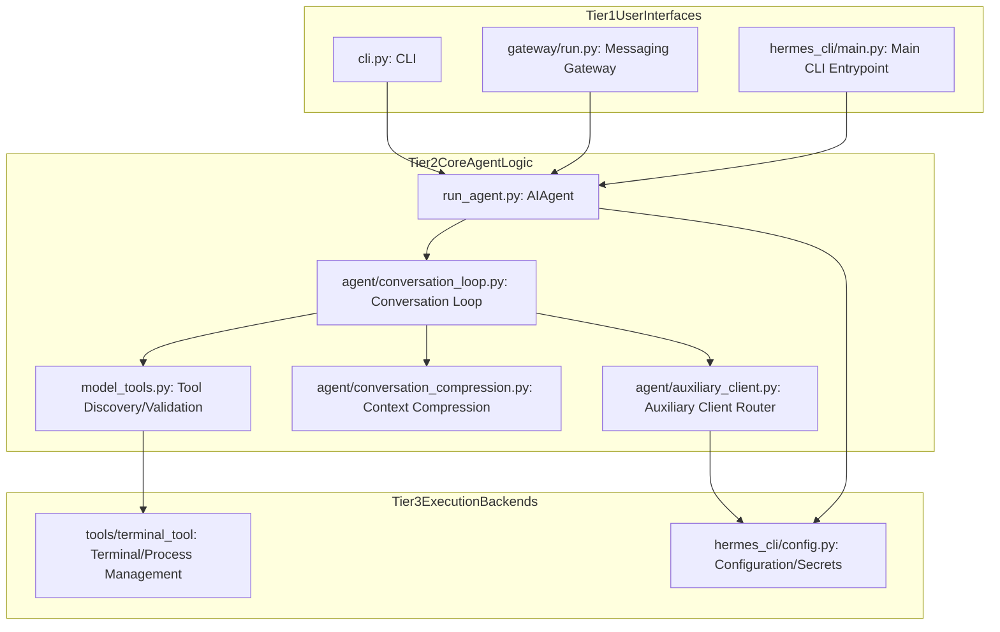
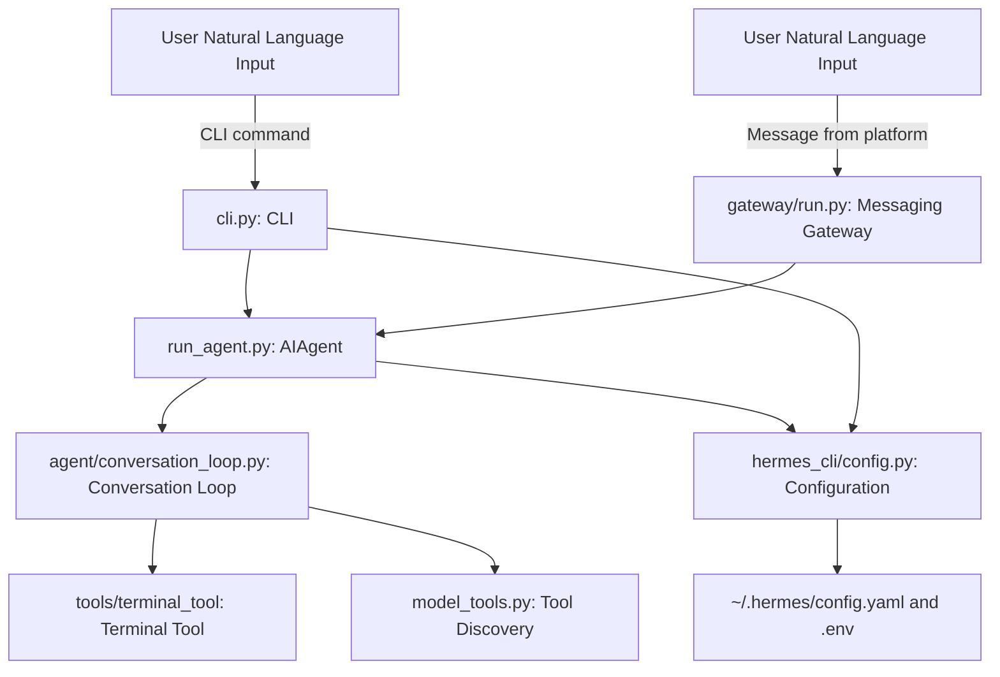
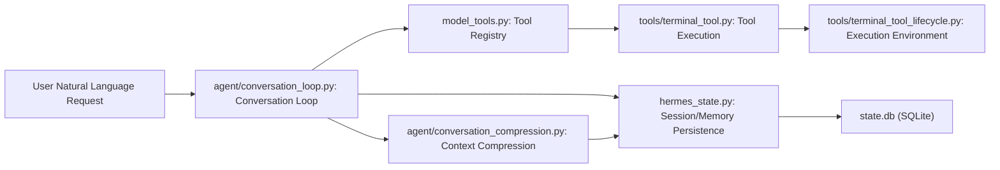

<!-- source: DeepWiki mcp.deepwiki.com · repo nousresearch/hermes-agent · page 1 Overview · fetched 2026-10-27 -->

# Overview

Relevant source files

The following files were used as context for generating this wiki page:

- [.env.example](.env.example)
- [AGENTS.md](AGENTS.md)
- [CONTRIBUTING.es.md](CONTRIBUTING.es.md)
- [CONTRIBUTING.md](CONTRIBUTING.md)
- [README.md](README.md)
- [agent/auxiliary_client.py](agent/auxiliary_client.py)
- [cli-config.yaml.example](cli-config.yaml.example)
- [cli.py](cli.py)
- [gateway/run.py](gateway/run.py)
- [gateway/session.py](gateway/session.py)
- [gateway/slash_commands.py](gateway/slash_commands.py)
- [hermes_cli/cli_commands_mixin.py](hermes_cli/cli_commands_mixin.py)
- [hermes_cli/commands.py](hermes_cli/commands.py)
- [hermes_cli/config.py](hermes_cli/config.py)
- [hermes_cli/config_defaults.py](hermes_cli/config_defaults.py)
- [hermes_cli/config_migrations.py](hermes_cli/config_migrations.py)
- [hermes_cli/config_version_stamp.py](hermes_cli/config_version_stamp.py)
- [hermes_cli/main.py](hermes_cli/main.py)
- [hermes_cli/setup.py](hermes_cli/setup.py)
- [hermes_state.py](hermes_state.py)
- [run_agent.py](run_agent.py)
- [scripts/check](scripts/check)
- [scripts/ci/check_agents_md_size.py](scripts/ci/check_agents_md_size.py)
- [scripts/code_health/cli.py](scripts/code_health/cli.py)
- [scripts/code_health/compare.py](scripts/code_health/compare.py)
- [scripts/code_health/config.py](scripts/code_health/config.py)
- [scripts/code_health/gitio.py](scripts/code_health/gitio.py)
- [scripts/code_health/measure.py](scripts/code_health/measure.py)
- [scripts/code_health/model.py](scripts/code_health/model.py)
- [scripts/code_health/py_rules.py](scripts/code_health/py_rules.py)
- [scripts/code_health/py_structure.py](scripts/code_health/py_structure.py)
- [scripts/code_health/replay.py](scripts/code_health/replay.py)
- [scripts/code_health/report.py](scripts/code_health/report.py)
- [scripts/code_health/ruff_runner.py](scripts/code_health/ruff_runner.py)
- [scripts/code_health/ts_measure.py](scripts/code_health/ts_measure.py)
- [scripts/code_health/ts_units.mjs](scripts/code_health/ts_units.mjs)
- [scripts/docker_config_migrate.py](scripts/docker_config_migrate.py)
- [tests/agent/test_auxiliary_client.py](tests/agent/test_auxiliary_client.py)
- [tests/gateway/test_session.py](tests/gateway/test_session.py)
- [tests/hermes_cli/test_commands.py](tests/hermes_cli/test_commands.py)
- [tests/hermes_cli/test_config.py](tests/hermes_cli/test_config.py)
- [tests/hermes_cli/test_config_migration_nested_guards.py](tests/hermes_cli/test_config_migration_nested_guards.py)
- [tests/hermes_cli/test_config_unversioned_migration.py](tests/hermes_cli/test_config_unversioned_migration.py)
- [tests/scripts/test_check_agents_md_size.py](tests/scripts/test_check_agents_md_size.py)
- [tests/scripts/test_code_health.py](tests/scripts/test_code_health.py)
- [tests/scripts/test_code_health_cli.py](tests/scripts/test_code_health_cli.py)
- [tests/scripts/test_code_health_identity.py](tests/scripts/test_code_health_identity.py)
- [tests/scripts/test_code_health_rules.py](tests/scripts/test_code_health_rules.py)
- [tests/tools/test_docker_config_migrate.py](tests/tools/test_docker_config_migrate.py)
- [ui-tui/src/__tests__/details.test.ts](ui-tui/src/__tests__/details.test.ts)
- [ui-tui/src/domain/details.ts](ui-tui/src/domain/details.ts)
- [website/docs/developer-guide/contributing.md](website/docs/developer-guide/contributing.md)
- [website/docs/getting-started/quickstart.md](website/docs/getting-started/quickstart.md)
- [website/docs/integrations/providers.md](website/docs/integrations/providers.md)
- [website/docs/reference/cli-commands.md](website/docs/reference/cli-commands.md)
- [website/docs/reference/environment-variables.md](website/docs/reference/environment-variables.md)
- [website/docs/reference/slash-commands.md](website/docs/reference/slash-commands.md)
- [website/docs/user-guide/cli.md](website/docs/user-guide/cli.md)
- [website/docs/user-guide/configuration.md](website/docs/user-guide/configuration.md)
- [website/docs/user-guide/features/fallback-providers.md](website/docs/user-guide/features/fallback-providers.md)
- [website/docs/user-guide/messaging/index.md](website/docs/user-guide/messaging/index.md)
- [website/docs/user-guide/tui.md](website/docs/user-guide/tui.md)
- [website/i18n/zh-Hans/docusaurus-plugin-content-docs/current/developer-guide/contributing.md](website/i18n/zh-Hans/docusaurus-plugin-content-docs/current/developer-guide/contributing.md)

Hermes Agent is an advanced, self-improving AI agent framework developed by **Nous Research**. It provides a robust conversation loop with tool-calling capabilities, persistent memory, support for agent-created extensible skills, and multi-platform messaging integrations. Hermes Agent operates seamlessly across multiple user interfaces, including a command-line interface (CLI), messaging platforms via a messaging gateway, editor integrations through the Agent Client Protocol (ACP), and a web dashboard UI.

The framework integrates with any OpenAI-compatible LLM provider and can execute commands in terminal environments, browsers, and other tool plugins across diverse execution backends ranging from local shells to Docker containers, SSH servers, and cloud sandboxes.

This page offers a high-level overview of Hermes Agent’s purpose, core architecture, and key runtime modes. For detailed technical descriptions, see the child pages:  
- **[Architecture Overview](#1.1)** — Detailed breakdown of the three-tier architecture, major subsystems, and their interactions.  
- **[Project Structure and Dependencies](#1.2)** — Directory layout, `uv` dependency management, lazy installation, and Nix support.

Sources: [cli.py:1-14](), [run_agent.py:1-7](), [gateway/run.py:1-4]()

---

## System Architecture

### Three-Tier Architecture

Hermes Agent is designed as a modular three-tier architecture separating user-facing interaction layers, core agent orchestration, and backend tool execution environments.

- **Tier 1: User Interfaces**  
  These entry points facilitate interaction with the agent by end-users or integrated systems:  
  - `cli.py` — Command-line interface offering an interactive REPL chat, slash commands, and session management, using `prompt_toolkit` for enhanced terminal UX [cli.py:1-14]().  
  - `gateway/run.py` — Messaging gateway service managing multi-platform bot connections, including Telegram, Discord, Slack, and others [gateway/run.py:1-4]().  
  - `hermes_cli/main.py` — The main CLI entrypoint, dispatching subcommands like chat, gateway, setup, and ACP server modes [hermes_cli/main.py:1-9]().  
  - FastAPI backend (in `hermes_cli/web_server.py`) — Hosts the web dashboard UI for session management, configuration, cron jobs, and analytics.

- **Tier 2: Core Agent Logic**  
  This layer orchestrates conversation flow, prompt assembly, tool dispatching, error handling, and session state management:  
  - `run_agent.py` — Defines the main `AIAgent` class running the tool-calling conversation loop and overseeing session lifecycles [run_agent.py:1-7]().  
  - `agent/conversation_loop.py` — Implements the iterative conversation and tool-call rounds.  
  - `model_tools.py` — Responsible for discovery, registration, and validation of tools callable by the agent.  
  - `agent/conversation_compression.py` — Manages context pruning and compression to fit conversations within LLM token limits.

- **Tier 3: Execution & Inference Backends**  
  This tier provides the environments and systems for command execution, process management, and provider authentication:  
  - Terminal and process management tools under `tools/`, with lifecycle and sandboxing support [run_agent.py:103-107]().  
  - Configuration and secret loading managed by `hermes_cli/config.py` for user settings, API keys, and environment variables [hermes_cli/config.py:1-6]().
  - Auxiliary client routing in `agent/auxiliary_client.py` handles side tasks like compression, search, and vision, with a fallback chain for provider resolution [agent/auxiliary_client.py:1-9]().

Sources: [cli.py:1-14](), [gateway/run.py:1-4](), [hermes_cli/main.py:1-9](), [run_agent.py:1-7](), [run_agent.py:103-107](), [hermes_cli/config.py:1-6](), [agent/auxiliary_client.py:1-9]()

---

### Diagram: Hermes Agent Three-Tier Architecture

Sources: [cli.py:1-14](), [gateway/run.py:1-4](), [hermes_cli/main.py:1-9](), [run_agent.py:1-7](), [hermes_cli/config.py:1-6](), [agent/auxiliary_client.py:1-9]()

---

### Bridging Natural Language Space to Code Entity Space #1

This diagram shows how user natural language inputs, from CLI or messaging platforms, flow into the core code entities responsible for conversation management and tool execution, linking system components to their code implementations.

Sources: [cli.py:1-14](), [gateway/run.py:1-4](), [run_agent.py:1-7](), [hermes_cli/config.py:1-6]()

---

### Bridging Natural Language Space to Code Entity Space #2

This diagram traces a typical user request path through Hermes Agent: reception, conversation management, tool discovery and dispatch, actual execution in environment backends, and session & memory persistence.

Sources: [run_agent.py:1-7](), [hermes_state.py:1-10](), [agent/conversation_compression.py:35-39]()

---

## Runtime Modes

Hermes Agent supports multiple operational modes adaptable to diverse user needs and environments:

| Runtime Mode  | Primary Entry Point               | Description                                                                                           |
|---------------|---------------------------------|----------------------------------------------------------------------------------------------------|
| **CLI**       | `cli.py`                        | Interactive terminal interface providing REPL prompt, slash commands, session management, and prompt-toolkit UX [cli.py:1-14](). |
| **Gateway**   | `gateway/run.py`                | Messaging gateway service supporting multi-platform bot interactions with Telegram, Discord, Slack, and others [gateway/run.py:1-4](). |
| **Web UI**    | `hermes web` (FastAPI backend) | Browser-based dashboard UI for session/config management and cron job administration.              |
| **ACP Server**| `hermes acp` (via `hermes_cli/main.py`) | Agent Client Protocol server enabling deep editor integrations (e.g., VS Code, Zed).               |

Sources: [cli.py:1-14](), [gateway/run.py:1-4](), [hermes_cli/main.py:1-9]()

---

## Core Components and Self-Improvement

- **`AIAgent` and the Conversation Loop**  
  The `AIAgent` class (defined in `run_agent.py`) is the runtime heart managing the tool-calling conversation loop, session lifecycle, streaming LLM calls, prompt composition, retries, fallback provider detection, and turn finalization [run_agent.py:1-7]().

- **Extensible Skills and Agent Self-Improvement**  
  Hermes supports user-created and dynamically managed skills stored in directories like `~/.hermes/skills/`. These agent-created skills expand capabilities, are managed centrally through tools and UI, and undergo background security and quality reviews. This modular skill system encourages continual self-improvement and extensibility of agents [website/docs/user-guide/configuration.md:28-29]().

- **Configuration Hierarchy and Management**  
  Configuration primarily resides in the user's `~/.hermes/config.yaml` file for general settings and `.env` files for secrets such as API keys or tokens. Settings resolve in this order of precedence: CLI arguments override `config.yaml`, which overrides `.env`, with built-in defaults as fallback. The system supports live editing, validation, safe migration workflows, and dedicated secret handling to securely support provider authentication and environment-specific overrides [website/docs/user-guide/configuration.md:58-68](). The `hermes_cli/setup.py` module provides an interactive wizard for initial configuration [hermes_cli/setup.py:1-7]().

Sources: [run_agent.py:1-7](), [website/docs/user-guide/configuration.md:28-29](), [website/docs/user-guide/configuration.md:58-68](), [hermes_cli/setup.py:1-7]()

---

## Child Pages

For more detailed and technical documentation, please see:  

- **[Architecture Overview](#1.1)** — Explains the three-tier architecture, major subsystems, and how they interact.  
- **[Project Structure and Dependencies](#1.2)** — Documents the directory structure, dependency management with `uv` and the `pm/` package manager, lazy dependency installation, and the installation ecosystem including Nix flake support.

Sources: [website/docs/user-guide/configuration.md:1-20]()

---

