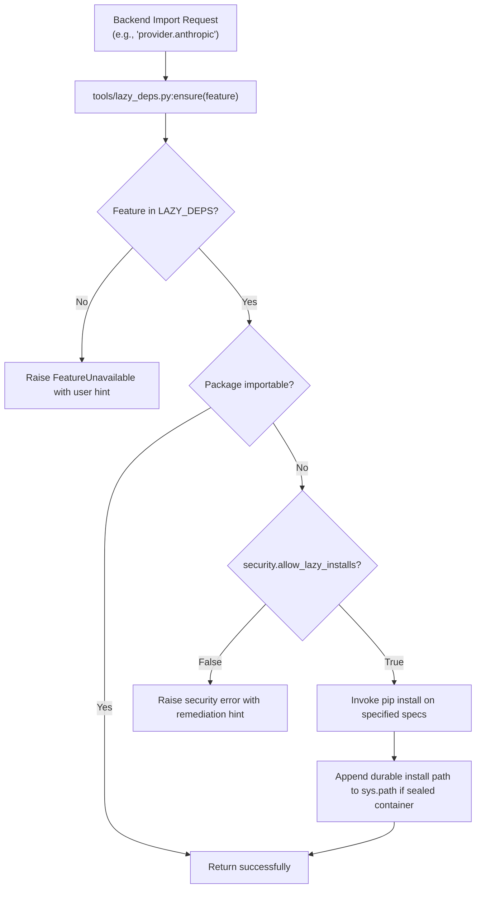
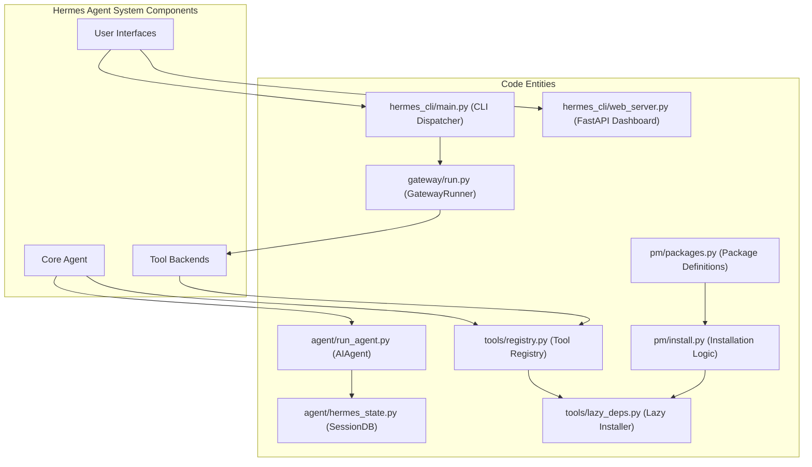
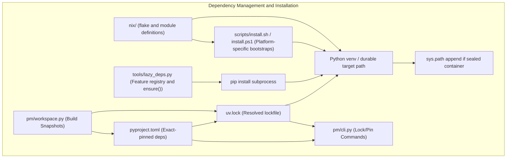

<!-- source: DeepWiki mcp.deepwiki.com · repo nousresearch/hermes-agent · page 1.2 Project Structure and Dependencies · fetched 2026-10-27 -->

# Project Structure and Dependencies

<details>
<summary>Relevant source files</summary>

The following files were used as context for generating this wiki page:

- [agent/model_metadata_http.py](agent/model_metadata_http.py)
- [apps/desktop/electron/feature-flags.test.ts](apps/desktop/electron/feature-flags.test.ts)
- [apps/desktop/electron/feature-flags.ts](apps/desktop/electron/feature-flags.ts)
- [contributors/README.md](contributors/README.md)
- [hermes_cli/__init__.py](hermes_cli/__init__.py)
- [hermes_cli/data_cleanup.py](hermes_cli/data_cleanup.py)
- [hermes_cli/data_cleanup_holders.py](hermes_cli/data_cleanup_holders.py)
- [hermes_cli/home_data_layout.py](hermes_cli/home_data_layout.py)
- [pm/AGENTS.md](pm/AGENTS.md)
- [pm/_marker_eval.py](pm/_marker_eval.py)
- [pm/build_env.py](pm/build_env.py)
- [pm/build_operations.py](pm/build_operations.py)
- [pm/cli.py](pm/cli.py)
- [pm/environment.py](pm/environment.py)
- [pm/extras.py](pm/extras.py)
- [pm/filesystem.py](pm/filesystem.py)
- [pm/install.py](pm/install.py)
- [pm/lock.json](pm/lock.json)
- [pm/lock.py](pm/lock.py)
- [pm/native_build.py](pm/native_build.py)
- [pm/operations.py](pm/operations.py)
- [pm/package.py](pm/package.py)
- [pm/packages.py](pm/packages.py)
- [pm/plugin_eviction.py](pm/plugin_eviction.py)
- [pm/plugins_state.py](pm/plugins_state.py)
- [pm/progress.py](pm/progress.py)
- [pm/recovery.py](pm/recovery.py)
- [pm/security_packages.py](pm/security_packages.py)
- [pm/store.py](pm/store.py)
- [pm/update.py](pm/update.py)
- [pm/uv_cache_prune.py](pm/uv_cache_prune.py)
- [pm/workspace.py](pm/workspace.py)
- [pyproject.toml](pyproject.toml)
- [scripts/add_contributor.py](scripts/add_contributor.py)
- [scripts/audit_pr_attribution.py](scripts/audit_pr_attribution.py)
- [scripts/contributor_audit.py](scripts/contributor_audit.py)
- [scripts/releases/authors.py](scripts/releases/authors.py)
- [scripts/releases/authors_legacy.py](scripts/releases/authors_legacy.py)
- [tests-js/bundle-inputs.test.mjs](tests-js/bundle-inputs.test.mjs)
- [tests/hermes_cli/test_data_uninstall.py](tests/hermes_cli/test_data_uninstall.py)
- [tests/hermes_cli/test_local_legacy_engine.py](tests/hermes_cli/test_local_legacy_engine.py)
- [tests/hermes_cli/test_local_runtime_pm.py](tests/hermes_cli/test_local_runtime_pm.py)
- [tests/install/BUNDLED_UPDATES.md](tests/install/BUNDLED_UPDATES.md)
- [tests/install/e2e-assets/bundle-inputs.mjs](tests/install/e2e-assets/bundle-inputs.mjs)
- [tests/install/e2e-assets/bundle-manifest.cjs](tests/install/e2e-assets/bundle-manifest.cjs)
- [tests/install/e2e-assets/bundle-plan.mjs](tests/install/e2e-assets/bundle-plan.mjs)
- [tests/pm/test_archive_safety.py](tests/pm/test_archive_safety.py)
- [tests/pm/test_baked_selection.py](tests/pm/test_baked_selection.py)
- [tests/pm/test_build_operations.py](tests/pm/test_build_operations.py)
- [tests/pm/test_custom_root_union.py](tests/pm/test_custom_root_union.py)
- [tests/pm/test_deb_safety.py](tests/pm/test_deb_safety.py)
- [tests/pm/test_environment_build.py](tests/pm/test_environment_build.py)
- [tests/pm/test_extras.py](tests/pm/test_extras.py)
- [tests/pm/test_ffmpeg_resolution.py](tests/pm/test_ffmpeg_resolution.py)
- [tests/pm/test_filesystem_is_junction.py](tests/pm/test_filesystem_is_junction.py)
- [tests/pm/test_held_entry_windows_live.py](tests/pm/test_held_entry_windows_live.py)
- [tests/pm/test_index_bridging.py](tests/pm/test_index_bridging.py)
- [tests/pm/test_installed_package.py](tests/pm/test_installed_package.py)
- [tests/pm/test_llamacpp_pins.py](tests/pm/test_llamacpp_pins.py)
- [tests/pm/test_lockfile_publication.py](tests/pm/test_lockfile_publication.py)
- [tests/pm/test_member_selection.py](tests/pm/test_member_selection.py)
- [tests/pm/test_node_sidecar.py](tests/pm/test_node_sidecar.py)
- [tests/pm/test_npm_dist_tags.py](tests/pm/test_npm_dist_tags.py)
- [tests/pm/test_plugin_survival_contract.py](tests/pm/test_plugin_survival_contract.py)
- [tests/pm/test_plugins_state.py](tests/pm/test_plugins_state.py)
- [tests/pm/test_pm_core.py](tests/pm/test_pm_core.py)
- [tests/pm/test_progress.py](tests/pm/test_progress.py)
- [tests/pm/test_python_release_identity.py](tests/pm/test_python_release_identity.py)
- [tests/pm/test_recovery.py](tests/pm/test_recovery.py)
- [tests/pm/test_store_extract.py](tests/pm/test_store_extract.py)
- [tests/pm/test_sync_bytecode_compile_fallback.py](tests/pm/test_sync_bytecode_compile_fallback.py)
- [tests/pm/test_takeover_preparation.py](tests/pm/test_takeover_preparation.py)
- [tests/pm/test_tree_digest_links.py](tests/pm/test_tree_digest_links.py)
- [tests/pm/test_update.py](tests/pm/test_update.py)
- [tests/pm/test_update_request_reuse.py](tests/pm/test_update_request_reuse.py)
- [tests/pm/test_workspace.py](tests/pm/test_workspace.py)
- [tests/pm/test_workspace_build_inputs.py](tests/pm/test_workspace_build_inputs.py)
- [tests/pm/test_workspace_output_encoding.py](tests/pm/test_workspace_output_encoding.py)
- [tests/scripts/install/test_install_ps1_pinned_git_extract.py](tests/scripts/install/test_install_ps1_pinned_git_extract.py)
- [tests/scripts/test_contributor_map.py](tests/scripts/test_contributor_map.py)
- [tests/scripts/test_release_revision_anchor.py](tests/scripts/test_release_revision_anchor.py)
- [tests/test_packaging_metadata.py](tests/test_packaging_metadata.py)
- [tests/test_project_metadata.py](tests/test_project_metadata.py)
- [tools/lazy_deps.py](tools/lazy_deps.py)
- [uv.lock](uv.lock)

</details>


This page documents the repository organization, dependency management, and installation ecosystem of Hermes Agent. It covers the directory layout, key source files, the `uv`-based Python environment and dependency management system, the runtime lazy dependency installation engine, and the multi-platform installation ecosystem including Nix flake support.

---

## Repository Layout and Code Entities

Hermes Agent adopts a modular directory structure with well-defined boundaries separating subsystems such as the CLI, core agent logic, tool infrastructure, messaging gateways, frontends, and deployment packaging.

### Top-Level Directory Structure and System Components

The following diagram maps natural language subsystem names to their concrete code entities, classes, and entry points within the repo:

```mermaid
graph TB
    Root["Repository Root"]

    Root --> CLI["hermes_cli/ [hermes_cli/]"]
    Root --> Agent["agent/ [agent/]"]
    Root --> Tools["tools/ [tools/]"]
    Root --> Gateway["gateway/ [gateway/]"]
    Root --> Nix["nix/ [nix/]"]
    Root --> TUI["ui-tui/ [ui-tui/]"]
    Root --> Web["web/ [web/]"]
    Root --> AppsDesktop["apps/desktop/ [apps/desktop/]"]
    Root --> PM["pm/ [pm/]"]

    CLI --> MainPy["main.py [hermes_cli/main.py]<br/>CLI Dispatcher"]
    CLI --> WebServer["web_server.py [hermes_cli/web_server.py]<br/>FastAPI Web Dashboard"]
    CLI --> UpdateCmd["update_cmd.py [hermes_cli/update_cmd.py]<br/>Self-Healing Pipeline"]
    CLI --> InitPy["__init__.py [hermes_cli/__init__.py:1-45]<br/>Version & _ensure_utf8()"]

    Agent --> AIAgent["run_agent.py [agent/run_agent.py]<br/>AIAgent Orchestration"]
    Agent --> StatePy["hermes_state.py [agent/hermes_state.py]<br/>Session & Memory Persistence"]

    Tools --> RegistryPy["registry.py [tools/registry.py]<br/>Tool Registry"]
    Tools --> ToolsetsPy["toolsets.py [tools/toolsets.py]<br/>Toolset Composer"]
    Tools --> LazyDeps["lazy_deps.py [tools/lazy_deps.py:1-16]<br/>ensure() & LAZY_DEPS"]

    Gateway --> GatewayRunner["run.py [gateway/run.py]<br/>GatewayRunner Service"]
    Gateway --> Platforms["platforms/ [gateway/platforms/]<br/>Platform Adapters"]

    Nix --> LibNix["lib.nix [nix/lib.nix]<br/>pythonSrc & npmWorkspaces"]
    Nix --> TuiNix["tui.nix [nix/tui.nix]<br/>buildNpmPackage TUI"]

    TUI --> TuiPkg["package.json [ui-tui/package.json]<br/>Ink / React Manifest"]
    Web --> WebPkg["package.json [web/package.json]<br/>Web Dashboard Manifest"]
    AppsDesktop --> DesktopPkg["package.json [apps/desktop/package.json]<br/>Electron Shell Manifest"]

    PM --> PackagesPy["packages.py [pm/packages.py:1-185]<br/>Package Definitions"]
    PM --> InstallPy["install.py [pm/install.py:1-166]<br/>Installation Logic"]
    PM --> CliPy["cli.py [pm/cli.py:1-177]<br/>PM CLI Commands"]
    PM --> WorkspacePy["workspace.py [pm/workspace.py:1-151]<br/>Build Snapshots"]
```



- **`hermes_cli/`** — Contains the unified command-line interface, including the main CLI dispatcher (`main.py`), the FastAPI-based web dashboard backend (`web_server.py`), and the update command pipeline (`update_cmd.py`). It also defines version info and startup UTF-8 enforcement routines in `__init__.py` [hermes_cli/__init__.py:1-45]().

- **`agent/`** — Implements the core AI agent runtime, including the AIAgent orchestration (`run_agent.py`) and session persistence logic (`hermes_state.py`).

- **`tools/`** — Hosts built-in tools, the tool registry, toolsets, and the lazy dependency provisioning system (`lazy_deps.py`) [tools/lazy_deps.py:1-16]().

- **`gateway/`** — The messaging gateway service, including the main service runner and platform adapters.

- **`nix/`** — Nix flakes and module definitions supporting the build and packaging of the Python runtime and frontends.

- **`ui-tui/`** — Terminal user interface implemented in React Ink with its own Node.js dependency.

- **`web/`** — React web dashboard frontend with a separate package configuration.

- **`apps/desktop/`** — Electron native desktop shell and associated Node.js tooling.

- **`pm/`** — The internal package manager for Hermes, handling tool definitions, installation, and environment management [pm/packages.py:1-185](), [pm/install.py:1-166](), [pm/cli.py:1-177](), [pm/workspace.py:1-151]().

Sources: [hermes_cli/__init__.py:1-45](), [pyproject.toml:3-16](), [tools/lazy_deps.py:1-16](), [nix/lib.nix](), [ui-tui/package.json](), [web/package.json](), [apps/desktop/package.json](), [pm/packages.py:1-185](), [pm/install.py:1-166](), [pm/cli.py:1-177](), [pm/workspace.py:1-151]()

---

## Versioning and System Constants

- The package metadata in `hermes_cli/__init__.py` provides versioning symbols:

  ```python
  __release_date__ = "2026.9.24"
  __version__: str
  ```

  The `__version__` attribute is resolved lazily to maintain compatibility with legacy updater behavior and editable installs. It reads an installation stamp JSON file if package metadata is inaccessible [hermes_cli/__init__.py:6-39]().

- UTF-8 encoding is enforced on stdout/stderr during CLI startup via the `_ensure_utf8()` function. This guarantees proper rendering of special glyphs and box-drawing characters, especially important for the setup wizard, status messages, and cross-platform terminal support [hermes_cli/__init__.py:42-70]().

- The release automation is handled by a separate script `scripts/release.py` (not detailed here) which implements tagging, changelog publishing, and GitHub release integration with contributor attribution.

- The `hermes_constants.py` file defines shared constants, including platform-aware logic for determining the Hermes home directory (`get_hermes_home`, `get_process_hermes_home`) and handling context-local overrides [hermes_constants.py:1-167](). It also includes utility functions like `sudo_invoker_default_home` for handling root execution scenarios [hermes_constants.py:61-77]().

Sources: [hermes_cli/__init__.py:6-70](), [hermes_constants.py:1-167]()

---

## Dependency Management via `uv`

Hermes Agent employs the `uv` package manager and environment toolset to manage Python dependency resolution, locking, and virtual environments with a philosophy focused on safety and exact pins.

### Python Version Constraints and Dependency Pinning

- The `pyproject.toml` file constrains the Python interpreter version range strictly:

  ```toml
  requires-python = ">=3.11,<3.15"
  ```

  The upper bound is intentional to avoid source builds of Rust dependencies such as `pydantic-core` that currently do not have wheels beyond Python 3.14 [pyproject.toml:15-16]().

- All core dependencies in `[project.dependencies]` are exact version pinned (e.g., `"openai==2.24.0"`), avoiding version ranges entirely. This policy ensures that automatic upgrades or supply-chain compromise through transitive dep updates cannot happen without explicit developer action, code review, and lock regeneration [pyproject.toml:19-125]().

- The resolution is frozen as `uv.lock` which records full hashes and versions of every resolved package for all supported targets, with special package overrides applied for security patches (e.g., `cryptography==50.0.1`) [uv.lock:1-118](). Overrides are also used to manage specific package versions, such as `pynacl` [uv.lock:18]().

- The `pm/cli.py` module provides commands for managing the `uv.lock` file, including `cmd_lock` to relock `uv.lock` from `pyproject.toml` and `_pin_tool` to bump specific tool versions [pm/cli.py:23-145]().

- The `uv.lock` file also specifies `exclude-newer-span = "P3D"` [uv.lock:14](), which corresponds to the `exclude-newer = "3 days"` policy in `pyproject.toml` [tests/test_packaging_metadata.py:65](). This ensures that all dependencies must be at least 3 days old when locked, preventing fresh, potentially unstable releases from entering the dependency graph [tests/test_packaging_metadata.py:56-69]().

### JavaScript Workspaces and Frontend Package Management

- Hermes adopts a JavaScript monorepo workspace structure for frontends and desktop apps, allowing efficient sharing and dependency management among React Ink TUI, React web DASH, and Electron desktop shell.

- The root-level `package.json` declares workspaces including `apps/*`, `ui-tui`, `ui-tui/packages/*`, `web`, and `tests-js`. Each workspace has its own locked dependencies manifested in independent `package.json` files [ui-tui/package.json](), [web/package.json](), [apps/desktop/package.json]().

Sources: [pyproject.toml:15-125](), [uv.lock:1-118](), [pm/cli.py:23-145](), [tests/test_packaging_metadata.py:56-69]()

---

## Lazy Dependency Installation System

To reduce initial install size and to safely handle optional backends, Hermes employs a runtime lazy dependency installation framework.

### Design and Behavioral Details in `tools/lazy_deps.py`

- The `tools/lazy_deps.py` module provides a key function:

  ```python
  def ensure(feature: str, *, prompt: bool = True) -> NoReturn:
  ```

  This function attempts to ensure that the runtime dependencies for a given feature are installed and importable. It raises an ImportError with a re-launch hint if the environment is not ready [tools/lazy_deps.py:1-16](). The `install_specs` function, also in this module, is retired and will raise an `ImportError` if called outside of a historical update context [tools/lazy_deps.py:14-26]().

- The system uses a curated dictionary of feature keys to frozen tuples of PyPI dependency specs (not shown here for brevity). Examples of such features include:

  - `"provider.anthropic"` → `("anthropic==0.87.0",)`
  - `"search.exa"` → `("exa-py==2.10.2",)`
  - `"tts.mistral"` → `("mistralai==2.4.8",)`
  - `"platform.discord"` → `("discord.py[voice]==2.7.1", "brotlicffi==1.2.0", "aiohttp==3.14.3")`

- If the feature dependencies are not importable, the system checks a security gate `security.allow_lazy_installs` config; if disallowed, it raises a user-friendly error with remediation hint.

- When allowed, the system invokes `pip` programmatically to install exact versions of packages into a separate durable directory appended to `sys.path` after core packages, preventing shadowing or supply-chain risks.

- After installing, it instructs a relaunch to pick up new packages, ensuring atomic upgrades.

### Lazy Dependency Installation Flow Diagram



This mechanism enables a lean initial environment with controlled on-demand extension of optional backends and reduces the attack surface of dependency bloat.

Sources: [tools/lazy_deps.py:1-26]()

---

## Installation Ecosystem and Nix Flake Support

Hermes supports a multi-platform installation ecosystem including Unix shell installers, Windows PowerShell installers, and Nix flakes for declarative system provisioning.

### Installers and Bootstrap Scripts

- **Unix Shell Installer (`scripts/install.sh`)**

  - Extracts a pinned `uv` binary from internal package locking (`pm/lock.json`), ensuring checksum validated staging.

  - Builds a hermetic Python virtual environment, resetting environment variables like `UV_NO_CONFIG` to avoid leaking host configs.

  - Supports options like `--skip-browser` to omit optional browser-related tooling.

  - Implements a multi-stage protocol for concurrency safety and robustness across platforms.

- **PowerShell Installer (`scripts/install.ps1`)**

  - Windows-specific installer with care to resolve user profile paths to 8.3 short paths as required by some PowerShell cmdlets.

  - Similar staging and checksum verification flow, catering to Windows nuances.

  - Supports verbose logging, skipping browser tools, and integration with Hermes Setup UI and CI.

### Nix Flake Packaging and Build Definitions

- The `nix/lib.nix` file defines the `pythonSrc` derivation that filters the source tree to exclude JavaScript codebases (`ui-tui`, `web`, `apps/desktop`), documentation, tests, locales, and non-Python tooling. This yields a minimal, pure Python derivation to reduce rebuilds and improve reproducibility.

- Defines `npmWorkspaces` for JavaScript parts, read from the root `package.json`.

- The `nix/tui.nix` defines a build for the terminal React Ink UI frontend, packaging it as a standalone NPM package named `hermes-agent-ui-tui` with outputs isolated for efficient downstream use.

This infrastructure empowers NixOS and Home Manager users to declaratively manage their Hermes agent environments with precise control over Python and frontend runtime deps.

Sources: [nix/lib.nix](), [nix/tui.nix]()

---

## Summary Diagrams Bridging Natural Language and Code Entity Space





---

# Additional Notes

- The strict exact dependency pinning policy in `pyproject.toml` is enforced to prevent inadvertent dependency upgrades without audit, protecting against supply-chain attacks and ensuring stable reproducible environments [pyproject.toml:19-125]().

- The Python interpreter version limit (below 3.15) avoids unstable or unavailable prebuilt wheels in Rust-driven dependencies like `pydantic-core` [pyproject.toml:8-15]().

- Lazy installation requires explicit opt-in (`security.allow_lazy_installs`), presenting remediation hints when disabled, ensuring runtime installs don't happen without user awareness [tools/lazy_deps.py:1-16]().

- The Nix infrastructure enables users to fully reproduce Hermes builds and runtime environments declaratively, including frontend assets and the Python runtime, aiding NixOS and Home Manager distributions [nix/lib.nix](), [nix/tui.nix]().

- The multi-platform install scripts are carefully engineered for cross-OS robustness, including checksum verification, concurrency-safe staging, and environment hygiene, easing installation for end users across Windows, Unix, and containerized setups.

- The `pm/` directory contains the core logic for Hermes's internal package management, including defining packages (`pm/packages.py`), handling installation (`pm/install.py`), providing CLI commands (`pm/cli.py`), and managing build workspaces (`pm/workspace.py`) [pm/packages.py:1-185](), [pm/install.py:1-166](), [pm/cli.py:1-177](), [pm/workspace.py:1-151]().

---

