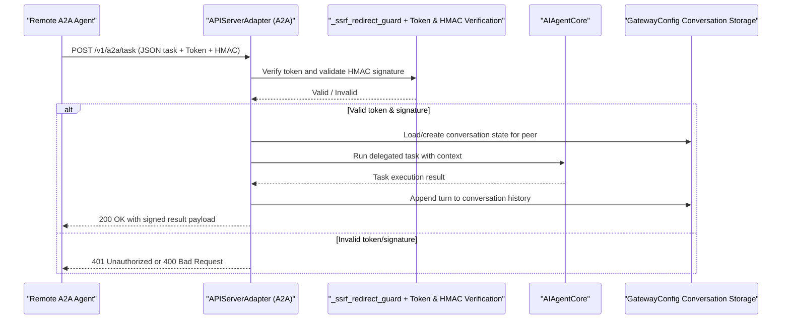
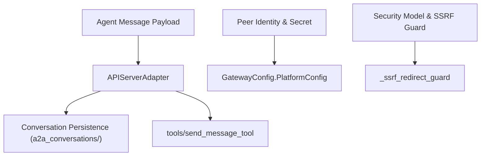
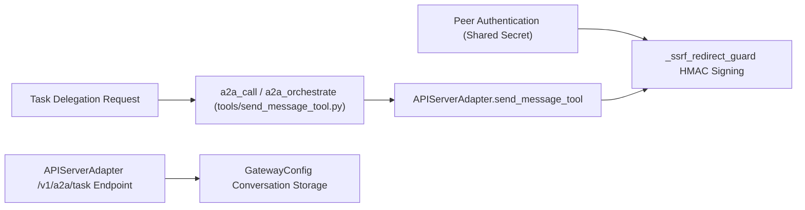

<!-- source: DeepWiki mcp.deepwiki.com · repo nousresearch/hermes-agent · page 10.10 A2A Agent-to-Agent Protocol · fetched 2026-10-27 -->

# A2A Agent-to-Agent Protocol

Relevant source files

The following files were used as context for generating this wiki page:

- [gateway/platform_registry.py](gateway/platform_registry.py)
- [gateway/platforms/ADDING_A_PLATFORM.md](gateway/platforms/ADDING_A_PLATFORM.md)
- [gateway/platforms/api_server.py](gateway/platforms/api_server.py)
- [gateway/platforms/api_server_openai_routes.py](gateway/platforms/api_server_openai_routes.py)
- [gateway/platforms/api_server_room_dispatch.py](gateway/platforms/api_server_room_dispatch.py)
- [gateway/platforms/api_server_room_grants.py](gateway/platforms/api_server_room_grants.py)
- [gateway/platforms/api_server_run_idempotency.py](gateway/platforms/api_server_run_idempotency.py)
- [gateway/platforms/api_server_runs.py](gateway/platforms/api_server_runs.py)
- [gateway/run_plugin_injection.py](gateway/run_plugin_injection.py)
- [hermes_cli/plugins_injection.py](hermes_cli/plugins_injection.py)
- [hermes_cli/status.py](hermes_cli/status.py)
- [plugins/platforms/dingtalk/adapter.py](plugins/platforms/dingtalk/adapter.py)
- [plugins/platforms/google_chat/__init__.py](plugins/platforms/google_chat/__init__.py)
- [plugins/platforms/google_chat/adapter.py](plugins/platforms/google_chat/adapter.py)
- [plugins/platforms/google_chat/oauth.py](plugins/platforms/google_chat/oauth.py)
- [plugins/platforms/google_chat/plugin.yaml](plugins/platforms/google_chat/plugin.yaml)
- [plugins/platforms/irc/adapter.py](plugins/platforms/irc/adapter.py)
- [plugins/platforms/irc/plugin.yaml](plugins/platforms/irc/plugin.yaml)
- [plugins/platforms/line/adapter.py](plugins/platforms/line/adapter.py)
- [plugins/platforms/mattermost/adapter.py](plugins/platforms/mattermost/adapter.py)
- [plugins/platforms/ntfy/adapter.py](plugins/platforms/ntfy/adapter.py)
- [plugins/platforms/raft/__init__.py](plugins/platforms/raft/__init__.py)
- [plugins/platforms/raft/adapter.py](plugins/platforms/raft/adapter.py)
- [plugins/platforms/raft/plugin.yaml](plugins/platforms/raft/plugin.yaml)
- [plugins/platforms/simplex/__init__.py](plugins/platforms/simplex/__init__.py)
- [plugins/platforms/simplex/adapter.py](plugins/platforms/simplex/adapter.py)
- [plugins/platforms/simplex/plugin.yaml](plugins/platforms/simplex/plugin.yaml)
- [plugins/platforms/sms/adapter.py](plugins/platforms/sms/adapter.py)
- [plugins/platforms/teams/adapter.py](plugins/platforms/teams/adapter.py)
- [plugins/platforms/teams/plugin.yaml](plugins/platforms/teams/plugin.yaml)
- [plugins/platforms/telegram/plugin.yaml](plugins/platforms/telegram/plugin.yaml)
- [tests/gateway/_plugin_adapter_loader.py](tests/gateway/_plugin_adapter_loader.py)
- [tests/gateway/test_api_hosted_binding.py](tests/gateway/test_api_hosted_binding.py)
- [tests/gateway/test_api_runs_native_session_refusal.py](tests/gateway/test_api_runs_native_session_refusal.py)
- [tests/gateway/test_api_server.py](tests/gateway/test_api_server.py)
- [tests/gateway/test_api_server_active_work_drain.py](tests/gateway/test_api_server_active_work_drain.py)
- [tests/gateway/test_api_server_reasoning_nonstream.py](tests/gateway/test_api_server_reasoning_nonstream.py)
- [tests/gateway/test_api_server_reasoning_stream.py](tests/gateway/test_api_server_reasoning_stream.py)
- [tests/gateway/test_api_server_runs.py](tests/gateway/test_api_server_runs.py)
- [tests/gateway/test_chat_completions_tool_progress_optout.py](tests/gateway/test_chat_completions_tool_progress_optout.py)
- [tests/gateway/test_cron_active_work_drain.py](tests/gateway/test_cron_active_work_drain.py)
- [tests/gateway/test_cron_interrupt_notification.py](tests/gateway/test_cron_interrupt_notification.py)
- [tests/gateway/test_dingtalk.py](tests/gateway/test_dingtalk.py)
- [tests/gateway/test_finalize_session_off_loop.py](tests/gateway/test_finalize_session_off_loop.py)
- [tests/gateway/test_google_chat.py](tests/gateway/test_google_chat.py)
- [tests/gateway/test_google_chat_oauth_dependencies.py](tests/gateway/test_google_chat_oauth_dependencies.py)
- [tests/gateway/test_irc_adapter.py](tests/gateway/test_irc_adapter.py)
- [tests/gateway/test_line_plugin.py](tests/gateway/test_line_plugin.py)
- [tests/gateway/test_mattermost.py](tests/gateway/test_mattermost.py)
- [tests/gateway/test_ntfy_plugin.py](tests/gateway/test_ntfy_plugin.py)
- [tests/gateway/test_platform_registry.py](tests/gateway/test_platform_registry.py)
- [tests/gateway/test_plugin_message_injection.py](tests/gateway/test_plugin_message_injection.py)
- [tests/gateway/test_plugin_origin_injection.py](tests/gateway/test_plugin_origin_injection.py)
- [tests/gateway/test_raft_adapter.py](tests/gateway/test_raft_adapter.py)
- [tests/gateway/test_readiness.py](tests/gateway/test_readiness.py)
- [tests/gateway/test_session_api.py](tests/gateway/test_session_api.py)
- [tests/gateway/test_shutdown_cache_cleanup.py](tests/gateway/test_shutdown_cache_cleanup.py)
- [tests/gateway/test_shutdown_executor_quiesce.py](tests/gateway/test_shutdown_executor_quiesce.py)
- [tests/gateway/test_shutdown_teardown_profile_scope.py](tests/gateway/test_shutdown_teardown_profile_scope.py)
- [tests/gateway/test_simplex_plugin.py](tests/gateway/test_simplex_plugin.py)
- [tests/gateway/test_sms.py](tests/gateway/test_sms.py)
- [tests/gateway/test_sse_agent_cancel.py](tests/gateway/test_sse_agent_cancel.py)
- [tests/gateway/test_teams.py](tests/gateway/test_teams.py)
- [tests/gateway/test_teams_dotenv_isolation.py](tests/gateway/test_teams_dotenv_isolation.py)
- [tests/gateway/test_unauthorized_dm_behavior.py](tests/gateway/test_unauthorized_dm_behavior.py)
- [tests/hermes_cli/test_plugin_message_injection.py](tests/hermes_cli/test_plugin_message_injection.py)
- [tests/hermes_cli/test_status.py](tests/hermes_cli/test_status.py)
- [tests/hermes_cli/test_tools_disable_enable.py](tests/hermes_cli/test_tools_disable_enable.py)
- [tests/website/test_check_doc_links.py](tests/website/test_check_doc_links.py)
- [website/README.md](website/README.md)
- [website/docs/developer-guide/adding-platform-adapters.md](website/docs/developer-guide/adding-platform-adapters.md)
- [website/docs/developer-guide/extending-the-cli.md](website/docs/developer-guide/extending-the-cli.md)
- [website/docs/developer-guide/programmatic-integration.md](website/docs/developer-guide/programmatic-integration.md)
- [website/docs/user-guide/features/api-server.md](website/docs/user-guide/features/api-server.md)
- [website/docs/user-guide/messaging/google_chat.md](website/docs/user-guide/messaging/google_chat.md)
- [website/docs/user-guide/messaging/ntfy.md](website/docs/user-guide/messaging/ntfy.md)
- [website/docs/user-guide/messaging/open-webui.md](website/docs/user-guide/messaging/open-webui.md)
- [website/docs/user-guide/messaging/raft.md](website/docs/user-guide/messaging/raft.md)
- [website/docs/user-guide/messaging/simplex.md](website/docs/user-guide/messaging/simplex.md)
- [website/docs/user-guide/messaging/teams.md](website/docs/user-guide/messaging/teams.md)
- [website/docs/user-guide/messaging/whatsapp-cloud.md](website/docs/user-guide/messaging/whatsapp-cloud.md)
- [website/i18n/zh-Hans/docusaurus-plugin-content-docs/current/user-guide/features/api-server.md](website/i18n/zh-Hans/docusaurus-plugin-content-docs/current/user-guide/features/api-server.md)
- [website/i18n/zh-Hans/docusaurus-plugin-content-docs/current/user-guide/messaging/google_chat.md](website/i18n/zh-Hans/docusaurus-plugin-content-docs/current/user-guide/messaging/google_chat.md)
- [website/i18n/zh-Hans/docusaurus-plugin-content-docs/current/user-guide/messaging/open-webui.md](website/i18n/zh-Hans/docusaurus-plugin-content-docs/current/user-guide/messaging/open-webui.md)
- [website/i18n/zh-Hans/docusaurus-plugin-content-docs/current/user-guide/messaging/teams.md](website/i18n/zh-Hans/docusaurus-plugin-content-docs/current/user-guide/messaging/teams.md)
- [website/scripts/check_doc_links.py](website/scripts/check_doc_links.py)
- [website/src/remark/relativeDocLinks.js](website/src/remark/relativeDocLinks.js)

## Purpose and Scope

The A2A (Agent-to-Agent) protocol v1.0 adapter enables autonomous Hermes Agent instances to communicate, delegate tasks, and orchestrate complex workflows by exchanging structured messages over secure HTTP. It provides a backend-to-backend communication mechanism distinct from user-facing chat, supporting delegation, orchestration, and multi-turn conversation persistence.

This page covers:

- The A2A adapter implementation as a subclass of `BasePlatformAdapter`, handling inbound signed task requests and conversation state management.
- Outbound tools `a2a_call` and `a2a_orchestrate` to invoke peer agents asynchronously or synchronously.
- Serving Agent Cards for peer discovery and capability interrogation.
- The security model enforcing per-peer shared secrets, HMAC signing, and SSRF restrictions.
- Persistent conversation storage scoped to peer sessions in the `a2a_conversations/` directory.

Sources:
[gateway/platforms/api_server.py:1-4612](), [gateway/platforms/api_server_runs.py:1-1500](), [gateway/platforms/api_server_openai_routes.py:1-1535](), [gateway/platforms/base.py:1-62](), [tools/send_message_tool.py:1-40](), [gateway/config.py:1-25]()

---

## 1. Overview of the A2A Protocol Adapter

The A2A adapter extends the base gateway platform adapter to implement the Hermes Agent-to-Agent messaging protocol. It is designed for direct, authenticated agent-to-agent communication enabling delegation and orchestration of tasks.

| Component | Code Entity | Description |
|---|---|---|
| Adapter Core | `APIServerAdapter` subclass | Implements inbound HTTP POST handlers for A2A tasks with signature verification. |
| Outbound Call Tools | `a2a_call`, `a2a_orchestrate` tools | Agent tools built on `tools/send_message_tool.py` that send tasks to remote agents. |
| Conversation Persistence| PlatformConfig with `a2a_conversations/` | Stores multi-turn conversation state per peer for reliable orchestration workflows. |
| Agent Card Serving | `APIServerAdapter` endpoints | Provides machine-readable peer discovery manifests exposing agent identity and capabilities. |
| Security Enforcement | `_ssrf_redirect_guard`, HMAC checks | Validates inbound message integrity and outbound URL fetch safety against SSRF attacks. |

The adapter processes inbound POST task calls from peers verifying tokens and HMAC signatures, loads or creates peer conversation context, executes delegated tasks, persists results, and signs responses.

Sources:
[gateway/platforms/api_server.py:1-4612](), [gateway/platforms/api_server_runs.py:1-1500](), [gateway/platforms/api_server_openai_routes.py:1-1535](), [gateway/platforms/base.py:1-62](), [tools/send_message_tool.py:1-40](), [gateway/config.py:1-25]()

---

## 2. Platform Adapter Implementation

### Adapter Core and Inbound Handling

The A2A platform adapter is implemented by `APIServerAdapter` [gateway/platforms/api_server.py:30-31]() which handles various API endpoints, including those for A2A. The adapter listens on `/v1/a2a/task` (or equivalent) for inbound POST requests. Key inbound handling features include:

- **Authentication and Signature Verification:**
  The adapter expects a token and an HMAC signature in the request headers. These are verified using the shared secret configured per peer in `GatewayConfig`. This protects message integrity and authenticates peer requests.

- **SSRF Protection:**
  Outbound URLs requested by inbound tasks are filtered through the `_ssrf_redirect_guard` function to prevent server-side request forgery (SSRF) attacks. This restricts outbound fetches to authorized and safe destinations.

- **Content Parsing and Stateful Conversation Context:**
  The adapter loads or initializes conversation histories scoped to the peer identity. This conversation context is then passed to the internal `AIAgent` core for executing the delegated task. The context is maintained in persistent storage.

- **Persistent Result Appending:**
  After task execution, results and conversation turns are appended to the persistent conversation database under the `a2a_conversations/` directory for durability across sessions and restarts.

### Outbound Tools: `a2a_call` and `a2a_orchestrate`

Two asynchronous tools facilitate outbound calls to peer agents:

- **`a2a_call` tool:**
  Sends a single call (RPC task) to a remote agent and waits synchronously for the response. Internally, this tool constructs the task message, signs it with HMAC using a shared secret, and posts it to the peer agent’s HTTP endpoint.

- **`a2a_orchestrate` tool:**
  Builds on `a2a_call` to execute higher-level orchestrations, potentially involving multiple peers in parallel or sequences. It allows complex workflows across autonomous agents.

Both tools rely on the core `send_message_tool.py` logic that handles message signing, sending HTTP requests, verifying inbound signatures on responses, and error handling, encapsulating the A2A messaging protocol communication pattern.

Sources:
[gateway/platforms/api_server.py:1-4612](), [gateway/platforms/api_server_runs.py:1-1500](), [gateway/platforms/api_server_openai_routes.py:1-1535](), [gateway/platforms/base.py:1-62](), [tools/send_message_tool.py:1-40](), [gateway/config.py:1-25]()

---

## 3. Inbound Task Handling Flow

The processing of an inbound A2A task request follows these steps to ensure secure, contextual, and persistent handling:

- The adapter verifies the sender’s identity and payload integrity.
- It conditions agent execution on prior conversation state to maintain continuity.
- Results are persistently stored and returned with fresh signatures for verification.

Sources:
[gateway/platforms/api_server.py:1-4612](), [gateway/platforms/api_server_runs.py:1-1500](), [gateway/platforms/api_server_openai_routes.py:1-1535](), [gateway/platforms/base.py:1-62](), [tools/send_message_tool.py:1-40]()

---

## 4. Security Model

The A2A protocol defines a multi-faceted security architecture for safe inter-agent communication:

### Per-Peer Shared Secrets and HMAC Signing

- Each peer agent is assigned a shared secret configured in the platform `GatewayConfig`.
- Outbound messages are signed by computing an HMAC over the serialized message using this shared secret.
- Inbound messages validate signatures against the stored secret to verify authenticity.
- This cryptographic signing prevents tampering, replay, and impersonation attacks.

### SSRF (Server-Side Request Forgery) Protections

- Outbound URL fetches requested as part of delegated tasks are validated by `_ssrf_redirect_guard`.
- This guard disallows redirects or direct requests to local, private, or unauthorized network addresses.
- It ensures the agent cannot be used as a proxy to attack internal or external systems.

### Conversation Scoping and Isolation

- Persistent conversation state is strictly scoped per peer identity to isolate data.
- The A2A adapter enforces this separation in both memory and persistent stores.
- This mechanism prevents data leakage and enforces trust boundaries in multi-peer environments.

Sources:
[gateway/platforms/api_server.py:1-4612](), [gateway/platforms/api_server_runs.py:1-1500](), [gateway/platforms/api_server_openai_routes.py:1-1535](), [gateway/config.py:1-25]()

---

## 5. Agent Card Serving

Decentralized agents need methods for peer discovery and capability negotiation. The A2A adapter supports **Agent Cards** for this purpose:

- Agent Cards are JSON documents describing the agent’s identity, capabilities, supported toolsets, and protocol versions.
- These cards are served from the API server via routes implemented in `APIServerAdapter`.
- Clients and peer agents query these cards to validate compatibility and protocol support before delegating tasks.

### Agent Card Components Overview

| Field | Description |
|---|---|
| Agent Identity | Name, version, unique IDs |
| Toolsets | Registered tools exposed to peers |
| Model Limits | Token/context window sizes, usage caps |
| Security Metadata | Authentication schemes, secrets requirements |
| Supported Protocols | Protocol versions, feature flags |

The Agent Card enables flexible multi-agent networks that can dynamically discover and interoperate with peers.

Sources:
[gateway/platforms/api_server.py:66-76](), [gateway/config.py:1-25]()

---

## 6. Code Mapping and Data Flow

### Natural Language to Code Entity Map for A2A Messaging

This diagram maps the conceptual elements of agent-to-agent messaging to the primary code components implementing them, aiding developers in connecting requirements to code.

---

### Outbound A2A Call Architecture: Tools to API Server

This flow illustrates how outbound calls are constructed, signed, routed over HTTP, verified on the receiving side, and stored persistently, showing full task delegation lifecycle.

Sources:
[gateway/platforms/api_server.py:1-4612](), [gateway/platforms/api_server_runs.py:1-1500](), [gateway/platforms/api_server_openai_routes.py:1-1535](), [gateway/platforms/base.py:1-62](), [tools/send_message_tool.py:1-40](), [gateway/config.py:1-25]()

---

## 7. Persistence and State Management

The A2A adapter emphasizes durable conversation state and continuity:

- Conversations are persistently stored scoped per-peer in the directory `a2a_conversations/`, as configured by the `GatewayConfig`.
- Upon receiving a task, the conversation history for that peer is loaded, enabling the agent to recall and build upon prior context.
- After processing, new messages and task results append to the persistent store.
- The system supports session branching/forking, enabling alternative task flows and experimentation without losing prior data.
- This persistent mechanism ensures fault tolerance and stateful multi-turn interactions across decentralized agents.

Sources:
[gateway/config.py:1-25](), [gateway/platforms/api_server.py:93-94](), [gateway/platforms/api_server_openai_routes.py:1-1535]()

---

# Summary

The A2A Agent-to-Agent Protocol adapter in Hermes Agent is a foundational subsystem enabling authenticated, persistent, and secure multi-agent communication. Through strict token and HMAC authentication, SSRF protections, conversation-scoped storage, and agent capability discovery via Agent Cards, it provides a robust infrastructure for orchestrated workflows spanning autonomous agents.

The outbound `a2a_call` and `a2a_orchestrate` tools offer programmable interfaces for sending and orchestrating tasks across peers. This architecture supports complex, asynchronous multi-agent collaborations critical to Hermes' extensible agent framework.

This documentation bridges abstract agent messaging concepts to concrete code entities and flows, aiding maintainers, integrators, and developers in understanding, extending, and troubleshooting the A2A system.

Sources:
[gateway/platforms/api_server.py:1-4612](), [gateway/platforms/api_server_runs.py:1-1500](), [gateway/platforms/api_server_openai_routes.py:1-1535](), [gateway/platforms/base.py:1-62](), [tools/send_message_tool.py:1-40](), [gateway/config.py:1-25]()

---

