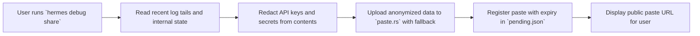
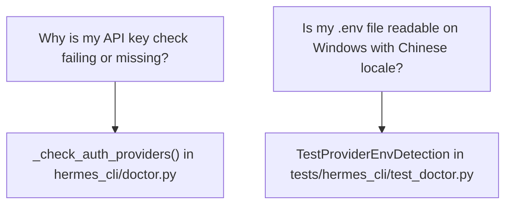
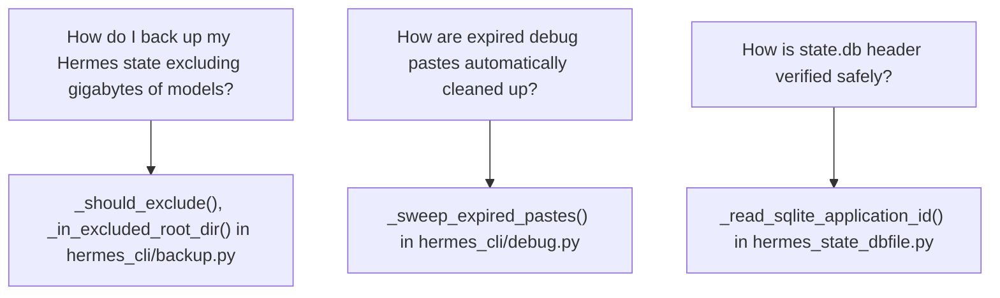

<!-- source: DeepWiki mcp.deepwiki.com · repo nousresearch/hermes-agent · page 10.4 Diagnostic Tools · fetched 2026-10-27 -->

# Diagnostic Tools

<details>
<summary>Relevant source files</summary>

The following files were used as context for generating this wiki page:

- [agent/redact.py](agent/redact.py)
- [gateway/platform_registry.py](gateway/platform_registry.py)
- [gateway/platforms/ADDING_A_PLATFORM.md](gateway/platforms/ADDING_A_PLATFORM.md)
- [hermes_cli/debug.py](hermes_cli/debug.py)
- [hermes_cli/doctor.py](hermes_cli/doctor.py)
- [hermes_cli/doctor_config.py](hermes_cli/doctor_config.py)
- [hermes_cli/doctor_connectivity.py](hermes_cli/doctor_connectivity.py)
- [hermes_cli/doctor_live.py](hermes_cli/doctor_live.py)
- [hermes_cli/doctor_platform.py](hermes_cli/doctor_platform.py)
- [hermes_cli/doctor_report.py](hermes_cli/doctor_report.py)
- [hermes_cli/doctor_state.py](hermes_cli/doctor_state.py)
- [hermes_cli/doctor_tools.py](hermes_cli/doctor_tools.py)
- [hermes_cli/dump.py](hermes_cli/dump.py)
- [hermes_cli/status.py](hermes_cli/status.py)
- [hermes_state_holders.py](hermes_state_holders.py)
- [plugins/platforms/dingtalk/adapter.py](plugins/platforms/dingtalk/adapter.py)
- [plugins/platforms/google_chat/__init__.py](plugins/platforms/google_chat/__init__.py)
- [plugins/platforms/google_chat/adapter.py](plugins/platforms/google_chat/adapter.py)
- [plugins/platforms/google_chat/oauth.py](plugins/platforms/google_chat/oauth.py)
- [plugins/platforms/google_chat/plugin.yaml](plugins/platforms/google_chat/plugin.yaml)
- [plugins/platforms/irc/adapter.py](plugins/platforms/irc/adapter.py)
- [plugins/platforms/irc/plugin.yaml](plugins/platforms/irc/plugin.yaml)
- [plugins/platforms/line/adapter.py](plugins/platforms/line/adapter.py)
- [plugins/platforms/mattermost/adapter.py](plugins/platforms/mattermost/adapter.py)
- [plugins/platforms/ntfy/adapter.py](plugins/platforms/ntfy/adapter.py)
- [plugins/platforms/raft/__init__.py](plugins/platforms/raft/__init__.py)
- [plugins/platforms/raft/adapter.py](plugins/platforms/raft/adapter.py)
- [plugins/platforms/raft/plugin.yaml](plugins/platforms/raft/plugin.yaml)
- [plugins/platforms/simplex/__init__.py](plugins/platforms/simplex/__init__.py)
- [plugins/platforms/simplex/adapter.py](plugins/platforms/simplex/adapter.py)
- [plugins/platforms/simplex/plugin.yaml](plugins/platforms/simplex/plugin.yaml)
- [plugins/platforms/sms/adapter.py](plugins/platforms/sms/adapter.py)
- [plugins/platforms/teams/adapter.py](plugins/platforms/teams/adapter.py)
- [plugins/platforms/teams/plugin.yaml](plugins/platforms/teams/plugin.yaml)
- [plugins/platforms/telegram/plugin.yaml](plugins/platforms/telegram/plugin.yaml)
- [tests/agent/test_gemini_key_surface_guidance.py](tests/agent/test_gemini_key_surface_guidance.py)
- [tests/agent/test_redact.py](tests/agent/test_redact.py)
- [tests/gateway/_plugin_adapter_loader.py](tests/gateway/_plugin_adapter_loader.py)
- [tests/gateway/test_dingtalk.py](tests/gateway/test_dingtalk.py)
- [tests/gateway/test_google_chat.py](tests/gateway/test_google_chat.py)
- [tests/gateway/test_google_chat_oauth_dependencies.py](tests/gateway/test_google_chat_oauth_dependencies.py)
- [tests/gateway/test_irc_adapter.py](tests/gateway/test_irc_adapter.py)
- [tests/gateway/test_line_plugin.py](tests/gateway/test_line_plugin.py)
- [tests/gateway/test_mattermost.py](tests/gateway/test_mattermost.py)
- [tests/gateway/test_ntfy_plugin.py](tests/gateway/test_ntfy_plugin.py)
- [tests/gateway/test_platform_registry.py](tests/gateway/test_platform_registry.py)
- [tests/gateway/test_raft_adapter.py](tests/gateway/test_raft_adapter.py)
- [tests/gateway/test_simplex_plugin.py](tests/gateway/test_simplex_plugin.py)
- [tests/gateway/test_sms.py](tests/gateway/test_sms.py)
- [tests/gateway/test_teams.py](tests/gateway/test_teams.py)
- [tests/gateway/test_teams_dotenv_isolation.py](tests/gateway/test_teams_dotenv_isolation.py)
- [tests/gateway/test_unauthorized_dm_behavior.py](tests/gateway/test_unauthorized_dm_behavior.py)
- [tests/hermes_cli/test_debug.py](tests/hermes_cli/test_debug.py)
- [tests/hermes_cli/test_doctor.py](tests/hermes_cli/test_doctor.py)
- [tests/hermes_cli/test_doctor_audit_remedy.py](tests/hermes_cli/test_doctor_audit_remedy.py)
- [tests/hermes_cli/test_doctor_github_token_probe.py](tests/hermes_cli/test_doctor_github_token_probe.py)
- [tests/hermes_cli/test_doctor_live.py](tests/hermes_cli/test_doctor_live.py)
- [tests/hermes_cli/test_doctor_wal_checkpoint_guard.py](tests/hermes_cli/test_doctor_wal_checkpoint_guard.py)
- [tests/hermes_cli/test_doctor_wal_holder_guard.py](tests/hermes_cli/test_doctor_wal_holder_guard.py)
- [tests/hermes_cli/test_doctor_workspace_audit.py](tests/hermes_cli/test_doctor_workspace_audit.py)
- [tests/hermes_cli/test_gemini_express_key_probes.py](tests/hermes_cli/test_gemini_express_key_probes.py)
- [tests/hermes_cli/test_status.py](tests/hermes_cli/test_status.py)
- [tests/hermes_cli/test_tools_disable_enable.py](tests/hermes_cli/test_tools_disable_enable.py)
- [tests/hermes_state/test_state_db_malformed_repair.py](tests/hermes_state/test_state_db_malformed_repair.py)
- [tests/hermes_state/test_state_db_repair_non_destructive.py](tests/hermes_state/test_state_db_repair_non_destructive.py)
- [tests/hermes_state/test_state_db_second_process_maintenance.py](tests/hermes_state/test_state_db_second_process_maintenance.py)
- [website/docs/developer-guide/adding-platform-adapters.md](website/docs/developer-guide/adding-platform-adapters.md)
- [website/docs/user-guide/messaging/google_chat.md](website/docs/user-guide/messaging/google_chat.md)
- [website/docs/user-guide/messaging/ntfy.md](website/docs/user-guide/messaging/ntfy.md)
- [website/docs/user-guide/messaging/raft.md](website/docs/user-guide/messaging/raft.md)
- [website/docs/user-guide/messaging/simplex.md](website/docs/user-guide/messaging/simplex.md)
- [website/docs/user-guide/messaging/teams.md](website/docs/user-guide/messaging/teams.md)
- [website/docs/user-guide/messaging/whatsapp-cloud.md](website/docs/user-guide/messaging/whatsapp-cloud.md)
- [website/i18n/zh-Hans/docusaurus-plugin-content-docs/current/user-guide/messaging/google_chat.md](website/i18n/zh-Hans/docusaurus-plugin-content-docs/current/user-guide/messaging/google_chat.md)
- [website/i18n/zh-Hans/docusaurus-plugin-content-docs/current/user-guide/messaging/teams.md](website/i18n/zh-Hans/docusaurus-plugin-content-docs/current/user-guide/messaging/teams.md)

</details>


## Purpose and Scope

This page documents the diagnostic, verification, backup, and debugging subsystems of the Hermes Agent. These tools offer comprehensive insight into the agent installation's runtime health, configuration correctness, environment compatibility, API connectivity, and credential status. They enable automated repair capabilities (`hermes doctor --fix`), support backup and restore operations, project verification (`hermes verify`), and facilitate debug trace collection and sharing.

---

## 1. Doctor Subsystem (`hermes doctor`)

`hermes doctor` is the principal diagnostic CLI command that performs a full health check of a Hermes installation. It executes a modular sequence of checks producing detailed output, with optional automated fix attempts.

### Architecture and Implementation

Implemented mainly in `hermes_cli/doctor.py`, the `run_doctor()` function sequentially walks through the `DOCTOR_CHECKS` tuple, which enumerates named diagnostic checks. Each check returns a `Finding` object aggregating issues, warnings, info messages, and repair attempts.

The diagnostics are organized into dedicated submodules for focused concerns:

- **Configuration Checks** (`hermes_cli/doctor_config.py`):  
  Validate `.env`, `config.yaml`, detect config drift, report deprecated or retired settings (e.g., xAI model retirement), inspect MCP server security, session reset state, and check Relay plugins for retirement.

- **Platform and Environment Checks** (`hermes_cli/doctor_platform.py`):  
  Verify Python version and virtual environment, SSL certificates and platform trust stores, gateway supervision status, installed required packages, command-line utility availability, terminal backend reachability, and recent security advisories.

- **External Tools Availability** (`hermes_cli/doctor_tools.py`):  
  Inspect presence and correctness of tools like Git, ripgrep, Node.js, browser tools, npm audit, and general toolset readiness.

- **State and Runtime Database Health** (`hermes_cli/doctor_state.py`):  
  Assess Hermes home directory integrity, presence and correctness of memory files, state DB health (including FTS and WAL sizes), cron store and checkpoint health, profile directory checks, memory provider recognition, and skills hub status.

- **Connectivity and OAuth Probes** (`hermes_cli/doctor_connectivity.py`):  
  Run parallel connectivity probes for all configured LLM providers, including OAuth token health snapshots, returning detailed network connectivity statuses.

At startup, `hermes doctor` loads environment variables from the `.env` file located in `HERMES_HOME` to enable accurate API key and environment-dependent checks.

### OAuth Provider Status Check Example

The `_check_auth_providers` function performs a refresh-free snapshot of OAuth status for several providers:

- Nous Portal OAuth  
- OpenAI Codex CLI tokens (importing tokens without refreshing)  
- MiniMax OAuth with region hints  
- xAI OAuth separately to avoid import failures blocking earlier output  

The function prints rows indicating login status (✓ / ✗) and any error hints without triggering token refreshes, which might cause side effects.

### Data Flow Summary

- User invokes `hermes doctor`.  
- Doctor loads environment and configuration for contextual awareness.  
- Iterates over ordered checks producing `Finding` summaries.  
- Diagnostic information is printed progressively.  
- With `--fix`, certain checks may attempt remediation.  

---

### Doctor Execution Flow Diagram

```mermaid
graph TD
    User["User runs `hermes doctor`"] --> RunDoctor["`run_doctor()` in hermes_cli/doctor.py"]
    RunDoctor --> LoadEnv["Load ~/.hermes/.env (API keys etc)"]
    RunDoctor --> WalkChecks["Iterate over `DOCTOR_CHECKS` tuple"]

    WalkChecks --> ConfigChecks["Config Checks (doctor_config.py)"]
    WalkChecks --> PlatformChecks["Platform Checks (doctor_platform.py)"]
    WalkChecks --> ToolsChecks["Tools Checks (doctor_tools.py)"]
    WalkChecks --> StateChecks["State Checks (doctor_state.py)"]
    WalkChecks --> ConnectivityChecks["API Probes (doctor_connectivity.py)"]

    subgraph Checks["Each emits `Finding` objects"]
        ConfigChecks
        PlatformChecks
        ToolsChecks
        StateChecks
        ConnectivityChecks
    end

    Checks --> Report["Aggregate and print findings"]
```

Sources: [hermes_cli/doctor.py:1-139](), [hermes_cli/doctor_config.py](), [hermes_cli/doctor_platform.py](), [hermes_cli/doctor_tools.py](), [hermes_cli/doctor_state.py](), [hermes_cli/doctor_connectivity.py]()

---

## 2. Status, Dump, and Debug Utilities

Hermes Agent ships several runtime introspection and debugging commands for lightweight real-time insights and advanced diagnostic sharing.

### 2.1 `hermes status`

Implemented in `hermes_cli/status.py`, `hermes status` prints a comprehensive environment and runtime snapshot including:

- Project root path and Python version  
- `.env` file existence  
- Configured default model and effective LLM provider label  
- Terminal backend type and environment variables  
- OAuth provider authentication states (multiple providers)  
- Gateway and supervised process status  
- Emergency stop (estop) global pause status  

Output employs aligned rows with green/red checkmarks indicating configuration and accessibility.

### 2.2 `hermes dump`

The dump command (`hermes dump`) collects a wide variety of runtime and version info, environment variables, configuration content, and current state snapshots useful for offline inspection.

It extracts:

- `.env` keys present and those exported in the shell environment  
- Git commit hashes and dates of the running codebase  
- Active cron job summaries  
- Detailed configuration parameter rubber stamping  

Though only partially shown here, it aids in troubleshooting drift between deployed config and runtime environment.

### 2.3 `hermes debug share`

Found in `hermes_cli/debug.py`, `hermes debug share` collects recent logs and internal state snapshots while applying strict redaction to mask secrets and API keys before uploading to public paste services (`paste.rs` primary, `dpaste.com` fallback).

Features include:

- Upload size limits: max 512 KB per log file  
- Records uploaded paste URLs locally in `pastes/pending.json` for scheduled deletion  
- Automated paste expiry and cleanup after 6 hours (24h fallback grace window)  
- Privacy notices explaining publicly visible data (non-secret info such as user IDs, message fragments, filesystem paths)  
- Optional `--no-redact` disables redaction for full debug traces (useful when diagnosing redaction itself)  

This tool greatly facilitates context sharing with developers and support teams while reducing risk of key leakage.

---

### Debug Share Flow Diagram



Sources: [hermes_cli/debug.py](), [hermes_cli/status.py](), [hermes_cli/dump.py]()

---

## 3. Backup and Restore Subsystem (`hermes backup` / `hermes import`)

The backup subsystem permits comprehensive snapshots of Hermes state for portability, disaster recovery, or migration.

### 3.1 Implementation Overview

Implemented primarily in `hermes_cli/backup.py`, the system archives `HERMES_HOME` or selected profiles carefully pruning:

- Large or regeneratable runtime cache artifacts  
- Source code directories (`hermes-agent/`)  
- Bytecode caches (`__pycache__/`)  
- NPM dependencies (`node_modules/`)  
- Backup and snapshot directories to avoid recursive archiving  
- Browser profiles locked at runtime  
- Python virtual environments and caches  
- SQLite sidecar files (`.db-wal`, `.db-shm`, `.db-journal`) to avoid corruption from hot backups  
- Runtime lock/PID files  

Durable media caches (`images/`, `audio/`, `screenshots/`, `citations/`) are retained.

### 3.2 Advisory Locking

Backup and import operations hold an exclusive advisory lock on the `.backup.lock` file within `HERMES_HOME` to prevent concurrent mutations that could corrupt archives.

---

### Backup Subsystem Directory Exclusion Diagram

```mermaid
flowchart TD
    Backup["`hermes backup` collects files"] --> ExclusionFilter["_should_exclude() and _in_excluded_root_dir() checks"]

    subgraph ExcludedDirs
        HA["hermes-agent/"]
        PyCache["__pycache__/"]
        NodeModules["node_modules/"]
        Backups["backups/", "state-snapshots/"]
        Checkpoints["checkpoints/"]
        BrowserProfiles["browser-profiles/", "browser-profile/"]
        VirtualEnv[".venv, venv, site-packages"]
        Caches[".cache, .tox, .pytest_cache"]
        SQLiteSidecars["*.db-wal, *.db-shm, *.db-journal"]
    end

    ExclusionFilter -->|Excluded| ExcludedDirs
    ExclusionFilter -->|Included| IncludedFiles["State DB, skills/, profiles/, logs/, media caches"]

    IncludedFiles --> Archive["Create compressed backup archive"]
```

Sources: [hermes_cli/backup.py:54-160]()

---

## 4. Project Verification Subsystem (`hermes verify`)

The verification subsystem (`hermes verify`) performs static and dynamic validation of project state including:

- Skill correctness and security checks  
- Linting and code scans for known unsafe patterns  
- Tool execution validation and usage approval flows  

This subsystem interacts with agent skill management and CLI workflows to ensure safe tool invocation and batch process integrity.

---

## 5. Mapping Natural Language to Code Entities for Diagnostics

The following diagrams map commonly asked diagnostic questions to specific code entities for developer reference.

### 5.1 OAuth and API Key Status Diagnostics



Sources: [hermes_cli/doctor.py:71-93](), [tests/hermes_cli/test_doctor.py:117-126]()

### 5.2 Backup, Debug Paste, and State DB Integrity



Sources: [hermes_cli/backup.py:72-130](), [hermes_cli/debug.py:59-95](), [hermes_state_dbfile.py:117-125]()

---

# Summary Table of Major Diagnostic Components

| Component           | CLI Command                   | Key Implementation Files             | Responsibilities                                                    |
|---------------------|-------------------------------|------------------------------------|--------------------------------------------------------------------|
| Doctor              | `hermes doctor`               | `hermes_cli/doctor.py` + submodules| Incremental config, environment, API, and state checks with fixes  |
| Status              | `hermes status`               | `hermes_cli/status.py`              | Fast runtime environment snapshot with gateway and estop info     |
| Dump                | `hermes dump`                 | `hermes_cli/dump.py`                | Environment, config, and runtime dumps for diagnostics             |
| Debug Share         | `hermes debug share`          | `hermes_cli/debug.py`               | Gather redacted debug logs and upload with paste and expiry support|
| Backup & Restore    | `hermes backup`, `hermes import` | `hermes_cli/backup.py`           | Full backup and restore with pruning exclusions and locking        |
| Verify              | `hermes verify`               | Integrated in CLI and `agent/verify`| Project correctness, skill checks, and tool invocation validation  |

---

This diagnostic framework ensures Hermes Agent installations are maintainable, secure, and observable. It assists users and developers in detailed troubleshooting, state preservation, and system health monitoring.

---

Sources:  
[hermes_cli/doctor.py:1-139](), [hermes_cli/doctor_config.py](), [hermes_cli/doctor_platform.py](), [hermes_cli/doctor_tools.py](), [hermes_cli/doctor_state.py](), [hermes_cli/doctor_connectivity.py](),  
[hermes_cli/status.py](), [hermes_cli/dump.py](), [hermes_cli/debug.py](), [hermes_cli/backup.py:1-160](), [tests/hermes_cli/test_doctor.py:117-126](), [hermes_state_dbfile.py:117-125]()

---

