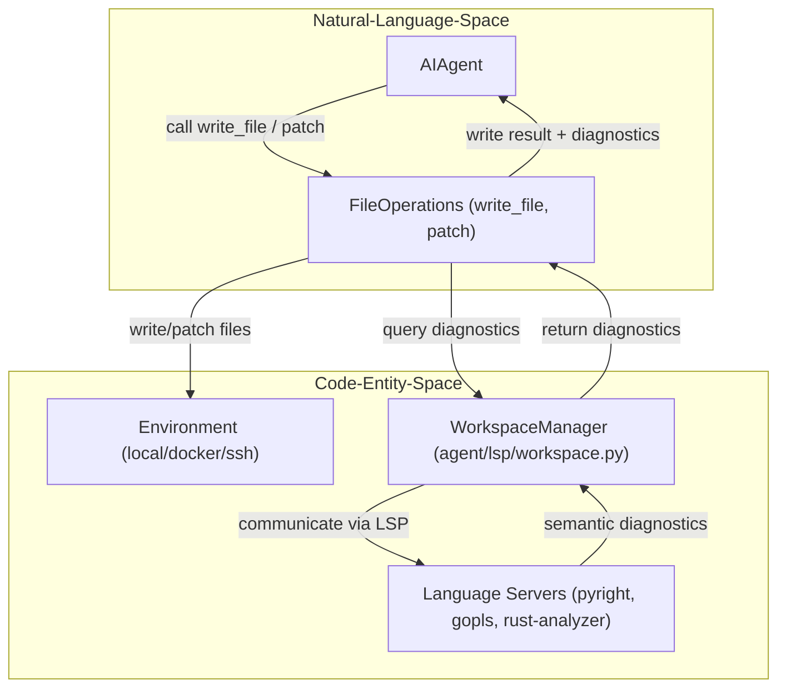
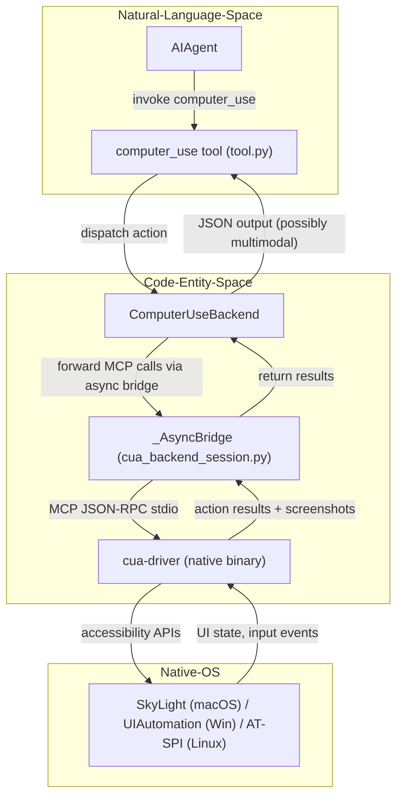

<!-- source: DeepWiki mcp.deepwiki.com · repo nousresearch/hermes-agent · page 10.5 LSP and Computer Use · fetched 2026-10-27 -->

# LSP and Computer Use

Relevant source files

The following files were used as context for generating this wiki page:

- [agent/file_safety.py](agent/file_safety.py)
- [agent/runtime_self_protection.py](agent/runtime_self_protection.py)
- [agent/search_policy.py](agent/search_policy.py)
- [agent/skill_bundles.py](agent/skill_bundles.py)
- [agent/subdirectory_hints.py](agent/subdirectory_hints.py)
- [contributors/emails/dickson.neoh@gmail.com](contributors/emails/dickson.neoh@gmail.com)
- [hermes_cli/subcommands/computer_use.py](hermes_cli/subcommands/computer_use.py)
- [skills/autonomous-ai-agents/computer-use/SKILL.md](skills/autonomous-ai-agents/computer-use/SKILL.md)
- [tests/agent/lsp/test_shell_linter_lsp_skip.py](tests/agent/lsp/test_shell_linter_lsp_skip.py)
- [tests/agent/test_file_safety.py](tests/agent/test_file_safety.py)
- [tests/agent/test_file_safety_credentials.py](tests/agent/test_file_safety_credentials.py)
- [tests/agent/test_file_safety_write_credentials.py](tests/agent/test_file_safety_write_credentials.py)
- [tests/agent/test_runtime_self_protection.py](tests/agent/test_runtime_self_protection.py)
- [tests/agent/test_skill_bundles.py](tests/agent/test_skill_bundles.py)
- [tests/agent/test_subdirectory_hints.py](tests/agent/test_subdirectory_hints.py)
- [tests/computer_use/test_cua_no_overlay.py](tests/computer_use/test_cua_no_overlay.py)
- [tests/computer_use/test_cua_spawn_env_sanitization.py](tests/computer_use/test_cua_spawn_env_sanitization.py)
- [tests/computer_use/test_cua_wayland_env.py](tests/computer_use/test_cua_wayland_env.py)
- [tests/computer_use/test_cua_wsl_manifest_path.py](tests/computer_use/test_cua_wsl_manifest_path.py)
- [tests/computer_use/test_doctor.py](tests/computer_use/test_doctor.py)
- [tests/gateway/test_restart_service_detection.py](tests/gateway/test_restart_service_detection.py)
- [tests/gateway/test_startup_environment_probe.py](tests/gateway/test_startup_environment_probe.py)
- [tests/hermes_cli/test_bundles.py](tests/hermes_cli/test_bundles.py)
- [tests/tools/test_binary_document_write_guard.py](tests/tools/test_binary_document_write_guard.py)
- [tests/tools/test_computer_use.py](tests/tools/test_computer_use.py)
- [tests/tools/test_computer_use_ax_walk_bound.py](tests/tools/test_computer_use_ax_walk_bound.py)
- [tests/tools/test_computer_use_capture_self_window.py](tests/tools/test_computer_use_capture_self_window.py)
- [tests/tools/test_computer_use_cua_0_10_permissions.py](tests/tools/test_computer_use_cua_0_10_permissions.py)
- [tests/tools/test_computer_use_cua_0_9.py](tests/tools/test_computer_use_cua_0_9.py)
- [tests/tools/test_computer_use_cua_backend_linux.py](tests/tools/test_computer_use_cua_backend_linux.py)
- [tests/tools/test_computer_use_delivery_ladder.py](tests/tools/test_computer_use_delivery_ladder.py)
- [tests/tools/test_computer_use_doctor_stale_units.py](tests/tools/test_computer_use_doctor_stale_units.py)
- [tests/tools/test_computer_use_screenshot_dedup.py](tests/tools/test_computer_use_screenshot_dedup.py)
- [tests/tools/test_cross_profile_guard.py](tests/tools/test_cross_profile_guard.py)
- [tests/tools/test_docker_windows_cwd_mount.py](tests/tools/test_docker_windows_cwd_mount.py)
- [tests/tools/test_escape_drift_autocorrect.py](tests/tools/test_escape_drift_autocorrect.py)
- [tests/tools/test_execute_code_lifecycle_guard_deadline.py](tests/tools/test_execute_code_lifecycle_guard_deadline.py)
- [tests/tools/test_file_operations.py](tests/tools/test_file_operations.py)
- [tests/tools/test_file_operations_delete.py](tests/tools/test_file_operations_delete.py)
- [tests/tools/test_file_operations_edge_cases.py](tests/tools/test_file_operations_edge_cases.py)
- [tests/tools/test_file_read_guards.py](tests/tools/test_file_read_guards.py)
- [tests/tools/test_file_staleness.py](tests/tools/test_file_staleness.py)
- [tests/tools/test_file_state_registry.py](tests/tools/test_file_state_registry.py)
- [tests/tools/test_file_tools.py](tests/tools/test_file_tools.py)
- [tests/tools/test_file_tools_container_config.py](tests/tools/test_file_tools_container_config.py)
- [tests/tools/test_file_tools_cwd_resolution.py](tests/tools/test_file_tools_cwd_resolution.py)
- [tests/tools/test_file_tools_live.py](tests/tools/test_file_tools_live.py)
- [tests/tools/test_file_tools_tilde_profile.py](tests/tools/test_file_tools_tilde_profile.py)
- [tests/tools/test_file_write_safety.py](tests/tools/test_file_write_safety.py)
- [tests/tools/test_fuzzy_match.py](tests/tools/test_fuzzy_match.py)
- [tests/tools/test_interrupted_command_cwd.py](tests/tools/test_interrupted_command_cwd.py)
- [tests/tools/test_known_file_write_baseline.py](tests/tools/test_known_file_write_baseline.py)
- [tests/tools/test_launchctl_guard_diagnostic.py](tests/tools/test_launchctl_guard_diagnostic.py)
- [tests/tools/test_line_ending_preservation.py](tests/tools/test_line_ending_preservation.py)
- [tests/tools/test_macos_protected_search.py](tests/tools/test_macos_protected_search.py)
- [tests/tools/test_patch_already_applied.py](tests/tools/test_patch_already_applied.py)
- [tests/tools/test_patch_parser.py](tests/tools/test_patch_parser.py)
- [tests/tools/test_read_loop_detection.py](tests/tools/test_read_loop_detection.py)
- [tests/tools/test_read_shell_line_clamp.py](tests/tools/test_read_shell_line_clamp.py)
- [tests/tools/test_resolve_path.py](tests/tools/test_resolve_path.py)
- [tests/tools/test_search_budget_truncation.py](tests/tools/test_search_budget_truncation.py)
- [tests/tools/test_search_files_engine_selection.py](tests/tools/test_search_files_engine_selection.py)
- [tests/tools/test_search_hidden_dirs.py](tests/tools/test_search_hidden_dirs.py)
- [tests/tools/test_search_native_rg.py](tests/tools/test_search_native_rg.py)
- [tests/tools/test_search_zero_match_and_multipath.py](tests/tools/test_search_zero_match_and_multipath.py)
- [tests/tools/test_session_cwd_store.py](tests/tools/test_session_cwd_store.py)
- [tests/tools/test_skill_view_dedup.py](tests/tools/test_skill_view_dedup.py)
- [tests/tools/test_ssh_remote_cwd.py](tests/tools/test_ssh_remote_cwd.py)
- [tests/tools/test_terminal_pre_guard_deadline.py](tests/tools/test_terminal_pre_guard_deadline.py)
- [tests/tools/test_terminal_task_cwd.py](tests/tools/test_terminal_task_cwd.py)
- [tests/tools/test_terminal_yield_to_background.py](tests/tools/test_terminal_yield_to_background.py)
- [tests/tools/test_write_deny.py](tests/tools/test_write_deny.py)
- [tools/binary_extensions.py](tools/binary_extensions.py)
- [tools/computer_use/__init__.py](tools/computer_use/__init__.py)
- [tools/computer_use/backend.py](tools/computer_use/backend.py)
- [tools/computer_use/cua_backend.py](tools/computer_use/cua_backend.py)
- [tools/computer_use/cua_backend_capture.py](tools/computer_use/cua_backend_capture.py)
- [tools/computer_use/cua_backend_daemon.py](tools/computer_use/cua_backend_daemon.py)
- [tools/computer_use/cua_backend_driver.py](tools/computer_use/cua_backend_driver.py)
- [tools/computer_use/cua_backend_input.py](tools/computer_use/cua_backend_input.py)
- [tools/computer_use/cua_backend_parse.py](tools/computer_use/cua_backend_parse.py)
- [tools/computer_use/cua_backend_session.py](tools/computer_use/cua_backend_session.py)
- [tools/computer_use/doctor.py](tools/computer_use/doctor.py)
- [tools/computer_use/permissions.py](tools/computer_use/permissions.py)
- [tools/computer_use/schema.py](tools/computer_use/schema.py)
- [tools/computer_use/tool.py](tools/computer_use/tool.py)
- [tools/computer_use_tool.py](tools/computer_use_tool.py)
- [tools/escape_drift_autocorrect.py](tools/escape_drift_autocorrect.py)
- [tools/file_operations.py](tools/file_operations.py)
- [tools/file_operations_common.py](tools/file_operations_common.py)
- [tools/file_operations_lint.py](tools/file_operations_lint.py)
- [tools/file_operations_search.py](tools/file_operations_search.py)
- [tools/file_state.py](tools/file_state.py)
- [tools/file_tools.py](tools/file_tools.py)
- [tools/file_tools_paths.py](tools/file_tools_paths.py)
- [tools/file_tools_read_tracking.py](tools/file_tools_read_tracking.py)
- [tools/file_tools_write_guards.py](tools/file_tools_write_guards.py)
- [tools/fuzzy_match.py](tools/fuzzy_match.py)
- [tools/hook_output_spill.py](tools/hook_output_spill.py)
- [tools/patch_parser.py](tools/patch_parser.py)
- [tools/terminal_tool.py](tools/terminal_tool.py)
- [tools/terminal_tool_background.py](tools/terminal_tool_background.py)
- [tools/terminal_tool_config.py](tools/terminal_tool_config.py)
- [tools/terminal_tool_guards.py](tools/terminal_tool_guards.py)
- [website/docs/user-guide/features/computer-use.md](website/docs/user-guide/features/computer-use.md)
- [website/docs/user-guide/skills/bundled/autonomous-ai-agents/autonomous-ai-agents-computer-use.md](website/docs/user-guide/skills/bundled/autonomous-ai-agents/autonomous-ai-agents-computer-use.md)

This page documents two advanced capabilities within the Hermes Agent framework that bridge the gap between text-based reasoning and environment-aware execution:

1.  **Language Server Protocol (LSP) Integration**: Wiring semantic diagnostics from language servers into file modification tools such as `write_file` and `patch`.
2.  **Computer Use Tool**: A universal cross-platform desktop control tool leveraging `cua-driver` to enable GUI automation on macOS, Windows, and Linux.

---

## Language Server Protocol (LSP) Integration

Hermes Agent integrates Language Server Protocol (LSP) semantic diagnostics directly into its file manipulation tools, providing real-time semantic feedback and error reporting after every file write or patch operation. This integration improves the agent’s ability to detect and repair code issues dynamically during interaction.

### Integration Details and Data Flow

- The `FileOperations` interface in `tools/file_operations.py` defines abstract methods like `write_file`, `patch_replace`, and `patch_v4a` for file edits across terminal backends [tools/file_operations.py:96-136]().
- The implementations of these methods are extended to invoke the Hermes LSP workspace manager after file writes or patches complete successfully.
- The workspace manager, defined in `agent/lsp/workspace.py` (not shown here), maintains active LSP client sessions communicating with language servers (e.g., Pyright, gopls, rust-analyzer).
- After changes, the workspace manager queries the language servers for updated semantic diagnostics relevant to the modified files.
- The diagnostics — structured per LSP spec with line and character ranges, severity (error/warning), and message text — are injected into the result objects (`WriteResult`, `PatchResult`).
- These results, now augmented with live semantics, are returned to the calling context, including AIAgent loops and interactive CLI or web UI, enabling semantic error awareness and intelligent fix suggestions.

### Core Components

| Component | Role | Key Location |
| :---------------- | :----------------------------------------------------------- | :--------------------------- |
| `write_file` & `patch_*` | Modify files and collect updated semantics diagnostic info | `tools/file_operations.py:96-136` |
| Workspace Manager | Manages LSP sessions, gathers diagnostics from language servers | `agent/lsp/workspace.py` (not shown) |
| Language Server Clients | External language servers providing semantic information | External LSP servers |

### Diagram: LSP Feedback Loop in File Operations

This ensures the agent receives up-to-date semantic feedback to guide precise code modifications.

Sources: `tools/file_operations.py`, `agent/lsp/workspace.py`

---

## Computer Use (Cross-Platform Desktop Control)

The `computer_use` tool enables agents to programmatically manipulate the desktop UI on macOS, Windows, and Linux using the `cua-driver` accessibility automation protocol, allowing fine-grained control over GUI elements and applications.

### Architecture and Core Implementation

- The primary interface is the `computer_use` tool entrypoint in `tools/computer_use/tool.py` [tools/computer_use/tool.py:1-110]().
- The tool dispatches JSON action commands representing UI operations (click, type, scroll, drag, capture, etc.) to platform-specific backends implementing the `ComputerUseBackend` interface [tools/computer_use/backend.py]().
- The common backend uses MCP (Modular Control Protocol) over stdio, managed via the async MCP bridge (`_AsyncBridge`) implemented in `tools/computer_use/cua_backend_session.py` [tools/computer_use/cua_backend_session.py]().
- This bridge communicates with the native `cua-driver` process, a cross-platform native binary that acts as a conduit to OS accessibility APIs:
  - **macOS**: Private SkyLight Accessibility APIs, including the AX tree and input synthesis.
  - **Windows**: UIAutomation APIs and synthetic input injection.
  - **Linux**: AT-SPI with virtual input event injection.
- The architecture isolates backend session management, input parsing, accessibility tree capture, and command result processing in separate mixins and modules (`cua_backend_capture.py` [tools/computer_use/cua_backend_capture.py](), `cua_backend_input.py` (not shown)).
- The native `cua-driver` process is opaque to Hermes but serves as the single source of truth for UI state and synthetic input on the host OS.

### Backend and Session Components

| Component | Role | Location |
| :---------------- | :----------------------------------------------------------- | :----------------------------------------------------------- |
| `computer_use` tool | Entrypoint, command validation, approval gating, dispatch | `tools/computer_use/tool.py:1-110` |
| `ComputerUseBackend` | Backend interface implementing all UI commands | `tools/computer_use/backend.py` (not shown) |
| `_AsyncBridge` | MCP async session over stdio JSON-RPC to `cua-driver` | `tools/computer_use/cua_backend_session.py` |
| `cua-driver` binary | Native bridge to OS accessibility APIs and input control | External native binary |

### Invocation and Execution Flow Diagram

Sources: `tools/computer_use/tool.py`, `tools/computer_use/backend.py`, `tools/computer_use/cua_backend.py`, `tools/computer_use/cua_backend_capture.py`, `tools/computer_use/cua_backend_session.py`

---

### Safety and Permissions Model

To prevent destructive or risky actions, `computer_use` enforces layered safeguards:

-   **Hard-blocked Key Combos:** Explicitly blocks destructive system key combinations (e.g., macOS force log out, Windows lock screen) early [tools/computer_use/tool.py:41-46]().
-   **Dangerous Typed Patterns:** Recognizes and rejects dangerous shell patterns like `curl | bash`, `sudo rm -rf /` and fork bombs via regex matching [tools/computer_use/tool.py:50-52]().
-   **Approval Callback:** Supports an optional approval callback for prompting user consent on sensitive operations. If none provided, it falls back to the shared CLI approval callback [tools/computer_use/tool.py:29-38]().
-   **Permission Modes:** The backend runs in one of three permission modes:
    -   `standard`: Default mode with normal approvals.
    -   `bounded`: Limited capabilities enforced via capability manifests.
    -   `unrestricted`: Full unrestricted backend access, typically disallowed by default.
    The mode is read from configuration at runtime and prevents silent escalation [tools/computer_use/cua_backend.py:71-76]().
-   **macOS TCC Permissions:** The `computer_use doctor` command deeply inspects OS accessibility and screen-recording permissions, especially on macOS, providing diagnostics and remediation guidance [tools/computer_use/doctor.py]().

Sources: `tools/computer_use/tool.py`, `tools/computer_use/cua_backend.py`, `tools/computer_use/doctor.py`

---

### Supported Commands Summary

| Command | Description | Safety Category |
| :---------------- | :-------------------------------------------- | :-------------------------- |
| `capture` | Screenshot / accessibility tree capture | Safe (no side-effects) |
| `click` | Mouse click (left, right, middle) | Requires approval |
| `double_click` | Double mouse click | Requires approval |
| `drag` | Drag mouse pointer between elements | Requires approval |
| `scroll` | Scroll wheel input at coordinates | Requires approval |
| `type` | Typing arbitrary text (with safety block) | Requires approval + filtering |
| `key` | Send shortcut key combinations | Hard-block certain combos |
| `list_apps` | Query running applications | Safe |
| `list_windows` | Query visible windows | Safe |
| `focus_app` | Focus or bring to front an application | Requires approval |
| `wait` | Wait for specified duration | Safe |

Sources: `tools/computer_use/schema.py`

---

### Screenshot Deduplication

The tool implements a session-scoped deduplication cache for screenshots [tools/computer_use/tool.py:92-110]():

-   Each screenshot is hashed (SHA-256 of MIME type + base64 content).
-   If a newly captured image for the same session and target (app, window) matches the previous image exactly and the number of consecutive omitted repeats is below a maximum streak, the tool omits sending the image data again.
-   Instead, it sends a short textual note referencing the unchanged screen, reducing bandwidth and repeated image tokens without losing context in the conversation.
-   The deduplication state is kept per session and per target, resetting on changes or after hitting the streak limit.

This optimization prevents bloating model context with redundant visual data during interaction loops.

Sources: `tools/computer_use/tool.py`

---

### Diagnostic and Doctor Support

The `computer_use doctor` subcommand provides deep diagnostics for the computer-use environment:

-   Runs health-check MCP commands over the JSON-RPC stdio connection to probe the `cua-driver` process state.
-   Checks for common issues affecting usability, such as missing OS-level Accessibility or Screen Recording permissions on macOS.
-   Reports actionable output and error details clearly to guide users in granting necessary permissions or reinstalling the `cua-driver`.
-   Diagnoses environment variables, driver command availability, and session permissions to prevent silent failures.
-   This doctor tool is the authoritative troubleshooting aid for desktop control feature activation.

Sources: `tools/computer_use/doctor.py`

---

# Summary

Hermes Agent tightly integrates LSP semantic diagnostics into its write and patch file tools, bringing real-time language-aware feedback to file modifications. Parallelly, the `computer_use` tool enables cross-platform desktop GUI automation through a robust, permission-aware, and safety-guarded interface mediated by the `cua-driver` protocol.

These systems empower the agent with precise code editing diagnostics and rich desktop interaction capabilities, bridging human natural language instructions to effective, safe, and context-aware system control.

---

**Sources:**
- LSP integration: `tools/file_operations.py`, `agent/lsp/workspace.py`
- Computer use tool & backend: `tools/computer_use/tool.py`, `tools/computer_use/backend.py`, `tools/computer_use/cua_backend.py`, `tools/computer_use/cua_backend_session.py`, `tools/computer_use/cua_backend_daemon.py`, `tools/computer_use/doctor.py`, `tools/computer_use/schema.py`
- Safety and approval: `tools/computer_use/tool.py`, `tools/computer_use/cua_backend.py`

---

