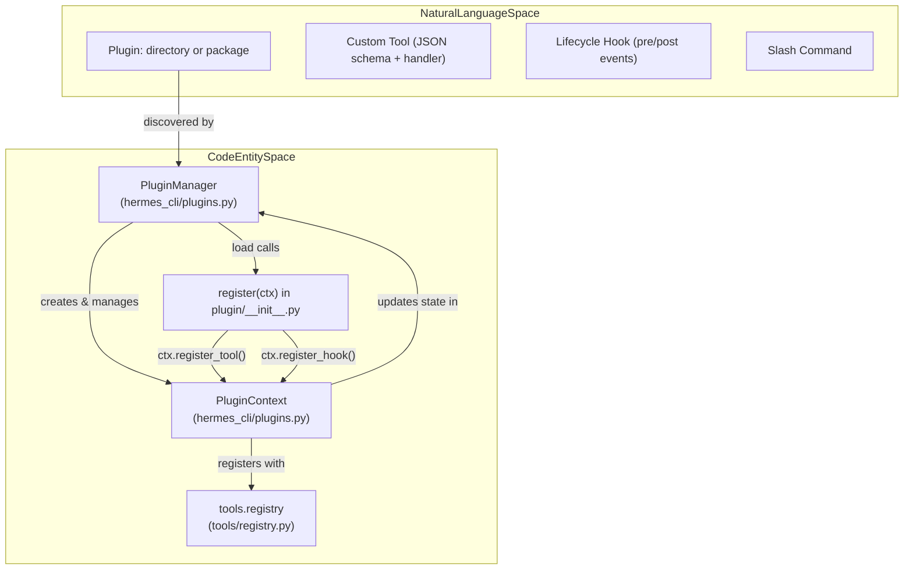
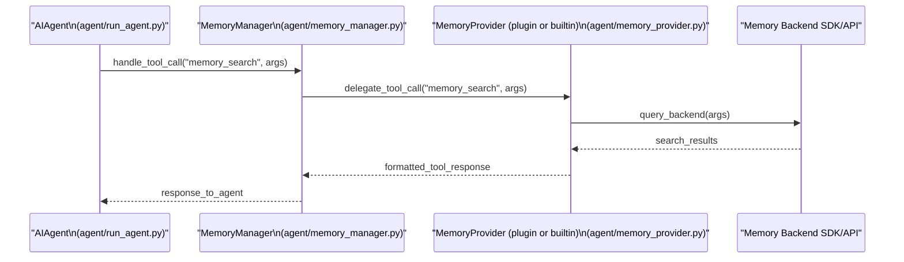

<!-- source: DeepWiki mcp.deepwiki.com · repo nousresearch/hermes-agent · page 10.7 Plugins and Memory Providers · fetched 2026-10-27 -->

# Plugins and Memory Providers

Relevant source files

The following files were used as context for generating this wiki page:

- [.github/actions/plugin-validate/action.yml](.github/actions/plugin-validate/action.yml)
- [.github/workflows/plugin-catalog-ci.yml](.github/workflows/plugin-catalog-ci.yml)
- [agent/memory_manager.py](agent/memory_manager.py)
- [agent/memory_provider.py](agent/memory_provider.py)
- [agent/replay_cleanup.py](agent/replay_cleanup.py)
- [agent/shell_hooks.py](agent/shell_hooks.py)
- [agent/title_generator.py](agent/title_generator.py)
- [agent/trace_upload.py](agent/trace_upload.py)
- [agent/trajectory.py](agent/trajectory.py)
- [contributors/emails/erosika@users.noreply.github.com](contributors/emails/erosika@users.noreply.github.com)
- [hermes_cli/hooks.py](hermes_cli/hooks.py)
- [hermes_cli/mcp_picker.py](hermes_cli/mcp_picker.py)
- [hermes_cli/mcp_security.py](hermes_cli/mcp_security.py)
- [hermes_cli/memory_oauth.py](hermes_cli/memory_oauth.py)
- [hermes_cli/middleware.py](hermes_cli/middleware.py)
- [hermes_cli/plugin_catalog.py](hermes_cli/plugin_catalog.py)
- [hermes_cli/plugins.py](hermes_cli/plugins.py)
- [hermes_cli/plugins_cmd.py](hermes_cli/plugins_cmd.py)
- [hermes_cli/plugins_cmd_catalog.py](hermes_cli/plugins_cmd_catalog.py)
- [hermes_cli/plugins_cmd_install.py](hermes_cli/plugins_cmd_install.py)
- [hermes_cli/plugins_discovery.py](hermes_cli/plugins_discovery.py)
- [hermes_cli/plugins_dispatch.py](hermes_cli/plugins_dispatch.py)
- [hermes_cli/plugins_ledger.py](hermes_cli/plugins_ledger.py)
- [hermes_cli/plugins_loader.py](hermes_cli/plugins_loader.py)
- [hermes_cli/plugins_manifest.py](hermes_cli/plugins_manifest.py)
- [hermes_cli/plugins_state.py](hermes_cli/plugins_state.py)
- [hermes_cli/plugins_transaction.py](hermes_cli/plugins_transaction.py)
- [hermes_cli/subcommands/plugins.py](hermes_cli/subcommands/plugins.py)
- [plugin-catalog/README.md](plugin-catalog/README.md)
- [plugins/memory/__init__.py](plugins/memory/__init__.py)
- [scripts/scan_plugin_payloads.py](scripts/scan_plugin_payloads.py)
- [scripts/validate_plugin_catalog.py](scripts/validate_plugin_catalog.py)
- [tests/_fixtures/live_system_guard.py](tests/_fixtures/live_system_guard.py)
- [tests/agent/test_memory_context_dedupe.py](tests/agent/test_memory_context_dedupe.py)
- [tests/agent/test_memory_provider.py](tests/agent/test_memory_provider.py)
- [tests/agent/test_memory_write_bridge.py](tests/agent/test_memory_write_bridge.py)
- [tests/agent/test_moa_quiet_reference_output.py](tests/agent/test_moa_quiet_reference_output.py)
- [tests/agent/test_pre_compress_checkpoint_contract.py](tests/agent/test_pre_compress_checkpoint_contract.py)
- [tests/agent/test_replay_cleanup.py](tests/agent/test_replay_cleanup.py)
- [tests/agent/test_shell_hooks.py](tests/agent/test_shell_hooks.py)
- [tests/agent/test_title_generator.py](tests/agent/test_title_generator.py)
- [tests/agent/test_trajectory_file_locking.py](tests/agent/test_trajectory_file_locking.py)
- [tests/ci/test_plugin_catalog_ci_confinement.py](tests/ci/test_plugin_catalog_ci_confinement.py)
- [tests/gateway/test_clarify_progress_leak.py](tests/gateway/test_clarify_progress_leak.py)
- [tests/gateway/test_control_socket_windows_live.py](tests/gateway/test_control_socket_windows_live.py)
- [tests/gateway/test_delivery_ledger_single_connection.py](tests/gateway/test_delivery_ledger_single_connection.py)
- [tests/gateway/test_gateway_command_line_matcher.py](tests/gateway/test_gateway_command_line_matcher.py)
- [tests/gateway/test_stale_confirmation_expiry.py](tests/gateway/test_stale_confirmation_expiry.py)
- [tests/gateway/test_weak_credential_guard.py](tests/gateway/test_weak_credential_guard.py)
- [tests/hermes_cli/test_desktop_lifecycle_windows_live.py](tests/hermes_cli/test_desktop_lifecycle_windows_live.py)
- [tests/hermes_cli/test_gateway_proc_fallback.py](tests/hermes_cli/test_gateway_proc_fallback.py)
- [tests/hermes_cli/test_hooks_cli.py](tests/hermes_cli/test_hooks_cli.py)
- [tests/hermes_cli/test_mcp_security.py](tests/hermes_cli/test_mcp_security.py)
- [tests/hermes_cli/test_plan_reconciliation_windows_live.py](tests/hermes_cli/test_plan_reconciliation_windows_live.py)
- [tests/hermes_cli/test_plugin_catalog.py](tests/hermes_cli/test_plugin_catalog.py)
- [tests/hermes_cli/test_plugin_hook_failure_reporting.py](tests/hermes_cli/test_plugin_hook_failure_reporting.py)
- [tests/hermes_cli/test_plugin_scan_dunder_dirs.py](tests/hermes_cli/test_plugin_scan_dunder_dirs.py)
- [tests/hermes_cli/test_plugin_update_transaction.py](tests/hermes_cli/test_plugin_update_transaction.py)
- [tests/hermes_cli/test_plugins.py](tests/hermes_cli/test_plugins.py)
- [tests/hermes_cli/test_plugins_cmd.py](tests/hermes_cli/test_plugins_cmd.py)
- [tests/hermes_cli/test_plugins_cmd_catalog.py](tests/hermes_cli/test_plugins_cmd_catalog.py)
- [tests/hermes_cli/test_plugins_cmd_enable_disable_nested.py](tests/hermes_cli/test_plugins_cmd_enable_disable_nested.py)
- [tests/hermes_cli/test_plugins_loader.py](tests/hermes_cli/test_plugins_loader.py)
- [tests/hermes_cli/test_web_memory_user_dir_provider.py](tests/hermes_cli/test_web_memory_user_dir_provider.py)
- [tests/hermes_cli/test_windows_relaunch_verify_budget.py](tests/hermes_cli/test_windows_relaunch_verify_budget.py)
- [tests/plugins/memory/test_discovery_sources.py](tests/plugins/memory/test_discovery_sources.py)
- [tests/plugins/test_memory_hook_registration.py](tests/plugins/test_memory_hook_registration.py)
- [tests/plugins/test_plugin_loader_unreadable.py](tests/plugins/test_plugin_loader_unreadable.py)
- [tests/scripts/test_scan_plugin_payloads.py](tests/scripts/test_scan_plugin_payloads.py)
- [tests/scripts/test_validate_plugin_catalog.py](tests/scripts/test_validate_plugin_catalog.py)
- [tests/tools/test_capability_fingerprint_skill_scope.py](tests/tools/test_capability_fingerprint_skill_scope.py)
- [tests/website/test_extract_plugins.py](tests/website/test_extract_plugins.py)
- [tests/website/test_extract_skills.py](tests/website/test_extract_skills.py)
- [website/docs/developer-guide/memory-provider-plugin.md](website/docs/developer-guide/memory-provider-plugin.md)
- [website/docs/developer-guide/middleware.md](website/docs/developer-guide/middleware.md)
- [website/docs/developer-guide/plugins/catalog-submission.md](website/docs/developer-guide/plugins/catalog-submission.md)
- [website/docs/developer-guide/plugins/index.md](website/docs/developer-guide/plugins/index.md)
- [website/docs/user-guide/features/hooks.md](website/docs/user-guide/features/hooks.md)
- [website/docs/user-guide/features/plugin-catalog.md](website/docs/user-guide/features/plugin-catalog.md)
- [website/docs/user-guide/features/plugins.md](website/docs/user-guide/features/plugins.md)
- [website/docs/user-stories.mdx](website/docs/user-stories.mdx)
- [website/i18n/zh-Hans/docusaurus-plugin-content-docs/current/user-guide/features/skills.md](website/i18n/zh-Hans/docusaurus-plugin-content-docs/current/user-guide/features/skills.md)
- [website/scripts/extract-plugins.py](website/scripts/extract-plugins.py)
- [website/scripts/extract-skills.py](website/scripts/extract-skills.py)
- [website/src/components/UserStoriesCollage/index.tsx](website/src/components/UserStoriesCollage/index.tsx)
- [website/src/components/UserStoriesCollage/styles.module.css](website/src/components/UserStoriesCollage/styles.module.css)
- [website/src/data/userStories.json](website/src/data/userStories.json)
- [website/src/pages/plugins/index.tsx](website/src/pages/plugins/index.tsx)
- [website/src/pages/plugins/styles.module.css](website/src/pages/plugins/styles.module.css)
- [website/src/pages/skills/index.tsx](website/src/pages/skills/index.tsx)
- [website/src/pages/skills/styles.module.css](website/src/pages/skills/styles.module.css)

## Purpose and Scope

This page documents the Hermes plugin system, focusing on the `MemoryProvider` abstract base class (ABC), bundled memory plugins, plugin discovery/loading mechanisms, lifecycle hooks, dashboard authentication plugins, the plugin catalog, and specialty plugins. It explains how plugins extend and integrate with Hermes agent core, particularly augmenting memory capabilities, tools, lifecycle events, and dashboard authentication. Key classes, data flows, and extension points are detailed to assist developers and advanced users in understanding and authoring Hermes plugins.

---

## Plugin System Architecture

Hermes employs a modular plugin framework enabling extensibility via custom tools, hooks, commands, and integrations without modifying core source code.

### Plugin Sources and Discovery

Plugins are discovered in order of precedence, where later sources override earlier on key name conflicts:

- **Bundled plugins:** Located inside the Hermes repo under `plugins/`. Memory and context-engine plugins have dedicated discovery paths here.
- **User plugins:** Installed in the user's home profile at `~/.hermes/plugins/<plugin_name>/`.
- **Project plugins:** Discovered optionally under `.hermes/plugins/<plugin_name>/` in the working directory if `HERMES_ENABLE_PROJECT_PLUGINS=true` is set. Disabled by default for security.
- **Pip packages:** Installed Python packages exposing the `hermes_agent.plugins` entry point group.

Each directory-plugin requires a `plugin.yaml` manifest file and a Python package exposing a canonical `register(ctx)` function, which registers runtime extensions via the `PluginContext` API. The plugin manager merges sources, resolves conflicts, and controls enabling/disabling [hermes_cli/plugins.py:1-132]().

### Key Classes and Components

- **`PluginManager`**
  Coordinates plugin discovery, loading, enabling/disabling, and management of registered tools and hooks.

- **`PluginContext`**
  Passed as argument to each plugin's `register()` function; provides an API to register tools, hooks, commands, middleware, etc.

- **Plugin Entry Point — `register(ctx)`**
  The standard plugin bootstrap function implemented in `__init__.py` that uses `ctx` to declare capabilities, register tools, and install hooks.

### Plugin Lifecycle and Tool Registration

Plugins register callable tools through `ctx.register_tool()`, providing JSON schema and handler functions that the LLM or agent can invoke. Hook functions can likewise be registered for lifecycle events such as `pre_tool_call` or `post_tool_call` via `ctx.register_hook()`. Plugins can also add slash commands, platform adapters, memory providers, context engines, terminal environments, middleware layers, and other extension points.

### Plugin System Entity Diagram

Sources: [hermes_cli/plugins.py:1-132]()

---

## Memory Providers & Bundled Memory Plugins

Hermes supports extensible persistent memory backends by defining a `MemoryProvider` abstract base class (ABC), enabling alternative storage and retrieval mechanisms beyond the builtin plain-text files (`MEMORY.md` and `USER.md`).

### `MemoryProvider` Abstract Base Class (ABC)

- The base interface for plugins providing persistent memory features that integrate with agent lifecycle. Key expected methods include:
  - `initialize()`: allocate or open backend resources.
  - `prefetch()`: eager read of memory before agent turn to reduce latency.
  - `sync_turn()`: save or synchronize memory changes after each turn.
  - `on_session_end()`: cleanup or commit at session close.
  - `on_pre_compress()`: hook before context compression phases.
  - `shutdown()`: cleanly shut down or free backend resources on agent exit.
- Default no-op implementations exist so plugins override only relevant methods.
- Each provider exposes JSON schema describing tools to the LLM (e.g., memory search or update operations).
- Defined in `agent/memory_provider.py`.

External memory provider plugins implement this ABC to provide integrations with vector databases, knowledge graphs, or advanced SQL backends.

### `MemoryManager`: Fan-Out to Providers

- The `MemoryManager` module manages multiple active memory providers, always including the builtin provider plus optionally one external plugin provider.
- It fans memory lifecycle calls (prefetch, sync, shutdown, hooks) out to all registered providers, coordinating calls asynchronously with timeout guards to avoid blocking agent runtime.
- It aggregates all tools contributed by the providers and injects them into the agent's tool surface.
- Honors gating configuration that controls whether memory provider tools are exposed on the agent based on enabled or disabled toolsets [agent/memory_manager.py:81-98]().
- Implements robust introspection and error handling to maintain runtime stability.
- Found at `agent/memory_manager.py`.

### Bundled Memory Plugins

Hermes ships with several enhanced memory backend plugins, commonly deployed via the plugin catalog under `plugins/memory/`:

| Provider | Description | Location |
|---|---|---|
| **Honcho** | AI-native memory with dialectic queries, user modeling | `plugins/memory/honcho/` (catalog) |
| **OpenViking** | Hierarchical tiered memory with semantic search and summarization| `plugins/memory/openviking/` (catalog)|
| **Hindsight** | Knowledge graph with entity resolution and hybrid methods | `plugins/memory/hindsight/` (catalog) |
| **RetainDB** | SQLite relational memory backend supporting TTL & offline sync | `plugins/memory/retaindb/` (catalog) |
| **ByteRover** | Lightweight high-throughput vector memory backend | `plugins/memory/byterover/` (catalog) |
| **Supermemory**| Webpage extraction and indexing memory backend | `plugins/memory/supermemory/` (catalog)|
| **Mem0** | Adaptive vector/graph memory system | Bundled internally |
| **Holographic**| Holographic associative memory backend | Bundled internally |

These plugins provide rich LLM-accessible memory tools for querying, updating, and managing knowledge representations, often leveraging advanced retrieval techniques and dynamic context extraction [website/docs/developer-guide/memory-provider-plugin.md]() (general documentation for memory provider plugins).

### Memory Provider Execution Flow

Sources: [hermes_cli/plugins.py:1-132](), [agent/memory_provider.py:1-163](), [agent/memory_manager.py:1-163](), [website/docs/developer-guide/memory-provider-plugin.md]()

---

## Plugin Hooks, Middleware, and Dashboard Authentication Plugins

### Plugin Hooks

The Hermes plugin system supports rich lifecycle event hooks that allow code injection at various points during agent operation. Plugins can register callbacks for these standard events enumerated in the `VALID_HOOKS` set.

**Key Hook Types and Lifecycle Points:**

| Hook Name | Description |
|---|---|
| `pre_tool_call` | Invoked before a tool call, can block or transform call parameters. |
| `post_tool_call` | Runs after a tool returns, for logging or modification. |
| `transform_llm_output` | Plugins can replace or modify LLM output strings on the fly. |
| `transform_tool_result` | Modify raw tool call results before consumption. |
| `transform_terminal_output`| Modify output intended for terminal display. |
| `pre_llm_call` | Before an LLM provider call, to modify prompts or params. |
| `post_llm_call` | After LLM call returns a result. |
| `on_stream_start/ delta/end/ interim_message` | Observers of streaming output tokens, cannot modify stream. |
| `pre_verify` | Called before code verification phase; can decide to continue or block. |
| `pre_api_request`, `post_api_request`, `api_request_error` | Hooks around LLM API calls for observation or error classification.|
| `pre_auxiliary_call`, `post_auxiliary_call` | Specialized hooks for auxiliary LLM calls, separate from main API hooks. |
| `transform_api_error_classification` | Allows reclassification and handling of API errors. |
| Session lifecycle hooks (`on_session_start/end/reset/finalize`) | Manage session-aware plugin logic. |

Hook errors are logged but isolated to prevent crashing the agent. Hooks can execute asynchronously or synchronously depending on the context. They provide extensive extension points for logging, guardrails, metrics, and flow control [hermes_cli/plugins.py:107-132]().

### Middleware System

Hermes plugins can register middleware callbacks influencing various processing stages, including:

- **LLM Request Middleware:** Transforms or augments the LLM completion request payload prior to dispatch.
- **Tool Request Middleware:** Alters or sanitizes tool arguments before invocation.
- **Execution Callbacks Middleware:** Wraps the LLM or tool execution promises with pre/post hooks, enabling layered interception or augmentation.

Middleware functions run in deterministic registration order, combining smoothly into extensible pipelines that can augment or block behavior dynamically [hermes_cli/middleware.py]().

### Dashboard Authentication Plugins

Special `dashboard_auth` plugin types customize authentication flows in the FastAPI-based web dashboard interface for Hermes. These plugins can implement:

- Custom SSO and OAuth login workflows.
- Additional security gates or multi-factor auth.
- Tenant-specific login logic and permissions.

Dashboard authentication plugins are loaded alongside runtime agent plugins but operate within the dashboard service context independently of the agent runtime [website/docs/developer-guide/plugins/index.md:30]().

---

## Plugin Catalog and Specialty Plugins

### Plugin Catalog

Hermes maintains a curated plugin catalog with comprehensive lifecycle and security management accessed via the `hermes plugins` CLI command. Catalog capabilities include:

- Browsing available plugins and their metadata.
- Installing, removing, updating, enabling, disabling plugins securely.
- Manifest validation and security scanning to detect unsafe code or capabilities.
- Python dependency provisioning for plugins requiring external packages.
- Permission gating for tools that override built-in core tools.
- Tracking enabled plugins per user profile and supporting version pinning.
- Grouped commands for install, update, toggle, list, catalog parsing [hermes_cli/plugins_cmd.py:27-55]().

The catalog itself is defined by YAML files in the `plugin-catalog/` directory of the `hermes-agent` repository. Each entry specifies details like `name`, `description`, `repo`, `sha` (exact commit pin), `tier`, `category`, `maintainer`, and `capabilities` [website/docs/user-guide/features/plugin-catalog.md:39-65](). This ensures that installations are secure and reproducible, as plugins are checked out at a specific, reviewed commit [website/docs/user-guide/features/plugin-catalog.md:71-76]().

### Specialty Plugins

Hermes ships and supports a variety of specialty plugins enhancing the agent across domains like collaboration, observability, multimedia, and workflow tooling:

| Plugin Name | Description |
|---|---|
| **Google Meet** | Calendar, presence, transcription integration |
| **Kanban** | SQLite-backed multi-agent/human task board |
| **Achievements** | Gamification tracking milestones and progress |
| **Observability/Langfuse** | OpenTelemetry and Langfuse telemetry integration |
| **Image Generation** | Unified backend interface for image synthesis |
| **Video Generation** | Video media generation capabilities |
| **Spotify** | Media playback control and catalog browsing |
| **Disk Cleanup** | Automated cache and temp file cleanup |
| **Security Guidance** | Real-time command risk assessment and approval workflows |
| **Teams Pipeline** | MS Teams notifications and pipeline integration |

These plugins extend Hermes into enterprise collaboration, multimedia creation, observability, and security domains, broadening its practical applications [website/docs/user-guide/features/plugins.md:101-130]().

---

## Summary

Hermes Agent’s plugin framework provides a powerful, modular architecture enabling:

- A `PluginManager` coordinating multi-source plugin discovery, lifecycle, and extension registration.
- The `MemoryProvider` ABC and `MemoryManager` enabling rich integration of external memory backends exposing LLM-accessible memory tools and lifecycle hooks.
- A flexible plugin hooks and middleware system allowing observation, modification, blocking, or augmentation of agent runtime flows.
- Dashboard-authentication plugins offering customizable web dashboard login flows.
- A secure, capability-monitored plugin catalog with CLI tools for plugin lifecycle management.
- Specialty plugins spanning collaboration, observability, multimedia, and workflow integration domains.

This comprehensive architecture supports scalable AI assistant customization through community and proprietary extensions.

---
Sources:
[hermes_cli/plugins.py:1-132](),
[hermes_cli/plugins_cmd.py:27-55](),
[hermes_cli/middleware.py](),
[agent/memory_manager.py:1-163](),
[agent/memory_manager.py:81-98](),
[agent/memory_provider.py:1-163](),
[website/docs/developer-guide/memory-provider-plugin.md](),
[website/docs/developer-guide/plugins/index.md:30](),
[website/docs/user-guide/features/plugin-catalog.md:39-65](),
[website/docs/user-guide/features/plugin-catalog.md:71-76](),
[website/docs/user-guide/features/plugins.md:101-130]()

---

