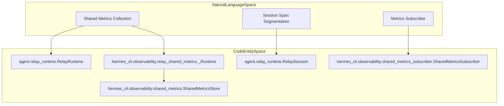
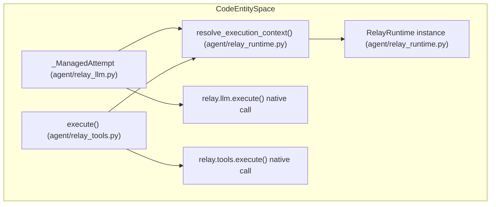

<!-- source: DeepWiki mcp.deepwiki.com · repo nousresearch/hermes-agent · page 10.9 Observability and Monitoring · fetched 2026-10-27 -->

# Observability and Monitoring

<details>
<summary>Relevant source files</summary>

The following files were used as context for generating this wiki page:

- [agent/relay_llm.py](agent/relay_llm.py)
- [agent/relay_runtime.py](agent/relay_runtime.py)
- [agent/relay_tools.py](agent/relay_tools.py)
- [agent/transports/anthropic.py](agent/transports/anthropic.py)
- [hermes_cli/observability/relay_shared_metrics.py](hermes_cli/observability/relay_shared_metrics.py)
- [hermes_cli/observability/schemas/hermes.shared_metrics.v1.schema.json](hermes_cli/observability/schemas/hermes.shared_metrics.v1.schema.json)
- [hermes_cli/observability/schemas/hermes.shared_metrics.v3.schema.json](hermes_cli/observability/schemas/hermes.shared_metrics.v3.schema.json)
- [hermes_cli/observability/schemas/hermes.shared_metrics.v4.schema.json](hermes_cli/observability/schemas/hermes.shared_metrics.v4.schema.json)
- [hermes_cli/observability/shared_metrics.py](hermes_cli/observability/shared_metrics.py)
- [hermes_cli/observability/shared_metrics_catalog.py](hermes_cli/observability/shared_metrics_catalog.py)
- [hermes_cli/observability/shared_metrics_contract.py](hermes_cli/observability/shared_metrics_contract.py)
- [hermes_cli/observability/shared_metrics_engagement.py](hermes_cli/observability/shared_metrics_engagement.py)
- [hermes_cli/observability/shared_metrics_events.py](hermes_cli/observability/shared_metrics_events.py)
- [hermes_cli/observability/shared_metrics_fields.py](hermes_cli/observability/shared_metrics_fields.py)
- [hermes_cli/observability/shared_metrics_model.py](hermes_cli/observability/shared_metrics_model.py)
- [hermes_cli/observability/shared_metrics_snapshot.py](hermes_cli/observability/shared_metrics_snapshot.py)
- [hermes_cli/observability/shared_metrics_subscriber.py](hermes_cli/observability/shared_metrics_subscriber.py)
- [hermes_cli/relay_plugin_migrate.py](hermes_cli/relay_plugin_migrate.py)
- [scripts/smoke_nemo_relay_shared_metrics.py](scripts/smoke_nemo_relay_shared_metrics.py)
- [tests/agent/test_anthropic_mcp_prefix_strip.py](tests/agent/test_anthropic_mcp_prefix_strip.py)
- [tests/agent/test_anthropic_message_stop.py](tests/agent/test_anthropic_message_stop.py)
- [tests/agent/test_auxiliary_relay.py](tests/agent/test_auxiliary_relay.py)
- [tests/agent/test_relay_llm.py](tests/agent/test_relay_llm.py)
- [tests/agent/test_relay_runtime_plugins.py](tests/agent/test_relay_runtime_plugins.py)
- [tests/agent/test_relay_tools.py](tests/agent/test_relay_tools.py)
- [tests/agent/transports/test_transport.py](tests/agent/transports/test_transport.py)
- [tests/hermes_cli/test_relay_plugin_migrate.py](tests/hermes_cli/test_relay_plugin_migrate.py)
- [tests/hermes_cli/test_relay_shared_metrics.py](tests/hermes_cli/test_relay_shared_metrics.py)
- [tests/hermes_cli/test_relay_shared_metrics_runtime.py](tests/hermes_cli/test_relay_shared_metrics_runtime.py)
- [tests/hermes_cli/test_shared_metrics_compression_outcome.py](tests/hermes_cli/test_shared_metrics_compression_outcome.py)
- [tests/hermes_cli/test_shared_metrics_engagement.py](tests/hermes_cli/test_shared_metrics_engagement.py)
- [tests/hermes_cli/test_shared_metrics_model_attribution.py](tests/hermes_cli/test_shared_metrics_model_attribution.py)
- [tests/hermes_cli/test_shared_metrics_update_stop_reasons.py](tests/hermes_cli/test_shared_metrics_update_stop_reasons.py)
- [tests/tools/test_toolsets.py](tests/tools/test_toolsets.py)
- [website/docs/developer-guide/relay-shared-metrics.md](website/docs/developer-guide/relay-shared-metrics.md)

</details>


This section documents the comprehensive observability and monitoring system within Hermes Agent, focusing on the OTLP/OpenTelemetry gateway monitoring, NeMo Relay shared-metrics integration, Langfuse observability plugin, relay_llm and relay_tools instrumentation, cron health telemetry, and the content-free telemetry export contract.

---

## Purpose and Scope

Hermes Agent implements a telemetry framework designed to monitor AI agent operation, provider interactions, tool executions, and system health with minimal overhead. The system integrates:

- **OpenTelemetry Protocol (OTLP) exports** for gateway runtime metrics.
- **NeMo Relay shared-metrics** integration delivering rich scope and event telemetry.
- **Langfuse plugin** providing detailed telemetry aggregation and tracing.
- Instrumentation in `agent/relay_llm.py` and `agent/relay_tools.py` capturing model and tool call metrics within Relay sessions.
- Health telemetry of background cron jobs.
- A **privacy-preserving telemetry export contract** that excludes user content from exported metrics while recording comprehensive metadata and aggregates.

---

## 1. OTLP/OpenTelemetry Gateway Monitoring System

The Hermes messaging gateway exports telemetry metrics using the OpenTelemetry Protocol (OTLP), enabling integration with observability backends like Prometheus, Jaeger, or commercial APMs.

### Implementation Highlights

- The gateway collects runtime metrics such as request latencies, success/failure counts, and resource usage.
- Metrics are encoded into OTLP protobuf format and sent asynchronously.
- Exporter dependencies (`opentelemetry-sdk`, `opentelemetry-exporter-otlp-proto-http`, etc.) are lazily installed using Hermes' `tools.lazy_deps` system to reduce startup overhead.
- Thread pool management for time-bounded scope operations employs daemon threads to avoid blocking interpreter exit, implemented in `_new_scope_op_executor` and accessed via `_scope_op_executor` singleton in `agent/relay_runtime.py` [agent/relay_runtime.py:60-68]().

This OTLP support forms the foundational gateway-level observability interface suitable for diverse backends.

---

## 2. NeMo Relay Shared-Metrics Integration

Hermes integrates **NeMo Relay** (version ≥0.10,<0.11) as a native runtime dependency on supported platforms, enabling rich observability via scope-based metrics and events.

### Runtime Behavior & Configuration

- Hermes installs the platform-specific native `nemo-relay` wheel from NVIDIA's repository [website/docs/developer-guide/relay-shared-metrics.md:1-147]().
- Unsupported platforms use a no-op Relay runtime that disables scope emission but preserves API.
- Shared metrics collection requires explicit opt-in in the profile configuration:

```yaml
telemetry:
  shared_metrics:
    enabled: true
```

- Relay discovers plugin configuration from TOML files at user and system paths, overrideable by `HERMES_NEMO_RELAY_PLUGINS_TOML`.
- The `hermes doctor` CLI command reports resolved plugin files and activation status.
- Relay 0.10+ automatically enables OTLP export when `OTEL_EXPORTER_OTLP_ENDPOINT` environment variables are set; Hermes configuration can disable this behavior to avoid dual exporting.

### Session-Span Segmentation for Long-Running Sessions

- As gateway sessions can remain open over long durations, Relay keeps a session-level telemetry scope open throughout.
- Hermes can optionally segment the session span after:

  - Context compaction (`gateway.telemetry.session_segments.on_compaction`)
  - Reaching a maximum number of turns (`gateway.telemetry.session_segments.max_turns`)

- These segments share the same `session_id` but get annotated with `hermes.session.segment` and a reason tag.

### Key Code Entities and Data Flow

| Natural Language Entity        | Code Entity                                                                       |
|-------------------------------|----------------------------------------------------------------------------------|
| Shared Metrics Collection      | `hermes_cli.observability.relay_shared_metrics._Runtime`                         |
| Session & Turn Scope Handling  | `agent.relay_runtime.RelaySession`, `agent.relay_runtime.RelayRuntime`           |
| Metrics Durable Storage        | `hermes_cli.observability.shared_metrics.SharedMetricsStore`                     |
| Metrics Subscriber             | `hermes_cli.observability.shared_metrics_subscriber.SharedMetricsSubscriber`     |



These components capture and store metrics on sessions, turns, model calls, tool calls, and usage, producing durable snapshots for export.

Sources: [hermes_cli/observability/relay_shared_metrics.py:1-183](), [agent/relay_runtime.py:1-172](), [hermes_cli/observability/shared_metrics.py:1-180]()

---

## 3. Langfuse Observability Plugin

Hermes optionally includes the Langfuse observability plugin (`plugins/observability/langfuse/`), enhancing telemetry with detailed tracing and aggregated metadata for ingestion by Langfuse backend systems.

### Core Features

- Maintains a `TraceState` dataclass that tracks:

  - The root telemetry span context.
  - Active LLM generations and queued tool spans.
  - Subagent-related spans grouped per activity.

- Supports configurable privacy modes via the environment variable `HERMES_LANGFUSE_CAPTURE`:

  - `metadata` mode: exports only summary metadata and identifiers.
  - `sanitized` (default): removes secrets, truncates content, redacts sensitive data.
  - `full`: exports all content truncated to safe lengths.

- Implements a failsafe context manager wrapper to ensure telemetry collection errors never propagate or affect normal agent operation.

This plugin facilitates detailed workflow observability with privacy controls compatible with Hermes' general telemetry strategy.

Sources: [plugins/observability/langfuse/__init__.py:1-171]()

---

## 4. Instrumentation in `relay_llm.py` and `relay_tools.py`

Hermes instruments LLM provider calls and tool executions within the NeMo Relay runtime, allowing correlated telemetry scoped to active Relay sessions and turns.

### `agent/relay_llm.py`

- Defines the `_ManagedAttempt` class representing a Relay-managed LLM provider attempt.
- Resolves execution context using `relay_runtime.resolve_execution_context(session_id)` to integrate with the native Relay session and scope stack.
- Canonicalizes Relay operation names based on the API mode for compatibility (`openai.chat_completions`, `openai.responses`, `anthropic.messages`).
- Maintains call lifecycle with stored raw responses, error tracking, and synchronous/asynchronous invocation.
- Uses native Relay APIs such as `runtime.relay.llm.execute` to execute the LLM call inside the Relay runtime.

### `agent/relay_tools.py`

- Wraps tool executions within Relay "tool" scope.
- Like `relay_llm.py`, resolves Relay execution context for managed execution support.
- Runs tool callbacks inside isolated contexts to avoid event loop conflicts.
- Provides utility functions `_jsonable` for ensuring JSON-serializable results and `_json_equal` for value comparisons with JSON logic.
- Implements safe scope popping following Relay's conventions to prevent conflicts in concurrent span termination.

### Instrumentation Data Flow



This instrumentation layer provides fine-grained, context-aware telemetry of provider model calls and tool usage during agent operation.

Sources: [agent/relay_llm.py:55-147](), [agent/relay_tools.py:1-71](), [agent/relay_runtime.py:71-73]()

---

## 5. Cron Health and Scheduled Task Telemetry

Hermes monitors the health and execution performance of scheduled tasks and cron jobs, which are essential for autonomous workflows.

- Records job start, finish, failures, and incident metrics into the execution ledger.
- Telemetry for cron job health reports into diagnostic commands such as `hermes doctor`.
- Aggregated token usage and skill invocation statistics contribute to monitoring dashboards.
- These signals enable proactive system maintenance and reliability observability.

Sources: [agent/insights.py:1-147](), [hermes_cli/observability/shared_metrics.py:1-180]()

---

## 6. Content-Free Telemetry Export Contract & Usage Pricing

Hermes enforces a **content-free** telemetry export contract protecting user privacy:

- No user prompts, conversation messages, or detailed tool arguments are exported.
- Only metadata such as model identifiers, operation types, token counts, success/failure outcomes, and aggregated usage statistics are conveyed externally.
- Aggregations bucket usage costs and metrics for monitoring and billing without exposing sensitive data.
- The `SharedMetricsStore` component stores aggregates persistently using SQLite and exports data packages in JSON format.
- Runtime telemetry events flow through the Relay subscriber `SharedMetricsSubscriber` which populates the durable store.

### Durable Metrics Storage Highlights

| Feature                     | Description                                                   |
|-----------------------------|---------------------------------------------------------------|
| Storage Backend             | SQLite with versioned schema and migrations                    |
| Export Packaging           | Produces JSON packages with unique `package_id` for upload     |
| Consent & Retention        | Explicit consent windows tracked as intervals with policies    |
| Incremental Aggregation    | Atomic increments on counters with dimension validations       |

This export contract ensures robust observability compatible with user privacy requirements.

Sources: [hermes_cli/observability/shared_metrics.py:1-180](), [hermes_cli/observability/relay_shared_metrics.py:160-180]()

---

# Summary

Hermes Agent's observability and monitoring system provides:

- OTLP/OpenTelemetry gateway telemetry exporting standardized runtime metrics.
- Native NeMo Relay integration for detailed scope- and event-based shared metrics.
- Langfuse plugin for enhanced tracing, telemetry aggregation, and privacy modes.
- Precise instrumentation in Relay-managed LLM and tool execution adapters.
- Monitoring and health telemetry of scheduled tasks and background cron jobs.
- A strict content-free telemetry export contract ensuring privacy while exporting rich usage metadata and aggregates.

Together, these components enable robust, privacy-aware, and extensible monitoring of agent operation, provider usage, and system health.

---

# References for Further Exploration

- `agent/relay_runtime.py` lines 1-172
- `agent/relay_llm.py` lines 1-152
- `agent/relay_tools.py` lines 1-71
- `hermes_cli/observability/relay_shared_metrics.py` lines 1-183
- `hermes_cli/observability/shared_metrics.py` lines 1-180
- `plugins/observability/langfuse/__init__.py` lines 1-171
- `agent/insights.py` lines 1-147

Sources:  
[agent/relay_runtime.py:1-172](),  
[agent/relay_llm.py:1-152](),  
[agent/relay_tools.py:1-71](),  
[hermes_cli/observability/relay_shared_metrics.py:1-183](),  
[hermes_cli/observability/shared_metrics.py:1-180](),  
[plugins/observability/langfuse/__init__.py:1-171](),  
[agent/insights.py:1-147]()

---

