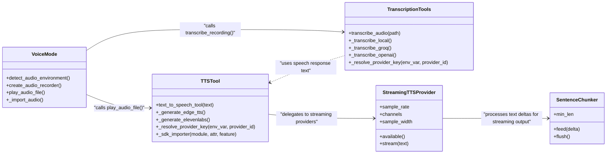

<!-- source: DeepWiki mcp.deepwiki.com · repo nousresearch/hermes-agent · page 11 Voice and TTS · fetched 2026-10-27 -->

# Voice and TTS

Relevant source files

The following files were used as context for generating this wiki page:

- [agent/tts_provider.py](agent/tts_provider.py)
- [apps/desktop/src/lib/speech-text.identifier-corpus.test.ts](apps/desktop/src/lib/speech-text.identifier-corpus.test.ts)
- [apps/desktop/src/lib/speech-text.test.ts](apps/desktop/src/lib/speech-text.test.ts)
- [apps/desktop/src/lib/speech-text.ts](apps/desktop/src/lib/speech-text.ts)
- [hermes_cli/profile_identity.py](hermes_cli/profile_identity.py)
- [hermes_cli/voice.py](hermes_cli/voice.py)
- [scripts/ci/list_os_marked_tests.py](scripts/ci/list_os_marked_tests.py)
- [tests/_fixtures/__init__.py](tests/_fixtures/__init__.py)
- [tests/_fixtures/env_filter.py](tests/_fixtures/env_filter.py)
- [tests/_fixtures/platform_gating.py](tests/_fixtures/platform_gating.py)
- [tests/agent/test_tts_registry.py](tests/agent/test_tts_registry.py)
- [tests/ci/test_list_os_marked_tests.py](tests/ci/test_list_os_marked_tests.py)
- [tests/fixtures/identifier_speech_corpus.json](tests/fixtures/identifier_speech_corpus.json)
- [tests/gateway/test_pm_activation.py](tests/gateway/test_pm_activation.py)
- [tests/git_safety.py](tests/git_safety.py)
- [tests/hermes_cli/test_graphical_browser_detection.py](tests/hermes_cli/test_graphical_browser_detection.py)
- [tests/hermes_cli/test_plugins_tts_registration.py](tests/hermes_cli/test_plugins_tts_registration.py)
- [tests/hermes_cli/test_plugins_update_sync.py](tests/hermes_cli/test_plugins_update_sync.py)
- [tests/hermes_cli/test_profile_rename_checkpoints.py](tests/hermes_cli/test_profile_rename_checkpoints.py)
- [tests/hermes_cli/test_tts_picker.py](tests/hermes_cli/test_tts_picker.py)
- [tests/hermes_cli/test_update_fleet_incomplete_warning.py](tests/hermes_cli/test_update_fleet_incomplete_warning.py)
- [tests/hermes_cli/test_update_launchd_fleet_restart.py](tests/hermes_cli/test_update_launchd_fleet_restart.py)
- [tests/hermes_cli/test_update_launchd_restart_verification.py](tests/hermes_cli/test_update_launchd_restart_verification.py)
- [tests/hermes_cli/test_update_launchd_unloaded_gateway.py](tests/hermes_cli/test_update_launchd_unloaded_gateway.py)
- [tests/hermes_cli/test_voice_wrapper.py](tests/hermes_cli/test_voice_wrapper.py)
- [tests/hermes_cli/test_web_server_tts_lease.py](tests/hermes_cli/test_web_server_tts_lease.py)
- [tests/plugins/tts/__init__.py](tests/plugins/tts/__init__.py)
- [tests/plugins/tts/check_parity_vs_main.py](tests/plugins/tts/check_parity_vs_main.py)
- [tests/test_git_safety_boundary.py](tests/test_git_safety_boundary.py)
- [tests/test_live_system_guard.py](tests/test_live_system_guard.py)
- [tests/test_os_marker_gating.py](tests/test_os_marker_gating.py)
- [tests/test_platforms_marker.py](tests/test_platforms_marker.py)
- [tests/tools/conftest.py](tests/tools/conftest.py)
- [tests/tools/test_transcription.py](tests/tools/test_transcription.py)
- [tests/tools/test_transcription_dotenv_fallback.py](tests/tools/test_transcription_dotenv_fallback.py)
- [tests/tools/test_transcription_tools.py](tests/tools/test_transcription_tools.py)
- [tests/tools/test_tts_command_providers.py](tests/tools/test_tts_command_providers.py)
- [tests/tools/test_tts_deepinfra.py](tests/tools/test_tts_deepinfra.py)
- [tests/tools/test_tts_dotenv_fallback.py](tests/tools/test_tts_dotenv_fallback.py)
- [tests/tools/test_tts_gemini.py](tests/tools/test_tts_gemini.py)
- [tests/tools/test_tts_identifier_speech.py](tests/tools/test_tts_identifier_speech.py)
- [tests/tools/test_tts_lifecycle_leases.py](tests/tools/test_tts_lifecycle_leases.py)
- [tests/tools/test_tts_macos_output.py](tests/tools/test_tts_macos_output.py)
- [tests/tools/test_tts_mistral.py](tests/tools/test_tts_mistral.py)
- [tests/tools/test_tts_piper.py](tests/tools/test_tts_piper.py)
- [tests/tools/test_tts_plugin_dispatch.py](tests/tools/test_tts_plugin_dispatch.py)
- [tests/tools/test_tts_streaming.py](tests/tools/test_tts_streaming.py)
- [tests/tools/test_tts_text_normalize.py](tests/tools/test_tts_text_normalize.py)
- [tests/tools/test_voice_cli_integration.py](tests/tools/test_voice_cli_integration.py)
- [tests/tools/test_voice_mode.py](tests/tools/test_voice_mode.py)
- [tests/tools/test_voice_stop_phrase.py](tests/tools/test_voice_stop_phrase.py)
- [tests/tools/test_voice_tts_echo_guard.py](tests/tools/test_voice_tts_echo_guard.py)
- [tools/checkpoint_manager_profile_rename.py](tools/checkpoint_manager_profile_rename.py)
- [tools/transcription_audio.py](tools/transcription_audio.py)
- [tools/transcription_cloud.py](tools/transcription_cloud.py)
- [tools/transcription_command.py](tools/transcription_command.py)
- [tools/transcription_common.py](tools/transcription_common.py)
- [tools/transcription_local.py](tools/transcription_local.py)
- [tools/transcription_tools.py](tools/transcription_tools.py)
- [tools/tts_command_provider.py](tools/tts_command_provider.py)
- [tools/tts_streaming.py](tools/tts_streaming.py)
- [tools/tts_text_normalize.py](tools/tts_text_normalize.py)
- [tools/tts_tool.py](tools/tts_tool.py)
- [tools/tts_tool_delivery.py](tools/tts_tool_delivery.py)
- [tools/tts_tool_lifecycle.py](tools/tts_tool_lifecycle.py)
- [tools/tts_tool_local.py](tools/tts_tool_local.py)
- [tools/tts_tool_openai.py](tools/tts_tool_openai.py)
- [tools/tts_tool_plugins.py](tools/tts_tool_plugins.py)
- [tools/tts_tool_providers.py](tools/tts_tool_providers.py)
- [tools/tts_tool_speaker.py](tools/tts_tool_speaker.py)
- [tools/voice_mode.py](tools/voice_mode.py)
- [tools/xai_http.py](tools/xai_http.py)
- [website/docs/developer-guide/streaming-tts.md](website/docs/developer-guide/streaming-tts.md)
- [website/docs/user-guide/features/tts.md](website/docs/user-guide/features/tts.md)

This page provides a high-level overview of the voice interaction and speech synthesis capabilities within Hermes Agent. The system enables real-time voice input and output across CLI and other platforms, supporting push-to-talk and continuous voice modes, multi-provider speech-to-text (STT) transcription, multi-provider text-to-speech (TTS) synthesis with streaming support, and a web platform adapter for browser-based voice interaction.

---

## Overview of Voice Capabilities

Hermes bridges "Natural Language Space" — the spoken and heard audio — with "Code Entity Space" — its internal agent classes and tools — via a modular voice processing pipeline. Core components include wake-word detection engines, audio recorders, transcription backends, the AI agent language model, and text-to-speech synthesizers.

| Feature | Description | Key Code Entities |
| :----------------------- | :--------------------------------------------------------------------------------------------------------------------------------------------------------------------------------------------------------------------------------------------------------------------------------------------------------------------------------------------------------------------------------------------------------------------------------------------------------------------------------------------------------------------------------------------------------------------------------------------------------------------------------------------------------------------------------------------------------------------------------------------------------------------------------------------------------------------------------------------------------------------------------------------------------------------------------------------------------------------------------------------------------------------------------------------------------------------------------------------------------------------------------------------------------------------------------------------------------------------------------------------------------------------------------------------------------------------------------------------------------------------------------------------------------------------------------------------------------------------------------------------------------------------------------------------------------------------------------------------------------------------------------------------------------------------------------------------------------------------------------------------------------------------------------------------------------------------------------------------------------------------------------------------------------------------------------------------------------------------------------------------------------------------------------------------------------------------------------------------------------------------------------------------------------------------------------------------------------------------------------------------------------------------------------------------------------------------------------------------------------------------------------------------------------------------------------------------------------------------------------------------------------------------------------------------------------------------------------------------------------------------------------------------------------------------------------------------------------------------------------------------------------------------------------------------------------------------------------------------------------------------------------------------------------------------------------------------------------------------------------------------------------------------------------------------------------------------------------------------------------------------------------------------------------------------------------------------------------------------------------------------------------------------------------------------------------------------------------------------------------------------------------------------------------------------------------------------------------------------------------------------------------------------------------------------------------------------------------------------------------------------------------------------------------------------------------------------------------------------------------------------------------------------------------------------------------------------------------------------------------------------------------------------------------------------------------------------------------------------------------------------------------------------------------------------------------------------------------------------------------------------------------------------------------------------------------------------------------------------------------------------------------------------------------------------------------------------------------------------------------------------------------------------------------------------------------------------------------------------------------------------------------------------------------------------------------------------------------------------------------------------------------------------------------------------------------------------------------------------------------------------------------------------------------------------------------------------------------------------------------------------------------------------------------------------------------------------------------------------------------------------------------------------------------------------------------------------------------------------------------------------------------------------------------------------------------------------------------------------------------------------------------------------------------------------------------------------------------------------------------------------------------------------------------------------------------------------------------------------------------------------------------------------------------------------------------------------------------------------------------------------------------------------------------------------------------------------------------------------------------------------------------------------------------------------------------------------------------------------------------------------------------------------------------------------------------------------------------------------------------------------------------------------------------------------------------------------------------------------------------------------------------------------------------------------------------------------------------------------------------------------------------------------------------------------------------------------------------------------------------------------------------------------------------------------------------------------------------------------------------------------------------------------------------------------------------------------------------------------------------------------------------------------------------------------------------------------------------------------------------------------------------------------------------------------------------------------------------------------------------------------------------------------------------------------------------------------------------------------------------------------------------------------------------------------------------------------------------------------------------------------------------------------------------------------------------------------------------------------------------------------------------------------------------------------------------------------------------------------------------------------------------------------------------------------------------------------------------------------------------------------------------------------------------------------------------------------------------------------------------------------------------------------------------------------------------------------------------------------------------------------------------------------------------------------------------------------------------------------------------------------------------------------------------------------------------------------------------------------------------------------------------------------------------------------------------------------------------------------------------------------------------------------------------------------------------------------------------------------------------------------------------------------------------------------------------------------------------------------------------------------------------------------------------------------------------------------------------------------------------------------------------------------------------------------------------------------------------------------------------------------------------------------------------------------------------------------------------------------------------------------------------------------------------------------------------------------------------------------------------------------------------------------------------------------------------------------------------------------------------------------------------------------------------------------------------------------------------------------------------------------------------------------------------------------------------------------------------------------------------------------------------------------------------------------------------------------------------------------------------------------------------------------------------------------------------------------------------------------------------------------------------------------------------------------------------------------------------------------------------------------------------------------------------------------------------------------------------------------------------------------------------------------------------------------------------------------------------------------------------------------------------------------------------------------------------------------------------------------------------------------------------------------------------------------------------------------------------------------------------------------------------------------------------------------------------------------------------------------------------------------------------------------------------------------------------------------------------------------------------------------------------------------------------------------------------------------------------------------------------------------------------------------------------------------------------------------------------------------------------------------------------------------------------------------------------------------------------------------------------------------------------------------------------------------------------------------------------------------------------------------------------------------------------------------------------------------------------------------------------------------------------------------------------------------------------------------------------------------------------------------------------------------------------------------------------------------------------------------------------------------------------------------------------------------------------------------------------------------------------------------------------------------------------------------------------------------------------------------------------------------------------------------------------------------------------------------------------------------------------------------------------------------------------------------------------------------------------------------------------------------------------------------------------------------------------------------------------------------------------------------------------------------------------------------------------------------------------------------------------------------------------------------------------------------------------------------------------------------------------------------------------------------------------------------------------------------------------------------------------------------------------------------------------------------------------------------------------------------------------------------------------------------------------------------------------------------------------------------------------------------------------------------------------------------------------------------------------------------------------------------------------------------------------------------------------------------------------------------------------------------------------------------------------------------------------------------------------------------------------------------------------------------------------------------------------------------------------------------------------------------------------------------------------------------------------------------------------------------------------------------------------------------------------------------------------------------------------------------------------------------------------------------------------------------------------------------------------------------------------------------------------------------------------------------------------------------------------------------------------------------------------------------------------------------------------------------------------------------------------------------------------------------------------------------------------------------------------------------------------------------------------------------------------------------------------------------------------------------------------------------------------------------------------------------------------------------------------------------------------------------------------------------------------------------------------------------------------------------------------------------------------------------------------------------------------------------------------------------------------------------------------------------------------------------------------------------------------------------------------------------------------------------------------------------------------------------------------------------------------------------------------------------------------------------------------------------------------------------------------------------------------------------------------------------------------------------------------------------------------------------------------------------------------------------------------------------------------------------------------------------------------------------------------------------------------------------------------------------------------------------------------------------------------------------------------------------------------------------------------------------------------------------------------------------------------------------------------------------------------------------------------------------------------------------------------------------------------------------------------------------------------------------------------------------------------------------------------------------------------------------------------------------------------------------------------------------------------------------------------------------------------------------------------------------------------------------------------------------------------------------------------------------------------------------------------------------------------------------------------------------------------------------------------------------------------------------------------------------------------------------------------------------------------------------------------------------------------------------------------------------------------------------------------------------------------------------------------------------------------------------------------------------------------------------------------------------------------------------------------------------------------------------------------------------------------------------------------------------------------------------------------------------------------------------------------------------------------------------------------------------------------------------------------------------------------------------------------------------------------------------------------------------------------------------------------------------------------------------------------------------------------------------------------------------------------------------------------------------------------------------------------------------------------------------------------------------------------------------------------------------------------------------------------------------------------------------------------------------------------------------------------------------------------------------------------------------------------------------------------------------------------------------------------------------------------------------------------------------------------------------------------------------------------------------------------------------------------------------------------------------------------------------------------------------------------------------------------------------------------------------------------------------------------------------------------------------------------------------------------------------------------------------------------------------------------------------------------------------------------------------------------------------------------------------------------------------------------------------------------------------------------------------------------------------------------------------------------------------------------------------------------------------------------------------------------------------------------------------------------------------------------------------------------------------------------------------------------------------------------------------------------------------------------------------------------------------------------------------------------------------------------------------------------------------------------------------------------------------------------------------------------------------------------------------------------------------------------------------------------------------------------------------------------------------------------------------------------------------------------------------------------------------------------------------------------------------------------------------------------------------------------------------------------------------------------------------------------------------------------------------------------------------------------------------------------------------------------------------------------------------------------------------------------------------------------------------------------------------------------------------------------------------------------------------------------------------------------------------------------------------------------------------------------------------------------------------------------------------------------------------------------------------------------------------------------------------------------------------------------------------------------------------------------------------------------------------------------------------------------------------------------------------------------------------------------------------------------------------------------------------------------------------------------------------------------------------------------------------------------------------------------------------------------------------------------------------------------------------------------------------------------------------------------------------------------------------------------------------------------------------------------------------------------------------------------------------------------------------------------------------------------------------------------------------------------------------------------------------------------------------------------------------------------------------------------------------------------------------------------------------------------------------------------------------------------------------------------------------------------------------------------------------------------------------------------------------------------------------------------------------------------------------------------------------------------------------------------------------------------------------------------------------------------------------------------------------------------------------------------------------------------------------------------------------------------------------------------------------------------------------------------------------------------------------------------------------------------------------------------------------------------------------------------------------------------------------------------------------------------------------------------------------------------------------------------------------------------------------------------------------------------------------------------------------------------------------------------------------------------------------------------------------------------------------------------------------------------------------------------------------------------------------------------------------------------------------------------------------------------------------------------------------------------------------------------------------------------------------------------------------------------------------------------------------------------------------------------------------------------------------------------------------------------------------------------------------------------------------------------------------------------------------------------------------------------------------------------------------------------------------------------------------------------------------------------------------------------------------------------------------------------------------------------------------------------------------------------------------------------------------------------------------------------------------------------------------------------------------------------------------------------------------------------------------------------------------------------------------------------------------------------------------------------------------------------------------------------------------------------------------------------------------------------------------------------------------------------------------------------------------------------------------------------------------------------------------------------------------------------------------------------------------------------------------------------------------------------------------------------------------------------------------------------------------------------------------------------------------------------------------------------------------------------------------------------------------------------------------------------------------------------------------------------------------------------------------------------------------------------------------------------------------------------------------------------------------------------------------------------------------------------------------------------------------------------------------------------------------------------------------------------------------------------------------------------------------------------------------------------------------------------------------------------------------------------------------------------------------------------------------------------------------------------------------------------------------------------------------------------------------------------------------------------------------------------------------------------------------------------------------------------------------------------------------------------------------------------------------------------------------------------------------------------------------------------------------------------------------------------------------------------------------------------------------------------------------------------------------------------------------------------------------------------------------------------------------------------------------------------------------------------------------------------------------------------------------------------------------------------------------------------------------------------------------------------------------------------------------------------------------------------------------------------------------------------------------------------------------------------------------------------------------------------------------------------------------------------------------------------------------------------------------------------------------------------------------------------------------------------------------------------------------------------------------------------------------------------------------------------------------------------------------------------------------------------------------------------------------------------------------------------------------------------------------------------------------------------------------------------------------------------------------------------------------------------------------------------------------------------------------------------------------------------------------------------------------------------------------------------------------------------------------------------------------------------------------------------------------------------------------------------------------------------------------------------------------------------------------------------------------------------------------------------------------------------------------------------------------------------------------------------------------------------------------------------------------------------------------------------------------------------------------------------------------------------------------------------------------------------------------------------------------------------------------------------------------------------------------------------------------------------------------------------------------------------------------------------------------------------------------------------------------------------------------------------------------------------------------------------------------------------------------------------------------------------------------------------------------------------------------------------------------------------------------------------------------------------------------------------------------------------------------------------------------------------------------------------------------------------------------------------------------------------------------------------------------------------------------------------------------------------------------------------------------------------------------------------------------------------------------------------------------------------------------------------------------------------------------------------------------------------------------------------------------------------------------------------------------------------------------------------------------------------------------------------------------------------------------------------------------------------------------------------------------------------------------------------------------------------------------------------------------------------------------------------------------------------------------------------------------------------------------------------------------------------------------------------------------------------------------------------------------------------------------------------------------------------------------------------------------------------------------------------------------------------------------------------------------------------------------------------------------------------------------------------------------------------------------------------------------------------------------------------------------------------------------------------------------------------------------------------------------------------------------------------------------------------------------------------------------------------------------------------------------------------------------------------------------------------------------------------------------------------------------------------------------------------------------------------------------------------------------------------------------------------------------------------------------------------------------------------------------------------------------------------------------------------------------------------------------------------------------------------------------------------------------------------------------------------------------------------------------------------------------------------------------------------------------------------------------------------------------------------------------------------------------------------------------------------------------------------------------------------------------------------------------------------------------------------------------------------------------------------------------------------------------------------------------------------------------------------------------------------------------------------------------------------------------------------------------------------------------------------------------------------------------------------------------------------------------------------------------------------------------------------------------------------------------------------------------------------------------------------------------------------------------------------------------------------------------------------------------------------------------------------------------------------------------------------------------------------------------------------------------------------------------------------------------------------
Voice and TTS is a core component of the Hermes Agent, enabling natural language interaction through both speech-to-text (STT) transcription and text-to-speech (TTS) synthesis. This system allows users to interact with the agent using their voice, and for the agent to respond audibly, creating a more intuitive and accessible experience.

This page provides a high-level overview of the voice mode, TTS, and transcription functionalities. For detailed technical information, please refer to the child pages.

---

## Voice Mode

Voice Mode provides an interactive spoken interface for Hermes Agent, primarily within the command-line interface (CLI), but also extending to platforms like Discord. It encompasses the activation and control of voice interactions, audio capture mechanisms, and environmental awareness to ensure proper functionality.

Users can activate and deactivate voice mode using specific commands, such as `/voice on` and `/voice off`. The CLI manages the voice state, orchestrating audio recording, transcription, and TTS playback asynchronously to deliver a seamless voice experience [tests/tools/test_voice_cli_integration.py:87-103](). Audio is captured at a sample rate of 16kHz, mono, utilizing `sounddevice` for hardware interaction. This component is designed with lazy imports to prevent errors in headless or containerized environments where audio hardware might be absent [tools/voice_mode.py:45-62](). The system also intelligently detects periods of silence to automatically stop recording after a configurable duration [tools/voice_mode.py:37-38]().

Hermes is aware of its operating environment, detecting conditions such as SSH sessions without sound servers, containerized deployments, Windows Subsystem for Linux (WSL), and the presence of PulseAudio or PipeWire servers. Voice mode is only enabled when the necessary audio input/output capabilities are confirmed to be available [tools/voice_mode.py:147-175](). The agent supports both push-to-talk and continuous listening, including wake-word detection for hands-free activation. Special logic is in place to normalize and manage voice activation keys, particularly on macOS and in multiplexed terminal sessions, to prevent keybinding conflicts [hermes_cli/voice.py:20-110]().

For a comprehensive explanation of voice mode activation, wake-word detection, Discord voice channel integration, the STT pipeline, and per-chat voice settings, see the child page [Voice Mode](#11.1).

Sources:
* [tools/voice_mode.py:37-38]()
* [tools/voice_mode.py:45-62]()
* [tools/voice_mode.py:147-175]()
* [hermes_cli/voice.py:20-110]()
* [tests/tools/test_voice_cli_integration.py:87-103]()

---

## TTS and Transcription

The Hermes Agent features a robust and extensible subsystem for both text-to-speech (TTS) synthesis and speech-to-text (STT) transcription, designed to operate across various platforms and integrate with multiple providers.

### Speech-to-Text (STT)

The STT subsystem supports a wide array of providers, including local implementations like `faster-whisper`, and cloud-based services such as Groq Whisper API, OpenAI Whisper, Mistral Voxtral ASR, xAI Grok, ElevenLabs, and DeepInfra. It also allows for user-defined command-line or plugin-based providers [tools/transcription_tools.py:1-9](). To optimize resource usage, local STT models are loaded lazily and automatically unloaded after periods of inactivity by background threads [tools/transcription_tools.py:67-84](). API keys and credentials for these providers are resolved through a flexible system that checks configuration files, environment variables, and a shared credential pool [tools/transcription_tools.py:51-54]().

### Text-to-Speech (TTS)

The TTS component integrates with numerous providers, offering a range of voices, models, speeds, and output formats. Built-in providers include the free default Edge TTS, ElevenLabs, OpenAI TTS, MiniMax, Mistral, Google Gemini, xAI, and DeepInfra. Additionally, local synthesizers like NeuTTS, KittenTTS, and Piper are supported [tools/tts_tool.py:1-9,104-105]().

Streaming TTS is a key feature, enabling low-latency audio playback by delivering raw PCM audio chunks on a per-sentence basis. Providers adhere to a common interface to integrate with this streaming pipeline, with synchronous fallback methods available for providers that do not support streaming [tools/tts_streaming.py:1-10,120-131](). Before synthesis, text undergoes normalization to improve speech clarity, which includes stripping Markdown and performing linguistic adjustments [tests/tools/test_voice_cli_integration.py:50-58]().

### Code Entity Relationships in Voice and TTS

*Diagram: Voice Input and Output Pipeline Bridging Natural Language to Code Entities*

This diagram illustrates the key code entities and their interconnections in voice input processing, transcription, and speech synthesis playback.

For comprehensive technical documentation of all TTS providers, full streaming synthesis mechanisms, detailed transcription implementations, and the web platform adapter enabling browser-based voice features, see the child page [TTS and Transcription](#11.2).

Sources:
* [tools/tts_tool.py:1-9]()
* [tools/tts_tool.py:104-105]()
* [tools/transcription_tools.py:1-9]()
* [tools/transcription_tools.py:51-54]()
* [tools/transcription_tools.py:67-84]()
* [tools/tts_streaming.py:1-10]()
* [tools/tts_streaming.py:120-131]()
* [tests/tools/test_voice_cli_integration.py:50-58]()

---

This overview sketches the architectural and code relationships for voice capture, transcription, and speech synthesis in Hermes Agent. To explore these subsystems further, consult the linked child pages:

- [Voice Mode](#11.1) — Voice mode activation, wakewords, Discord voice integration, STT pipeline, and per-chat voice settings.
- [TTS and Transcription](#11.2) — TTS synthesis backends, streaming TTS, transcription tool implementations, and the web platform voice adapter.

---

