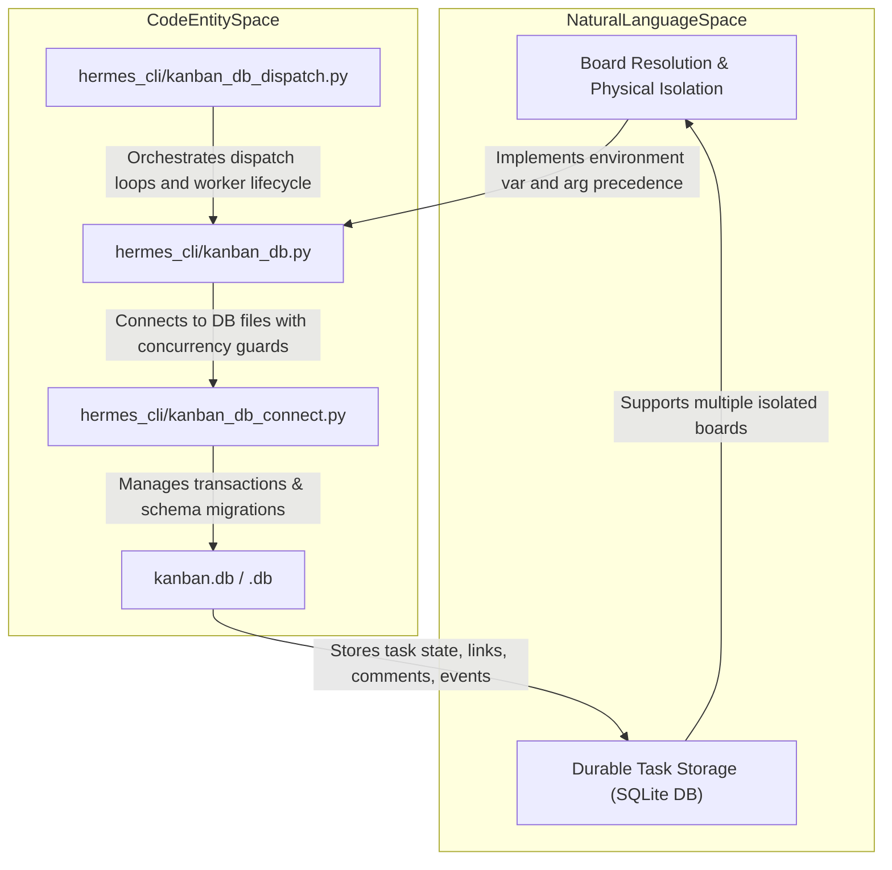
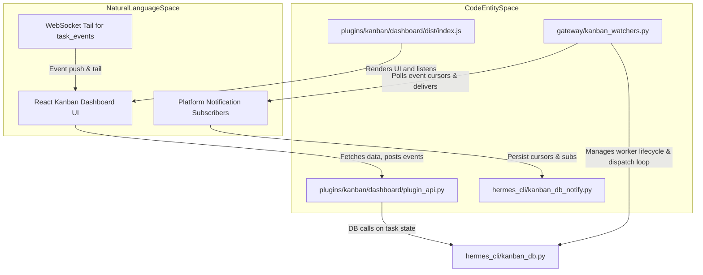

<!-- source: DeepWiki mcp.deepwiki.com · repo nousresearch/hermes-agent · page 13.1 Kanban Core and CLI · fetched 2026-10-27 -->

# Kanban Core and CLI

Relevant source files

The following files were used as context for generating this wiki page:

- [contributors/emails/robertlisowski57@gmail.com](contributors/emails/robertlisowski57@gmail.com)
- [hermes_cli/kanban.py](hermes_cli/kanban.py)
- [hermes_cli/kanban_db.py](hermes_cli/kanban_db.py)
- [hermes_cli/kanban_db_connect.py](hermes_cli/kanban_db_connect.py)
- [hermes_cli/kanban_db_dispatch.py](hermes_cli/kanban_db_dispatch.py)
- [hermes_cli/kanban_db_notify.py](hermes_cli/kanban_db_notify.py)
- [hermes_cli/kanban_db_workspace.py](hermes_cli/kanban_db_workspace.py)
- [hermes_cli/kanban_diagnostics.py](hermes_cli/kanban_diagnostics.py)
- [hermes_cli/kanban_ops.py](hermes_cli/kanban_ops.py)
- [hermes_cli/kanban_output.py](hermes_cli/kanban_output.py)
- [hermes_cli/kanban_parser.py](hermes_cli/kanban_parser.py)
- [hermes_cli/kanban_swarm.py](hermes_cli/kanban_swarm.py)
- [hermes_cli/kanban_transfer.py](hermes_cli/kanban_transfer.py)
- [hermes_cli/kanban_workflow.py](hermes_cli/kanban_workflow.py)
- [optional-skills/autonomous-ai-agents/agent-merge-conflict-arbiter/SKILL.md](optional-skills/autonomous-ai-agents/agent-merge-conflict-arbiter/SKILL.md)
- [plugins/kanban/dashboard/dist/index.js](plugins/kanban/dashboard/dist/index.js)
- [plugins/kanban/dashboard/dist/style.css](plugins/kanban/dashboard/dist/style.css)
- [plugins/kanban/dashboard/plugin_api.py](plugins/kanban/dashboard/plugin_api.py)
- [tests/hermes_cli/test_kanban_block_kinds.py](tests/hermes_cli/test_kanban_block_kinds.py)
- [tests/hermes_cli/test_kanban_cli.py](tests/hermes_cli/test_kanban_cli.py)
- [tests/hermes_cli/test_kanban_complete_live_claim_guard.py](tests/hermes_cli/test_kanban_complete_live_claim_guard.py)
- [tests/hermes_cli/test_kanban_core_functionality.py](tests/hermes_cli/test_kanban_core_functionality.py)
- [tests/hermes_cli/test_kanban_db.py](tests/hermes_cli/test_kanban_db.py)
- [tests/hermes_cli/test_kanban_diagnostics.py](tests/hermes_cli/test_kanban_diagnostics.py)
- [tests/hermes_cli/test_kanban_dispatch_claim_allowlist.py](tests/hermes_cli/test_kanban_dispatch_claim_allowlist.py)
- [tests/hermes_cli/test_kanban_gc_retention.py](tests/hermes_cli/test_kanban_gc_retention.py)
- [tests/hermes_cli/test_kanban_list_undecodable_text.py](tests/hermes_cli/test_kanban_list_undecodable_text.py)
- [tests/hermes_cli/test_kanban_notify.py](tests/hermes_cli/test_kanban_notify.py)
- [tests/hermes_cli/test_kanban_review_lifecycle.py](tests/hermes_cli/test_kanban_review_lifecycle.py)
- [tests/hermes_cli/test_kanban_review_lifecycle_complete.py](tests/hermes_cli/test_kanban_review_lifecycle_complete.py)
- [tests/hermes_cli/test_kanban_review_surfaces.py](tests/hermes_cli/test_kanban_review_surfaces.py)
- [tests/hermes_cli/test_kanban_swarm.py](tests/hermes_cli/test_kanban_swarm.py)
- [tests/hermes_cli/test_kanban_transfer.py](tests/hermes_cli/test_kanban_transfer.py)
- [tests/hermes_cli/test_kanban_watch_banner.py](tests/hermes_cli/test_kanban_watch_banner.py)
- [tests/hermes_cli/test_kanban_workflow.py](tests/hermes_cli/test_kanban_workflow.py)
- [tests/hermes_cli/test_kanban_worktree_teardown.py](tests/hermes_cli/test_kanban_worktree_teardown.py)
- [tests/plugins/test_kanban_dashboard_plugin.py](tests/plugins/test_kanban_dashboard_plugin.py)
- [tests/plugins/test_kanban_workflow_matrix.py](tests/plugins/test_kanban_workflow_matrix.py)
- [tests/tools/test_kanban_tools.py](tests/tools/test_kanban_tools.py)
- [tools/kanban_tools.py](tools/kanban_tools.py)
- [tools/kanban_tools_schemas.py](tools/kanban_tools_schemas.py)
- [website/docs/user-guide/features/kanban-worker-lanes.md](website/docs/user-guide/features/kanban-worker-lanes.md)
- [website/docs/user-guide/features/kanban.md](website/docs/user-guide/features/kanban.md)
- [website/i18n/zh-Hans/docusaurus-plugin-content-docs/current/user-guide/features/kanban-worker-lanes.md](website/i18n/zh-Hans/docusaurus-plugin-content-docs/current/user-guide/features/kanban-worker-lanes.md)
- [website/i18n/zh-Hans/docusaurus-plugin-content-docs/current/user-guide/features/kanban.md](website/i18n/zh-Hans/docusaurus-plugin-content-docs/current/user-guide/features/kanban.md)

The Kanban system in Hermes Agent is a durable, SQLite-backed task board designed for coordinating multiple profiles and projects across agentic workflows [website/docs/user-guide/features/kanban.md:7-12](). Unlike ephemeral subagent delegation via `delegate_task`, Kanban provides a resilient state machine for tasks that survive process restarts, enable human-in-the-loop input, and maintain a durable audit trail [website/docs/user-guide/features/kanban.md:32-54]().

---

## Kanban Database Schema and Architecture

The Kanban core is implemented primarily in `hermes_cli/kanban_db.py`, which manages a SQLite database that defaults to `<root>/kanban.db` for a shared default board, with support for multiple isolated boards located under `<root>/kanban/boards/<slug>/`. Boards are completely isolated, with workers scoped to a single board never able to see or affect others [hermes_cli/kanban_db.py:1-13,3-9]().

### Board Resolution Hierarchy

Board resolution determines which physical SQLite database file a caller accesses. It follows this precedence:

1. Explicit `board=` argument — e.g., CLI flags, web dashboard query params [hermes_cli/kanban_db.py:5-9]()
2. Environment variable `HERMES_KANBAN_BOARD` — resolved to a normalized board slug [hermes_cli/kanban_db.py:5-9]()
3. Environment variable `HERMES_KANBAN_DB` — pins a file path directly, bypassing slug normalization [hermes_cli/kanban_db.py:5-9]()
4. Content of the `<root>/kanban/current` file — stores the current active default board slug
5. Fallback to the hardcoded `"default"` board for backward compatibility [hermes_cli/kanban_db.py:3-9]()

The dispatcher and spawned workers enforce board scoping by injecting `HERMES_KANBAN_DB` and `HERMES_KANBAN_BOARD` into subprocess environments, ensuring strict physical separation of boards [hermes_cli/kanban_db.py:5-9](). This architectural isolation ensures that a worker on one board cannot see or affect others.

### Core Schema Entities

The SQLite schema consists of the following primary tables representing the Kanban data model:

| Table           | Description                                                                                                                                    |
|-----------------|------------------------------------------------------------------------------------------------------------------------------------------------|
| `tasks`         | Core task records with columns like `id`, `title`, `body`, `assignee`, `status`, `priority`, timestamps (`created_at`, `started_at`, etc.), `claim_lock`, workspace kind/path, tenant, metadata, and other fields [tests/hermes_cli/test_kanban_db.py:109-125]() |
| `task_links`    | Directed parent-child edges representing dependencies controlling readiness and sequencing. These enforce DAG integrity and propagate status [website/docs/user-guide/features/kanban.md:63-64]() |
| `task_comments` | Append-only comments on tasks supporting collaboration and human feedback                                                                         |
| `task_events`   | Immutable append-only event log capturing lifecycle transitions, claims, releases, diagnostics, and user actions; critical for event streaming and notification [plugins/kanban/dashboard/plugin_api.py:4-8]() |
| `task_runs`     | Tracks individual execution runs/work sessions on tasks, recording iteration counts, timestamps, and final results                               |
| `attachments`   | Files attached to tasks (max size capped by `KANBAN_ATTACHMENT_MAX_BYTES`), stored with metadata                                                 |
| `notify_subs`   | Notification subscription records for external platforms (Telegram, Slack etc.), holding cursor state for incremental event transmission [tests/hermes_cli/test_kanban_core_functionality.py:104-150]() |

### Concurrency and Consistency

The Kanban DB uses SQLite's WAL (Write-Ahead Log) mode with `BEGIN IMMEDIATE` transactions to serialize writers and prevent deadlocks. Atomic claim and status changes employ compare-and-swap (CAS) operations on the task's `status` and `claim_lock` fields to guarantee exclusive ownership and detect contention without requiring distributed locks or retries. If competing claimers race, only one wins, and others see zero rows affected [hermes_cli/kanban_db.py:1-12](), [tests/hermes_cli/test_kanban_db.py:50-80]().

This guarantees a linearizable transitions model even under concurrent multi-process readers and writers and supports robust task ownership semantics.

### Diagram: Kanban Board Resolution and Core SQLite Schema

Sources: `hermes_cli/kanban_db.py:1-69`, `tests/hermes_cli/test_kanban_db.py:50-170`, `plugins/kanban/dashboard/plugin_api.py:1-50`

---

## Task Lifecycle and State Machine

The Kanban task lifecycle is orchestrated as a finite state machine with canonical statuses that guide coordination between agents, humans, and the dispatcher. The primary statuses are:

| Status      | Description                                                      |
|-------------|------------------------------------------------------------------|
| `triage`    | Raw new ideas or tasks awaiting specification                    |
| `todo`      | Blocked or waiting on dependencies or assignment                |
| `scheduled` | Scheduled for future execution (time delay)                     |
| `ready`     | Ready to be claimed and worked on; dependencies satisfied       |
| `running`   | Claimed by a worker, actively in progress                        |
| `blocked`   | Paused awaiting manual input or external conditions             |
| `review`    | Implementation complete; under review/verification              |
| `done`      | Completed successfully and finalized                            |
| `archived`  | Archived, hidden from normal board views                        |

These statuses dictate board column layout, dispatcher handling, and UI rendering [hermes_cli/kanban_db.py:106-107](), [website/docs/user-guide/features/kanban.md:30-35]().

### Block Reasons and Recurrence Guards

When a task is blocked, a typed reason from `{"dependency", "needs_input", "capability", "transient"}` is recorded. This typing enables targeted routing and troubleshooting.

To avoid infinite block-unblock cycling, a recurrence limit (default 2) is applied to the block/unblock cycles of the same reason. Upon exceeding this `BLOCK_RECURRENCE_LIMIT`, the task is sent back to the `triage` status for manual intervention [hermes_cli/kanban_db.py:109-114]().

### Workspace Types

Kanban tasks specify a **workspace** type denoting the execution environment/context:

- `scratch`: Ephemeral temporary directories that are cleared automatically after task completion, preserving any declared output artifacts intact.
- `dir:<path>`: Persistent directory workspaces shared and preserved indefinitely; absolute paths, useful for long-lived state or shared data.
- `worktree`: Git worktrees created under `.worktrees/<id>/`, enabling incremental, isolated Git environments for tasks working on version-controlled projects.

These modes facilitate safe isolated or persistent file environments per task, supporting workflows like parallel development, review, and artifact staging [website/docs/user-guide/features/kanban.md:65-68](), [hermes_cli/kanban_db.py:115-135]().

Sources: `hermes_cli/kanban_db.py:106-135`, `website/docs/user-guide/features/kanban.md:55-68`

---

## Claim, Heartbeat, Complete, and Crash Recovery

Kanban employs a structured lifecycle for task ownership by workers, enabling coordination and fault tolerance.

### Atomic Claiming

The `claim_task(conn, task_id)` function attempts to claim a task atomically within a transaction. It succeeds only if the task:

- Is in `ready` status
- Is not currently claimed (`claim_lock` is null or expired)

Claiming updates the task row's `claim_lock` (usually the caller's unique token or session) and transitions status to `running`. This uses SQLite's CAS semantics inside a `BEGIN IMMEDIATE` transaction to guarantee exclusivity even with concurrent claim attempts [tests/hermes_cli/test_kanban_db.py:50-80]().

### Heartbeat Renewal

A worker holding the claim must call `kanban_heartbeat` at intervals to extend their lease. This refreshes the claim expiry timestamps, preventing the dispatcher from prematurely reclaiming the task as crashed/stale.

Missed heartbeats past a configured grace window result in the task being declared orphaned, allowing the dispatcher to reclaim it for retry or recovery [tools/kanban_tools.py:130-160]().

### Completion and Promotion

Upon successful task execution, workers invoke `complete_task(conn, task_id, ...)` to:

- Record the completion result in `task_runs`
- Update the task status to `done`
- Release the claim lock
- Promote dependent child tasks to `ready` status if appropriate (according to dependency rules)

Completion commits a final summary and result metadata for auditing and downstream workflows [tests/tools/test_kanban_tools.py:110-140]().

### Crash Detection and Recovery

The dispatcher continuously monitors:

- Expired or missing heartbeats on claimed tasks
- Active worker process IDs associated with claims (via system PID checks)

If a worker process is no longer alive or the claim has been stale beyond a grace period (`HERMES_KANBAN_CRASH_GRACE_SECONDS`, default 30s), it reclaims the task by resetting status to `ready`. This recovers lost work due to crashes or disconnections and prevents tasks from being indefinitely stalled [tests/hermes_cli/test_kanban_core_functionality.py:30-55]().

Sources: `hermes_cli/kanban_db.py:1-12`, `tests/hermes_cli/test_kanban_core_functionality.py:30-55`, `tools/kanban_tools.py:130-160`

---

## Hermes Kanban CLI

The human- and scripting-facing CLI entrypoint is `hermes_cli/kanban.py`, implementing the `hermes kanban` command group. It exposes commands for comprehensive management of tasks, runs, boards, and dispatcher operations atop the transactional Kanban DB [hermes_cli/kanban.py:1-150]().

### Command Structure

The CLI commands include (not exhaustive):

- `create`: Creates new tasks with optional parents, assignee, priority, workspace, metadata, and git branch info [hermes_cli/kanban.py:80-95]().
- `list`: Lists tasks filtered by assignee, status, tenant, limiting output, with JSON or text rendering options [hermes_cli/kanban.py:35-56]().
- `show`: Displays detailed information about a task, including comments, events, and runs [hermes_cli/kanban.py:30-34]().
- `claim`, `heartbeat`: Claim and renew task lease for a worker.
- `complete`: Mark task as done with optional result and summary.
- `boards`: Manage board creation, deletion, metadata editing, and active board switching.
- `daemon`, `dispatch`: Manage the dispatcher daemon and worker spawn cycles.

The CLI includes strict flag parsing and validation:

- Board slug normalization and validation to prevent invalid or archived boards from operating [hermes_cli/kanban.py:60-84]()
- JSON metadata passed via `--metadata` flags, with parse error reporting and coercion [hermes_cli/kanban.py:44-55]()
- Workspace and git branch flag parsing with path expansion and syntax checking [hermes_cli/kanban.py:66-97]()
- Dispatcher presence checks showing warnings if no active dispatcher is running [hermes_cli/kanban.py:98-135]()

### Slash Command Integration

The CLI exports a `run_slash()` method enabling the `/kanban` slash command interface, integrating with messaging gateways or chat bots to control the Kanban via chat commands [hermes_cli/kanban.py:1-20]().

Sources: `hermes_cli/kanban.py:1-150`, `hermes_cli/kanban_db.py:1-40`

---

## Agent Tool Integration

Agents interact with Kanban via the structured tools layer implemented in `tools/kanban_tools.py`. These tools execute as in-process Python calls rather than shelling out to the CLI, allowing robust, structured JSON argument passing and typed schema validation [tools/kanban_tools.py:1-190]().

### Toolset Gating and Safety

- Kanban tools are registered only when the environment marks the process as a Kanban task worker (via `HERMES_KANBAN_TASK` environment variable) or when the profile explicitly enables the `kanban` toolset. This avoids exposing Kanban mutation functions in normal chat sessions [tools/kanban_tools.py:35-90]().

- Delegated subagent child contexts are prohibited from mutating Kanban state; the DB mutation layer enforces this by checking the context using internal fences to prevent forkbombs or unintended mutations outside trusted paths [hermes_cli/kanban_db.py:138-151](), [tools/kanban_tools.py:70-90]().

- Ownership checks inside handlers ensure workers can only mutate tasks they claim, and validation failures propagate as structured tool errors with usable messages for the AI. Unexpected exceptions are logged with tracebacks for operators [tools/kanban_tools.py:120-180]().

- The `_kanban_handler` decorator wraps each tool handler to convert exceptions into structured JSON tool errors comprehensible by LLMs, improving user and developer experience.

### Exposed Kanban Tools

Common Kanban tools include:

- `kanban_show`, `kanban_list` — read board and task state
- `kanban_complete`, `kanban_block`, `kanban_request_review`, `kanban_request_changes` — lifecycle transition operations terminating or advancing work runs
- `kanban_heartbeat` — renew claim ownership to avoid crashes
- `kanban_comment`, `kanban_attach`, `kanban_attach_url` — add collaboration artifacts and metadata

This API surface enables multi-agent orchestration with integrity and strong runtime validation.

Sources: `tools/kanban_tools.py:1-190`, `hermes_cli/kanban_db.py:138-151`

---

## Dashboard, Live Updates, and Notifications

The Kanban dashboard plugin provides a web-based real-time UI and REST API built atop the core Kanban DB, allowing human users to view, update, and react to task changes collaboratively [plugins/kanban/dashboard/plugin_api.py:1-58]().

### Dashboard Backend API

The plugin API handlers wrap the same `kanban_db` functions used by CLI/tools, ensuring no divergence in state or behavior:

- Creation, update, and deletion endpoints for tasks and boards
- Attachment file upload and download
- Board metadata management
- Task comments and event fetching
- Auxiliary asynchronous LLM helper calls to enrich tasks or compute metrics

Strict board slug normalization and error handling return HTTP 400 or 404 as appropriate on invalid or non-existent boards [plugins/kanban/dashboard/plugin_api.py:50-90]().

### Live Event Streaming via WebSocket

To enable near-real-time UI updates, the plugin exposes a WebSocket `/api/plugins/kanban/events` endpoint that tails the `task_events` table in SQLite WAL mode. This implementation is non-blocking and scalable, streaming only incremental events after a stored cursor per subscriber [plugins/kanban/dashboard/plugin_api.py:1-58]().

On the client-side, the React dashboard subscribes to this socket and renders updates to board columns, comments, and statuses as they arrive.

### Notification Subscriptions and Incremental Delivery

- Subscribers (e.g., Telegram chats, Slack channels) register notification cursors stored in `notify_subs` table enabling incremental delivery of task events.
- The gateway periodically polls subscribers, claims unseen events, delivers messages, then advances cursors.
- Subscriptions record platform, chat_id, user_id, delivery metadata, and last seen event to enable coordinated multi-process notification [tests/hermes_cli/test_kanban_core_functionality.py:100-180]().

### Gateway Background Watchers

Inside the messaging gateway component (not directly in the Kanban core), there are long-lived workers responsible for:

- Polling notification subscriptions and delivering event messages via platform adapters (Telegram, Slack, Discord, etc.)
- Performing Kanban dispatch cycles: scanning ready tasks, spawning workers, monitoring worker heartbeats, reclaiming crashed workers.
- Rotating worker log files and cleaning up stale runs.

This integration keeps the Kanban board in continuous synchronization with external messaging platforms and ensures resilient agent task execution [gateway/kanban_watchers.py:1-170]().

### Diagram: Dashboard Plugin and Gateway Notification Flow

Sources: `plugins/kanban/dashboard/plugin_api.py:1-58`, `plugins/kanban/dashboard/dist/index.js:1-50`, `gateway/kanban_watchers.py:1-170`, `tests/hermes_cli/test_kanban_core_functionality.py:100-180`

---

# Summary

The Kanban subsystem of Hermes Agent combines:

- A robust, isolated SQLite backend implementing task state machines, durable task/workflow data, and strong concurrency controls using WAL and CAS semantics.
- A lifecycle model for tasks supporting atomic claim, heartbeat renewal, completion, and automated crash recovery.
- A human- and automation-friendly CLI (`hermes kanban`) exposing transactional and filtered task management commands.
- A structured toolset API in-process for agents to drive task workflows, guarded by context and environment to prevent accidental mutations.
- A real-time web dashboard plugin with live event streaming, incremental notification subscriptions, and integration with messaging gateway watchers for external platform dispatch.
- Dispatcher logic managing worker spawning, crash/stale detection, and circuit breaker protective mechanisms to ensure system stability under failure.

Together, these components provide a scalable, durable, and observable coordination layer for complex multi-profile AI agent task workflows, enabling concurrent human and AI collaboration with resilience and traceability.

---

# Additional References

- Kanban core DB and concurrency: `hermes_cli/kanban_db.py`
- CLI command dispatch and parsing: `hermes_cli/kanban.py`
- Kanban lifecycle dispatcher and spawn loops: `hermes_cli/kanban_db_dispatch.py`
- Agent Kanban tools for structured task operations: `tools/kanban_tools.py`
- Dashboard backend API and websocket tailing: `plugins/kanban/dashboard/plugin_api.py`
- Gateway background watchers and notifier tick: `gateway/kanban_watchers.py`

This completes the detailed technical overview of Kanban Core and CLI in Hermes Agent.

---

