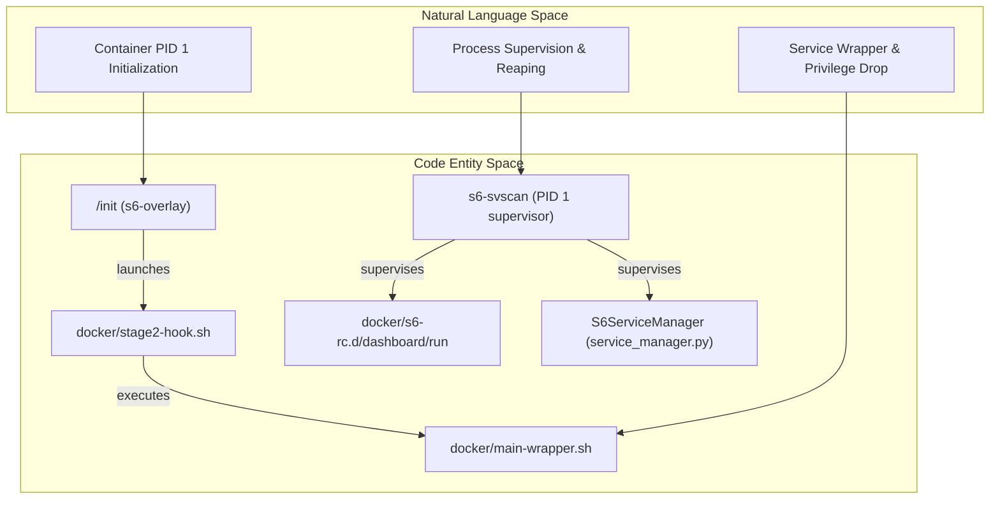
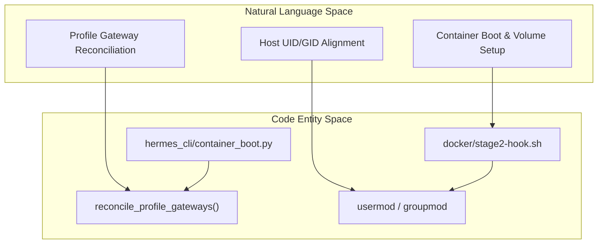
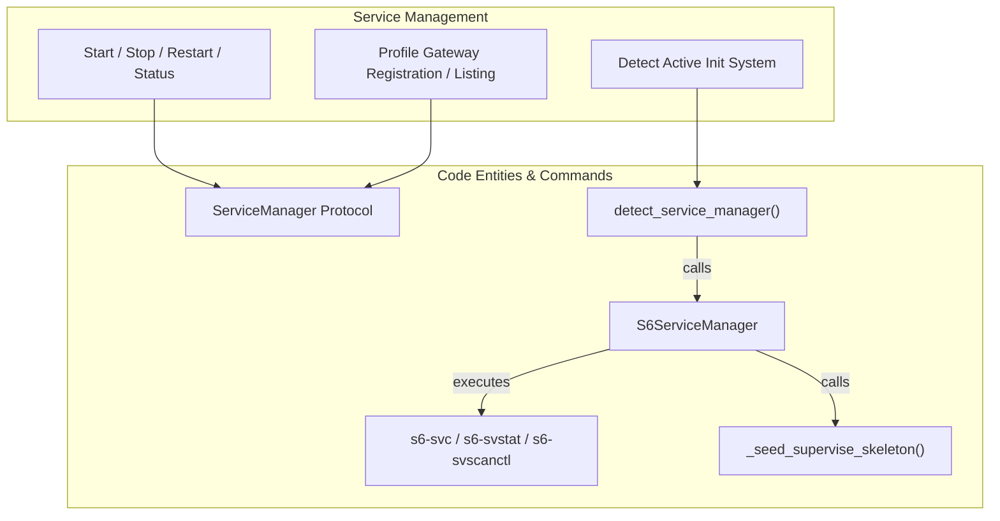

<!-- source: DeepWiki mcp.deepwiki.com · repo nousresearch/hermes-agent · page 14.1 Docker Deployment · fetched 2026-10-27 -->

# Docker Deployment

<details>
<summary>Relevant source files</summary>

The following files were used as context for generating this wiki page:

- [.dockerignore](.dockerignore)
- [.gitignore](.gitignore)
- [.hadolint.yaml](.hadolint.yaml)
- [Dockerfile](Dockerfile)
- [contributors/emails/dstkwll@users.noreply.github.com](contributors/emails/dstkwll@users.noreply.github.com)
- [docker-compose.yml](docker-compose.yml)
- [docker/cont-init.d/02-reconcile-profiles](docker/cont-init.d/02-reconcile-profiles)
- [docker/entrypoint-dispatch.sh](docker/entrypoint-dispatch.sh)
- [docker/entrypoint.sh](docker/entrypoint.sh)
- [docker/hermes-exec-shim.sh](docker/hermes-exec-shim.sh)
- [docker/main-wrapper.sh](docker/main-wrapper.sh)
- [docker/s6-rc.d/dashboard/run](docker/s6-rc.d/dashboard/run)
- [docker/stage2-hook.sh](docker/stage2-hook.sh)
- [hermes_cli/container_boot.py](hermes_cli/container_boot.py)
- [hermes_cli/copilot_auth.py](hermes_cli/copilot_auth.py)
- [hermes_cli/dashboard_register.py](hermes_cli/dashboard_register.py)
- [hermes_cli/main_profile_recovery.py](hermes_cli/main_profile_recovery.py)
- [hermes_cli/service_manager.py](hermes_cli/service_manager.py)
- [hermes_time.py](hermes_time.py)
- [registration_lifecycle.py](registration_lifecycle.py)
- [scripts/docker_rebootstrap_nous_session.py](scripts/docker_rebootstrap_nous_session.py)
- [setup.py](setup.py)
- [tests/cron/test_timezone.py](tests/cron/test_timezone.py)
- [tests/dashboard/test_ws_client_host.py](tests/dashboard/test_ws_client_host.py)
- [tests/docker/__init__.py](tests/docker/__init__.py)
- [tests/docker/conftest.py](tests/docker/conftest.py)
- [tests/docker/test_config_migration.py](tests/docker/test_config_migration.py)
- [tests/docker/test_container_restart.py](tests/docker/test_container_restart.py)
- [tests/docker/test_dashboard.py](tests/docker/test_dashboard.py)
- [tests/docker/test_docker_exec_privilege_drop.py](tests/docker/test_docker_exec_privilege_drop.py)
- [tests/docker/test_gateway_bootstrap_state.py](tests/docker/test_gateway_bootstrap_state.py)
- [tests/docker/test_gateway_run_supervised.py](tests/docker/test_gateway_run_supervised.py)
- [tests/docker/test_home_override_scripts.py](tests/docker/test_home_override_scripts.py)
- [tests/docker/test_license_file_present.py](tests/docker/test_license_file_present.py)
- [tests/docker/test_main_invocation.py](tests/docker/test_main_invocation.py)
- [tests/docker/test_profile_gateway.py](tests/docker/test_profile_gateway.py)
- [tests/docker/test_s6_profile_gateway_integration.py](tests/docker/test_s6_profile_gateway_integration.py)
- [tests/docker/test_tui_passthrough.py](tests/docker/test_tui_passthrough.py)
- [tests/docker/test_zombie_reaping.py](tests/docker/test_zombie_reaping.py)
- [tests/hermes_cli/test_apply_profile_override.py](tests/hermes_cli/test_apply_profile_override.py)
- [tests/hermes_cli/test_container_boot.py](tests/hermes_cli/test_container_boot.py)
- [tests/hermes_cli/test_copilot_auth.py](tests/hermes_cli/test_copilot_auth.py)
- [tests/hermes_cli/test_copilot_token_exchange.py](tests/hermes_cli/test_copilot_token_exchange.py)
- [tests/hermes_cli/test_credential_pool_off_loop.py](tests/hermes_cli/test_credential_pool_off_loop.py)
- [tests/hermes_cli/test_dashboard_register.py](tests/hermes_cli/test_dashboard_register.py)
- [tests/hermes_cli/test_doctor_terminal_backends.py](tests/hermes_cli/test_doctor_terminal_backends.py)
- [tests/hermes_cli/test_gateway_s6_dispatch.py](tests/hermes_cli/test_gateway_s6_dispatch.py)
- [tests/hermes_cli/test_profile_export_default_path.py](tests/hermes_cli/test_profile_export_default_path.py)
- [tests/hermes_cli/test_service_manager.py](tests/hermes_cli/test_service_manager.py)
- [tests/hermes_cli/test_setup_terminal.py](tests/hermes_cli/test_setup_terminal.py)
- [tests/hermes_cli/test_terminal_backend_docker_probe.py](tests/hermes_cli/test_terminal_backend_docker_probe.py)
- [tests/hermes_cli/test_update_flat_install_state_gitignore.py](tests/hermes_cli/test_update_flat_install_state_gitignore.py)
- [tests/tools/test_docker_find.py](tests/tools/test_docker_find.py)
- [tests/tools/test_docker_rebootstrap_nous_session.py](tests/tools/test_docker_rebootstrap_nous_session.py)
- [tests/tools/test_stage2_hook_api_server_keygen.py](tests/tools/test_stage2_hook_api_server_keygen.py)
- [tests/tools/test_stage2_hook_nous_routing_env.py](tests/tools/test_stage2_hook_nous_routing_env.py)
- [tests/tools/test_stage2_hook_seed_one_symlinks.py](tests/tools/test_stage2_hook_seed_one_symlinks.py)
- [tests/tools/test_stage2_hook_symlink_chown.py](tests/tools/test_stage2_hook_symlink_chown.py)
- [tests/tui_gateway/test_cold_start_gil_stall.py](tests/tui_gateway/test_cold_start_gil_stall.py)
- [tests/tui_gateway/test_entry_sys_path.py](tests/tui_gateway/test_entry_sys_path.py)
- [tests/tui_gateway/test_subprocess_encoding.py](tests/tui_gateway/test_subprocess_encoding.py)
- [toolset_distributions.py](toolset_distributions.py)
- [website/docs/user-guide/docker.md](website/docs/user-guide/docker.md)
- [website/i18n/zh-Hans/docusaurus-plugin-content-docs/current/user-guide/docker.md](website/i18n/zh-Hans/docusaurus-plugin-content-docs/current/user-guide/docker.md)

</details>


This page documents the Docker-based deployment configuration for the Hermes Agent. It covers the `Dockerfile` build architecture, the `s6-overlay` process supervision system, the container bootstrap sequence (`stage2-hook.sh`), profile gateway reconciliation (`container_boot.py`), in-container service management via `service_manager.py`, and runtime operational patterns.

---

## 1. Architecture and Init System

The Hermes Agent container image uses the `s6-overlay` init system to handle process supervision, liveness checking, and zombie reaping, replacing the previously used tini init system. This enhances robustness of process management within the container [Dockerfile:64-70]().

### Build-Time Architecture and Multi-Stage Build

- The Docker build is a multi-stage setup.

- The `sqlite_build` stage starts with Debian 13.4 pinned by digest to fix SQLite issues not addressed by the distro packages.

- It downloads and verifies a custom-pinned SQLite source archive (version 3530400) via SHA256 checksum, then compiles it from source enabling extensions such as FTS3/4/5, R-Tree, GeoPoly, math functions, session hooks, and thread-safety among others, disabling static linking, and installs it under `/opt/sqlite-fixed` [Dockerfile:7-43]().

- The runtime stage copies this compiled shared library into `/usr/local/lib/`, sets up stable symbolic links (`libsqlite3.so.0`, `libsqlite3.so`), updates dynamic loader configs, then verifies at build time the SQLite version is >= 3.51.3 and that the FTS5 trigram tokenizer works correctly via a self-test query to prevent runtime WAL-reset bugs [Dockerfile:45-116]().

### Supervision and PID 1 Architecture

- The container's actual entrypoint is the s6-overlay-provided `/init` binary, which becomes PID 1 and manages all child processes via `s6-svscan` for supervision and non-blocking signal handling [Dockerfile:118-122]().

- The s6 supervision tree manages the Hermes gateway agent, the optional dashboard web server, and per-profile gateway services.

- The Hermes gateway runs via `main-wrapper.sh`, a wrapper script that drops root privileges to the `hermes` user and launches the gateway CLI command with proper argument handling.

#### Diagram: Init System and Supervision Architecture



**Sources:** [Dockerfile:64-70](), [docker/stage2-hook.sh:1-16](), [hermes_cli/service_manager.py:32-53]()

---

## 2. Container Lifecycle and Bootstrap

### 2.1 Stage 2 Hook: `docker/stage2-hook.sh`

- This shell script runs as root during container init via the s6-overlay `cont-init.d` mechanism, installed into `/etc/cont-init.d/01-hermes-setup` [docker/stage2-hook.sh:9-15]().

- It performs critical bootstrap tasks before user services start, including:

  1. **User Privilege Enforcement and Remapping:**  
     Detects if the container was started with a pinned `--user <uid>:<gid>` set, which is unsupported because the bootstrap must run as root to correctly remap the `hermes` user UID/GID and set ownership of mounted volumes/files. Instead of pinned container user start, environment variables `HERMES_UID`/`HERMES_GID` or aliases `PUID`/`PGID` are honored to dynamically remap the `hermes` user and group at container boot via `usermod`/`groupmod` [docker/stage2-hook.sh:26-74]().

  2. **Volume Directory Setup and Ownership:**  
     Creates the `$HERMES_HOME` (default `/opt/data`) directory if missing, ensuring root or the remapped `hermes` user can write as needed. This avoids permission errors on fresh mounts or custom paths [docker/stage2-hook.sh:76-86]().

  3. **Docker Socket Group Membership Fix:**  
     If a Docker socket is bind-mounted into the container for the Docker-in-Docker (or Docker backend) feature (`/var/run/docker.sock`), it detects the socket’s GID and ensures there is a matching `/etc/group` entry that includes the `hermes` user. This solves permission denied errors when `docker` CLI is run within the container [docker/stage2-hook.sh:117-139]().

  4. **Configuration Seeding and Skills Sync:**  
     Seeds the data volume with default configuration and baked-in skills copies on first boot to ensure a consistent runtime environment prior to services starting.

- The script uses the `s6-setuidgid` helper for running commands as the `hermes` user during bootstrap but does not drop privileges for the hook itself, which runs as root.

### 2.2 Profile Gateway Reconciliation: `container_boot.py`

- Because `/run/service/` (the s6 services mountpoint) is ephemeral and erased on container restart, each container boot must reconstruct the per-profile s6 service slots that run Hermes gateway instances for each user profile.

- The function `reconcile_profile_gateways()` scans `$HERMES_HOME/profiles/` for all profiles, identifying them by the presence of a `SOUL.md` file in each profile directory [hermes_cli/container_boot.py:69-84]().

- It reads the persisted `gateway_state.json` within each profile directory (and the root `$HERMES_HOME`) to determine current and desired gateway states. It maps transient sub-states like `"draining"` or `"degraded"` back to `"running"` to avoid stranded deadlocks caused by mid-shutdown states [hermes_cli/container_boot.py:20-40]().

- Reconciliation always registers a `gateway-default` slot for the root profile, so that CLI commands without an explicit `-p` profile target operate correctly [hermes_cli/container_boot.py:90-140]().

- Named profiles are registered but their services are marked `down` to avoid multiple gateway instances competing in multiplex deployments. Only the root multiplexing gateway runs actively.

- The service directory for each profile slot includes an executable `run` script which uses `s6-setuidgid` to run the gateway CLI as the `hermes` user with a `--replace` flag, ensuring that stale PID locks from previous gateway instances are forcibly cleared for reliable restarts [tests/hermes_cli/test_service_manager.py:190-204]().

#### Diagram: Lifecycle Boot and Reconciliation Architecture



**Sources:** [docker/stage2-hook.sh:1-140](), [hermes_cli/container_boot.py:1-120]()

---

## 3. In-Container Service Management (`hermes_cli/service_manager.py`)

- The `hermes_cli.service_manager` module abstracts interactions with various init systems, supporting these backends:

  - `systemd` (Linux)
  - `launchd` (macOS)
  - Windows Services
  - `s6` (used inside the container for Hermes Agent)
  - `none` (fallback)

- The interface is defined as a `ServiceManager` `Protocol` with lifecycle methods:

  - `start(name: str)`, `stop(name: str)`, `restart(name: str)`, `is_running(name: str) -> bool`
  - s6 additionally supports runtime registration of profile gateways:
    - `register_profile_gateway(profile: str, extra_env: dict[str, str] | None = None, start_now: bool = True)`
    - `unregister_profile_gateway(profile: str)`
    - `list_profile_gateways() -> list[str]`

- Profile names are validated to be filesystem- and s6-safe, matching `[a-z0-9][a-z0-9_-]*` and limited in length to 251 characters [hermes_cli/service_manager.py:16-30]().

- The function `detect_service_manager()` heuristically detects the active init system by inspecting:

  - Whether `/proc/1/comm` reads `"s6-svscan"` and `/run/s6/basedir` exists → `s6` [hermes_cli/service_manager.py:81-99]()
  - If platform is Windows → `windows`
  - If macOS → `launchd`
  - If systemd with running DBus → `systemd`
  - Otherwise → `none` [hermes_cli/service_manager.py:55-78]()

- For `s6`, the module manages service directories for each profile under `/run/service/gateway-<profile>/` controlling lifecycle via `s6-svc` commands (`-u`, `-d`, `-r`), and monitors status with `s6-svstat`.

- It uses the helper `_seed_supervise_skeleton()` to prepare the necessary s6 service directory structure and control FIFO with correct permissions [tests/hermes_cli/test_service_manager.py:110-178]().

- The `run` script is rendered to include the `--replace` flag to safely take over stale gateway locks (prevents "Another gateway instance running" errors and restart loops) [tests/hermes_cli/test_service_manager.py:190-204]().

This abstraction unifies service operations for Hermes Agent across host and container environments and enables dynamic management of profile-specific gateway services inside the container.

#### Diagram: Service Manager to Init System Mappings



**Sources:** [hermes_cli/service_manager.py:1-171](), [tests/hermes_cli/test_service_manager.py:110-204]()

---

## 4. Docker Deployment Configuration and Services

### Image Channels and Tags

- Images are published to `nousresearch/hermes-agent` Docker Hub repository with tags:

| Tag             | Meaning                                       |
|-----------------|-----------------------------------------------|
| `latest` / `stable` | The image accepted by the stable release gate. |
| `main`          | The development image published from main-branch builds. |
| `X.Y.Z`         | A versioned stable image. Use a digest for an exact deployment pin. |

- Images are multi-architecture (amd64, arm64) built and tested. Stable tags do not rebuild but refer to archived tested builds [website/docs/user-guide/docker.md:18-22]().

### Running Hermes Agent in Docker

- The container image is stateless; all persistent mutable data (configs, API keys, sessions, skills, memories) is stored in a single bind-mounted volume at `/opt/data` on the host.

- Recommended first-run setup creates a host data directory, then runs:

```sh
mkdir -p ~/.hermes
docker run -it --rm \
  -v ~/.hermes:/opt/data \
  nousresearch/hermes-agent setup
```

- This interactive session runs the setup wizard, prompting for API keys, which are saved persistently on the volume [website/docs/user-guide/docker.md:50-54]().

- Typical gateway run command, launching detached with restart unless stopped, exposing port 8642 (OpenAI-compatible gateway API endpoint and messaging platform access):

```sh
docker run -d \
  --name hermes \
  --restart unless-stopped \
  -v ~/.hermes:/opt/data \
  -p 8642:8642 \
  nousresearch/hermes-agent gateway run
```
[website/docs/user-guide/docker.md:66-73]()

### Dashboard Service Supervision

- Setting the environment variable `HERMES_DASHBOARD=1` in the container environment activates the built-in web dashboard service supervised by s6 alongside the gateway, exposed on port 9119 by default [website/docs/user-guide/docker.md:115-131]().

- The dashboard logs (stdout/stderr) are forwarded to `docker logs <container>` separately from the gateway, which logs per-profile into s6-managed log files.

### Container Logging and Supervision Benefits

- The `s6-overlay` init system automatically restarts gateway and dashboard processes if they crash [website/docs/user-guide/docker.md:77-83]().

- `docker stop` cleanly signals `s6-overlay` (PID 1), which orderly stops all services before container shutdown.

- Separate logs for dashboard and gateway avoid clashing interleaved output, simplifying monitoring and troubleshooting.

**Sources:** [website/docs/user-guide/docker.md:1-134]()

---

# Summary

Hermes Agent's Docker deployment is built on a Debian 13 pinned multi-stage Dockerfile ensuring a fixed, audited SQLite build free of WAL-reset bugs.

The container is managed by the `s6-overlay` init system, which acts as PID 1 supervising all Hermes services inside the container, handling process monitoring, restarting, and signal forwarding robustly.

During container bootstrap, `docker/stage2-hook.sh` runs as root to:

- Remap the `hermes` user UID/GID according to environment variables for host file system ownership alignment.
- Initialize volume directories with proper ownership.
- Apply Docker socket group fixes to enable Docker CLI usage inside.
- Seed configuration and skills into the mutable data volume.

Persistent per-profile Hermes gateway services are recreated dynamically each container start by `reconcile_profile_gateways()` in `container_boot.py`, ensuring the ephemeral `/run/service` s6 folder matches real profiles and run intents.

The in-container `service_manager.py` module abstracts service lifecycle across backends and implements an `s6` backend controlling per-profile gateway slots with filesystem-based supervision and commands.

Official container images are stateless except for a mounted `/opt/data` volume for user data and support stable, dev, and versioned release channels for production deployments.

This architecture results in a reliable, cleanly supervised container deployment optimized for production use, with straightforward volume management and upgradeability, exploiting s6-overlay features fully.

---

# References Summary

| Component                | Primary Files                                                |
|-------------------------|-------------------------------------------------------------|
| Dockerfile and Image Build | `Dockerfile` [1–122]()                                     |
| Container Bootstrap Hook  | `docker/stage2-hook.sh` [1–140]()                           |
| Profile Gateway Reconciliation | `hermes_cli/container_boot.py` [1–120]()                |
| In-Container Service Management | `hermes_cli/service_manager.py` [1–171](), Tests [tests/hermes_cli/test_service_manager.py:110-204]() |
| Docker Image Usage and Docs | `website/docs/user-guide/docker.md` [1–134]()              |

---

This is a leaf page. For related topics, see:

- [14.2 CI/CD and Release Management](#)
- [12.1 Electron Shell and Gateway Connection](#)  
- [6.2 Backend Implementations - Docker Backend](#)

---

