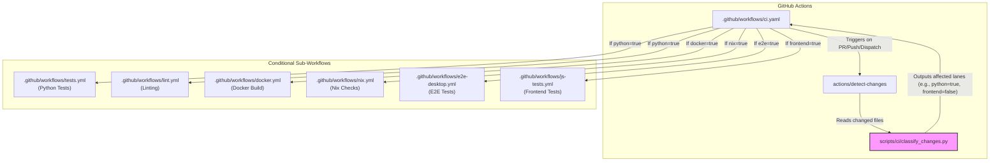
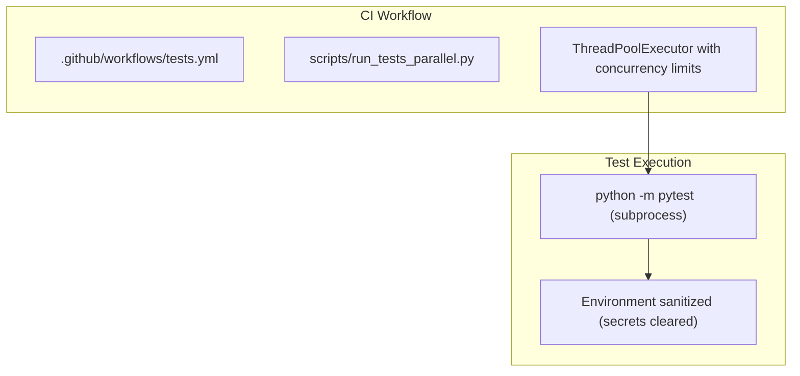
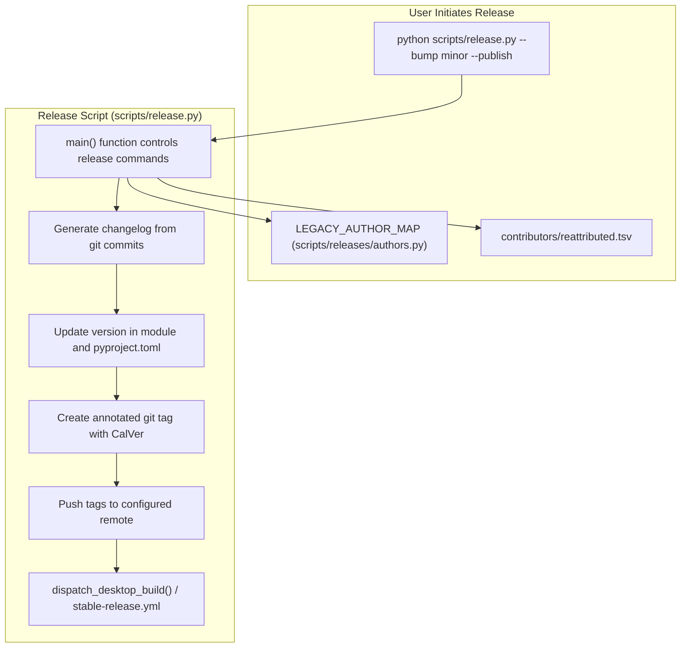

<!-- source: DeepWiki mcp.deepwiki.com · repo nousresearch/hermes-agent · page 14.2 CI/CD and Release Management · fetched 2026-10-27 -->

# CI/CD and Release Management

<details>
<summary>Relevant source files</summary>

The following files were used as context for generating this wiki page:

- [.coderabbit.yaml](.coderabbit.yaml)
- [.github/actions/check-clean-worktree/action.yml](.github/actions/check-clean-worktree/action.yml)
- [.github/actions/detect-changes/action.yml](.github/actions/detect-changes/action.yml)
- [.github/actions/get-app-token/action.yml](.github/actions/get-app-token/action.yml)
- [.github/actions/nix-setup/action.yml](.github/actions/nix-setup/action.yml)
- [.github/workflows/ci-review-comment.yml](.github/workflows/ci-review-comment.yml)
- [.github/workflows/ci.yaml](.github/workflows/ci.yaml)
- [.github/workflows/contributor-check.yml](.github/workflows/contributor-check.yml)
- [.github/workflows/deploy-site.yml](.github/workflows/deploy-site.yml)
- [.github/workflows/desktop-bundled-release.yml](.github/workflows/desktop-bundled-release.yml)
- [.github/workflows/docker-lint.yml](.github/workflows/docker-lint.yml)
- [.github/workflows/docker.yml](.github/workflows/docker.yml)
- [.github/workflows/docs-site-checks.yml](.github/workflows/docs-site-checks.yml)
- [.github/workflows/e2e-desktop.yml](.github/workflows/e2e-desktop.yml)
- [.github/workflows/history-check.yml](.github/workflows/history-check.yml)
- [.github/workflows/js-autofix.yml](.github/workflows/js-autofix.yml)
- [.github/workflows/js-tests.yml](.github/workflows/js-tests.yml)
- [.github/workflows/label-rerun.yml](.github/workflows/label-rerun.yml)
- [.github/workflows/lint.yml](.github/workflows/lint.yml)
- [.github/workflows/live-providers.yml](.github/workflows/live-providers.yml)
- [.github/workflows/lockfile-diff.yml](.github/workflows/lockfile-diff.yml)
- [.github/workflows/nix.yml](.github/workflows/nix.yml)
- [.github/workflows/osv-scanner.yml](.github/workflows/osv-scanner.yml)
- [.github/workflows/skills-index-freshness.yml](.github/workflows/skills-index-freshness.yml)
- [.github/workflows/skills-index.yml](.github/workflows/skills-index.yml)
- [.github/workflows/stable-release.yml](.github/workflows/stable-release.yml)
- [.github/workflows/supply-chain-audit.yml](.github/workflows/supply-chain-audit.yml)
- [.github/workflows/tests-os.yml](.github/workflows/tests-os.yml)
- [.github/workflows/tests.yml](.github/workflows/tests.yml)
- [.github/workflows/uv-lockfile-check.yml](.github/workflows/uv-lockfile-check.yml)
- [.github/workflows/windows-install-update-e2e.yml](.github/workflows/windows-install-update-e2e.yml)
- [apps/desktop/e2e/visual-snapshot.ts](apps/desktop/e2e/visual-snapshot.ts)
- [contributors/reattributed.tsv](contributors/reattributed.tsv)
- [evals/update_obligation_identity.py](evals/update_obligation_identity.py)
- [hermes_cli/_old_updater.py](hermes_cli/_old_updater.py)
- [hermes_cli/_update_takeover.py](hermes_cli/_update_takeover.py)
- [hermes_cli/uninstall.py](hermes_cli/uninstall.py)
- [hermes_cli/update_abort_recovery.py](hermes_cli/update_abort_recovery.py)
- [hermes_cli/update_cmd_config.py](hermes_cli/update_cmd_config.py)
- [hermes_cli/update_cmd_fleet.py](hermes_cli/update_cmd_fleet.py)
- [hermes_cli/update_cmd_fleet_gatewayless.py](hermes_cli/update_cmd_fleet_gatewayless.py)
- [hermes_cli/update_completion.py](hermes_cli/update_completion.py)
- [hermes_cli/update_finish.py](hermes_cli/update_finish.py)
- [hermes_cli/update_handoff.py](hermes_cli/update_handoff.py)
- [hermes_cli/update_inventory.py](hermes_cli/update_inventory.py)
- [hermes_cli/update_receipt.py](hermes_cli/update_receipt.py)
- [hermes_cli/update_restart_recovery.py](hermes_cli/update_restart_recovery.py)
- [hermes_cli/update_serve_obligations.py](hermes_cli/update_serve_obligations.py)
- [scripts/bundles/release_artifacts.py](scripts/bundles/release_artifacts.py)
- [scripts/ci/assemble_review_comment.py](scripts/ci/assemble_review_comment.py)
- [scripts/ci/check_catalog_cors.py](scripts/ci/check_catalog_cors.py)
- [scripts/ci/classify_changes.py](scripts/ci/classify_changes.py)
- [scripts/ci/live_comment.py](scripts/ci/live_comment.py)
- [scripts/ci/timings_report.py](scripts/ci/timings_report.py)
- [scripts/release.py](scripts/release.py)
- [scripts/releases/channel_releases.py](scripts/releases/channel_releases.py)
- [scripts/releases/docker.py](scripts/releases/docker.py)
- [scripts/releases/entrypoint.py](scripts/releases/entrypoint.py)
- [scripts/releases/lanes.py](scripts/releases/lanes.py)
- [scripts/releases/sequencer.py](scripts/releases/sequencer.py)
- [scripts/releases/stable.py](scripts/releases/stable.py)
- [scripts/render-builds-table.py](scripts/render-builds-table.py)
- [tests/ci/test_assemble_review_comment.py](tests/ci/test_assemble_review_comment.py)
- [tests/ci/test_check_catalog_cors.py](tests/ci/test_check_catalog_cors.py)
- [tests/ci/test_classify_changes.py](tests/ci/test_classify_changes.py)
- [tests/ci/test_clean_worktree_check.py](tests/ci/test_clean_worktree_check.py)
- [tests/ci/test_desktop_release_tag_admission.py](tests/ci/test_desktop_release_tag_admission.py)
- [tests/ci/test_live_comment.py](tests/ci/test_live_comment.py)
- [tests/ci/test_stable_release_graph.py](tests/ci/test_stable_release_graph.py)
- [tests/ci/test_timings_report.py](tests/ci/test_timings_report.py)
- [tests/ci/test_update_ci_routing.py](tests/ci/test_update_ci_routing.py)
- [tests/ci/test_update_transitive_routing.py](tests/ci/test_update_transitive_routing.py)
- [tests/ci/workflow_steps.py](tests/ci/workflow_steps.py)
- [tests/hermes_cli/test_fleet_matrix_down_state.py](tests/hermes_cli/test_fleet_matrix_down_state.py)
- [tests/hermes_cli/test_manual_serve_deferral.py](tests/hermes_cli/test_manual_serve_deferral.py)
- [tests/hermes_cli/test_old_updater_additional_shims.py](tests/hermes_cli/test_old_updater_additional_shims.py)
- [tests/hermes_cli/test_old_updater_main_shims.py](tests/hermes_cli/test_old_updater_main_shims.py)
- [tests/hermes_cli/test_old_updater_shims.py](tests/hermes_cli/test_old_updater_shims.py)
- [tests/hermes_cli/test_old_updater_takeover.py](tests/hermes_cli/test_old_updater_takeover.py)
- [tests/hermes_cli/test_pending_supervisor_recovery.py](tests/hermes_cli/test_pending_supervisor_recovery.py)
- [tests/hermes_cli/test_restart_plan_reconciliation.py](tests/hermes_cli/test_restart_plan_reconciliation.py)
- [tests/hermes_cli/test_serve_runtime_inventory.py](tests/hermes_cli/test_serve_runtime_inventory.py)
- [tests/hermes_cli/test_update_completion_process.py](tests/hermes_cli/test_update_completion_process.py)
- [tests/hermes_cli/test_update_config_migration_on_current.py](tests/hermes_cli/test_update_config_migration_on_current.py)
- [tests/hermes_cli/test_update_finish.py](tests/hermes_cli/test_update_finish.py)
- [tests/hermes_cli/test_update_fleet_restart_pending.py](tests/hermes_cli/test_update_fleet_restart_pending.py)
- [tests/hermes_cli/test_update_fleet_restart_timeout.py](tests/hermes_cli/test_update_fleet_restart_timeout.py)
- [tests/hermes_cli/test_update_fleet_snapshot_settle.py](tests/hermes_cli/test_update_fleet_snapshot_settle.py)
- [tests/hermes_cli/test_update_inventory.py](tests/hermes_cli/test_update_inventory.py)
- [tests/hermes_cli/test_update_no_gateway_restart.py](tests/hermes_cli/test_update_no_gateway_restart.py)
- [tests/hermes_cli/test_update_obligation_identity.py](tests/hermes_cli/test_update_obligation_identity.py)
- [tests/hermes_cli/test_update_post_commit_followups.py](tests/hermes_cli/test_update_post_commit_followups.py)
- [tests/hermes_cli/test_update_post_commit_safety.py](tests/hermes_cli/test_update_post_commit_safety.py)
- [tests/hermes_cli/test_update_receipt.py](tests/hermes_cli/test_update_receipt.py)
- [tests/hermes_cli/test_update_receipt_durability.py](tests/hermes_cli/test_update_receipt_durability.py)
- [tests/hermes_cli/test_update_restart_recovery.py](tests/hermes_cli/test_update_restart_recovery.py)
- [tests/hermes_cli/test_update_scoped_reconciliation.py](tests/hermes_cli/test_update_scoped_reconciliation.py)
- [tests/hermes_cli/test_update_serve_generation_recovery.py](tests/hermes_cli/test_update_serve_generation_recovery.py)
- [tests/scripts/test_release_artifacts.py](tests/scripts/test_release_artifacts.py)
- [tests/scripts/test_release_channels.py](tests/scripts/test_release_channels.py)
- [tests/scripts/test_release_docker_cli.py](tests/scripts/test_release_docker_cli.py)
- [tests/scripts/test_release_entrypoint.py](tests/scripts/test_release_entrypoint.py)
- [tests/scripts/test_release_lanes.py](tests/scripts/test_release_lanes.py)
- [tests/scripts/test_release_sequencer.py](tests/scripts/test_release_sequencer.py)
- [tests/scripts/test_render_builds_publication.py](tests/scripts/test_render_builds_publication.py)
- [tests/scripts/test_stable_admission.py](tests/scripts/test_stable_admission.py)
- [tests/scripts/test_stable_release.py](tests/scripts/test_stable_release.py)
- [tests/tools/test_lazy_deps_runtime.py](tests/tools/test_lazy_deps_runtime.py)
- [tests/website/test_fetch_plugin_stars.py](tests/website/test_fetch_plugin_stars.py)
- [website/docs/developer-guide/stable-releases.md](website/docs/developer-guide/stable-releases.md)
- [website/scripts/fetch-plugin-stars.py](website/scripts/fetch-plugin-stars.py)
- [website/scripts/prebuild.mjs](website/scripts/prebuild.mjs)

</details>


This page documents the infrastructure supporting the Hermes Agent software lifecycle, detailing the GitHub Actions CI/CD workflows, the Calendar Versioning (CalVer) release script, update fleet rollout mechanisms, contributor audit, lazy dependency management, Nix packaging, and the security advisory system.

---

## Overview of CI/CD Workflows

The Hermes Agent project employs **GitHub Actions** as its continuous integration and delivery backbone. The workflows are structured to optimize build time and avoid unnecessary job runs by dynamically detecting changed code areas within a commit or pull request.

### Dynamic Workflow Triggering with `classify_changes.py`

The `scripts/ci/classify_changes.py` script is central to optimizing CI runs. It analyzes changed files in a pull request or commit and determines which CI "lanes" (e.g., `python`, `frontend`, `docker`, `nix`, `e2e`) are affected. This allows the main CI orchestrator (`.github/workflows/ci.yaml`) to conditionally call sub-workflows, running only the necessary jobs.

For example, a change to only documentation files (`website/docs/`) might only trigger the `site` lane, skipping Python tests, Docker builds, and E2E tests. Conversely, a change to core Python code (`python_prod`) would trigger Python tests, linting, and potentially other related lanes.

The script operates on a "fail open, never closed" principle: it may run a lane unnecessarily but must never skip one that a change could break. For pushes to `main` or release runs, all lanes are forced on to ensure comprehensive validation.


Sources: `scripts/ci/classify_changes.py:1-78()`, `.github/workflows/ci.yaml:1-147()`

### Supply Chain and Reproducibility Controls

Key security and reproducibility controls implemented in the CI/CD process include:

- **Exact Dependency Pinning:** The `pyproject.toml` specifies dependencies with exact version pins (e.g., `openai==2.24.0`) avoiding any version ranges or approximate matches. This ensures that dependency updates cannot be automatically pulled in, reducing the risk of supply chain attack vectors [pyproject.toml:19-40]().

- **Restricted Python Versions:** The project targets Python >=3.11 and <3.15, primarily due to limitations or compatibility constraints of Rust-backed dependencies such as `pydantic-core` which require compiled wheels [pyproject.toml:8-15]().

- **Lockfile Management with `uv.lock`:** Hermes uses `uv.lock` for reproducible installs, locking all transitive dependencies exactly and including overrides for certain problematic dependencies. This guarantees that identical dependency trees are installed for every environment, avoiding unexpected drift [uv.lock:1-120]().

- **Nix Packaging:** Nix expressions in `nix/lib.nix` isolate rebuild scopes by language domain (Python or frontend), so only relevant parts are rebuilt on code changes. This avoids unnecessary environment rebuilds triggered by unrelated code edits, improving CI performance and consistency [nix/lib.nix:8-11]().

---

## Testing Infrastructure and Parallel Test Execution

Hermes orchestrates its test runs to maximize isolation and minimize state leakage by spawning each test file as a separate pytest subprocess. This per-file parallelization effectively isolates long-running or flaky tests and balances load across workers.



- The `scripts/run_tests_parallel.py` enumerates all test files under `tests/` (excluding known slow or external integration directories), launching each file isolated in its own pytest subprocess. Semaphore-based concurrency bounds resource usage [scripts/run_tests_parallel.py:1-147]().

- Environment variable cleaning is performed by a fixture in `tests/conftest.py` that clears environment keys matching secret suffixes (`_API_KEY`, `_TOKEN`, etc.) on test startup to prevent inadvertent calls to real services during test runs [tests/conftest.py:5-15,70-143]().

Sources: `.github/workflows/tests.yml()`, `scripts/run_tests_parallel.py:1-147()`, `tests/conftest.py:5-15,70-143()`

---

## Supply Chain Security and Auditing Mechanisms

Hermes includes rigorous static and dynamic supply chain security checks integrated into CI to detect suspicious code patterns or dependency alterations:

| Check Type                     | Description                                                | Workflow Location                                   |
|-------------------------------|------------------------------------------------------------|----------------------------------------------------|
| Scanning for `.pth` Files      | Detect unauthorized `.pth` files executed on Python start  | `.github/workflows/supply-chain-audit.yml:87-101()`  |
| Base64 + `exec` / `eval`       | Searches for base64-encoded dynamic execution patterns     | `.github/workflows/supply-chain-audit.yml:103-115()` |
| Encoded Subprocess Calls       | Detects obfuscated subprocess invocations (base64/chr)    | `.github/workflows/supply-chain-audit.yml:117-129()` |
| Exact Dependency Pins          | Validates all pins in `pyproject.toml`                     | `pyproject.toml:19-39()`                              |
| Security Diagnostic Checks     | Runs `hermes doctor` checks including advisories and MCP state | `hermes_cli/doctor.py:100-140()`                   |

Detection of suspicious issues blocks merges until a trusted maintainer reviews and approves the changes, signaled by appropriate `ci-reviewed` labels.

Sources: `.github/workflows/supply-chain-audit.yml:72-142()`, `pyproject.toml:19-39()`, `hermes_cli/doctor.py:100-140()`

---

## CalVer Release Management with `scripts/release.py`

Hermes Agent uses a **Calendar Versioning (CalVer)** scheme embedding a YYYY.MM.DD style version plus optional semantic suffixes. The version string is exposed in `hermes_cli/__init__.py` and pinned in `pyproject.toml` [hermes_cli/__init__.py:6-7](), [pyproject.toml:5]().

The release lifecycle is automated by the `scripts/release.py` Python script, which:

- Updates version strings in key files.
- Generates changelogs from git commit history with conventional commit parsing.
- Applies git annotated tags with CalVer style tags.
- Attributes contributions via a legacy map and email parsing of contributors with override support.
- Pushes tags and optionally triggers downstream GitHub workflows for Docker and PyPI publishing.



### Notable Features

- **Contributor Attribution:** The `scripts/release.py` script uses `scripts.releases.authors.resolve_author()` to attribute commits. This function likely consults a mapping of original SHAs to corrected author information, such as the `contributors/reattributed.tsv` file, which lists commits originally authored by an agent identity that were later reattributed to a human contributor [scripts/release.py:29](), [contributors/reattributed.tsv:1-7]().

- **Date Override:** Supports a `--date` option allowing backdated or specifically timed releases [scripts/release.py:19-20]().

- **Support for First Release:** The `--first-release` flag initializes versioning for initial project bootstrapping [scripts/release.py:17]().

- **GitHub Workflow Dispatch:** After tagging, the `dispatch_desktop_build` function in `scripts/release.py` dispatches workflows differently for stable and canary releases, ensuring container and package builds are triggered appropriately. It targets `desktop-bundled-release.yml` for canary builds and `stable-release.yml` for stable releases [scripts/release.py:68-104]().

Sources: `scripts/release.py:1-180()`, `hermes_cli/__init__.py:6-7()`, `pyproject.toml:5()`, `scripts/release.py:29()`, `contributors/reattributed.tsv:1-7()`, `scripts/release.py:17-20()`, `scripts/release.py:68-104()`

---

## Summary of GitHub Actions Workflows

| Workflow                 | Purpose                                                      | File Location                           |
|--------------------------|--------------------------------------------------------------|----------------------------------------|
| **CI**                   | Orchestrates other workflows based on changed files          | `.github/workflows/ci.yaml`              |
| **Tests**                | Run hermetic tests in parallel subprocesses                  | `.github/workflows/tests.yml`           |
| **Lint**                 | Ruff linter and static type checks (via `ty`)                | `.github/workflows/lint.yml`             |
| **Supply Chain Audit**   | Detect suspicious packages, encoded exec patterns            | `.github/workflows/supply-chain-audit.yml`|
| **Docker Build**         | Build, test, and publish Docker images                        | `.github/workflows/docker.yml`           |
| **Deploy Site**          | Build and deploy documentation and skill catalog             | `.github/workflows/deploy-site.yml`      |
| **Desktop Bundled Release** | Builds the bundled desktop installer for each OS/arch      | `.github/workflows/desktop-bundled-release.yml` |
| **Stable Release**       | Manages the stable release process, including feed promotion | `.github/workflows/stable-release.yml`   |
| **OSV Scanner**          | Scan dependencies for known vulnerabilities                   | `.github/workflows/osv-scanner.yml`      |
| **Skills Index**         | Build and publish skills catalog artifact                     | `.github/workflows/skills-index.yml`     |
| **UV Lockfile Check**    | Validate `uv.lock` consistency                                | `.github/workflows/uv-lockfile-check.yml`|
| **Contributor Check**    | Audit contributor identity and attribution mapping            | `.github/workflows/contributor-check.yml`|
| **JS Tests**             | Run JavaScript/TypeScript tests                              | `.github/workflows/js-tests.yml`         |
| **Nix**                  | Run Nix flake checks                                         | `.github/workflows/nix.yml`              |

All workflows support `workflow_call` triggers with input parameters, concurrency cancellation configurations, and cache-aware steps to optimize resource usage across CI runs.

Sources: `.github/workflows/ci.yaml()`, `.github/workflows/tests.yml()`, `.github/workflows/lint.yml()`, `.github/workflows/supply-chain-audit.yml()`, `.github/workflows/docker.yml()`, `.github/workflows/deploy-site.yml()`, `.github/workflows/desktop-bundled-release.yml()`, `.github/workflows/stable-release.yml()`, `.github/workflows/osv-scanner.yml()`, `.github/workflows/skills-index.yml()`, `.github/workflows/uv-lockfile-check.yml()`, `.github/workflows/contributor-check.yml()`, `.github/workflows/js-tests.yml()`, `.github/workflows/nix.yml()`

---

## Update Fleet Rollout and Restart Markers

During the `hermes update` command, the Hermes Agent orchestrates a controlled gateway fleet restart phase to apply updates cleanly to running processes. This is coordinated with a restart obligation marker signaling the need for restart after code advances.

```mermaid
graph TD
    Start["`hermes update` completes git pull"]
    MarkRestartObligation["_write_fleet_restart_pending_marker()"]
    RestartGateways["_restart_gateways() (systemd, launchd, s6, etc.)"]
    PollReady["_poll_gateways_for_ready() (bounded timeout)"]
    SuccessClearMarker["_clear_fleet_restart_pending_marker() on success"]
    FailureRetainMarker["Retain marker if restart incomplete or fails"]

    Start --> MarkRestartObligation
    MarkRestartObligation --> RestartGateways
    RestartGateways --> PollReady
    PollReady -->|Success| SuccessClearMarker
    PollReady -->|Failure| FailureRetainMarker
```

- The `_write_fleet_restart_pending_marker` function in `hermes_cli/update_cmd_fleet.py` arms a host-scoped obligation to restart the fleet after a `git pull` advances HEAD. This marker is a file (e.g., `.fleet-restart-pending`) under the Hermes home directory [hermes_cli/update_cmd_fleet.py:64-82]().
- The `_fleet_restart_obligation_armed` function checks for the presence of this marker or a host-level obligation to determine if a restart is pending [hermes_cli/update_cmd_fleet.py:102-109]().
- Hermes supports restart under various supervisors (`systemd`, `launchd`, `s6`), polling with a bounded timeout (~120s) to verify gateways reach a ready state post-restart [hermes_cli/update_cmd_fleet.py:31-57]().
- If the restart is incomplete or the system is interrupted, the obligation marker remains. This forces a restart on the next update or system start, preventing stale code from running indefinitely. The `_clear_fleet_restart_pending_marker` function discharges this obligation [hermes_cli/update_cmd_fleet.py:94-99]().

Sources: `hermes_cli/update_cmd_fleet.py:27-79()`, `hermes_cli/update_cmd_fleet.py:64-82()`, `hermes_cli/update_cmd_fleet.py:102-109()`, `hermes_cli/update_cmd_fleet.py:31-57()`, `hermes_cli/update_cmd_fleet.py:94-99()`

---

## Lazy Dependency Management

Hermes implements a controlled lazy dependency installation system for optional feature or provider modules, preserving minimal install size and dependency surface by installing extra dependencies only on demand.

- The `tools/lazy_deps.py` defines the immutable dictionary `LAZY_DEPS`, mapping feature keys like `"provider.anthropic"` or `"tts.mistral"` to exact pip requirement strings with rigid version pins [tools/lazy_deps.py:1-26]().

- Lazy dependencies are installed either into the active Python virtual environment or an isolated "durable" target folder appended to `sys.path`. This ensures the core runtime remains stable while extra modules can be installed asynchronously.

- Installation failures are reported verbatim with pip errors; Hermes does not retry or attempt silent fallback, encouraging maintainers to keep these lazy pins accurate and well-tested.

- Lazy dependency pins are tested for compatibility in both Python and JavaScript CI jobs to minimize supply chain risks [tests/test_project_metadata.py:105-153]().

Sources: `tools/lazy_deps.py:1-27()`, `tests/test_project_metadata.py:105-153()`

---

## Nix Packaging

The Hermes Agent provides Nix flake support, allowing for reproducible builds and environments. The `nix/` directory contains the Nix expressions that define how Hermes Agent and its dependencies are built and packaged.

- **`flake.nix` and `flake.lock`**: These files define the Nix flake, specifying inputs (other flakes, Git repositories) and outputs (packages, development environments). `flake.lock` ensures reproducible builds by pinning all inputs to specific versions.
- **`nix/lib.nix`**: This file contains helper functions and definitions used across the Nix flake, such as isolating rebuild scopes by language domain (Python or frontend) to optimize build times.
- **`nix/hermes-agent.nix`**: Defines the Hermes Agent package itself, including its dependencies, build steps, and installation paths.

Nix packaging ensures that the Hermes Agent can be deployed consistently across different systems, leveraging Nix's strong guarantees for reproducibility and isolation.

Sources: `nix/lib.nix:8-11()`, `scripts/ci/classify_changes.py:18-19()`

---

## Security Advisory System and Diagnostics

The `hermes doctor` diagnostic utility includes security advisory inspections and environment health checks that integrate into CI guardrails and daily monitoring:

- Checks include SSL validity, configuration hygiene, MCP system diagnostics, and advisories on insecure or outdated components [hermes_cli/doctor.py:100-140]().

- These diagnostics generate overridable advisories that can block merges or alert operators to remediate.

- Hermes CLI enforces UTF-8 encoding on stdout and stderr early in `hermes_cli/__init__.py` to prevent UnicodeEncodeErrors interfering with diagnostics and log integrity in CI and production runtime [hermes_cli/__init__.py:10-45]().

Sources: `hermes_cli/doctor.py:100-140()`, `hermes_cli/__init__.py:10-45()`

---

## Summary Diagram: Major Components in CI/CD and Release Management

```mermaid
graph TD
    subgraph "GitHub Actions Workflows"
        CI[".github/workflows/ci.yaml\n(Orchestrator)"]
        Tests[".github/workflows/tests.yml\n(Parallel Test Runner)"]
        Lint[".github/workflows/lint.yml\n(Ruff + ty)"]
        Audit[".github/workflows/supply-chain-audit.yml\n(Supply chain scan)"]
        DesktopRelease[".github/workflows/desktop-bundled-release.yml\n(Desktop Installer)"]
        StableRelease[".github/workflows/stable-release.yml\n(Stable Release)"]
        Docker[".github/workflows/docker.yml\n(Container build/publish)"]
        Nix[".github/workflows/nix.yml\n(Nix Checks)"]
    end

    subgraph "Release Management"
        ReleaseScript["scripts/release.py\n(CalVer Release Script)"]
        LegacyMap["LEGACY_AUTHOR_MAP (scripts/releases/authors.py)"]
        Emails["contributors/reattributed.tsv"]
        VersionFiles["hermes_cli/__init__.py + pyproject.toml"]
    end

    subgraph "Update Fleet Rollout"
        RestartMarker["_write_fleet_restart_pending_marker()\n(hermes_cli/update_cmd_fleet.py)"]
        Supervisor["Systemd/launchd/s6 Supervisors"]
    end

    subgraph "Lazy Dependency Management"
        LazyDeps["LAZY_DEPS dict\n(tools/lazy_deps.py)"]
        Pip["pip install in active venv/durable-target"]
    end

    subgraph "Diagnostics System"
        UTF8Enforce["UTF-8 Streams\n(hermes_cli/__init__.py)"]
        DoctorChecks["hermes doctor DOCTOR_CHECKS\n(hermes_cli/doctor.py)"]
    end

    CI -- "Triggers" --> Tests
    CI -- "Triggers" --> Lint
    CI -- "Triggers" --> Audit
    CI -- "Triggers" --> Docker
    CI -- "Triggers" --> Nix

    ReleaseScript --> LegacyMap
    ReleaseScript --> Emails
    ReleaseScript --> VersionFiles
    ReleaseScript -- "Dispatches" --> DesktopRelease
    ReleaseScript -- "Dispatches" --> StableRelease

    RestartMarker --> Supervisor
    LazyDeps --> Pip
    DoctorChecks --> UTF8Enforce
    Tests --> DoctorChecks
    Audit --> DoctorChecks
```



---

### Sources

- `scripts/release.py:1-180()`
- `hermes_cli/__init__.py:6-45()`
- `pyproject.toml:5-40()`
- `uv.lock:1-120()`
- `.github/workflows/tests.yml()`
- `scripts/run_tests_parallel.py:1-147()`
- `tests/conftest.py:5-15, 70-143()`
- `.github/workflows/supply-chain-audit.yml:72-142()`
- `hermes_cli/doctor.py:100-140()`
- `hermes_cli/update_cmd_fleet.py:1-79()`
- `tools/lazy_deps.py:1-27()`
- `tests/test_project_metadata.py:105-153()`
- `scripts/ci/classify_changes.py:1-78()`
- `.github/workflows/ci.yaml:1-147()`
- `contributors/reattributed.tsv:1-7()`
- `.github/workflows/desktop-bundled-release.yml()`
- `.github/workflows/stable-release.yml()`
- `.github/workflows/docker.yml()`
- `.github/workflows/nix.yml()`
- `.github/workflows/js-tests.yml()`

---

